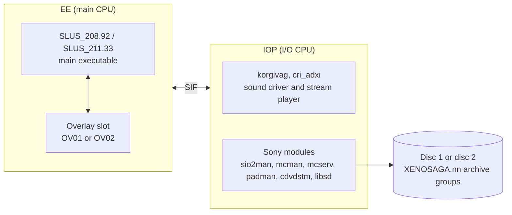
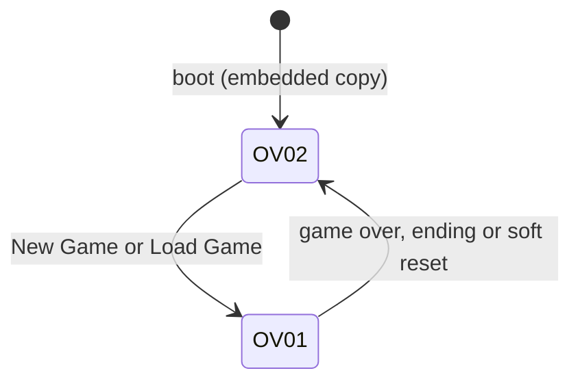
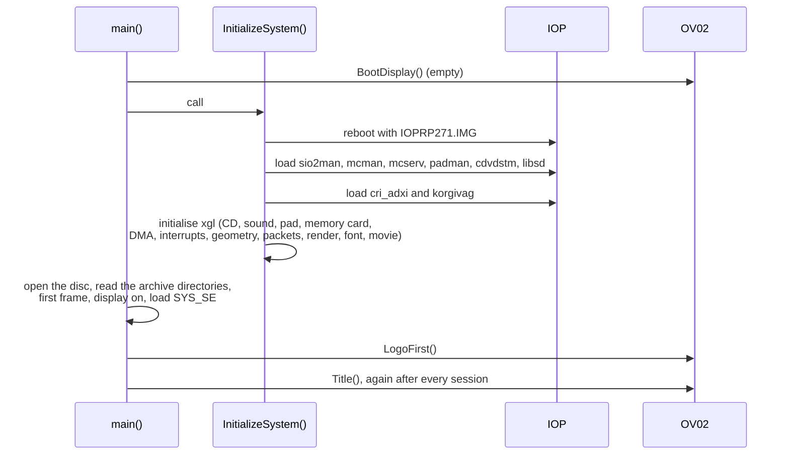
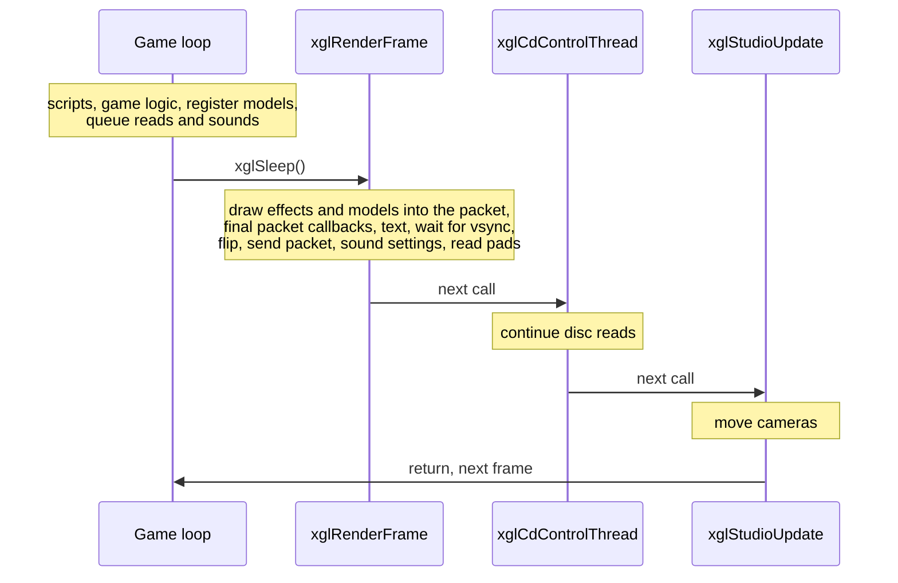
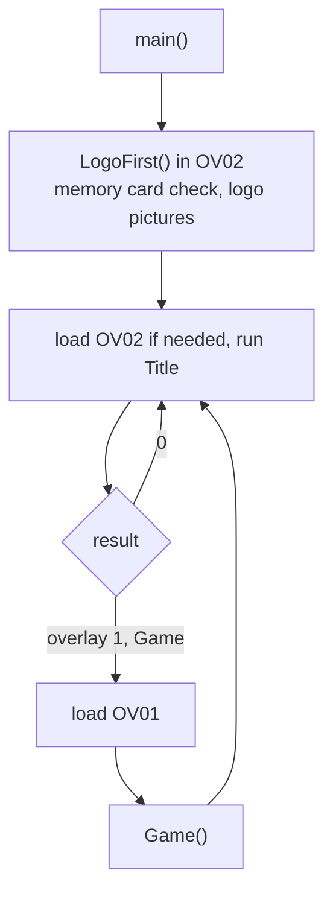
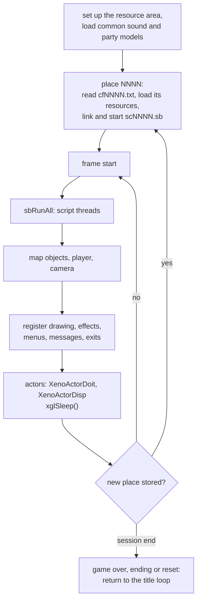
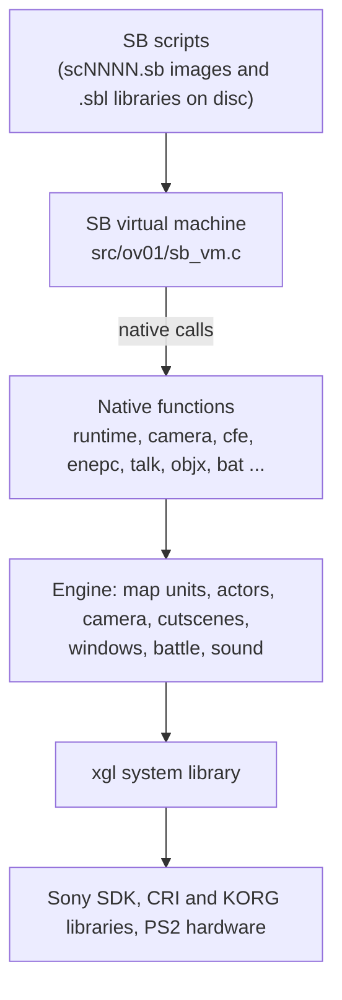
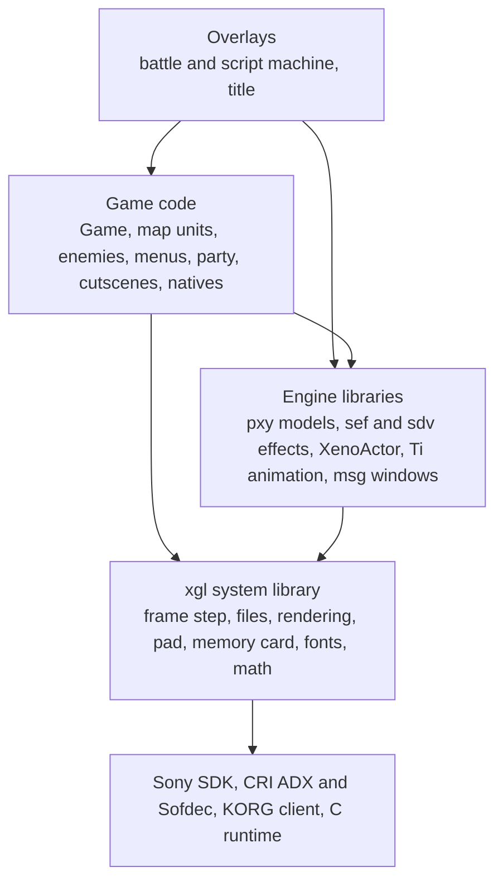

# Xenosaga Episode II — Game Architecture

*Xenosaga Episode II: Jenseits von Gut und Böse* is a role-playing game by
Monolith Soft, published by Namco for the PlayStation 2 (Japan 2004, North
America 2005). It shipped on two DVDs. This source tree rebuilds the North
American release, `SLUS-20892`.

This page gives the overall structure of the game. The pages linked below go
deeper into each part.

## Contents

This page covers the programs on the two discs, the overlays, memory,
start-up, the frame, the play session, the menus and side quests, the scripts
and the layers of the code. The other pages are grouped by area. The
[glossary](glossary.md) lists every term used across the pages, with a link
to the place where it is explained.

**Architecture**

| Page | Topics |
| --- | --- |
| [Memory management](architecture/memory.md) | The EE memory map, the work area and `WorkEnd`, the resource area and its block table, the heaps and pools, packet buffers, the scratchpad, IOP and GS memory |
| [Files and resources](architecture/files-and-resources.md) | The two discs and their archive groups, from a path to bytes in memory, the request queue, packed ARX files, streams, the resource block system, scene resources, file types |
| [Save data](architecture/save-data.md) | The save image and its blocks, new games and the bonus for Episode I saves, the memory card library, the save and load screen, thumbnails, the JPEG codec |
| [Runtime libraries](architecture/runtime-libraries.md) | The Sony SDK, the CRI ADX and Sofdec middleware, the KORG sound client and the C runtime linked into the executable, the IOP modules |
| [Rendering pipeline](architecture/rendering.md) | Video memory, packets, the VIF1/VU1/GIF path, the final packet callbacks, textures, 2D drawing, the order of drawing in a frame |
| [From Episode I to Episode II](architecture/from-episode-i.md) | What the code of the two games shares, what evolved from the same engine and what was replaced |
| [Audio](architecture/audio.md) | Sound banks and sound memory, sequenced music, voices and sound effects, footsteps, ADX streams, volume, battle and movie sound, the IOP modules behind them |

**Scripting**

| Page | Topics |
| --- | --- |
| [The SB virtual machine](scripting/sb-vm.md) | Script images and libraries, linking, script threads, the stack, the 46 opcodes, waiting, messages |
| [Native functions](scripting/natives.md) | The 268 native table entries, grouped by owner, how natives are registered and how they read arguments |
| [Events and places](scripting/events.md) | Place numbers, scene resource scripts and their commands, event slots and locators, talks, flags, message text, place changes, the disc change |
| [Cutscenes](scripting/cutscenes.md) | The `cfe` cutscene player: key tracks, actors, cameras, lights, monitors, sound and messages, plus movies and captions |

**Engine libraries**

| Page | Topics |
| --- | --- |
| [xgl, the system library](libraries/xgl.md) | The frame step, files, DMA and packets, rendering, cameras, studios, lights, controllers, memory cards, fonts, movies, timers |
| [Math helpers](libraries/math.md) | Vectors, matrices, the three VU0 current matrices, quaternions, curves, random numbers, geometry tests |
| [pxy, the model library](libraries/pxy.md) | Model data, the next-model block and model packets, draw passes, lights, shadows, reflection, the effect drawing back end, the VU1 microcode |
| [sef, the visual effect system](libraries/sef.md) | Effect keys and files, effect records, lines and particles, tracks, emission, lights of effects, the draw passes |
| [sdv, the effect sequence driver](libraries/sdv.md) | The timelines of an effect record: effect objects, shadows, wind, camera, specials and alters, plus the built-in particle emitters |
| [Screen effects](libraries/screen-effects.md) | The `gifState` modes, the battle transition, defocus layers, record banks and presets, fades, background layers |
| [Actors](libraries/actors.md) | The `XenoActor` pool, resources, the actor record, motion channels, update and draw, children and attachments, shadows |
| [Animation](libraries/animation.md) | Hierarchies, motion curves, the motion package, blending, aim control, hair and cloth dynamics, wind, water |
| [Fonts and text](libraries/fonts-and-text.md) | Character encoding, the font module, control codes and inline commands, font objects, the text layers of menus and battle |
| [User interface and windows](libraries/ui-windows.md) | Message windows and their slots, the dialogue window, script menus, the sell window, the item notice, number entry, the countdown panel |

**Game systems**

| Page | Topics |
| --- | --- |
| [Boot and title screen](game/title-and-boot.md) | `main()`, the device checks, the logo pictures, the title screen, new game and load, synopsis, disc change, intermission, game over |
| [The field game](game/field.md) | The play session `Game()`, `gameWork`, the frame loop, the player, battles started from the field, place changes, the field camera, pause |
| [Maps and units](game/map-and-units.md) | Map loading, the collision mesh, map units, doors, breakable objects, treasure boxes, ladders, elevators, save points |
| [Field enemies](game/field-enemies.md) | Enemy and NPC records, the enemy states, sight and hearing, routes, starting a battle |
| [Main menu](game/main-menu.md) | Opening the menu, scenes and pages, lists and cursors, using items and ethers, models in the menu, the battle result screen |
| [Party and growth](game/party-and-growth.md) | The party and the reserve, E.S. pilots, character parameters, levels, skills, items, awards after battle |
| [G.S. Campaign and side quests](game/gs-campaign.md) | The G.S. Campaign screens, citizens, segment addresses and decoders, the debt and the sell window |
| [Battle system](game/battle.md) | How a battle starts and ends, turn order, commands, hit and damage, zones and Break, Stock, Boost, status effects, targets, enemy thinking |
| [The battle engine](game/battle-engine.md) | The OV01 objects, slots and tasks, unit objects and their commands, battle loading and memory, the HUD panels, graphics helpers |
| [Battle effects](game/battle-effects.md) | The `MSe` and `MEf` effect objects, the effect families, the hit signal, screen fills and flashes |
| [Debug tools and test programs](game/debug-tools.md) | Developer test programs, debug menus and drawers, and what remains of them in the release |

**File formats**

| Page | Topics |
| --- | --- |
| [Models and textures](formats/models-and-textures.md) | PXY models, TXY texture sets, XTX textures |
| [Skeletons and motion](formats/skeletons-and-motion.md) | XHR hierarchies, XAP motion packs, the face motion pack, cutscene device files |
| [Maps and field data](formats/maps-and-field-data.md) | The map directory, the `.id` collision and layout data, EPF files, treasure, breakable object, spline and enemy tables |
| [Effect data](formats/effects.md) | The `.esd` effect files and the `.esp` effect packs |
| [Sound files](formats/sound.md) | VSF and PRJ sound banks, MIDI sequences, ADX streams |
| [Movies, images and icons](formats/movies-images-and-icons.md) | Sofdec movies, IPU movies, captions, JPEG pictures, title data, memory card icons |
| [Scripts and archives](formats/scripts-and-archives.md) | The `XENOSAGA.nn` archive groups, ARX packing, SB script images and SBL libraries, scene resource scripts |
| [Text and fonts](formats/text-and-fonts.md) | Font files and glyph sheets, character encoding, control codes found in the game text, tagged text files |
| [Game data tables](formats/game-tables.md) | `batdat.us`, battle think scripts, menu tables, quest and citizen tables |

## 1. Programs on the discs

The game is split into three programs. The main executable stays in memory
the whole time. Two overlays share one slot of memory and are swapped in when
needed. Sound and disc streaming are served by modules on the second
processor.

| File on disc | Source | Runs on | Contents |
| --- | --- | --- | --- |
| `SLUS_208.92` (disc 1), `SLUS_211.33` (disc 2) | `src/main/` | EE | Engine, field game, main menu, side quest screens, cutscene player, script natives of the field |
| `OV01.OVL` | `src/ov01/` | EE | Battle system and battle effects, the SB script virtual machine, the game data accessors |
| `OV02.OVL` | `src/ov02/` | EE | Boot checks, logo pictures, title screen, HDD install dialogs |
| `IOP/KORGIVAG.IRX`, `IOP/CRI_ADXI.IRX` | KORG, CRI | IOP | The sound driver for banks and sequences, and the ADX stream player |
| other files in `IOP/` | Sony | IOP | The IOP reboot image `IOPRP271.IMG` and Sony's serial, memory card, controller, disc streaming and sound modules |

The two executables are the same file under two names, and both overlays and
the `IOP` folder are identical on both discs. Only the story data differs.

The PlayStation 2 has two main processors:

- The **EE** (Emotion Engine) is the main MIPS CPU. All game code runs here. It
  has two vector units (VU0 and VU1) and sends graphics to the **GS** (Graphics
  Synthesizer).
- The **IOP** (I/O Processor) is a second, smaller MIPS CPU. It owns the disc
  drive, memory cards, controllers and the sound chip. The EE sends it requests
  through **SIF** remote calls.

The game data (models, maps, textures, sound, scripts, movies) is stored in
large archive files named `XENOSAGA.nn`. They form groups. Group 00
(`XENOSAGA.00` to `.02`) holds the data shared by the whole game and is the
same on both discs. Disc 1 adds the story group 10 (`XENOSAGA.10` to `.14`)
and disc 2 the story group 20 (`XENOSAGA.20` to `.24`), which hold the movies,
the cutscene motion and the voiced streams of each half of the story. The
file library (`xgl_cd`) finds a file by its path in the group directories.
The archives and the way each kind of data is loaded are described in
[architecture/files-and-resources.md](architecture/files-and-resources.md).

A large part of the executable is library code. Besides the Sony SDK and the
C runtime it links the CRI middleware (ADX audio streams and Sofdec movies,
which also carries every disc read of the game) and the EE client of the KORG
sound driver. These parts are described in
[architecture/runtime-libraries.md](architecture/runtime-libraries.md), and
the game's side of sound in [architecture/audio.md](architecture/audio.md).



## 2. Overlays

An overlay is a block of code and data loaded from disc on demand. Both
overlays are linked to run at the same address, `0x00A80000`, so only one of
them can be in memory at a time. `xglCdLoadOverlay(n)` in
`src/main/xgl_cd.c` clears the `0x80000` bytes of the slot and loads
`cdrom0:\OVnn.OVL;1` into it. It does nothing when overlay `n` is already
loaded.

The main executable also carries its own copy of OV02, which the console
loads together with it into the slot. The file library starts with overlay 2
marked as loaded, so the boot checks and the first title screen need no disc
read. Later visits to the title screen load `OV02.OVL` from the disc.

**OV01 is the resident overlay during play.** It holds the battle system, but
also two things the field needs on every frame: the SB script virtual machine
that runs the script of every place, and the accessors of the game data
tables that the menus read. So the whole play session runs with OV01 loaded,
and OV02 only returns when the session ends. Because loading an overlay
clears the slot, everything the virtual machine holds is lost at that moment,
and a new session starts its scripts from nothing.

| Overlay | Loaded by | Source |
| --- | --- | --- |
| OV02 | already in memory at boot (embedded copy), then `main()` every time the title screen runs again | `src/main/control_entry.c`, `src/main/xgl_cd.c` |
| OV01 | `main()`, from the overlay number in the title screen's result | `src/ov02/title.c`, `src/main/control_entry.c` |

Code in an overlay calls the main executable freely. The main executable
calls into OV02 only through `LogoFirst()` and `Title()`. Its calls into OV01
are many more, because the script machine and the data accessors live there.
OV01 is described in [game/battle.md](game/battle.md),
[game/battle-engine.md](game/battle-engine.md),
[game/battle-effects.md](game/battle-effects.md) and
[scripting/sb-vm.md](scripting/sb-vm.md), and OV02 in
[game/title-and-boot.md](game/title-and-boot.md). The diagram shows how the
overlay slot changes over time.



## 3. Memory map

The EE has 32 MiB of main memory. The lowest part belongs to the EE kernel.
The main executable is loaded at `0x00120000`, with its code first and then
its data. The overlay slot starts at `0x00A80000` and is followed by the work
area, which starts at `0x00B00000`. The two GPU packet buffers take the 4 MiB
from `0x00C00000` to `0x01000000`. The whole upper half of memory is the
resource area.

```
0x00000000 ┌───────────────────────────────┐
           │ EE kernel                     │
0x00120000 ├───────────────────────────────┤
           │ main executable code          │  libraries and game code
0x002B5D80 ├───────────────────────────────┤
           │ main executable data + BSS    │
0x009D5D70 ├───────────────────────────────┤
           │ (unused)                      │
0x00A80000 ├───────────────────────────────┤
           │ overlay slot (OV01 or OV02)   │  xglCdLoadOverlay
0x00B00000 ├───────────────────────────────┤
           │ work area (WorkEnd →)         │  archive directories, ADX buffers
0x00C00000 ├───────────────────────────────┤
           │ GPU packet buffer 0 (2 MiB)   │  xgl_packet.c
0x00E00000 ├───────────────────────────────┤
           │ GPU packet buffer 1 (2 MiB)   │
0x01000000 ├───────────────────────────────┤
           │ resource area (16 MiB)        │  models, maps, motion, effects,
           │                               │  the battle heap, picture buffers
0x02000000 └───────────────────────────────┘
```

The **work area** is managed with a simple bump pointer, `WorkEnd`. A loader
places its data at `WorkEnd` and moves the pointer past it. It holds the few
things that live for the whole run, such as the archive directories and the
work buffers of the ADX streams.

The **resource area** is where a play session keeps everything it loads.
`Game()` hands the 16 MiB at `0x01000000` to the resource block system, which
describes them with one table of 128 blocks (`gameResBlockTable`). Every loaded
file of a place (map, actors, motion, effects) is one block. A screen that
needs a lot of memory for a while, such as a battle with its 10 MiB heap,
borrows a run of blocks and the resources it pushed out are loaded again
afterwards. Outside a session, the title, synopsis and game over screens use
fixed addresses in the same area for their pictures.

Smaller pools sit inside the executable's own data: the actor pool, the
`RgHeap` heaps (one of them holds the joint matrices of the actors), the
effect heap and the script machine's tables. All memory areas, including the
scratchpad and the memory of the IOP and the GS, are described in
[architecture/memory.md](architecture/memory.md).

## 4. Start-up

Start-up is in `src/main/control_entry.c`.

1. `main()` stores `argc` and `argv` and calls `BootDisplay()`, which is
   empty in this release.
2. `InitializeSystem()` reboots the IOP with the replacement module image
   `IOPRP271.IMG`, then loads the IOP modules. These are Sony's serial,
   memory card, controller, disc streaming and sound modules, followed by the
   CRI stream player `cri_adxi` and the KORG sound driver `korgivag`. It sets
   `WorkEnd` to `0x00B00000` and initialises every `xgl` subsystem.
3. `main()` opens the disc through the CRI file layer, reads the archive
   directories, sets up rendering and movies and runs one first frame by
   hand.
4. It turns the display on, loads the system sound bank `SYS_SE` and runs
   `LogoFirst()` from OV02, which checks the memory cards and shows the logo
   pictures.
5. From then on `main()` loops on the title screen and never returns.

Each step is described in more detail in
[game/title-and-boot.md](game/title-and-boot.md).



## 5. One thread and the frame

The whole game runs on one thread, the one that enters `main()`. There are no
system threads and no scheduler. Every screen of the game (the title, the
field, a battle, a menu, a movie) is an ordinary loop, and each pass of the
loop ends with a call to `xglSleep()`. That call is the frame boundary. It is
three plain function calls:

| Step | Function | Work |
| --- | --- | --- |
| 1 | `xglRenderFrame()` | Finish the frame's GPU packet, wait for the vertical sync, flip the frame buffers and send the packet. Then apply the sound settings and read the controllers |
| 2 | `xglCdControlThread()` | Advance the queued disc reads by one step. In spite of its name it is a function, not a thread |
| 3 | `xglStudioUpdate()` | Update the cameras of every studio |

Inside a game loop, `xglSleep()` simply means "finish this frame and wait for
the next one". The normal rate is 30 frames per second, because the render
step waits for two vertical syncs. Movies run at one sync per frame.

The render step works one frame behind the game. During its loop pass the
game runs its logic, registers the models it wants drawn and writes draw
commands into the current packet buffer. `xglRenderFrame()` then draws the
visual effects, turns the registered models into GPU commands, runs a table
of 17 final packet callbacks (full-screen effects, the battle's own drawing,
fades), flushes the text, and sends the finished packet while the game
already fills the other buffer.

Only two things run outside this single thread. The vertical sync interrupt
counts fields and keeps the CRI audio streams fed. And a battle starts one
short-lived thread while it loads, so that a blocking load can run while the
main thread keeps the screen alive. The frame step is described in
[libraries/xgl.md](libraries/xgl.md) and the path of the packet to the GS in
[architecture/rendering.md](architecture/rendering.md).



## 6. From the title screen to the game

After the logo pictures, `main()` loops forever on the title screen. Each
pass makes sure OV02 is loaded and calls `Title()`. The title screen plays a
demo scene behind its logo and offers two entries, New Game and Load Game.
The code also holds dialogs for installing the game on the hard disk, but the
hard disk check always fails in this release, so they never appear.

`Title()` returns one 32-bit value that encodes where to go next:

- bits 0–23 hold the address of the next screen's function,
- bits 24–31 hold the overlay that screen needs.

Starting or loading a game returns the address of `Game()` with overlay
number 1, which means "load OV01, then call `Game()`". A result of 0 keeps
the player on the title screen. When `Game()` returns, the loop loads OV02
again and the title screen reappears. A new game first asks whether to look
for save data of the earlier games on the memory cards, which gives a small
starting bonus (see [architecture/save-data.md](architecture/save-data.md)).



### The play session

`Game()` in `src/main/game_data.c` is the play session. Its state is one
large record, `gameWork`, which is also the part of the save image that
describes where the player is. `Game()` sets up the resource area, loads the
common sound bank and the party's models, and then runs two nested loops.

The outer loop makes one pass per **place**. A place is a four-digit number
that names three files: a scene resource script `cf\cfNNNN.txt` that lists
what to load (map, actors, motion, effects, sound), a script image
`cf\scNNNN.sb` and its text library `cf\en\scNNNN.sbl`. The game has no
separate list of events. The script of a place decides whether it is a map
to walk on, a cutscene, or both. A new game starts at place 7001, and a
loaded game resumes at its saved place.

The inner loop makes one pass per frame:

1. Run every script thread (`sbRunAll`).
2. Update the map objects and the player (`DispMapObject`,
   `uwamonoPlayerUpdate`), then the field camera.
3. Register the map and its objects for drawing and advance the visual
   effects.
4. Handle the menu buttons, the message windows and the exits of the place.
5. Animate and draw every actor (`XenoActorDoit`, `XenoActorDisp`).
6. Call `xglSleep()`.

The inner loop ends when something stores a new place number, for example a
script calling the native `runtime.jumpCF` or the player walking into an exit
area. A cutscene runs inside the same loop. While the `cfe` cutscene player
is active, a control bit makes `Game()` skip the field update and drawing,
and the script drives the scene one frame at a time
(see [scripting/cutscenes.md](scripting/cutscenes.md)).

Battles against field enemies start inside the loop too. When the player
touches an enemy, the field saves its state with `Game_Data_Push`, runs the
battle scene of OV01 until it ends, shows the result screen and restores the
field with `Game_Data_Pop`. A lost battle ends the session with the game
over screen. Scripts can start battles in the same way. See
[game/field.md](game/field.md), [game/field-enemies.md](game/field-enemies.md)
and [game/battle.md](game/battle.md).

A session ends on a game over, on the ending, or on the soft reset button
combination. `Game()` then returns to `main()` and the title screen.



## 7. Menus and side quests

The main menu opens from the field with the triangle button. It is a loop of
its own (`menuSceneRunLoop()` in `src/main/menu_scene.c`). Six cards lead to
the item, ether, skill, tech, status and party pages, and a second row of
commands leads to the U.M.N. page, the side quest screens and the options.
The menu has two forms, one for the party on foot and one for the party in
its E.S. Opening the menu keeps the field in memory, hides its actors, stops
the scripts and borrows one arena of resource blocks for its textures and
models. Closing it puts the field back. The menu reads the game data tables through the accessors in
OV01, which is one more reason why OV01 stays loaded. See
[game/main-menu.md](game/main-menu.md), and
[game/party-and-growth.md](game/party-and-growth.md) for the party, the
characters' numbers and how they grow.

Saving happens at save points on the map. Standing at one and pressing the
circle button opens the save and load screen, which is shared with the title
screen's Load Game. See [architecture/save-data.md](architecture/save-data.md).

Xenosaga Episode II has no minigames. Its optional content is a set of side
quest systems, each with its own screens inside the main menu:

| System | What it is | Code |
| --- | --- | --- |
| G.S. Campaign | Quests given by citizens, with a grid of quest paths, message pages and citizen profiles | `src/main/yg2path.c` |
| Segment addresses | Numbered locked doors that open with decoders and hold treasure | `src/main/ysegf.c` |
| The debt | A large debt that the player pays off by selling items in a special sell window | `src/main/msg_text_draw.c`, `src/main/msg_window_bind.c` |

The quest state lives in flag tables inside the save image, and the scripts
of the places start and advance the quests through a few natives. All three
are described in [game/gs-campaign.md](game/gs-campaign.md).

## 8. Game logic in scripts

Most story and event logic is not written in C. Every place has a script,
compiled to a compact bytecode called **SB**, and the game contains a small
virtual machine that runs it. The same machine runs the "think" scripts of
enemies in battle.

| File | Role |
| --- | --- |
| `src/ov01/sb_vm.c` | The whole machine: images, linking, script threads, the interpreter and its 46 opcodes |
| `src/ov01/sb_natives.c` | Argument readers for natives, and battle natives |
| `src/main/ytachi_test.c` | `mapSceneScriptLoad`, which loads and starts the script of a place |
| `src/main/uwamono_objx.c` | `scriptRegisterModules`, which registers the native owners of the field |
| `src/main/runtime_*.c`, `src/main/cfePlugIn.c` and others | The native functions themselves |

A script image (`.sb`) holds the code. A script library (`.sbl`) holds its
strings, one library per language, so the same code can show text in another
language. Linking an image resolves the natives it names and patches their
numbers into the code.

Scripts run as **script threads** inside the machine. These are not
operating-system threads. They are records with a small stack, and the
machine runs each of them once per frame, at the start of the frame loop. A
script that waits (for a number of frames, a message window, a movement)
simply gives up control and resumes on a later frame. The machine can hold
80 threads.

Scripts reach the engine through **native functions**. Natives are grouped
under **owners**, which are the names scripts use, such as `runtime.jumpCF`
or `camera.cfSet`. The field registers 15 owners with 200 natives when a
place loads. A battle replaces them with its own 5 owners and 120 natives,
and the field set is registered again when the battle is over.

| Owner | Natives | Used for |
| --- | --- | --- |
| `camera` | 50 | The field and event cameras (registered in the field and in battle) |
| `runtime` | 34 | Game flow: place changes, flags, messages, fades, movies, sound, effects |
| `cfe` | 29 | The cutscene player: loaders, key setters, the frame step |
| `enepc` | 18 | Field enemies and NPCs: parameters, motion, look-at, encounters |
| `talk` | 16 | Dialogue windows, script menus, the sell window |
| `objx` | 15 | Map objects: move, rotate, scale, transparency, parents and pairs |
| `menu`, `id`, `uwamono`, `g2path`, `math`, `ladder`, `seg`, `samp`, `deb` | 38 | Party and menus, elevators, map units, quests, math, ladders, segment addresses, samples and debugging |
| `bat` | 63 | Battle scripts: units, messages, lights, sound, effects (battle only) |

A native is a thin bridge. It reads its arguments from the script's stack,
calls ordinary engine code and pushes one result. A native that cannot
finish in one frame asks to be called again on the next frame, which is how
a script waits for a window to close or a movement to end. The machine is
described in [scripting/sb-vm.md](scripting/sb-vm.md), every native in
[scripting/natives.md](scripting/natives.md), and the way places, events and
talks use them in [scripting/events.md](scripting/events.md).



## 9. Layers

The code is organised in layers. Each layer uses the layers below it and is
not called by them.

| Layer | Examples | Notes |
| --- | --- | --- |
| Sony SDK and middleware | `sceCd*`, `sceGs*`, `sceVif1Pk*`, `sceMc*`, `ADXT_*`, `ADXF_*`, `mwPly*`, `korgEvag*` | Sony's libraries, the CRI ADX and Sofdec middleware, the KORG sound client, the C library and the compiler's runtime, all linked into the executable. They are not part of the game's own source. See [runtime libraries](architecture/runtime-libraries.md) |
| System library | `xgl*` | The frame step, file reads, rendering, controllers, memory cards, fonts, math. See [libraries/xgl.md](libraries/xgl.md) |
| Engine libraries | `pxy*` (models), `sef*` and `sdv*` (effects), `XenoActor*` (actors), `ti*` and `xac*` (animation), `msg*` (windows), `MMath*` | Built on top of `xgl`. See [pxy](libraries/pxy.md), [sef](libraries/sef.md), [sdv](libraries/sdv.md), [actors](libraries/actors.md), [animation](libraries/animation.md), [windows](libraries/ui-windows.md), [text](libraries/fonts-and-text.md) and [math](libraries/math.md) |
| Game code | `Game*`, `uwamono*`, `Enemy_*`, `menu*`, `pt*`, `cfe*`, script natives | Uses every layer below it. See [field](game/field.md), [maps and units](game/map-and-units.md), [main menu](game/main-menu.md) and [events](scripting/events.md) |
| Overlays | battle and the script machine (OV01), title (OV02) | Same layers, loaded on demand. See [section 2](#2-overlays) |



## Conventions

- File references are paths from the repository root, such as
  `src/main/xgl_cd.c`.
- Function and variable names are the ones used in the recovered source. A
  few of them are misleading, and the pages say so where it matters.
- When a statement is a likely reading of the code rather than a certainty,
  the text says so.
