# Audio

Xenosaga Episode II produces sound in two different ways, and each one has its
own library and its own module on the IOP. Sequenced music and every short
sound (menu clicks, footsteps, ambient loops, battle hits and grunts) are
played by the KORG sound driver. The game loads a sound bank and a MIDI file
into the driver, and then plays notes by sending MIDI messages. Recorded audio
(the battle music, the title music, voiced lines in cutscenes and in battle) is
played by CRI ADX, which streams `.adx` files from the disc. Movies use CRI
Sofdec, which sits on the same ADX machinery.

The game's own sound code is small. It lives in a few files of the main
executable and has three jobs. It decides which bank goes into which bank slot
and where in sound memory it lies. It turns "play sound N of bank B" into a
handful of MIDI messages. It keeps all volume levels and moves them smoothly
with ramps. Everything else (the sequencer, the voices of the sound chip, the
ADX decoder) is inside the two third-party libraries and their IOP modules.

The same layer also owns the pad vibration, because vibration is driven from
the same places as sound: scripts, map units and the configuration menu.

[← Back to the overview](../README.md)

## Contents

1. [Files](#1-files)
2. [Layers](#2-layers)
3. [Start-up](#3-start-up)
4. [The sound control block](#4-the-sound-control-block)
5. [The KORG client calls](#5-the-korg-client-calls)
6. [Sound banks](#6-sound-banks)
7. [Sequenced music](#7-sequenced-music)
8. [Voices: sound effects as MIDI messages](#8-voices-sound-effects-as-midi-messages)
9. [Looping sounds and positional sound](#9-looping-sounds-and-positional-sound)
10. [Footsteps](#10-footsteps)
11. [ADX streams](#11-adx-streams)
12. [Volume](#12-volume)
13. [Sound in a frame](#13-sound-in-a-frame)
14. [Pause, menus and scene changes](#14-pause-menus-and-scene-changes)
15. [Script natives](#15-script-natives)
16. [Cutscenes](#16-cutscenes)
17. [Battle sound](#17-battle-sound)
18. [Movie sound](#18-movie-sound)
19. [Output settings](#19-output-settings)
20. [Vibration](#20-vibration)
21. [The MSe object pool](#21-the-mse-object-pool)
22. [The IOP modules](#22-the-iop-modules)
23. [Quirks in the code](#23-quirks-in-the-code)

## 1. Files

| File | Contents |
| --- | --- |
| `src/main/sound_driver.c`, `include/main/sound_driver.h` | Driver start-up (`soundDriverInit`), the control block `soundCtrl`, the two ADX slots (`soundSlot*`, `adxSetSlotFile`), the per-frame update `soundApplySettings`, mute and output mode |
| `src/main/se_bank_load.c`, `include/main/se_bank_load.h` | Bank loading from disc and from memory (`seBankLoad*`), sequenced music (`seBgm*`), the master volume (`seVolumeSet`), voices as MIDI messages (`seVoice*`, `seTonePlay`) |
| `src/main/se_volume.c`, `include/main/se_volume.h` | The volume curve `seVolumeCurve` and the volume ramps (`seVolumeRampSet`, `seVolumeRampStep`) |
| `src/main/res_get_path.c` | The scene side of sound: bank names per slot, the sound memory address table, music by name, the 24 voice records, positional sound, footstep banks, the `mapse`, `bgm`, `bgmvol`, `foot` and `enefoot` commands of scene resource scripts. The file as a whole belongs to [Events and scenes](../scripting/events.md) |
| `src/main/uwamono_event_check.c` | `Sound_FootStep`, which decides when a map unit makes a footstep sound |
| `src/main/runtime.c` | Script natives `se`, `seVol`, `sePos`, `bgmse`, `bgmsePos`, `bgmFade`, `nextBgm`, `bgm` |
| `src/main/runtime.c`, `include/main/runtime.h` | Script natives `mpeg2`, `adx`, `adxLoad`, `adxPlay` |
| `src/main/yajima_test.c` | Four fixed level setters for the ADX slots (`bgmSlotLevelSet`, `actionSoundSlotLevelSet`, `streamKeySlotLevelSet`, `streamSetLevel`). The rest of the file is the display adjustment entry and the developer test menu, described in [Debug tools](../game/debug-tools.md) |
| `src/main/vibration.c`, `include/main/vibration.h` | Pad vibration: `Vibration_Set_Weak`, `Vibration_Set_Strong`, `Vibration_Stop`, `VibrationEngine` |
| `src/main/movie_player.c` | The Sofdec movie player. Its sound parts are the movie volume, the extra audio stream and the sound shutdown |
| `src/main/m_se_obj.c`, `include/main/m_se_obj.h` | The `MSe` object pool. Despite the name it holds visual effect objects, see [section 21](#21-the-mse-object-pool) |
| `src/ov01/snd_play.c`, `include/ov01/snd_play.h` | Battle sound: unit voices, battle music tracks, voiced action lines |
| `src/ov01/handle_table.c`, `include/ov01/handle_table.h` | The six battle bank handles and their places in sound memory |
| `src/ov01/handle_state.c`, `include/ov01/handle_state.h` | The "uploaded" mark of a battle bank handle and `seVoiceStartTagged` |
| `src/ov01/data_file_load.c` | Reads the battle sound bank and the unit voice banks and builds the paths of voiced battle lines. The file belongs to [The battle engine](../game/battle-engine.md) |
| `src/main/yajima_test.c` | `SoundTest`, the developer sound test. It is a useful witness for what the levels mean |

## 2. Layers

A request for sound passes through three layers on the EE and then crosses to
the IOP. The top layer is the game code: the field loop, the menus, scripts,
the cutscene player and the battle overlay. It calls the game's sound layer,
the `se*`, `sound*` and `adx*` functions. Below it are two libraries that are
linked into the executable and are not game code: the KORG client (the
`korgEvag*` functions) and CRI's ADX and Sofdec (`ADXT_*`, `ADXM_*`,
`mwPly*`). Each library talks to its own IOP module, `KORGIVAG.IRX` and
`CRI_ADXI.IRX`, and both modules drive the SPU2 sound chip through Sony's
`LIBSD.IRX`.

| Layer | Processor | Where | Role |
| --- | --- | --- | --- |
| Game code | EE | field, menus, scripts, cutscenes, battle | Asks for music, sounds, voices and streams |
| Sound layer | EE | `sound_driver.c`, `se_bank_load.c`, `se_volume.c`, parts of `res_get_path.c`, `ov01/snd_play.c` | Bank slots, sound memory layout, MIDI messages, levels and ramps, ADX slots |
| KORG client | EE | `korgEvag*`, linked library | Sends bank, sequence and MIDI commands to the IOP |
| CRI ADX and Sofdec | EE | `ADXT_*`, `ADXM_*`, `ADXF_*`, `mwPly*`, linked library | Decodes ADX audio and Sofdec movies, reads the disc |
| KORG driver | IOP | `KORGIVAG.IRX` | Sequencer, programs, voices, effect unit |
| CRI ADX sound output | IOP | `CRI_ADXI.IRX` | Feeds decoded stream audio to the sound chip |
| Sony sound library | IOP | `LIBSD.IRX` | Access to the SPU2 |

There are two data paths. A KORG bank is never read by the game. The game
looks the file up, takes its first sector on the disc and gives that sector
number to the driver, which loads the file by itself. Battle banks are the
exception: the battle overlay reads them into EE memory first and then hands
the driver a pointer. An ADX file is also only looked up by the game. The ADX
library gets a text key made of the start sector and the length, and reads and
decodes the file while it plays.

The diagram below shows the control path and the two data paths.

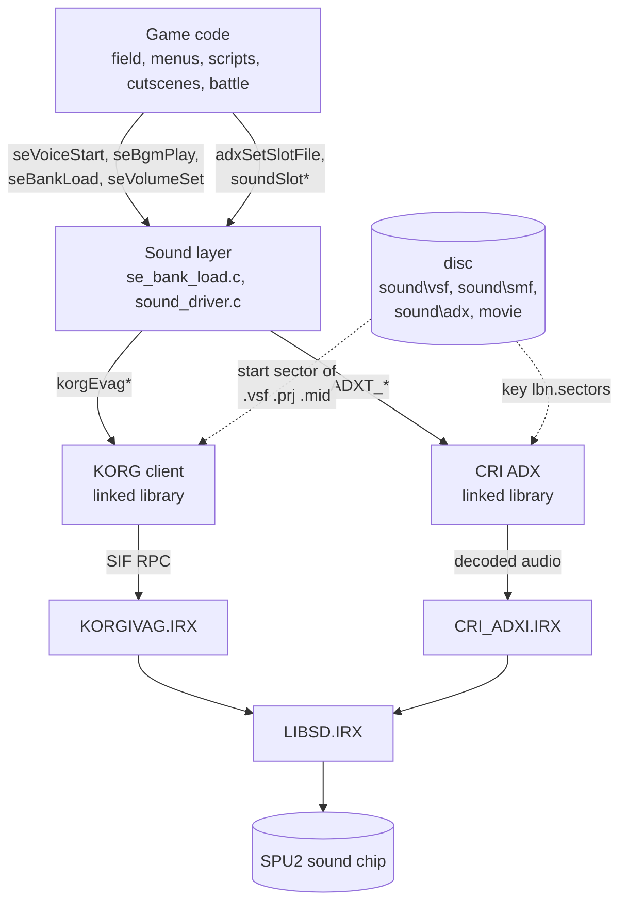

The two paths do not share volume controls. A KORG sound is scaled by MIDI
expression and by the driver's unit volumes. An ADX stream has its own output
volume on its ADX handle. The sound layer hides this behind one set of levels
from 0 to `SOUND_LEVEL_MAX` (`0x7F`, 127), described in
[section 12](#12-volume).

## 3. Start-up

Sound starts in `InitializeSystem` (`src/main/control_entry.c`). It first
loads the IOP modules from the disc with `xglCdSifLoadModule`, which builds
the path `cdrom0:\IOP\<NAME>.IRX;1`. The order is `sio2man`, `mcman`,
`mcserv`, `padman`, `cdvdstm`, `libsd`, then `cri_adxi` with the argument
string `spucore=1`, and last `korgivag` with six arguments:
`vag=256`, `key=256`, `prg=64`, `sbf=128`, `seq=64`, `ply=16`. The arguments
are settings of the KORG driver. The game only passes them on. Their names
read like capacities (samples, keys, programs, sequences, players), and
`vag=256` matches the `korgEvagAllocVagParam(0x100, 0)` call that follows
later.

After the modules, `InitializeSystem` sets `WorkEnd` to `0xB00000`, starts the
disc layer with `xglCdInitial` and calls `soundDriverInit`. This function does
the whole EE side of the start-up:

1. `ADXPS2_Setup(0)` and `ADXM_Setup(0)` start CRI's PlayStation 2 layer and
   its middleware manager.
2. `sceGsSyncVCallback(soundVSyncCallback)` installs a vertical blank
   handler. The handler calls `ADXM_ExecVint(0)`, the tick CRI needs once per
   field, and leaves with `ExitHandler`. When `xglRenderInit` runs a few lines
   later it installs its own handler, `xglRenderVSyncCallback`, which makes the
   same `ADXM_ExecVint(0)` call, so the tick continues from there.
3. `ADXT_Init()` starts the ADX player library.
4. `korgEvagBind()` connects the KORG client to the driver on the IOP. If it
   fails, the function prints `[EE] Failed to bind KORG IOP Sound Driver.` and
   returns at once. Nothing below this step runs in that case.
5. `korgEvagInitSpu2(0xA1)`, `korgEvagInit(0, 0)` and
   `korgEvagAllocVagParam(0x100, 0)` set up the driver.
6. For each of the 16 MIDI channels it calls
   `korgEvagSetChannelPriority(1, channel, 127)` and
   `korgEvagSetChannelPriority(4, channel, 127)`. The first argument is a unit
   number (see [section 8](#8-voices-sound-effects-as-midi-messages)), so
   units 1 and 4 get the highest priority on all channels.
7. `soundSetDefaults()` writes the default levels and sets units 1 to 3 to
   full volume.
8. Two work buffers for the ADX slots are cut from `WorkEnd`. Slot 0 gets
   `0x30200` bytes and tells ADX to use `0x301E4` of them. Slot 1 gets
   `0x3DA00` bytes and uses `0x3D9E4`. Together they move `WorkEnd` up by
   `0x6DC00` bytes (about 439 KiB).
9. `soundSlotsReopen()` creates the two ADX handles
   (see [section 11](#11-adx-streams)).

The sequence below shows the start-up from the module loads to the first
bank.

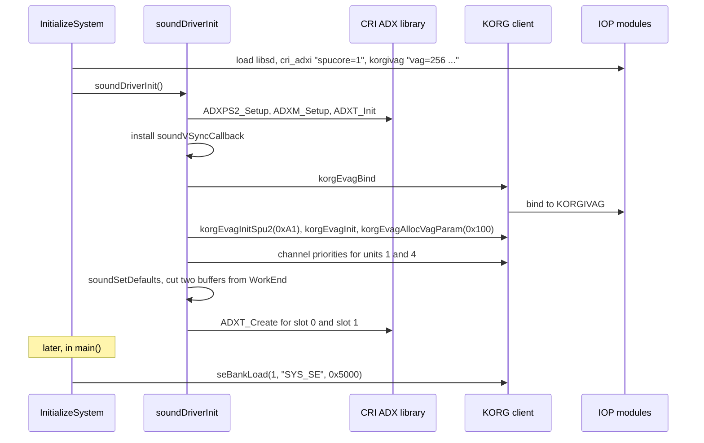

The first bank is loaded by `main()` in `src/main/control_entry.c`,
right after the display is switched on and before the title overlay is
loaded: `seBankLoad(SYSTEM_SE_SLOT, "SYS_SE", SYSTEM_SE_ADDRESS)` puts the system
sound bank into bank slot 1 at sound memory address `0x5000`. This bank holds
the cursor, confirm and cancel sounds of all menus and stays loaded for the
whole run. The boot flow around it is described in
[Title and boot](../game/title-and-boot.md).

## 4. The sound control block

All state of the sound layer is in one small global, `soundCtrl`
(`union SoundControl` in `include/main/sound_driver.h`). It has a 16-byte head
and two 16-byte ADX slot records, 48 bytes in total.

| Offset | Type | Name | Meaning |
| --- | --- | --- | --- |
| `+0x00` | `unsigned char` | `initialized` | While this byte is 0, `soundInitIfNeeded` sends the queued MIDI messages to the driver. `soundDriverInit` clears it and no game code sets it, see [section 23](#23-quirks-in-the-code) |
| `+0x03` | `unsigned char` | `song` | Number of the loaded song, taken from the first three digits of its name. `0xFF` when the name has no such digits |
| `+0x04` | `unsigned char` | `master_volume` | The overall volume. Every level is multiplied by it and divided by 127. Default `0x6E` (110) |
| `+0x05` | `unsigned char` | `master_level` | Default level of the sequenced music. Default `0x71` (113) |
| `+0x06` | `unsigned char` | `voice_level` | Default level of sound effects. Default `0x64` (100) |
| `+0x07` | `unsigned char` | `slot_level` | Default level of the ADX slots. Default `0x64` (100) |
| `+0x0C` | `VolumeRamp` | `master_ramp` | Ramp of the KORG master volume (unit 0) |
| `+0x10` | `SoundSlot[2]` | `slots` | The two ADX slots |

The developer sound test (`SoundTest` in `src/main/yajima_test.c`) has a
volume page with four rows, `MASTER`, `BGM`, `SE` and `ADX`. They edit
`master_volume`, `master_level`, `voice_level` and `slot_level` in this order,
which is where the meanings in the table come from. The retail game has no
volume option. The four values keep their defaults, and `soundSetDefaults`
writes them again at start-up and each time a play session ends.

One ADX slot is a `SoundSlot`:

| Offset | Type | Name | Meaning |
| --- | --- | --- | --- |
| `+0x00` | `int` | `driver_id` | The ADX handle that `ADXT_Create` returned. 0 before the first create |
| `+0x04` | `unsigned char *` | `create.buffer` | Work buffer of the handle, cut from `WorkEnd` at start-up |
| `+0x08` | `int` | `create.buffer_size` | Bytes of the buffer that ADX may use |
| `+0x0C` | `VolumeRamp` | `ramp` | Output level ramp of this slot |

A `VolumeRamp` is four bytes (`include/main/se_volume.h`):

| Offset | Type | Name | Meaning |
| --- | --- | --- | --- |
| `+0x00` | `signed char` | `step` | Added to `current` on each frame. 0 when the ramp is at rest |
| `+0x01` | `unsigned char` | `pause_value` | Only used in slot ramps. It holds the last pause value that `soundSlotSetPause` gave the slot |
| `+0x02` | `unsigned char` | `target` | Level the ramp moves toward |
| `+0x03` | `unsigned char` | `current` | Level that is in effect now |

The head of the block has the same size as a slot record, and the union also
exposes the whole block as `records[3]`. `soundSlotReopen` uses that view and
addresses slot `index` as `records[index + 1]`.

```
soundCtrl (48 bytes)
+0x00  initialized | -- | -- | song          head
+0x04  master_volume | master_level | voice_level | slot_level
+0x08  (4 bytes not used by the game code)
+0x0C  master_ramp: step | pause_value | target | current
+0x10  slots[0].driver_id                    ADX slot 0
+0x14  slots[0].create.buffer
+0x18  slots[0].create.buffer_size
+0x1C  slots[0].ramp
+0x20  slots[1].driver_id                    ADX slot 1
+0x24  slots[1].create.buffer
+0x28  slots[1].create.buffer_size
+0x2C  slots[1].ramp
```

## 5. The KORG client calls

The game uses 30 functions of the KORG client. Their bodies are library code.
The table lists what the game passes and what the call is used for. Where the
meaning of an argument is only known from the way the game uses it, the text
says so.

| Call | Used by | Purpose in the game |
| --- | --- | --- |
| `korgEvagBind()` | `soundDriverInit` | Connects to the IOP driver. Nonzero means failure |
| `korgEvagInitSpu2(0xA1)`, `korgEvagInit(0, 0)`, `korgEvagAllocVagParam(0x100, 0)` | `soundDriverInit` | One-time driver set-up |
| `korgEvagSetChannelPriority(unit, channel, level)` | `soundDriverInit` | Priority 127 for all 16 channels of units 1 and 4 |
| `korgEvagLoadVsfCdSector(slot, lbn, byte)` | `seBankLoadFile` | Loads a `.vsf` bank from the disc sector `lbn` into bank slot `slot` |
| `korgEvagLoadVsfCdSector2(slot, lbn, byte, address)` | `seBankLoadFile` | The same, with the place in sound memory given by the game |
| `korgEvagLoadPrjCdSector(slot, lbn, byte)` | `seBankLoadFile` | Loads the `.prj` file that belongs to the bank |
| `korgEvagLoadVsfFromEe(slot, vsf)`, `korgEvagLoadVsfFromEe2(slot, vsf, address)`, `korgEvagLoadPrjFromEe(slot, prj)` | `seBankLoadMemory` | The same three loads from files already in EE memory |
| `korgEvagFreeBank(slot)` | `seBankLoadFile`, `seBankLoadMemory`, `handleTableInit`, `handleFree` | Unloads a bank slot |
| `korgEvagLoadSmfCdSector(id, lbn, byte)` | `seBgmLoad` | Loads a standard MIDI file as sequence `id` |
| `korgEvagLoadSmfFromEe(id, smf)` | `seBgmLoadMemory` | The same from memory. `seBgmLoadMemory` has no caller in the game |
| `korgEvagFreeSeq(id)` | `seBgmLoad` | Unloads sequence `id` |
| `korgEvagInitChannel(0, channel)` | `seBgmStart` | Resets one MIDI channel of unit 0 |
| `korgEvagPlaySeq(0, sequence, player, 1)` | `seBgmStart` | Starts a loaded sequence |
| `korgEvagStopSeq(0, player)`, `korgEvagStopAllSeq()` | `seBgmPlay`, `seBgmStop` | Stops music |
| `korgEvagPauseSeq(player, flag)` | `seSetMuted`, `soundRestart`, sound test | Pauses or resumes the music player |
| `korgEvagMidiProc(0, message, 0)` | `seBgmStart` | Sends one MIDI message to unit 0 at once |
| `korgEvagMidiProcBatchAdd(unit, message, 0)` | `seVoiceStart`, `seVoiceStop`, `seVoiceSetPanVolume`, `seTonePlay` | Queues one MIDI message for a unit |
| `korgEvagMidiProcBatchFlush()` | `soundInitIfNeeded` | Sends the queued messages to the IOP |
| `korgEvagSetUnitVolume(unit, level)` | `soundSetMuted`, `soundSetDefaults`, `seVolumeSet`, `soundApplySettings` | Volume of unit 1, 2 or 3, or of unit 0, which the game treats as the master |
| `korgEvagSetFxVolume(1, level)`, `korgEvagSetFxType(1, 0)` | `seBgmPlay`, `seBgmStop`, `seSetMuted`, `seBgmSetSongLevel`, `Game` | Depth and type of the driver's effect unit 1, used per song |
| `korgEvagAllUnitsSoundOff()` | `soundDriverReset` | Silences everything the driver is playing |
| `korgEvagSetGlobalOutputMode()` | `soundStereoSet` | Mono or stereo output |
| `korgEvagSetDmaTransCallback(-1)` | `moviePlayerDestroy` | Called after a movie with an extra audio stream |
| `korgEvagSuspend()` | `xglRenderAndMovieShutdown` | Driver shutdown |

A *unit* is the KORG driver's name for an independent group of 16 MIDI
channels with its own volume. The game uses five of them. Unit 0 carries the
sequenced music, and its volume is used as the master volume. Units 1 to 4
carry sound effects, see the table in
[section 8](#8-voices-sound-effects-as-midi-messages).

## 6. Sound banks

A KORG sound bank is a pair of files with the same name. The `.vsf` file holds
the sample data. The `.prj` file is the project that describes the sounds of
the bank. The developer sound test reads `.prj` files directly and shows what
the game knows about them: a count at offset `0x08`, a 16-character name at
`0x10`, and from offset `0x30` one `0x30`-byte entry per sound with a
"hidden" byte at `+0x0D` and a 16-character sound name at `+0x20`. The full
layouts belong to [Sound files](../formats/sound.md).

### Bank slots and sound memory

The driver has numbered bank slots. `seBankLoadFile` accepts slots 0 to 23
(`SE_BANK_SLOT_COUNT` is 24). The slot number is also the MIDI bank number: a
sound is addressed as "note N of bank slot B".

Each loaded bank needs room in the sound chip's memory for its samples. The
game does not leave this to the driver. For almost every load it passes the
address in sound memory where the bank must go. The source calls this
argument `bank_address`, but its values come from `seBankAddressTable` in
`src/main/res_get_path.c`, they rise from slot to slot, and the address of
slot 4 is computed as "end of the bank in slot 3". They are start addresses.
The battle code calls the same value an address (`handleAddressGet`). An
address of 0 lets the driver choose.

| Slot | Address | Room to the next | Contents |
| --- | --- | --- | --- |
| 1 | `0x05000` | `0x14000` | `SYS_SE`, the system sounds. Loaded once in `main()` |
| 0 | `0x19000` | `0x64000` | The bank of the current song (`sound\smf\<song>.vsf`) |
| 2 | `0x7D000` | `0x41000` | `CFS_SE`, the common field sounds. Loaded at the start of `Game` |
| 3 | `0xBE000` | shared with slot 4 | First map bank, named by the `mapse` command of the scene |
| 4 | after slot 3 | up to `0x154000` | Second map bank. Its address is `0xBE000` plus the size of the slot 3 bank rounded up to 256 bytes |
| 5, 6 | 0 | | No fixed address |
| 7 | `0x154000` | `0x22000` | Field action sounds of the controlled character (`break_xxx`): its item sounds and the sounds of breaking objects, no footsteps |
| 8 to 11 | `0x176000`, `0x17A400`, `0x17E800`, `0x182C00` | `0x4400` each | Footstep material banks of the player character (`fs_xxx_xxx`). Nine banks on the disc are larger than this step (eight `fs_r05_*` banks and `fs_jrr_sto`), see [Sound files](../formats/sound.md) |
| 12 to 20 | `0x187000` to `0x1B7000` | `0x6000` each | Footstep banks of field enemies |
| 21 | 0 | | End of the table |

During a battle the layout above slot 1 is replaced by the battle layout of
[section 17](#17-battle-sound).

```
Sound memory in the field (addresses the game passes to the driver)

0x005000  slot 1   SYS_SE              system sounds
0x019000  slot 0   <song>.vsf          samples of the current music
0x07D000  slot 2   CFS_SE              common field sounds
0x0BE000  slot 3   map bank 1
   ...    slot 4   map bank 2          starts where slot 3 ends
0x154000  slot 7   break_xxx           player action sounds
0x176000  slots 8-11   fs_xxx_xxx      player footstep materials
0x187000  slots 12-20  fs_<enemy>_xxx  enemy footsteps
0x1BD000  end of the last slot
```

### Loading a bank from the disc

`seBankLoadFile(slot, name, directory, address)` is the one loader for disc
banks. `seBankLoad(slot, name, address)` calls it with the directory
`sound\vsf\`, and `seBankLoadDefault(slot, name)` calls that with address 0.
The steps are:

1. A slot of 24 or more returns 0.
2. `korgEvagFreeBank(slot)` unloads whatever the slot held.
3. A null `name` returns 0 here. This is how the game unloads a bank:
   `seBankLoadDefault(slot, 0)`.
4. The path `<directory><name>.vsf` is built and looked up with
   `xglCdGetFileData`, which fills a `CdFilePosition`. A negative result is
   returned as the error.
5. The file's start sector (`lbn`) goes to `korgEvagLoadVsfCdSector2` together
   with the address, or to `korgEvagLoadVsfCdSector` when the address is 0. A
   negative result is returned as the error. Both calls also get one more
   byte of the file record whose meaning is not known.
6. The extension is changed to `.prj`, the file is looked up again and its
   sector goes to `korgEvagLoadPrjCdSector`.
7. The function returns the size of the `.vsf` file in bytes.

File lookup and the meaning of a sector number are explained in
[Files and resources](files-and-resources.md).

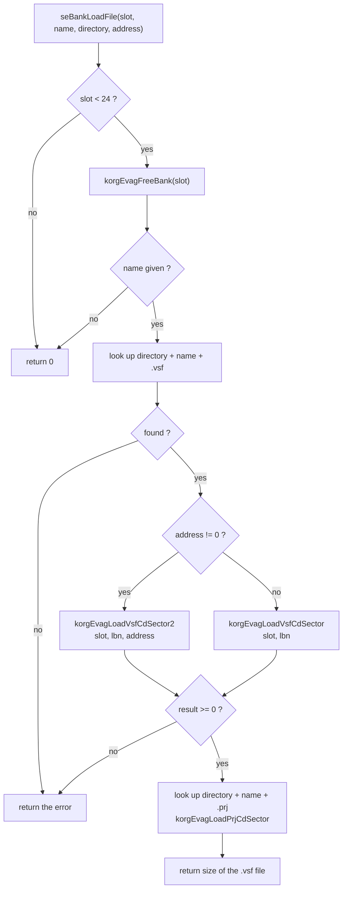

### Loading a bank from memory

`seBankLoadMemory(slot, vsf, prj, address)` does the same with two files that
are already in EE memory. It frees the slot, returns 0 when either pointer is
null, sends the `.vsf` with `korgEvagLoadVsfFromEe2` (or
`korgEvagLoadVsfFromEe` for address 0) and then the `.prj` with
`korgEvagLoadPrjFromEe`. Only the battle overlay uses it.

### Bank names per slot

The field must be able to rebuild its banks after a battle has overwritten
them. For that, `res_get_path.c` remembers the name of the bank in each slot
in `seBankNames[32]`. `resResetDescriptorTables` clears the table when a new
scene is set up and puts `CFS_SE` back into entry 2. `seBankSetName(kind,
name)` is the call that both remembers and loads:

- For slot 3 and slot 4 (the map banks) the name is kept in two fixed 16-byte
  buffers. Before anything else, every looping voice that plays from that slot
  is stopped (`resReleaseRecordsOfType`). If the new name equals the old one,
  the function returns without loading. A new map that uses the same sound
  bank as the old one therefore keeps it.
- For slots 7 to 11 (the player footstep banks) nothing is remembered. These
  banks are rebuilt by `seFootBanksLoad`.
- For any other slot the name is copied into the 256-byte pool
  `seBankNamePool` and the slot's entry points at the copy.
- A load into slot 3 first unloads slot 4, loads slot 3 at `0xBE000` and then
  sets the address of slot 4 from the size of the file that was just loaded.

## 7. Sequenced music

Sequenced music is a standard MIDI file played by the KORG driver with the
samples of a bank. A song has three files with the same name in `sound\smf\`:
`<song>.vsf` and `<song>.prj` (its bank) and `<song>.mid` (the notes). Song
names start with a three-digit number, for example `201_menu` and
`203_game_over`. The number is stored in `soundCtrl.song` and selects
per-song settings.

In the retail game, sequenced music is the music of the field: towns,
dungeons, the main menu's own screens and the game over screen. Battle music
and the title music are ADX streams ([section 11](#11-adx-streams)).

### Loading: seBgmLoad

`seBgmLoad(packed, name, address)` loads a song. The low 16 bits of `packed`
are the sequence id that the driver will know the MIDI file by. A value above
`0xFFFF` means "bank only".

1. Unless it is a bank-only call, `korgEvagFreeSeq(packed)` unloads the old
   sequence with this id.
2. `seBankLoadFile(0, name, "sound\smf\", address)` loads the song's bank into
   bank slot 0. With a null name this just unloads slot 0, and the function
   returns.
3. A bank-only call returns 0 here.
4. `sound\smf\<name>.mid` is looked up and `korgEvagLoadSmfCdSector(packed,
   lbn, byte)` loads it.
5. `soundCtrl.song` becomes the number made of the first three characters of
   the name when all three are digits, otherwise `SE_SONG_NONE` (`0xFF`).

### Starting: seBgmStart

`seBgmStart(id, next_id)` starts sequence `next_id` on player `id`. It first
resets all 16 channels of unit 0 with `korgEvagInitChannel`. Then it calls
`korgEvagPlaySeq(0, next_id, id, 1)` and returns the driver's answer.

Song 6 gets special treatment before it starts. Eight MIDI messages are sent
to channel 1 with `korgEvagMidiProc`: a pitch bend value of `0x3F`,
modulation 0, data entry 0, channel volume `0x41`, pan `0x5A`, reverb send
`0x7F`, bank select 0 and program change 6. Channel 1 of that song is
prepared by code, with an instrument panned to the right and with full
reverb, instead of by events inside the MIDI file.

### The one entry point: seBgmPlay

Game code does not call the two functions above. It calls
`seBgmPlay(packed, name, address)`. The high 16 bits of `packed` are a mode,
the low 16 bits are the player id. All callers use id 1 and the address
`0x19000`. The sequence id is always the player id plus `0x100`
(`SE_BGM_LOAD_OFFSET`), so the song is sequence `0x101` on player 1.

| Mode | Name | Steps |
| --- | --- | --- |
| 0 | `SE_BGM_START` | Stop player `id`, set the effect depth to 0, load bank and MIDI file, start the song, then set the master volume to its default at once |
| 2 | `SE_BGM_START_KEEP_VOLUME` | The same without the last step. The caller has set the master volume |
| 1 | `SE_BGM_BANK` | Load the bank only. Then set the master volume to 0, resume the player (`seSetMuted(id, 0)`), fade the master volume up to its default by 16 per frame and apply the song's effect depth |

With a null name, modes 0 and 2 stop the player, free the sequence and unload
bank slot 0. This is how music is switched off: `seBgmPlay(1, 0, 0x19000)`.

Mode 1 exists for the return from a battle. The battle has overwritten the
song's samples in sound memory, but the driver still holds the paused
sequence. Loading only the bank again and resuming the player continues the
field music from where it stopped, with a short fade-in.

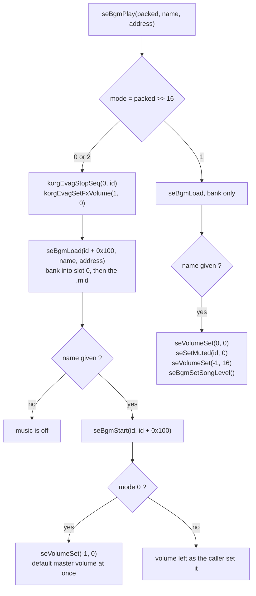

`seBgmStop` is the hard stop: `korgEvagStopAllSeq`, effect type 0 and effect
depth 0.

### The effect depth per song

`korgEvagSetFxVolume(1, level)` sets how strongly the driver's effect unit 1
is mixed in. By its use this is most likely the reverb. `seBgmSetSongLevel`
picks the level from a table by song number. Songs that are not in the table
keep the level that is already set.

| Songs | Level |
| --- | --- |
| 1, 5, 108, 110, 111 | 90 |
| 2 | 105 |
| 3, 8, 201, 202 | 80 |
| 4, 9, 10, 12 to 17, 101, 103, 104, 105, 107, 109 | 100 |
| 6, 7, 106 | 70 |
| 11 | 110 |
| 102 | 115 |
| 203 | 0 |

The table ends at its entry for song 0, so `203` (the game over music) is the
only song with level 0. The level is applied when the music is resumed
(`seSetMuted(…, 0)`) and in mode 1 of `seBgmPlay`. `seBgmPlay` sets the depth
to 0 before every load, and pausing the music also sets it to 0, so that no
effect tail rings on while the game is paused.

### Music chosen by the scene

In the field, music is chosen by the scene resource script, the text file
that lists what a scene needs
(see [Events and scenes](../scripting/events.md)). Two of its commands are
about music.

- `bgm name1,name2,...` stores a list of song names. When the scene is
  applied, one name of the list is passed to `seBgmNameSet`. Normally it is
  the first one. A script can choose a later one beforehand with the native
  `nextBgm`: it sets `bgmNameListIndex`, and a value of 2 or more selects the
  second, third and so on. `GameResourceInit` resets the index to 0.
- `bgmvol N` stores the master volume for this scene in `seBgmVolume`. Without
  the command the value is -1, the default level.

`seBgmNameSet(name)` then compares the name with the song that is playing
(`seBgmName`, 32 bytes):

- An empty name stops the music, unloads its bank and clears `seBgmName`.
- A different name sets the master volume to the scene's value at once and
  starts the new song with `seBgmPlay(0x20001, name, 0x19000)`, which is mode
  2 on player 1.
- The same name keeps the song running and only moves the master volume
  toward the scene's value by 16 per frame.

Walking from one map into the next therefore does not restart the music when
both scenes name the same song. The script native `bgm` calls `seBgmNameSet`
directly with a name from the script.

Three other places start a song by a fixed name with mode 0. The game over
screen plays `203_game_over` (`src/main/game_over.c`), fades it out with
`seVolumeSet(0, 2)` while the picture fades, and then switches the music off.
The two quest screens in `src/main/yg2path.c` and `src/main/ysegf.c` play
`201_menu` after a `soundRestart` and return to the field music with
`seStateRestoreDefault`.

## 8. Voices: sound effects as MIDI messages

A sound effect is one note of one bank. The game calls such a sound a
*voice* and names it with a 32-bit voice id:

```
voice id
 31       24 23                      7 6        0
+-----------+-------------------------+----------+
| bank slot |         unused          |   note   |
+-----------+-------------------------+----------+
                                         ^^^^ low 4 bits of the note
                                              are also the MIDI channel
```

The top byte (bits 24 to 30) is the bank slot, which the source calls the
*kind*. The low seven bits are the note number, which selects the sound
inside the bank. The MIDI channel is not a separate field. It is the low four
bits of the same number, so sounds 1 and 17 of a bank share channel 1.

Examples: `0x01000001` is note 1 of bank 1, the menu cursor sound of
`SYS_SE`. `0x02000011` is note `0x11` of bank 2, the pause sound of `CFS_SE`.

### Units

The bank slot also decides which KORG unit plays the sound.
`seVoiceSlotUnit` maps it:

| Unit | Used for | Chosen when |
| --- | --- | --- |
| 0 | Sequenced music | `seBgmStart` |
| 1 | Footsteps (`seTonePlay`) | always for footsteps |
| 2 | Voices of bank slot 3, the first map bank | kind 3 |
| 3 | Voices of bank slot 4, the second map bank | kind 4 |
| 4 | Every other voice: system sounds, common field sounds, battle sounds | any other kind |

The split has a purpose. `soundSetMuted` sets the volume of units 1, 2 and 3
to 0 or back to 127. That silences footsteps and the ambient sounds of the
map, while unit 4 with the menu sounds stays audible. The game uses this when
the main menu opens over the field.

### Starting a voice

`seVoiceStart(voice, volume, pan)` queues five MIDI messages for the unit of
the voice, all on the voice's channel:

1. Control change 0 (bank select) with the bank slot.
2. Control change 10 (pan) with `pan`. `0x40` is the centre.
3. Control change 11 (expression) with the volume.
4. Program change to program 0.
5. Note on for the note, with velocity 127.

The volume is prepared first. A negative `volume` means "default", and the
default depends on the bank slot. Bank slots 1 and 2 (`SYS_SE` and `CFS_SE`)
play at 127. Bank slot 7 plays at `master_level`. Slot 0 and all other slots
play at `voice_level`. The result is then multiplied by `master_volume`,
divided by 127 and limited to 127. With the default levels a system sound has
expression 110 and an ordinary voice has expression 86.

`seVoiceStartDefault(voice)` is `seVoiceStart(voice, -1, 0x40)`. It is by far
the most used sound call of the game: the main menu alone calls it more than
a hundred times.

Each message is one 32-bit word. The status byte with the channel is in bits
8 to 15, the first data byte in bits 16 to 23 and the second data byte in
bits 24 to 30:

```
MIDI message word
 31      24 23      16 15       8 7        0
+----------+----------+----------+----------+
|  data 2  |  data 1  |  status  |    0     |
+----------+----------+----------+----------+
status: 0x80 note off, 0x90 note on, 0xB0 control change,
        0xC0 program change, 0xE0 pitch bend, plus the channel
```

The messages are not sent one by one. `korgEvagMidiProcBatchAdd(unit,
message, 0)` only adds them to a queue inside the KORG client, and
`korgEvagMidiProcBatchFlush` sends the whole queue to the IOP once per frame
([section 13](#13-sound-in-a-frame)). The client reports a full or busy queue
with -1. The game ignores that result, so a sound that does not fit is
dropped silently.

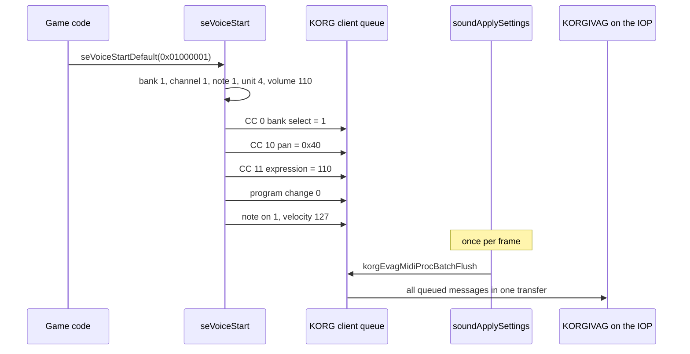

### Changing and stopping a voice

`seVoiceSetPanVolume(voice, volume, pan)` queues only the pan and expression
messages. A negative volume means `voice_level` here, for every bank slot.
The function is used for looping sounds whose place or loudness changes.

`seVoiceStop(voice)` queues expression 0, a program change and a note off for
the note. One-shot sounds are never stopped, they end by themselves. Only
loops need the stop.

### System sound numbers

The same few voice ids appear all over the menus under local names. They all
belong to `SYS_SE` in bank slot 1, except the pause sound.

| Voice id | Names in the source | Sound |
| --- | --- | --- |
| `0x01000001` | `MENU_SE_CURSOR`, `SAVE_SE_CURSOR` | Cursor move |
| `0x01000002` | `MENU_SE_CONFIRM`, `LOGO_SE_DECIDE`, `HDD_SE_DECIDE` | Confirm |
| `0x01000003` | `MENU_SE_REFUSE` | Not allowed |
| `0x01000007` | `MENU_SE_BACK` | Back |
| `0x01000008` | `MENU_SE_CANCEL`, `LOGO_SE_CANCEL`, `HDD_SE_CANCEL` | Cancel |
| `0x02000011` | `CFE_PAUSE_SOUND`, `MOVIE_SE_PAUSE` | Pause on and off, in the field, in cutscenes and in movies |
| `0x0200000A`, `0x0200000B` | `triggerSound` values in `src/main/runtime_menu.c` | Two sounds of map units that are triggered by the player |

## 9. Looping sounds and positional sound

One-shot sounds need no bookkeeping. Looping sounds do: a waterfall or a
machine hum must be stopped when the scene ends, restarted after a battle and
adjusted while the player walks around. The field keeps them in a table of 24
*voice records* (`resRecordTable` in `src/main/res_get_path.c`,
`SE_RECORD_COUNT`). One record is 16 bytes:

| Offset | Type | Name | Meaning |
| --- | --- | --- | --- |
| `+0x0` | `u32` or `f32[3]` | `u.params.volume`, `u.params.pan` or `u.position` | Fixed volume and pan, or the x, y, z position of the emitter |
| `+0xC` | `u32` | `flags` | 0 for a free record. Bits 0 to 30 are the voice id. Bit 31 (`SE_RECORD_HAS_PARAMS`) says that the record holds a fixed volume and pan |

There are two kinds of record, and each has its script native.

### Fixed loops: bgmse

`seVoiceRecordSet(voice, volume, pan)` serves the native `bgmse`:

- If a record with this voice exists and `volume` is not 0, the record gets
  the new volume and pan and `seVoiceSetPanVolume` applies them. The sound
  keeps playing.
- If a record exists and `volume` is 0, the record is cleared and the voice is
  stopped. For a positional voice the third argument is read as the index of
  the emitter record to remove, and the voice is only stopped when no other
  record with this voice is left.
- If no record exists and `volume` is not 0, the first free record is taken
  and `seVoiceStart` starts the sound.

### Emitters with a position: bgmsePos

`seVoiceRecordAddAt(voice, position)` serves the native `bgmsePos`. It stores
the position in the first free record without the `SE_RECORD_HAS_PARAMS` bit.
If no record with this voice existed before, it starts the voice with volume
0 and centre pan. The sound becomes audible on the next frame, when the
positional update sets its real level. Several records may carry the same
voice. They are several emitters of one sound, for example a row of identical
machines.

### From a position to pan and volume

`seVoicePanVolumeFromPosition(position)` turns a world position into a pan
and a volume. The listener is the player's actor, taken from the current map
unit record (`uwamonoRecords[uwamonoCurrentIndex].body.actor`).

1. Without a player actor the result is 0, which means "not audible".
2. The distance between emitter and player is computed. Beyond
   `seMaxDistance` the result is 0.
3. The volume falls linearly with distance:
   `(1 - distance / seMaxDistance) * 127`.
4. The direction from player to emitter is `atan2(dx, dz)`. The camera's
   compass angle (`gameWork.camera.range.northAngle`) and a quarter turn are
   added, and the angle is brought into the range 0 to 2π. Angles above π are
   mirrored (`2π - angle`), because front and back sound the same on two
   speakers.
5. The pan is `angle / π * 127`.
6. The result is `(volume << 8) + pan`.

Pan depends on the camera, not on where the character looks. A sound at the
left edge of the picture comes from the left speaker.

`seMaxDistance` is set by `seSetMaxDistance`. `seFootBanksLoad` sets it to 10
for the seven on-foot characters and to 60 for the three other player groups
([section 10](#10-footsteps)).

`seVoiceRecordsUpdatePan` runs once per field frame, at the start of
`resJumpPointsUpdate`. It skips its work while the top-exit control bit of
`gameWork.control` is set. For every positional voice it evaluates all
emitters of that voice, keeps the largest result (which is the loudest one,
because the volume is in the upper bits) and applies it with
`seVoiceSetPanVolume`. The player hears each looping sound from its nearest
emitter.

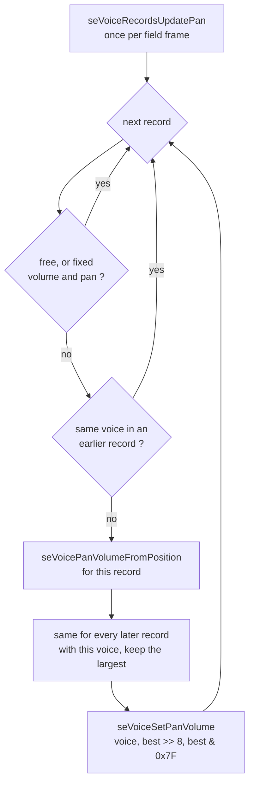

### Releasing and restoring

When a map bank changes, `resReleaseRecordsOfType(kind, …)` stops and clears
every record whose voice belongs to that bank slot and then flushes the MIDI
queue at once with `soundInitIfNeeded`, so that the notes are off before the
bank is unloaded.

`seStateRestore(mode)` rebuilds the whole KORG state of the field. It unloads
bank slot 0 and slots 2 to 23, loads every slot that has a remembered name
again at its table address, rebuilds the footstep banks and then, unless
`mode` is negative, restarts the music and the looping voices. Fixed loops
start with their stored volume and pan. Positional voices start silent, once
per voice, and the next positional update sets their level.

| Wrapper | Mode | Used |
| --- | --- | --- |
| `seStateRestoreField()` | `0x10000` | After a battle on maps below id 6300. The music is resumed with `seBgmPlay` mode 1 |
| `seStateRestoreDefault()` | 0 | After the quest screens. The music is started again from its beginning |
| `seStateClear()` | -1 | After a battle on maps from id 6300 up. Banks are reloaded, the music name is forgotten and all voice records are cleared |

## 10. Footsteps

Footsteps are the most elaborate sound in the field. The sound depends on who
walks and on the material under the feet, and for other characters also on
where they are.

### Materials

A material is a three-letter key. `footMaterialKeys` in
`src/main/res_get_path.c` lists 14 of them, in this order: `kon`, `rai`,
`gla`, `flo`, `iro`, `sto`, `car`, `woo`, `clo`, `wat`, `tur`, `ear`, `sno`,
`sna`. `footMaterialFind` returns the index of a key and falls back to index
0, `kon`, for an unknown one.

A scene does not load all materials. Its resource script names the ones the
map has with `foot key,key,...`, at most nine (`RES_FOOT_MATERIAL_MAX`). The
list is stored in `resFootMaterials`, and the position of a material in that
list decides its bank slot.

### Banks of the player character

`seFootBanksLoad` builds the bank names for the current player character. It
finds the group of the player's map unit key in `footGroupKeyTable`. The
table lists unit keys in groups that end with -1, and each group has a
three-letter name in `footGroupMaterialNames`: `shi`, `kos`, `cha`, `jrr`,
`mom`, `zig`, `jin`, `r02`, `r03`, `r05`. The first seven read as the seven
playable characters. The last three have keys in the `0x14000` range and a
far larger hearing distance, which fits the E.S., but the source does not
name them.

With the group name `ggg` the function loads:

- `break_ggg` into bank slot 7.
- `fs_ggg_mmm` into bank slot 8 and upward, one bank for each material `mmm`
  of the scene's list.

For group 6 (`jin`) the bank name changes to `fs_ji2_mmm` when the 8-bit game
flag 401 is above 13. The same flag is tested in the battle voice code, so it
is most likely a story progress value. The function also sets the hearing distance (10
for groups 0 to 6, 60 for the others) and switches the random pitch of
footsteps on for groups 0 to 6 and off for the others.

`seFootBanksLoad` runs when the player's map unit is set up for a character
(from `src/main/game_camera.c`) and inside every `seStateRestore`.

### Banks of field enemies

The command `enefoot name,name,...` of the scene script names the enemy
models that make footstep sounds. For each name and each listed material it
creates a bank entry `fs_<name>_<material>`, with bank slots counted up from
12. The model's file group id is stored in `resEnemyFootGroups`.

### From a step to a sound

`Sound_FootStep(index)` in `src/main/uwamono_event_check.c` runs for a map
unit and decides whether it steps on this frame.

1. A collision probe below the actor (`UnduCheck`) returns the surface kind
   of the ground. The collision system is described in
   [Map and units](../game/map-and-units.md).
2. `seFootBankFromKind(key, kind)` turns the unit key and the surface kind
   into a bank slot. Surface kinds of the form `0x4nn` are mapped to a
   material through `footMaterialIndexTable`, and the material's position in
   the scene's list gives the slot. For a player character this is slot 8
   plus the position. For an enemy it is slot 12 plus the position plus the
   enemy's group number times the number of listed materials. A material
   that the scene does not list gives -1 and no sound.
3. The step moment comes from the animation. `footStepTable` holds, per unit
   key, up to four frame numbers. A step happens when the animation frame
   passes one of them.
4. A step of the player plays `seTonePlay(bank)`. A step of any other unit is
   positioned first: `seVoicePanVolumeFromPosition` gives volume and pan, and
   the sound is played with `seTonePlay((result << 8) + bank + 0x01000000)`.
   A result of 0 (too far away) plays nothing.

The same function also creates the footstep dust and splash effects, which
belong to [sef](../libraries/sef.md).

### seTonePlay

`seTonePlay(packed)` plays one footstep on unit 1. It differs from
`seVoiceStart` in three ways that make repeated steps sound less mechanical.

- The MIDI channel is not taken from the note. A counter picks the next of
  the 16 channels in turn, so a new step does not cut off the previous one.
- The note is 1 or 2, chosen at random. Each footstep bank has two variants
  of the step.
- A random pitch bend (7 bits from `xglSRand`) is sent before the note,
  unless bends are switched off.

The bank slot is the low seven bits of the argument. A value above
`0xFFFFFF` also carries the volume in bits 16 to 22 and the pan in bits 8 to
14. Otherwise the volume is `voice_level` and the pan is the centre. A
negative argument plays nothing and only sets the bend switch: -1 switches
random bends on, -2 switches them off.

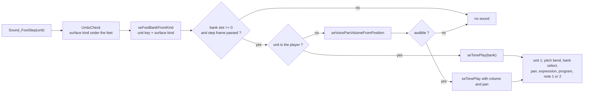

## 11. ADX streams

ADX is CRI's compressed audio format. An `.adx` file is read from the disc
and decoded while it plays, so it can be as long as a piece of music or a
voiced line without taking sound memory. The game keeps exactly two ADX
players, called *sound slots* in the source.

| Slot | Buffer | Reload threshold | Used for |
| --- | --- | --- | --- |
| 0 | `0x30200` bytes | 50 | Music: title music, battle music, music and long audio that scripts start with `adx`, the first audio track of a cutscene |
| 1 | `0x3DA00` bytes | 70 | Voices: voiced lines in battle, battle streams started by scripts, the second audio track of a cutscene |

All slot functions take the slot index and do nothing for an index of 2 or
more.

### Creating a slot

`soundSlotReopen(index)` creates the ADX handle of a slot. If the slot
already has a handle, `ADXT_Destroy` removes it first. Then
`ADXT_Create(2, buffer, buffer_size)` makes a new one over the slot's work
buffer. The first argument 2 is, by CRI's interface, the largest number of
channels, so each slot can play stereo. `ADXT_SetSvrFreq(id, 0x1E)` sets a
service rate of 30, `soundSlotSetVolume(index, -1, 0)` applies the default
level, and `ADXT_SetReloadSct` sets the reload threshold in sectors, 50 for
slot 0 and 70 for slot 1.

`soundSlotsReopen` does this for both slots. `soundSlotsRestart` first stops
each slot and then reopens it. The game calls `soundSlotsRestart` at every
large change of scene (entering and leaving a battle, leaving a map, the
title screen, a soft reset), which guarantees that no stream of the old
scene keeps playing and that the ADX handles start fresh.

### Starting a file

`adxSetSlotFile(index, name)` starts a file by name:

1. It builds the path `sound\adx\<name>.adx`. A `/` in the name becomes a
   `\`, so names can contain folders, for example `battle/...`.
2. `xglCdGetFileData` looks the file up.
3. It formats the text key `"%08x.%08x"` from the file's start sector and its
   length in sectors (the stored size shifted right by 11).
4. `soundSlotStartFile(index, key)` sets the loop flag with
   `ADXT_SetLpFlg(id, 1)` and starts playback with `ADXT_StartFname(id, key)`.

ADX believes it opens a file called, for example, `0004a2c0.00000310`. The
disc layer has taught CRI's file system to read such a name as "this many
sectors from this sector", which is how one reader serves both the game's
archives and CRI's streams. That mechanism is described in
[Files and resources](files-and-resources.md).

The loop flag is always set. Whether a file really loops depends on the loop
points inside the file. On the discs only the five battle tracks and the victory fanfare have them
(`battle01`, `battle02`, `boss01`, `boss02`, `bosslast`, `fanfale01`). The
title music, the field streams and every voice line have none and play once
(see [Sound files](../formats/sound.md)).

The title screen is the one caller that bypasses the path builder. It looks
up `yajima\M-01.adx` by its full path and gives the key to
`soundSlotStartFile(0, key)` itself (`titleStartBgm` in `src/ov02/title.c`).

### Pause, stop and status

| Function | Effect |
| --- | --- |
| `soundSlotSetPause(index, value)` | `ADXT_Pause(id, value)`. The value is also remembered in the slot's `ramp.pause_value` |
| `soundSlotSetPauseIfNotHeld(index, value)` | The same, but it does nothing when the remembered value is not 0. It does not change the remembered value |
| `soundSlotStop(index)` | `ADXT_Stop(id)`, then `ADXT_Pause(id, 0)` |
| `soundSlotStatus(index)` | `ADXT_GetStat(id)`, or -1 for a bad index |
| `soundSlotLoopCountGet(index)` | `ADXT_GetLpCnt(id)`. No caller in the game |
| `soundSlotStartKey(index, key)` | Same as `soundSlotStartFile`. No caller in the game |

The two pause functions exist because a slot can be paused for two reasons.
A script or the cutscene player may pause a slot on purpose to prepare a file
that should start later at an exact moment. The player may also pause the
whole game with START. The field pause uses `soundSlotSetPauseIfNotHeld`, so
releasing the game pause does not start a stream that a script is still
holding back.

A paused slot still loads data. That is the basis of the prepare-then-play
pattern: pause the slot, start the file, wait until the status says the
stream is ready, and release the pause at the right frame. The cutscene
player waits for status 3, which in CRI's interface is the playing state.

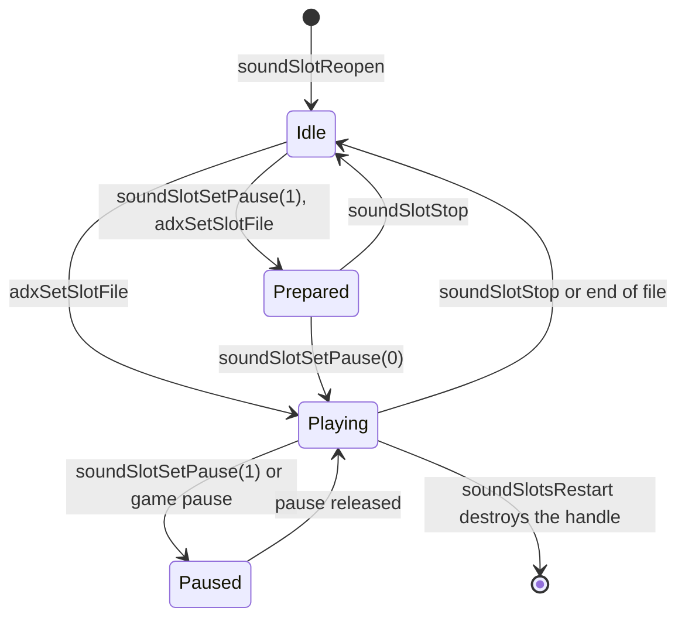

### Slot volume

`soundSlotSetVolume(index, level, step)` sets the level of a slot.

1. A negative level means `soundCtrl.slot_level`.
2. For slot 0 only, the level is multiplied by `master_volume` and divided by
   127. Slot 1, the voice slot, is not scaled.
3. The level is limited to 127 and given to the slot's ramp with the step.
4. With step 0 the level is applied at once. Otherwise the ramp moves it a
   step per frame.

Applying a level means `ADXT_SetOutVol(id, seVolumeCurve(level))`. The curve
is explained in [section 12](#12-volume).

Four tiny functions in `src/main/yajima_test.c` set fixed levels.
They come in two identical pairs:

| Function | Level | Used by |
| --- | --- | --- |
| `bgmSlotLevelSet(index)` | `0x5A` (90) | Battle music (`bgmPlayTrack`), the battle script command `bgmFade` |
| `actionSoundSlotLevelSet(index)` | `0x5A` (90) | Voiced technique lines in battle (`unitPlayActionSound`) |
| `streamKeySlotLevelSet(index)` | `0x7A` (122) | Battle lines by situation (`streamPlayByKey`) |
| `streamSetLevel(index)` | `0x7A` (122) | The battle script command `streamPlay` |

## 12. Volume

All levels in the sound layer run from 0 to 127. There are four stored
defaults in `soundCtrl` ([section 4](#4-the-sound-control-block)), three
ramps, one curve and two mute functions.

### How a level is computed

| Sound | Starting level | Scaled by `master_volume` | Applied through |
| --- | --- | --- | --- |
| Sequenced music | `master_level` (113), or the level of `seVolumeSet`, `bgmFade` or `bgmvol` | yes | `korgEvagSetUnitVolume(0, level)` |
| Voice of bank 1 or 2 | 127, or the given volume | yes | MIDI expression |
| Voice of bank 7 | `master_level`, or the given volume | yes | MIDI expression |
| Other voices | `voice_level` (100), or the given volume | yes | MIDI expression |
| Footstep | `voice_level`, or the volume from the position | yes | MIDI expression |
| ADX slot 0 | `slot_level` (100), or the given level | yes | `ADXT_SetOutVol` through the curve |
| ADX slot 1 | `slot_level`, or the given level | no | `ADXT_SetOutVol` through the curve |
| Movie | 127 | no | The player's `set_volume` through the curve |

"Scaled" means `level * master_volume / 127`, limited to 127. With the
default `master_volume` of 110 the music runs at 97, a system sound at 110,
an ordinary sound effect at 86 and ADX slot 0 at 86.

Unit 0 is special. The game uses the volume of KORG unit 0 as its master
volume control (`seVolumeSet`), and unit 0 is also the unit that plays the
sequenced music. A music fade is therefore a fade of this value.

### Ramps

A ramp moves a level smoothly. `seVolumeRampSet(ramp, level, step)` stores
the target. With step 0 it also sets the current level and returns it, so
the caller can apply it at once. Otherwise it stores the step with the right
sign and returns -1. When the target equals the current level it changes
nothing.

`seVolumeRampStep(ramp)` is called once per frame for each ramp. A resting
ramp returns -1. A moving ramp adds the step to the current level. When the
new level passes the target, or leaves the range 0 to 127, it becomes the
target and the ramp comes to rest. The new level is returned, and the caller
applies it.

The step is therefore "levels per frame". `seVolumeSet(-1, 16)` reaches the
default music level from silence in seven frames. `seVolumeSet(0, 2)`, used
by the game over screen, fades the music out in about 49 frames.

There are three ramps: `soundCtrl.master_ramp` for the KORG master volume and
one in each ADX slot.

### The curve

ADX does not take a level from 0 to 127. `ADXT_SetOutVol` takes an
attenuation, where 0 is full volume and large negative numbers are quiet.
`seVolumeCurve(level)` converts. It reads `seVolumeCurveTable`, 36 signed
16-bit values with one point for every four levels, and interpolates linearly
between two points for the levels in between. A level of 127 or more gives 0.

| Level | 0 | 4 | 8 | 16 | 32 | 48 | 64 | 80 | 96 | 112 | 124 | 127 |
| --- | --- | --- | --- | --- | --- | --- | --- | --- | --- | --- | --- | --- |
| Curve value | -999 | -692 | -553 | -414 | -276 | -195 | -137 | -92 | -56 | -25 | -5 | 0 |

The values fall steeply near level 0 and flatten toward the top, the shape of
a logarithm. In CRI's interface the unit of this value is a tenth of a
decibel, which fits the table: level 64 is about -13.7 dB and level 0 is the
floor of -99.9 dB. The fixed slot levels become -69 for `0x5A` and -8 for
`0x7A`. The movie player uses the same curve for its own volume.

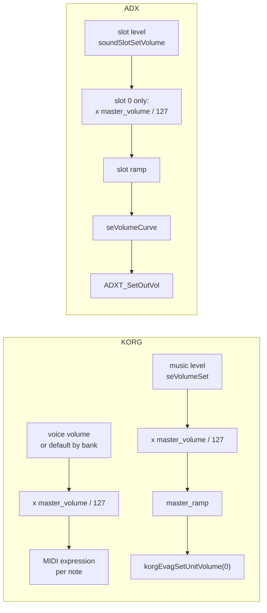

### Mute

`soundSetMuted(muted)` sets the volume of KORG units 1, 2 and 3 to 0, or back
to 127. It silences footsteps and map sounds and leaves music, system sounds
and ADX alone.

`seSetMuted(player, flag)` is the bigger switch. It pauses or resumes the
music player with `korgEvagPauseSeq`, calls `soundSetMuted(flag)`, and sets
the effect depth to 0 when muting or back to the song's value when unmuting.
All callers pass player 1.

## 13. Sound in a frame

The sound layer has one per-frame function, `soundApplySettings`. It is
called from `xglRenderFrame` between the renderer's frame work and the pad
read, and `xglRenderFrame` is the first thing `xglSleep` does. Every loop of
the game that waits for the next frame with `xglSleep` therefore also
services sound. The frame as a whole is described in
[xgl](../libraries/xgl.md).

`soundApplySettings` does four things in order:

1. It steps the master ramp. If the level changed, it sends it with
   `korgEvagSetUnitVolume(0, level)`.
2. It calls `soundInitIfNeeded`, which flushes the MIDI queue with
   `korgEvagMidiProcBatchFlush`. All voices that were started since the last
   frame leave for the IOP here, in one transfer.
3. It steps the ramp of each ADX slot and applies the level of a slot whose
   ramp moved.
4. It calls `ADXM_ExecMain`, CRI's main service function. It refills the
   stream buffers of the ADX slots and of a running movie.

A second, shorter service runs in the vertical blank interrupt:
`ADXM_ExecVint(0)`, called from `xglRenderVSyncCallback`.

```mermaid
sequenceDiagram
    participant Loop as Game loop
    participant Snd as Sound layer
    participant Korg as KORG client
    participant Cri as CRI ADX
    participant Iop as IOP
    Loop->>Snd: seVoiceStart, seTonePlay, seVolumeSet ...
    Snd->>Korg: korgEvagMidiProcBatchAdd (queued)
    Loop->>Loop: xglSleep, xglRenderFrame
    Loop->>Snd: soundApplySettings
    Snd->>Korg: korgEvagSetUnitVolume(0) if the master ramp moved
    Snd->>Korg: korgEvagMidiProcBatchFlush
    Korg->>Iop: queued MIDI messages
    Snd->>Cri: ADXT_SetOutVol for slots whose ramp moved
    Snd->>Cri: ADXM_ExecMain
    Cri->>Iop: stream data
    Note over Cri: vertical blank: ADXM_ExecVint(0)
```

Two other places keep sound alive when no frame loop runs. While the disc
layer waits for a blocking read, it calls `ADXM_ExecMain` itself
(`src/main/xgl_cd.c`), so music does not stutter during loading. And
`resReleaseRecordsOfType` flushes the MIDI queue directly after it has queued
note-off messages.

## 14. Pause, menus and scene changes

The field loop `Game` (`src/main/game_data.c`) is where most global sound
switching happens. The loop itself is described in
[The field](../game/field.md).

### Pause

START toggles the pause, with a 16-frame guard against repeats. Entering the
pause plays the pause sound `0x02000011`, then calls `seSetMuted(1, 1)` and
`soundSlotSetPauseIfNotHeld(0, 1)`. The music player stops, map sounds and
footsteps go silent, the effect depth drops to 0 and the music stream in ADX
slot 0 is paused unless a script holds it. Leaving the pause does the reverse
and plays the same sound again.

The order matters. On entering, the sound is queued before the mute. On
leaving, the mute is lifted first. In both cases the pause sound itself is
heard, because it plays on unit 4, which is never muted.

### Menus

TRIANGLE opens the main menu. CIRCLE next to a map unit of search type 7 or
8 opens the file menu (`MenuFileMain`). Both calls are wrapped in `soundSetMuted(1)` and `soundSetMuted(0)`.
The music keeps playing under the menu, the map goes quiet, and the menu's
own sounds are audible.

### Entering and leaving a battle

A battle needs the sound memory for its own banks and both ADX slots for its
music and voices. The field gives everything up and takes it back afterwards.

1. `soundRestart()` runs. It restarts both ADX slots, pauses the music
   player with `korgEvagPauseSeq(1, 1)` and silences every note with
   `soundDriverReset`, which is `korgEvagAllUnitsSoundOff`.
2. `korgEvagSetFxVolume(1, 0)` removes the effect.
3. The battle overlay runs (`ov01SceneEnter`, `ov01SceneLoop`,
   `ov01SceneEnd`). It unloads bank slot 0, loads its banks and plays its
   streams ([section 17](#17-battle-sound)).
4. After the battle and the result screen, `soundSlotsRestart()` ends the
   battle streams.
5. On maps with an id below 6300, `seStateRestoreField()` reloads all field
   banks, resumes the paused music with a fade-in and restarts the looping
   voices. On maps from 6300 up, `seStateClear()` reloads the banks but drops
   the music and the loops.

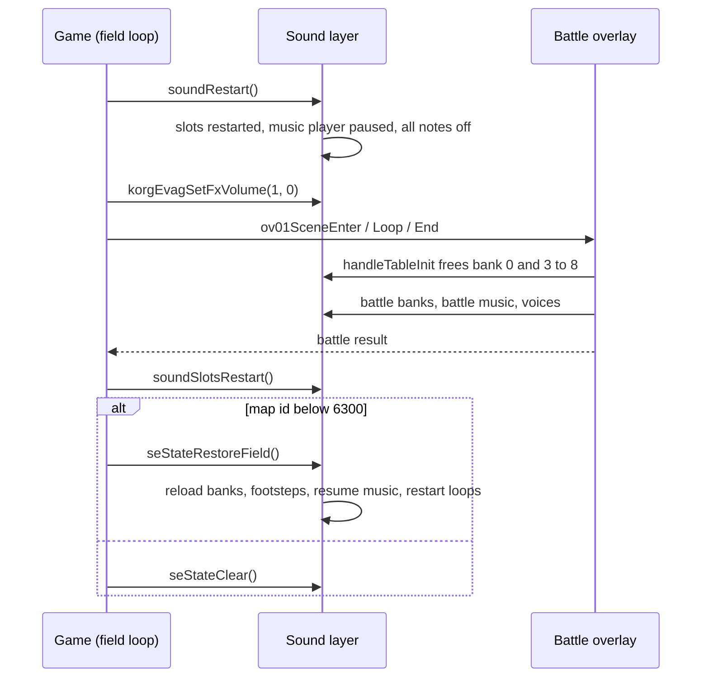

### Changing map and ending the session

At the start of each map the loop calls `Vibration_Stop()` and
`seSetMuted(1, 0)`, so a map always starts unmuted and with the song's effect
depth. When the loop leaves a map it calls `soundSlotsRestart()`.

When the play session ends, `Game` calls `soundReset()` (which is
`soundRestart`, then `seSetMuted(1, 0)` and `seBgmStop`), releases any pause
on slot 0 and writes the default levels with `soundSetDefaults()`.

### Other screens

| Place | Sound handling |
| --- | --- |
| Game over (`src/main/game_over.c`) | Plays song `203_game_over`, fades the master volume to 0 by 2 per frame, then switches the music off |
| Battle result (`src/main/battle_result.c`) | On leaving, fades ADX slot 0 (the fanfare) to 0 by 8 per frame and plays the confirm sound. On a soft reset it restarts the slots |
| Title (`src/ov02/title.c`) | Plays `yajima\M-01.adx` in slot 0. Stops both slots when it starts and restarts them when a choice is accepted |
| Movies (`src/main/game_movie.c`) | `soundRestart()` before the movie, see [section 18](#18-movie-sound) |
| Cutscene module start (`cfeInit`) | `soundDriverReset()` |

## 15. Script natives

Field and event scripts reach sound through twelve natives of the main
executable's table `runtimeNativeTable`. How natives are registered and how
they read arguments is described in [Natives](../scripting/natives.md). This
section says what each one does to the sound layer.

| Native | Function | Arguments | Effect |
| --- | --- | --- | --- |
| `se` | `runtimeSe` | voice, volume, pan | Volume above 0: `seVoiceStart`. Volume 0 or less: `seVoiceStop`. A missing volume is the script default set by `seVol`, a missing pan is `0x40` |
| `seVol` | `seVol` | volume | Sets the default volume byte `seDefaultVolume` that `se` and the battle unit voices use |
| `sePos` | `sePos` | voice, x, y, z | One-shot sound at a position. The coordinates are integers in hundredths of a unit. Plays only when the position is audible |
| `bgmse` | `bgmSe` | voice, volume, pan | Looping sound with fixed volume and pan (`seVoiceRecordSet`). Volume 0 stops it. A missing volume is -1, the default level |
| `bgmsePos` | `bgmSePos` | voice, x, y, z | Looping sound with an emitter position (`seVoiceRecordAddAt`) |
| `bgmFade` | `bgmFade` | level, step | `seVolumeSet(level, step)`: moves the music volume. A negative level is the default, a missing step is 0 |
| `nextBgm` | `nextBgm` | index | Sets `bgmNameListIndex`, which picks a name from the next scene's `bgm` list |
| `bgm` | `runtimeBgm` | name | `seBgmNameSet(name)`: changes the song, or stops the music for an empty name |
| `adx` | `adx` | name | Default level on slot 0, then `adxSetSlotFile(0, name)`. The stream starts at once |
| `adxLoad` | `adxLoad` | name | Pauses slot 0, sets the default level and starts the file. The stream is prepared but silent |
| `adxPlay` | `adxPlay` | none | Releases the pause of slot 0 |
| `mpeg2` | `mpeg2` | name | Plays a movie with `GameMpeg2Play` |

`adxLoad` and `adxPlay` are the script form of the prepare-then-play pattern
of [section 11](#11-adx-streams). A script loads a line of dialogue early and
starts it on the exact frame it wants.

The battle overlay registers four more sound natives in its own table. They
are listed in [section 17](#17-battle-sound). Vibration has one native, see
[section 20](#20-vibration).

## 16. Cutscenes

The cutscene player `cfe` (see [Cutscenes](../scripting/cutscenes.md)) uses
both ADX slots for recorded dialogue and music and the master volume for
fades. Its sound handling is in `src/main/cfePlugIn.c` and
`src/main/cfeEvaluate.c`.

### Audio tracks

A cutscene's messages are `CfeMessageRecord` entries. Besides the subtitle
text and its first and last frame, a message can carry the name of an ADX
file and a sound slot number. When the cutscene reaches its first frame and
its first message names a file, `cfeSoundSlotStartWait(file, slot)` prepares
it:

1. `soundSlotSetPause(slot, 1)`.
2. `soundSlotSetVolume(slot, -1, 0)`.
3. `adxSetSlotFile(slot, file)`.
4. It waits, one `xglSleep` per turn, until `soundSlotStatus(slot)` is 3.

The cutscene does not advance while this waits. Afterwards, on every frame,
each message whose first frame is the current time and that has a file name
releases the pause of its slot with `soundSlotSetPause(slot, 0)`. Picture and
sound start on the same frame, however long the disc took to deliver the
first block of audio.

### Volume track

A cutscene has sound records (`CfeSndRecord`) with two animated values, a
volume and a duration. When the volume value changes and the duration is not
0, the evaluator calls `seVolumeSet(value, steps)` with
`steps = |old - new| / duration`, at least 1. The cutscene script can fade
the sequenced music down under a line of dialogue and back up without knowing
about ramps. `cfeInit` resets the record to volume `0x7F` and duration 0.

### Pause and skip

START pauses a cutscene once it has run for 31 frames and no screen fade is
active. While paused, every frame pauses both ADX slots and calls
`seSetMuted(1, 1)`. START again releases both slots and unmutes. TRIANGLE
during the pause skips the cutscene: both slots are stopped and unpaused,
`seSetMuted(1, 0)` and `seVolumeSet(0, 0)` leave the music running but
silent, and the pause sound plays. The script that follows the cutscene sets
the volume again.

`cfe.destroy` stops both ADX slots when a cutscene ends.

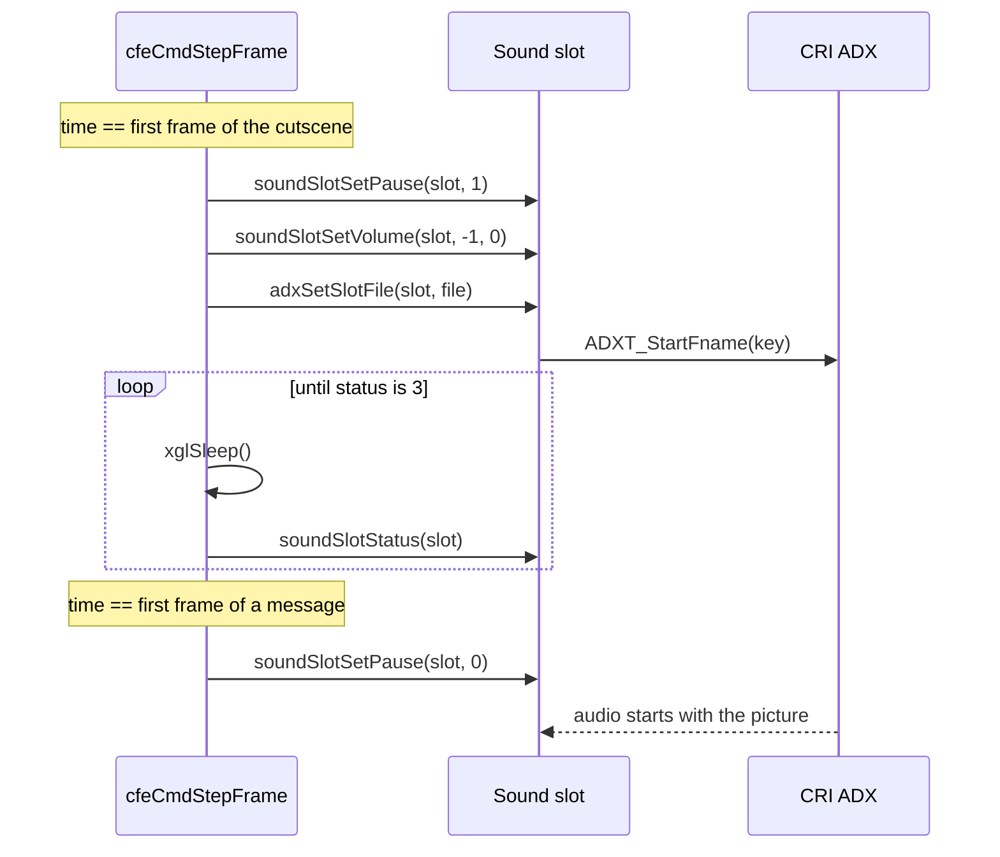

## 17. Battle sound

The battle overlay OV01 has its own small sound files on top of the main
layer. The battle systems themselves are described in
[Battle](../game/battle.md) and [The battle engine](../game/battle-engine.md).

### Sound memory in battle

`handleTableInit` (`src/ov01/handle_table.c`) runs when a battle scene is set
up. It clears its table, frees bank slot 0 (the field song's bank) and bank
slots 3 to 8, and resets a bump cursor to `0x37800`. From then on the sound
memory above the system bank is laid out for the battle:

```
Sound memory in battle

0x005000  slot 1      SYS_SE            system sounds (kept from the field)
   ...    slot 2      bts_se            battle sounds, placed by the driver
0x037800  slots 6-8   enemy voice banks, packed one after another
   ...                (bump cursor, may not pass 0x100000)
0x100000  slot 3      voice bank of a party member   (0x50000 bytes of room)
0x150000  slot 4      voice bank of a party member
0x1A0000  slot 5      voice bank of a party member
0x1F0000  end
```

The battle sound bank `bts_se` is loaded into bank slot 2 with address 0, so
the driver chooses its place. Its `.vsf` buffer is `0x1E800` bytes, and
`0x19000 + 0x1E800` is exactly `0x37800`, the start of the bump area. The
bank most likely sits at `0x19000`, where the field song's bank was.

### Bank handles

A *handle* is a bank slot number for a unit's voice bank. There are six
(`HANDLE_SLOT_COUNT`), numbered 3 to 8 (`HANDLE_BASE` is 3). One `HandleSlot`
record is 12 bytes: an in-use word, the sound memory address and a third
word.

`handleAlloc(fromBump, size)` hands one out:

- With `fromBump` 0 it takes one of the first three handles (3, 4, 5). Their
  addresses are fixed: `0x100000 + n * 0x50000`.
- Otherwise it takes one of the last three (6, 7, 8) and gives it `size`
  bytes at the bump cursor. If the cursor would pass `0x100000` the call
  fails with -1.
- When no handle of the wanted kind is free it returns -1.

The caller is `dataVoiceSetLoad` in `src/ov01/data_file_load.c`. Data ids
below 16 (`DATA_BATTLE_ID_COUNT`, the party side) get fixed handles, all
others (enemies) get bump handles sized by their files. There is room for
three party voice banks and three enemy voice banks at a time.

`handleAddressGet(handle)` returns the address, `handleFree(handle)` clears
the record and unloads the bank slot. The bump cursor is never moved back
during a battle. It is only reset by `handleTableInit`.

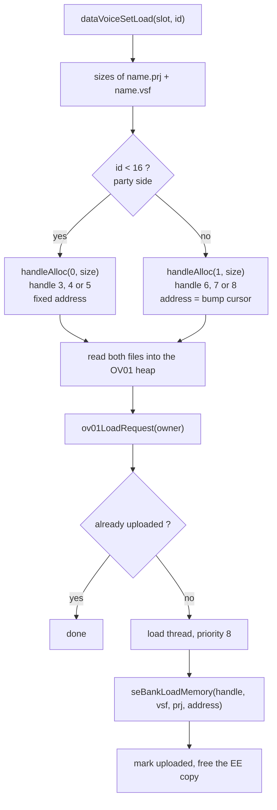

### Uploading banks

Battle banks are read from `sound\vsf\battle\` into EE memory and then
uploaded with `seBankLoadMemory`. The upload blocks until the driver has
taken the data, so it runs in a separate thread with priority 8 and a
`0x1000`-byte stack, started by `ov01LoadBlockStart` or `ov01LoadRequest`
(`src/ov01/scene_load.c`). The battle keeps drawing while it waits for the
`ov01LoadDone` flag.

- `dataBattleSeLoad` reads `bts_se.prj` (buffer `0x800` bytes) and
  `bts_se.vsf` (buffer `0x1E800` bytes). The thread function
  `ov01LoadComplete` calls `dataBattleSeUpload`, which uploads the pair to
  bank slot 2 and frees the two buffers.
- For a unit, `dataVoiceFilesLoad` reads `<voice name>.prj` and `.vsf` into
  one block of the OV01 heap. The thread function `ov01LoadCompleteForOwner`
  calls `dataSlotVoiceUpload`, which uploads the pair to the unit's handle at the
  handle's address, marks the handle with `handleStateSet` and frees the
  block.

`handleStateGet` lets `ov01LoadRequest` skip the thread when the bank of a
unit is already in the driver.

### Unit voices

A unit's grunts and shouts are notes of its voice bank. The voice id is the
handle in the top byte plus a code: `(handle << 24) + code`
(`SE_VOICE_TAG_SHIFT` is `0x18`).

- `seObjectVoiceStart(unit, code, volume)` plays code `code` of the unit's
  bank at centre pan. A negative volume means the script default
  `seDefaultVolume`.
- `seObjectVoiceStartDefault(unit, code)` is the same with volume -1.
- `seVoiceStartTagged(tag, code)` in `src/ov01/handle_state.c` plays a note
  of any bank slot at the default level. With tag 2 it plays the battle
  sounds of `bts_se`. For example `seVoiceStartTagged(2, 1)` is the boost
  sound and `seVoiceStartTagged(2, 4)` plays while the battle scene opens.

Because handles are the bank slots 3 to 8, a voice from handle 3 plays on
unit 2, one from handle 4 on unit 3 and the rest on unit 4
([section 8](#8-voices-sound-effects-as-midi-messages)).

### Battle music

Battle music is ADX in slot 0. `bgmPlayTrack(track)` takes a track number
from 1 to 6, stops slot 0, sets the level `0x5A` and starts the file from
`bgmTrackHandles`:

| Track | File in `sound\adx\` | Use |
| --- | --- | --- |
| 1 | `battle01.adx` | Normal battle |
| 2 | `battle02.adx` | Normal battle |
| 3 | `boss01.adx` | Boss |
| 4 | `boss02.adx` | Boss |
| 5 | `bosslast.adx` | Final boss |
| 6 | `fanfale01.adx` | Victory fanfare |

The uses are read from the file names. The battle script chooses the track
with the native `bgmPlay`, which only stores the number. The battle start
step plays it with `bgmPlayTrack(bgmIndexGet())`. When the last enemy is gone
the target selection code plays track 6 (`TGT_VICTORY_BGM`).

### Voiced lines

Voiced lines are ADX files in slot 1. Each one is started the same way:
`soundSlotReopen(1)` makes a fresh handle, a fixed level is set, and
`streamSlotSetFile(1, path)` starts the file. The path starts with `battle/`,
so the files are in `sound\adx\battle\`.

- `streamPlayByKey(unit, mode)` plays the line of a character for a
  situation. The character is the unit's key from 1 to 10 and the mode is 0
  to 7. Modes 6 and 7 pick one of several lines at random. Mode 6 is the
  line at the start of a battle (`BATTLE_START_STREAM`) and mode 7 the
  victory line (`TGT_VICTORY_STREAM`). The level is `0x7A`.
- `unitPlayActionSound(unit, code)` plays the sound of a technique. The
  technique record's `gateFlag` decides the kind. For the values 0, 6, 7, 8
  and 10 it is a note of the unit's voice bank, `code - base + 17`, where
  `base` is 11 for unit key 3, 27 for unit key 6 and otherwise the first
  nonzero entry of the unit's key row. For every other value it is an ADX
  line from `dataBattleCodePathGet`, at level `0x5A`.

### Battle script natives

| Native | Function | Effect |
| --- | --- | --- |
| `bgmPlay` | `bgmPlay` | Stores the music track for the battle start |
| `bgmStop` | `bgmStop` | `streamSlotStop(0)`: stops the battle music |
| `bgmFade` | `batBgmFade` | Two arguments. If the first is `0x5A` it sets slot 0 to that level at once. Otherwise it calls `soundSlotSetVolume(0, first, second)`: a level and a step |
| `streamPlay` | `streamPlay` | Plays a named ADX file in slot 1 at level `0x7A` |

## 18. Movie sound

Movies are Sofdec files in the folder `movie\`, played by
`src/main/movie_player.c` through CRI's `mwPly` interface. The picture side
is described in [xgl](../libraries/xgl.md) and
[Cutscenes](../scripting/cutscenes.md). The audio of a movie is inside the
movie file and is played by the Sofdec library, not by the two ADX slots.

`GameMpeg2Play` (`src/main/game_movie.c`) calls `soundRestart()` before it
creates the player, so the music is paused and no stream is running. The
player is created by `movieRenderBufferAlloc`, whose last argument is the
Dolby Digital option of the configuration, `SaveData.dolby_digital`.

- Without the option, the movie plays its normal audio. When the file is
  started, `moviePlayerStartFile` sets the player's volume to
  `seVolumeCurve(127)`, which is 0, full volume.
- With the option, `ADXM_Lock()` is called before the player is created, and
  after it `mwPlyCreateStm` adds a second stream with its own work area
  (`mwPlyCalcWorkStm` bytes) to the player. The volume call is skipped. The
  source only calls this the "extra" block. It is tied to nothing but the
  Dolby Digital option, so it is most likely the digital surround track of
  the movie.

When the movie ends, `moviePlayerDestroy` stops and destroys the player. If
the extra stream was in use it destroys that first, and afterwards calls
`ADXM_Unlock()`, `ADXM_ExecMain()`, `korgEvagSetDmaTransCallback(-1)` and
`soundSlotsReopen()`. The extra stream takes over sound output in a way that
both the KORG driver and the ADX slots have to recover from, so the callback
is reset and both slots are created again.

A movie can be paused with START. `moviePlayerPause` passes the flag to the
player, and the pause sound `0x02000011` plays on both transitions.

`xglRenderAndMovieShutdown` is the shutdown of the whole sound and movie
side: it removes the vertical blank handler, calls `korgEvagSuspend()`,
`mwPlyFinishSfdFx()`, `ADXT_DestroyAll()` and `ADXT_Finish()`. No caller of it
was found in the game code.

## 19. Output settings

The configuration has two sound options. Both are stored in the save data
(see [Save data](save-data.md)) and can be changed in the configuration page
of the main menu and on the settings page of the save screen.

`SaveData.soundMode` has three values, 0, 1 and 2, and the option cycles
through them. The sound layer only looks at "zero or not":
`soundStereoSet(SaveData.soundMode != 0)`. Value 0 is mono. Values 1 and 2
are both stereo for the sound layer. `soundStereoSet(flag)` calls
`korgEvagSetGlobalOutputMode()` for the KORG driver and
`ADXT_SetOutputMono(flag == 0)` for ADX. The setting is applied when a save
is loaded (`padApplySaveSettings`), when the option is changed and when the
defaults are restored.

`SaveData.dolby_digital` is a switch. It has no effect on the KORG driver or
on the ADX slots. It only selects the extra audio stream of movies
([section 18](#18-movie-sound)). The default of a new save is off.

## 20. Vibration

The pad vibration is driven from `src/main/vibration.c`. It writes two bytes
of the first pad's record: `PadData[0].actuator[0]` switches the small motor
on, and `PadData[0].actuator[1]` is the strength of the large motor from 0
to 255. The pad layer sends the actuator bytes to the controller on every
pad read and clears them afterwards (`src/main/xgl_pad.c`), so a motor only
runs for as long as someone keeps writing its byte. If the vibration option
of the configuration is off (`actuatorMode` not 0), the pad layer clears the
bytes before sending.

The state is five fields of `gameWork`:

| Field | Meaning |
| --- | --- |
| `vibrationHold` | Frames the small motor still runs |
| `vibrationStart` | Strength of the large motor at the start of the fade |
| `vibrationEnd` | Strength of the large motor at the end of the fade |
| `vibrationFramesLeft` | Frames left in the fade |
| `vibrationFramesTotal` | Length of the fade |

| Function | Effect |
| --- | --- |
| `Vibration_Set_Weak(frames)` | Runs the small motor for `frames` frames |
| `Vibration_Set_Strong(target, value, frames)` | Starts a fade of the large motor over `frames` frames |
| `Vibration_Stop()` | Clears both counters and both actuator bytes |
| `VibrationEngine()` | The per-frame step |

`VibrationEngine` does two independent things. While `vibrationHold` is not
0 it writes 1 to the small motor byte and counts down. While
`vibrationFramesLeft` is not 0 it writes
`value + (target - value) * framesLeft / framesTotal` to the large motor
byte and counts down. The large motor starts at `target` and falls in a
straight line toward `value`. The names in the source suggest the opposite
direction, but the formula starts at the first argument: a triggered map
unit uses `Vibration_Set_Strong(255, 32, 30)`, a hard jolt that dies away over
half a second.

`VibrationEngine` is called once per frame from the field loop while the
game is not paused, and from `xglTickAdvance` (`src/main/xgl_cd_arena.c`),
which the configuration menu and the battle result screen call in their own
loops.

| Caller | Call |
| --- | --- |
| Script native `Vibration` (`runtimeVibration` in `src/main/runtime_enepc.c`) | Four arguments: small motor frames, then target, value and frames of the large motor. A missing first argument stops all vibration |
| A triggered map unit (`src/main/uwamono_record.c`) | `Vibration_Set_Strong(255, 32, 30)`, except on map 3560 |
| Start of a search action (`src/main/game_camera.c`) | `Vibration_Set_Weak(4)` |
| Configuration menu, vibration switched on | `Vibration_Set_Weak(15)` and `Vibration_Set_Strong(200, 60, 30)` as a sample |
| Start of each map, entering a battle, the main menu code | `Vibration_Stop()` |

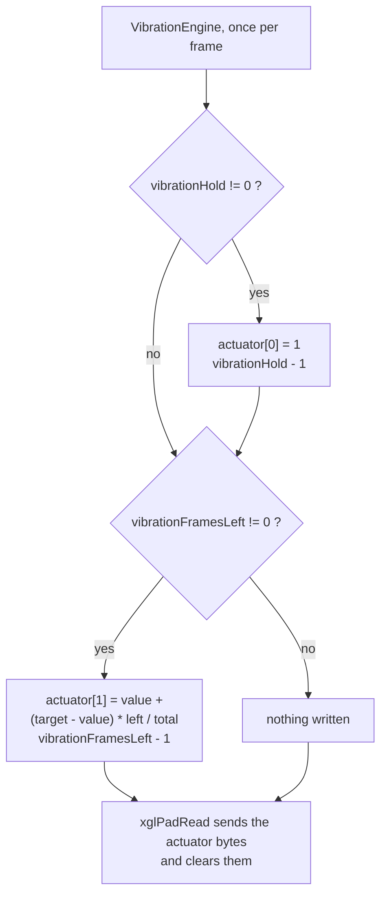

## 21. The MSe object pool

`src/main/m_se_obj.c` looks like a sound file by its name, but `MSe` is not
"sound effect". It is a pool of visual effect objects that the battle
overlay's `MEf` effects are built from. It is covered in
[Battle effects](../game/battle-effects.md). A short summary follows, so that
the name is not mistaken.

The pool is 127 slots (`MSE_OBJ_SLOTS`) of `0x800` bytes each at the fixed
address `0x01FB0000`. `MSeObjInit` clears it and is called when the battle
scene systems start. `MSeObjShutdown` forgets it. `MSeObjAlloc` takes the
first free slot and sets its flag `MSE_OBJ_BUSY`. `MSeObjRequestFree` sets
`MSE_OBJ_FREE_REQUESTED` on an object.

Each object has four callbacks, `modeProc[0]` to `modeProc[3]`.
`MSeObjProc(mode)` runs one of them for every busy object and is called four
times per frame from the effect system in `src/main/sef.c`: modes 0 and 1 in
the update part, modes 2 and 3 in the draw part.

| Mode | Extra work |
| --- | --- |
| 0 | Takes a snapshot of camera 0 into `MEfCamParams` (view matrix, rotation, rotation matrix) before the callbacks |
| 1 | Calls `MSeMode1Hook` after the callbacks, if set |
| 2 | Selects each object's image mapper with `svForceImageMapper` before its callback, then calls `MSeMode2Hook`, if set |
| 3 | Frees the objects that asked for it |

The file also holds `MMathMatrixBetweenVectors`, which builds the rotation
that turns one unit vector onto another. It belongs to
[Math](../libraries/math.md).

## 22. The IOP modules

Three IOP modules produce the sound. None of them is game code. The game
only loads them and talks to them through the two linked client libraries,
so this section describes them from the EE side.

| Module | Loaded as | Arguments | Role |
| --- | --- | --- | --- |
| `LIBSD.IRX` | `libsd` | none | Sony's sound library, the access to the SPU2 for the two modules below |
| `CRI_ADXI.IRX` | `cri_adxi` | `spucore=1` | CRI's sound output module. The EE library decodes ADX and Sofdec audio and this module plays it |
| `KORGIVAG.IRX` | `korgivag` | `vag=256`, `key=256`, `prg=64`, `sbf=128`, `seq=64`, `ply=16` | The KORG sound driver: banks, programs, the MIDI sequencer, voices and an effect unit |

`CDVDSTM.IRX`, Sony's disc streaming module, is loaded just before them. The
game code does not call it directly.

What the game relies on, seen from its calls:

- The KORG driver reads bank and MIDI files from the disc by itself when it
  is given a start sector, and it also accepts files from EE memory.
- It keeps numbered bank slots and lets the caller place a bank's samples at
  a given address in sound memory.
- It has units with 16 MIDI channels each, a volume per unit and channel
  priorities per unit.
- It plays standard MIDI files as sequences that can be stopped, paused and
  resumed, and it accepts single MIDI messages for any unit, one at a time or
  batched.
- It has an effect unit with a type and a depth.
- The `spucore=1` argument of the CRI module reads as "use SPU2 core 1". By
  that reading the stream audio and the KORG voices do not compete for the
  same part of the sound chip. The game never checks this.

The linked libraries and the full module list are described in
[Runtime libraries](runtime-libraries.md).

## 23. Quirks in the code

- The third argument of `seBankLoad` and its relatives is named `bank_address`
  in the source, and the local constant for the system bank is
  `SYSTEM_SE_ADDRESS`. The values are start addresses in sound memory
  ([section 6](#6-sound-banks)).
- `soundCtrl.initialized` is described as a set-up flag, and
  `soundInitIfNeeded` as a one-time set-up. In fact the byte is never set by
  the game code, and the function is the per-frame flush of the MIDI queue.
  The byte works as a "hold the queue" switch that nothing uses.
- `soundSlotStop` releases the pause in the ADX library but does not clear
  the remembered pause value in `ramp.pause_value`. After `adxLoad` and a stop,
  the slot still counts as held for `soundSlotSetPauseIfNotHeld`. The play
  session clears it at its end with `soundSlotSetPause(0, 0)`.
- `bgmSlotLevelSet` and `actionSoundSlotLevelSet` are the same function
  twice, and so are `streamKeySlotLevelSet` and `streamSetLevel`. They sit in
  a file about display settings.
- The battle native `bgmFade` treats the value `0x5A` as a command, not as a
  level: `bgmFade(0x5A, n)` ignores `n` and sets level `0x5A` at once.
- Only ADX slot 0 is scaled by `master_volume`. With the default values a
  level of 100 becomes 86 on the music slot and stays 100 on the voice slot.
- A voice of bank slot 7 defaults to the music level instead of the sound
  effect level. In the field slot 7 is the player's footstep bank, in battle
  it is the handle of an enemy voice bank.
- The MIDI channel of a voice is the low four bits of its note number. Two
  sounds of one bank whose numbers differ by 16 share a channel, and the
  bank select and pan of the second one also reach the first while it still
  sounds.
- `seBgmSetSongLevel` scans its table until an entry with song 0, so the
  table cannot hold a song number 0, and the entry for song 203 with level 0
  is a real setting, not an end mark.
- `dataBattleSeUpload` and `dataSlotVoiceUpload` in the battle overlay upload a
  bank to the driver. They are named after the EE buffers they free
  afterwards.
- `seVoiceRecordAddAt` does not test whether a free record was found. With
  all 24 records in use it would write before the start of the table.
- `soundSlotStartKey`, `soundSlotLoopCountGet`, `seBgmLoadMemory`,
  `MSeSetMode1Hook` and `MSeSetMode2Hook` have no callers in the game.
- The developer sound test reads its lists from a development host
  (`host0:/home/xeno/vcd-f/x2/sound/vsf/_list.txt` and the same for `smf` and
  `adx`). The three folder names match the three disc folders `sound\vsf\`,
  `sound\smf\` and `sound\adx\`.
