# Files and resources

Almost all game data of Xenosaga Episode II is stored in a few very large
archive files on the two DVDs, `XENOSAGA.00` to `XENOSAGA.24`. Each archive
group starts with a directory of path names, and the file library `xgl_cd`
finds every file by its path (for example `model\char\pc\shion00.pxy`). The
same library reads the loose files of the disc, loads the two overlays and the
IOP modules, feeds the movie player through streams and tells the game which
disc is in the drive.

On top of plain file reads the field has a resource manager. It owns 16 MiB of
memory, cuts it into blocks, and loads whole *file sets* into them: the model,
textures, skeleton and motion of a character, or the model, collision and
script of a map. A short text file per scene, the scene resource script, lists
what a scene needs. The manager reads that list ahead of time, loads the new
resources in the background while the player walks towards an exit, and frees
what the next scene no longer uses.

This page describes the discs, the archive directory, the way from a path to
bytes in memory, the packed file format, the streams, the resource block
system with its file ids and file sets, the smaller sector arena used by the
menus, and the development loaders for a host PC, USB and LAN. The API side of
the file library is described in [xgl.md](../libraries/xgl.md), and the memory
that the resources live in is described in [memory.md](memory.md).

[← Back to the overview](../README.md)

## Source files

| File | Contents |
| --- | --- |
| `src/main/xgl_cd.c` | The file library: drive start-up, the archive directories (`xglCdArcInit`, `xglCdGetFilePosSub`), path lookup (`xglCdGetFilePos`), file reads (`xglCdReadFilePart`, `xglCdReadFile`), the request queue and the per-frame service (`xglCdControlThread`, `xglCdServiceRead`), streams (`xglCdStream*`), disc identification (`xglCdDiskCheck`), overlay and IOP module loading, the real-time clock (`xglClock*`) and the debug file selector (`xglCdFileSelect`) |
| `include/main/xgl_cd.h` | `CdFilePosition`, `CdStreamParam`, `StreamRing`, `XglClock`, the read modes, the source numbers and the callback type |
| `src/main/xgl_timer0.c` | The packed file decoder `xglArxExtract` with its bit reader, the language code `xglGetLanguageCode`, and the two EE timer 0 helpers `xglTimer0Reset` and `xglTimer0Get` |
| `src/main/res_get_path.c` | The resource manager: the block table `gameResBlockTable` and its allocator (`GameResBlock*`, `GameResLoadID`, `GameResLoadName`), the file groups and file ids (`xglCdFileGroups`), the file set loaders (`xglCdLoadFileSet`, `xglCdLoadBinFileSet`), the scene resource script reader (`resLoadCfFile`, `resScriptRun`, `resApplyCfFile`) and its commands (`resCmd*`), the jump points that start preloading, the player slots, and the sound state a scene sets up |
| `include/main/res_get_path.h` | `GameResBlock`, `GameResCallback`, `ResJumpPoint` and the prototypes of the resource manager |
| `src/main/xgl_cd_arena.c` | The sector arena of the menus (`xglCdArenaOpen`, `xglCdSectorAlloc`, `xglCdBuffer*`), tagged background reads (`xglCdReadFileAsync`), and a few unrelated per-frame helpers (play time, tick counter, callback queue, two pad tests) |
| `src/main/xgl_debug_file.c` | The host file functions `xglDebFileSize`, `xglDebFileRead` and `xglDebFileWrite`, which are stubs in this build |
| `src/main/lan_usb.c` | A small file transfer client over the Sony network stack: `UsbInit`, `LanOpen`, `UsbReadFile`, `UsbWrite`, `UsbSend`, `UsbRecv` |
| `src/main/srs_file.c` | Three helpers of the effect loader: `srsFileLoad` (a wrapper around `fileLoad`), `srsEffectNameToID` and `srsIsEffectImageKey` |
| `src/main/script_load.c` | The development loader of a scene script from the host PC: `scriptLoadByNumber`, `scriptReadFile`, `scriptFreeBuffer` |

Several other files are needed to follow a read from start to end. The load
modes of the effect files are in `src/main/srs.c`, the HDD support is in
`src/main/xgl_hdd.c`, the disc change screen is in
`src/main/game_disk_change.c`, and the start-up order is in
`src/main/control_entry.c`.

## The discs

The game is shipped on two DVDs. The root of each disc holds the boot
configuration `SYSTEM.CNF`, the main executable, the two overlays `OV01.OVL`
and `OV02.OVL`, an `IOP` folder with nine files, and the archive files. The
executable, the overlays and the IOP modules are loose ISO 9660 files that the
Sony loaders read. Everything else is inside an archive.

The two discs differ only in the name of the executable and in their second
archive group. Disc 1 boots `SLUS_208.92` and disc 2 boots `SLUS_211.33`. The
two executables are byte for byte the same file, and so are both overlays, the
IOP folder and the whole first archive group. The game can therefore be
started from either disc, and the common data is always in the drive.

| File | Disc 1 | Disc 2 | Size in bytes |
| --- | --- | --- | --- |
| `SYSTEM.CNF` | `BOOT2 = cdrom0:\SLUS_208.92;1` | `BOOT2 = cdrom0:\SLUS_211.33;1` | 57 |
| Executable | `SLUS_208.92` | `SLUS_211.33` | 5,877,344 |
| `OV01.OVL` | yes | yes | 450,848 |
| `OV02.OVL` | yes | yes | 20,160 |
| `XENOSAGA.00` | yes | yes | 108,544 (53 sectors, directory only) |
| `XENOSAGA.01` | yes | yes | 1,073,741,824 |
| `XENOSAGA.02` | yes | yes | 165,586,944 |
| `XENOSAGA.10` | yes | | 6,144 (3 sectors, directory only) |
| `XENOSAGA.11` to `.13` | yes | | 1,073,741,824 each |
| `XENOSAGA.14` | yes | | 192,774,144 |
| `XENOSAGA.20` | | yes | 4,096 (2 sectors, directory only) |
| `XENOSAGA.21` to `.23` | | yes | 1,073,741,824 each |
| `XENOSAGA.24` | | yes | 203,825,152 |

The archives come in three groups. A group is one logical archive split into
pieces of at most 1 GiB. The first piece, `XENOSAGA.n0`, holds only the
directory, and the data pieces `.n1`, `.n2` and so on follow it. File
positions in the directory are counted in 2048-byte sectors from the start of
`XENOSAGA.n0`, so the code treats all pieces of a group as one continuous run
of sectors. This works because the pieces are stored one after another on the
disc.

Group 00 is the common data that every part of the game needs. Groups 10 and
20 are the two halves of the story, one per disc. The code never names a
group when it asks for a file. It searches the directories it has in memory,
and a file of the missing half is simply not found until the player changes
the disc.

The `IOP` folder holds the IOP kernel replacement image and eight modules.
`InitializeSystem` in `src/main/control_entry.c` reboots the IOP with the image
and loads the modules in the order of the table.

| File | Size | Loaded as | Purpose |
| --- | --- | --- | --- |
| `IOPRP271.IMG` | 266,817 | `sceSifRebootIop` | IOP kernel image |
| `SIO2MAN.IRX` | 6,641 | `sio2man` | Serial port manager for pads and memory cards |
| `MCMAN.IRX` | 95,877 | `mcman` | Memory card manager |
| `MCSERV.IRX` | 7,417 | `mcserv` | Memory card server |
| `PADMAN.IRX` | 43,813 | `padman` | Controller manager |
| `CDVDSTM.IRX` | 24,721 | `cdvdstm` | Disc streaming |
| `LIBSD.IRX` | 28,605 | `libsd` | Sound device library |
| `CRI_ADXI.IRX` | 117,339 | `cri_adxi` | CRI ADX driver |
| `KORGIVAG.IRX` | 128,194 | the KORG driver | KORG sound driver |

The modules themselves are described in
[runtime-libraries.md](runtime-libraries.md) and [audio.md](audio.md). The
diagram below shows what is on each disc.

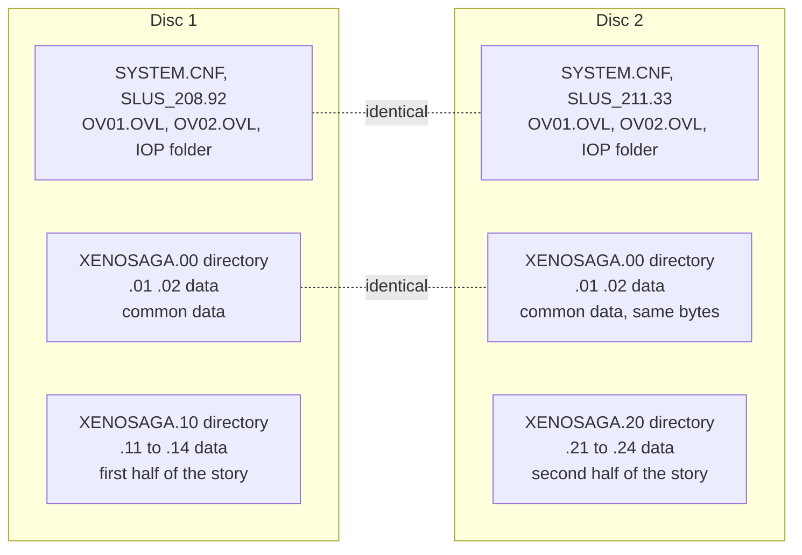

## Starting the file library

`InitializeSystem` sets the work memory pointer `WorkEnd` to `0xB00000` and
then calls `xglCdInitial`. This is the first use of the disc after the IOP
modules are loaded. `xglCdInitial` does the following steps in order.

1. It clears the device handle `xglCdDeviceHandle` and the drive fields of the
   control block `LW`: spindle control, search layer, dual-layer flag,
   power-off flag, disc state and disc flags.
2. It starts the drive with `sceCdInit(0)` and selects DVD media with
   `sceCdMmode(SCECdDVD)`.
3. It allocates `0x40 * 2048 + 0x80` bytes on the IOP heap and starts the
   Sony stream reader with `sceCdStInit(0x40, 0x10, buffer)`. The IOP side
   then has a ring of 64 sectors in 16 banks for streamed reads.
4. `xglCdReset` empties the request queue and the stream list, sets the
   stream turn period to `0x40` ticks, makes `xglCdDefaultCallback` the
   current callback, pauses the drive and waits for it.
5. `sceCdReadDvdDualInfo` reports whether the disc has two layers. The answer
   is stored in `LW.dual_layer_disc`.
6. `loaded_overlay` is set to `OVERLAY_TITLE` (2), and the four archive slots
   of `ArcHeader` are marked unused (`CD_SOURCE_UNUSED`, `0xFF`).
7. `xglHddActivate(HDD_ACTIVATE_NO_ARC_CHECK)` and `xglHddMount` try to bring
   up the hard disk.
8. `xglCdArcInit` loads the archive directories.

Later in `main`, after the system is up, `xglCdOpenDevice` opens the disc
through the CRI file layer with `ADXF_Open("CDV:DVD-ROM", 0)` and stores the
handle in `xglCdDeviceHandle`. From then on every disc read of the library
goes through `ADXF_Seek` and `ADXF_ReadNw` in place of `sceCdRead`. This is
probably done so that file reads and ADX audio streams share the drive through
one scheduler. The directories are read before that, with `sceCdRead`.

### Loading the directories

`xglCdArcInit` reads the directory of each archive group into the work memory
at `WorkEnd` and keeps it there for the whole run. Each of the four entries of
`ArcHeader` describes one group.

| Offset | Type | Field | Meaning |
| --- | --- | --- | --- |
| `0x00` | `unsigned char` | `source` | Where the group is read from: `CD_SOURCE_DISC` (0), `CD_SOURCE_HOST` (1), `CD_SOURCE_HDD` (2), or `CD_SOURCE_UNUSED` (`0xFF`) |
| `0x02` | `unsigned char` | `packed` | Set by a lookup: the found file is packed |
| `0x04` | `unsigned char *` | `destination` | Address of the directory in memory |
| `0x08` | `int` | `lbn` | Sector number of `XENOSAGA.n0` on the disc |
| `0x0C` | `int` | `file_lbn_offset` | Set by a lookup: sector offset of the found file from the start of the group |
| `0x10` | `int` | `stored_bytes` | Set by a lookup: bytes on disc |
| `0x14` | `int` | `size_bytes` | Set by a lookup: bytes after unpacking |

One entry is `0x18` bytes. Slot 0 is group 00, slot 1 is the story group on
the disc, slot 2 is only used on a dual-layer disc, and slot 3 is never
filled.

The helper `xglCdArcInitSub1` loads one directory. It looks the file name up
as a loose ISO file, stores the sector number, and reads the first sector with
`xglCdArcInitSub0`. The first byte of that sector is the number of directory
sectors. When it is 2 or more, the remaining sectors are read right behind the
first. The function returns the sector count plus one, or 0 when the file is
missing.

Each released disc holds about 4.66 GB, which fits on one DVD layer, and the
size constants of the single-layer path match the files of the released discs
exactly. `xglCdArcInit` therefore takes its single-layer path. It loads `xenosaga.00` at `WorkEnd`, skips
`CD_ARC_LOOKAHEAD_BYTES` (`0x1A800`, exactly the 53 sectors of
`XENOSAGA.00`), and loads `xenosaga.10` there. When that file is missing it
tries `xenosaga.20` in the same slot. When neither exists the slot is marked
unused and gets an empty directory. Finally `CD_ARC_HEADER_RESERVE` (`0x1800`,
the 3 sectors of `XENOSAGA.10`) is added, and `WorkEnd` is moved past both
directories.

```
work memory after xglCdArcInit on a released disc

0xB00000  +-----------------------------------+  ArcHeader[0].destination
          | directory of XENOSAGA.00          |
          | 0x1A800 bytes (53 sectors)        |
0xB1A800  +-----------------------------------+  ArcHeader[1].destination
          | directory of XENOSAGA.10 or .20   |
          | 0x1800 bytes reserved (3 sectors) |
0xB1C000  +-----------------------------------+  WorkEnd
          | free work memory                  |
```

The code also has a path for one dual-layer disc that holds all three groups.
There `xglCdArcInitSub2` walks the records of a directory to find its real
end, rounds up to a 64-byte boundary and writes a two-byte terminator, so the
three directories are packed tightly one after another. The directory of
`xenosaga.20` is searched on the second layer (`LW.search_layer` is 1 during
that lookup). On such a disc `xglCdDiskCheck` always reports that every disc
is present.

When a hard disk is active, `xglCdArcInit` first tries to open
`pfs0:/xenosaga.00`. If that works, the directory of group 00 is read from the
HDD and slot 0 gets the source `CD_SOURCE_HDD`. In this build
`xglHddCheckCore` in `src/main/xgl_hdd.c` always returns -1, so the HDD is
never mounted and the disc path is always taken.

`xglCdArcCheck` loads the directories again into the memory they already use
and keeps `WorkEnd`. The disc change screen calls it after a new disc is
accepted, which replaces the directory in slot 1 with the one of the other
story group.

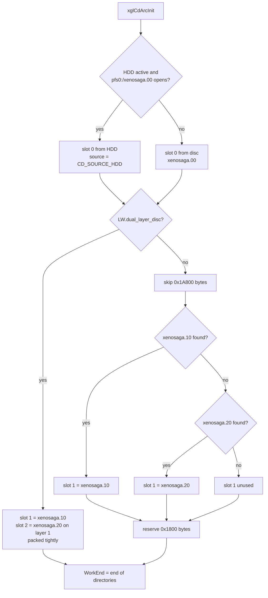

## The archive directory

A directory starts with one byte, the number of directory sectors. Records
follow from byte 1, and a zero byte ends the list. Every record starts with a
flags byte. Its low 6 bits (`ARC_RECORD_LENGTH_MASK`) give the length of the
record up to the end of its name part, counting the flags byte. Bit 7
(`ARC_RECORD_DIRECTORY`) marks a directory record. Bit 6
(`ARC_RECORD_PACKED`) marks a packed file.

```
directory record (bit 7 set):
  +0  flags            0x80 | length
  +1  levels up        how many directory levels to leave first
  +2  name record      length - 2 bytes

file record (bit 7 clear):
  +0  flags            bit 6 = packed, low 6 bits = length
  +1  name record      length - 1 bytes
  +n  sector offset    3 bytes, little endian, from the start of XENOSAGA.n0
  +n+3 stored size     4 bytes, little endian, bytes on disc
  +n+7 unpacked size   3 bytes, little endian, only when the packed bit is set
```

Names are stored with front and back compression. `xglCdArcNameExpand` turns a
name record into text. The record starts with a count byte.

- A count of zero means that a complete name follows, ended by a zero byte.
  It replaces the text at the current position.
- Any other count keeps most of the text that is already there. The low
  nibble is the number of bytes to copy from the record. The high nibble plus
  one says how many characters before the end of the old name the copy
  starts. The rest of the old name stays as it is.

A run of files such as `shion00.pxy`, `shion00.txy`, `shion00.xhr` therefore
costs only a few bytes per name: each record replaces the changed letters of
the name before it. The 3-byte unpacked size limits a packed file to 16 MiB,
and the 3-byte sector offset limits a group to 16,777,216 sectors.

The records form a depth-first walk of a directory tree. A directory record
first leaves some levels, then enters a new directory, and the file records
that follow belong to it. `xglCdGetFilePosSub` walks the list for one
requested path. It keeps the path it is building in a 256-byte buffer and an
array of 16 pointers (`ARC_DIRECTORY_DEPTH_MAX`), one for the start of the
name at each depth.

Before the walk the function counts the backslashes of the requested path and
notes the length of its directory part. The pair (depth, directory length) is
kept in an `ArcNameKey` and compared as one word. A file record is only
expanded and compared when the walk stands at the same depth with a directory
part of the same length. All other file records are skipped by their length
alone, which makes the search cheap even though it is linear.

For a file record that passes this test the name is expanded, the total
length is compared with the length of the request, and then the two strings
are compared byte by byte. On a match the entry of `ArcHeader` receives the
sector offset, the stored size, the packed flag and the unpacked size, and
the function returns 1. It returns 0 when the zero byte at the end of the
list is reached.

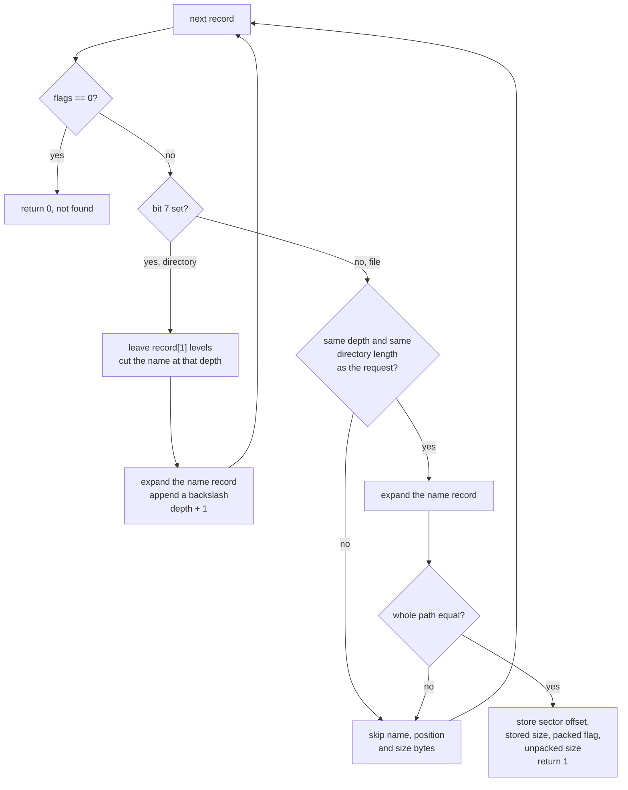

## From a path to a position

Every read starts with a path, written with backslashes and relative to the
data root, for example `yajima\diskchg.jpg` or `sound\vsf\CFS_SE.vsf`.
`xglCdGetFilePos` turns the path into a `CdFilePosition`.

| Offset | Type | Field | Meaning |
| --- | --- | --- | --- |
| `0x00` | `unsigned int` | `lbn` | First sector of the file on its source |
| `0x04` | `int` | `stored_bytes` | Bytes on the source |
| `0x24` | `unsigned char` | `source` | `CD_SOURCE_DISC`, `CD_SOURCE_HOST` or `CD_SOURCE_HDD` |
| `0x26` | `unsigned char` | `packed` | Nonzero when the data may be packed |
| `0x28` | `int` | `descriptor` | Open file descriptor of a host or HDD file |
| `0x2C` | `int` | `size_bytes` | Bytes after unpacking |

The record is `0x30` bytes. The lookup works in these steps.

1. A path that starts with `data\` loses that prefix. The function prints
   both forms with `printf` (`**** replace path [...]->[...]`), so this was a
   compatibility aid for older path strings.
2. Unless the path starts with a backslash, every forward slash in it is
   turned into a backslash. The change is made in the caller's string.
3. The archive slots are searched in order: slot 0, slot 1, slot 2. The first
   directory that contains the path wins. The path is then replaced by the
   name of the archive file itself (`xenosaga.00`, `xenosaga.10` or
   `xenosaga.20`), and the source of the slot becomes the source of the file.
4. A path that starts with a backslash is an absolute device path. The
   backslash is dropped, the rest is used as it is, and the source becomes
   `CD_SOURCE_HOST`. Such a path can name any device of the I/O manager, for
   example `host0:`.
5. Otherwise the final name is built for the source. For the disc it is
   upper-cased and gets a leading backslash and the version suffix `;1`. For
   the host it gets the prefix `host0:/home/xeno/vcd-f/x2/`, and for the HDD
   the prefix `pfs0:/`, both with forward slashes.
6. The callback is told about the lookup with `CD_EVENT_LOOKUP`, the original
   path and the current read tag.
7. For the disc and a file found in an archive, the position is the sector of
   the archive plus the sector offset of the record. A path that no archive
   contains is searched as a loose ISO 9660 file with `sceCdLayerSearchFile`
   on the layer `LW.search_layer`. A loose file gets `packed = 1`, which only
   means that the reader will check it for the packed signature.
8. For the host and the HDD the file is opened with `sceOpen`. For an archive
   member the descriptor is moved to the member with `sceLseek`, in steps of
   at most `0x40000000` bytes, because the offset can be larger than one seek
   allows. For a plain file the size comes from seeking to its end.

The function returns the record, or 0 when the file does not exist.
`xglCdGetFileData` is the probe form: it fills a record, closes a descriptor
that the lookup opened, and returns 0 or -1. `xglCdGetFileSize` returns
`size_bytes` or -1. Many callers use `xglCdGetFileSize` to test whether a file
exists before they read it, and the sound code uses `xglCdGetFileData` to hand
the sector number of a bank or an ADX file to the IOP drivers, which then read
the data themselves (see [audio.md](audio.md)).

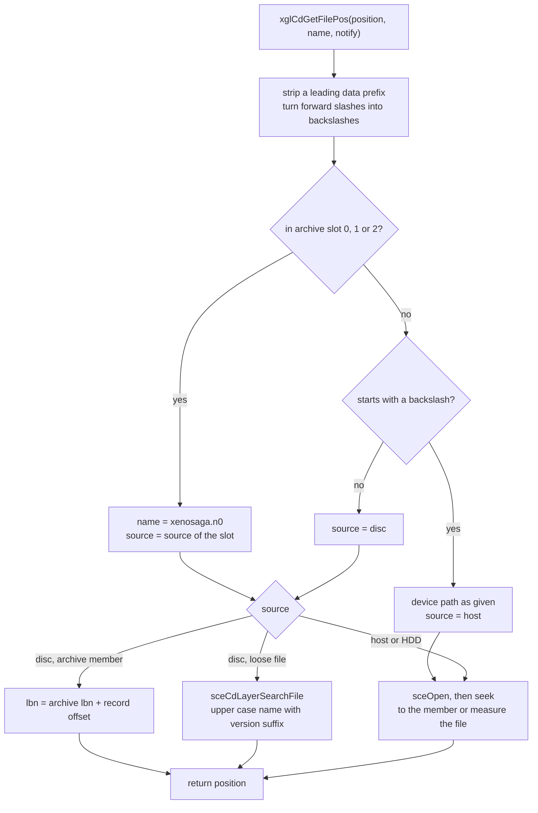

## Reading a file

`xglCdReadFile(name, buffer, mode, notify)` reads a whole file.
`xglCdReadFilePart` is the full form with a byte offset and a length. The
offset is rounded down to a sector, and a length of zero or less means the
whole file. The HDD install uses the partial form to copy the archive pieces
in slices of 16 MiB.

The mode is a small set of flags.

| Value | Name | Meaning |
| --- | --- | --- |
| 0 | `CD_READ_SYNC` | Read now and return when the data is in memory |
| 1 | `CD_READ_ASYNC` | Start the read, or queue it behind an active read, and return at once |
| 2 | `CD_READ_NO_EXTRACT` | Leave packed data as it was read |
| 4 | `CD_READ_WHILE_BUSY` | As the whole mode value: read synchronously even though the library is not idle |

The `notify` argument is a callback of the type `CdCompletionCallback`, which
receives an event number, a value and a tag. Three small numbers select a
ready-made callback instead: `CD_NOTIFY_CURRENT` (0) is the global callback
that `xglCdSetCallback` installed, `CD_NOTIFY_DUMMY` (1) and
`CD_NOTIFY_DEFAULT` (2) are two empty functions. The tag is the *read tag*, a
word that the caller sets with `xglCdSetReadTag` before the read. It lets one
callback serve many reads, for example by carrying a block index.

| Event | Name | Value |
| --- | --- | --- |
| 0 | `CD_EVENT_LOOKUP` | The path that is being looked up |
| 1 | `CD_EVENT_SIZE` | The stored size, rounded up to whole sectors |
| 2 | `CD_EVENT_PROGRESS` | Progress of a synchronous read: bytes read so far or the drive's read position |
| 3 | `CD_EVENT_PROGRESS_ASYNC` | The same for an asynchronous read, at most once per frame |
| 4 | `CD_EVENT_DONE` | The read is complete. For an asynchronous read the value is the number of requests still queued |
| -2 | `CD_EVENT_READ_ERROR` | A disc read failed and is being repeated. The value is the error code |

The return value of a synchronous read is the unpacked size rounded up to a
whole sector, so callers can advance a bump pointer by it. An asynchronous
read that starts at once returns the unpacked size, and one that is queued
returns 0. A missing file gives -1. `CD_READ_BUSY` (-3) is returned when a
synchronous read is asked for while another read or a stream is active.

Data is always read in whole sectors. A file that may be packed is read into
the *end* of the place it will finally occupy, and is then expanded forward
into the same buffer. The buffer must therefore have room for the unpacked
size, rounded up to a sector.

```
buffer for a packed file

buffer                                  buffer + round(size_bytes)
  |                                               |
  +-----------------------+-----------------------+
  | free at first         | packed data as read   |
  +-----------------------+-----------------------+
                          ^
                          extract_source = buffer + round(size_bytes) - round(stored_bytes)

after extract():

  +-----------------------------------------------+
  | unpacked data                                 |
  +-----------------------------------------------+
```

After the read, `extract` looks at the first word of what was read. When it is
the ARX signature and the fourth word is zero, `xglArxExtract` unpacks the
data. Otherwise the words are copied to the start of the buffer if they were
read elsewhere. The check on the data itself means that the packed bit of the
directory is only a hint about where to place the data.

A synchronous disc read waits in a loop and reports progress on every pass.
When the drive reports an error above `SCECdErABRT`, or the CRI layer reports
state 4, the callback gets `CD_EVENT_READ_ERROR` and the read is started
again. There is no retry limit. A host or HDD file is read with `sceRead` in
chunks of at most 64 KiB (`CD_FILE_CHUNK_BYTES`). The unused end of its last
sector is filled with a falling byte pattern, the descriptor is closed, and
the data is unpacked like disc data. A failed `sceRead` closes the file, shows
the HDD error screen through `hdd_error` and starts the whole request again.

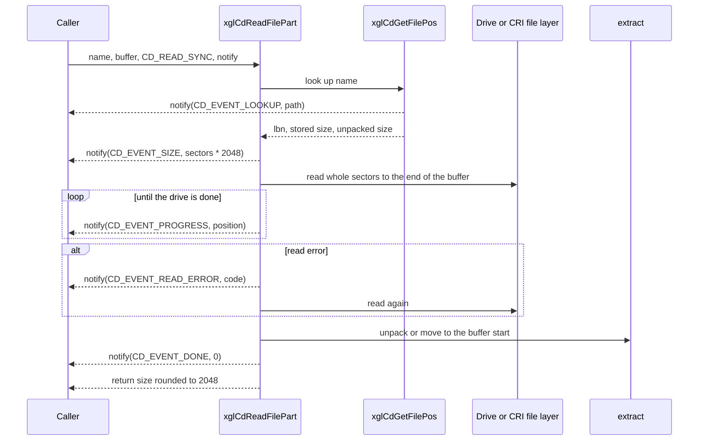

## The request queue and the per-frame service

The library has no thread of its own. Its state lives in the control block
`LW` (type `CdReadControl`, at `0x955C80`), and one function,
`xglCdControlThread`, advances that state once per frame. `xglSleep` in
`src/main/xgl_thread.c` is the frame wait of the whole game, and it calls
`xglRenderFrame`, `xglCdControlThread` and `xglStudioUpdate` in this order.

| Offset | Field | Meaning |
| --- | --- | --- |
| `0x00` | `active_file_descriptor` | Descriptor of the host or HDD file that is being read, -1 when none |
| `0x04` | `write_cursor` | Where the next chunk of that file goes |
| `0x08` | `remaining_bytes` | Bytes of that file still to read |
| `0x0C` | `read_poll_mode` | Source of the active read (`CD_SOURCE_*`) |
| `0x10` | `completion_callback` | Callback of the active read |
| `0x14` | `callback_argument` | Read tag of the active read |
| `0x1C` | `disk_state` | Disc identification state |
| `0x1D` | `disk_flags` | Which story groups the disc holds |
| `0x20` | `extract_source` | Where the data is read to |
| `0x24` | `extract_destination` | Where the unpacked data goes, the caller's buffer |
| `0x28` | `extract_byte_count` | Stored size rounded up to sectors |
| `0x30` | `dispatch_state` | What the library is doing, see below |
| `0x31` | `spindle_control` | Spindle setting passed to `sceCdRead` |
| `0x32` | `search_layer` | DVD layer for loose file lookups |
| `0x33` | `dual_layer_disc` | Result of `sceCdReadDvdDualInfo` |
| `0x34` | `power_off_pending` | Set by `xglCdPowerOffCB` |
| `0x3E` | `queue_cursor` | Index of the next queued request to start |
| `0x3F` | `queue_tail` | Index where the next request is stored |
| `0x40` | `requests[32]` | The queue, `0x80` bytes per request |

The byte `dispatch_state` has four values. The source also reaches the same
byte under the name `xglCdDispatchState`, so `xglCdServiceIfPending` and
`xglCdGetServicePending` really test whether the library is in any state
other than idle.

| Value | Name | Meaning |
| --- | --- | --- |
| 0 | `CD_STATE_IDLE` | Nothing is active |
| 1 | `CD_STATE_SYNC_READ` | A synchronous read is running inside `xglCdReadFilePart` |
| 2 | `CD_STATE_ASYNC_READ` | An asynchronous read is running and is advanced by `xglCdServiceRead` |
| 3 | `CD_STATE_STREAM` | At least one stream is open |

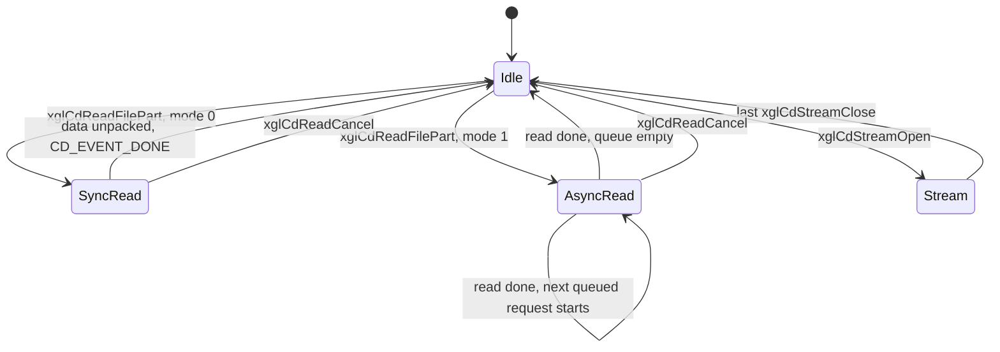

### Queued requests

When an asynchronous read is asked for while another read is active,
`xglCdReadFilePart` stores it in the queue and returns 0. A request keeps the
buffer, the offset, the length, the callback, the read tag of that moment and
a copy of the path.

| Offset | Field | Meaning |
| --- | --- | --- |
| `0x00` | `buffer` | Destination |
| `0x04` | `offset` | Byte offset in the file |
| `0x08` | `length` | Byte count, or -1 for the whole file |
| `0x0C` | `completion_callback` | Callback of this request |
| `0x10` | `tag` | Read tag to restore when the request starts |
| `0x14` | `name` | Path, up to `0x6C` bytes with its terminator |

`LW` has room for 32 requests (`CD_QUEUE_SIZE`). The two queue indices are
wrapped with the mask `0x7F`, as if there were 128, so more than 32 pending
requests would write past the queue. The game never queues that many.

`queue_next` ends one asynchronous read and starts the next. It calls the
callback of the finished read with `CD_EVENT_DONE` and the number of requests
still pending, sets the state to idle, and, when the queue is not empty,
restores the tag of the next request and calls `xglCdReadFilePart` for it in
asynchronous mode. Since the state is idle at that moment, the read starts at
once.

### One step of the service

`xglCdControlThread` does four things on every frame.

1. It counts down `ReadClockInterval`, which limits how often the real-time
   clock is read (see [The real-time clock](#the-real-time-clock)).
2. When `LW.power_off_pending` is set, it closes all files of `pfs0:` and
   `pfs1:` with `sceDevctl`, switches the expansion bay device `dev9x:` off
   and calls `sceCdPowerOff`. The flag is set by `xglCdPowerOffCB`.
3. It serves the current state. In `CD_STATE_ASYNC_READ` it calls
   `xglCdServiceRead`. In `CD_STATE_STREAM` it refills the ring of the current
   stream (see [Streams](#streams)).
4. It clears the byte `xglCdServiceActive`.

`xglCdServiceRead` advances the active asynchronous read by one step. For a
disc read it reports the position with event 3 and tests whether the drive, or
the CRI layer, is done. When it is, the data is unpacked with `extract` and
`queue_next` starts the next request. When the queue is empty after a plain
`sceCdRead`, the drive is paused. For a host or HDD file one chunk of at most
64 KiB is read per step, and after the last chunk the sector is padded, the
file is closed, the data is unpacked and `queue_next` runs.

The byte `xglCdServiceActive` limits the progress event. `xglCdServiceRead`
sets it when it returns, and it skips the progress callback while the byte is
set. Many places in the game wait with a tight loop of the form
`while (xglCdServiceIfPending() != 0) {}`, which calls `xglCdServiceRead` over
and over inside one frame. Thanks to the byte, the callback sees one progress
event per frame, and the loop still finishes all queued reads before it ends.

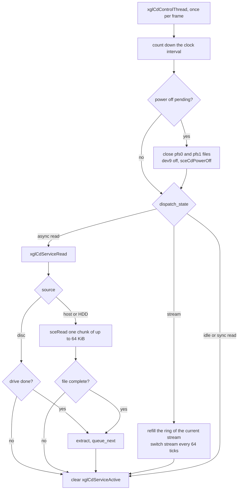

### Cancelling

`xglCdReadCancel(immediate)` drops all queued requests and stops the active
read. A disc read is stopped with `ADXF_StopNw` or `ADXF_Stop` when the CRI
handle is open (the argument chooses the form that returns at once), and with
`sceCdBreak` and `sceCdPause` otherwise. An asynchronous host or HDD read has
its descriptor closed. The state then becomes idle. `resResetScriptState`
calls it before a scene's resource list is thrown away, and the title screen
and the HDD install use it as well.

`xglCdSyncDone` tells whether the drive has finished its last request. The
field code tests it before it starts background preloading, so that a preload
never competes with a read that is still in flight.

## Packed files (ARX)

Many files in the archives are stored packed. The packed bit of a directory
record says so, and the data itself starts with a header of 34 words.

| Word | Name | Contents |
| --- | --- | --- |
| 0 | `ARX_MAGIC_WORD` | The signature `0x00585241`, the letters `ARX` and a zero byte |
| 1 | `ARX_SIZE_WORD` | Unpacked size in bytes |
| 2 | `ARX_STREAM_SIZE_WORD` | Size of the coded stream in bytes |
| 3 | `ARX_FLAGS_WORD` | Must be zero |
| 4 to 33 | `ARX_TABLE_WORD` | A table of 30 words (`ARX_TABLE_COUNT`) |
| 34 on | `ARX_DATA_WORD` | The coded stream |

The format works on whole 32-bit words. The table holds 30 words that occur
often in the file. The stream is a sequence of 32-bit words of two kinds that
are mixed freely: *bit words*, which the bit reader consumes from the top bit
down, and *literal words*, which are taken from the stream as they are.

Each output word starts with one flag bit, read by `getbit1`.

- Flag 0: the next whole word of the stream is the output word.
- Flag 1: a table code follows. A run of 1 bits ended by a 0 bit selects a
  class, and then some index bits, read by `getbits`, select the entry in the
  class.

| Code bits after the flag | Index bits | Table entries | Total bits |
| --- | --- | --- | --- |
| `0` | 1 | 0 and 1 | 3 |
| `10` | 2 | 2 to 5 | 5 |
| `110` | 3 | 6 to 13 | 7 |
| `1110` | 4 | 14 to 29 | 9 |

A word from the table therefore costs 3 to 9 bits, and any other word costs
33 bits. The first table entries get the shortest codes. This suits model and
texture data, where a few words such as zero and one repeat very often.

`xglArxExtract(dest, src)` first copies the table to the first 64-byte
boundary at or after `WorkEnd`, so the decoder needs a little free work
memory. The copy is needed because the decoder usually works in place: the
packed data sits at the end of the buffer it unpacks into, and the output
will overwrite the header long before the stream is finished.

Unpacking in place has one more problem. The write position moves faster than
the read position, and near the end of the buffer it catches up. The decoder
checks first whether the stream and the destination overlap at all. If they
do, it decodes words until the write position reaches the read position.
At that point it copies the unread rest of the stream to the work memory
behind the table (32 words after the table start), continues reading from
that copy, and decodes the remaining words. The function returns the unpacked
size, or -1 when the signature or the flags word is wrong.

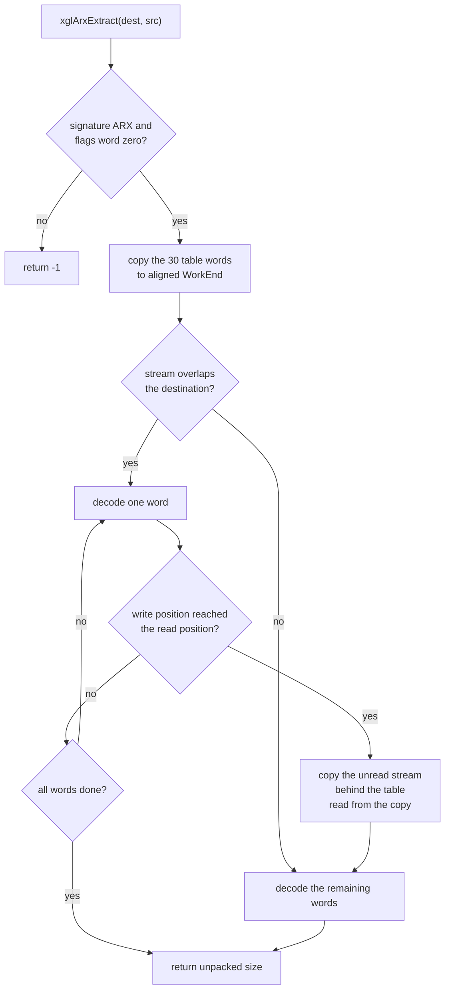

## Streams

A stream reads a file piece by piece while it is being used. The movie player
of `src/main/xgl_1.c` is the only user. It opens one stream per movie and
lets the IPU decoder take the data straight out of the stream's ring buffer
(see [xgl.md](../libraries/xgl.md)).

| Offset | Field | Meaning |
| --- | --- | --- |
| `0x00` | `xss` | Interleave state of an XSS stream, 0 for a plain stream |
| `0x04` | `exhausted` | Set when no bytes are left |
| `0x05` | `source` | `CD_SOURCE_DISC`, `CD_SOURCE_HOST` or `CD_SOURCE_HDD` |
| `0x08` | `sector_position` | Current sector inside the file |
| `0x0C` | `block_size` | Reads are padded to this size, 2048 after an open |
| `0x10` | `descriptor` | First sector on the disc, or the descriptor of a host or HDD file, -1 when closed |
| `0x14` | `file_byte_count` | Size of the file |
| `0x18` | `remaining` | Bytes that have not been moved into the ring yet |
| `0x20` | `ring` | The ring buffer: `buffer`, `capacity`, `write_position`, `read_position` |
| `0x30` | `alternate_ring` | Second ring of an XSS stream |

`xglCdStreamParamInit` puts a record into its closed state. The owner then
sets the ring buffer and its capacity and calls `xglCdStreamOpen` with a
path. The open looks the file up, fills the source and the sizes, and puts
the library into `CD_STATE_STREAM`. The first disc stream starts the Sony
stream reader at the file's sector with `sceCdStStart`. A further stream is
only sought to its start. A stream that has a ring buffer is entered in the
service list `xglCdStreamService.list`, which has two places
(`CD_STREAM_LIST_SIZE`).

While the state is `CD_STATE_STREAM`, the per-frame service refills the ring
of the current stream with `xglCdStreamReadRingCore`. For a plain stream,
`StreamReadRingCoreNormal` works out how many sectors fit between the write
position and the read position, in one piece or in two pieces around the end
of the ring. It limits that to the number of sectors the IOP side has ready
(`sceCdStStat`, or a fixed 32 sectors for a host or HDD file) and reads them
with `StreamReadRingCoreSub`. At the end of the file the last block is filled
with zeros and the stream is marked exhausted.

The consumer calls `xglCdStreamReadRing(stream, bytes)` when it has used some
data. The call moves the read position forward by the byte count, rounded up
to sectors, and then refills the ring until it is full or the file ends.
`xglCdStreamSeek` moves a stream to a sector, `xglCdStreamRewind` moves it to
the start, and the movie player uses the rewind to loop a movie.
`xglCdStreamRead` is a direct read into a caller's buffer without the ring.
Nothing in the game calls it.

With two streams open the drive can only serve one at a time. The service
gives each stream a turn of `0x40` ticks (`turn_period`). When the turn
counter runs out, the next open stream in the list becomes current and is
sought to its own `sector_position`. `xglCdStreamClose` takes a stream out of
the list. When it was the last one, the Sony stream reader is stopped and the
library goes back to idle.

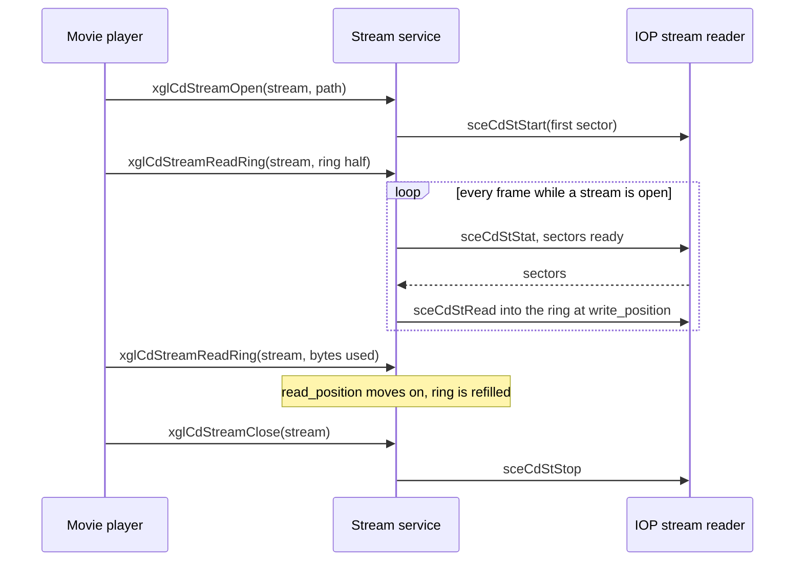

The code also knows an interleaved container. When a stream record has an
`xss` state, `StreamReadRingCoreXss` reads the file one sector at a time. The
first sector, and then one sector after every `0x4000` data sectors, is a
map. Each bit of the map says whether the next data sector belongs to `ring`
(0) or to `alternate_ring` (1), which lets one file carry two streams, most
likely video and audio. No caller in the game sets `xss`, so the
released game does not use this path.

## Disc identification and disc change

`xglCdDiskCheck` answers one question: which disc is in the drive. The answer
is a bit mask. Bit 0 (`CD_DISC_FLAG_ARC10`) means that the disc carries
`xenosaga.10`, so it is disc 1. Bit 1 (`CD_DISC_FLAG_ARC20`) means
`xenosaga.20`, disc 2. Zero means that the drive is empty, and a negative
value means that the disc cannot be used at this moment.

| Result | Name | Meaning |
| --- | --- | --- |
| 1 | | Disc 1 |
| 2 | | Disc 2 |
| `0x7F` | `CD_DISC_FLAGS_DUAL_LAYER` | A dual-layer disc with everything on it |
| 0 | | No disc |
| -1 | `CD_CHECK_UNSUPPORTED` | Not a disc of this game |
| -2 | `CD_CHECK_SHELL_OPEN` | The tray is open or was opened |
| -3 | `CD_CHECK_NOT_READY` | The drive is still working out what the disc is |

The function keeps a small state in `LW.disk_state`. A disc that has been
identified is only checked for a tray change (`sceCdTrayReq`) and an open
shell. A disc that has not been identified goes through the full test: the
drive must be ready, the disc type must be a PS2 DVD (`CD_DISC_PS2_DVD`, 20),
at least one of `xenosaga.10` and `xenosaga.20` must exist with a size of at
most `0x1800` bytes, and `system.cnf` must name an executable whose third
letter is `U`, as in `SLUS`. The size limit is the room that `xglCdArcInit`
reserves for the second directory.

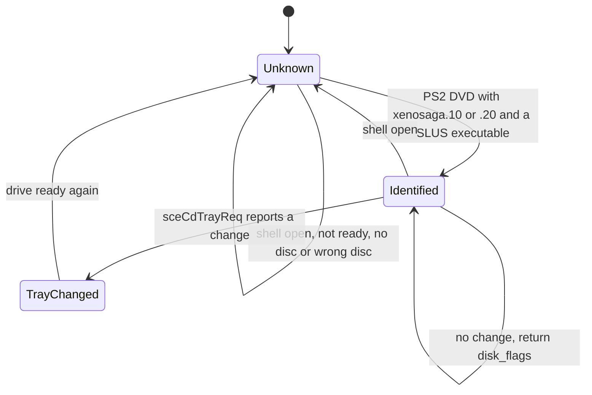

The disc change screen `GameDiskChange(request)` in
`src/main/game_disk_change.c` uses the function. The low four bits of the
request are the wanted disc, 1 or 2. When that disc is already in the drive
the function returns at once. Otherwise it loads the picture
`yajima\diskchg.jpg`, shows it with one of four messages (insert the disc, no
disc, incorrect disc, checking), and polls `xglCdDiskCheck` every frame. The
wanted disc must be seen on two frames in a row. Between the two,
`xglCdArcCheck` loads the directories again, so the story group of the new
disc replaces the old one in slot 1.

Two things ask for a disc. `GameSynopsis` asks for disc 1 or disc 2 before a
play session starts, depending on the story progress flag, and the scene
resource command `disk` asks for a disc when a scene needs it (see
[Scene resource scripts](#scene-resource-scripts)). The story side is
described in [events.md](../scripting/events.md), and the title flow in
[title-and-boot.md](../game/title-and-boot.md).

## Overlays and IOP modules

The two overlays are ELF files in the root of the disc. Both are linked to
load at `0xA80000`, so only one can be in memory at a time. `OV02.OVL` holds
the logo and title screens, and `OV01.OVL` holds the battle engine and the SB
script virtual machine.

`xglCdLoadOverlay(overlay)` loads overlay number `overlay` unless
`loaded_overlay` already holds that number. It builds the path
`cdrom0:\OVnn.OVL;1` from the two decimal digits, clears the `0x80000` bytes
at `0xA80000`, flushes the data cache and invalidates the instruction cache,
and calls `sceSifLoadElf` until it succeeds. The caches are flushed once more
after the load, because new code now sits where old code was.

`main` in `src/main/control_entry.c` drives the overlays. It loads overlay 2
and runs the boot logo. Then it loops forever: it loads overlay 2 again if
needed and calls `Title`. The result of `Title` is a word whose low 24 bits
are the entry address of the chosen program and whose top byte is the overlay
that the program needs. `main` loads that overlay and calls the address.

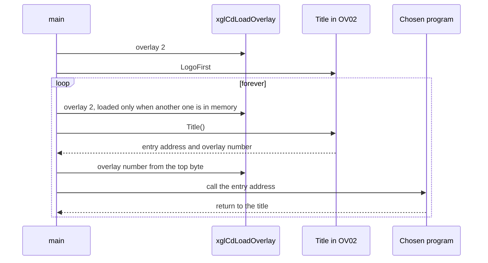

`xglCdSifLoadModule(path, args)` loads an IOP module. It builds
`cdrom0:\IOP\<NAME>.IRX;1` with the name in upper case and measures the
argument block, which is a list of strings ended by two zero bytes. Then it
calls `sceSifLoadModule`. `InitializeSystem` loads the eight modules of the
disc this way. The network loader in `src/main/lan_usb.c` asks for eight more
modules that are not on the released discs.

## The real-time clock

`src/main/xgl_cd.c` also holds the clock functions, because the clock of the
PlayStation 2 is read through the disc drive controller. `xglClockRead` fills
an `XglClock` record (second, minute, hour, day, month, year) from the BCD
bytes of `sceCdReadClock`. The drive is asked at most once every ten frames:
`ReadClockInterval` is set to `CD_CLOCK_READ_INTERVAL` after a read, and the
per-frame service counts it down.

`xglClockDayTime2UInt` turns a record into the number of seconds since the
start of the year 2000, and `xglClockUInt2DayTime` turns a number of seconds
back into a record. Both use the table `monthday`, which holds the twelve
month lengths followed by twelve running day totals.

The play time of a save is counted with these functions.
`xglClockSampleDayTime` in `src/main/xgl_cd_arena.c` notes the current time,
and `xglClockAccumulate` adds the seconds since the last sample to
`ptState.progress->playTime`. `PartyTimeDispChange` prepares a duration for
display: days are turned into hours, and the result is limited to 99:59:59.
The save screen and the menu show it (see [save-data.md](save-data.md)).

## The resource block system

Plain reads need a buffer from the caller. The field and the cutscenes load
dozens of files per scene, and something has to decide where each one goes
and when its memory can be used again. That is the job of the resource
manager in `src/main/res_get_path.c`.

`Game()` starts it with `GameResourceInit((void *) 0x1000000, 0x1000000)`:
the manager owns the 16 MiB from `0x01000000` to `0x02000000`. Three debug
programs start it over the same range, and `src/main/oLib.c` starts it over a
smaller one of 8 MiB.

### The block table

The memory is described by `gameResBlockTable`, an array of 128 `GameResBlock` entries
(`GAME_RES_BLOCK_COUNT`) at `0x2BB7A0`. The entries from index 1 on describe
consecutive blocks in address order. Each block is either free or owned.

| Offset | Type | Field | Meaning |
| --- | --- | --- | --- |
| `0x00` | `void *` | `buffer` | Start of the block. Zero ends the table |
| `0x04` | `unsigned int` | `size` | Bytes in the block |
| `0x08` | `int` | `owner` | 0 when free, else the owner |
| `0x0C` | `void *` | `tag` | Completion callback of a read into the block, 0 when none |
| `0x10` | `void *` | `value` | A word handed back to that callback |

Entry 0 is a header. Its `buffer` and `size` are the managed range, and its
`owner` is the *selected index*: the first block that the allocator and the
scene reset may touch. Blocks below the selected index are permanent.

An owner is one of three things.

- A *file id*, for example `0x10002`. The block holds the file set of that
  id.
- The value `0xF00000` plus bits 8 to 23 of the block address
  (`GAME_RES_OWNER`). The block was allocated without an id: it is either an
  anonymous buffer, or a file loaded by name whose first `0x40` bytes hold
  that name.
- A file id with bit 30 set (`RES_OWNER_PRELOADED`). The block was loaded in
  the background for the next scene.

```
gameResBlockTable while a scene is loaded (illustration, sizes left out)

index  owner       contents
  0    9           header: managed range, selected index
  1    0xF0....    map object tables and marker models, loaded by name
  ..   ...
  .    0xF0....    scene script buffer (gameWork.resBuffer, 0x12000 bytes)
  .    0x30041     face motion file, permanent
  .    0x10002     player slot 0 (0xC5FC0 bytes)
  .    0xF0....    "(padding)" (0x40 bytes)
  ..   two more player slots with their pads
  9    0x20011     file set of the map                 <- selected index
 10    0x11003     file set of an NPC
 11    0           free
 12    -1          buffer 0: end of the table
```

### Allocating and freeing

`GameResBlockAlloc(owner, size)` rounds the size up to 64 bytes
(`GAME_RES_BLOCK_ALIGN`) and looks for a free block with
`GameResBlockFindBestFit`. The search starts at the selected index. A block
of exactly the wanted size is taken at once, otherwise the smallest larger
one wins. `GameResBlockAssign` then gives the block to the owner. When the
block is larger than needed, all later entries move up by one and the rest
becomes a new free block right behind it.

`GameResBlockFree` marks a block free and joins it with a free block behind
it and a free block in front of it. The later entries move down to close the
gap. `GameResBlockFreeByBuffer` and `GameResBlockFreeByOwner` find the block
first.

Several small functions sit on top of these.

| Function | What it does |
| --- | --- |
| `GameResBufferAlloc(size)` | Allocates an anonymous block and returns its address, 0 when nothing fits |
| `GameResBufferAllocOwned(owner, size)` | The same for a given owner |
| `GameResourceGetFreeAddr(&size)` | Address and size of the largest free block. Callers use it as scratch memory for a short time, for example to decode the disc change picture |
| `GameResFindID(id, &size)` | The block that holds a file id, 0 when it is not loaded |
| `GameResFindName(name, &size)` | The data of a block loaded by name |
| `resSelectSlot(search)` | Sets the selected index to the largest free block (1) or back to 1 (0) |
| `GameResourceReset()` | Turns everything from the selected index up into one free block |

`Game()` shows how the selected index is used. It initialises the manager,
allocates the things that must survive every scene change (the map object
tables and marker models, the scene script buffer `gameWork.resBuffer` of
`0x12000` bytes, the face motion file and the three player slots), and then calls `resSelectSlot(1)`. From then on a scene
reset keeps those blocks and clears only what lies above them. At the end of
the play session `resSelectSlot(0)` gives everything back.

### Loading by id and by name

`GameResLoadID(id, &buffer, &size, callback)` is the main entry. The low 24
bits of the id are the file id.

1. If a block is already owned by the file id, its address and size are
   returned, and the callback is called at once.
2. Otherwise `xglCdLoadByKind` is called with slot 0. In this form it only
   measures: it asks the directory for the size of every file of the set and
   returns the total.
3. A block of that size is allocated with the file id as owner.
4. `xglCdLoadByKind` is called again with the block index and reads the files
   into the block.

The result is the owner, -1 when the set has no files or the library is busy,
and -2 when no block is large enough. Because a busy library also gives -1,
several callers simply repeat the call until it succeeds, as in
`while (GameResLoadID(id, &data, 0, 0) == -1)`.

Bit 31 of the id selects how the files are read. Without it the loader
refuses to start while the library is busy, and it reads every file with a
blocking read. With it (`RES_ID_QUEUED_LOAD`) the loader starts in any state
and issues every file as an asynchronous read, so the files are queued and
arrive in the background. The name of the constant and of the flag
`gameResQueuedLoad` suggest the opposite of what the code does: the flag set
means queued reads.

`GameResLoadName(name, &data, &size, callback)` loads one file by its path.
A block that already holds the name is reused. Otherwise a block of the file
size plus a `0x40`-byte header is allocated, the name is written into the
header, and the file is read asynchronously behind it. The returned data
pointer is past the header. `mapObjectResourcesLoad` loads the map object
tables and marker models this way, the talk window loads `omiya\talk01.xtx`,
and the cutscene player loads files from `motion/cfevent/`.

When a read into a block completes, `gameResReadEvent` runs. The read tag of
such a read is the block index. The handler stores the size on
`CD_EVENT_SIZE`, and on `CD_EVENT_DONE` it calls the callback kept in the
block's `tag` with the block index, the buffer, the size and the block's
`value` word. `gameResSetReadValue` sets the word that the next load copies
into `value`.

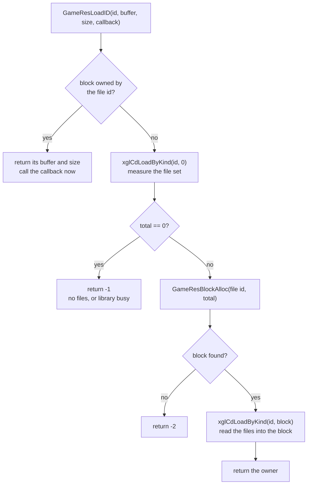

### Work areas inside the resource memory

Some screens need a large piece of memory for a short time: a movie, the main
menu, the save screen, the battle result screen. They borrow it from the
resource memory with `GameResourceWorkAlloc(bytes)`.

The function starts at the largest free block and widens the run block by
block, forwards first and backwards when it reaches the end of the table,
until the run is large enough. It does not care whether the neighbours are
owned. It returns the start of the run and records the run as the *arena*
(`gameResArenaStart` to `gameResArenaEnd`). A second call while an arena is
open records a *work area* instead.

The table itself is not changed, so the owned blocks inside the run are still
listed. Their contents are simply overwritten by the borrower. While the
arena is open, `GameResBlockFindByOwner` and `GameResBlockFindByName` skip
blocks inside it.

`GameResArenaRelease` ends the loan. It walks the table and reads every owned
block inside the run again from the disc, using the owner as the file id and
the block address as the destination. `GameResourceWorkReload` does the same
in the background for the part of the arena that lies outside the work area.
The result is that the field's resources are back in place when the menu or
the movie ends, without the scene having to be loaded again.

## File ids and file groups

Scene scripts and game code name most resources by a number, the *file id*.
Bits 16 to 23 of the id are the kind, and the low bits select a name from a
table. The table `xglCdFileGroups` has 14 groups. Each group covers the ids
from `base` to `base + count - 1` and has a list of names. Name 0 of every
list is the directory of the group, so id `base + n` is the file
`names[0]` followed by `names[n]`.

| Base id | Count | Directory | Contents |
| --- | --- | --- | --- |
| `0x10000` | 58 | `model\char\pc\` | Party characters and their weapons (`shion00`, `kosmos00`, `jr_gun01`) |
| `0x11000` | 90 | `model\char\npc\` | Story characters (`allen01`, `albelt00`, `marglis00`) |
| `0x12000` | 88 | `model\char\cf_npc\` | Field people (`vecm100`, `gfgf00`, `hakase00`) |
| `0x13000` | 72 | `model\char\citizen\` | Citizens and animals (`boy100`, `woman200`, `cat00`) |
| `0x14000` | 19 | `model\robo\pc_robo\` | The party's E.S. and their weapons (`pcr01a`, `pcr05_sh01`) |
| `0x15000` | 33 | `model\robo\npc_robo\` | Other machines (`npcr01` to `npcr19` and parts) |
| `0x16000` | 82 | `model\robo\gattai_robo\` | `gattai01` to `gattai81` |
| `0x18000` | 83 | `model\enemy\` | Enemies (`uso001`, `cre001`, `gno001`) |
| `0x19000` | 32 | `model\enemy\` | Bosses (`bos001` to `bos031`) |
| `0x20000` | 362 | `model\map\` | Maps (`E2_KML01`, `E2_MIL01`, `CFEVE01`, `E2_EVE01`) |
| `0x30000` | 66 | `motion\` | Motion files (`shion00`, `motion_ext01` to `motion_ext50`, `face_all`) |
| `0x40000` | 9 | `effect\` | `00` to `07` |
| `0x70000` | 325 | `model\mobj\` | Map objects (`mobj000` to `mobj299` with variants) |
| `0x80000` | 60 | `cf\` | Field enemy and NPC records (`enemy001`, `enemy_001`, `npc_001`) |

A name of `_` marks an unused number. Four functions work on the table.
`xglCdFindFileGroup` finds the group of an id. `xglCdFindFileName` returns
the name of an id. `xglCdFindFileId` searches all groups for a name and
returns its id, or -1. `xglCdBuildFileName` writes the directory and the name
into a buffer and returns the end of the text, where the caller appends an
extension.

`resParseFileGroup` is the parser used by the scene scripts. It reads a name
from text and returns the matching id. The comparison ignores letter case and
skips underscores on both sides, so `E2KML01` and `e2_kml01` name the same
map. A kind can be given to limit the search to one group family.

## File sets

`xglCdLoadByKind` picks a loader by the kind of the id. Each loader has two
uses. With slot 0 it only adds up sizes. With a block index, or with an
address of `0x80` or more, it reads the files into that memory.

| Kind | Ids | Loader | Files |
| --- | --- | --- | --- |
| `RES_KIND_ACT` | `0x10000` to `0x19xxx` | `xglCdLoadFileSet` | `.xap`, `.epf`, `.xhr`, `.txy`, `.pxy` |
| `RES_KIND_MAP` | `0x20000` | `xglCdLoadBinFileSet` | `.bin`, language `.sbl`, `.id`, `.txy`, `.pxy` |
| `RES_KIND_MOT` | `0x30000` | `xglCdLoadXapFile` | `.xap`, or `.fap` when there is no `.xap` |
| `RES_KIND_EFFECT` | `0x40000` | none | Effect names are handled by the effect system |
| `RES_KIND_MOBJ` | `0x70000` | `xglCdLoadFileSet` | The same five files as a character |
| `RES_KIND_ENE` | `0x80000` | `xglCdLoadEneFile` | `.ene` |

### Character and object sets

A character block starts with a header of `0x40` bytes
(`GAME_RES_NAME_HEADER_SIZE`). Its first words are a `CdFileSetHeader` with
the address of each file inside the block, or 0 for a file that does not
exist.

| Offset | Field | File |
| --- | --- | --- |
| `0x00` | `pxy` | The model |
| `0x04` | `txy` | The textures of the model |
| `0x08` | `xhr` | The hierarchy (skeleton) |
| `0x0C` | `epf` | A further per-model file. The loader only stores its address |
| `0x10` | `xap` | The motion file |

The files follow the header in the order `.xap`, `.epf`, `.xhr`, `.txy`,
`.pxy`. Each is rounded up to 64 bytes, and the last one to a whole sector.
The model file is read last and with the caller's callback, so the callback
fires when the whole set is in memory. `XenoActor` takes its five resource
pointers from this header (see [actors.md](../libraries/actors.md)), and the
file formats are described in
[Models and textures](../formats/models-and-textures.md) and
[Skeletons and motion](../formats/skeletons-and-motion.md).

When a preloaded block is moved to another address, `resRelocateRecord`
subtracts the old block address from the five pointers and adds the new one.

The motion file of a set is not always named after the model. Many people in
the field share one set of motions. `xglCdLoadFileSet` picks the name in
steps.

1. `xglCdFindXapName` looks the id up in `xglCdXapGroups`. This table lists
   22 shared motion files (`man`, `woman`, `boy`, `girl`, `oldm`, `soldm`,
   `soldf`, `kidm`, `kidf`, `albelt`, `momo00`, `kebin`, `urtvf`, `proudm`,
   `faithm`, `kenkyum`, `kenkyuf`, `erobo`, `cook1`, `cook2`, `cat`, `oldf`)
   and the model ids that use each. A listed id uses `motion\<group>.xap`.
2. Otherwise `motion\<model name>.xap` is tried.
3. If that file is missing, the digits at the end of the name are removed
   and the name is tried again.
4. If that is missing too, a trailing `H` is removed and `00` is appended.
   `shionH03` thus falls back to `shion00`.
5. As the last resort, for every kind except map objects, the default
   `motion\man.xap` is used.

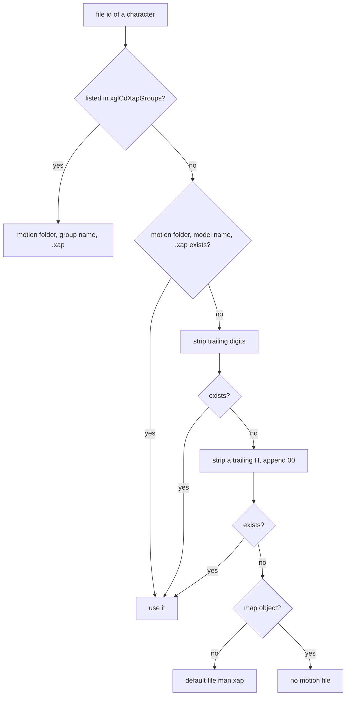

### Map sets

A map block has the same `0x40`-byte header, with other meanings for some
words. `pxy` and `txy` are the map model and its textures. The word at `0x0C`
points at the `.id` file, which holds the collision and layout data of the
map (see [map-and-units.md](../game/map-and-units.md)). The word at `0x10`
points at the `.bin` file and the word at `0x14` holds its rounded size.

The `.bin` file is the battle script of the map, the SB image that places
the enemy groups and holds their think routines, and the `.sbl` file is its
language library. (The field script of a place is a different file,
`cf\scNNNN.sb`.) Only 113 of the maps on the discs have a `.bin`. The path of
the library has the two-letter language code as an extra directory:
`model\map\E2_KML03.bin` goes with `model\map\en\E2_KML03.sbl`. Where the two go depends on how the set is
loaded. A direct load puts the `.bin` straight into the scene script buffer
`gameWork.resBuffer` and the `.sbl` right behind it, and stores the address
of the library in `gameWork.imageEnd`. A background preload keeps both inside
the block, and the map loader copies them to the script buffer later. The
script image is described in [sb-vm.md](../scripting/sb-vm.md).

### Motion and enemy files

`xglCdLoadXapFile` reads one motion file. It tries the extension `.xap` and
then `.fap`. The id `0x30041` is `motion\face_all`, the shared face motion
file, which exists as `.fap` and is loaded once per play session.
`xglCdLoadEneFile` reads one `.ene` file from `cf\`. These files hold the
records of the field enemies and NPCs of a scene (see
[field-enemies.md](../game/field-enemies.md)).

## Scene resource scripts

Every field scene has a number, and a text file `cf\cfNNNN.txt` lists what the
scene needs. `xglCdFormatFileName` writes the name from the low 16 bits of the
scene number as four decimal digits. The file starts with the four characters
`#scn` and must fit in one sector, because it is read into the 2048-byte
buffer `resScriptBuffer`.

The commands of the file and their effect on the game are the subject of
[events.md](../scripting/events.md). This section describes how the file
drives the resource manager.

### Reading the list

`resLoadCfFile(id)` starts the work. For a new scene number it cancels any
read in flight, clears the old lists (`resResetScriptState`), and reads the
file asynchronously with `resScriptRun` as the callback. While the read is
running the state byte `resCfCurrent.kind` is `RES_CF_LOADING` (`0xFF`).

`resScriptRun` runs when the read is done. It skips the header line and then
handles the file line by line until the line `#end`. `next_line` moves to the
next line and skips lines that start with a semicolon, which are comments.
The first word of a line is looked up in `resCommandTable`, and the handler
gets the rest of the line.

| Command | Handler | What it records |
| --- | --- | --- |
| `map` | `resCmdMap` | The file id of a map |
| `act` | `resCmdAct` | The file id of a character, E.S. or enemy model |
| `mot` | `resCmdMot` | The file id of a motion file |
| `mobj` | `resCmdMobj` | The file id of a map object |
| `effect` | `resCmdEffect` | An effect name |
| `mapse` | `resCmdMapse` | One or two sound bank names for bank slots 3 and 4 |
| `bgm` | `resCmdRuntimeBgm` | A list of music names |
| `bgmvol` | `resCmdBgmVol` | The music volume |
| `foot` | `resCmdFoot` | The footstep materials of the scene, up to nine three-letter keys |
| `enefoot` | `resCmdEnefoot` | Models that have their own footstep banks |
| `disk` | `command_disk` | A disc change request |
| `save` | `command_save` | An intermission (save) request |
| `;mpeg2` | `resCmdMpeg2` | Plays a movie at once. The name starts with a semicolon, and such lines are skipped as comments, so the command can never match |

The handlers do not load anything. They append words to `resEntryTable`, a
list of up to 63 entries whose word 0 is the count. An entry is either a file
id, or a kind plus an offset into the 1024-byte text pool `resNamePool`, or
an event number.

| Entry word | Meaning |
| --- | --- |
| `0x1xxxx`, `0x2xxxx`, `0x3xxxx`, `0x7xxxx` | A file id to load |
| `0x40000` + offset | An effect name in the pool |
| `0x90000` + offset | A sound record in the pool. Its first byte is a bank number below 64, or one of the letters `f`, `e`, `s`, `v` |
| `0xF00000` + offset | A file name in the pool, to load by name |
| `0xF10100` + n | Intermission number n (`RES_EVENT_SAVE`) |
| `0xF10200` + n | Disc change to disc n (`RES_EVENT_DISK`) |

After the last line, `resScriptRun` cleans the list in three passes.

1. Duplicate entries are removed.
2. Every block of the table is compared with the list. A file id that is
   already loaded is taken out of the list, because nothing has to be done
   for it. A loaded block at or above the selected index that the new scene
   does not list is noted in `resOwnerTable`, the list of blocks to free.
3. The list is sorted in ascending order. Since the kind is in the high bits,
   this fixes the load order: characters, maps, motions, effects, map
   objects, sounds, and events last.

The state byte then becomes 1, which means that preloading can begin.

### Preloading

Each further call of `resLoadCfFile` with the same scene number runs one
preload step, `resPreloadStep`. The step takes the entry whose index is the
state byte and loads it with `GameResLoadID` in background mode. A block
loaded this way gets the flag `RES_OWNER_PRELOADED` in its owner. The byte
then moves to the next entry, and it returns to 0 when the list is done.

The calls come from `resJumpPointsUpdate`, which `Game()` runs once per
frame. This function knows where the exits of the current map are and where
each one leads.

- `resParseJumpTarget` reads the script image of the map. It finds the
  function `mapjump`, follows its bytecode to the switch table, and scans
  each case for the call of the script native `runtime.jumpCF`. The argument
  of that call is the scene number that the exit leads to. The result is one
  `JumpRecord` per exit kind in `resJumpRecords` (up to 32).
- `resJumpPointsBuild` finds the place of each exit. It walks the collision
  triangles of the map whose key is `0x100` plus the exit kind and averages
  their centres. Then it gives each exit a radius: half the distance to the
  nearest exit that leads to a different scene.
- An elevator can add a record of its own with `resJumpRecordSet`.

On every frame, when the drive is idle (`xglCdSyncDone`), the function
measures the distance from the player to each exit. For the first exit whose
radius contains the player it calls `resLoadCfFile` with the exit's scene
number. The first call reads the list of that scene, and the calls on the
next frames preload its resources one by one. If the player turns around and
approaches another exit, the scene number changes, the old list is dropped,
and its preloaded blocks are freed. Scenes 1520 and 1560 are excluded from
preloading.

### Applying the list

When the scene change really happens, `resApplyCfFile(id)` finishes the job.
The diagram after the steps shows the whole life of a list.

1. It calls `resLoadCfFile` and services the library in a loop until the list
   of scene `id` is read and every preload step has run.
2. It resets the sound descriptor tables, clears the current map and waits
   until the library is idle.
3. If the scene has no resource file, it resets the block table from the
   selected index and clears the voice records.
4. It frees every block noted in `resOwnerTable`.
5. It compacts the preloaded blocks. Each one is moved down into the first
   free block below it that is large enough, its header pointers are
   relocated, and the flag is cleared. A block that cannot move just loses
   the flag.
6. It walks the entry list. File ids are loaded with `GameResLoadID`, which
   returns at once for a block that is already there. Sound records are
   applied: bank names with `seBankSetName`, footstep materials, enemy
   footstep groups, the music name with `seBgmNameSet` and the volume. Effect
   names go to `sefLoadEffectCfName`. Event entries call `Intermission(n)` or
   `GameDiskChange(n)`.
7. It clears the lists again with `resResetScriptState`.

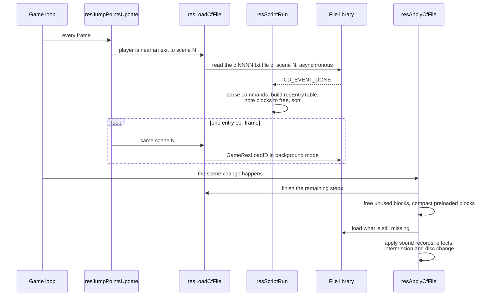

### Player slots

The three party members that walk in the field can be swapped at any time, so
their models do not belong to a scene. `resPlayerSlotsInit` reserves three
*player slots* for them. A slot is a block of `0xC5FC0` bytes
(`PLAYER_MODEL_BUFFER_SIZE`) followed by a pad block of `0x40` bytes, which
together take `0xC6000` bytes. An empty slot holds the text `(Player#n)` or
`(Player)`, and the pad holds `(padding)`, which makes the blocks easy to
recognise in a memory dump.

`resPlayerSlotLoadID(slot, id, &out)` loads a character's file set into a
slot. If the id is already loaded somewhere, that block is used. Otherwise
the function looks for a free or anonymous block inside the slot's range,
gives it to the id and reads the files there. `resPlayerSlotUpdate` clears a
slot: every owned block inside it is freed, actors that used its resources
are reset through `uwamonoActorsResetByKey`, and the block gets its
placeholder text back. `resPlayerSlotsReset` restores all three slots after a
scene reset and loads the three models again with `resPlayerSlotsLoadModels`.
The party side is described in
[party-and-growth.md](../game/party-and-growth.md).

### Sound state of a scene

The resource manager also remembers which sound data a scene has loaded,
because sound banks are loaded by name and must be restored after a battle or
a menu. `seBankNames` holds the bank name of each of the 32 bank slots.
`seBankSetName(kind, name)` stores a name and loads the bank with
`seBankLoad`. `seStateRestore` loads all remembered banks again, starts the
remembered music and restarts the looping voices kept in `resRecordTable` (24
records). `seFootBanksLoad` builds the names of the footstep banks from the
current character and the materials that the `foot` command listed. All of
this is described in [audio.md](audio.md).

## The sector arena of the menus

The main menu, the save screen and the battle result screen load their own
files: fonts, backgrounds, skill models, pictures. They use a small allocator
in `src/main/xgl_cd_arena.c` that hands out memory in whole sectors.

`xglCdArenaOpen(buffer, size)` opens the arena over a buffer of the caller.
With a null buffer it borrows the memory from the resource manager through
`GameResourceWorkAlloc`, with a default size of `0x288000` bytes when the
size is 0. `xglCdSectorAlloc(size)` is a bump allocator that returns the
current position and advances it by the size rounded up to 2048 bytes.
`xglCdArenaClose` waits until all reads are done, resets the menu parts that
point into the arena, and gives borrowed memory back with
`GameResArenaRelease`, which also reloads the field resources that were
overwritten.

Inside the arena a screen can set aside one *buffer area* with
`xglCdBufferAlloc(size)`. `xglCdBufferReserve(size)` takes pieces from it,
and `xglCdBufferRewind` waits for the drive and frees all pieces at once.
The G.S. Campaign screens and the segment address screen use this to load
their texts and pictures for one page and to drop them when the page closes.

| Caller | Arena | Buffer area |
| --- | --- | --- |
| Main menu (`src/main/menu_scene.c`) | Borrowed, default size | `0x140000` bytes |
| Save screen (`src/main/save_screen.c`) | `0x200000` bytes, at `0x01000000` or borrowed | `0x40800` bytes |
| Battle result (`src/main/battle_result.c`) | Borrowed, default size | none |

Reads into the arena are asynchronous.
`xglCdReadFileAsync(name, buffer, kind, sub)` packs the two bytes into the read tag, starts the read with
`xglCdReadDoneCallback`, and counts it in `xglCdPendingReads`. When the read
is done, the callback looks at the kind and tells the right part of the menu
that its data has arrived.

| Kind | Name | Called on completion | Loader |
| --- | --- | --- | --- |
| 1 | `CD_READ_FONT_SLOT` | `fontObjMarkSlotLoaded(sub)` | A font texture of the font objects |
| 2 | `CD_READ_BG_LAYER` | `bgLayerAdvance(sub)` | A model or texture of the three menu background layers |
| 3 | `CD_READ_MENU_SKILL` | `menuSkillModelReadDone(sub)` | A skill model of the menu |
| 4 | `CD_READ_UMN_IMAGE` | `menuUmnImageDecode(sub)` | A JPEG picture of the menu |

`xglCdWaitIdle` is the matching wait: it services the library until the state
is idle and no tagged read is pending.

The same source file holds a few helpers that have nothing to do with files.
`xglTickAdvance` advances a 16-bit frame counter and runs the vibration
engine. `xglCallbackQueueAdd` and `xglCallbackQueueRun` keep a list of up to
four draw callbacks for one frame. `padCirclePressedAlone` and
`padCrossPressedAlone` test for a single button press.
`xglFontGetTextWidth` measures a string, and `pxyTickScaleDoubleOverride`
saves and restores the model tick scale. They are described with their
subjects in [xgl.md](../libraries/xgl.md),
[main-menu.md](../game/main-menu.md) and
[fonts-and-text.md](../libraries/fonts-and-text.md).

## Language directories

Some files exist once per language. `xglGetLanguageCode(buffer)` in
`src/main/xgl_timer0.c` returns a two-letter code and writes it into the
buffer when one is given. The code is picked from a table of nine entries by
the byte `SaveData.caption_all` of the save data.

| Index | 0 | 1 | 2 | 3 | 4 | 5 | 6 | 7 | 8 |
| --- | --- | --- | --- | --- | --- | --- | --- | --- | --- |
| Code | `en` | `jp` | `en` | `de` | `fr` | `it` | `es` | `zh` | `ko` |

A new save has the value 2, so the North American game always asks for the
`en` directories. Three loaders use the code.

| Loader | Path |
| --- | --- |
| `xglCdLoadBinFileSet` | `model\map\<code>\<map>.sbl`, the language library of a map script |
| The scene loader in `src/main/ytachi_test.c` | `cf\<code>\scNNNN.sbl`, the language library of the scene script `cf\scNNNN.sb` |
| `GameMpeg2Play` in `src/main/game_movie.c` | `movie/<code>/<name>.txt`, the caption text of a movie |

The battle code has its own pair of paths for the enemy think scripts,
`yamamoto\think\` and `yamamoto\think\jp\` (see
[battle-engine.md](../game/battle-engine.md)). Only the battle debug menu
uses them, and that directory is not on the discs. The think scripts that
the game really runs are the map `.bin` files described under map sets.

## Host, USB and LAN loading

The developers did not burn a disc for every change. The code has several
ways to read files from a development PC. All of them are still present, and
all of them end in a stub or need hardware that a retail console does not
have.

### The host file functions

`xglDebFileSize`, `xglDebFileRead` and `xglDebFileWrite` in
`src/main/xgl_debug_file.c` were the general host file functions. In this
build each of them prints a message such as `Don't use xglDebFileRead()`,
runs the debug break `DEBUG_BREAK()` and returns -1. The callers remain: the
effect loader, the scene script loader below, the temporary file of the
cutscene tools (`cfeFileTempWrite`), a test program and the debug file
selector.

### Effect files

The effect loader `fileLoad` in `src/main/srs.c` has four load modes, set
with `srsSetLoadMode`. `srsFileLoad` in `src/main/srs_file.c` is a wrapper
that passes its three arguments to `fileLoad`.

| Mode | Name | Path | Read with |
| --- | --- | --- | --- |
| 0 | `SRS_LOAD_MODE_CD` | `simajiri\<file>` | `xglCdReadFile`. A busy library (-3) makes the loader repeat the read as an asynchronous one |
| 1 | `SRS_LOAD_MODE_HOST` | `host0:/home/xeno/work/<view path><file>` | `sceOpen`, `sceLseek`, `sceRead` |
| 2 | `SRS_LOAD_MODE_USB` | `usb0:/<view path><file>` | `xglDebFileRead` |
| 3 | `SRS_LOAD_MODE_DEB` | `<view path><file>` | `xglDebFileSize` and `xglDebFileRead` |

The view path is a folder name set with `srsSetViewPath`. It let an effect
artist point the effect viewer at a working folder. The released game uses
mode 0, where the files are `simajiri\esd\<name>.esd` and
`simajiri\esp\<name>.esp`.

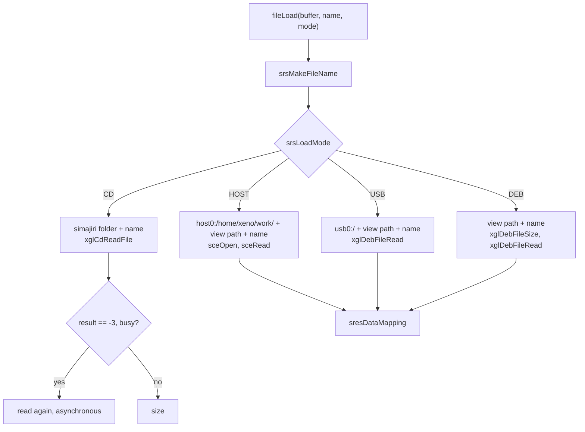

The other two functions of `src/main/srs_file.c` deal with effect names.
`srsEffectNameToID` turns a nine-character effect name into an effect key.
The first two letters give the kind (`pe` is 0, `ce` is 1, `ee` is 2), three
digits give the index, and after a separator three more digits give the
sub-number. The key is `kind << 28 | index << 12 | sub`.
`srsIsEffectImageKey` tells whether a key is of kind 1 with an index from 300
to 449. The effect system is described in [sef.md](../libraries/sef.md).

### Scene scripts from the host

`src/main/script_load.c` loads a scene script without the archives.
`scriptLoadByNumber(slot, number)` builds the name `scNNNN.sb` from four
decimal digits. `scriptReadFile` allocates a buffer, builds the path
`host0:/home/xeno/vcd/x2/cf/scNNNN.sb`, reads the file with `xglDebFileRead`
and links the image with `sbLinkImage`. When linking fails the function stops
in an endless loop. `scriptFreeBuffer` frees the buffer. Since
`xglDebFileRead` is a stub, this path cannot work in the released game, and
nothing calls `scriptLoadByNumber`. The disc path of a scene script is
`cf\scNNNN.sb` with the library `cf\<language>\scNNNN.sbl`, read with
`xglCdReadFile` (see [sb-vm.md](../scripting/sb-vm.md)).

### File transfer over the network

`src/main/lan_usb.c` is a file transfer client for a server program on a
development PC. The function names start with `Usb` because the first
adapter was a USB Ethernet adapter. No function of this file is called from
the rest of the game.

`UsbInit(statusHandler, device)` brings the network up once. It takes
`0x8010` bytes of work memory from `WorkEnd`, loads the modules `inet`,
`netcnf` and `inetctl`, then `usbd` and `an986` for device 0 (USB) or `smap`
for device 1 (the network adapter), then `msifrpc` and `libnet`. The
configuration is read from the memory card file
`mc0:/BISLPS-00000DebugSta/net000.cnf` (USB) or `net001.cnf`. The function
waits for an address and prints it as `My address: ...`.
`UsbSetHost(name, port)` stores the server name (at most 15 characters) and the port, and
`UsbGetHost`, `UsbGetLocalAddress` and `UsbGetInitState` read the state back.

Each transfer opens its own connection. `LanOpen` resolves the host name
with `sceInetName2Address`, creates the connection with `sceInetCreate` and
opens it with a timeout of 5 seconds. The client then sends a command word,
the path as a zero-terminated string, and the data. `LanClose` sends the word
`CLOSE` and closes the connection. Data moves in chunks of at most `0x4000`
bytes, and sizes are sent as 4-byte integers.

| Function | Command | Exchange |
| --- | --- | --- |
| `UsbGetFileSize(path)` | `SIZE ` | Send the path, receive the size |
| `UsbReadFile(path, buffer)` | `GET ` | Send the path, receive the size, receive the file |
| `UsbWrite(path, buffer, size)` | `PUT ` | Send the path, send the size, send the file |
| `UsbSend(path, buffer, size)` | `SEND ` | The same exchange as `PUT ` with another command word |
| `UsbRecv(path, buffer, max)` | `RECV ` | Send the path, receive the size, receive at most `max` bytes and discard the rest |

While a transfer runs, `LanReportStatus` prints the current step with the
debug font at position (16, 16), for example `LanOpen:connect` or
`UsbRead:request`, and calls the status handler that `UsbInit` stored. The
handler is expected to draw a frame, so the screen stays alive during a long
transfer.

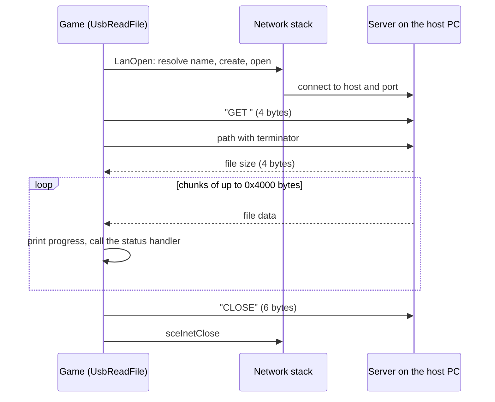

### The debug file selector

`xglCdFileSelect` in `src/main/xgl_cd.c` is a text-mode file browser for the
debug tools. It works on a `CdFileSelect` record that holds a screen
position, a number of rows, a directory, a print function and a list buffer.
The list of names does not come from the disc. `FileSelectListReload` reads a
file named `.filelist` from the chosen directory with `xglDebFileRead`. The
file holds sections of the form `<path>:` followed by one name per line, and
a name that ends with a slash is a folder.

The browser is a small state machine (`FileSelectSub`): reload the list, look
up the section of the current path, idle, and go up one level. Up and down
move the cursor, left and right move it by a page, circle enters a folder or
picks a file, cross cancels and triangle reloads the list. Inside a folder
the first two rows are `..` and `.`. The function returns 1 when a file was
picked, 2 on cancel and 3 when `.` was picked. Nothing in the game code
calls it, and its list source is a stub, so it is a leftover of the
development tools (see [debug-tools.md](../game/debug-tools.md)).

## File types

The table lists the file types that the code loads, taken from the path
strings and extensions in `src/`. The byte layout of each type belongs to the
formats pages named in the last column.

| Extension | Example path | Contents | Read by | Format page |
| --- | --- | --- | --- | --- |
| `.pxy` | `model\char\pc\shion00.pxy`, `matumoto\Tre001.pxy` | Model | `xglCdLoadFileSet`, `xglCdLoadBinFileSet`, menu and map object loaders, OV01 | [Models and textures](../formats/models-and-textures.md) |
| `.txy` | `model\map\E2_KML01.txy` | Texture set of a model | The same loaders | [Models and textures](../formats/models-and-textures.md) |
| `.xtx` | `omiya\talk01.xtx`, `yosikawa\font.xtx`, `yamamoto\stat\stat.xtx` | Texture for windows, menus and 2D pictures | `GameResLoadName`, the menus, OV01, OV02 | [Models and textures](../formats/models-and-textures.md) |
| `.xhr` | `model\char\pc\shion00.xhr` | Hierarchy (skeleton) of a model | `xglCdLoadFileSet`, OV01 | [Skeletons and motion](../formats/skeletons-and-motion.md) |
| `.xap` | `motion\man.xap`, `yosikawa\model\menubg.xap` | Motion data | `xglCdLoadFileSet`, `xglCdLoadXapFile`, OV01 | [Skeletons and motion](../formats/skeletons-and-motion.md) |
| `.fap` | `motion\face_all.fap` | Face motion data, tried when no `.xap` exists | `xglCdLoadXapFile`, OV01 | [Skeletons and motion](../formats/skeletons-and-motion.md) |
| `.epf` | `model\char\pc\shion00.epf` | A further file of a model's set | `xglCdLoadFileSet`, OV01 | [Models and textures](../formats/models-and-textures.md) |
| `.id` | `model\map\E2_KML01.id` | Collision and layout data of a map | `xglCdLoadBinFileSet` | [Maps and field data](../formats/maps-and-field-data.md) |
| `.bin` in `model\map\` | `model\map\E2_KML01.bin` | Script image of a map | `xglCdLoadBinFileSet` | [Scripts and archives](../formats/scripts-and-archives.md) |
| `.sb` | `cf\sc0000.sb`, `yamamoto\think\think000.sb` | SB script image of a scene or of an enemy's battle logic | The scene loader, OV01 | [Scripts and archives](../formats/scripts-and-archives.md) |
| `.sbl` | `cf\en\sc0000.sbl`, `model\map\en\E2_KML01.sbl` | Language library of a script image | The same loaders | [Scripts and archives](../formats/scripts-and-archives.md) |
| `.txt` in `cf\` | `cf\cf0000.txt` | Scene resource script (tag `#scn`) | `resLoadCfFile` | [Scripts and archives](../formats/scripts-and-archives.md) |
| `.ene` | `cf\enemy001.ene` | Field enemy and NPC records | `xglCdLoadEneFile` | [Maps and field data](../formats/maps-and-field-data.md) |
| `.dat` | `matumoto\treasurebox.dat`, `matumoto\kowaremono.dat`, `matumoto\spline.dat`, `matumoto\enemyorder.dat`, `iwase\img\door\doorimg.dat` | Tables of map units and other field data | `mapObjectResourcesLoad`, the segment address screen | [Maps and field data](../formats/maps-and-field-data.md) |
| `.esd`, `.esp` | `simajiri\esd\<name>.esd`, `simajiri\esp\default.esp`, `simajiri\esp\cfdef.esp` | Effect files and effect packs | `fileLoad` in `src/main/srs.c` | [Effects](../formats/effects.md) |
| `.vsf`, `.prj` | `sound\vsf\CFS_SE.vsf`, `sound\vsf\battle\` | KORG sound bank: wave data and its project file | `seBankLoadFile`. The IOP driver reads the sectors | [Sound](../formats/sound.md) |
| `.mid` | `sound\smf\<nnn>.mid` | Music sequence, with a bank of the same name | `seBgmLoad` | [Sound](../formats/sound.md) |
| `.adx` | `sound\adx\<name>.adx`, `yajima\M-01.adx` | CRI ADX audio stream | `adxSetSlotFile` | [Sound](../formats/sound.md) |
| `.sfd` | `movie\<name>.sfd` | CRI Sofdec movie | `GameMpeg2Play`, the movie player | [Movies, images and icons](../formats/movies-images-and-icons.md) |
| `.txt` in `movie/` | `movie/en/<name>.txt` | Caption text of a movie | `GameMpeg2Play` | [Text and fonts](../formats/text-and-fonts.md) |
| `.jpg` | `yajima\diskchg.jpg`, `yajima\gameov1.jpg`, `yajima\synopsis\00.jpg`, `yosikawa\umn1.jpg` | JPEG picture | `xglJpegDecode` callers | [Movies, images and icons](../formats/movies-images-and-icons.md) |
| `.bin` in `yajima\` | `yajima\title.bin`, `yajima\synopsis.bin`, `yajima\im.bin`, `yajima\mc\shion.bin` | Picture packs of the title, synopsis and intermission screens, and memory card icons | OV02, `GameSynopsis`, the save code | [Movies, images and icons](../formats/movies-images-and-icons.md) |
| `.us` | `font0.us`, `font1.us`, `yamamoto\batdat.us` | The two font textures and the battle data table of the North American version | `xglFontLoad`, OV01 | [Text and fonts](../formats/text-and-fonts.md), [Game tables](../formats/game-tables.md) |
| `.txd` | `yosikawa\MainMenu.txd`, `yosikawa\Tutorial.txd`, `yosikawa\Location.txd` | Text tables of the menus | The menu and save code | [Text and fonts](../formats/text-and-fonts.md) |
| `.txt` in `iwase\` | `iwase\QuestMes.txt`, `iwase\Citizen.txt`, `iwase\Treasure.txt` | Texts of the G.S. Campaign and segment address screens | `src/main/yg2path.c`, `src/main/ysegf.c` | [Game tables](../formats/game-tables.md) |
| `credit.bin` | `credit.bin` | The credit roll picture bands | `src/ov02/logo.c` | [Movies, images and icons](../formats/movies-images-and-icons.md) |
| `hdd.res` | `hdd.res` | Resource file of the HDD install | `xglHddInstall` | [Movies, images and icons](../formats/movies-images-and-icons.md) |
| `.OVL` | `cdrom0:\OV01.OVL;1` | Overlay, an ELF file | `xglCdLoadOverlay` | [The overview](../README.md) |
| `.IRX`, `.IMG` | `cdrom0:\IOP\LIBSD.IRX;1` | IOP module and IOP kernel image | `xglCdSifLoadModule`, `sceSifRebootIop` | [runtime-libraries.md](runtime-libraries.md) |

Like the first game, the data root has several directories named after staff
members. The code that reads them shows what each one holds: `yajima` has
the title, synopsis, game over and disc change pictures, `yosikawa` has the
menu data, `matumoto` has the map unit tables and marker models, `iwase` has
the G.S. Campaign data, `omiya` has the talk window textures, `simajiri` has
the effects and `yamamoto` has the battle data.

The archive lookup compares names exactly, including letter case. Only the
loose-file lookup and the module and overlay paths turn names into upper
case.

## Development paths

Several paths in the code only make sense on a development system. They show
how the game was built and tested.

| Path | Used by | Purpose |
| --- | --- | --- |
| `host0:/home/xeno/vcd-f/x2/` | `xglCdGetFilePos`, for an archive slot with the host source | The developers' copy of the disc image on a PC. No code sets the host source for a slot |
| `host0:/home/xeno/vcd/x2/cf/` | `scriptReadFile` | Scene scripts fresh from the script compiler |
| `host0:/home/xeno/work/` | `fileLoad` in host mode | Effect work folders |
| `host0:/home/xeno/work/snap/game0000.jpg` | `src/main/game_snap_shot.c` | Screenshots |
| `host0:/home/xeno/vcd-f/x2/sound/...` and `host0:/home/xeno/vcd-f/x2u/movie/sfd.lst` | `src/main/yajima_test.c` | File lists for the sound and movie test programs |
| `host1:/home/xeno/vcd-f/conf/iconjp/` | `netcnf` arguments in `src/main/lan_usb.c` | Icon files for the network configuration |
| `mc0:/BISLPS-00000DebugSta/net000.cnf` | `inetctl` arguments | Network settings on a memory card |
| `usb0:/` | `fileLoad` in USB mode | A USB storage device |
| `pfs0:/xenosaga.00`, `pfs0:/xenosaga.hdd` | `xglCdArcInit`, `src/main/xgl_hdd.c` | The HDD copy of group 00 and its check file |

The folder name `vcd-f/x2u` next to `vcd-f/x2` suggests one disc image tree
per region, with `x2u` for the North American version. That reading fits the
`.us` extension of the font and battle data files.

The HDD code is complete: `xglHddInstall` copies the pieces of group 00 to
`pfs0:` in slices of 16 MiB with `xglCdReadFilePart` in `CD_READ_NO_EXTRACT`
mode, and the lookup and read functions handle the HDD source everywhere.
The check that every HDD function starts with always fails in this build, so
the North American game never uses a hard disk. Paths starting with a
backslash still reach `sceOpen` directly, which on a retail console finds no
`host0:` device. The debug programs that use these paths are described in
[debug-tools.md](../game/debug-tools.md).
