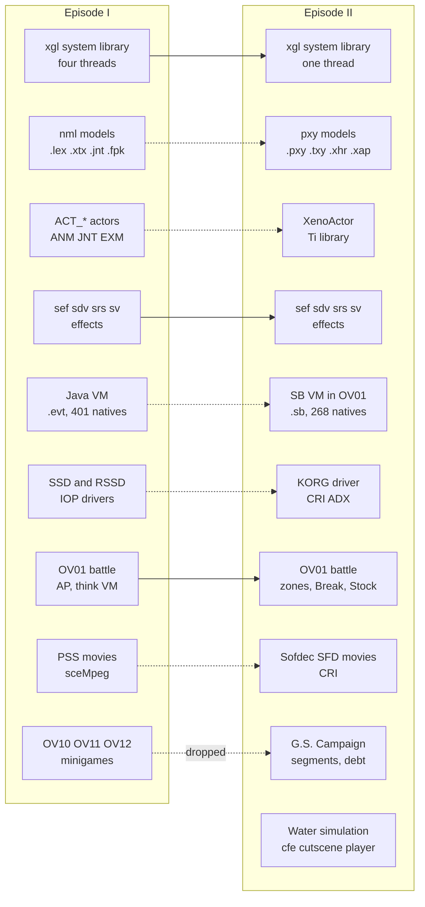
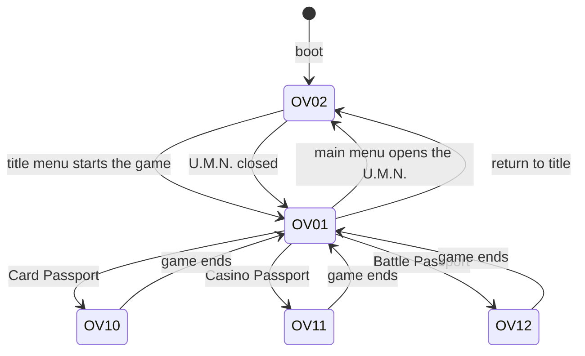
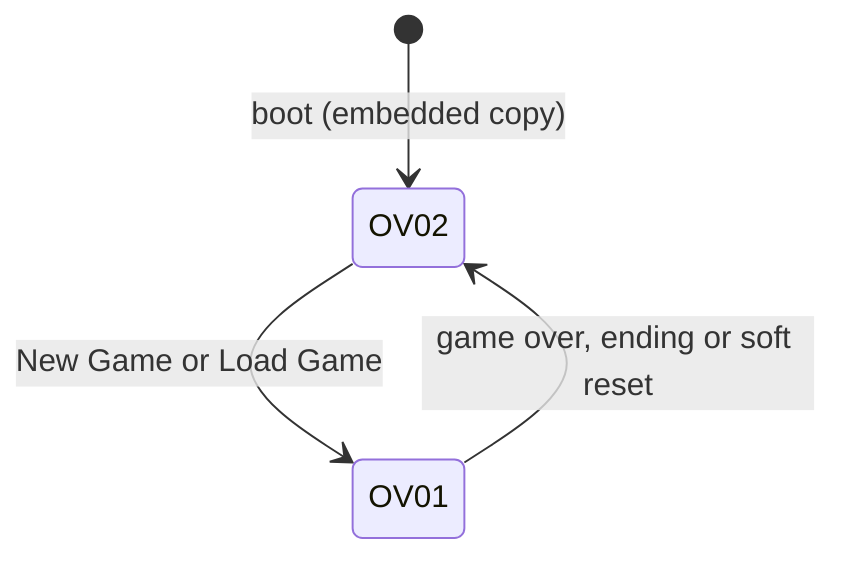
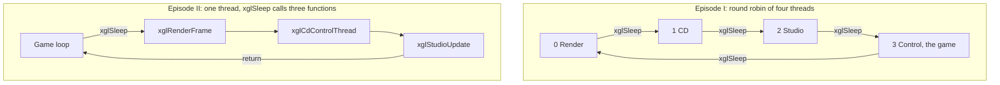
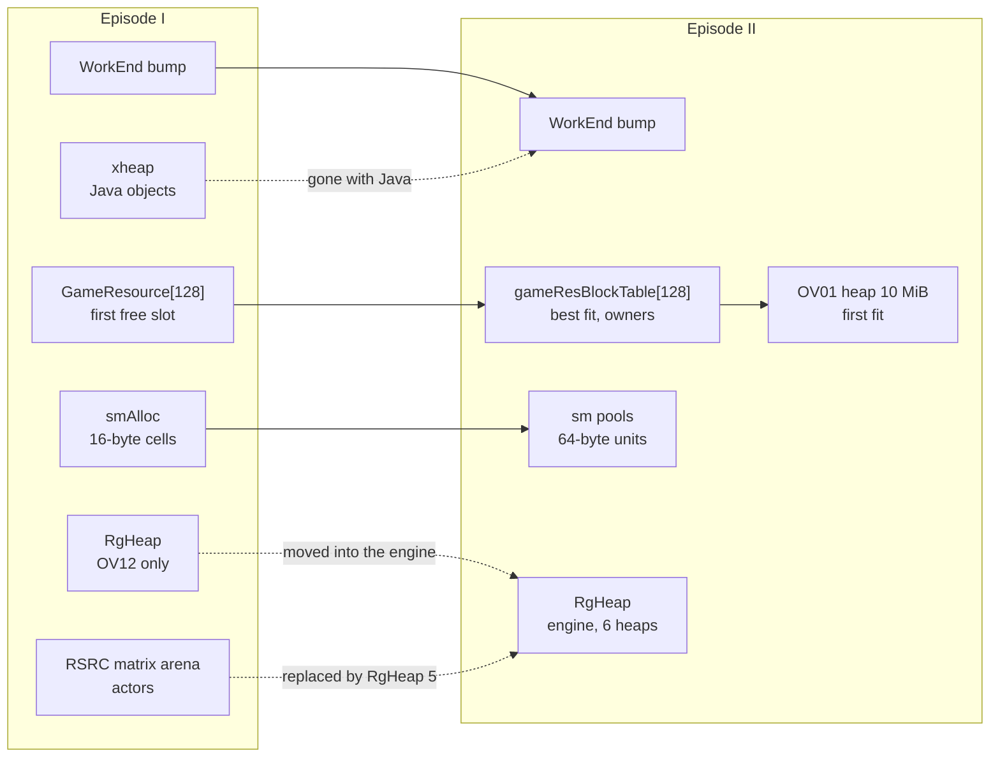
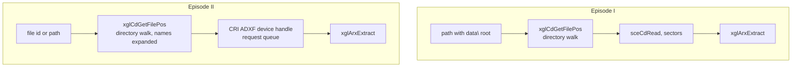
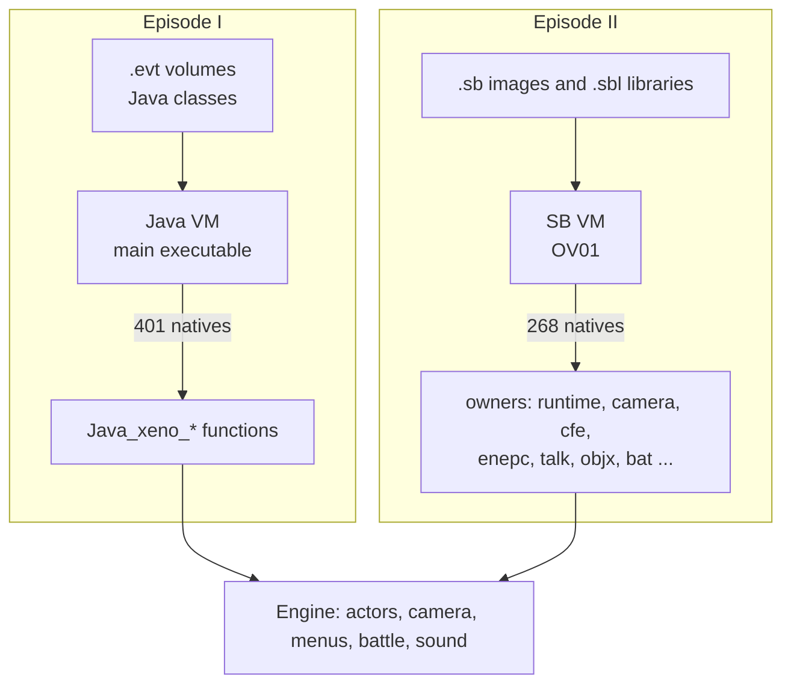
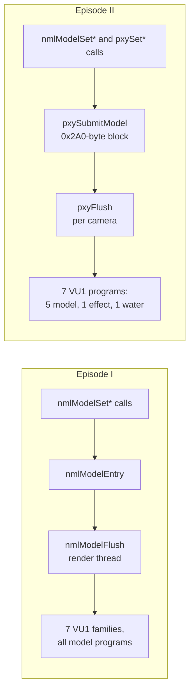
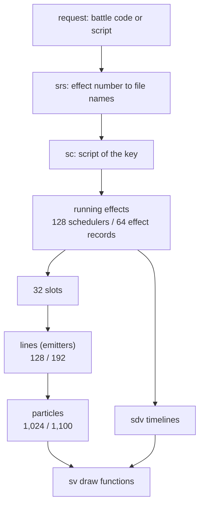
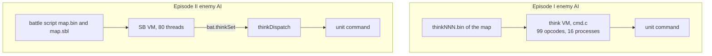

# From Episode I to Episode II

*Xenosaga Episode II* is not a new engine. It is the engine of *Xenosaga Episode I* after two more years of work. The two games share a system library, an effect system, a way of storing data in archives, a frame model built on `xglSleep`, a map unit system and a large part of the battle rules. Between the two games some parts were rewritten from scratch and some parts were dropped with the minigames. This page sets the two programs side by side, subject by subject, and says for each one what stayed, what changed and what is new.

Every statement on the Episode II side comes from the Episode II pages and source linked below. Every statement on the Episode I side comes from the Episode I source tree and from the Episode I page on the same subject. Episode I pages are named in words, because they are not part of this documentation. When a function or file is said to exist in both games, it was found by name in both source trees. The measured code sizes of both games are in `docs/x2-target.md`.

[← Back to the overview](../README.md)

## The two games in numbers

The table gives the scale of the two programs. The sizes count only the game's own code, without the Sony libraries, the CRI middleware and the C runtime.

| | Episode I (`SLUS-20469`) | Episode II (`SLUS-20892`) |
| --- | --- | --- |
| Game functions of the EE programs | 7,150 | 5,055 |
| Game code in bytes | 2,031,816 | 1,316,628 |
| Main executable | `SLUS_204.69`, loaded at `0x00200000` | `SLUS_208.92`, loaded at `0x00120000` |
| Overlays | five, linked at `0x00A00000` | two, linked at `0x00A80000` |
| Start of the work area | `0x00A80000` | `0x00B00000` |
| Sony SDK release | 2.4.2 | 2.7.x |
| Middleware | none | CRI ADX and Sofdec, KORG sound client |
| IOP sound modules | `SSD.IRX`, `RSSD.IRX` | `KORGIVAG.IRX`, `CRI_ADXI.IRX` |
| Discs | one dual-layer DVD with three archive groups | two DVDs, each with group 00 and one story group |


## What stayed, what evolved, what is new

The table is the summary of the whole page. Each row has its own section below.

| Subject | Stayed | Evolved | Replaced or new |
| --- | --- | --- | --- |
| Overlays | OV01 is resident, OV02 holds the title, the overlay number travels in the top byte of the title result | Two overlays at `0x00A80000` instead of five at `0x00A00000` | The minigame overlays OV10, OV11 and OV12 are gone |
| Threads and frame | `xglSleep` is the frame boundary, 30 frames per second | The three jobs of the old threads are three plain calls | The four system threads and the round robin |
| Memory | `WorkEnd` bump pointer, a 128-entry resource table over `0x01000000`, `GameResourceWorkAlloc` borrowing | Best-fit blocks with owners and callbacks, two effect pools of 64-byte units, `RgHeap` moved into the main program | `xheap` and the Java object heap, the thread stacks |
| Files | `XENOSAGA.nn` groups, the directory record format, ARX packing, `xglArxExtract` | Compressed names in the directory, file ids with named groups | The CRI file layer under every disc read |
| Scripting | Script threads that run once per frame, native functions as thin bridges, scene resource scripts with `#scn` and `#end` | 13 commands instead of 23, place numbers instead of event ids | The Java virtual machine and `.evt` volumes. The SB virtual machine in OV01 |
| Cutscenes | Cutscenes run inside the field loop | Key tracks of the `cfe` player | `xeno.Scene` classes, time charts, `.cam` camera curves |
| Models | `nmlModelSet*` calls, VIF streams ready for VU1, the order of submit and flush | `pxy` functions and a 0x2A0-byte next-model block | `.lex` and `.jnt` files. `.pxy`, `.txy`, `.xhr` and `.xap` files |
| Actors | A pool of actor records, shadows in `act_3.c`, look-at helpers | 48 `XenoActor` records with two frame passes | The 64-actor `ACT_*` table with update callbacks. The `Ti` library with water |
| Effects | `sef`, `sdv`, `srs`, `sc`, `sv`, `.esd` and `.esp` files in `simajiri` | Effect records, new timelines, other pool sizes | Java-created effects |
| Sound and movies | Sound banks, sequenced music, IPU movies | The EE side moved onto CRI and KORG | `SSD`, `RSSD`, `.swd`, `.sed`, `.smd`, `.pss` |
| Field and maps | `uwamono`, `Undu*`, ladders, symbol encounters, `Enemy_*`, `Check_*`, `Get_*` | Units made by SB scripts, `gameWork` | Traps, the monitor screens, the radar |
| Battle | OV01 with `calc.c`, `unit_cmd.c`, Boost, Event Slot, `MEf` effects | Zones, Break and Stock, battle objects and tasks | AP, the think virtual machine in `cmd.c`, the battle camera `m_cam.c` |
| Menus and save | Archive-sized save image on the card, JPEG thumbnail, HDD code | A 20,832-byte save image, a menu in one loop | U.M.N. screens in OV02, shops, Xeno Card, casino, Driller, A.G.W.S. Battle. New: G.S. Campaign, segment addresses, the debt, the bonus for Episode I saves |
| Debug leftovers | Test programs named after programmers, assert names, the same staff folders | Other test pages | The in-game debug menu and the event tools |

The diagram shows the lineage of the subsystems. A solid arrow means the code of Episode I carries on under the same name and job. A dashed arrow means a successor with a new design. A box without an incoming arrow is new in Episode II.



## 1. Programs and overlays

Both games are one main executable plus overlays that load into a single slot of memory. In both, `xglCdLoadOverlay(n)` in `src/main/xgl_cd.c` loads `cdrom0:\OVnn.OVL;1` and does nothing when overlay `n` is already loaded. In both, the executable carries its own copy of OV02 so that the first title screen needs no disc read. In both, `main()` loops on the title screen and the title screen returns one 32-bit word with the address of the next screen in bits 0 to 23 and the overlay number in bits 24 to 31. In Episode I the word `0x01245C58` means "load OV01, then call `Game()`". In Episode II the same encoding is used with a different address. OV01 is the resident overlay in both games, but for a slightly different reason.

| | Episode I | Episode II |
| --- | --- | --- |
| Overlays | OV01 battle, OV02 title and U.M.N., OV10 Xeno Card, OV11 Network Casino, OV12 A.G.W.S. Battle | OV01 battle and script machine, OV02 boot and title |
| Slot address | `0x00A00000` | `0x00A80000`, `0x80000` bytes cleared at each load |
| Why OV01 stays | Battles start at any moment, the menus read its data tables, field scripts use its camera and movie helpers | The same reasons, and above all the SB virtual machine that runs the script of every place |
| Minigames | Passport items in the menu, or the script native `Runtime.minigameExec` | None |
| Overlay swaps in play | U.M.N. loads OV02 then OV01 again, each minigame loads its overlay then OV01 again | None. OV01 stays loaded until the session ends |
| IOP reboot image | `IOPRP24D.IMG` | `IOPRP271.IMG` |

The state diagram of Episode I shows how often the slot changed during play.



Episode II has only the first, the second and the last transition. The slot is loaded once when the session starts and once when it ends. The details are in [the overview](../README.md#2-overlays) and in [Boot and title screen](../game/title-and-boot.md#2-the-two-overlays-and-the-two-discs).



OV01 grew in meaning and not in size alone. In Episode I it was a battle program with data accessors. In Episode II it also holds `src/ov01/sb_vm.c`, the machine that every place script runs on. The main executable calls straight into fixed addresses of the overlay on every frame (see [A machine that lives in the overlay](../scripting/sb-vm.md#a-machine-that-lives-in-the-overlay)). Because loading an overlay clears the slot, everything the machine holds is lost at that moment and a new session starts its scripts from nothing.

### The two discs

Episode I ships on one dual-layer DVD. Its code still knows the single-layer case, and `xglCdDiskCheck` reports a disc as a bit mask with three disc flags. Episode II ships on two DVDs. Disc 1 boots `SLUS_208.92` and disc 2 boots `SLUS_211.33`, two names for the same bytes. Both discs carry the two overlays, the `IOP` folder and the archive group 00. Disc 1 adds the story group 10 and disc 2 adds the story group 20. The check function was cut down to two flags (`CD_DISC_FLAG_ARC10` and `CD_DISC_FLAG_ARC20`) and still keeps the value `0x7F` for a dual-layer disc with everything on it. The disc change prompt and the scene commands `disk` and `save` exist in both games. See [The discs](files-and-resources.md#the-discs).

## 2. Threads and the frame

Episode I runs four EE threads in a fixed round robin. The table `asSystemThreadList` in `src/main/xgl_thread.c` holds them in this order, and each one calls `xglSleep()` to wake the next.

| # | Episode I thread | Work |
| --- | --- | --- |
| 0 | Render (`xglRenderEntry`) | Finish the frame's GPU packet and send it, send sound commands, read the controllers |
| 1 | CD (`xglCdControlThread`) | Advance disc reads and stream refills |
| 2 | Studio (`xglStudioEntry`) | Update the cameras |
| 3 | Control (`ControlEntry`) | The game itself, with a 64 KiB stack against 4 KiB for the others |

Episode II removed the threads and kept their jobs. The function `xglSleep` still sits in `src/main/xgl_thread.c`, but it is now three plain calls: `xglRenderFrame()`, `xglCdControlThread()` and `xglStudioUpdate()`. The middle one keeps the word "thread" in its name and is an ordinary function that returns after one step of work. The program contains no call to a thread function in the main executable. The whole game, from `main` to the deepest battle function, runs on the stack that the kernel gave to the program. The one exception is a short-lived load thread in OV01, started with `CreateThread` while a battle loads (see [Thread stacks](memory.md#thread-stacks)). Because of this, Episode II has no memory reserved for system thread stacks. Episode I keeps them between `0x001E5000` and `0x001F8000`, just below its executable.

What did not change is the meaning of `xglSleep` for game code. In both games it is the frame boundary. A loop ends each pass with it, and it means "finish this frame and wait for the next". Both games run at 30 frames per second, because the render step waits for two vertical syncs. In Episode I the global `FLAG_FRAME_60` switches the wait to one sync, which gives 60 frames per second. Episode II keeps the count in `xglRenderVSyncInterval` instead. It is 2 at start-up, 1 while a movie plays and 3 for one phase of the title screen. See [Threads and the frame](../libraries/xgl.md#threads-and-the-frame).



In both games the game logic registers the models it wants drawn during its pass, and the render step turns them into GPU commands and sends the packet. In Episode I this ran on the render thread at its turn. In Episode II `xglRenderFrame` does it before it returns to the loop, and the vertical sync interrupt calls `ADXM_ExecVint(0)` to feed the CRI streams.

## 3. Memory

Both games divide the 32 MiB of main memory in the same way: kernel at the bottom, the executable, one overlay slot, a work area managed by a bump pointer, two packet buffers of 2 MiB at `0x00C00000` and `0x00E00000`, and the upper 16 MiB from `0x01000000` managed as resource blocks.

```
Episode I                                   Episode II
0x001E5000  system thread stacks            (none)
0x00200000  main executable                 0x00120000  main executable
0x00A00000  overlay slot                    0x00A80000  overlay slot
0x00A80000  work memory (WorkEnd)           0x00B00000  work area (WorkEnd), 1 MiB
0x00C00000  packet buffer 0                 0x00C00000  packet buffer 0
0x00E00000  packet buffer 1                 0x00E00000  packet buffer 1
0x01000000  upper memory                    0x01000000  resource area, 16 MiB
```

### The work area

The pointer is the same variable, `u8 *WorkEnd` in `src/main/control_entry.c`, set by `InitializeSystem` after the IOP modules have loaded. In both games a loader places its data at `WorkEnd` and moves the pointer past it, and a screen releases its memory by writing back a saved value. `Game()` stores `WorkEnd` in `gameWork.workEnd` in Episode II and restores it in `Game_Data_Pop`. Episode I restores it when the session ends. The Episode II work area holds the archive headers and the two ADX stream buffers of `0x30200` and `0x3DA00` bytes. The Episode I work memory also held the heap and the script images of the Java machine. See [The work area and WorkEnd](memory.md#the-work-area-and-workend).

### The resource table

Both games keep the loaded data of a place in a table of 128 records over the 16 MiB at `0x01000000`, started by `GameResourceInit` and cleared by `GameResourceReset`. Both let a sub-program such as the menu borrow the area with `GameResourceWorkAlloc` and have the table load the lost files again afterwards.

| | Episode I `GameResource[128]` | Episode II `gameResBlockTable[128]` |
| --- | --- | --- |
| Record | address, size, handle, state | `buffer`, `size`, `owner`, `tag`, `value` (20 bytes) |
| Taking memory | The first free slot, no search for a hole | `GameResBlockFindBestFit` keeps the free block that wastes the fewest bytes |
| Owner | The resource id or a random token | A resource id or an anonymous tag built from the address |
| Completion | A read callback that calls `xglSleep` | A callback and a value in every record |

The rule that the table is the only owner of the upper memory held for both games. Episode II made the table smarter because more systems use it: the field, the menus, the cutscene player and the battle engine all go through it. See [The resource block table](memory.md#the-resource-block-table).

### Allocators with a real free

| Allocator | Episode I | Episode II |
| --- | --- | --- |
| Effect pool | `smAlloc` over `_eftBuffer` of `0xD4800` bytes, 16-byte cells, blocks rounded to 2 KiB | `smPool` of `0x152800` bytes and `smPoolSmall` of `0x20000` bytes, 64-byte units with a 16-byte header |
| Object heap | `xheap`, a bump allocator of 256 KiB (`0x40000`) for Java objects | None. No `xheap` function exists |
| `RgHeap` | Only in OV12, two heaps over upper memory (1 MiB code heap at `0x01000000`, 15 MiB data heap at `0x01100000`) | In the main executable (`src/main/test_128.c`), `HEAP_MAX` of 6 heaps, used by the actors and by `oLib.c` |
| Joint matrices | An `RsrcManager` over `actMatrix`, `0xC0000` bytes with 64 entries | `RgHeap` number 5 over `0x38000` bytes |

The effect pool kept its tags. Free blocks carry `0x1234` and used blocks carry `0x5678` in both games. `RgHeap` kept its block layout. Every block starts with a 64-byte header with links, a size, the source file and line of the allocating call and a magic stamp. The stamp in Episode I is `gAMe sHoW 2001.10.15`, and Episode II uses the first 15 characters, `gAMe sHoW 2001.`. Seven `RgHeap` names are defined in both trees: `InitRgHeap`, `ClearRgHeap`, `RgHeapFree`, `RgHeapDump_sub`, `RgHeapDumpBlock`, `RgHeapIsInSelf` and `RgHeapIsInvalidMemory`. In Episode I this checked heap served the A.G.W.S. Battle minigame. When that minigame was dropped, the heap code stayed and moved into the engine, where Episode II uses it for actor matrices. The vector helpers `XrgInnerVector`, `XrgOuterVector` and `XrgScaleVector` of the minigame code are defined in the Episode II main executable too, and its quaternion functions of the `Xrg` family serve the hair simulation of the `Ti` library. See [RgHeap](memory.md#rgheap), [The sm pools](memory.md#the-sm-pools) and [The battle heap](memory.md#the-battle-heap).



## 4. Files and archives

The data of both games lives in `XENOSAGA.nn` archives. Both games use the same three groups, 00 for the common data, 10 and 20 for the two halves of the story. Each group is one logical archive split into pieces of at most 1 GiB. The first piece, `XENOSAGA.n0`, holds only the directory, and file positions are counted in 2,048-byte sectors from its start. The directory record format is the same. A record starts with a flags byte, bit 7 marks a directory, bit 6 marks a packed file, the low 6 bits give the record length, and a file record ends with a 3-byte sector offset, a 4-byte stored size and, for packed files, a 3-byte unpacked size. The constants `ARC_RECORD_DIRECTORY` (`0x80`) and `ARC_RECORD_LENGTH_MASK` exist in `src/main/xgl_cd.c` of both games, and so do `xglCdGetFilePosSub`, `xglCdArcInit` and `xglCdReadFile`.

### What changed in the directory

| | Episode I | Episode II |
| --- | --- | --- |
| Names | Stored in full, no terminator | Stored with front and back compression, expanded by `xglCdArcNameExpand` |
| Root folder | `data\` (`root_0` in `src/main/xgl_cd.c`) | No `data\` root. Folders such as `model\`, `motion\`, `cf\` and `simajiri\` |
| How a resource is named | Model keys and resource types in the scene script | A file id with a kind in bits 16 to 23, resolved through the 14 groups of `xglCdFileGroups` |
| Reading | `sceCdRead` and the stream calls of the Sony library | Through the CRI file layer, opened with `ADXF_Open("CDV:DVD-ROM", 0)`, when that handle exists. The direct `sceCdRead` call stays as the other path. A queue of requests is served once per frame |
| Disc check | Three disc flags | Two disc flags |

The CRI file layer is the biggest difference below the surface. Episode II reads the disc through the ADX file system of the CRI middleware whenever it has opened a device handle, and falls back to the direct Sony call when it has none. A synchronous read waits in a loop and reports progress to the caller on each pass, and a read that fails is started again with no limit. Host files and HDD files still use `sceRead` in chunks of at most 64 KiB, as before. See [Reading a file](files-and-resources.md#reading-a-file).

### ARX packing

The packing is the same in both games. A packed file starts with the word `ARX\0` (`0x00585241`), the unpacked size, the payload size, a zero flags word and a table of 30 frequent 32-bit words. A word of the table costs 3 to 9 bits and any other word costs 33 bits. The decoder `xglArxExtract(u32 *dest, u32 *src)` is in `src/main/xgl_timer0.c` of both games and unpacks in place. The data is read to the end of its final buffer and expanded forward. In Episode I 2,168 files carry the packed bit, and every one starts with the ARX header. In both games the file reader looks at the first word of what it read and unpacks when it is the ARX signature, so the packed bit of the directory is only a hint about where to place the data. See [Packed files (ARX)](files-and-resources.md#packed-files-arx).



## 5. Scripting, events and cutscenes

This is the largest change between the games. Episode I scripted its story in Java. Episode II scripts it in a bytecode of its own.

| | Episode I | Episode II |
| --- | --- | --- |
| Machine | A Java virtual machine in the main executable (`init_vm.c`, `jni.c`, `jthread.c`, `xheap.c`) | The SB virtual machine in OV01 (`src/ov01/sb_vm.c`) |
| Script files | Class files, version 45.3, packed into `.evt` volumes | `.sb` images (352 of them) and `.sbl` libraries with the text |
| Instruction set | Java bytecode | 46 opcodes |
| Threads | `JThread` records with a Java call stack | 80 `SbThread` records with a 128-word stack, 8 jump slots and 16 messages |
| Native functions | 401, in `xeno.*` classes | 268 in 17 tables, grouped under owner names |
| Memory | A 256 KiB heap, two 32 KiB system images, two 180 KiB scene images | Static tables of about 113 KiB inside the overlay |
| Registration | Classes are linked and their natives bound when a script loads | The field set is registered when a place loads and the battle set when a battle starts |

What the two machines share is the way they sit in the game. Both run their threads from the main loop once per frame, and these threads are plain records with a stack and not operating system threads. A script that waits simply gives up control and resumes on a later frame. A native function is a thin bridge: it reads its arguments from the script's stack, calls ordinary engine code and pushes a result. In both games a native that cannot finish in one frame holds the script until the work is done. Episode I builds this on suspending a Java call. Episode II lets a native ask to be called again on the next frame. The effect scripts of `src/main/sc_get.c` (a third, unrelated small language) exist in both games. See [The SB virtual machine](../scripting/sb-vm.md) and [Native functions](../scripting/natives.md).

The native tables show how the engine's view of the world changed. Episode I split its natives by the Java class of the object they act on. The biggest classes were `xeno.Chr` (98 natives for characters), `xeno.Unit` (71 for map objects), `xeno.util.Runtime` (68) and `xeno.Camera` (39). Episode II groups them under owners. The largest are `camera` (50), `runtime` (34) and `cfe` (29), and the owner `bat` (63) is registered only in battle. The owner `enepc` (18 natives) serves field enemies and NPCs, and `objx` (15) serves map objects, which is the part of the work that `xeno.Chr` and `xeno.Unit` did in Episode I.



### Events and places

Both games start a place by reading a small text file, the scene resource script. The file begins with `#scn`, ends with `#end`, has one command per line, treats a line that starts with a semicolon as a comment and is read with the same line helpers `next_line` and `skip_space`. The commands `disk` and `save` have the same meaning in both games. The rest was cut down.

| | Episode I | Episode II |
| --- | --- | --- |
| Name of a place | An event id. Field places `cfNNNN.txt`, cutscenes `evNNNN.txt` for ids above `0x0FFFFFFF` | A place number of up to four digits, `cf\cfNNNN.txt` |
| Script of a place | `script NAME` command, a Java class that extends `xeno.Stage` or `xeno.Scene` | `cf\scNNNN.sb` and `cf\en\scNNNN.sbl`, found from the number |
| Commands | 23 (`loadmap`, `loadact`, `loadmot`, `loadeffect`, `loadene`, `loadse`, `mpeg2` and others), with an optional slot number | 13 (`map`, `act`, `mot`, `mobj`, `effect`, `mapse`, `bgm`, `bgmvol`, `foot`, `enefoot`, `disk`, `save` and a disabled `;mpeg2`) |
| Resource names | Model keys | File ids of named groups, compared without case and without underscores |
| Archives of a scene | Optional `.a` files that copy what the script loads | None |
| Counts | 387 field scripts and 181 cutscene scripts | 352 script images, 38 without a scene resource script |

Episode II also dropped the idea of a separate event list. The script of a place decides whether it is a map to walk on, a cutscene or both, and the place number 7001 starts a new game. See [Events and places](../scripting/events.md#place-numbers) and [The scene resource script](../scripting/events.md#the-scene-resource-script).

### Cutscenes

Episode I played a cutscene as a Java object of a class that extends `xeno.Scene`, with a `play()` method. A time chart player, `PlayControl` (`src/main/play.c`, `src/main/playcontrol.c`, `src/main/tch.c`), kept a clock and called script methods at keyed times. Event cameras played camera curve files with the magic `CAM`. Episode II has none of these files. Its `cfe` player (`src/main/cfePlugIn.c`, `src/main/cfeEvaluate.c`) is a set of key tracks. Every value that changes has its own track, such as the position of an actor, the angle of the camera, a light colour or the volume of the music. Once per frame the script calls `cfe.stFrm`, which samples every track and writes the results into the actors, the camera, the lights and the sound. Keys live in a pool of 6,144 nodes. The `cfe` module has 29 natives. In both games a cutscene runs inside the field loop and not in a loop of its own. See [Cutscenes](../scripting/cutscenes.md#key-tracks).

## 6. Models and rendering

The model library kept its prefix and changed its content. Episode I's `nml` library read `.lex` models and `.xtx` texture sets. Episode II draws `.pxy` models with `.txy` texture files, and its new functions use the prefix `pxy`. The old names live on inside it. Of the 55 functions of Episode II whose names start with `nml`, 42 also exist in Episode I (for example `nmlModelSetFogDist`, `nmlModelSetTexture`, `nmlPacketAddTexture` and `nmlPacketGsInit`). The files `src/main/nml_model_set.c` and `src/main/nml_packet_add.c` exist in both games, but their bodies were rewritten.

| | Episode I (`nml`) | Episode II (`pxy`) |
| --- | --- | --- |
| Model file | `.lex`, 1,317 files | `.pxy` |
| Texture file | `.xtx` set of the same name | `.txy` block of the same name. `.xtx` stays for 2D picture lists |
| Skeleton file | `.jnt` | `.xhr` (see section 7) |
| Describing a model | `nmlModelSet*` calls, then `nmlModelEntry` | `nmlModelSet*` and `pxySet*` calls, then `pxySubmitModel` |
| Drawing | `nmlModelFlush` on the render thread | `pxyFlush`, once per camera, four cameras |
| Next-model state | A block of globals | `nmlRenderStatus`, 0x2A0 bytes, copied into the packet as a `PxyPacket` |
| Screen passes | Filters, fades and the back buffer inside `nml` | Separate modules: `gifState`, defocus layers, fades (see [Screen effects](../libraries/screen-effects.md)) |

Both libraries work the same way at heart. During the game's pass, code describes one model at a time and registers it. Nothing is drawn at that moment. At the end of the frame the library walks all registered models and writes VIF1 packet data, in the order opaque parts, shadows, translucent parts and extra passes. The vertices are stored as ready VIF commands that VU1 reads without any change. A model and its texture are tied together by video memory addresses and not by names. See [pxy, the model library](../libraries/pxy.md) and [Models and textures](../formats/models-and-textures.md#pxy-models).



### The VU1 programs

Episode I loads seven VU1 microcode families, all of them for models: `ENV`, `PLAIN`, `PROREAL`, `ADD_ENV`, `ADD`, `TEX_ENV` and `DROP`. They differ in skinning, point lights, projected textures, silhouettes and drop shadows. Only one family fits in the VU1 program memory at a time. Episode II also has seven programs, but they are split differently. Five are model programs, selected by the packet mode (plain, environment, texture pass, field mode and battle mode). One draws the sprites, ribbons and particles of the effect system and is the whole `.vutext` section of 9,696 bytes. One draws water. The VU data is `.vudata` (78,432 bytes) plus 46 overlay sections (87,528 bytes). See [VU1 programs](rendering.md#vu1-programs) and [VU1 microcode](../libraries/pxy.md#vu1-microcode).

### Shadows

Shadows show how a feature moved while its names stayed. Both games draw ground shadows in `src/main/act_3.c` with the same function names, `ACT_DrawShadowBegin`, `ACT_DrawShadow`, `ACT_DrawShadowEnd`, `DrawCircleShadow`, `DrawDropCircle`, `DrawDropShadow` and `DrawZeldaShadow`. The Episode I model library added projected shadows with the `PROREAL` and `DROP` programs. Episode II keeps projected, circle and planar shadows inside `pxy`, and its effect records also carry an `sdv` shadow sequence.

## 7. Actors and animation

An actor in both games is the record of one animated 3D object: the player, the people, the enemies, the units of a battle, the models of the menus. In both games a record joins a transform, a model with a skeleton, a motion clock and a light, and two frame passes animate and draw every actor. The libraries that hold them differ in size and shape.

| | Episode I | Episode II |
| --- | --- | --- |
| Library | `ACT_*` (69 names, files `act_1.c`, `act_2.c`, `act_3.c`) | `XenoActor*` (64 names, `xenoActor.c`) and `ACT_DrawShadow*` in `act_3.c` |
| Number of actors | One table of 64 records | One pool of 48 records of `0x7F0` bytes in a buffer of 97,728 bytes |
| Behaviour | An update callback in the actor (`enemy->update = ACT_updateEnemy`) | The owner writes position and rotation and the two passes do the rest |
| Frame passes | `ACT_update` and `ACT_draw` | `XenoActorDoit` and `XenoActorDisp`, walking an active table |
| Joint matrices | 64 entries of an `RsrcManager` over 768 KiB | `RgHeap` number 5 over 229,376 bytes |
| Script link | A Java object (`Chr` peer) | A `uwamonoRecords[]` entry, a `cfeActors[]` entry or a `BattleUnit` |

In Episode II the actor library knows nothing about game rules. The field keeps `uwamonoRecords[]`, the battle keeps `BattleUnit` objects and the cutscene player keeps `cfeActors[]`, and each stores a pointer to its actor. See [Actors](../libraries/actors.md#the-pool-and-the-matrix-heap).

### The animation library

Episode I animates through several small libraries. `anm.c` is the motion clock, `fcv2.c` reads curves, `jnt.c` builds joint matrices, `jc_face.c` attaches faces and weapons, `look.c` turns heads, `exm_1.c` and `exm_2.c` simulate hair and wind and `mdl.c` wraps the model handle. Episode II folds all of this into the `Ti` library, built around one `TiMRPackage` of 0x100 bytes that every actor carries. Around it are the curve reader `xac`, the motion solver, the blender, the dynamics with collision shapes, the animated camera reader, wind and water. The files changed with it: skeletons are `.xhr` instead of `.jnt`, motion packs are `.xap` instead of `.fpk`, and the face has one shared pack `motion\face_all.fap`.

Three things are new or much larger.

- **Hair and cloth.** Episode I solved a hair chain with the `EXM` chain solver. Episode II simulates each node as a point mass at a fixed distance from its parent, with collision shapes of the body and of the scene. See [Dynamics: hair and cloth](../libraries/animation.md#dynamics-hair-and-cloth).
- **Wind.** Episode I has one global wind (`EXM_WindState`) with three modes: off, directional, point. Episode II has four directional and four point sources whose strength can be driven by curves, and the `sdv` wind sequence of an effect can start a gust. See [Wind](../libraries/animation.md#wind).
- **Water.** No water code exists in the Episode I source. In Episode II `TiWater.c` and `TiWatSim.c` simulate a height field that rain and footsteps disturb, and the model library draws it with its own VU1 program. See [Water](../libraries/animation.md#water).

The ground height code stayed. `Undulate.c` of Episode I is `undulate.c` in Episode II, and all nine `Undu*` functions (`UnduInit`, `UnduCheck`, `UnduCheckSub` and the rest) exist in both. The look-at helpers `Actor_LookAt`, `Actor_LookAt_Init`, `Actor_LookAt_Set` and `Actor_LookAt_Release` sit in `src/main/set_motion.c` of both games.

## 8. Effects

The effect system is the clearest case of a library that carried over. Both games have `src/main/sef.c`, `sdv.c`, `srs.c`, `sc_get.c`, `sv_get_image_item.c` and `sef_print.c`. Of the 330 `sef*` functions of Episode II, 89 are also defined in Episode I, and the same holds for 31 of 54 `sdv*` functions, 16 of 39 `srs*` functions and 26 of 79 `sv*` functions. In both games the system has the same layers. `srs` turns an effect number into file names and loads them. `sc` finds the script of one effect. `sef` runs the effects. `sdv` runs the timelines. `sv` draws.

The data is the same kind of data. Effects live in a folder named `simajiri`, after the effect programmer (`data/simajiri/` in Episode I and `simajiri/` in Episode II). Each `.esd` file holds one effect and each `.esp` file packs the images, models and effects of one character, enemy type or scene. Both kinds are a list of 64-byte aligned chunks. See [Effect data](../formats/effects.md#the-files-at-a-glance).

| | Episode I | Episode II |
| --- | --- | --- |
| `.esd` files | 1,051 | 1,022 |
| `.esp` files | 169, plus the name table `seffect.esp` | 125 |
| Running effects | `_scheduler[0x80]`, 128 schedulers | `sefEffectRecords` with 64 records of 0xA70 bytes, still stored in a variable named `_scheduler` |
| Slots per effect | 32 | 32 |
| Lines (emitters) | 128 | 192 |
| Particles | 1,024 | 1,100 |
| Creation | `sefCreateEffect` from battle, `sefCreateEffectCf` from the field and from Java | The same two calls, plus `sefStartEffect`, fed by script natives |
| Timelines of `sdv` | Sound, camera, ambient light, special (screen filters), alters (trails) | Effect sequence, shadow sequence, wind sequence, camera schedule, specials, alters and ambient light |
| Pool | One `smAlloc` pool | Two `sm` pools |

The variable name `_scheduler` shows the lineage. The Episode II table of 64 effect records is declared as `_scheduler` and then cast to `SefEffectRecord`, the same name the 128 schedulers of Episode I had. The hit signal that tells battle when a blow lands is in both games, and so are the `MEf` effects: hand-written effects that compute their own geometry and send their own GS packets. Only three files of this family exist in both games: `src/ov01/m_ef.c`, `src/ov01/m_gs.c` and `src/ov01/m_ef_create_smp_01.c`. Episode I has 14 `m_ef_create_*` files (one per effect family). Episode II has 12 `m_ef_*` files and rewrote the families. See [sef](../libraries/sef.md), [sdv](../libraries/sdv.md) and [Battle effects](../game/battle-effects.md).



The screen-wide passes of Episode I (the defocus layers and the screen mask) were part of the `sef` page there. Episode II keeps the same defocus functions (16 of its 17 `Defocus*` and `GameDefocus*` names also exist in Episode I, among them `DefocusMainType01` to `DefocusMainType11`) and describes them as a module of their own. See [Screen effects](../libraries/screen-effects.md).

## 9. Sound and movies

Both games use the same idea for sound on the EE: bank files, sequenced music, short sounds sent as commands, and streams for long audio. The software underneath was replaced.

| | Episode I | Episode II |
| --- | --- | --- |
| IOP driver | `SSD.IRX` (`PS2_SuzukiSoundDriver`) and `RSSD.IRX`, the game's own code in `src/audio/ssd` and `src/audio/rssd` | `KORGIVAG.IRX`, the KORG IOP Sound Driver, a third-party module |
| EE client | `xglSound*` over the `Ssd*` RPC client (`ssd_*.c`) | KORG client calls, wrapped by `src/main/sound_driver.c` |
| Wave banks | `.swd` | `.vsf` samples and `.prj` project, a pair of files with one name |
| Sequences | `.sed` effects and `.smd` music | Standard MIDI files (`.mid`) that play a bank |
| Streams | Headerless ADPCM files `.vds` and `.vdm` | CRI ADX files (`.adx`), two stream players, work buffers of `0x30200` and `0x3DA00` bytes |
| Movies | `.pss` MPEG-2 streams, decoded through `sceMpeg` | `.sfd` Sofdec files (MPEG-1 with ADX stereo and AC-3 sound), decoded by CRI Sofdec |
| Short clips | `.ipu` IPU movies | `.ipu` IPU movies |

The Episode I driver was code of the project, and the IOP side counted 25 source files. The Episode II driver is a module of an outside vendor, so the sound code of the game shrank to a layer that decides which bank goes where, turns "play sound N of bank B" into MIDI messages and keeps all volume levels with ramps. See [Audio](audio.md) and [Sound files](../formats/sound.md).

Names from the earlier design remained. The function that plays a movie is `GameMpeg2Play` (`src/main/game_movie.c`) in both games, although Episode II plays a Sofdec file with it. The script native is `runtime.mpeg2` in `src/main/runtime.c`. The IPU helper `myDmaDirectFromIPU` is in both trees. Episode II loads the CRI middleware into the main executable, which the earlier game does not have. See [Runtime libraries](runtime-libraries.md) and [Movies, images and icons](../formats/movies-images-and-icons.md#2-sofdec-movies).

## 10. Field, menus, save data and battle

### The field

Both games run the field in one function, `Game()`. Episode I has it in `src/main/game.c`, with a `GameLoopState` and a table of modes (field control, cutscene, pause, debug modes). Episode II has it in `src/main/game_data.c` with a large record `gameWork` and two nested loops. The outer loop runs once per place and the inner loop once per frame. Both games push the field state before a battle or a sub-program with `Game_Data_Push` and bring it back with `Game_Data_Pop`. Both have `GameOver`, `Intermission`, `GameDiskChange`, `GameSnapShot*` and `GameCamera*` functions, and 28 of the 56 `Game*` functions of Episode II are also defined in Episode I. See [The field game](../game/field.md).

### Map units and enemies

The map unit system carried over almost intact, even its Japanese name: `uwamono`, "things placed on top". Doors, treasure boxes, breakable objects, ladders, elevators and save points are units. In Episode I a Java class `xeno.Unit` controlled them, in Episode II the `objx` natives of a place script do, and all of them live in one table of 256 records, `uwamonoRecords`. The functions that test them kept their names. All 17 `HitCheck*` and `CrossCheck*` functions and all 20 `Check*` functions of Episode II exist in Episode I (among them `Check_Wall`, `Check_Locater`, `Check_Encount` and `Check_Undu`), and so do 18 of its 20 `Get_*` functions.

Enemies are visible on the map in both games. They stand, patrol, notice the player by sight or sound, give chase and start a battle by touch, and no random encounter code exists in either game. The enemy behaviour functions live in `src/main/enemy_1.c` of both games under the same names: `Enemy_Init`, `Enemy_Route`, `Enemy_Route_Chase`, `Enemy_Chase`, `Enemy_Escape`, `Enemy_Pause`, `Enemy_Threat`, `Enemy_Found`, `Enemy_Stiff`, `Enemy_Unique` and `Enemy_Damage_Explosion`. All 14 `Enemy_*` names of Episode II are defined in Episode I, which has 33. Episode I had field traps that stun, shock or seal an enemy. Episode II has explosions that stun an enemy beside them, and a battle that starts during the stun gives the party a bonus. See [Field enemies](../game/field-enemies.md) and [Maps and units](../game/map-and-units.md#the-collision-mesh).

### Menus and optional content

The main menu moved from `window_tex_load.c` to its own loop in `src/main/menu_scene.c`. Episode I had nine levels (Items, Ether, Tech Attack, Skills, Characters, A.G.W.S., Battle Formation, U.M.N. and Game Options). Episode II has six cards for items, ethers, skills, tech, status and party and a second row for the U.M.N. page, the quest screens and the options. The U.M.N. changed most. In Episode I it was a network terminal in OV02 with Mail, Database, EVS and Plug-in services. In Episode II the U.M.N. page of the menu travels between destinations that show eight pictures (`umn1.jpg` to `umn8.jpg`), and there is no U.M.N. overlay.

The optional content was replaced as a whole. Episode I had four minigames: Xeno Card (OV10), the Network Casino (OV11), A.G.W.S. Battle (OV12) and the Driller Game (a map unit). Episode II has none of them. It has three systems that run beside the story: the G.S. Campaign (36 quests that citizens give), 18 segment addresses (locked doors opened with decoders) and a debt of 10,000,000 G that the player pays by selling items. See [G.S. Campaign](../game/gs-campaign.md).

### Save data

Both games keep their state in one object, `SaveData`, and write it as a plain copy to a memory card. Episode I's object is `0x163B0` bytes (91,056 bytes) and held the minigame blocks and U.M.N. mail state. Episode II's is `0x5160` bytes (20,832 bytes). A new game of Episode II looks on the cards for saves of Episode I (`/BASLUS-20469Xeno`), of the Japanese re-release `Episode I Reloaded` and of Xenosaga Freaks, and gives a bonus to finished games. It reads six numbers from an Episode I save of `0x163B0` bytes. See [Save data of the earlier games](save-data.md#save-data-of-the-earlier-games).

The thumbnail in each save is a JPEG, made and read by the software codec in `src/main/xgl_jpeg.c`, which exists in both games (22 shared function names, among them `ConvertYUV2MCU`, `Quantize`, `EncodeDc`, `HuffmanEncode` and `ConvertYUV2RGB`). The hard disk code is in `src/main/xgl_hdd.c` of both games, with 26 shared names. In Episode II the HDD check always fails in the retail release, so its install dialogs never appear. See [The JPEG codec](save-data.md#the-jpeg-codec).

### Battle

Both games run battles in OV01, and the battle code is where the shared names are most dense. These files exist in both: `calc.c`, `unit_cmd.c`, `battle_init.c`, `entry_first_init.c`, `gr_gp_init.c`, `menu.c`, `obj.c`, `debug_entry.c`, `data_unit_org_get.c` and `yamamoto_test.c`. Of the 88 `calc*` functions of Episode II, 60 also exist in Episode I (`calcHit`, `calcDmg`, `calcCrit`, `calcBoost`, `calcLvUp` and `calcTurnStart` among them), and 29 of the 54 `unitCmd*` functions do. The battle HUD objects (`menuStockObj`, `menuBoostObj`, `menuNumPut`) and the input table functions (`keyCmdChk`, `keyCmdGet`) have the same names in both games. Boost and the Event Slot (a bonus ring on the HUD) are rules of both games.

The rules around them changed.

| | Episode I | Episode II |
| --- | --- | --- |
| Action cost | AP: 4 per turn, at most 6 | Button combinations that hit height zones. No AP cost is described |
| Weak point | Elements and rows | Break zones. The right order of zones breaks an enemy |
| Saved attacks | Tech Attacks and Ether paid with AP | Stock, 0 to 3, kept per character during the battle |
| Machines | A.G.W.S. in battle | E.S. units |
| Enemy thinking | A think machine in `cmd.c`: 99 opcodes, 16 processes, two contexts | An SB script of the battle that answers through the 63 natives of the `bat` owner |
| Data tables | `batdat.bin` | `batdat.us` |
| Camera | The battle camera `m_cam.c` and the movie players `m_mv.c` | The `camera` natives of the script machine |
| Battle objects | `obj.c` with a work pool | `obj.c`, `obj_slot.c` and tasks, with units that run lists of commands |

The think machine is the clearest example of a replacement. Episode I had two script machines, the Java VM for places and the think VM for enemy AI. Episode II has one machine for both, and the enemy decision code was moved from the engine into script data. See [Break zones, Break, Air and Down](../game/battle.md#break-zones-break-air-and-down), [Stock](../game/battle.md#stock), [Boost](../game/battle.md#boost), [Enemy thinking](../game/battle.md#enemy-thinking) and [The battle engine](../game/battle-engine.md#the-object-model).



### Debug leftovers and the people behind them

Both executables still carry the code that the programmers used while they built the game, with the way in cut off. Test programs are named after their authors, assertions give original source file names ending in `.euc.c` and the debug text is switched off. Several programmers left their names in test functions and in data folders on the disc, and the names that appear in both games are these.

| Name in the code | Episode I | Episode II |
| --- | --- | --- |
| `yajima` | `YajimaTest`, `data\yajima\` | `YajimaTest` with its ten pages, folder `yajima\` for title and game over pictures |
| `yosikawa` | `YosikawaTest` | `YosikawaTest`, folder `yosikawa\` for menu textures and models |
| `yamamoto` | `YamamotoTest`, `data\yamamoto\` with battle data | `YamamotoTest` in `src/ov01/yamamoto_test.c`, folder `yamamoto\` with `batdat.us` and think data |
| `matumoto` | `MatumotoTest`, enemy presets and marker models | Folder `matumoto\` with field objects and `enemyorder.dat` |
| `simajiri` | `SimajiriTest`, effect viewer | Folder `simajiri\` for effects |
| `ytachi` and `itai` | `YtachiTest` and `ItaiTest` | The same two names |

Some test functions also kept their names, such as `FontTest`, `HddTest`, `MemcardTest` and `TexturTest`. The effect programmer's folder is the one that became the most important, since the whole effect data of both games lives in it. The names `endou`, `karakama`, `tanaka` and `nisimori` (menus, the casino and A.G.W.S. Battle) are nearly or completely absent from the Episode II source, and Episode II adds `iwase` and `omiya`. See [Programmers and their folders](../game/debug-tools.md#programmers-and-their-folders). What Episode I had and Episode II removed from this area is the in-game debug menu `GameDebugMenu`, the event tools and the light editor.

## 11. What carried over unchanged

The table lists functions and files that exist in both source trees with the same body text. Each one was found in both trees at the same file name. Many are mathematics, hardware helpers and file code, which is the kind of code that has no reason to change.

| Area | File (both games) | Functions |
| --- | --- | --- |
| System math | `src/main/xgl_2.c` | `xglMatrixMul`, `xglVectorMulMat`, `xglQuaternion2Matrix` |
| DMA | `src/main/xgl_dma.c` | `xglDmaDirectNormal`, `xglDmaDirectSrcChain`, `xglDmaMFIFOKick` |
| Hard disk | `src/main/xgl_hdd.c` | `xglHddMcExist`, `xglHddMcLoadCore`, `xglHddMcCheckCore`, `xglHddMcGetFree`, `create_file`, `Judge_MakeNewSavedata` |
| JPEG | `src/main/xgl_jpeg.c` | `ConvertYUV2MCU`, `ConvertMCU2YUV`, `ConvertYUV2RGB`, `Quantize`, `PutBits`, `EncodeDc`, `EncodeAc`, `HuffmanEncode`, `StartOfFrame`, `DefineHuffmanTable` |
| Game math | `src/main/m_math.c` | `MMathCalcHermite`, `MMathCalcHermitePrm`, `MMathCalcOffset`, `MMathCalcOffsetXYZ`, `MMathDivVector`, `MMathApplyMatrix`, `MMathScaleMatrix`, `MMathTranslateMatrix` |
| Geometry | `src/main/get.c`, `src/main/face_point.c`, `src/main/outer_product.c` | `Get_Distance`, `Get_Distance3D`, `Get_Angle`, `Get_MiddlePoint_Parabora`, `Get_Rnd`, `Check_CrossingOver`, `GetBSplineLoop`, `plane_from_points`, `CheckCrossLine`, `CheckDist2D` |
| Hit tests | `src/main/init_uwamono_sys.c` | `HitCheckMapUnitPos`, `CheckNearPoint` |
| Effects | `src/main/sdv.c`, `src/main/sef.c`, `src/main/srs.c` | `sdvInitAmbient`, `sdvExecAmbient`, `sdvSetAmbState`, `sdvAllocSpecialWork`, `sefAllocLocalData`, `sefHitEffect`, `srsAtan2`, `srsSetLoadMode`, `srsLoadEffectData`, `srsInitCdRead` |

Other code kept its name, file name and job but was reworked. The packed file decoder `xglArxExtract` in `src/main/xgl_timer0.c` reads the same format. The frame function `xglSleep` is in `src/main/xgl_thread.c` in both games. `Game()`, `InitializeSystem()`, `LogoFirst()`, `Title()` and `TitleGameInit()` exist in both, and the 14 enemy behaviour functions and the nine `Undu*` functions keep their names.

The shared names, counted by family, show where the engine stayed the same. The first number is the count of functions in Episode II and the second is how many of them are also defined in Episode I.

| Family | In Episode II | Also in Episode I |
| --- | ---: | ---: |
| `xgl*` | 569 | 296 |
| `sef*` | 330 | 89 |
| `calc*` | 88 | 60 |
| `MMath*` | 73 | 48 |
| `nml*` | 55 | 42 |
| `unitCmd*` | 54 | 29 |
| `sdv*` | 54 | 31 |
| `Check*` | 20 | 20 |
| `HitCheck*` and `CrossCheck*` | 17 | 17 |
| `Defocus*` and `GameDefocus*` | 17 | 16 |
| `Enemy_*` | 14 | 14 |
| `Undu*` | 9 | 9 |
| `ACT_*` and `Actor_*` | 8 | 8 |
| `pxy*` | 143 | 0 |
| `XenoActor*` | 64 | 0 |

The last two rows are the new code. Episode II has 143 functions with the prefix `pxy` and 64 with the prefix `XenoActor`, and Episode I has no function with either prefix. The page [Runtime libraries](runtime-libraries.md) shows the other new weight of Episode II, the CRI middleware, which adds 2,778 functions and 363,944 bytes to the executable.
