# Memory management

Xenosaga Episode II runs in the 32 MiB of main memory of the PlayStation 2
Emotion Engine (EE). The game divides that memory by convention. The
executable with its static data sits at the bottom, the current overlay has a
fixed slot above it, a small work area follows, then two packet buffers, and
the upper 16 MiB belong to a table of resource blocks that the field, the
menus, the cutscene player and the battle engine all share.

Most of the game's data lives in that upper half. It is described by one
table of 128 block records, and almost every large loader in the game goes
through it. Screens that need several megabytes for a short time do not ask
for free memory. They take a run of blocks, overwrite whatever field data was
there, and have the table load the lost files again when they close. Around
this table the game keeps a handful of smaller allocators with a real `free`:
two best-fit pools for the effect system, the debug heap `RgHeap` that holds
the actor matrices, the first-fit heap of the battle overlay, a ring of
particle slots and a pool of cutscene track nodes.

The page also covers the memory that is reused every frame (the packet
buffers and the scratchpad) and the memory that the EE does not own: the IOP,
the sound chip and the Graphics Synthesizer.

[← Back to the overview](../README.md)

## Source files

| File | Contents |
| --- | --- |
| `src/main/control_entry.c` | `main` and `InitializeSystem`. Sets `WorkEnd` to the start of the work area, gives the packet system its 4 MiB and starts every `xgl` module |
| `src/main/res_get_path.c` | The resource block table `gameResBlockTable`: `GameResourceInit`, `GameResourceReset`, the `GameResBlock*` allocator, `GameResLoadID`, `GameResLoadName`, `GameResourceWorkAlloc`, `GameResourceWorkReload`, `GameResArenaRelease` |
| `src/main/xgl_cd_arena.c` | The CD arena and the CD buffer, two sector-aligned bump allocators for menu screens, with the counter of pending asynchronous reads. The file also holds a few unrelated helpers (pad predicates, the play-time clock, a callback queue) |
| `src/main/sm_initilize.c` | The `sm` best-fit allocator and its two pools |
| `src/main/test_128.c` | The `RgHeap` allocator (six heaps selected by id) and the debug windows that display them |
| `src/main/xenoActor.c` | The actor pool and `XenoActorInitHeap`, which installs the matrix heap (`RgHeap` 5) |
| `src/main/oLib.c` | `oLibInit`, which installs `RgHeap` 4 over upper memory |
| `src/main/sef.c` | The effect system's start-up (`sefInitEffect`) and the particle slot ring (`sevAllocPtAllocator`, `sevFreePtAllocator`) |
| `src/main/cfe_node_pool.c`, `src/main/cfe_init.c` | The pool of 6,144 cutscene track nodes |
| `src/main/script_load.c` | The only callers of the C library `malloc` and `free` |
| `src/main/xgl_packet.c` | The two packet buffers: `xglPacketInit`, `xglPacketMove`, `xglPacketSend`, plus two packet helpers (`xglPacketTextureTrans`, `xglPacketInterpolate`) |
| `src/main/xgl_packet_scratch.c` | A batch of GS register writes built in the scratchpad, and two small integer helpers |
| `src/main/pxy_packet_state.c` | `nmlPacketSetAttributeData` and its relatives, which allocate per-frame data from the packet buffers |
| `src/main/xgl_cd.c` | `xglCdLoadOverlay`, `xglCdArcInit` (archive headers in the work area), `xglCdInitial` (the IOP stream buffer) |
| `src/main/sound_driver.c` | `soundDriverInit`, which takes the two stream work buffers from the work area |
| `src/ov01/data_unit_org_get.c` | The battle overlay's heap (`ov01HeapInit`, `ov01HeapAlloc`, `ov01HeapFree`) and its file read helpers |
| `src/ov01/scene_load.c` | The battle overlay's load threads and their 4 KiB stack |

## The EE memory map

The main executable `SLUS_208.92` is linked for `0x00120000`. Its code
section `.text` runs to `0x002B3740` and is followed by the VU microcode
section `.vutext`, which ends at `0x002B5D20`. The data group starts at
`0x002B5D80` with `.data` (`0x3BC0B4` bytes) and continues with the VU data
`.vudata`, `.rodata`, `.lit4`, `.sdata`, `.sbss` and finally `.bss`, which
starts at `0x0069E400` and is `0x337970` bytes long. The program image
therefore ends at `0x009D5D70`. The game's own variables come first in each
data section and the library data follows them. In `.bss` the game's part
ends at `0x00991000`.

Many of the game's larger buffers are plain static arrays in these sections.
The effect pool `sefDefaultMemoryBlock` (`0x152800` bytes), the small effect
pool `sefSmallHeap` (`0x20000` bytes), the particle slot table `_ptAlloc`
(`0xBD110` bytes) and the actor pool with its matrix heap (`0x17DC0` and
`0x38050` bytes in `src/main/xenoActor.c`) are all static. Together these
five take about 2.5 MiB of the data segment.

The overlay slot starts at `0x00A80000`. Both overlays are linked for this
address, so only one of them can be in memory at a time. `xglCdLoadOverlay`
in `src/main/xgl_cd.c` clears `CD_OVERLAY_SIZE` (`0x80000`) bytes at
`CD_OVERLAY_ADDRESS` (`0x00A80000`) before it loads an overlay, so the slot
reaches to `0x00B00000`. OV01, the battle overlay, fills most of it: its code
and data take `0x6D088` bytes and end at `0x00AED088`. OV02, the title
overlay, is small and ends at `0x00A83E28`. The main ELF carries a copy of
OV02 as an extra loadable segment at `0x00A80000`, so the title overlay is
already in the slot when the program starts. `xglCdInitial` records that by
setting `loaded_overlay` to `OVERLAY_TITLE` (2).

The work area begins where the overlay slot ends, at `0x00B00000`
(`WORK_HEAP_START` in `src/main/control_entry.c`), and is handed out by the
bump pointer `WorkEnd`. It ends at `0x00C00000`, where the packet buffer
begins. `InitializeSystem` gives the packet system `PACKET_BUFFER_SIZE`
(`0x400000`) bytes at `PACKET_BUFFER_BASE` (`0x00C00000`), which
`xglPacketInit` splits into two halves of 2 MiB.

Upper memory, from `0x01000000` to the end of RAM at `0x02000000`, is the
resource area. `Game()` in `src/main/game_data.c` hands the whole 16 MiB to
the resource block table with `GameResourceInit((void *) 0x1000000,
0x1000000)`. The battle heap, the menu arenas and the movie player's buffers
are all cut out of this range while they run.

The layout below shows all regions with the file or function that owns each
of them. No recovered game function assigns the range between the end of the
program image and the overlay slot, or the memory below `0x00120000`. The
main stack is set up by the start-up code before `main` runs and is not
visible in the game's own source.

```
0x00000000 ┌──────────────────────────────────────────┐
           │ EE kernel, not used by game code         │
0x00120000 ├──────────────────────────────────────────┤
           │ .text: SCE libraries, KORG client,       │ runtime-libraries.md
           │ CRI middleware, game code, C runtime     │
0x002B3740 ├──────────────────────────────────────────┤
           │ .vutext (VU microcode)                   │
0x002B5D80 ├──────────────────────────────────────────┤
           │ .data .vudata .rodata .lit4 .sdata       │
           │  sefDefaultMemoryBlock, sefSmallHeap ... │
0x0069E180 ├──────────────────────────────────────────┤
           │ .sbss .bss                               │
           │  gameResBlockTable, _ptAlloc, actor pool,   │
           │  matrix heap, heapArenas ...             │
0x009D5D70 ├──────────────────────────────────────────┤
           │ (not assigned by game code)              │
0x00A80000 ├──────────────────────────────────────────┤
           │ overlay slot, 0x80000 bytes              │ xglCdLoadOverlay
           │  OV01 ends at 0x00AED088                 │
           │  OV02 ends at 0x00A83E28                 │
0x00B00000 ├──────────────────────────────────────────┤
           │ work area, WorkEnd grows up              │ control_entry.c
           │  archive headers, stream work buffers,   │
           │  then scratch space                      │
0x00C00000 ├──────────────────────────────────────────┤
           │ packet buffer 0 (2 MiB)                  │ xgl_packet.c
0x00E00000 ├──────────────────────────────────────────┤
           │ packet buffer 1 (2 MiB)                  │
0x01000000 ├──────────────────────────────────────────┤
           │ resource area (16 MiB), block table      │ res_get_path.c
           │  field: party, scene and map resources   │
           │  battle: the OV01 heap (10 MiB)          │ data_unit_org_get.c
           │  menus: the CD arena                     │ xgl_cd_arena.c
           │  movies: render buffers                  │ game_movie.c
0x02000000 └──────────────────────────────────────────┘
```

The table lists the allocation schemes the rest of this page describes, and
the diagram after it shows which scheme serves which region.

| Scheme | Region | Freed by | Section |
| --- | --- | --- | --- |
| `WorkEnd` bump pointer | `0x00B00000`–`0x00C00000` | restoring a saved `WorkEnd` | [The work area](#the-work-area-and-workend) |
| resource block table | `0x01000000`–`0x02000000` | `GameResBlockFree`, `GameResourceReset` | [The resource block table](#the-resource-block-table) |
| arena and work range | a run of resource blocks | `GameResArenaRelease`, which reloads the lost files | [Borrowing the resource area](#borrowing-the-resource-area) |
| CD arena and CD buffer | a borrowed run or a fixed address | `xglCdArenaClose`, `xglCdBufferRewind` | [The CD arena](#the-cd-arena-and-the-cd-buffer) |
| `smAlloc` best fit | `sefDefaultMemoryBlock`, `sefSmallHeap` (static) | `smFree` | [The sm pools](#the-sm-pools) |
| `RgHeap` best fit | six heaps, by id | `RgHeapFree` | [RgHeap](#rgheap) |
| OV01 heap, first fit | 10 MiB of the resource area | `ov01HeapFree` | [The battle heap](#the-battle-heap) |
| particle slot ring | `_ptAlloc` (static) | `sevFreePtAllocator` | [The particle slot ring](#the-particle-slot-ring) |
| cutscene node pool | one resource block of `0x48000` bytes | `cfeNodeRelease` | [The cutscene node pool](#the-cutscene-node-pool) |
| packet attribute cursor | upper half of each packet buffer | reset every frame | [Packet buffers](#packet-buffers-as-frame-memory) |
| fixed offsets | scratchpad `0x70000000` | not managed | [The scratchpad](#the-scratchpad) |

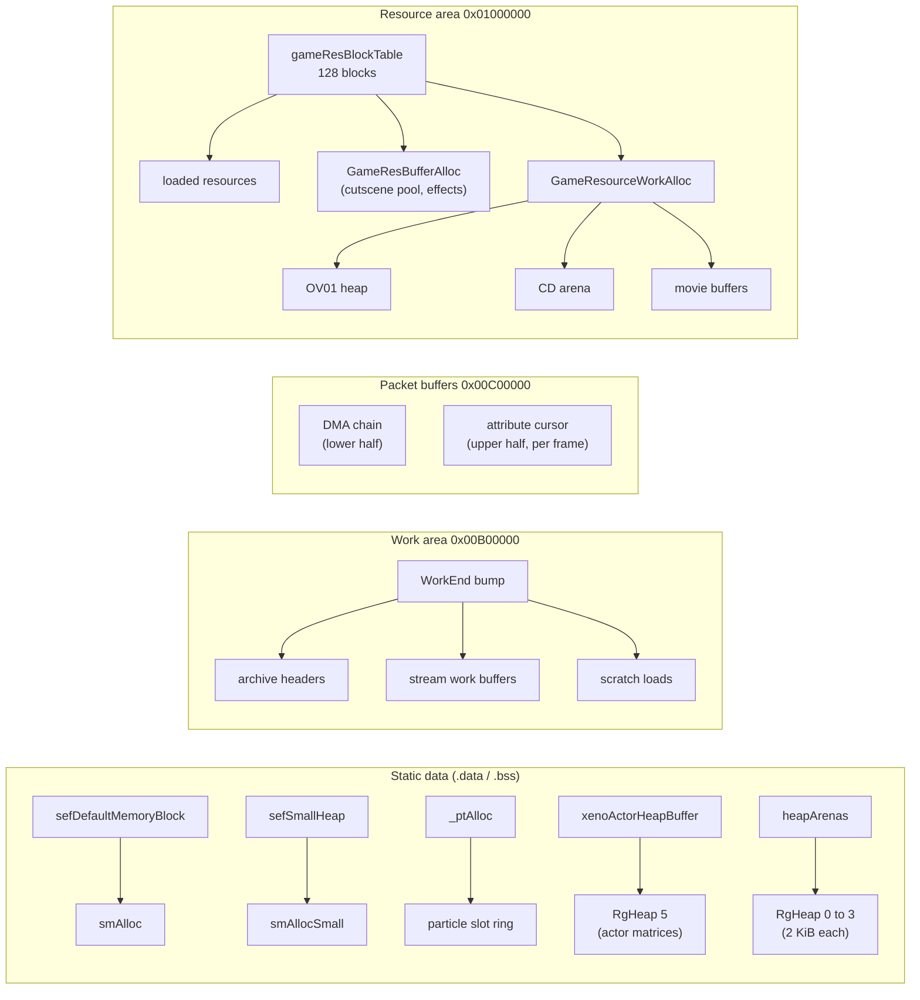

## Start-up

Memory is set up by `InitializeSystem` in `src/main/control_entry.c`, which
`main` calls right after `BootDisplay`. The function first reboots the IOP
and loads the IOP modules (see
[runtime-libraries.md](runtime-libraries.md#start-up)). Only then does it
touch EE memory, in a fixed order:

1. `WorkEnd = (u8 *)WORK_HEAP_START` puts the work pointer at `0x00B00000`.
2. `xglCdInitial` asks the IOP for the disc stream buffer and calls
   `xglCdArcInit`, which reads the archive headers to `WorkEnd` and moves the
   pointer past them.
3. `soundDriverInit` takes two work buffers for the stream players from
   `WorkEnd`.
4. The pad, memory card, task, DMA, interrupt and geometry modules start.
   They use static data only.
5. `xglPacketInit(PACKET_BUFFER_BASE, PACKET_BUFFER_SIZE, PACKET_RATE)` sets
   up the two packet buffers.
6. The render, font, movie and menu modules start.

The resource area is not set up here. It belongs to a play session, and
`Game()` initializes it each time a session starts. The title screen in OV02
runs before that and only uses the work area.

The sequence below shows the order in which the regions come to life.

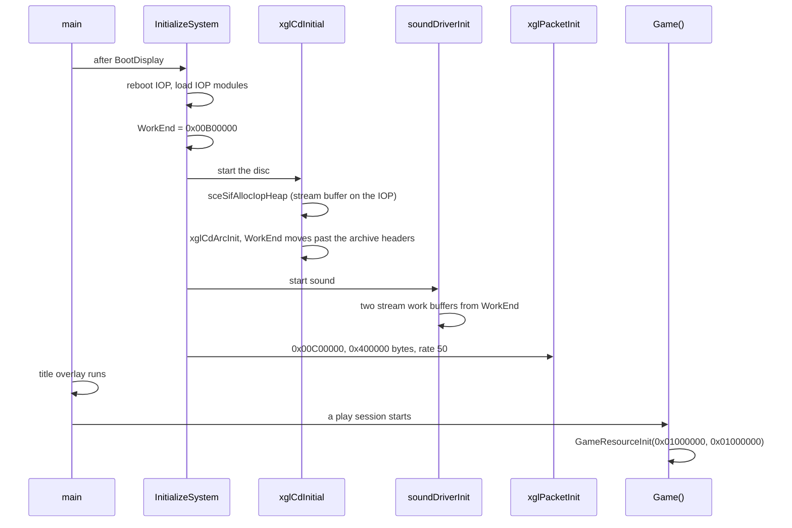

## The work area and WorkEnd

`WorkEnd` is a single global pointer, `u8 *WorkEnd` in
`src/main/control_entry.c`. It marks the first free byte of the work area. A
loader that wants permanent memory reads its data at `WorkEnd` and moves the
pointer past it. Nothing is freed block by block. A part of the game that
wants to release its memory saves `WorkEnd` when it starts and writes the
saved value back when it ends.

The work area is small, 1 MiB, and only three things live in it for the
whole run of the program.

The archive headers come first. `xglCdArcInit` in `src/main/xgl_cd.c` starts
at `WorkEnd` and reads the header of the first archive there, from the HDD
copy when the game is installed and from the disc otherwise. The headers of
the other archives follow, and the function ends with `WorkEnd = work`. The
headers stay in memory because every file read looks its file up in them.
`xglCdArcCheck` reads them again after a disc change. It sets `WorkEnd` back
to the address of the first header for the duration of the call, so the new
headers land exactly where the old ones were, and then restores the pointer.
The archives are described in
[files-and-resources.md](files-and-resources.md).

The two stream work buffers come second. `soundDriverInit` in
`src/main/sound_driver.c` takes `SOUND_SLOT0_BUFFER_BYTES` (`0x30200`) bytes
for the first stream player and `SOUND_SLOT1_BUFFER_BYTES` (`0x3DA00`) bytes
for the second. These are the work areas that the CRI ADX library needs for
each player (`ADXT_Create` receives the buffer and its size). The sizes
handed to the library are 28 bytes smaller than the space taken,
`0x301E4` and `0x3D9E4`. Together the two buffers use `0x6DC00` bytes, a
little under 440 KiB. Streams are described in [audio.md](audio.md).

The network work area is the third, and it only exists in a development
setup. `UsbInit` in `src/main/lan_usb.c` rounds `WorkEnd` up to 64 bytes,
keeps the address in `netInetWorkArea` and moves `WorkEnd` `0x8010` bytes
past it.

What remains above `WorkEnd` is scratch space. Several readers put temporary
data at `WorkEnd` and leave the pointer where it was, so the next user simply
overwrites it:

| User | File | What it puts at `WorkEnd` |
| --- | --- | --- |
| `xglCdDiskCheck` | `src/main/xgl_cd.c` | The text of `SYSTEM.CNF`, read to find the boot file name |
| `xglArxExtract` | `src/main/xgl_timer0.c` | Its decode table, at the first 64-byte boundary after `WorkEnd` |
| `xglHddMount` | `src/main/xgl_hdd.c` | A buffer at the first 64-byte boundary |
| `gameOverLoadFile` | `src/main/game_over_095.c` | A JPEG file `0xE0000` bytes above `WorkEnd`, decoded to `WorkEnd` itself |
| snapshot | `src/main/game_snap_shot.c` | The JPEG encoder's output buffer |
| `mc_check`, `Title` | `src/ov02/logo.c`, `src/ov02/title.c` | Memory card directory data and HDD query results |
| HDD install screen | `src/ov02/title_hdd_install.c` | Its picture and a transfer buffer |
| debug test | `src/main/debug_test.c` | A test texture |

The HDD install screen is the one user that moves the pointer for a while.
It saves `WorkEnd`, reads its picture there, places the transfer buffer at
the next 64-byte boundary after the picture and sets `WorkEnd` past the
buffer, so that the HDD functions it calls find their own scratch space
above it. When the screen ends it writes the saved value back.

A play session uses the same save and restore pattern. `Game()` stores
`WorkEnd` in `gameWork.workEnd` after it has set up the resource area, and
`Game_Data_Pop`, which brings the field back after a sub-program, writes
`gameWork.workEnd` back to `WorkEnd` before it reloads the map resources. Whatever a sub-program left in the work area is dropped at that
point.

The rule for any code that runs while others use the work area is therefore
simple: data at `WorkEnd` is only valid until the next load.

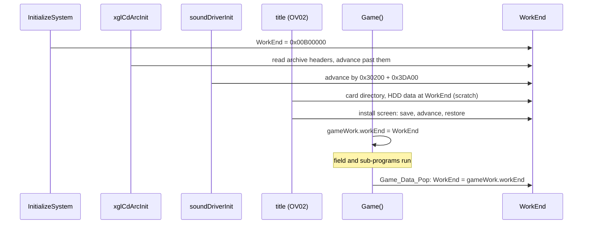

## The resource block table

The upper 16 MiB are managed by one table, `GameResBlock gameResBlockTable[]` with
`GAME_RES_BLOCK_COUNT` (128) entries, declared in
`include/main/res_get_path.h`. Each entry is 20 bytes and describes one
block of memory.

| Offset | Type | Field | Meaning |
| --- | --- | --- | --- |
| `0x00` | `void *` | `buffer` | Start of the block. A zero ends the table, and every search stops there |
| `0x04` | `unsigned int` | `size` | Size of the block in bytes |
| `0x08` | `int` | `owner` | 0 for a free block. Otherwise a resource id, or an anonymous owner tag |
| `0x0C` | `void *` | `tag` | Completion callback of a read into the block (`GameResCallback`), 0 when idle |
| `0x10` | `void *` | `value` | A word handed back to that callback, copied from `xglCdSlotValue` |

The entries describe consecutive extents of one memory range in address
order. Entry `n + 1` starts where entry `n` ends. Entry 0 is not a block. It
is the header of the table: its `buffer` and `size` hold the managed range,
and its `owner` holds the base index, the first entry that the best-fit
search and `GameResourceReset` look at (see
[Reset and the base index](#reset-and-the-base-index)).

`GameResourceInit(base, size)` stores the range in entry 0, selects base
index 1 with `resSelectSlot(0)` and calls `GameResourceReset`. After that the
table holds one free block, entry 1, that covers the whole range. Every
entry after it has a zero `buffer` and an `owner` of -1. The function also
resets the tables of the scene resource script and the sound records that
live in the same file.

`Game()` is the main caller, with the 16 MiB at `0x01000000`. The debug
entry `debug_test.c` and the battle test `src/ov01/yamamoto_test.c` use the
same range, and the resource test in `src/main/yajima_test.c` does too.

### Allocating and freeing blocks

`GameResBlockAlloc(owner, size)` is the allocator behind every other entry
point. It rounds the size up to `GAME_RES_BLOCK_ALIGN` (64 bytes) and calls
`GameResBlockFindBestFit`. The search starts at the base index and walks the
table to its end. A free block of exactly the wanted size is taken at once.
Otherwise the search keeps the free block that wastes the fewest bytes. The
result is 0 when nothing fits, which works as a failure code because entry 0
is never a block.

`GameResBlockAssign(index, owner, size)` then gives the block to its owner.
When the block is larger than the request, every later entry of the table
moves up by one place, and the new entry behind the block becomes a free
block with the remaining bytes. The table is therefore always sorted by
address, and splitting costs a copy of the table tail.

A block without a resource id still needs a non-zero `owner`.
`GameResBlockAlloc` builds one for it: `GAME_RES_OWNER` (`0xF00000`) plus
bits 8 to 23 of the block address. `GameResBufferAlloc(size)` is the usual
way to get such an anonymous block. It allocates with owner 0, clears `tag`
and `value` and returns the buffer address. `GameResBufferAllocOwned(owner,
size)` does the same for a caller that brings its own owner value.

`GameResBlockFree(index)` marks the block free and merges it with its
neighbours. A free block after it is absorbed first, then the block itself
is absorbed into a free block before it. The entries behind the merged block
move down to close the gap. Two wrappers find the block first:
`GameResBlockFreeByBuffer(buffer)` by its start address and
`GameResBlockFreeByOwner(owner)` by its owner. Both return the former index,
or 0 when no such block exists.

`GameResourceGetFreeAddr(size)` returns the start of the largest free block
and, when `size` is not null, its length. Code uses it as a large temporary
buffer that does not disturb loaded resources. `Intermission` and
`GameDiskChange` take the buffer for their frame picture from it.

The state diagram below shows the life of one block.

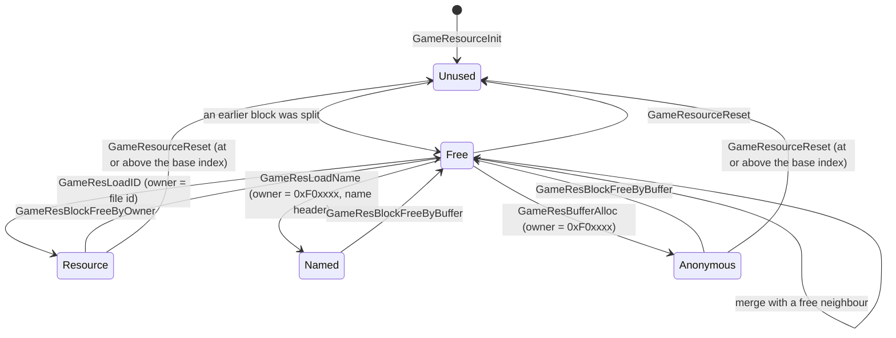

The users of anonymous blocks show how widely the table is used:

| Caller | File | Size | Use |
| --- | --- | --- | --- |
| `Game()` | `src/main/game_data.c` | `0x12000` | `gameWork.resBuffer` |
| `resPlayerSlotsInit` | `src/main/res_get_path.c` | 3 × (`0xC5FC0` + `0x40`) | The three party model buffers, each followed by a pad block |
| `cfeNodePoolInit` | `src/main/cfe_init.c` | `0x48000` | The cutscene track node pool |
| cutscene player | `src/main/cfePlugIn.c` | variable | Message text, group records, movie source and image buffers |
| map objects | `src/main/game_map_object.c` | `JPEG_DECODE_BUFFER_SIZE` | A JPEG decode buffer |
| effect loader | `src/main/sv_get_image_item.c` | file size | An effect file that did not fit the effect pool |
| resource test | `src/main/yajima_test.c` | `0x4000` | A file name list |

### Loading into blocks

Two functions load a file into a block and remember it, so that a second
request for the same file finds the data instead of reading it again.

`GameResLoadID(id, buffer, size, callback)` works with resource ids. The low
24 bits of the id (`GAME_RES_ID_MASK`) are the file id, and that value
becomes the block's `owner`. The function first calls
`GameResBlockFindByOwner`. When a block already holds the file, it reports
the block's address and size, calls the callback at once and returns. When
not, it asks `xglCdLoadByKind` for the total size the resource needs,
allocates a block of that size and calls `xglCdLoadByKind` again to start
the read into it. The return value is the owner, -1 when the file does not
exist and -2 when no block is large enough. `GameResFindID(id, size)` is the
lookup alone.

`GameResLoadName(name, data, size, callback)` works with file names. A block
loaded by name starts with a header of `GAME_RES_NAME_HEADER_SIZE` (64)
bytes that holds the name, and the file data follows it.
`GameResBlockFindByName` finds such a block by comparing the name with the
first bytes of every anonymous block. A new block gets the file size rounded
up to a 2,048-byte sector plus the header. `GameResFindName` is the lookup
alone and returns the address behind the header.

Reads are asynchronous. The block's `tag` holds the caller's callback, and
`gameResReadEvent`, the completion handler given to `xglCdReadFile`, calls it
with the block index, the buffer, a state word and the `value` word when the
read ends. How a resource id turns into one or several files is described in
[files-and-resources.md](files-and-resources.md).

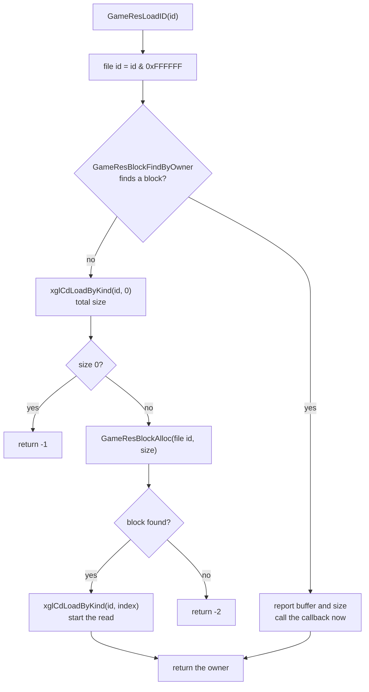

### Reset and the base index

There are two ways to release blocks. Single blocks are freed with
`GameResBlockFree`. Everything at once is released with
`GameResourceReset()`, and the base index decides what "everything" means.

`GameResourceReset` reads the base index `i` from entry 0. Entry `i` becomes
one free block that runs from its own start address to the end of the
managed range, and every entry after it is cleared. Entries below `i` are
not touched. With base index 1 the whole area becomes free.

`resSelectSlot(search)` sets the base index. `resSelectSlot(0)` selects 1.
`resSelectSlot(1)` selects the index of the largest free block at that
moment. `Game()` uses this to split the area into a permanent part and a
scene part. After `GameResourceInit` it loads the data that must stay for
the whole session: `gameWork.resBuffer`, then the resource `0x30041` and
the three party model buffers of `resPlayerSlotsInit`. It loads the party
models with `ptLoadPartyModels` and then calls `resSelectSlot(1)`. The largest free block is the
remainder behind all of these, so from now on the best-fit search and
`GameResourceReset` only see the memory above the permanent blocks.

The scene loader then calls `GameResourceReset` when it changes to a new
scene, and the cutscene player calls it when a cutscene ends. Both drop
every scene resource in one step and leave the party data where it is. When
the session ends, `Game()` calls `resSelectSlot(0)` again.

```
0x01000000  entry 1..k: permanent blocks (below the base index)
            gameWork.resBuffer (0x12000)
            resource 0x30041
            party buffer 0 (0xC5FC0) + pad (0x40)
            party buffer 1 (0xC5FC0) + pad (0x40)
            party buffer 2 (0xC5FC0) + pad (0x40)
            anything ptLoadPartyModels allocated
            ------------------------------- base index (resSelectSlot(1))
            scene resources, cutscene blocks, effect files ...
            last entry: free space
0x02000000
```

Each pad block holds the text `(padding)`, and each party buffer starts with
the text `(Player#n)` until a model is loaded into it. The texts make the
blocks easy to recognise in the debug display. `resPlayerModelSlots[3].base` is set
to the largest free block and serves as a fourth, unbounded slot.

### Borrowing the resource area

Screens and sub-programs that run on top of the field need several megabytes
for a short time: the battle engine, the menus, the save screen, the battle
result screen and the movie player. They ask for it with
`GameResourceWorkAlloc(bytesWanted)`.

The function starts from the largest free block. When that block is large
enough, its address is the answer. When it is not, the function widens the
run block by block until the total reaches the wanted size. It extends the
run downward, toward lower addresses, when the entry after the run is the
end of the table and the run has not reached the base index. Otherwise it
extends upward. The blocks it adds are not free. They hold loaded resources,
and the caller will overwrite them.

The table is not changed by this call. The function only records the
borrowed range, as the start addresses of the first and the last block of
the run. The first borrower's range is stored in `gameResArenaStart` and
`gameResArenaEnd`. While that arena exists, a second call stores its range
in `gameResWorkStart` and `gameResWorkEnd` instead. The game therefore
supports two nested borrowers: an arena and, inside or beside it, a work
range.

The recorded arena has one immediate effect. `GameResBlockFindByOwner` and
`GameResBlockFindByName` skip every block whose address lies in the arena,
so a resource that the borrower is about to overwrite counts as not loaded.

Two functions give the memory back, and both do it by loading files again:

- `GameResArenaRelease()` ends the innermost borrower. It takes the work
  range when one is recorded and the arena otherwise, walks the table and
  calls `xglCdLoadByKind(owner, block start)` for every owned block in that
  range. Each lost resource is read into its old block again. Then all four
  range variables are cleared.
- `GameResourceWorkReload()` is used while both ranges exist. It reloads
  every owned block that lies inside the arena but outside the work range,
  with the synchronous flag `RES_ID_QUEUED_LOAD` set. This brings back the
  part of the field that the first borrower destroyed and the second one
  does not need.

A battle shows both steps. The battle scene takes the arena for its heap.
When the battle ends, the result screen opens the CD arena, which becomes
the work range. `battleResultScene` loads its fonts and background layers
into it and then calls `GameResourceWorkReload`, so the field's resources
load again behind the result screen while the player reads the numbers.
Closing the result screen releases the work range.

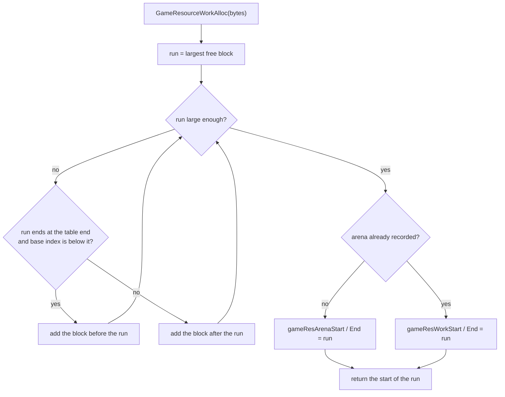

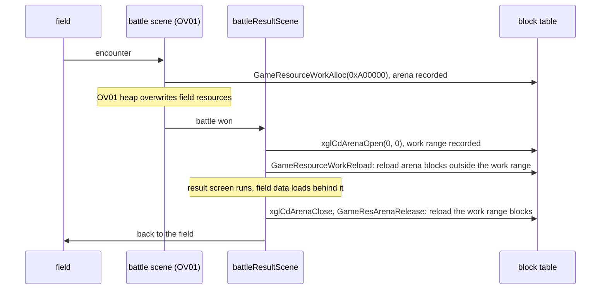

The users of `GameResourceWorkAlloc` are few, because most screens reach it
through the CD arena:

| Caller | File | Size |
| --- | --- | --- |
| `ov01HeapBaseGet` | `src/ov01/data_unit_org_get.c` | `0xA00000`, the battle heap |
| `xglCdArenaOpen` | `src/main/xgl_cd_arena.c` | The size the screen asks for, `0x288000` by default |
| movie player | `src/main/game_movie.c` | `movieRenderBufferSize(SaveData.dolby_digital)` |

## The CD arena and the CD buffer

Menu screens load many small files: font textures, background layers, skill
models, pictures. `src/main/xgl_cd_arena.c` gives them two bump allocators
that hand out memory in whole disc sectors of 2,048 bytes
(`CD_SECTOR_SIZE`), so that every allocation can be the target of a sector
read.

### The arena

`xglCdArenaOpen(buffer, size)` opens the arena. With a buffer, the arena
lies over the caller's memory and `xglCdArenaOwned` is 0. With a null
buffer, the arena takes its memory from `GameResourceWorkAlloc` and
`xglCdArenaOwned` is 1. A size of 0 selects the default of `0x288000`
bytes. The start address is kept in the variable `xglCdArenaStart` and the
size in `xglCdArenaBytes`. The two names are the wrong way round in the
source, and `xglCdArenaGetStart()` accordingly returns the start address. The
text marker code uses that function only to ask whether an arena is open.

`xglCdSectorAlloc(size)` is the allocator. It returns `xglCdArenaUsed` and
moves that pointer forward by the size, rounded up to the next sector
boundary. Nothing checks the pointer against the end of the arena.

`xglCdArenaClose()` waits until the disc is idle (`xglCdWaitIdle`), resets
the users that keep pointers into the arena (`menuSkillModelReset`,
`fontObjClearRunLists`, `bgLayerResetState`) and, when the arena owns its
memory, calls `GameResArenaRelease` so that the field data comes back. Then
it clears the arena variables.

### The buffer

The CD buffer is a second bump allocator inside the arena, for data that
changes while the screen stays open. `xglCdBufferAlloc(size)` takes one
piece of the arena and stores its address in `xglCdBufferBase` and
`xglCdBufferCursor`. `xglCdBufferReserve(size)` returns the cursor and moves
it forward by the size, rounded up to a sector. `xglCdBufferRewind()` waits
for the disc, resets the font slots and the skill models that live in the
buffer (`fontObjResetBufferSlots`, `menuSkillModelTailReset`) and sets the
cursor back to the base. A menu page that is left can thus drop all its
files at once, while the data allocated directly from the arena stays.
`xglCdBufferClear()` forgets the buffer.

```
xglCdArenaStart (start)                                    start + xglCdArenaBytes
┌──────────── CD buffer ────────────┬───── arena allocations ─────┬──── free ────┐
│ xglCdBufferReserve grows ▶        │ xglCdSectorAlloc grows ▶    │              │
└───────────────────────────────────┴─────────────────────────────┴──────────────┘
xglCdBufferBase   xglCdBufferCursor                                xglCdArenaUsed
(rewound by xglCdBufferRewind)                         (cleared by xglCdArenaClose)
```

The table lists the screens that open the arena.

| Screen | File | Arena | First allocations |
| --- | --- | --- | --- |
| Main menu | `src/main/menu_scene.c` | borrowed, default size | CD buffer of `0x140000` bytes |
| Save and load screen (`MenuFileMain`) | `src/main/save_screen.c` | `0x200000` bytes, borrowed (mode 0) or fixed at `0x01000000` | CD buffer of `0x40800`, scan buffer `0x7160`, slot table `0x97680`, card data `0x42000`, thumbnail `0x7900`, text table `0x800` |
| `configScreenRun` | `src/main/save_screen.c` | `0x200000` bytes at `0x01000000` | scan buffer `0x19000` |
| Battle result | `src/main/battle_result.c` | borrowed, default size | three small tables of 128, 280 and 64 bytes |

The save screen uses the fixed address `0x01000000` when its entry mode is
not 0. That is probably the case when it runs without a field behind it,
for example from the title screen, where the resource table is not in use.
The screens themselves are described in
[main-menu.md](../game/main-menu.md) and [save-data.md](save-data.md).

### Pending reads

The same file counts the asynchronous reads that go into arena memory.
`xglCdReadFileAsync(name, buffer, kind, sub)` packs `kind` and `sub` into a
tag (`(kind << 8) + sub`), starts the read with `xglCdReadFile` and, when
the read started, adds one to `xglCdPendingReads`. When the read ends,
`xglCdReadDoneCallback` receives event `CD_EVENT_DONE` (4), calls the
handler for the kind and subtracts one.

| Kind | Name | Handler | Owner |
| --- | --- | --- | --- |
| 1 | `CD_READ_FONT_SLOT` | `fontObjMarkSlotLoaded(sub)` | font textures, see [fonts-and-text.md](../libraries/fonts-and-text.md) |
| 2 | `CD_READ_BG_LAYER` | `bgLayerAdvance(sub)` | background layers, see [screen-effects.md](../libraries/screen-effects.md) |
| 3 | `CD_READ_MENU_SKILL` | `menuSkillModelReadDone(sub)` | skill models of the main menu |
| 4 | `CD_READ_UMN_IMAGE` | `menuUmnImageDecode(sub)` | pictures of the main menu |

`xglCdWaitIdle()` loops until the disc reports idle and
`xglCdPendingReads` is zero. Both `xglCdArenaClose` and `xglCdBufferRewind`
call it first, so no read can still be writing into memory that is about to
be given away.

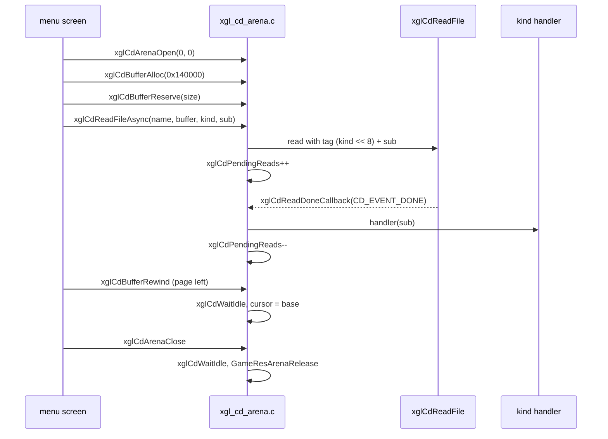

### Other contents of the file

`src/main/xgl_cd_arena.c` also holds a few helpers that have nothing to do
with memory. `xglFontGetTextWidth` copies a text behind a two-byte prefix in
`xglFontMeasureBuffer` and measures it. `padCirclePressedAlone` and
`padCrossPressedAlone` test for a fresh press of one button with no
direction held. `xglTickAdvance` advances the 16-bit counter
`xglTickCounter` and runs the vibration engine. `xglClockSampleDayTime` and
`xglClockAccumulate` add the real time that has passed to the party's play
time, and `PartyTimeDispChange` folds days into hours and clamps the display
at 99:59:59. `xglCallbackQueueAdd` and `xglCallbackQueueRun` keep a queue of
up to four functions that is run once and then emptied.
`pxyTickScaleDoubleOverride` saves and restores the model library's
double-speed flag. These belong to [xgl.md](../libraries/xgl.md) and
[party-and-growth.md](../game/party-and-growth.md).

## Allocators with real free

### The sm pools

`src/main/sm_initilize.c` implements a small best-fit allocator for the
effect system. It manages two pools, each described by one `SmPool` record:
`smPool` for effect files and `smPoolSmall` for small work blocks.

A pool is divided into units of 64 bytes (`0x40`). Every block, free or
used, starts with one header unit. The header itself is the 16-byte
`SmCell`, and the rest of the unit is unused. The headers form a doubly
linked list in address order.

| Offset | Type | Field | Meaning |
| --- | --- | --- | --- |
| `0x00` | `int` | `tag` | `0x1234` for a free block, `0x5678` for a used one |
| `0x04` | `int` | `unit_count` | Number of 64-byte units after the header unit |
| `0x08` | `SmCell *` | `prev` | The block before this one, 0 for the first |
| `0x0C` | `SmCell *` | `next` | The block after this one, 0 for the last |

`smInitilize(memory, size)` turns a memory range into one free block of
`size / 64 - 1` units and records it in `smPool`. `smInitilizeSmall` does
the same for `smPoolSmall`. Both call `smInitMemInfo`, which fills the
`SmPool` record.

| Offset | Field | Meaning |
| --- | --- | --- |
| `0x00` | `first_cell` | The first block of the pool |
| `0x04` | `total_units` | Units in the pool |
| `0x08` | `allocated_units` | Set to 0 at start |
| `0x0C` | `total_bytes` | Pool size in bytes |
| `0x10` | `allocated_bytes` | Set to 0 at start |
| `0x14` | `largest_free_block` | Set to the pool size at start |

Only `first_cell` and `total_units` are read again. The four counters are
written once by `smInitMemInfo` and no other function updates them, so they
look like the remains of a statistics display.

`smAllocFromPool(size, first_cell, total_units, find_only)` does the search.
It converts the size to units, walks the list and keeps the smallest free
block that is large enough, stopping early on an exact fit. With
`find_only` set, it returns the block it found and changes nothing. In the
normal case it marks the block used. When the block is larger than needed,
the units behind the request become a new free block with its own header
unit. The result is the address of the first unit after the header.

Three entry points use it:

- `smAlloc(size)` rounds the size up to 2,048 bytes and allocates from
  `smPool`. Every block is thus a whole number of disc sectors.
- `smFindFree(size)` does the same search without allocating. The effect
  loader uses it to test whether a file would fit before it decides to evict
  other effects.
- `smAllocSmall(size)` rounds the size up to 64 bytes and allocates from
  `smPoolSmall`.

`smFree(allocation)` steps back one unit to the header, marks the block free
and merges it with a free block after it and then with a free block before
it. A null pointer is ignored. `smFreeHandle` is a second name for the same
function. `smPrintInfo` and `smPrintInfoSmall` walk the list of a pool and
stop at the first header whose tag is neither value. The walk prints
nothing and changes nothing. It was probably a debug listing whose output
was removed.

```
sefDefaultMemoryBlock
┌────────┬──────────────────┬────────┬────────────┬────────┬─────────
│ SmCell │ used block       │ SmCell │ free block │ SmCell │ used ...
│ 0x5678 │ (n x 2 KiB)      │ 0x1234 │            │ 0x5678 │
└────────┴──────────────────┴────────┴────────────┴────────┴─────────
  64 B                        64 B                  64 B
```

The large pool lives in the static array `sefDefaultMemoryBlock` of
`0x152800` bytes. `sefInitEffect` in `src/main/sef.c` calls
`smInitilize(sefDefaultMemoryBlock, 0x152800)` each time a play session
starts. The effect resource code in `src/main/srs.c` takes fixed blocks from
it: `SRS_ESP_BUFFER_SIZE` (`0x28800`) bytes for the effect package,
`SRS_SLOT_BUFFER_SIZE` (`0x1C000`) bytes for a waiting slot and
`SRS_BLOCK_BUFFER_SIZE` (`0x10000`) bytes for an effect block. A single
effect file gets a block of its own file size from
`src/main/sv_get_image_item.c`. When that allocation fails for an effect of
owner mode 1, the loader falls back to `GameResBufferAlloc` and puts the
file in the resource area. The slot record remembers which allocator the
block came from (`SRS_KIND_SM_BLOCK` or `SRS_KIND_GAME_RES_BLOCK`), and
`srsFreeEffectSlot` frees it with the matching function.

The small pool lives in the static array `sefSmallHeap` of `0x20000` bytes.
`sefResetBuffers` in `src/main/sdv.c` installs it, and the effect sequence
driver takes the ring buffers of its emitters from it with `smAllocSmall`
and gives them back with `smFreeHandle`. The effect system is described in
[sef.md](../libraries/sef.md) and [sdv.md](../libraries/sdv.md).

The flowchart below shows `smAlloc`.

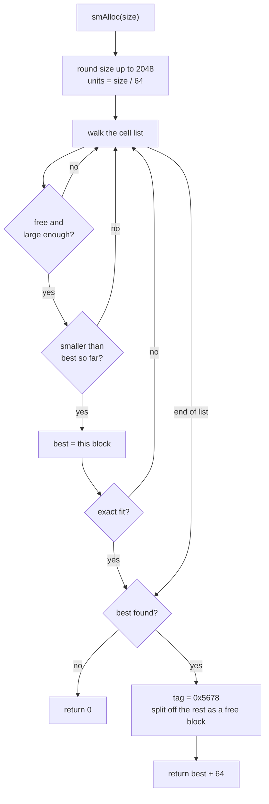

### RgHeap

`RgHeap` in `src/main/test_128.c` is a general heap with heavy checking. It
keeps the source file and line of every allocation and stamps every block
with a magic text, so that a wrong `free` or an overwritten header is
reported with the place that allocated the block.

There are `HEAP_MAX` (6) heaps, selected by a number. Each has a 32-byte
record in `heapInstances`, of which the `RgHeap` structure uses 20 bytes.

| Offset | Type | Field | Meaning |
| --- | --- | --- | --- |
| `0x00` | `void *` | `top` | Start of the heap's memory |
| `0x04` | `int` | `size` | Size of the heap in bytes |
| `0x08` | `RgHeapBlock *` | `freeHead` | Lowest block of the circular free list |
| `0x0C` | `RgHeapBlock *` | `allocHead` | One block of the circular list of allocated blocks, 0 when there are none |
| `0x10` | `int` | `mapStride` | Bytes per cell of the debug heap map, `0x100` at start |

Every block starts with a 64-byte `RgHeapBlock` header, and the memory given
to the caller follows it.

| Offset | Type | Field | Meaning |
| --- | --- | --- | --- |
| `0x00` | `RgHeapBlock *` | `pre` | Previous block of the list the block is in |
| `0x04` | `RgHeapBlock *` | `next` | Next block of that list |
| `0x08` | `u32` | `size` | Size of the block in bytes, header included |
| `0x0C` | `u16` | `mark` | 1 while the block is allocated |
| `0x0E` | `u16` | `line` | Source line of the allocating call |
| `0x10` | `char[32]` | `module` | Byte 0 is the heap id. The source file name of the allocating call follows from byte 1, cut to 30 characters |
| `0x30` | `char[16]` | `magic` | The 15-character stamp `gAMe sHoW 2001.` |

`InstanceOfRgHeapById(heapId)` returns the record of a heap. The first time
a heap is asked for, the function gives it a default arena of
`HEAP_ARENA_SIZE` (2,048) bytes from the static array `heapArenas`. A user
that needs a real heap calls `InitRgHeap(heap, memory, size)` afterwards.
That function requires a size that is a multiple of 16, clears the memory
and turns it into one free block. `ClearRgHeap` rebuilds the single free
block without clearing.

`RgHeapAllocById(heapId, size, sourceFile, line)` rounds the size up to 16
bytes and adds the header. It walks the whole free list and takes the
smallest block that is large enough. When the rest of the block is at least
`HEAP_MIN_BLOCK_SIZE` (65) bytes, a header plus one byte, the rest becomes a
new free block. Otherwise the caller gets the whole block. The block is
unlinked from the free list, marked, stamped with file, line, heap id and
magic text and inserted into the allocated list. When no block fits, the
function dumps the heap and prints `too big size (%d) of allocation`, then
returns 0.

`RgHeapFree(pointer, sourceFile, line)` reads the heap id from the header in
front of the pointer, so the caller does not name the heap. It reports a
block that is already free (with the place that allocated it), a block that
was never allocated, a destroyed magic text and a pointer outside the heap.
Then it unlinks the block from the allocated list, inserts it into the free
list at its place by address and calls `_MergeBlocks`, which joins every
free block that ends exactly where the next one starts.

Errors that the heap cannot survive go to `_Error`. It prints the failed
condition with file and line, dumps the heap and then loops forever. The
dump functions `RgHeapDump_sub`, `RgHeapDumpBlock` and `RgHeapDumpById`
print the free map and the allocation map with `printf`.

```
heap->top                                                top + size
┌────────┬─────────┬────────┬──────────────┬────────┬─────────────┐
│ header │ payload │ header │ free         │ header │ payload     │
│ mark 1 │         │ mark 0 │              │ mark 1 │             │
└───┬────┴─────────┴───┬────┴──────────────┴───┬────┴─────────────┘
    │  allocated list  │       free list       │
    └──────────────────┼───────────────────────┘ (circular, any order)
                       └── circular, sorted by address
```

Two of the six heaps have a real user.

Heap 5 is the matrix heap. `XenoActorInitHeap` in `src/main/xenoActor.c`
installs it over a static buffer of `0x38000` bytes, and
`XenoActorPoolInit` calls it every time the actor pool is set up. An actor
takes its joint matrix arrays from it when a model is attached: `pLocalMat`,
`pGlobalMat` and `pBlendMat` with 64 bytes per joint, `pDynamics` with 64
bytes per dynamics node and `pPartsMat` with 64 bytes per model part. They
are freed again when the model is detached or the actor is released. Because
the game re-creates the pool with `XenoActorPoolInitDefault` at every major
transition (14 call sites), the heap is also emptied as a whole at those
points. Actors are described in [actors.md](../libraries/actors.md).

Heap 4 is installed by `oLibInit` in `src/main/oLib.c` over `0x01200000`
bytes at `0x01000000`. The function then allocates `0x800010` bytes from it
and gives the first `0x800000` of them to `GameResourceInit`, which makes
the resource area an 8 MiB block inside the heap. No recovered function
calls `oLibInit`, so this is probably a development setup for a test
program.

Heaps 0 to 3 keep their 2 KiB default arenas and have no recovered user.
The debug heap windows at the end of `src/main/test_128.c` show all six
heaps. Their titles name heaps 0 to 3 "memory 0" to "memory 3", heap 4
"system" and heap 5 "matrix" (the titles are Japanese text in the game).
The windows are described in [debug-tools.md](../game/debug-tools.md).

The flowchart below shows an allocation.

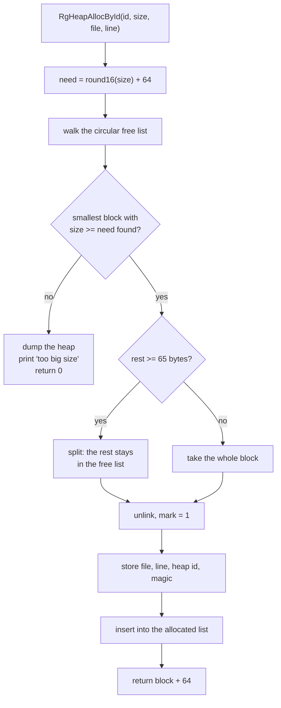

### The battle heap

The battle engine in OV01 loads unit models, motions, voices and stage data
whose sizes differ from battle to battle. It manages them with a heap of its
own in `src/ov01/data_unit_org_get.c`.

`ov01HeapInit` runs when a battle scene starts (`ov01SceneInit` calls
`dataFileInit`, which calls it). It takes `OV01_HEAP_BYTES` (`0xA00000`, 10
MiB) from the resource area with `GameResourceWorkAlloc` and stores the
first and the end address in `ov01HeapStart`. The whole range becomes one
free block.

A block has a header of `OV01_HEAP_HEADER_SIZE` (64) bytes, of which only
the first two words are used.

| Offset | Type | Field | Meaning |
| --- | --- | --- | --- |
| `0x00` | `unsigned int` | `flags` | Bit 0 (`OV01_HEAP_FLAG_IN_USE`) is set while the block is in use. `ov01HeapAlloc` writes 3 |
| `0x04` | `int` | `size` | Payload size in bytes, a multiple of 64 |

There are no links. The blocks lie back to back, and `ov01HeapNextBlock`
finds the next header by adding the payload size and the header size. It
returns 0 at the end of the heap.

`ov01HeapAlloc(size)` rounds the size up to 64 bytes and calls
`ov01HeapFindFree`, which returns the first free block that is large enough.
This is a first-fit search from the start of the heap. When the block is
larger than the request plus one header, the rest becomes a new free block.
The result is the address behind the header, or 0 when nothing fits.

`ov01HeapFree(payload)` ignores a pointer outside the heap. Otherwise it
clears the flags of the block and then walks the whole heap once. Every free
block absorbs the free blocks that follow it, so all neighbouring free
blocks are merged, not only those around the freed block.

`ov01HeapProbeLargeAlloc()` allocates `0x2A800` bytes and frees them again
by clearing the flags directly. It returns 1 when the allocation worked.
The battle start step calls it once the battle files are loaded and ignores
the result. `0x2A800` is the size of a small voice stream buffer
(`DATA_STREAM_SMALL_SIZE` in `src/ov01/data_file_load.c`), so the call
appears to be a leftover check that one more stream would still fit.

`ov01LookupNonHeap(key)` connects the heap to the resource table. It looks a
resource up with `GameResFindID` and returns its address, unless that
address lies inside the battle heap. A field resource whose block the heap
now covers has been overwritten, and the function reports it as absent so
that the battle loads its own copy.

The heap's users are all in `src/ov01/data_file_load.c`: the general file
buffer (`DATA_FILE_BUF_SIZE`, `0x2E800`), the enemy think data
(`DATA_THINK_BUF_SIZE`, `0x12000`), an arena of `DATA_ARENA_SIZE`
(`0x11800`) bytes, the voice banks of each unit slot and the model buffers
of the units. The memory goes back to the field when the battle ends and
`GameResArenaRelease` reloads the field's resources. The engine is described
in [battle-engine.md](../game/battle-engine.md).

The same file holds the overlay's two read helpers. `dataFileLoad` reads a
file and waits for it. `dataFileLoadNB` starts an asynchronous read with the
callback `dataNBreadCB` and counts it in `ov01CdPendingCount`. `dataCdSync`
returns that count, so the loading steps can wait until it is zero.

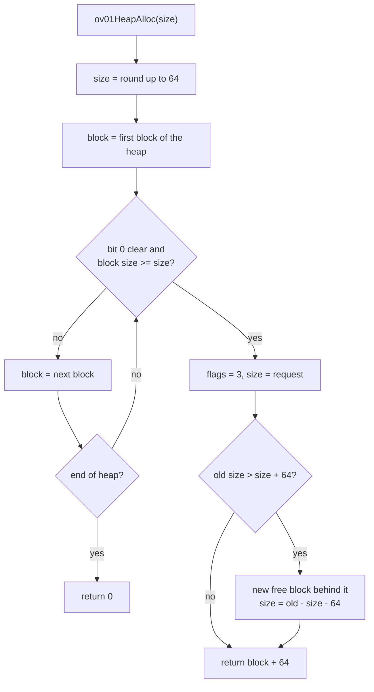

### The particle slot ring

The effect system gives every particle group a slot in a fixed table.
`src/main/sef.c` manages the slots with a ring of free indices, which makes
both allocation and release a matter of a few instructions.

The table `_ptAlloc` is a static array of `0xBD110` bytes. Its entries are
`SefSlot` records of `0x2C0` bytes, and entry 0 is the control block of the
ring: its first two words are `head` and `tail`. The free indices are kept
in `sefPtFreeSlots`, an array of 1,104 `short` values. `sefPtAllocCount`,
set to `0x44C` (1,100) by `sefInitEffect`, is the length of the ring.

`sevInitPtAllocator` clears the table and writes the numbers 0 to 1,099 into
the ring. `sevAllocPtAllocator` reads the index at `head` and advances
`head`, wrapping at `sefPtAllocCount`. It returns -1 when advancing would
reach `tail`, which means the ring is empty. `sevFreePtAllocator(handle)`
writes the index at `tail` and advances `tail` in the same way. It ignores a
handle outside the valid range and does nothing when `head` equals `tail`.
The particle code is described in [sef.md](../libraries/sef.md).

### The cutscene node pool

The cutscene player builds its tracks from small list nodes.
`cfeNodePoolInit` in `src/main/cfe_init.c` takes one anonymous resource
block of `0x48000` bytes with `GameResBufferAlloc` and passes it to
`cfeNodePoolSet`. The block holds `CFE_POOL_NODE_COUNT` (6,144)
`CfeTrackNode` records of 48 bytes.

`cfeNodeAlloc` in `src/main/cfe_node_pool.c` scans the pool from the start
for the first node whose `CFE_TRACK_IN_USE` bit is clear, clears the node
and sets the bit. It returns 0 when all nodes are in use. `cfeNodeRelease`
clears the bit. `cfeNodePoolReset` clears the whole pool at once, and
`cfeNodePoolCountInUse` counts the used nodes. Because the pool is a
resource block above the base index, the `GameResourceReset` at the end of a
cutscene gives its memory back together with everything else the cutscene
loaded. The player is described in
[cutscenes.md](../scripting/cutscenes.md).

### The C library heap

The C library's `malloc` and `free` are linked into the executable, but the
game almost never calls them. The only callers are two development functions
in `src/main/script_load.c`. `scriptReadFile` allocates a buffer with
`malloc(100)`, reads a script image from the development host
(`host0:/home/xeno/vcd/x2/cf/`) into it and links it. `scriptFreeBuffer`
frees it. The released game loads its scripts from the disc through the
resource table instead. The C library is described in
[runtime-libraries.md](runtime-libraries.md#the-c-library).

## Fixed pools

Not every object count is dynamic. Several systems use a static array of
records and a flag per record, which needs no allocator at all.

The actor pool is the most important one. `XenoActorPoolInitDefault` calls
`XenoActorPoolInit(xenoActorPoolBuffer, 0x30)`, which lays out 48 `XenoActor`
records of `XENO_ACTOR_POOL_STRIDE` (`0x7F0`) bytes in a static buffer,
followed by the table `XenoActorActiveTable` with one word per record. It
initializes every record, clears the table and installs the matrix heap. The
function returns the first address behind the table, so a caller could also
place the pool in memory of its own.

Other pools of this kind are the effect slot tables of `srs.c`, the message
window slots and the object slots of the battle engine. Each is described on
the page of its system.

## Packet buffers as frame memory

The 4 MiB at `0x00C00000` hold the display lists that the game sends to the
graphics hardware. `xglPacketInit(buffer, size, rate)` in
`src/main/xgl_packet.c` splits the range into two halves and sets up one
`XglPacket` record for each, `packetSourceFirst` and `packetSourceSecond`.
The game fills one half while the hardware reads the other.

Each half is divided again. The DMA chain, the list of tags and commands,
grows upward from the start of the half. Large data that the chain only
points to is placed above a fixed line, the record's `limit`, through the
record's `cursor`. `rate` is the percentage of the half that is reserved for
this data. `xglPacketInit` clamps it to the range 1 to 99, computes the
reserve, rounds it up to 16 bytes and sets `limit` to the end of the half
minus the reserve. `InitializeSystem` passes `PACKET_RATE` (50), so the line
lies in the middle of each half.

| Record | `buffer` | `limit` and first `cursor` | End |
| --- | --- | --- | --- |
| `packetSourceFirst` | `0x00C00000` | `0x00D00000` | `0x00E00000` |
| `packetSourceSecond` | `0x00E00000` | `0x00F00000` | `0x01000000` |

The functions that allocate through `cursor` are in
`src/main/pxy_packet_state.c`. `nmlPacketSetAttributeData(data, size)`
copies a piece of data to `cursor`, advances the cursor and returns the
address of the copy. `nmlPacketSetAttributeData64` copies one 4×4 matrix,
`nmlPacketSetAttributeData64N` a number of matrices and
`nmlPacketSetAttributeData16N` a number of 16-byte vectors.
`nmlPacketSetAttributeAlloc16N(count)` only reserves space, `count * 16 +
16` bytes. It is the one function that checks for room: it returns 0 when
the cursor is within `0x8000` bytes of the end of the half. The GS register
queue also lives here. `nmlPacketAddGsFlush` advances the cursor past the
queued entries when it links them into the chain.

Once per frame `xglRenderMove` calls `xglPacketMove`. It ends the current
chain (`sceVif1PkEnd`, `sceVif1PkTerminate`), writes the data cache back
with `FlushCache(0)`, sets the record's `cursor` back to its `limit`, makes
the record the send packet (`pSendPacket`) and switches `pCurrentPacket` to
the other record, which it resets. `xglPacketSend` then starts the DMA
transfer of the send packet on the VIF1 channel.

Everything allocated from a half therefore stays valid for the frame being
built and the frame being sent. It is released automatically when the half
becomes the current packet again and the chain is rebuilt from its start.
No code ever frees attribute data.

```
0x00C00000                    0x00D00000                    0x00E00000
┌─ DMA chain (grows up) ─▶     │─ attribute data (grows up) ─▶         ┐
│ tags, VIFcodes, small data   │ matrices, vectors, register queues    │
└──────────────────────────────┴───────────────────────────────────────┘
buffer                         limit: cursor is set back here
                               by xglPacketMove
```

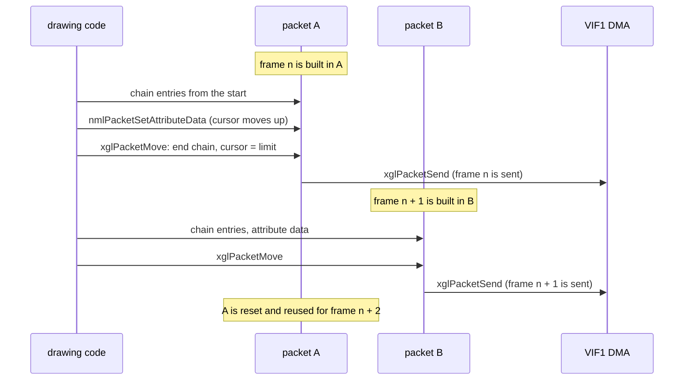

The same file holds two helpers that write into the current packet.
`xglPacketTextureTrans(set)` adds one texture upload per entry of an
`XglTextureTransSet`: it computes the target position in video memory from
`sRenderTextureBase` and the entry's offset, and references the pixel data
in place. The talk window and the button icons use it.
`xglPacketInterpolate` adds the full-screen pass that `xglRenderMove` draws
with the display buffer as a texture. `xglPacketGetCurrent` returns the
current record. The packet format and these passes are described in
[rendering.md](rendering.md).

## The scratchpad

The EE has 16 KiB of fast scratchpad memory at `0x70000000`
(`SCRATCHPAD_BASE` in `include/shared.h`). It is part of the processor and
does not go through the data cache, which makes it a good place for small
blocks that are built and consumed at once. The game has no allocator for
it. Each routine that wants fast temporary space uses fixed offsets of its
own. More than thirty source files do so.

`src/main/xgl_packet_scratch.c` is the nearest thing to a shared interface.
It builds a batch of GS register writes at the start of the scratchpad and
appends the batch to the current packet:

1. `xglPacketScratchBegin()` remembers the current packet, points
   `xglScratchQuads` at `SCRATCHPAD_BASE` and sets the count to 0.
2. `xglPacketScratchAddQuad(high, low)` stores one 128-bit entry (a register
   address and its data) and counts it. The first entry is the GIF tag of
   the batch.
3. `xglPacketScratchPatchTag()` adds `count - 1` to the data word of the
   first entry, which writes the number of register writes into the tag.
4. `xglPacketScratchAddDirect()` copies the batch into the packet as a
   direct-mode block (`sceVif1PkOpenDirectHLCode`,
   `sceVif1PkAddDirectDataN`, `sceVif1PkCloseDirectHLCode`).

The text tag code in `src/main/text_tag.c` is the user of this interface.
The file also contains `xglClampInt(value, lower, upper)` and
`xglWrapIntRange(value, lower, upper)`, two integer helpers that the window and
text code call. The first limits a value to a range, the second wraps it
once into the range.

The table lists the main scratchpad users and what they keep there.

| User | Offsets | Use |
| --- | --- | --- |
| `xgl_packet_scratch.c` | `+0x0000` upward | The register batch described above |
| `xgl_packet.c` | `+0x0000` | One register pair for `xglPacketInterpolate` |
| `xgl_jpeg.c` | `+0x0000`, `+0x3000` | JPEG work area, and the staging area for one decoded block |
| `xgl_packet_unpack.c`, `TiDrawJoint.c` | `+0x0000`, `+0x0010` | A GIF tag and the vertex rows behind it |
| `pxy_packet_state.c` | `+0x0000`, `+0x0010`, `+0x001C`, `+0x0028` | The model drawing state: current packet pointer, part pointer and work words |
| `game_camera.c` | `+0x0000` to `+0x0170` | Camera probes, orbit search state and the collision record set |
| `undulate.c` | `+0x0000` | The move probe of the collision code |
| `act_3.c` | `+0x0000` | Shadow workspaces |
| `talk_draw_fade.c`, `talk_script.c`, `record_render.c` | `+0x0000` | Lists of GS register pairs |
| `msg_slot_core.c`, `msg_text_draw.c`, `cfePlugIn.c`, `cfeFileControl.c` | `+0x0000` | Text being formatted or measured |
| `movie_player.c`, `game_over.c`, `src/ov02/title.c`, `src/ov01/gr_gp_init.c` | `+0x0000` | Small packets built in place |

Because nearly every user starts at offset 0, two of these routines must not
use the scratchpad at the same time. Nothing enforces that. The routines
rely on being short, on not calling each other, and on the game running its
logic in a single thread.

## Thread stacks

The game code of the main executable creates no threads. `xglSleep` in
`src/main/xgl_thread.c` is a plain function that renders a frame, services
the disc and updates the studios, and the whole game runs on the main
thread's stack. Threads that the middleware may run internally are outside
the game's source.

The battle overlay is the exception. `ov01LoadBlockStart` and
`ov01LoadRequest` in `src/ov01/scene_load.c` start a short-lived load thread
with `CreateThread` and `StartThread`. Both use the same static stack,
`loadThreadStack`, of `OV01_LOAD_THREAD_STACK_SIZE` (`0x1000`) bytes, at
priority 8. The thread sets `ov01LoadDone` and ends itself with
`ExitDeleteThread`. Only one load thread can exist at a time, since they
share the stack. The loading steps are described in
[battle-engine.md](../game/battle-engine.md).

## IOP and sound memory

The IOP, the second processor of the console, has its own 2 MiB of memory.
`InitializeSystem` reboots the IOP with the image `IOPRP271.IMG`, resets the
IOP heap with `sceSifInitIopHeap` and loads the modules listed in
[runtime-libraries.md](runtime-libraries.md#iop-modules-on-the-disc). The
modules allocate their own IOP memory.

The EE allocates IOP memory directly in one place. `xglCdInitial` takes
`CD_STREAM_IOP_BYTES` with `sceSifAllocIopHeap`: 64 sectors
(`CD_STREAM_BUFFER_SECTORS`) of 2,048 bytes plus 128 bytes of alignment
slack. The address is rounded up to 128 bytes and given to `sceCdStInit` as
the ring buffer of the disc streaming service, with 16 banks. The buffer is
never freed.

The sound driver's own memory is sized by the arguments that
`InitializeSystem` passes to the module `korgivag`: `vag=256`, `key=256`,
`prg=64`, `sbf=128`, `seq=64` and `ply=16`. Judging by their names they set
the number of voice records, key records, programs, sound bank files,
sequences and players that the driver keeps. On the EE side
`soundDriverInit` adds `korgEvagAllocVagParam(0x100, 0)`.

Sound bank data normally does not pass through EE memory at all.
`seBankLoadFile` in `src/main/se_bank_load.c` looks up the position of the
bank files on the disc and gives the driver the sector numbers
(`korgEvagLoadVsfCdSector`, `korgEvagLoadPrjCdSector`), and the IOP reads
them itself. The `bank_address` argument tells the driver how much room to keep
for the bank: `0x5000` for the system sound effects that `main` loads into
slot 1, and `0x7D000` for the field's common bank `CFS_SE` that `Game()`
loads into slot 2. A second path, `seBankLoadMemory`, sends bank files that
are already in EE memory (`korgEvagLoadVsfFromEe`, `korgEvagLoadPrjFromEe`).
The battle engine uses it for the battle sound effects and the unit voice
banks that it reads into its heap. The
details are in [audio.md](audio.md).

## GS memory

The Graphics Synthesizer has 4 MiB of local memory for frame buffers, the
depth buffer and textures. It is laid out with fixed base pages, such as
`sRenderDisplayBase` and `sRenderTextureBase` in `src/main/xgl_render.c`,
and not with an allocator. Texture uploads name their target position
themselves, as `xglPacketTextureTrans` shows. The layout is described in
[rendering.md](rendering.md).
