# Rendering pipeline

Every picture of Xenosaga Episode II is built as one long list of commands per
frame, called a packet. The game writes the packet in main memory while it
runs the frame. At the end of the frame the render step closes the packet,
waits for the vertical sync, exchanges the frame buffers and starts a DMA
transfer that feeds the packet to the PS2's vector unit and graphics chip.
While the hardware draws that packet, the game is already writing the next
one into a second buffer.

Several engine layers write into the same packet. The model library `pxy`
draws 3D models through VU1 microcode, `sef` draws effects, the font module
draws windows and text, `gifState` draws full-screen effects, and a number of
small users write raw GS register lists. The `xgl` render module ties them
together. It owns the frame buffers and the display, runs the hooks of the
other layers in a fixed order, and decides when the frame is over.

Xenosaga Episode II does not use a render thread. The whole pipeline runs on
the game's own thread, inside the function `xglSleep`, which every game loop
calls once per frame. Interrupt handlers do the small part that must happen
at an exact moment: counting vertical syncs and releasing VIF1 from a marker.

[← Back to the overview](../README.md)

## Source files

| File | Contents |
| --- | --- |
| `src/main/xgl_render.c` | Render state `sRender`, resolution tables, draw, display and clear environments, frame buffer swap and copies, the vsync callback, frame pacing, the global fade, the final packet callbacks, the render step `xglRenderMove` |
| `src/main/xgl_packet.c` | The two packet records, `xglPacketInit`, `xglPacketMove`, `xglPacketSend`, the generic texture upload `xglPacketTextureTrans`, the scanline blend `xglPacketInterpolate` |
| `src/main/xgl_packet_scratch.c` | A small batch of GS register writes built in the scratchpad, plus the integer helpers `xglClampInt` and `xglWrapIntRange` |
| `src/main/xgl_packet_unpack.c` | `UNPACK` helpers for VU1 data and the packet writers of the water surface (`tiWater*`) |
| `src/main/xgl_dma.c` | DMA channel table, `xglDmaDirectNormal`, `xglDmaDirectSrcChain`, chain buffer helpers, MFIFO helpers |
| `src/main/xgl_dma_handler.c` | Interrupt registry: the INTC and DMAC handler tables, `xglIntrInit`, enable and disable calls, the seven DMAC handlers |
| `src/main/xgl_intc.c` | The ten INTC handlers and the VIF1 timer accumulator |
| `src/main/gs_queue.c` | The GS register queue: batches of points, lines, strips, fans and sprites built in the scratchpad |
| `src/main/gs_make_frame.c` | `gsMakeFrame` and `gsMakeAlpha`, register values for the three frame pages and four blend modes |
| `src/main/gs_make_tex0.c` | `gsMakeTex0`, a `TEX0` value that reads a frame page as a texture, plus `xglColorLerp` and `xglWrapDegrees` |
| `src/main/gr_screen.c` | Screen helpers: frame target, whole-frame copy, fill and fade sprites, scissor rectangles |
| `src/main/draw_list.c` | Slot helpers of the effect draw list `svDrawList` |
| `src/main/render_sprite.c` | Sprites that read the texture area: plain, palette and palette with alpha, and a fading band |
| `src/main/sprite_batch_draw.c` | `spriteBatchDraw`, the repeated textured sprite of the record system, and two clip rectangle helpers |
| `src/main/pxy_frame_alpha.c` | Four full-screen passes that work on the alpha channel of the frame buffer |
| `include/gs.h` | GS register numbers, GIF tag constants and the `GS_SET_*` macros |
| `include/main/gr_screen.h` | `XglRenderReso`, `XglRenderVram`, `XglRenderState`, `ScissorRect` |
| `include/main/xgl_render.h`, `include/main/gs_display.h` | `GsClearEnv`, `GsDispEnv` and the display register layouts |
| `include/main/xgl_camera.h`, `include/main/xgl_packet.h` | `XglPacket`, `GsAdPair`, `XglTextureTransSet` and the `sceVif1Pk*` prototypes |

The page also describes parts of `src/main/pxy_packet_state.c`,
`src/main/nml_model_set.c` and `src/main/sv_get_image_item.c` as far as they
form the path from a model or an effect to the packet. Those files belong to
[pxy.md](../libraries/pxy.md) and [sef.md](../libraries/sef.md).

## The hardware path

The PS2 has no single graphics processor. Drawing goes through a chain of
units. The **EE** (Emotion Engine) is the main CPU that runs the game code.
The **DMA controller** copies data from main memory to the other units
without the CPU. **VIF1** is the interface in front of vector unit 1. It reads
a stream of VIFcodes and data, unpacks data into VU1 memory and starts VU1
programs. **VU1** is a small vector processor that runs microcode. The
microcode transforms and lights vertices and writes ready-to-draw GS packets
into its own memory. The **GIF** is the gateway to the **GS** (Graphics
Synthesizer), the rasterizer that owns 4 MiB of video memory and draws the
pixels.

The GIF accepts data from three paths. PATH1 is VU1 itself: the microcode
sends a GS packet from VU1 memory. PATH2 is VIF1 in direct mode: a `DIRECT`
or `DIRECTHL` VIFcode inside the VIF1 stream passes the following data
straight to the GIF. PATH3 is the GIF's own DMA channel, which sends GS
packets from main memory without VIF1.

The game uses all three paths, and the frame packet carries the first two.
The model library uploads matrices and constants with `UNPACK` VIFcodes and
calls VU1 programs with `MSCAL`. Even many GS register changes travel through
VU1: `nmlPacketAddGsFlush` unpacks a list of register writes into VU1 memory
and calls a kick entry of the current microcode, which passes the list to the
GIF. Text, windows, full-screen effects, sprites and texture uploads are
written as direct blocks inside the same VIF1 stream. A few jobs bypass the
packet and send a small GS packet over the GIF DMA channel at once: the
per-frame clear sprite, the whole-frame copies of `xgl_render.c`, movie
frames (`src/main/xgl_1.c`), the snapshot code (`src/main/game_snap_shot.c`),
the save screen and the HDD code.

A fourth path feeds VIF0. `xglGeometryInit` in `src/main/xgl_2.c` starts one
source-chain transfer on DMA channel 0 with the chain
`xglVu0ResidentMicroprogram`, once at start-up. The chain lies in the `.vudata`
section, and it is the upload of the VU0 microprogram that the
math code calls: one `MPG` block of 224 instruction pairs (see [math.md](../libraries/math.md)). It draws nothing.

The diagram below shows how the data flows from main memory to the screen.

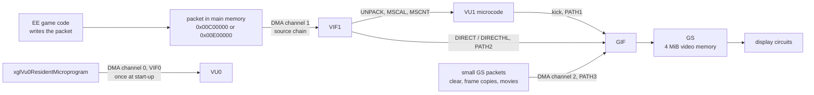

### DMA channels

`src/main/xgl_dma.c` wraps the DMA controller. The table `tbl` holds the
register block address of the ten EE channels, from `0x10008000` (VIF0) to
`0x1000D400` (to scratchpad), followed by two empty slots. Each block is
described by `XglDmaChannel`: the control register `CHCR` at +0x00, the memory
address `MADR` at +0x10, the quadword count `QWC` at +0x20 and the tag address
`TADR` at +0x30.

Two functions start a transfer. Both accept only the channels 0, 1 and 2
(VIF0, VIF1 and GIF) and first spin until the channel's start bit is clear, so
a new transfer always waits for the previous one on the same channel.

| Function | Use | Control value |
| --- | --- | --- |
| `xglDmaDirectNormal(channel, address, count)` | One plain block of `count` quadwords at `address` | start, tag transfer enable, direction from memory (`0x141`) |
| `xglDmaDirectSrcChain(channel, address)` | A source chain that begins with the DMA tag at `address` | the same plus chain mode (`0x145`) |

Both convert a scratchpad address. The scratchpad is the 16 KiB of fast
memory at `0x70000000`. The DMA controller addresses it as an offset with bit
31 set, so an address whose upper half is `0x7000` becomes
`(address & 0x3FFF) + 0x80000000`. Before the start, each function writes the
channel's bit to `DMAC_STAT`, which clears a pending interrupt flag of that
channel.

A source chain is a list of DMA tags in memory. Each tag names a block of data
and tells the controller where the next tag is. The packet builder uses three
kinds. A `CNT` tag is followed directly by its data. A `REF` tag points at
data elsewhere in memory. An `END` tag closes the chain. The frame packet is
one such chain on channel 1.

The rest of the file is a small tool kit that the rest of the program does not
call. `xglDmaBufferReset`, `xglDmaBufferCnt`, `xglDmaBufferRef`,
`xglDmaBufferCall` and `xglDmaBufferRequest` build and send a chain by hand in
an `XglDmaBuffer`. `xglDmaMFIFOSetup`, `xglDmaMFIFOKick` and `xglDmaMFIFOLeave`
drive the controller's memory FIFO mode, in which the scratchpad channel
feeds a ring buffer that another channel drains. `xglDmaInitial` is an empty
function that `InitializeSystem` calls. The same file also defines `PadData`,
the two controller records that `xglPadRead` fills.

## The frame without a render thread

A game loop in Xenosaga Episode II is a plain loop on the main thread. The
field loop `Game` in `src/main/game_data.c`, the title screen, the menus and
the battle scene all have the same shape: do the work of one frame, then call
`xglSleep`. That function, in `src/main/xgl_thread.c`, is three calls long.

1. `xglRenderFrame` runs the render step `xglRenderMove`, then
   `soundApplySettings`, then `xglPadRead`.
2. `xglCdControlThread` gives the disc code its turn (see
   [files-and-resources.md](files-and-resources.md)).
3. `xglStudioUpdate` moves the cameras, unless `StudioEntrySkip` is set.

Despite the names with "thread" and "sleep", none of this changes threads.
`xglRenderMove` returns only after the vertical sync wait, so the call of
`xglSleep` is also what limits the frame rate. The only EE threads that the
program creates itself are the loader threads of the battle overlay (see
[battle-engine.md](../game/battle-engine.md)).

The work of a frame therefore falls into three groups. Game code runs first
and mostly records what should be drawn: models are submitted to `pxy`, text
is queued in the font module, effects are updated, small GS blocks are queued
as direct entries. Some users also write straight into the current packet at
this time. The render step then turns the recorded requests into packet data
in a fixed order, closes the packet and hands it to the hardware. Finally the
hardware draws the packet during the next frame while the game is already
filling the other buffer.

The sequence below shows one frame from the point of view of the main thread,
the interrupt handlers and the hardware.

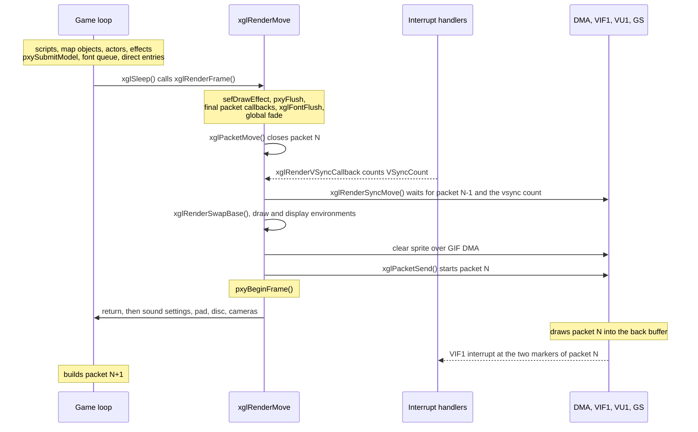

## Packets

A packet is an `XglPacket` record plus one half of a 4 MiB buffer.
`InitializeSystem` in `src/main/control_entry.c` calls
`xglPacketInit(0xC00000, 0x400000, 50.0f)`. The two records are
`packetSourceFirst` and `packetSourceSecond` in `src/main/xgl_packet.c`. Their
halves start at `0x00C00000` and `0x00E00000`, so the second one ends at
`0x01000000`, where the resource memory of the field begins. The record is
used through Sony's `sceVif1Pk*` packet functions, so its first fields follow
the SDK's layout.

| Offset | Field | Meaning |
| --- | --- | --- |
| +0x00 | `write_cursor` | Where the next DMA tag or VIFcode is written |
| +0x04 | `start` | Start of the buffer and of the DMA chain |
| +0x08 | `directCode` | Address of the open `DIRECT` VIFcode, if a direct block is open |
| +0x0c | `directState` | State of the open direct or unpack block |
| +0x20 | `limit` | End of the chain area and start of the attribute area |
| +0x24 | `cursor` | Allocation cursor of the attribute area |
| +0x28 | `buffer` | Start of this packet's half |
| +0x2c | `bufferSize` | Size of the half, `0x200000` |

Each half is split into two areas by the third argument of `xglPacketInit`, a
percentage. The function clamps it to the range 1 to 99, takes that share of
the half, rounds it up to 16 bytes and reserves it at the top. With the value
50 the split is in the middle. The lower megabyte is the **chain area**: DMA
tags, VIFcodes and small inline data, written by the `sceVif1Pk*` functions
upward from `start`. The upper megabyte is the **attribute area**: larger
data that the chain refers to with `REF` tags. `cursor` starts at `limit` and
also grows upward.

The diagram below shows the layout of the first half while it is being
written.

```
0x00C00000  buffer, start +----------------------------------------+
                          | chain area                             |
                          | CNT/REF tags, VIFcodes, UNPACK headers,|
                          | DIRECT blocks                          |
                          |               |                        |
                          |               v  grows upward          |
           write_cursor ->+----------------------------------------+
                          |              free                      |
0x00D00000  limit         +----------------------------------------+
                          | attribute area                         |
                          | matrices, model state, register lists, |
                          | copies of direct data, effect records  |
                          |               |                        |
                          |               v  grows upward          |
                 cursor ->+----------------------------------------+
                          |              free                      |
0x00E00000  buffer + size +----------------------------------------+
```

The attribute area has its own small allocator in
`src/main/pxy_packet_state.c`. `nmlPacketSetAttributeData(data, size)` copies
a block to `cursor` and advances it. `nmlPacketSetAttributeData64` copies one
matrix, `nmlPacketSetAttributeData64N` copies several, and
`nmlPacketSetAttributeData16N` copies a number of quadwords. All return the
address of the copy. `nmlPacketSetAttributeAlloc16N` reserves space without
copying and returns 0 when less than `0x8000` bytes would be left. The data
stays valid until the packet has been drawn, which is why game code can pass
pointers to temporary data and still have the hardware read it a frame later.

Two functions report how full a packet is. `xglPacketQueuedPercent` divides
the chain size reported by `sceVif1PkSize` by the size of the chain area.
`xglPacketBufferUsedPercent` does the same for the attribute area. The model
passes in `nml_model_set.c` check both before every batch and stop drawing
when either is above 85 percent. A scene that is too heavy therefore loses
models at the end of the draw order instead of overflowing the buffer.

`xglPacketGetCurrent` returns the packet being written in this frame. At the
end of the frame `xglPacketMove` closes it. It ends the chain with
`sceVif1PkEnd` and `sceVif1PkTerminate`, flushes the data cache so that the
DMA controller sees the writes, resets the finished packet's `cursor` to its
`limit`, remembers the packet as `pSendPacket`, switches to the other record
and resets that one with `sceVif1PkReset`. A little later `xglPacketSend`
starts the DMA with `xglDmaDirectSrcChain(1, pSendPacket->start)`.

Each buffer goes through the same cycle every two frames, as the state diagram
below shows.

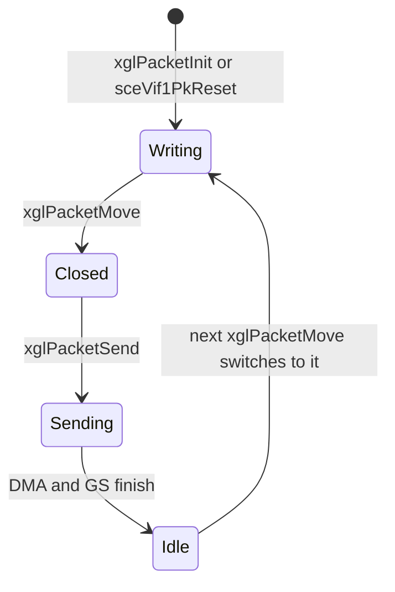

Before a new packet is sent, `xglRenderSyncMove` asks `sceGsSyncPath` whether
the previous transfer and its drawing are complete, and waits for that. The
two buffers therefore never overlap in use.

### Writing into a packet

The game has four ways to put GS register writes into the packet. They differ
in where the data is built and which path it takes.

| Method | Built in | Path | Used by |
| --- | --- | --- | --- |
| Direct block from the scratchpad | scratchpad at `0x70000000`, copied into the chain | PATH2 | `xgl_render.c`, `gs_queue.c`, `xgl_packet_scratch.c` |
| `gifState` register list | the array `gifStatePacket`, copied into the chain | PATH2 | `render_sprite.c`, [screen effects](../libraries/screen-effects.md) |
| Direct queue, submitted by reference | attribute area, `REF` tag in the chain | PATH2 | `gr_screen.c` |
| Direct queue, flushed through VU1 | attribute area, `REF` tag, unpacked into VU1 memory | PATH1 | `pxy_packet_state.c`, `nml_model_set.c`, `pxy_frame_alpha.c` |

All four write the same kind of data: a GIF tag that announces "address plus
data" pairs, called A+D, followed by the pairs. One pair is a 64-bit register
value and the number of the GS register it goes to. `GsAdPair` in
`include/main/xgl_packet.h` is that pair, and `include/gs.h` has the register
numbers and the `GS_SET_*` macros that pack the fields of each register.

**Scratchpad blocks.** The simplest users build the list at `0x70000000`,
write the tag `0x1000000000008000` (end of packet, one register per loop, no
loop count yet) with the register list `0xE` (A+D) in front, add the pairs,
add the number of pairs to the tag and copy everything into the chain with
`sceVif1PkCnt`, `sceVif1PkOpenDirectHLCode`, `sceVif1PkAddDirectDataN` and
`sceVif1PkCloseDirectHLCode`. `xgl_packet_scratch.c` wraps these steps for
other files: `xglPacketScratchBegin` remembers the current packet and resets
the count, `xglPacketScratchAddQuad(reg, data)` appends one pair,
`xglPacketScratchPatchTag` adds the count to the tag and
`xglPacketScratchAddDirect` copies the batch into the packet. The text tag
code in `src/main/text_tag.c` uses them.

**The direct queue.** `nmlPacketGsInit` starts a list at the packet's
attribute `cursor`. It writes two header quadwords: an empty one whose last
word will hold a VIFcode, and the A+D GIF tag. `packet_gs_entry64(address,
data)` appends one pair, and code that writes many pairs uses the macro
`GS_PUT` on a cursor and adds the count to `xglDirectQueueCount` afterwards.
The list then leaves through one of two exits.

- `xglDirectQueueSubmitRef` turns the first header word into a `DIRECT`
  VIFcode with the quadword count, sets the loop count of the tag, adds a
  `REF` tag to the chain and advances the attribute cursor past the list. The
  GS receives the list straight from VIF1.
- `nmlPacketAddGsFlush` turns the first header word into an `UNPACK` to VU1
  address `0x330`, adds the `REF`, then adds `MSCAL` with the GS kick entry of
  the current microcode, `MSCNT` and a `FLUSH`. The microcode passes the list
  to the GIF. `nmlPacketAddGsFlushWide` does the same at VU1 address `0x228`
  with the wide kick entry, for lists that are too long for the first place,
  and clears the bone matrix cache because that memory holds the matrices.

A third exit, `xglDirectQueueDefer`, does not add the list to the chain at
all. It hands it to `nmlModelDirectSendFull` as a direct entry that is played
later (see [Direct entries](#direct-entries)).

Routing register writes through VU1 looks like a detour, but it keeps the
order right. VU1 programs draw asynchronously after VIF1 has started them. A
register write that went straight through PATH2 could reach the GS before the
triangles of the previous model. A write that VU1 itself kicks is always in
order with the model data.

The flowchart below shows the two exits of the direct queue.

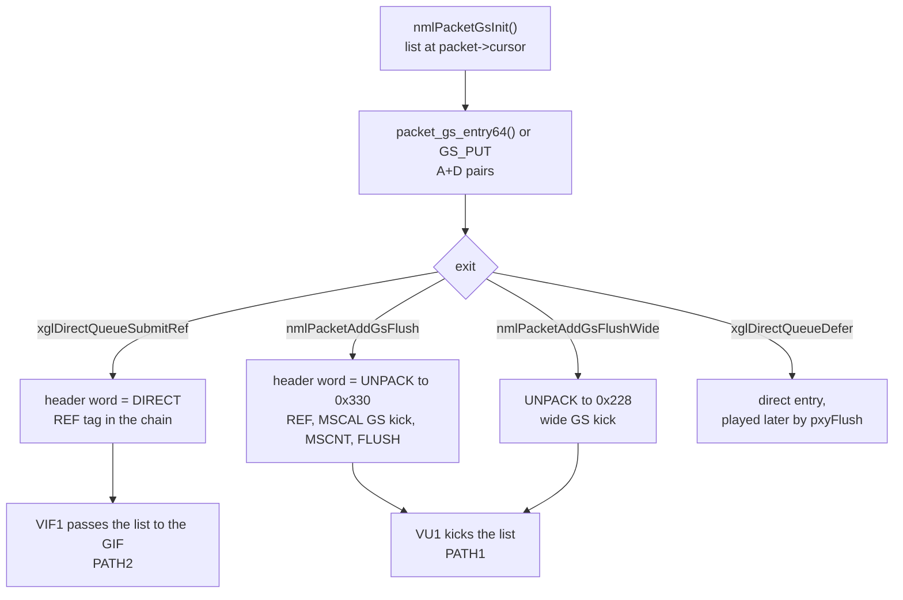

## Video memory

The GS has 4 MiB of local memory. The game addresses it in two units. Frame
buffer and depth buffer bases are given in 8 KiB pages (the GS `FBP` and `ZBP`
fields), and texture bases are given in 256-byte blocks (the `TBP` field). One
page holds 32 blocks, which is why the code shifts a page number left by 5
whenever a frame buffer is read as a texture or copied.

`xglRenderSetReso` picks one row of two tables in `xgl_render.c`.
`asDispReso[6]` holds the pixel formats and the size: 24-bit depth (`PSMZ24`,
`0x31`), 32-bit colour (`PSMCT32`, 0), a width of 640, 512, 448, 384, 320 or
256 pixels and a height of 448 lines. `asVramBase[6]` holds the matching page
numbers. Only `xglRenderInit` calls `xglRenderSetReso`, always with row 1, so
the game always renders at 512 x 448. Many files rely on that and use the
numbers 512 and 448 directly.

At 512 x 448 one buffer of 32-bit pixels needs 112 pages (`0x70`). Row 1 of
`asVramBase` places four such buffers and leaves the rest for textures. The
diagram below shows that layout.

```
 page   block
0x000  0x0000 +--------------------------------------+
              | depth buffer, PSMZ24, 512 x 448      |  112 pages
0x070  0x0E00 +--------------------------------------+
              | frame buffer A, PSMCT32              |  112 pages
0x0E0  0x1C00 +--------------------------------------+
              | frame buffer B, PSMCT32              |  112 pages
0x150  0x2A00 +--------------------------------------+
              | work buffer, PSMCT32                 |  112 pages
              | reflections, glow, captures,         |
              | menu and save screen backgrounds     |
0x1C0  0x3800 +--------------------------------------+
              | texture area, 512 KiB                |   64 pages
              | model textures, effect images,       |
              | circle shadow, font, menu textures   |
0x200  0x4000 +--------------------------------------+  end of 4 MiB
```

The two frame buffers A and B alternate as draw buffer and display buffer.
The **work buffer** at page `0x150` is a third full-screen buffer that never
goes to the display in normal play. The game renders extra views into it and
reads them back as a texture. It serves the water reflection and the glow pass
of the model library, the frame captures of the screen effects, and the
backgrounds of the menu and the save screen. The **texture area** at page
`0x1C0`, block `0x3800`, is shared by every texture user. See
[Textures](#textures) for how it is reused within a frame.

### The render state

`sRender` at `0x00645820` is the render module's state. It starts with a copy
of the chosen rows of both tables, followed by the two buffer words that the
swap exchanges, the callback slots and a few counters. Most files do not read
it through one structure. They declare the words they need under their own
names, so the same word has a field name in `XglRenderState`
(`include/main/gr_screen.h`) and a second, global name. The table gives both.
Some of the global names are misleading, so the meaning column is the one to
trust.

| Offset | Field | Global name | Meaning |
| --- | --- | --- | --- |
| +0x00 | `reso.depth_psm` | | Depth format, `PSMZ24` |
| +0x02 | `reso.frame_psm` | `sRenderPsm` | Colour format, `PSMCT32` |
| +0x04 | `reso.frame_width` | `cameraScreenWidth` | 512 |
| +0x06 | `reso.frame_height` | `cameraScreenHeight` | 448 |
| +0x08 | `vram.depth_base` | `sRenderDepthBase` | Page of the depth buffer, 0 |
| +0x10 | `vram.width` | `sRenderDispfbBase` | Page that is shown on screen |
| +0x12 | `vram.height` | `sRenderPrevDispfbBase` | Page the GS draws into |
| +0x14 | `vram.work_buffer_base` | `sRenderFrameBase` | Page of the work buffer, `0x150` |
| +0x1a | `vram.texture_base` | `sRenderTextureBase` | Page of the texture area, `0x1C0` |
| +0x20 | `display_buffer_base` | `sRenderDisplayBase` | Same page as +0x10 |
| +0x22 | `draw_buffer_base` | `sRenderFlipBase` | Same page as +0x12 |
| +0x24 | `final_packet_callback[17]` | several, see below | Late packet writers |
| +0x68 | | `xglRenderGlobalFadeCallback` | Optional writer called by the global fade |
| +0x6c | | `xglRenderStatus` | Cleared by every swap |
| +0x70 | | `xglRenderFrameDelta` | 1 when the last frame was late |
| +0x74 | | `xglRenderFrameCount` | Number of late frames |
| +0x78 | | `xglRenderPathBusyFlag` | 1 when the hardware was still busy at the sync |
| +0x7c | | `xglRenderVSyncTickCount` | Vertical syncs since the last render step |
| +0x80 | | `xglRenderSkippedFrameCount` | Frames lost in the last render step |
| +0x84 | | first byte of `pxyDigitStrokeTable` | Scene switch, see [The render step](#the-render-step) |

The fields at +0x10 and +0x12 are named `width` and `height` in the structure
but hold buffer pages. The unnamed words between the named ones hold further
values of the table row: the three colour pages again at +0x0a, and the values
`0x1C0`, `0x230`, `0x1E0` and `0x200` around the texture page. No code in the
source reads those.

## Frame buffers and the swap

`xglRenderSwapBase` runs once per render step. It exchanges
`display_buffer_base` and `draw_buffer_base`, copies the old +0x10 to +0x12
and the new `display_buffer_base` to +0x10. After every swap +0x10 equals
`display_buffer_base` and +0x12 equals `draw_buffer_base`. It also clears
`xglRenderStatus` and adds `xglRenderFrameDelta` to `xglRenderFrameCount`.

The names describe the state between two swaps, while the game builds the
next packet. During that time `display_buffer_base` is the buffer on screen
and `draw_buffer_base` is the buffer that the previous packet is drawing
into. The new packet draws into `display_buffer_base`. This looks backwards,
but the packet only starts after the next swap, and the swap turns the
displayed buffer into the draw buffer. That is why the model passes, the
sprites of `render_sprite.c` and `grSetRenderFrame` all set the GS `FRAME`
register to `display_buffer_base`.

The sequence below follows two frames with the buffers A (page `0x70`) and B
(page `0xE0`).

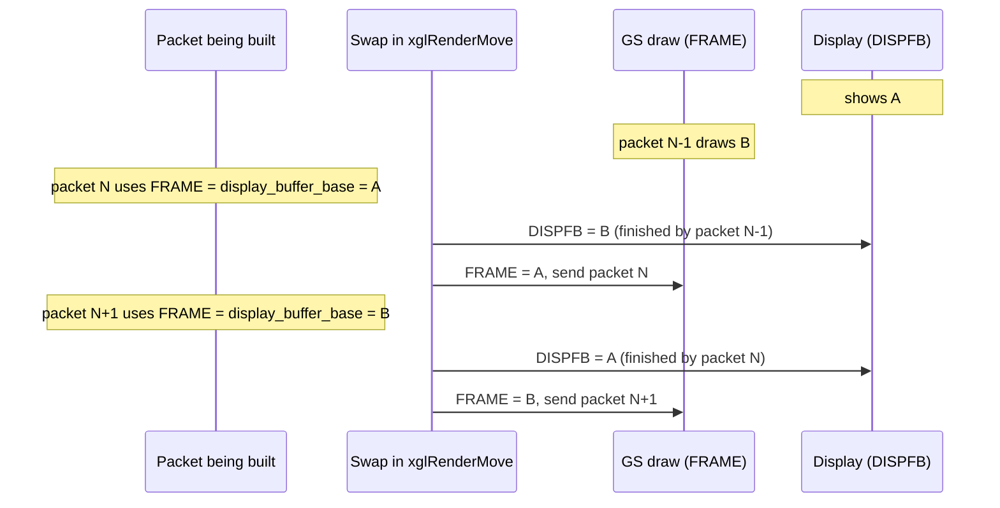

### Whole-frame copies

Several helpers move a whole picture between the buffers with a GS
local-to-local transfer. Each writes `TEXFLUSH`, `BITBLTBUF` with the two
pages and a buffer width of 8 (512 pixels), `TRXPOS` 0, `TRXREG` 512 x 448 and
`TRXDIR` 2. The ones in `xgl_render.c` build the list in the scratchpad.

| Function | From | To | Sent |
| --- | --- | --- | --- |
| `xglRenderCopyDisp2Draw` | `display_buffer_base` | `draw_buffer_base` | at once, GIF DMA |
| `xglRenderCopyDisp2Flip` | `display_buffer_base` | work buffer | at once, GIF DMA |
| `xglRenderCopyDraw2Flip` | `draw_buffer_base` | work buffer | at once, GIF DMA |
| `xglRenderDrawFlipPk(packet)` | `draw_buffer_base` | work buffer | in the packet, direct block |
| `pxyAddFrameCopyPacket(packet)` | `draw_buffer_base` | `display_buffer_base` | in the packet, direct block |
| `grCopyFrame(dst, src)` | any page | any page | in the packet, direct queue by reference |

The immediate copies execute `sync`, flush the cache and call
`xglDmaDirectNormal(2, ...)`, so they act on the pictures that exist right
now. `Game` uses `xglRenderCopyDisp2Draw` just before a battle starts and the
cutscene player uses it too. Both buffers then hold the same picture, so the
screen very likely stays steady while the next scene is loaded and the
buffers keep swapping.
`xglRenderCopyDisp2Flip` is called by the screen effects to capture the
picture on screen.

The copies inside a packet execute when the packet is drawn, one frame later.
`xglRenderDrawFlipPk` is used by the game over and disc change screens to keep
the last picture in the work buffer. `pxyAddFrameCopyPacket` sits in callback
slot 13 and copies the previous picture over the new frame once after
`pxyFrameCopyRequest` was called. `xglRenderDrawFlip` exchanges
`display_buffer_base` with the work buffer page and sets `FRAME_1` and
`FRAME_2` over GIF DMA. Nothing in the source calls it.

## GS environments

Three small GS register sets are rebuilt or resent every frame. They are
global records in `xgl_render.c`, filled once by `xglRenderSetReso`.

**DrawEnv** (`GsDrawPacket`) is a GIF tag with fifteen A+D register writes,
sent by `xglRenderDrawEnvMove` through `sceGsPutDrawEnv` after each swap. It
sets up both GS drawing contexts in the same way. Every frame the function
only refreshes the frame page and the depth page.

| Register | Value |
| --- | --- |
| `FRAME_1`, `FRAME_2` | Draw page (+0x12), width / 64 = 8, `PSMCT32`, no write mask |
| `ZBUF_1`, `ZBUF_2` | Depth page, `PSMZ24`, depth writes on |
| `XYOFFSET_1`, `XYOFFSET_2` | `(2048 - width / 2) << 4` and the same for the height |
| `SCISSOR_1`, `SCISSOR_2` | The whole screen, 0..511 and 0..447 |
| `TEST_1`, `TEST_2` | Depth test on with `GEQUAL`, alpha tests off |
| `PRMODECONT` | Use the attributes of the `PRIM` register |
| `TEXA` | Alpha `0x80` for texels without an alpha value |
| `COLCLAMP` | Clamp colours |
| `DTHE`, `DIMX` | Dithering off, with a 4 x 4 dither matrix loaded |

The offset centres the screen at GS coordinate 2048. The top left pixel is at
(1792, 1824), and that pair appears all over the 2D code as `0x700` and
`0x720`, or as `0x7000` and `0x7200` in the 12.4 fixed point format of the
vertex registers. The depth test uses `GEQUAL`, so a larger Z value is nearer
to the camera, and a depth buffer cleared to 0 is "infinitely far".

**DispEnv** (`GsDispEnv`) holds the display registers. `xglRenderDispEnvInit`
fills it with `sceGsSetDefDispEnv` for a 512 x 448 picture and clears two bits
of its mode word, one of which is the enable bit of the main read circuit. The
picture is therefore off after start-up. `xglRenderDispOn` and
`xglRenderDispOff` set and clear that bit. `main` turns the display on after
the first render step, and `Game` does it again whenever a map starts.

Every frame `xglRenderDispEnvMove` stores the shown page (+0x10) in both frame
buffer fields, applies the [scanline interpolation](#scanline-interpolation)
mode, sends the record with `sceGsPutDispEnv` and then writes the second set
of frame buffer and display values straight to the `DISPFB1` and `DISPLAY1`
registers. It also writes `EXTBUF`, `EXTDATA` and `EXTWRITE`, the registers of
the GS feedback write circuit, from three words that are zero unless another
module has set them, and finally writes 16 to the GS status register, which
likely acknowledges a pending status flag.

**ClearEnv** (`GsClearPacket`) is a full-screen sprite of six quadwords: a GIF
tag, a `TEST_1` value, the colour, two corners and a final `TEST_1` that
restores the depth test to `GEQUAL`. `xglRenderClearEnvMove` sends it over GIF
DMA right after each swap, before the new packet starts. So every frame begins
with this sprite. The first `TEST_1` value selects what it clears.

| Function | TEST value | Effect |
| --- | --- | --- |
| `xglRenderClearFrame` | `0x30003` | Alpha test and depth test always pass, so the sprite writes colour and depth |
| `xglRenderClearDepth` | `0x32001` | The alpha test never passes and its fail mode writes depth only |

`xglRenderClearColor(color)` sets the colour from a packed `0xAABBGGRR` value.
The default is black with alpha `0x80`, and the default target is the full
clear. The field loop switches to the depth-only clear, because every camera
view of the model library clears its own rectangle in the clear colour (see
[Model passes](#model-passes)). Screens without a 3D view, such as the main
menu, the save screen, the battle result and the logo, switch to the full
clear.

`xglRenderClearSkipOn` and `xglRenderClearSkipOff` set a flag that makes
`xglRenderMove` skip the clear sprite. With the skip on, the draw buffer keeps
its old contents, both colour and depth, when the new packet starts. The
battle scene turns it on for its whole duration (`src/ov01/scene.c`), and the
field does so while bit `0x200000` of `gameWork.control` is set.

## The render step

`xglRenderMove` in `src/main/xgl_render.c` is the work between two frames. Its
first half adds the late layers to the current packet. Its second half closes
the packet and hands it to the hardware.

1. **Begin marker.** `xglRenderFrameBeginFlushEIrq` adds a `FLUSH` VIFcode
   with the interrupt bit (`0x91000000`), see
   [Interrupts](#interrupts).
2. **3D effects.** `sefDrawEffect` draws the effect records that are 3D
   models (see [sef.md](../libraries/sef.md)).
3. **Models.** `pxyFlush` turns all submitted models and direct entries into
   VU1 commands, see [Model passes](#model-passes).
4. **Blur hook.** `gifStateUpdateDrawHook` installs `gifStateDrawBlurFrame`
   in callback slot 1 when the model library reports a pending glow pass, and
   removes it otherwise.
5. **Final packet callbacks.** `xglRenderFinalPacket` calls each non-null
   entry of the 17 slots with the packet.
6. **Text.** `xglFontFlush` draws all queued text and window frames (see
   [fonts-and-text.md](../libraries/fonts-and-text.md)).
7. **Global fade.** `xglRenderGlobalFade`, see [Global fade](#global-fade).
8. **Packet interpolation.** `xglPacketInterpolate` when the scanline mode
   is 2.
9. **End marker.** `xglRenderFrameEndFlushEIrq` adds the second `FLUSH` with
   the interrupt bit.
10. **Close.** `xglPacketMove` closes the packet and switches buffers.
11. **Wait.** `xglRenderSyncMove` waits for the hardware and the vertical
    sync, see [Frame pacing](#frame-pacing). Then `xglRenderMoveCount` and
    `LoopCount` advance.
12. **Reset.** `sceGsResetGraph(1, 0, 0, 0)` resets the GS, very likely only
    its drawing state, since the video mode set at start-up stays in use.
13. **Swap.** `xglRenderSwapBase` exchanges the buffers.
14. **Environments.** `xglRenderDrawEnvMove`, `xglRenderDispEnvMove` and,
    unless the clear skip is on, `xglRenderClearEnvMove`.
15. **Send.** `xglPacketSend` starts the DMA of the closed packet.
16. **Counters.** `xglRenderSkippedFrameCount` becomes the number of vertical
    syncs since the last step divided by 2, minus 1, and the tick count is
    cleared.
17. **New frame.** `pxyBeginFrame` resets the model library's tables for the
    next frame and allows direct entries again.

Steps 2, 3, 5, 7 and 8 depend on one byte, the scene switch at +0x84 of
`sRender`. While it is not 0, the effects, the callbacks, the fade and the
interpolation are skipped, and `nmlModelFlushClear` throws the submitted
models away instead of drawing them. Text is still drawn. `xglRenderInit`
clears the byte and nothing in the source sets it, so in the game as shipped
the full path always runs. The flowchart below shows the order.

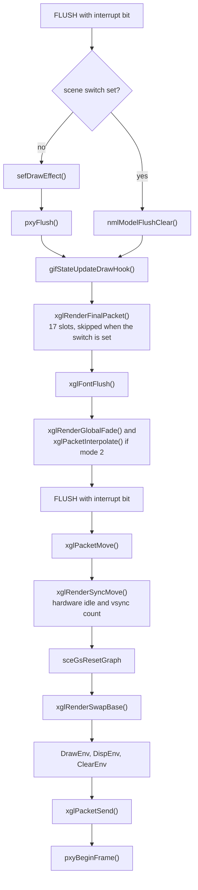

### Final packet callbacks

The **final packet callbacks** are hooks for everything that must come after
the models and before the text. `xglRenderInit` clears 17 slots and
`xglRenderFinalPacket` calls them in index order with the current packet as
the argument. Each slot belongs to one module by convention. Most modules do
not write to the array by index. They declare the slot as a global of their
own, which is why the slots have so many different names.

| Slot | Offset | Name of the slot | Writer installed | Installed by |
| --- | --- | --- | --- | --- |
| 1 | +0x28 | `gifStateDrawHook` | `gifStateDrawBlurFrame` | `gifStateUpdateDrawHook`, while a glow pass is pending |
| 3 | +0x30 | `draw2D` in `sef.c` | `sefDrawEffect2D` | `sefSetRenderHooks`: the effect scene in 2D mode |
| 6 | +0x3c | `final_packet_callback[6]` | `recordRenderAll` or `DefocusMain` | the record system and the defocus layers of the screen effects |
| 7 | +0x40 | `draw3D` in `sef.c` | `sefDrawEffect3DCallback` | `sefSetRenderHooks`: the effect scene in sprite mode |
| 8 | +0x44 | `battle_draw_callback` | `ov01DrawAll` | the battle scene, between `ov01SceneInit` and `ov01SceneEnd` |
| 9 | +0x48 | `menuCallbackHook` | `xglCallbackQueueRun` | `src/main/menu_scene.c` |
| 10 | +0x4c | `gifStateModeHook` | one of `gifStateEffectDraws[mode]` | `gifStateSetMode` |
| 11 | +0x50 | `fadeUpdateHook` | `fadeUpdate` | `src/main/fade_ctrl.c`, while a fade runs. It steps the fade colour |
| 12 | +0x54 | `pxyEntryGroupHooks` | `pxyPlayEntryGroup5` | `nmlModelConstruct`, always |
| 13 | +0x58 | `pxyFrameCopyHooks` | `pxyAddFrameCopyPacket` | `nmlModelConstruct`, always |
| 14 | +0x5c | `msgFrameHooks` | `msgWindowFlush` | `src/main/effect_request.c`, while message windows are open |
| 15 | +0x60 | `gifStateEffectHook` | `gifStateDrawBreakShards` | `gifStateEnableEffect` in `src/main/gifState.c` |
| 16 | +0x64 | `pauseDrawHook` | `pauseDrawTitleHook` | `src/main/game_pause_disp.c` |

Slots 0, 2, 4 and 5 have no user in the source. Slot 6 is shared: both
`recordUpdateRenderHook` and the defocus code store their own function or 0
there, so the one that updates last wins. The order of the slots is the
drawing order. Blur, 2D effects and the records come first, the battle scene's
own drawing, the menu and the effect modes follow, and message windows and
the pause title come last. Slot 11 is different from the others: `fadeUpdate`
draws nothing. It advances the fade and stores the new colour for the
[global fade](#global-fade), which is painted after the text. The owners describe what each writer draws:
[screen-effects.md](../libraries/screen-effects.md),
[sef.md](../libraries/sef.md), [battle-engine.md](../game/battle-engine.md),
[main-menu.md](../game/main-menu.md) and
[ui-windows.md](../libraries/ui-windows.md).

## Model passes

Models reach the packet in two stages. During the frame, game code describes
each model with a group of `nmlModelSet*` and `pxySet*` calls (matrices,
texture block, lights, fog, transparency, shadow mode) and then calls
`pxySubmitModel` with the model's `pxy` header. That function checks the
header, computes the bounding sphere, tests it against the active cameras,
evaluates fog and fade factors and queues the model's parts as batches. Callers
are the map objects (`src/main/game_map_object.c`), the actors
(`src/main/xenoActor.c`), the menu scenes, 3D effect items
(`src/main/sv_get_image_item.c`) and several battle effects of the overlay.
Nothing is written to the chain yet. The model data format, the batch tables
and the sorting are described in [pxy.md](../libraries/pxy.md).

The second stage is `pxyFlush` in `src/main/nml_model_set.c`, called from the
render step. It applies the frame's global settings, resets the GS state with
`pxyResetGsState`, plays direct entry group 3, and then runs
`nmlModelFlushSub` once for each of four camera indexes. A camera index is a
studio: `xgl_studio.c` keeps four studios of eight cameras each, and
`xglStudioSelectGetActiveCamera` returns the first active camera of a studio.
The main view is studio 0. The other three exist for extra views such as
sub-windows, and a studio is only drawn when it has an active camera and its
entry in `pxyCameraEnable` is set. After the four runs `pxyFlush` plays group
2 and stores the fill percentages of the packet for the debug displays.

For one camera `nmlModelFlushSub` runs up to five passes. Which ones run
depends on the request bits in `pxyFlags`, which game code sets during the
frame and which last for that frame only.

| Order | Condition | Target | What is drawn |
| --- | --- | --- | --- |
| 1 | `pxyFlags & 1` (water reflection) | work buffer | Batches of mode 1, then the result is copied through `pxyDrawTextureRect` |
| 2 | `pxyFlags & 0x8000` | `display_buffer_base` | Batches of mode 4, then the draw callback |
| 3 | always | `display_buffer_base` | The main pass: batches of mode 0, the registered draw callbacks |
| 4 | `pxyFlags & 0x100` | `display_buffer_base` | The separate batches of mode 3, after a depth-only clear |
| 5 | `pxyFlags & 4` (glow) | work buffer or frame alpha | Batches of mode 2 |

Every pass starts the same way. `xglStudioSetScissor` limits drawing to the
camera's window rectangle. `xglPacketInitVuState` uploads the constants that
all VU1 programs need for this camera. `nmlPacketAddScreenClear(page, flags)`
then draws a large sprite into the target page. Its flag bits choose what the
sprite does. Without any bit it writes nothing. Bit 1 lets it write the alpha
channel, with the value 0. Bit 2 lets it write the colour channels. Bit 4
uses black instead of the clear colour, and bit 8 lets the sprite write
depth. The main pass uses the flags 11 unless pass 2 has already drawn the
view, so each view starts as a rectangle in the clear colour with alpha 0 and
with its depth reset. This is very likely why the field can use the
depth-only clear at the start of the frame.

The main pass, `pxyDrawBatches(0, page)`, has a fixed inner order.

1. The overlay batches (models whose header flags have `0x81`).
2. Direct entry group 4 for this camera.
3. The opaque batches in sorted order, with the model's `preDraw` and
   `postDraw` callbacks around each.
4. Direct entry group 0 for this camera.
5. The translucent batches in sorted order, each preceded by its depth-only
   parts and its screen-sampling parts.
6. Direct entry group 1 for this camera.

After the batches the main pass calls the up to 16 functions registered with
`pxyRegisterDrawCallback` and the single function set with
`pxySetDrawCallback`. The water surface uses the latter: `TiWater.c` installs
`tiWaterDrawAll`, which writes its own VU1 data through
`xgl_packet_unpack.c`.

The flowchart below shows the order of one frame's model work.

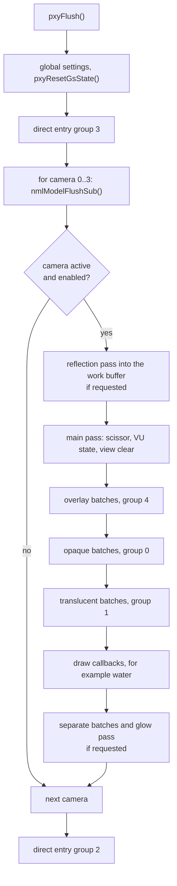

### Direct entries

A **direct entry** is a block of ready-made packet data that some code wants
at a certain point of the model passes, for example between the opaque and the
translucent models. `nmlModelDirectSend(key, data, qwc)` and its variants
record such a block in `pxyEntryQueue`, which holds up to 3048 entries per
frame. The key encodes three things.

| Part of the key | Meaning |
| --- | --- |
| `key & 1` | 0: the data is copied into the attribute area. 1: the data is referenced where it is |
| `(key % 12) >> 1` | The group, 0 to 5, which selects the moment of playback |
| `key / 12` | The row. In the camera groups, row 1 sends the data through VU1 instead of by reference |

The variants add a camera filter (`flag`) and an offset for the reference
(`state`). Entries are refused after `pxyFlush` has finished and until
`pxyBeginFrame` has run, because the queue has been played by then.

| Group | Played |
| --- | --- |
| 3 | At the start of `pxyFlush`, before any camera |
| 4 | Per camera, after the overlay batches |
| 0 | Per camera, after the opaque batches |
| 1 | Per camera, after the translucent batches |
| 2 | After all cameras |
| 5 | In final callback slot 12, after the 2D effects and before the battle scene's drawing |

Playback adds one `REF` tag per entry with `xglPacketAddRefOffset`. An entry
is thus a piece of VIF stream: it must contain its own `DIRECT` VIFcode and
GIF tag, or `UNPACK` and `MSCAL` codes. `pxyQueueTextureSet` uses entries to
queue a texture upload, and the shadow, effect and screen effect code use them
for small GS blocks.

### One model part

Drawing one part of a model takes a short and regular run of commands, built
by `pxyUploadPacketState` and its helpers in `pxy_packet_state.c`.

1. `nmlPacketAddTransMicrocode` selects the VU1 program for the model and
   adds a `REF` to the program when it differs from the one loaded last.
2. `nmlPacketAddTexture` uploads the model's texture set when it differs from
   the cached one, and sets the fog colour register.
3. The view, light and part matrices, the bone matrices and the flag word are
   unpacked into VU1 memory. Most of them are first copied into the attribute
   area and then referenced.
4. `pxyDrawPartData` adds `MSCAL` with the program's model entry and a `REF`
   to the part's prebuilt VIF stream inside the model file, followed by a
   `FLUSH`. The stream unpacks the vertex data and runs the program.

The model file therefore carries most of its packet in final form. The CPU
never touches the vertices of a model. It only supplies matrices, state and
the order.

## VU1 programs

The executable carries its vector unit code in two sections, `.vutext`
(9,696 bytes at `0x002B3740`) and `.vudata` (78,432 bytes at `0x00671E50`),
plus 46 DVP overlay sections in the ELF file. The programs that the rendering
code loads are not copied by the CPU. Each one is stored as a ready VIF
stream, and loading it means adding one `REF` tag to the frame packet. VIF1
then writes the program into VU1 program memory in passing.

The executable holds seven VU1 programs. Five are model programs. One draws
the sprites, ribbons and particles of the effect systems (it is the whole
`.vutext` section), and one draws water. The `.vudata` section holds the
water program, the VU0 chain and the five model programs. What each program
computes is described in [pxy.md](../libraries/pxy.md#vu1-microcode).

The model library has five programs. `xglPacketMicrocodeEntry(kind)` returns,
for the current `xglPacketMode`, the stream of the program, its size in
quadwords, and three entry addresses divided by 8 for the `MSCAL` VIFcode.

| Mode | Program | Selected when |
| --- | --- | --- |
| 0 | `xglPlainMicrocodeProgram` | Default |
| 1 | `xglVertexColorMicrocodeProgram` | The model header has flag bit 0 |
| 2 | `xglBreakUpMicrocodeProgram` | The model's render status has `0x8000` |
| 3 | `xglMode3MicrocodeProgram` | `xglPacketMode3Flag` is set (`pxyFlags & 0x10`) |
| 4 | `xglMode4MicrocodeProgram` | `xglPacketMode4Flag` is set (`pxyFlags & 0x80000`) |

Each program has three entries. The **model entry** starts a model part. It
stops at once, and every `MSCNT` code in the part's VIF data then runs the
program's dispatcher for one batch (a setup batch with the material, a vertex
batch or a flush). The **GS kick entry** sends the register
list at VU1 address `0x330` to the GIF. The **wide GS kick entry** sends the
longer list at `0x228`. Modes 0, 2 and 3 share the same two kick addresses,
mode 1 and mode 4 have their own. `xglPacketSelectDefaultMode` loads program 0
and calls its GS kick entry once, and `nmlModelFlushSub` does that at the
start of every camera, so register lists can be flushed before the first
model has chosen a program.

`xglPacketInitVuState` uploads the per-camera constants that the programs
share: the screen offset and screen scale vectors of the selected camera, two
GIF tags, a list of register numbers, two blend register values, tables of
state bytes (a different pair when reflection mapping is on), clipping
constants, a scale that corrects for a narrow field of view, and a block of
five small parameter records. It ends by setting the second context's depth
buffer through a GS flush. What the programs do with these values, and the
programs themselves, are described in [pxy.md](../libraries/pxy.md).

Two more users bring their own programs. The effect system references
`svEffectMicrocodeData` in `.vutext` at the start of an effect scene and calls the
draw program of the current draw mode from `svDrawModeRoutineTable` (see
[The effect draw list](#the-effect-draw-list)). The water surface references
`xglWaterPacketEntries` in `.vudata` once per frame in `tiWaterSendFrame`.

The diagram below shows how the commands of one model part pass through the
hardware.

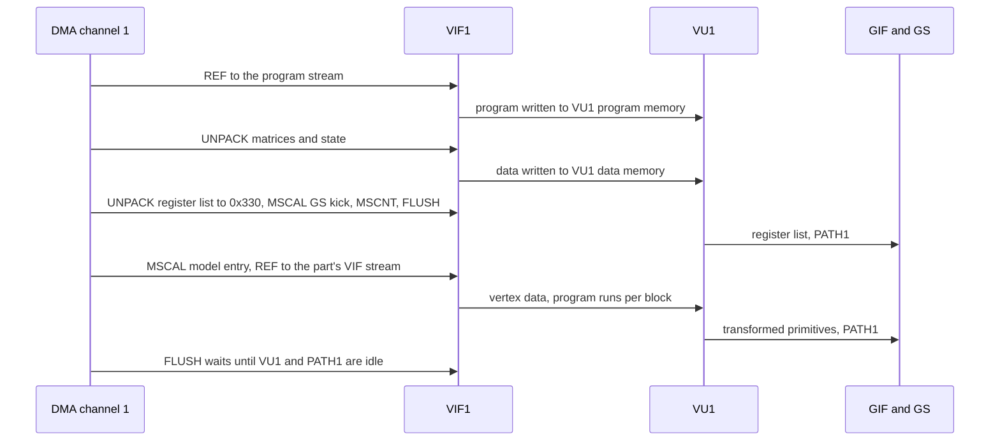

### Water packets

`src/main/xgl_packet_unpack.c` holds the generic unpack helpers and, built on
them, the packet writers of the water surface. `xglPacketCaptureCurrent`
stores the current packet in `xglCurrentPacket`. `xglPacketBeginUnpack(vuAddress)`
opens an `UNPACK` of 32-bit four-component vectors to a VU1 address,
`xglPacketEndUnpack` closes it, and `xglPacketFlush` adds a `FLUSH`.
`xglPacketUploadVu1Data` in `pxy_packet_state.c` is the same idea as a single
call.

`tiWaterSendFrame(camera, data)` sends what the water program needs once per
frame: a reference to the program, the product of the camera's view matrix and
the water's matrix at VU1 address `0x3C2`, the water matrix alone at `0x3C6`,
an orientation matrix built from three fixed axes at `0x3CA`, a fixed matrix
at `0x3CE`, the camera's screen scale and offset rows at `0x3C0` and `0x3C1`,
and a pair of constants. `tiWaterSendDirection` sends the camera position and
the normalised direction from the camera to the water. `tiWaterSendGrid`
walks the height grid row by row. For each strip of up to 29 columns
(`tiWaterStripColumns`) `tiWaterSendStrip` writes a GIF tag, the flat grid
positions and the simulated vertices into the scratchpad and unpacks them, and
an `MSCNT` VIFcode continues the VU1 program for that strip. The simulation
that produces the heights is described in
[animation.md](../libraries/animation.md).

## Textures

The texture area at block `0x3800` is 512 KiB, much smaller than the textures
of a scene. So textures are not resident. Each user uploads its texture inside
the packet just before it draws with it, and the next user overwrites the area
again. Because the GS executes the packet in order, each draw sees the texture
that was uploaded last.

An upload has up to three parts: in most users a `FLUSH` so that pending
drawing with the old texture is finished, then a direct block that sets up a host-to-local
transfer (`BITBLTBUF`, `TRXPOS`, `TRXREG`, `TRXDIR`), and a `REF` to the pixel
data in main memory. The users in packet order are listed below.

- **Model texture sets.** `nmlPacketAddTexture` calls `nmlPacketTextureTrans`
  with the model's texture block (`TxyBlock`), the layer of the current part
  and the base block `sRenderTextureBase << 5`. For each record of the set it
  builds the transfer header with `sceGsSetDefLoadImage`, using the record's
  block offset and its width and height, and references the record's data. The
  upload is skipped when the block and the layer equal `pxyTextureTableCache`
  and `pxyTextureChannelCache`. `nmlPacketClrTextureCache` empties that cache
  at the start of every camera and after every effect pass, because other
  users overwrite the area in between.
- **Effect images.** `svLoadImageList` uploads all images and palettes of one
  image mapper with `sceVif1PkRefLoadImage`: 8-bit or 4-bit images, a 16 x 16
  palette for 8-bit images and an 8 x 2 palette for 4-bit ones. The effect
  scene switches mappers as the sorted effect records need them (see
  [sef.md](../libraries/sef.md)).
- **Circle shadow.** `nmlPacketSendCircleTexture` uploads a 64 x 64 8-bit
  image at the start of the texture area and its 16 x 16 palette 128 blocks
  above it. The palette is first copied into the attribute area.
- **Text.** `xglFontReloadTexture` references the font texture, its palette
  and three small register lists. It runs from the font flush, after the
  models (see [fonts-and-text.md](../libraries/fonts-and-text.md)).
- **Texture transfer sets.** `xglPacketTextureTrans(set)` is the generic
  upload, used by the talk windows, the text tags, the G.S. Campaign screens
  (`yg2path.c`, `ysegf.c`), the battle menu textures and the title screen.

An `XglTextureTransSet` is the content of an `.xtx` file. It starts with the
magic `XTX\0` and the file size at +0x04, and has an entry count at +0x08 and the offset of its
entry table at +0x0c. Each entry is 20 bytes.

| Offset | Field | Meaning |
| --- | --- | --- |
| +0x00 | `size` | Width in pixels in the low half. When the high half is not 0 it is the buffer width in units of 64 pixels, otherwise that width is computed from the pixel width |
| +0x04 | `height` | Height in pixels |
| +0x08 | `vramOffset` | Offset from the start of the texture area in 32-bit words |
| +0x0c | `dataSize` | Size of the data in quadwords |
| +0x10 | `dataOffset` | Offset of the data from the start of the set |

For each entry the function stores the destination block
`((texture page << 11) + vramOffset) >> 6` and the buffer width in a
`BITBLTBUF` value, stores the width and height in a `TRXREG` value, and copies
seven quadwords from `textureTransGifSetupTable` into the chain: three `NOP`
VIFcodes and a `DIRECTHL` of six quadwords, a GIF tag for five A+D pairs,
`TEXFLUSH`, and the four transfer registers. The destination format is always
`PSMCT32`. A `REF` to the entry's data follows. The data must begin with its
own VIFcode and image tag, since the function adds none.

Every rectangle is uploaded as 32-bit pixels, but the sprites read the same
memory in other formats. `renderSpriteClut`, for example, reads the area as an
8-bit image with a palette. That only works when the stored data was arranged
for it in advance, which is very likely done by the tools that built the
files.

Frame pages can also be textures. `gsMakeTex0(buffer, tcc)` returns a `TEX0`
value that reads a 512 x 512 `PSMCT32` texture from one of three pages: 0 is
`display_buffer_base`, the frame being built, 1 is `draw_buffer_base`, the
picture of the previous frame, and 2 is the work buffer. `gsMakeFrame(buffer,
flag)` is the matching `FRAME` value for a draw target, with a slightly
different numbering: 0 is `display_buffer_base`, 1 is `draw_buffer_base` and 2
is the work buffer, each with a buffer width of 8. The talk window code, the
record system and the GS register queue use the pair to draw one page into
another.

## 2D drawing

Everything that is not a model is drawn with GS primitives that the CPU
builds: sprites, strips, fans, lines and points in screen coordinates. This
section covers the building blocks that live with the renderer. The users are
described on their own pages.

### The GS register queue

`src/main/gs_queue.c` is a small immediate-mode drawing layer. A batch is a
list of A+D pairs in the scratchpad that starts with a GIF tag, and the
functions append pairs to it. Three globals hold its state: `gsQueueBase`
points at the list, `gsQueueCount` is the number of quadwords, and
`gsQueueBeginHandler` remembers which function started the batch.

A batch is described by the first words of a `GsQueueContext`
(`include/main/gs_queue.h`). The same 0x7C-byte record is the draw record of
the [record system](../libraries/screen-effects.md), whose handlers pass their
record on to the queue.

| Offset | Field | Meaning |
| --- | --- | --- |
| +0x04 | `frame` | Draw target for `gsMakeFrame`: 0, 1 or 2 |
| +0x08 | `tex0` | Texture page for `gsMakeTex0`: 0, 1 or 2 |
| +0x0c | `color` | RGBA colour of the batch |
| +0x10 | `z` | Depth shared by all vertices |
| +0x14 | `count` | Repeat count used by some handlers |
| +0x18 | `textured` | Non-zero adds texture state and UV coordinates |
| +0x1c | `blend_kind` | Blend mode, see below |

Five begin functions start a batch: `gsQueueBeginPoints`, `gsQueueBeginLines`,
`gsQueueBeginTriStrip`, `gsQueueBeginTriFan` and `gsQueueBeginSprites`. Each
writes the tag, then `TEXFLUSH`, the `FRAME_1` value of the target, a `TEST_1`
value, the texture registers when the batch is textured, the `PRIM` register
for its primitive type with Gouraud shading and alpha blending on, the blend
register and the colour. The point variant differs slightly: it sets its own
depth test and a texture filter. A textured batch uses fixed-point UV
coordinates and halves the red, green and blue of its colour, because the GS
doubles texture colours on modulation and `0x80` means "unchanged".

| `blend_kind` | `ALPHA_1` | Result |
| --- | --- | --- |
| 0 or other | `(Cs - Cd) * As + Cd` | Normal alpha blending |
| 1 | `Cs * As + Cd` | Additive |
| 2 | `Cd - Cs * As` | Subtractive |
| 3 | `(Cs - Cd) * As` | Difference without the destination term |

`gsMakeAlpha(blend)` in `gs_make_frame.c` returns the same four register
values for code that builds its own lists.

Two flags change the state for all following batches. `gsQueueSetAlphaFlags`
stores `gsQueueTexAlphaExpand` and `gsQueueAlphaTest`. With the alpha test on,
`gsQueueSetTest` adds an alpha test that rejects texels with alpha 0, and
`gsQueueTex0Value` asks for a `TEX0` that takes alpha from the texture. With
the expand flag on, `gsQueueSetTexA` sets the `TEXA` bit that makes black
texels of a texture without alpha transparent.

Vertices are added one at a time. A position is given in screen pixels. The
functions add the origin (1792, 1824), convert to 12.4 fixed point and append
the Z value. The GS draws a primitive when it receives the last vertex through
a register with a "drawing kick". The queue exposes that choice in its
function names.

| Function | Appends |
| --- | --- |
| `gsQueueAddVertex` | A position without kick (`XYZ3`) |
| `gsQueueAddKickVertex` | A position with kick (`XYZF2`) |
| `gsQueueAddTexturedVertex` | UV when the batch is textured, then a position without kick |
| `gsQueueAddTexturedKickVertex` | UV when the batch is textured, then a position with kick |
| `gsQueueAddTriangle` | Three UV and position pairs, the third with kick |
| `gsQueueAddTexturedQuad` | Four UV and position pairs, the last two with kick |
| `gsQueueAddColor`, `gsQueueAddContextColor` | An `RGBAQ` value for the following vertices |
| `gsQueueSetClamp`, `gsQueueSetTexFilter`, `gsQueueFlushTexture`, `gsQueueAddPrimTriStrip` | A single state register |

A sprite, for example, is one vertex without kick for the first corner and one
with kick for the opposite corner. A strip is two vertices without kick
followed by kick vertices.

The scratchpad holds 1024 quadwords. The kick functions and the colour
functions therefore check the count, and at 901 quadwords they call
`gsQueueFlush` and `gsQueueRestart`. The flush adds the count to the tag and
copies the batch into the packet as a `DIRECTHL` block. The restart calls the
stored begin function again with the same context, so the next vertices
continue with the same state. The check runs only after a kick, so a primitive
is never cut in half. The caller ends a batch with a final `gsQueueFlush`.

The state diagram below shows the life of a batch.

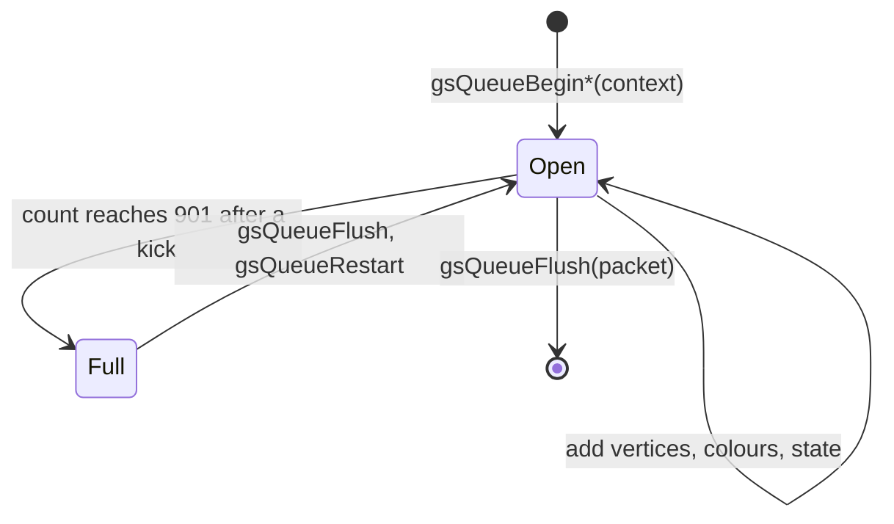

`gsQuadHalfScreenFill(kind, quad)` fills four vertices with one of two
diamond-shaped quads that cover the left or the right half of the screen at
the farthest depth. `src/main/circle_draw.c` uses it.

`spriteBatchDraw` in `src/main/sprite_batch_draw.c` is the simplest complete
user of the queue. It reads a screen rectangle and a texture rectangle from
the record, begins a sprite batch, queues the same two corners `count` times
and flushes. Drawing the same blended sprite several times deepens its effect.
The record system calls it for its plain textured sprite records. The same
file has `recordDrawNone`, an empty draw handler, and two helpers that fill
clip rectangle records for a 512 x 448 frame, `clipRectFill` and
`clipRectOffsetSplit`. Nothing else in the source calls the two helpers.

### Screen helpers

`src/main/gr_screen.c` collects operations on whole frame pages. All of them
build their list in the direct queue and submit it by reference, so they act
at the point of the packet where they are called. The main menu
(`src/main/menu_scene.c`) and the save screen use them to prepare their
backgrounds.

| Function | Effect |
| --- | --- |
| `grSetFrameBase` | Sets `FRAME_1` to the work buffer, so that following primitives draw into it |
| `grSetRenderFrame` | Sets `FRAME_1` back to `display_buffer_base` |
| `grResetRenderState` | Uploads the VU1 constants and clears the work buffer to black with depth writes on |
| `grCopyFrame(dst, src)` | Copies 512 x 448 pixels from one page to another |
| `grFillFrame` | Darkens the work buffer by subtracting a constant grey, then selects the render frame again |
| `grDrawScreenSprite(expand, alpha)` | Draws the work buffer over the current target as one textured sprite, added with weight `alpha`, with its corners moved outward by `expand` sixteenths of a pixel |
| `grDrawScreenFade(fade)` | Calls the sprite with values derived from `fade` in -128..128: at 0 the picture is unscaled and at full weight, toward either end it is scaled and fades out |
| `grResetScissor` | Sets the scissor to the whole frame |
| `grSetScissor(x0, y0, x1, y1)` | Sets the scissor to a rectangle, with the corners ordered and clamped to the frame |
| `ScissorSet(cursor, rect)` | The same as a font callback: the rectangle is clamped to the frame size and written into the font's packet |

The scissor is how windows clip their contents. A text box sets a rectangle
before it draws scrolling text and resets it afterwards.
`ScissorSet` exists because text is drawn late, from the font queue. A caller
passes it to `xglFontPrintExtFunc` so that the scissor change is queued
between the right pieces of text (see
[fonts-and-text.md](../libraries/fonts-and-text.md)).

### Sprites from the texture area

`src/main/render_sprite.c` draws rectangles that sample the texture area. The
functions open a `DIRECTHL` block in the current packet and build their
register list with the `gifState` list builder (`gifStateReset`,
`gifStateAddReg`, `gifStateFlush`, described in
[screen-effects.md](../libraries/screen-effects.md)). Coordinates are screen
pixels to which the origin words `renderOriginX` and `renderOriginY` are
added. All of them draw into `display_buffer_base` with the depth test set to
"always".

| Function | Texture | Blending |
| --- | --- | --- |
| `renderSprite(x, y, w, h, alpha)` | 256 x 256 `PSMCT32` at the start of the texture area | `(Cs - Cd) * alpha + Cd` with a constant alpha |
| `renderSpriteClut(x, y, w, h, clutOffset)` | 512 x 512 `PSMT8`, palette at block `0x3800 + clutOffset` | `(Cs - Cd) * Ad + Cd`, weighted by the alpha already in the frame buffer |
| `renderSpriteClutAlpha(x, y, w, h, clutOffset, alpha)` | 1024 x 256 `PSMT8` with the same palette rule | Normal alpha blending with `alpha` in the vertex colour. The frame mask protects red, green and blue, so only the alpha channel of the frame is written |
| `renderFadeBand(x0, y0, x1, y1, colour)` | none | A strip that is transparent at both ends and `colour` in the middle, drawn five times |

The two palette variants are used by the G.S. Campaign screens, which upload
their pictures with `xglPacketTextureTrans` first. `renderFadeBand` flushes
the font queue before it draws, so text queued earlier stays below the band.

### Frame alpha passes

The frame buffer has an alpha channel that the display does not show. The
model library uses it as a mask for multi-pass effects, and
`src/main/pxy_frame_alpha.c` holds four full-screen passes that prepare or use
that mask. Each one draws a single untextured sprite over the whole screen
through the VU1 flush path.

| Function | What the sprite does |
| --- | --- |
| `pxyClearFrameAlphaMsb(mask, page)` | Writes only the top alpha bit of every pixel and clears it |
| `pxyFillFrameAlpha80(mask, page)` | Writes only the alpha channel and sets it to `0x80` |
| `pxyModulateFrameByAlpha` | Multiplies the colour of every pixel by its own alpha |
| `pxyClearDepthByFrameAlpha(mask, page)` | Writes depth 0 at every pixel whose top alpha bit is set, without touching colour |

The ones that take a page and a mask restore `FRAME_1` with that mask and the
`GEQUAL` depth test afterwards. `nml_model_set.c` calls them around batches
that need a mask, for example the glow pass that marks the glowing pixels in
the alpha channel (see [pxy.md](../libraries/pxy.md)).

### The effect draw list

Effects draw thousands of small quads, far too many for one `UNPACK` each. The
effect system therefore collects them in a **draw list**, `svDrawList`, and
sends many at a time. `svDrawListBegin` reserves the list in the packet's
attribute area with `nmlPacketSetAttributeAlloc16N`. A list is a row of
16-byte slots. `svDrawListAppend(vuAddress, a, b)` starts a record with two
header slots that contain a `FLUSH`, a cycle setting and an `UNPACK` VIFcode,
and the drawing code appends the vertex slots behind it.
`svDrawListFlush` patches the header with the final count, adds a `REF` to the
record, then `FLUSH`, `MSCAL` with the draw program of the current draw mode
and another `FLUSH`. Records longer than 256 slots are split.

`src/main/draw_list.c` is the slot interface to this list.

| Function | Effect |
| --- | --- |
| `drawListGetSlots` | Base of the slot table |
| `drawListGetNextSlot` | Address of the first free slot |
| `drawListCommitSlot`, `drawListCommitSlots(n)` | Advance the end by 1 or n slots after writing them in place |
| `drawListAppendSlot(value)`, `drawListAppendSlotCopy(src)` | Append one quadword |
| `drawListAppendSlotHalves(low, high)` | Append one quadword given as two 64-bit halves |
| `drawListAppendFourSlots(src)` | Append four quadwords, for example a matrix |
| `drawListSetFlushCode(value)` | Sets the code word of the list |

The effect scene itself runs in three places of the render step.
`sefDrawEffect` draws the effect records that are 3D models at the start, by
submitting them to `pxy`. `sefDrawEffect3D` (callback slot 7) and
`sefDrawEffect2D` (slot 3) draw the sprite scenes through `svDrawScene`, which
uploads the image mapper textures and plays the draw lists. The effect system
is described in [sef.md](../libraries/sef.md).

## Interrupts

The EE has two interrupt controllers. INTC collects the device causes (GS,
vertical blank, VIF, VU, timers) and DMAC collects the end-of-transfer events
of the DMA channels. `xglIntrInit` in `src/main/xgl_dma_handler.c` registers a
handler for each cause the engine knows, once at start-up.

The registry is two tables of `XglIntrRecord` (handle, count, id, handler),
each closed by a record with id -1. `xglIntcRecords` lists the INTC causes 0
(GS), 2 and 3 (start and end of vertical blank), 4 and 5 (VIF0 and VIF1), 6
and 7 (VU0 and VU1), 8 (IPU, the image decoder), 9 and 10 (timers 0 and 1).
The GS record appears twice in the table, so that handler is registered twice.
`xglDmaRecords` lists the DMAC channels 0, 1, 2 (VIF0, VIF1, GIF), 3 and 4
(from and to the IPU), 8 and 9 (from and to the scratchpad). For each record
`xglIntrInit` stores the table index in a slot map (`xglIntcSlotMap` or
`xglDmaSlotMap`) and calls `AddIntcHandler` or `AddDmacHandler`.

All handlers but one do the same thing: they increment the `count` of their
record, call `ExitHandler` and return 0. They are counters, nothing more.
`xglIntcGetEventCount` and `xglDmaGetEventCount` read a count, and
`xglIntcEnable`, `xglIntcDisable`, `xglDmaEnable` and `xglDmaDisable` switch a
registered cause on or off through the kernel. The only enable call in the
source is `xglIntcEnable(5)` in `xglRenderInit`, which turns on the VIF1
cause.

The VIF1 handler, `xglIntcHandlerVif1` in `src/main/xgl_intc.c`, is the one
with a job. A VIFcode with the interrupt bit stops VIF1 and raises this
interrupt, and the render step puts two such codes into every packet: one
before the layers that `xglRenderMove` adds and one after them. The handler
reads the count of EE timer 1 at each interrupt. At the first one it stores
the count and sets `intrTimerActive`. At the second one it adds the difference
to `intrTimerAccum` and clears the flag. Both times it writes the "stall
cancel" bit to `VIF1_FBRST` so that VIF1 continues. The accumulator thus
measures how long the hardware needs for the part of the frame between the
two markers. `intrTimerReset` clears it and `intrTimerGetAccum` returns it.
Nothing in the source calls those two, so the measurement is a leftover of the
developers' profiling.

The vertical sync is not handled through this registry.
`xglRenderSyncInit` gives `xglRenderVSyncCallback` to the SDK with
`sceGsSyncVCallback`, and the SDK calls it at each vertical blank.

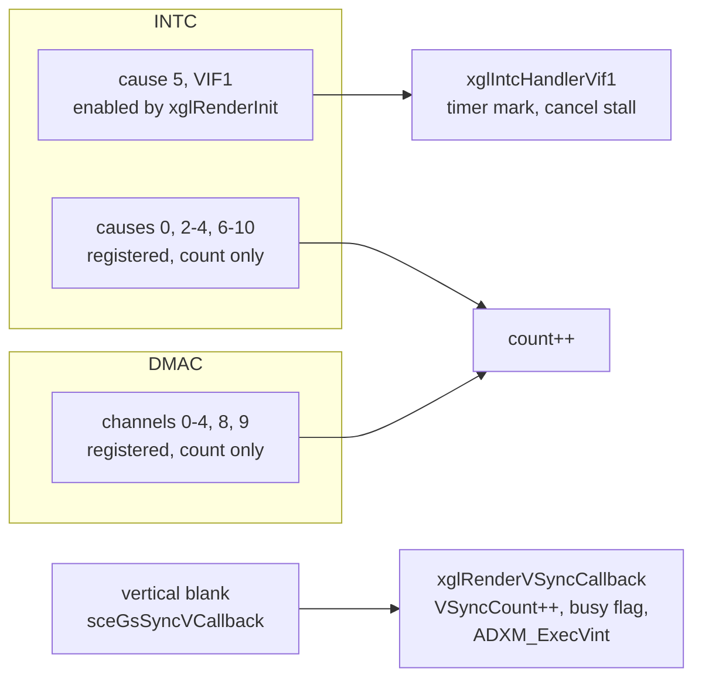

## Frame pacing

The game runs at 30 frames per second, one frame for every two vertical syncs
of the display. The number is the variable `xglRenderVSyncInterval`, which
`xglRenderInit` sets to 2.

`xglRenderVSyncCallback` runs at every vertical sync. It increments
`VSyncCount` and `xglRenderVSyncTickCount`. When `VSyncCount` has reached the
interval and the GIF still has an active path or VIF1 is still busy, it sets
`xglRenderPathBusyFlag` to 1, otherwise to 0. That marks a frame whose packet
did not finish in time. The callback then calls `ADXM_ExecVint(0)`, the
per-sync service of the CRI ADX sound library (see [audio.md](audio.md)), and
re-enables interrupts before it returns.

`xglRenderSyncMove` runs after the packet is closed.

1. If `VSyncCount` is already above the interval, the frame took too long
   and `xglRenderFrameDelta` becomes 1, otherwise 0. Game code can read it to
   catch up, and the swap adds it to `xglRenderFrameCount`.
2. In the normal mode it polls up to 128 times. Each round asks
   `sceGsSyncPath(1, 0)` whether the previous packet is still being
   transferred or drawn. The loop ends when the hardware is idle and
   `VSyncCount` has reached the interval. Otherwise the round calls
   `mwPlyExecServer`, the server function of the CRI movie player, and tries
   again.
3. If the hardware is still busy after the last round, the function recovers
   by force. It suspends the DMA controller, clears the control registers of
   channels 1 and 2, resumes, resets the GIF and VIF paths with
   `sceGsResetPath` and the GS with `sceGsResetGraph`. It then copies the
   picture on screen into the other frame buffer over GIF DMA and waits for
   one vertical sync. The unfinished frame is dropped and the last good
   picture stays visible.
4. `VSyncCount` is reset to 0.

One flag changes this. While `pxyTickScaleDouble` is 1 the function only
calls `mwPlyExecServer` once, waits with `sceGsSyncPath(0, 0)` until the
hardware is idle and returns without looking at the vertical sync count. The
battle result screen and the save screen set the flag through
`pxyTickScaleDoubleOverride` and restore it when they end. The same flag
doubles the tick scale of the timing code in `src/main/pxy_profile.c`, and a
few field routines read it too.

`game_movie.c` sets `xglRenderVSyncInterval` to 1 while a movie plays and back
to 2 afterwards, so movies are shown at the full field rate of the display. It
sets `StudioEntrySkip` at the same time, which stops the camera update of
`xglSleep`.

The state diagram below shows the normal wait.

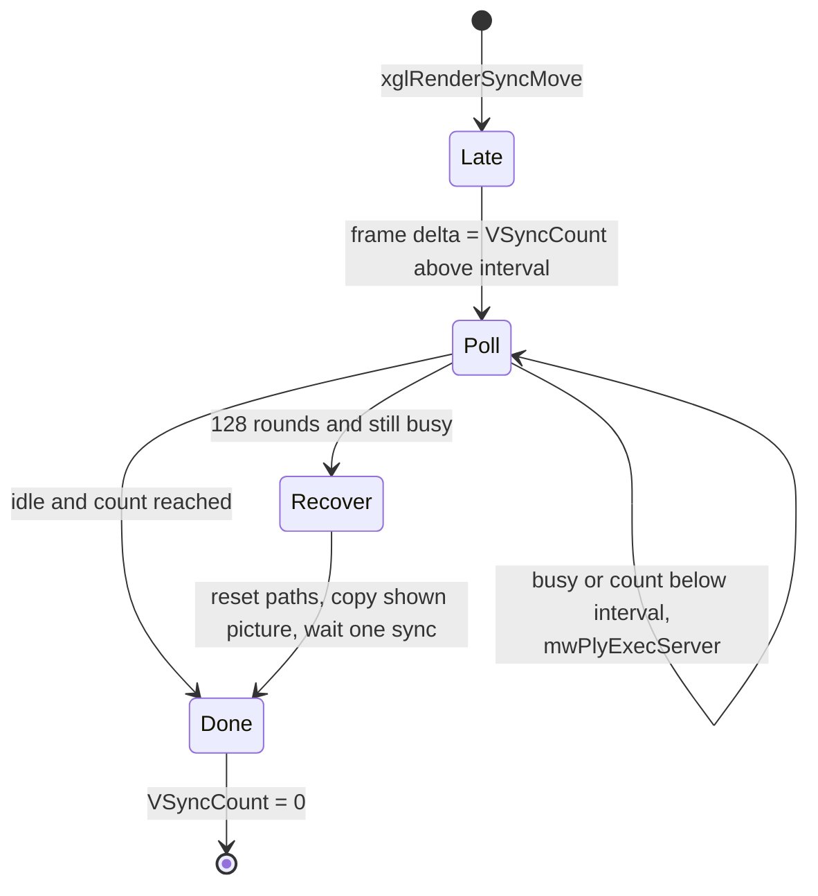

## Scanline interpolation

`xglRenderInit` calls `sceGsResetGraph(0, 1, 2, 0)`, which sets up an
interlaced NTSC picture. In an interlaced picture each field shows every other
line of the 448-line buffer, so detail that is only one line thin appears in
one field and not in the other, and flickers. The global `ScanLineInterpolate`
selects one of three ways to soften it.

| Value | Method |
| --- | --- |
| 0 | Read circuit 1 is off, no softening |
| 1 | Both read circuits show the same buffer, one of them one line higher, mixed at 50 percent (`alp` = `0x80`) |
| 2 | `xglPacketInterpolate` draws the finished frame over itself one line lower, at 50 percent |

Mode 1 is the default set by `xglRenderInit`. `xglRenderDispEnvMove`
implements it: it copies the enable bit of the main circuit to the other one,
sets the mix value and gives the second display position a Y that is one less
than the first. It costs nothing because the display hardware does the blend.

Mode 2 costs one full-screen textured sprite at the end of the packet.
`xglPacketInterpolate` adds a `FLUSH` and a direct block. The block sets
`TEX0_1` to the buffer being drawn (512 x 512, `PSMCT32`), a `TEST_1` whose
alpha test fails and writes colour only, and `ALPHA_1` to
`(Cs - Cd) * 0x40 + Cd`, which is a 50 percent mix. The sprite then covers the
screen and samples the texture with its V coordinate starting at 1.0, one line
down. The only code that selects mode 2 is a defocus layer in
`src/main/game_defocus.c`. It saves the current mode, fills the feedback
write registers of `DispEnv` and restores the mode when the layer ends (see
[screen-effects.md](../libraries/screen-effects.md)).

## Global fade

`xglRenderGlobalFade` is the last layer that the render step paints. It first
calls the function in `xglRenderGlobalFadeCallback` when one is set. No code
in the source sets it. Then it writes one direct block from the scratchpad in
either of two forms.

`xglRenderGlobalFadeSet(r, g, b, a)` clamps its arguments to 0..1 and packs
them into `xglRenderGlobalFadeColor`: the colour as bytes scaled by 255 and
the alpha scaled by 128 in the top byte. `xglRenderGlobalFadeSetPacked` stores
a packed value directly, `xglRenderGlobalFadeGet` returns it, and
`xglRenderGlobalFadeInit` clears the colour and the callback. The fade
controller in `src/main/fade_ctrl.c` drives these calls from its per-frame
update (see [screen-effects.md](../libraries/screen-effects.md)).

When the packed alpha is not 0, the block sets `ALPHA_1` to
`(Cs - Cd) * FIX + Cd` with `FIX` equal to the alpha, sets the depth test to
"always" and draws one full-screen sprite in the fade colour. With alpha 128
the screen is the plain fade colour, with smaller values the picture shows
through. When there is no fade, the block is still written, but with a blend
setting that leaves the picture unchanged. In both forms the sprite is
followed by 80 writes of that neutral `ALPHA_1` value. The code gives no
reason for the repeated writes. They are probably padding that gives the
packet a constant tail.

The field loop uses the packed value as a state too: while
`xglRenderGlobalFadeGet()` is negative, which means an alpha of 128 or more,
the pause button is ignored.

## The order of a frame

The field loop `Game` in `src/main/game_data.c` shows the complete order of a
frame. One pass of its inner loop does the following (see
[field.md](../game/field.md) for the loop itself).

1. Per-frame requests to the model library: `pxySetMode3Flag(1)`,
   `pxySetShadowUploadFlag`, `pxyRequestOverlayPass`,
   `pxySetShadowCasterMode`, and `pxySetFreezeAnimation` while paused. The
   clear skip is set or cleared from `gameWork.control`.
2. `sbRunAll` runs the scripts, unless the game is paused.
3. `DispMapObject` and `mapObjectsDraw` submit the map and its objects,
   around `uwamonoPlayerUpdate` and `cameraUpdateFrame`.
4. `sefExecEffect` advances the effects, `VibrationEngine` the controller
   motors. The menu can be opened here, which runs its own frame loop.
5. Message panels and windows are updated, and the pause button is checked.
6. `XenoActorDoit` moves the actors and `XenoActorDisp` submits them.
7. `xglSleep` runs the render step, the pad, the disc code and the cameras.

The order of steps 3 to 6 is the order of registration, not the order of
drawing. Models are sorted by `pxy`. Text and windows wait in the font queue.
Effects are only moved and are drawn later by their hooks. The picture is
composed inside `xglRenderMove`, and the table below lists the layers in the
order in which the GS draws them.

| Order | Layer | Code | Path |
| --- | --- | --- | --- |
| 1 | Start-of-frame clear | `ClearEnv`, `xglRenderClearEnvMove`, after the swap | PATH3 |
| 2 | Packet data written during the frame by game code | for example `renderSpriteClut`, `gr_screen.c`, `xglPacketTextureTrans` | PATH2 |
| 3 | 3D effect models | `sefDrawEffect`, submitted to `pxy` | drawn with the models |
| 4 | Direct entry group 3 | `pxyFlush` | as built |
| 5 | Per camera: reflection, view clear, overlay, opaque, translucent models, draw callbacks, glow | `nmlModelFlushSub` | PATH1 |
| 6 | Direct entry group 2 | `pxyFlush` | as built |
| 7 | Blur, 2D effects, records and defocus, sprite effects | callback slots 1 to 7 | PATH2 and PATH1 |
| 8 | Battle scene drawing, menu callbacks, effect mode | slots 8 to 10 | PATH2 |
| 9 | Direct entry group 5, frame copy | slots 12 and 13 | as built |
| 10 | Message windows, break effect, pause title | slots 14 to 16 | PATH2 |
| 11 | Windows and text | `xglFontFlush` | PATH2 |
| 12 | Global fade | `xglRenderGlobalFade` | PATH2 |
| 13 | Scanline mode 2 | `xglPacketInterpolate` | PATH2 |

The flowchart below shows where the work of the game loop ends up.

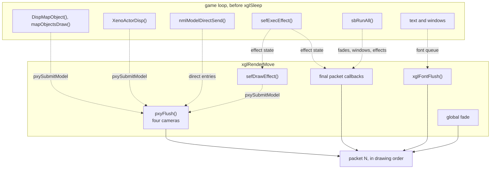

Other loops follow the same pattern with a different first half. The battle
scene installs `ov01DrawAll` in slot 8 and turns the clear skip on. The menu
prepares a background in the work buffer with the screen helpers. A movie
changes the vsync interval. In every case the second half is the same
`xglSleep`.

## Start-up

`InitializeSystem` brings the pipeline up in this order: `xglDmaInitial`,
`xglIntrInit`, `xglGeometryInit`, `xglPacketInit` and `xglRenderInit`. The
last one does the following.

1. `sceGsResetPath` resets the VIF and GIF paths, and the error mask
   registers of VIF0 and VIF1 are cleared.
2. After one vertical sync, `sceGsResetGraph(0, 1, 2, 0)` sets the video
   mode.
3. `xglRenderSyncInit` installs the vsync callback and clears `VSyncCount`.
4. `xglRenderSetReso(1)` copies the 512 x 448 rows into `sRender`, builds the
   three environments and initialises the studios and their main cameras.
5. The counters are cleared, the vsync interval is set to 2 and the scanline
   mode to 1.
6. The 17 callback slots are cleared, `xglRenderGlobalFadeInit` clears the
   fade, and `nmlModelConstruct` initialises the model library, which
   installs slots 12 and 13.
7. `xglIntcEnable(5)` enables the VIF1 interrupt.

`main` then calls `xglRenderAndMovieInit`, which runs `xglRenderInit` a second
time and initialises the movie player library, and `xglRenderFrame` once to
send a first, empty frame. After the studios are set up it calls
`xglRenderDispOn`, and the picture appears.

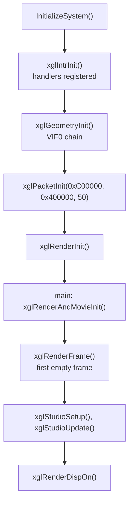
