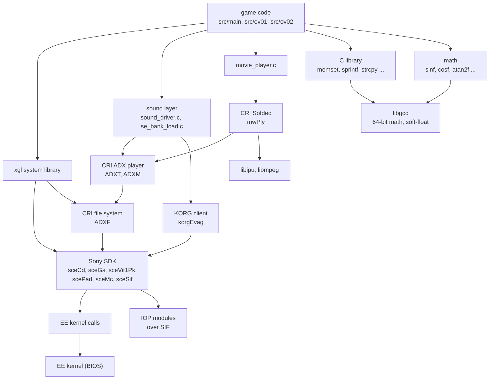
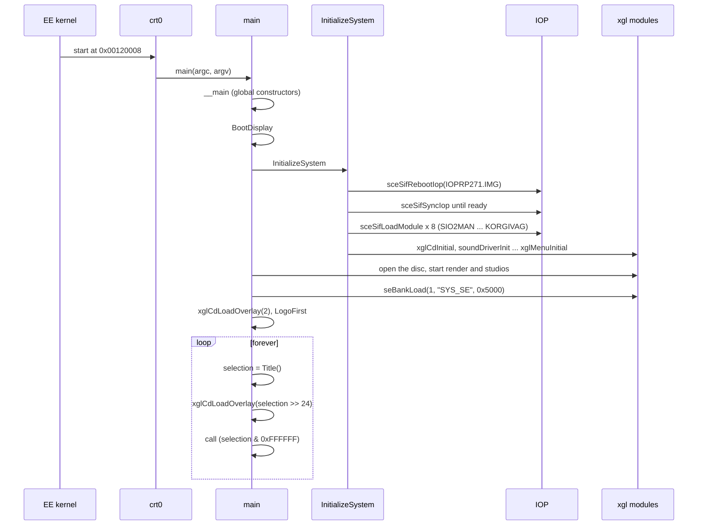
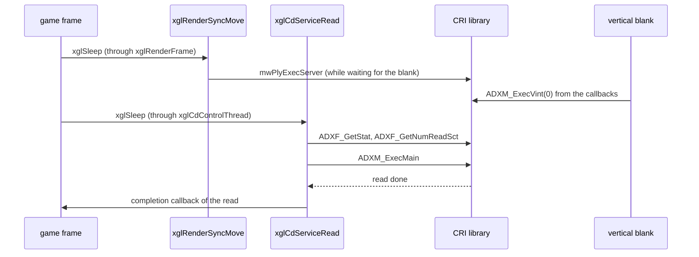
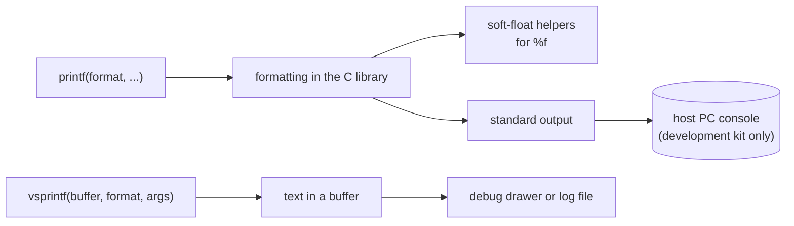
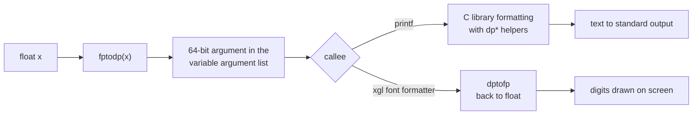
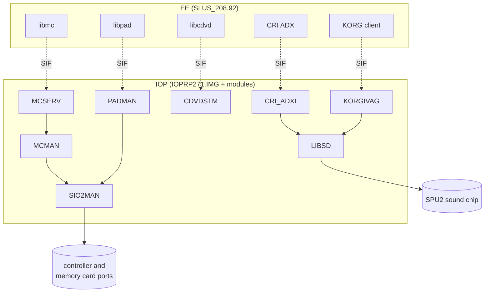

# Runtime libraries

A large part of `SLUS_208.92` was not written by the game's developers. Of
the roughly 7,600 functions in the executable, about 3,800 come from
libraries that were linked into it: the start-up code and the Sony
PlayStation 2 SDK (release 2.7.x), the EE client of the KORG sound driver,
the CRI middleware (the ADX audio and file system and the Sofdec movie
player), Sony's network library, and the C runtime with its math and
compiler support code. Together they take about 560 KiB of the 1.6 MiB of
code. The CRI middleware alone is 364 KiB, which is a third of the size of
the game code itself.

The game reaches the hardware almost only through these libraries. It reads
the disc through CRI's file system, plays music through CRI's ADX player and
sound effects through the KORG client, decodes movies with Sofdec, and
builds its display lists with Sony's packet library. This page shows where
the libraries sit in the executable, how the program starts through them,
which parts the game calls and from which files, and which modules run on
the IOP, the console's second processor.

[← Back to the overview](../README.md)

## Source files

The libraries themselves are not part of the game's source. The table lists
the game files that form the border to them.

| File | Contents |
| --- | --- |
| `src/main/control_entry.c` | `main` and `InitializeSystem`: the IOP reboot, the list of IOP modules, the start of every `xgl` module |
| `src/main/xgl_cd.c` | Disc access through libcdvd and the CRI file system, `xglCdSifLoadModule`, `xglCdLoadOverlay` |
| `src/main/xgl_hdd.c` | The HDD functions on top of Sony's file I/O calls |
| `src/main/sound_driver.c` | `soundDriverInit`: the start of the CRI ADX library and the KORG client, and the stream players |
| `src/main/se_bank_load.c` | The game's sound effect layer on top of the KORG client |
| `src/main/movie_player.c` | The Sofdec movie player |
| `src/main/xgl_render.c` | Display set-up through libgraph, the vertical blank callback |
| `src/main/xgl_packet.c` | The packet buffers on top of libpkt |
| `src/main/xgl_pad.c` | Controllers through libpad |
| `src/main/xgl_mc.c`, `src/main/xgl_mc_request.c` | Memory cards through libmc |
| `src/main/xgl_dma_handler.c` | Interrupt and DMA handlers through the kernel calls |
| `src/main/lan_usb.c` | The development network link through the network library |
| `src/main/script_load.c` | The only callers of `malloc` and `free` |
| `src/ov01/scene_load.c` | The only callers of the kernel thread calls |

## Where the libraries are

The libraries sit in two blocks at the two ends of the code section. The
game's own code lies between them, from `InitializeSystem` at `0x00194638`
to `0x0029F008`. The first block holds the start-up code, the Sony
libraries, the KORG client and the CRI middleware. The second block holds
the network library and the C runtime. The linker probably placed the
objects in the order they appeared on the link command line: Sony and
middleware archives first, the game's objects next, and the libraries that
everything else depends on last.

The zone edges below come from the layout of the executable. The addresses
inside a zone are the first functions of each library that the game calls,
so they mark where a library is, not exactly where it starts.

```
.text of SLUS_208.92 (0x00120000 - 0x002B3740)

0x00120008  crt0           program entry
0x00120200  kernel         EE kernel call stubs: AddIntcHandler, CreateThread,
                           FlushCache, EnableIntc, EnableDmac ...
0x00122D68  libkernel      SIF RPC (sceSifInitRpc)
0x00124688  libkernel      file I/O: sceFsReset, sceOpen ... sceDevctl
0x00127478  libkernel      IOP heap, module and ELF loading, IOP reboot
0x00129A88  libgraph       sceGs*
0x0012B498  libpkt         sceVif1Pk* (VIF1 packet building)
0x0012BEF0  libpad         scePad*
0x0012D8F0  libcdvd        sceCd*, sceCdSt* (streaming)
0x0012F868  libmc          sceMc*
0x00131380  libipu         sceIpu*, followed by libmpeg and libdma
0x00138298  KORG client    korgEvag*
0x0013B890  CRI            Sofdec player (mwPly*), ADX file system (ADXF_*),
                           ADX player (ADXT_*), ADX manager (ADXM_*),
                           PS2 layer (ADXPS2_*) and their internals
0x00194638  ----------     game code (src/main/) -----------------------------
0x0029F008  libnet         sceEENetInit, sceInet*
0x002A1578  math           atanf, cosf, sinf, tanf, atan2, sqrt ...
0x002A4EE8  libgcc         __muldi3, __udivdi3, __main, fptodp, dpadd ...
0x002A9350  C library      malloc, free, memcpy, memset, printf, sprintf,
                           the str* functions, vsprintf
0x002B3740  end of .text
```

The table gives the size of each zone. The function counts are estimates,
because the executable carries no symbol table.

| Zone | Range | Functions | Bytes |
| --- | --- | --- | --- |
| Start-up code and Sony SDK | `0x00120000`–`0x00138298` | 678 | 98,968 |
| KORG EE client | `0x00138298`–`0x0013B890` | 101 | 13,816 |
| CRI ADX and Sofdec | `0x0013B890`–`0x00194638` | 2,778 | 363,944 |
| Game | `0x00194638`–`0x0029F008` | 3,774 | 1,092,048 |
| Sony network library | `0x0029F008`–`0x002A1578` | 72 | 9,584 |
| C runtime | `0x002A1578`–`0x002B3740` | 203 | 74,184 |

The overlays contain no library code of their own. OV01 and OV02 call the
copies in the main executable, which stays in memory all the time.

The data sections are ordered the other way round: the game's data comes
first and the library data follows it. The game's part ends at `0x00646F20`
in `.data`, at `0x0068F990` in `.rodata` and at `0x00991000` in `.bss`. The
memory map is described in [memory.md](memory.md).

### Identification

The Sony libraries carry their version strings in `.rodata`. The first
library string after the game's data is `PsIIlibkernl2710`, the banner of
libkernel 2.7.1.0. libcdvd, libmc and libpad are also 2.7.1.0. libgraph,
libipu, libmpeg, libpkt, libdma, libmrpc and libnet are 2.7.0.0. The game
was therefore built against SDK release 2.7.x.

The CRI libraries carry build strings with the date `Jan 23 2004`. The KORG
client has no banner of its own in the executable, but its IOP counterpart
identifies itself as "KORG IOP Sound Driver", (C)2001-2004 KORG Inc., and
the game prints `[EE] Failed to bind KORG IOP Sound Driver.` when the two
cannot connect. The C runtime has no version string.

The diagram below shows the layers from the game down to the hardware. The
game calls the libraries mostly through `xgl`, the system library described
in [xgl.md](../libraries/xgl.md).



## Start-up

The EE kernel starts the program at its entry point `0x00120008`, which is
the start-up code crt0. That code prepares the C environment and calls
`main`. It is the only place where library code calls game code directly.
Everywhere else the game calls the libraries, and the libraries call back
only through function pointers that the game registered.

`main(argc, argv)` is in `src/main/control_entry.c`. The compiler inserts a
call to `__main` (`0x002A6D50`, libgcc) at the start of `main`, which runs
the global constructors. `main` then stores its arguments in
`mainParamArgc` and `mainParamArgv`, shows the boot screen with
`BootDisplay` and calls `InitializeSystem`.

`InitializeSystem` brings up the IOP and the libraries in a fixed order:

1. `sceSifInitRpc(0)` and `sceCdInit(0)` start the link to the IOP and the
   disc drive.
2. `sceSifRebootIop("cdrom0:\IOP\IOPRP271.IMG;1")` reboots the IOP with the
   replacement module image from the disc. The call is repeated until it is
   accepted, and `sceSifSyncIop` is polled until the IOP is back.
3. `sceSifInitRpc(0)` again, then `sceSifInitIopHeap` and
   `sceSifLoadFileReset` prepare the IOP heap service and the module loader.
4. `sceCdInit(0)` again, `sceCdMmode(SCECdDVD)` to select DVD media, and
   `sceFsReset` for the file service.
5. Eight IOP modules are loaded with `xglCdSifLoadModule`, in this order:
   `sio2man`, `mcman`, `mcserv`, `padman`, `cdvdstm`, `libsd`, `cri_adxi`
   and `korgivag`. The last two receive arguments (see
   [IOP modules on the disc](#iop-modules-on-the-disc)).
6. `WorkEnd` is set to `0x00B00000`, the start of the work area.
7. The `xgl` modules start: `xglCdInitial`, `soundDriverInit`,
   `xglPadInitial`, `xglMcInitial`, `xglTaskInitial(0, 0, 0)`,
   `xglDmaInitial`, `xglIntrInit`, `xglGeometryInit`, `xglPacketInit`,
   `xglRenderInit`, `xglFontInitial`, `xglMovieInit` and `xglMenuInitial`.

`xglCdSifLoadModule(path, args)` in `src/main/xgl_cd.c` builds the module
path. It writes `cdrom0:\IOP\`, appends the module name in upper case and
ends with `.IRX;1`. The argument list is a sequence of strings that ends
with two zero bytes. The function measures its length and passes everything
to `sceSifLoadModule`.

Back in `main`, the remaining set-up calls open the disc device
(`xglCdOpenDevice`), start the renderer and the studios, switch the display
on and load the system sound effect bank `SYS_SE` into bank slot 1. Then the
title overlay takes over. `main` loads overlay 2, runs `LogoFirst` and
enters an endless loop around `Title()`. The value that `Title` returns
names the next program: its low 24 bits are an entry address and its top
byte is the overlay to load first. `main` loads that overlay and calls the
address. The boot screens and the title are described in
[title-and-boot.md](../game/title-and-boot.md).

The sequence below shows the whole start-up.



### Loading an overlay

`xglCdLoadOverlay(overlay)` shows how the game uses the ELF loader of
libkernel. The function does nothing when the wanted overlay is already
loaded. Otherwise it builds the name `cdrom0:\OVnn.OVL;1` from the overlay
number, clears the 512 KiB of the overlay slot at `0x00A80000` and calls
`FlushCache(WRITEBACK_DCACHE)` and `FlushCache(INVALIDATE_ICACHE)`. Then it
calls `sceSifLoadElf` until the call succeeds, and flushes both caches
again. The flushes make sure that no instructions of the previous overlay
remain in the instruction cache. The IOP reads the file and writes it into
EE memory, so the EE itself takes no part in the read.

## The EE kernel calls

The EE kernel lives in the console's BIOS. Programs call it with the
`syscall` instruction, and the SDK wraps each call in a small stub. Unlike
the rest of the SDK these stubs have no `sce` prefix. The game uses very few
of them directly:

| Functions | Used in | Purpose |
| --- | --- | --- |
| `FlushCache` | 7 files, among them `xgl_cd.c`, `xgl_dma.c`, `xgl_render.c`, `xgl_packet.c` | Write the data cache back before a DMA transfer, and clear the instruction cache after loading code |
| `AddIntcHandler`, `AddDmacHandler` | `src/main/xgl_dma_handler.c` | Register the game's interrupt and DMA handlers |
| `EnableIntc`, `DisableIntc`, `EnableDmac`, `DisableDmac` | `src/main/xgl_dma_handler.c` | Switch single interrupt causes and DMA channels on and off |
| `CreateThread`, `StartThread`, `ExitDeleteThread` | `src/ov01/scene_load.c` | The load thread of the battle engine |

The game code of the main executable creates no threads. `xglSleep`, the
function that ends a frame, simply calls the renderer, the disc service and
the studio update in turn. Only the battle overlay starts a thread, a
short-lived one that unloads data in the background, with a 4 KiB stack and
priority 8 (see [memory.md](memory.md#thread-stacks)). The middleware is a
different matter. The CRI libraries are driven by calls from the game
(`ADXM_ExecMain`, `ADXM_ExecVint`, `mwPlyExecServer`) and may run threads
of their own inside the library.

## The Sony libraries

Each Sony library is used by only a few game files, almost always inside
`xgl`. The table lists them with the number of different functions the game
calls and the files that call them.

| Library | Prefix | Version | Functions called | Called from |
| --- | --- | --- | --- | --- |
| libkernel SIF | `sceSif*` | 2.7.1.0 | 8 | `control_entry.c`, `xgl_cd.c`, `lan_usb.c` |
| libkernel file I/O | `sceOpen`, `sceRead`, `sceWrite`, `sceLseek`, `sceClose` | 2.7.1.0 | 5 | `xgl_cd.c`, `xgl_hdd.c`, `srs.c`, `srs_file.c`, `cfe_init.c`, `cfeFileControl.c`, `game_snap_shot.c`, `yajima_test.c` |
| libkernel devices | `sceMount`, `sceUmount`, `sceFormat`, `sceDevctl`, `sceIoctl2`, `sceDopen`, `sceDread`, `sceDclose`, `sceGetstat`, `sceChstat`, `sceMkdir`, `sceRemove` | 2.7.1.0 | 12 | `xgl_hdd.c`, and `xgl_cd.c` for `sceDevctl` |
| libgraph | `sceGs*` | 2.7.0.0 | 12 | `xgl_render.c`, `xgl_jpeg.c`, `xgl_dma.c`, `xgl_task.c`, and others for `sceGsSyncPath` and `sceGsSyncV` |
| libpkt | `sceVif1Pk*` | 2.7.0.0 | 21 | 38 files that build VIF1 packets |
| libpad | `scePad*` | 2.7.1.0 | 12 | `xgl_pad.c` |
| libcdvd | `sceCd*` | 2.7.1.0 | 22 | `xgl_cd.c`, and `control_entry.c` for the first two calls |
| libmc | `sceMc*` | 2.7.1.0 | 12 | `xgl_mc.c`, `xgl_mc_request.c`, `yajima_test.c` |
| libipu | `sceIpu*` | 2.7.0.0 | 2 | `movie_player.c` (`sceIpuInit`), `xgl_1.c` (`sceIpuSync`) |
| libnet | `sceInet*`, `sceEENetInit` | 2.7.0.0 | 11 | `lan_usb.c` |

libmpeg, libdma and libmrpc are linked as well, but no game function calls
them. They serve the other libraries: Sofdec decodes its video through
libmpeg and the IPU, and libnet talks to the IOP through libmrpc.

### The IOP link

`sceSif*` is the library for the SIF, the channel between the EE and the
IOP. The game uses it only for set-up work: `sceSifInitRpc` to start remote
procedure calls, `sceSifRebootIop` and `sceSifSyncIop` to restart the IOP,
`sceSifInitIopHeap` and `sceSifAllocIopHeap` for IOP memory,
`sceSifLoadFileReset`, `sceSifLoadModule` and `sceSifLoadElf` for loading
code. The game never sends an RPC of its own. All later traffic to the IOP
is hidden inside libcdvd, libpad, libmc, the KORG client and the CRI
libraries.

### Files and devices

The file I/O functions (`sceOpen` and the others) send each request to the
IOP's file manager, which passes it to the device named in the path. The
game uses three devices this way. `host0:` is the PC connected to a
development kit, and the debug file functions and several tools read and
write there (for example `host0:/home/xeno/vcd-f/x2/` in `xgl_cd.c`).
`pfs0:` is the game's partition on the internal hard disk drive, where an
installed copy of the archives lives as `pfs0:/xenosaga.00`. `hdd0:` is the
drive itself, used when the partition is created and checked. `xglCdArcInit`
opens the HDD copy of the first archive with `sceOpen` and reads its header
with `sceRead`.

The disc is not read through this path. The game reads it sector by sector
through the CRI file system (see [CRI ADX and Sofdec](#cri-adx-and-sofdec))
and through `sceCdRead`, and it uses libcdvd for everything else that
concerns the drive: `sceCdDiskReady`, `sceCdGetDiskType`, `sceCdStatus` and
`sceCdGetError` to watch the disc, `sceCdTrayReq` for the tray,
`sceCdReadDvdDualInfo` and `sceCdLayerSearchFile` for the two layers of the
DVD, `sceCdReadClock` for the real-time clock, `sceCdPowerOff` for the
power button and the `sceCdSt*` family for the streaming service. All of
this is described in [files-and-resources.md](files-and-resources.md) and
[xgl.md](../libraries/xgl.md).

### Graphics

libgraph sets up the display. `xgl_render.c` resets the graphics system
(`sceGsResetGraph`, `sceGsResetPath`), builds and installs the display and
drawing environments (`sceGsSetDefDispEnv`, `sceGsPutDispEnv`,
`sceGsPutDrawEnv`) and registers the vertical blank callback with
`sceGsSyncVCallback`. `sceGsSyncPath(0, 0)` waits until the graphics paths
are idle and is called from 8 files, usually before a screen is copied.
`xgl_jpeg.c` reads the frame buffer back with `sceGsSetDefStoreImage` and
`sceGsExecStoreImage` and writes pictures with `sceGsExecLoadImage`.

libpkt is the most widely used Sony library. Its functions build VIF1
packets in an `XglPacket` record: `sceVif1PkCnt` and `sceVif1PkRef` add DMA
tags, `sceVif1PkOpenDirectHLCode`, `sceVif1PkAddDirectDataN` and
`sceVif1PkCloseDirectHLCode` add a block of GS data, `sceVif1PkOpenUpkCode`
and `sceVif1PkAddUpkData128N` add data for the VU1 vector unit. The table
shows how many game files call the most common ones.

| Function | Files |
| --- | --- |
| `sceVif1PkCnt` | 35 |
| `sceVif1PkAddDirectDataN` | 23 |
| `sceVif1PkOpenDirectHLCode` | 21 |
| `sceVif1PkCloseDirectHLCode` | 20 |
| `sceVif1PkRef` | 19 |
| `sceVif1PkAddDataN` | 16 |
| `sceVif1PkAddCode` | 8 |

The packet life cycle (`sceVif1PkInit`, `sceVif1PkReset`, `sceVif1PkEnd`,
`sceVif1PkTerminate`) is used only by `xgl_packet.c`. How the game drives
the graphics libraries is described in [rendering.md](rendering.md).

### Controllers and memory cards

`xgl_pad.c` is the only user of libpad. It opens the ports
(`scePadInit`, `scePadPortOpen`), reads the buttons (`scePadRead`,
`scePadGetState`), switches the controller to analog mode and pressure
sensing (`scePadSetMainMode`, `scePadInfoPressMode`,
`scePadEnterPressMode`) and drives the vibration motors
(`scePadSetActAlign`, `scePadSetActDirect`).

`xgl_mc.c` and `xgl_mc_request.c` wrap libmc. Every libmc call is
asynchronous: the game issues a request such as `sceMcOpen` or `sceMcRead`
and then polls `sceMcSync` for the result. Saving is described in
[save-data.md](save-data.md).

### The network library

`src/main/lan_usb.c` contains a small network client built on libnet
(`sceInetCreate`, `sceInetOpen`, `sceInetSend`, `sceInetRecv` and others).
`UsbInit` loads the network modules `inet`, `netcnf`, `inetctl`, then
either `usbd` and `an986` for a USB network adapter or `smap` for the
network adapter of the console, and finally `msifrpc` and `libnet`. None of
these modules is on the game disc, and the configuration paths point to a
development host (`host1:/home/xeno/vcd-f/conf/...`) and to a debug save
folder on the memory card. The code is therefore a development tool that
cannot work on a retail disc. It is described in
[debug-tools.md](../game/debug-tools.md).

## The KORG client

Sound effects and sequenced music are played by a sound driver from KORG
that runs on the IOP as the module `KORGIVAG.IRX`. The executable contains
its EE client, 101 functions that pack each request and send it to the
driver. The game knows them as `korgEvag*` and calls 30 of them.

| Group | Functions | Called from |
| --- | --- | --- |
| Set-up | `korgEvagBind`, `korgEvagInitSpu2`, `korgEvagInit`, `korgEvagAllocVagParam`, `korgEvagSetChannelPriority`, `korgEvagSetGlobalOutputMode` | `sound_driver.c` |
| Banks from disc | `korgEvagLoadVsfCdSector`, `korgEvagLoadVsfCdSector2`, `korgEvagLoadPrjCdSector`, `korgEvagLoadSmfCdSector` | `se_bank_load.c` |
| Banks from EE memory | `korgEvagLoadVsfFromEe`, `korgEvagLoadVsfFromEe2`, `korgEvagLoadPrjFromEe`, `korgEvagLoadSmfFromEe` | `se_bank_load.c` |
| Release | `korgEvagFreeBank`, `korgEvagFreeSeq` | `se_bank_load.c`, `src/ov01/handle_table.c` |
| Sequences | `korgEvagPlaySeq`, `korgEvagStopSeq`, `korgEvagStopAllSeq`, `korgEvagPauseSeq` | `se_bank_load.c`, `res_get_path.c`, `yajima_test.c` |
| Notes | `korgEvagMidiProc`, `korgEvagMidiProcBatchAdd`, `korgEvagMidiProcBatchFlush`, `korgEvagInitChannel` | `se_bank_load.c`, `sound_driver.c` |
| Volume and effects | `korgEvagSetUnitVolume`, `korgEvagSetFxType`, `korgEvagSetFxVolume`, `korgEvagAllUnitsSoundOff` | `se_bank_load.c`, `sound_driver.c`, `game_data.c` |
| Movies | `korgEvagSuspend`, `korgEvagSetDmaTransCallback` | `movie_player.c` |

The names show the model of the driver. A bank consists of a `.vsf` file
with the waveforms and a `.prj` file with the program data, and a sequence
is a `.smf` file. Sound effects are triggered like notes on a synthesizer,
through `korgEvagMidiProc`, and the batch functions collect several such
events and send them in one request.

`soundDriverInit` connects to the driver with `korgEvagBind`. When that
fails it prints `[EE] Failed to bind KORG IOP Sound Driver.` and returns,
which leaves the game without sound effects. Otherwise it initializes the
sound chip (`korgEvagInitSpu2(0xA1)`), the driver (`korgEvagInit(0, 0)`)
and the voice parameters (`korgEvagAllocVagParam(0x100, 0)`), and calls
`korgEvagSetChannelPriority` for 16 channels, once with a first argument
of 1 and once with 4.

The game does not call the client from everywhere. `src/main/se_bank_load.c`
and `src/main/sound_driver.c` form the game's own sound layer (`seBankLoad`,
`seBankLoadMemory` and the volume and playback functions), and the rest of
the game calls that layer. It is described in [audio.md](audio.md).

## CRI ADX and Sofdec

The largest library block is the middleware of CRI: 2,778 functions and 364
KiB of code. It has three faces for the game.

### The ADX file system

`ADXF` is CRI's file layer. The game uses it for its normal disc reads.
`xglCdOpenDevice` calls `ADXF_Open` with the name `CDV:DVD-ROM`, which opens
the whole disc as one file, and keeps the handle in `xglCdDeviceHandle`. A
read then seeks to a sector number and starts a background read:
`ADXF_Seek(handle, lbn, 0)` and `ADXF_ReadNw(handle, sectors, buffer)`.
The game polls `ADXF_GetStat` until the read is done and reports progress
with `ADXF_GetNumReadSct`. While it waits it calls `ADXM_ExecMain`, which
gives the CRI library time to do its work. `ADXF_Stop` and `ADXF_StopNw`
cancel a read.

Reading the game's archives through the same file layer as the ADX streams
lets the library schedule both on the one disc drive. The read path is
described in [files-and-resources.md](files-and-resources.md).

### The ADX player

`ADXT` plays ADX audio streams from the disc: the background music and
voices. `soundDriverInit` starts the library with `ADXPS2_Setup(0)`,
`ADXM_Setup(0)` and `ADXT_Init`, and registers `soundVSyncCallback`, which
calls `ADXM_ExecVint(0)` on every vertical blank. The game keeps two
players. Each is created with `ADXT_Create(2, buffer, size)`, a stereo
player with its work buffer in the work area (see
[memory.md](memory.md#the-work-area-and-workend)).

| Function | Purpose in the game |
| --- | --- |
| `ADXT_Create`, `ADXT_Destroy` | Create and remove a player |
| `ADXT_StartFname`, `ADXT_Stop`, `ADXT_Pause` | Play a file by name, stop, pause |
| `ADXT_GetStat` | Poll the player state |
| `ADXT_SetOutVol`, `ADXT_SetOutputMono` | Volume and mono output |
| `ADXT_SetLpFlg`, `ADXT_GetLpCnt` | Looping, and the number of loops played |
| `ADXT_SetSvrFreq`, `ADXT_SetReloadSct` | Tuning of the player's service rate and read-ahead |
| `ADXT_DestroyAll`, `ADXT_Finish` | Shut the players down around a movie |

The IOP side of the player is the module `CRI_ADXI.IRX`. The streams are
described in [audio.md](audio.md).

### The Sofdec movie player

Movies are Sofdec files, and `src/main/movie_player.c` plays them with the
`mwPly` functions. It computes the work memory a movie needs
(`mwPlyCalcWorkCprmSfd`, `mwPlyCalcWorkStm`), starts the effect layer
(`mwPlyInitSfdFx`), creates a player (`mwPlyCreateSofdec`) and, when the
caller asked for the extra work block, a stream object
(`mwPlyCreateStm`). The field's movie code asks for that block when the
Dolby Digital option of the save data is set. In its
loop it fetches each decoded frame with `mwPlyGetCurFrm`, draws it and
returns it with `mwPlyRelCurFrm`. `mwPlyExecServer` is the library's
service function. `xglRenderSyncMove` in `src/main/xgl_render.c` calls it
while it waits for the vertical blank, so the decoder keeps running between
frames.

The movie player has to share the sound hardware with the KORG driver.
It calls `korgEvagSuspend` and `korgEvagSetDmaTransCallback` for that, and
it brackets the creation of the player with `ADXM_Lock` and `ADXM_Unlock`. It also calls `sceIpuInit` for the image
processing unit, the hardware decoder that Sofdec drives. Movies are
described in [xgl.md](../libraries/xgl.md) and
[cutscenes.md](../scripting/cutscenes.md).

The sequence below shows how the three CRI services are driven during one
frame of the game.



## The C library

The C runtime zone at the end of the code holds the standard C functions.
The game uses a small part of it. The table counts the game source files
(main executable and overlays, 294 files) that call each function.

| Function | Files | Typical use |
| --- | --- | --- |
| `memset` | 82 | Clearing work areas and structures |
| `sprintf` | 25 | Building file names, formatting numbers |
| `printf` | 18 | Debug messages |
| `strcpy` | 15 | Building file paths |
| `strcat` | 14 | Building file paths |
| `strcmp` | 12 | Name lookups |
| `strlen` | 8 | Text layout |
| `memcpy` | 6 | Block copies |
| `strchr` | 4 | Parsing text tags and paths |
| `vsprintf` | 3 | The game's own formatted debug output |
| `vprintf`, `strncmp`, `strncat` | 2 each | |
| `strncpy`, `rand`, `malloc`, `free` | 1 each | |

Many game functions copy strings and blocks with loops of their own instead
of calling the library. `xglCdSifLoadModule` and `xglCdLoadOverlay`, for
example, build their paths character by character. The vector and matrix
copies of the engine use 128-bit loads and stores (see
[math.md](../libraries/math.md)).

### printf and the debug output

`printf` formats its text and writes it to the standard output of the
program, which on a development kit is the console of the host PC. On a
retail console no host is connected, so the output of the 18 files that
call `printf` probably goes nowhere. The game still spends the time to
format it. The heap checker `RgHeap` reports all its errors this way (see
[memory.md](memory.md#rgheap)), and so does `soundDriverInit` when the sound
driver cannot be bound. `vprintf` serves the assertion handler in
`src/main/assert_fail.c`.

The game's on-screen text does not use this path. It is drawn by the font
module of `xgl`, which has its own formatter (see
[fonts-and-text.md](../libraries/fonts-and-text.md)). The game's debug
print functions in `pxy_debug_draw.c`, `sef_print.c` and
`cfeFileControl.c` format their lines with `vsprintf` into a buffer first
and then draw or log the text themselves.



### malloc and free

The game manages its memory itself, with `WorkEnd`, the resource block
table and several special allocators (see [memory.md](memory.md)). The C
library's allocator is linked (`malloc` at `0x002A9350`, `free` at
`0x002A93A8`), but only one game file calls it. `scriptReadFile` in
`src/main/script_load.c` allocates a buffer with `malloc(100)` and reads a
script image from the development host into it, and `scriptFreeBuffer`
frees it. Both are development functions. The allocator is therefore used
almost only by the libraries themselves.

### rand

`rand` has a single caller, in `src/main/sdv.c`. The game's random numbers
come from its own generators, which are described in
[math.md](../libraries/math.md).

## The math library

The math functions sit at the start of the C runtime zone. The game mostly
calls the single-precision versions, which run on the EE's floating-point
unit without help:

| Function | Files |
| --- | --- |
| `cosf` | 23 |
| `sinf` | 20 |
| `atan2f` | 12 |
| `sqrt` | 7 |
| `sqrtf` | 5 |
| `tanf` | 4 |
| `atanf`, `asinf`, `acosf` | 3 each |
| `fmodf`, `atan2` | 2 each |
| `floorf`, `sin`, `atan` | 1 each |

`sqrt`, `atan2`, `sin` and `atan` are the double-precision versions. They
appear where the original code did not use the `f` form, for example the
`sqrt` calls in `src/main/m_math.c` and `src/main/cfePlugIn.c`, and each
call converts its argument to `double` and the result back.

Vector and matrix math does not use this library. It runs on the VU0
coprocessor through the macros and functions described in
[math.md](../libraries/math.md).

## The compiler runtime

libgcc holds the helpers that the compiler calls for operations the
processor cannot do in one instruction.

The first group is 64-bit integer arithmetic: `__muldi3`, `__udivdi3` and
the conversions `__floatdisf`, `__fixdfdi`, `__fixsfdi` and
`__fixunssfdi`. The game calls `__udivdi3`, the unsigned 64-bit division,
from two files: `src/main/battle_result.c` and
`src/ov02/title_hdd_install.c`, where it probably computes the progress of
the HDD installation from byte counts.

The second group is `__main`, the constructor support that `main` calls
first.

The third group is the software floating point. The EE's floating-point
unit handles only single-precision `float`. Every operation on a `double`
therefore becomes a call into libgcc. The routines have short names:
`dpadd`, `dpsub` and `dpcmp` for arithmetic and compares, and `fptodp`,
`dptofp` and `dptoli` for conversions.

The game code avoids `double`, but it cannot avoid it everywhere. The most
common reason is C's rule for variable argument lists: a `float` passed to
`printf` or to one of the game's own formatted print functions is converted
to `double` first, and the callee converts it back. A few files call the
routines by name:

| File | Routines | Where |
| --- | --- | --- |
| `src/main/xgl_font.c` | `dptofp` | The `%f` argument of the font formatter arrives as a `double` and is converted back to `float` |
| `src/main/uwamono_record.c` | `fptodp`, `dptofp`, `dpsub`, `dpcmp` | Double-precision steps in the map unit records |
| `src/main/xrg_rand_int.c` | `fptodp`, `dptofp` | Around its calls of `sqrt` and `atan2` |
| `src/ov01/m_ef_spiral.c`, `src/ov01/m_ef_missile_trail.c` | `fptodp`, `dpcmp` | Compares against double constants in two battle effects |
| `src/ov01/m_ef_sway.c` | `dpcmp` | A compare against a double constant |

The diagram below shows what one formatted `float` costs.



## IOP modules on the disc

The `IOP` folder of the disc holds nine files. All of them are loaded during
`InitializeSystem`, in the order of the table.

| File | Origin | Role | Arguments |
| --- | --- | --- | --- |
| `IOPRP271.IMG` | Sony | Replacement IOP module image, used to reboot the IOP. The number matches the SDK release 2.7.1 of the EE libraries | |
| `SIO2MAN.IRX` | Sony | Serial port manager for controllers and memory cards | |
| `MCMAN.IRX` | Sony | Memory card driver | |
| `MCSERV.IRX` | Sony | Memory card server for libmc | |
| `PADMAN.IRX` | Sony | Controller driver for libpad | |
| `CDVDSTM.IRX` | Sony | Disc streaming service for the `sceCdSt*` calls | |
| `LIBSD.IRX` | Sony | Low-level sound library for the SPU2 sound chip | |
| `CRI_ADXI.IRX` | CRI | IOP part of the ADX player | `spucore=1` |
| `KORGIVAG.IRX` | KORG | The sound driver for effects and sequences | `vag=256`, `key=256`, `prg=64`, `sbf=128`, `seq=64`, `ply=16` |

The KORG driver's six arguments are passed as one list of strings. Judging
by their names they set the sizes of the driver's tables: voices, keys,
programs, sound bank files, sequences and players. `spucore=1` tells the
ADX module which core of the sound chip to use, so that the two sound
systems do not collide. The KORG driver has 239 functions of its own.

The order matters. `sio2man` must be present before the card and controller
drivers that use it, and `libsd` before the two sound modules that build on
it.



The disc holds no hard disk or network modules. The HDD functions of
`xgl_hdd.c` and the `pfs0:` reads need the HDD drivers on the IOP, but no
recovered EE function loads them by name. They are possibly part of the
`IOPRP271.IMG` image or provided by the console's own system software. This
is not clear from the code. The network modules that `UsbInit` asks for are
missing from the disc altogether.

## How the game sees the libraries

For the game's code a library function is an ordinary external C function.
Each source file declares the functions it calls, with the usual
prototypes. The declarations are local in most files. `control_entry.c`,
for example, declares `sceSifInitRpc`, `sceCdInit`, `sceSifRebootIop` and
the other start-up calls right above `InitializeSystem`.

The libraries call back into the game through function pointers only. The
vertical blank callbacks (`xglRenderVSyncCallback`, `soundVSyncCallback`)
are registered with `sceGsSyncVCallback`. The interrupt handlers go through
`AddIntcHandler` and `AddDmacHandler`. The KORG client takes a DMA transfer
callback from the movie player. This one-way structure is what lets the
overlays work without library code of their own: they call the library
copies in the main executable at fixed addresses, and nothing in a library
ever needs the address of an overlay function that it was not handed at run
time.
