# Save data

Everything that Xenosaga Episode II keeps between play sessions lives in one
object, `SaveData`, declared in `include/main/xgl_mc_request.h` and defined at
the end of `src/main/xgl_mc_request.c`. It is `SAVE_DATA_SIZE` = `0x5160` bytes
long (20,832 bytes). A save file on a memory card is a plain copy of this
object, protected by a checksum and a version number. Loading a game reads the
file back over the object and then copies its parts out to the systems that own
them.

Only a small part of the game state lives inside `SaveData` all the time: the
player's options and the packed script flags. Everything else (the party, the
character parameters, the inventory, the game work block, the quest and citizen
flags) lives in its own variables and is copied into the image by
`saveWriteImage` just before the file is written, and copied back by
`saveReadImage` and `saveReadGameWork` when the play session starts.

This page describes the layout of the image, how a new game fills it, the
memory card library and its request state machine, the save and load screen,
the search for save data of the earlier Xenosaga games, the hard disk code, and
the JPEG codec that makes the thumbnail picture stored in every save.

[← Back to the overview](../README.md)

## Files

| File | Contents |
| --- | --- |
| `include/main/xgl_mc_request.h` | `struct SaveData` and every structure layered on it: `SaveParty`, `PartyTakenBits`, `SaveThumbnail`, the flag blocks. Also `McRequestParam` |
| `src/main/xgl_mc_request.c` | The memory card request queue (`xglMcRequest`), the state machine `xglMcMain`, path building, the create, list and old-data scans, and the definition of `SaveData` |
| `src/main/xgl_mc.c` | `xglMcInitial` and the two blocking helpers `xglMcEasyLoad` and `xglMcEasySave` |
| `src/main/save_screen.c` | The save and load screen `MenuFileMain`, the thumbnail encoder call, and the new game configuration screen `configScreenRun` with the old-data check |
| `src/main/pt_member.c` | `saveChecksum`, `saveWriteImage`, `saveReadImage`, `saveReadGameWork`, `padApplySaveSettings` (the file belongs to the party page, these five functions are described here) |
| `src/main/save_party_init.c` | `saveDataSetDefaults` (default options), `ptReset` (party reset), the load request flag, and several party and skill tables |
| `src/main/xgl_flags.c` | The packed script flags inside the image: `xglFlagsGet`, `xglFlagsSet` and their fixed-width forms |
| `src/main/xgl_hdd.c` | Hard disk support: mounting and checking the game partition, the installer, and saves in `pfs1:/Your Saves` |
| `src/main/game_snap_shot.c` | Screen snapshots written as JPEG files to the development host, and a 128x112 thumbnail encoder |
| `src/main/xgl_jpeg.c` | The JPEG encoder `xglJpegEncode` and decoder `xglJpegDecode` |
| `src/main/sv_scene_flags.c` | The `svSceneFlags` word and its four accessors, a direction-to-angles helper and a light set log. None of it is saved |

## The save image

`SaveData` is one C structure. The first `0x74` bytes are a header with the
bookkeeping fields and the options. The 256 bytes of script flags follow, then
the thumbnail, and then a series of blocks that are whole copies of live
objects of the game. The structure leaves several spans without a field. No
function in the source reads or writes those spans by name, so their meaning is
unknown.

Because the whole object is written and read as one piece, a field only has to
be inside `SaveData` to be saved. The save code has no list of saved variables
other than the assignments in `saveWriteImage`.

```
SaveData (0x5160 bytes)
+0x0000  (8 bytes)          no named field
+0x0008  checksum           s64, see "Checksum and version"
+0x0010  saveCount          int, incremented by every save
+0x0028  soundMode          byte 0..2, sound output
+0x0029  dolby_digital      byte, Dolby Digital for movies
+0x0032  displayOffsetX     short, screen position
+0x0034  displayOffsetY     short
+0x003A  caption_all        byte, 0 or 2, caption lines
+0x003E  actuatorMode       byte, controller vibration
+0x0046  cursor_memory      byte
+0x0047  cursor_memory_alt  byte
+0x0050  version            s64, SAVE_VERSION = 200
+0x0060  saveTime           XglClock, real-time clock at the save
+0x0068  playTime           XglClock, total play time
+0x0074  scriptFlags        0x100 bytes, packed flags (xglFlags*)
+0x0174  thumbnail          0x1000 bytes, JPEG of the screen
+0x1174  battleSlots      0x1080 bytes, copy of battleSlotTable
+0x21F4  (0x80 bytes)       no named field
+0x2274  slotRecords       0x400 bytes, copy of slotRecordTable
+0x2674  shortTables[0]     0x1FE bytes, copy of dataBoxQuantityTable1
+0x2872  shortTables[1]     copy of dataBoxQuantityTable2
+0x2A70  shortTables[2]     copy of dataBoxQuantityTable3
+0x2C6E  shortTables[3]     copy of dataBoxQuantityTable4
+0x2E6C  word2E6C           int, copy of startStockCount
+0x2E70  brokenEnemyBuf          16 bytes, copy of brokenEnemyBuf
+0x2E80  game               GameWork, 0x1B30 bytes, copy of gameWork
+0x49B0  (0x4D0 bytes)      no named field
+0x4E80  questFlags         0x24 bytes
+0x4EA4  citizenFlags       0x32 bytes
+0x4ED6  segFlags           0x12 bytes
+0x4EF0  party              SaveParty, 0x218 bytes
+0x5108  (0x48 bytes)       no named field
+0x5150  balance            int, copy of msgBalance
+0x5160  end
```

The diagram below shows the two ways state reaches the image. The options and
the script flags are worked on in place. The other blocks are copied in at save
time and copied out when the session starts from a loaded save.

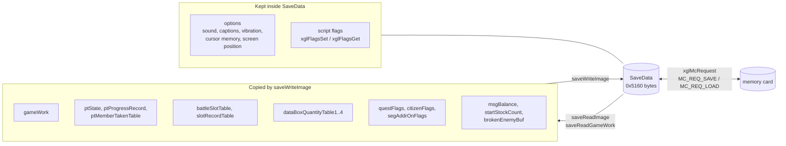

## The header and the options

The header holds the checksum, the save counter, the version and the two clock
records. The option bytes sit between them. They are edited by two screens: the
configuration page of the main menu (`src/main/menu_scene.c`, see
[main-menu.md](../game/main-menu.md)) and the configuration step of a new game
(`configScreenUpdate` in `src/main/save_screen.c`).

| Offset | Field | Values | Effect |
| --- | --- | --- | --- |
| `0x28` | `soundMode` | 0, 1 or 2 | `soundStereoSet(SaveData.soundMode != 0)`. Both screens step it modulo 3. The texts of the three values are entries `0x165` to `0x167` of `MainMenu.txd` |
| `0x29` | `dolby_digital` | 0 or 1 | The movie player sizes and allocates its render buffer with it (`movieRenderBufferSize`, `movieRenderBufferAlloc` in `src/main/game_movie.c`) |
| `0x32` | `displayOffsetX` | signed | Horizontal screen position, applied with `tyaSetDisplayOffset` |
| `0x34` | `displayOffsetY` | signed | Vertical screen position |
| `0x3A` | `caption_all` | 0 or 2 | When zero, the movie player and the cutscene player (`src/main/cfePlugIn.c`) show only the caption lines whose text starts with a space. When nonzero they show every line |
| `0x3E` | `actuatorMode` | 0 or 1 | Copied to `PadData[0].actuatorMode` and `PadData[1].actuatorMode`, the vibration switch of both controllers |
| `0x46` | `cursor_memory` | 0 or 1 | Copied to `menuCursorMemory` for the main menu |
| `0x47` | `cursor_memory_alt` | 0 or 1 | Copied to `menuCursorMemoryAlt` for the main menu |

Three of the options take effect outside the menu, so they have to be applied
again whenever the image changes. `padApplySaveSettings` in
`src/main/pt_member.c` does that: it copies `actuatorMode` to both pads, calls
`soundStereoSet` and calls `tyaSetDisplayOffset` with the two offsets. `Game()`
calls it as its first statement, so a loaded save and a new game both start
with the right settings. The sound side is described in
[audio.md](audio.md) and the pads in [xgl.md](../libraries/xgl.md).

The screen position is adjusted by `tyaDisplaySetting` in
`src/main/tya_display_setting.c`. Called with `TYA_DISPLAY_APPLY` it writes the saved
offsets into the display environment: the horizontal offset is multiplied by 5
and added to `DispEnv.base.field.dx`, the vertical offset is added to
`DispEnv.base.field.dy`. Called with `TYA_DISPLAY_RESET` it zeroes both offsets
and restores the base position. Called with a buffer address it shows the
adjustment picture `yajima\mnt_set.jpg` and lets the player move the screen.

### Default options

`saveDataSetDefaults` in `src/main/save_party_init.c` writes the defaults:
`soundMode` 1, `caption_all` 2, both cursor memory bytes 0, `actuatorMode` 0,
`dolby_digital` 0, and it resets the screen position with
`tyaDisplaySetting(TYA_DISPLAY_RESET)`. It has two callers. `ptReset` calls it
when the load-pending flag is set (see [A new game](#a-new-game)), and the
configuration page of the main menu calls it for its "default" row and then
applies the pads, the sound mode and the display offset again.

### Dates and play time

Two clock records follow the version, both in the `XglClock` format of
`include/main/xgl_cd.h`: `status`, `second`, `minute`, `hour`, `day`, `month`
(one byte each) and a 16-bit `year`. `xglClockRead` fills one from the
console's real-time clock. `xglClockDayTime2UInt` turns a record into seconds
since 2000-01-01 00:00:00 and `xglClockUInt2DayTime` does the reverse.

`saveTime` at `0x60` is the date and time of the save. `saveWriteImage` reads
it from the real-time clock just before it computes the checksum.

`playTime` at `0x68` is the total play time. The game does not count frames for
it. The party progress record keeps a reference value in
`ptState.progress->playTime`, which is "the clock reading at which the play
time was zero". `ptReset` and `ptStateInit` set the reference to the current
clock reading. `saveWriteImage` stores `now - reference` in the image, and
`saveReadImage` sets the reference to `now - saved play time`, so the count
continues where the save left it.

`PartyTimeDispChange` in `src/main/xgl_cd_arena.c` prepares a play time for
display. It folds the days into the hour field (`hour + (day - 1) * 24`),
limits the hours to 255, and shows 99:59:59 for anything of 100 hours or more.
The save screen and the memory card title both use it.

## The script flags

The 256 bytes from `0x74` to `0x173` are a packed bit array, `scriptFlags`.
A flag is addressed by its bit offset and its width in bits. This is the
storage behind the story progress value and the flags that scripts set and
test (see [events.md](../scripting/events.md) and
[natives.md](../scripting/natives.md)). Because the array is part of
`SaveData`, the flags are always current in the image and need no copy at save
time.

`xglFlagsGet(bit_offset, bit_count)` copies the bytes that the field touches
into an 8-byte window, shifts the window right by `bit_offset & 7` and masks
the result with `(1 << bit_count) - 1`. `xglFlagsSet(bit_offset, bit_count,
value)` reads the same window, replaces the field, writes the bytes back and
returns the previous value. The number of bytes copied is
`(bit_count + (bit_offset & 7) + 7) >> 3`, so a field may start at any bit and
cross byte boundaries.

| Function | Width |
| --- | --- |
| `xglFlagsGet1`, `xglFlagsSet1` | 1 bit |
| `xglFlagsGet2`, `xglFlagsSet2` | 2 bits |
| `xglFlagsGet4`, `xglFlagsSet4` | 4 bits |
| `xglFlagsGet8`, `xglFlagsSet8` | 8 bits |
| `xglFlagsGet16`, `xglFlagsSet16` | 16 bits |
| `xglFlagsGet32`, `xglFlagsSet32` | 32 bits |
| `xglFlagsGet64`, `xglFlagsSet64` | two 32-bit calls, at `bit_offset` and `bit_offset + 32` |

The 32-bit and 64-bit forms do not work as their names say. The mask is
computed with a 32-bit shift, and on the console a shift by 32 uses only the
low five bits of the count, so the mask for a width of 32 comes out as zero.
`xglFlagsGet32` therefore returns 0, and `xglFlagsSet32` leaves the bits
unchanged. The 64-bit forms are built from two such calls and behave the same
way. Widths of 1 to 16 bits are the ones the game relies on. Neither function
checks that the offset lies inside the 256 bytes.

`xglFlagsInitial` clears the 256 bytes. `TitleGameInit` calls it for a new
game and for a loaded game alike, before the save file is read.

Two flag positions appear in the save code itself. The 8-bit field at bit
`0x191` (`STORY_PROGRESS_FLAG` in `src/main/pt_member.c`) is the story
progress. The bit at `0x2F0` is set and cleared by `uwamonoAttachCurrent` and
`uwamonoDetachCurrent` in `src/main/save_party_init.c`, described below.

## The copied blocks

`saveWriteImage` copies each of the following objects whole into the image.
`saveReadImage` and `saveReadGameWork` copy them back. The table lists them in
image order with the page that describes their contents.

| Image field | Live object | Size | Contents |
| --- | --- | --- | --- |
| `battleSlots` | `battleSlotTable` | `0x1080` | The parameter blocks (`StatBlock`) of the playable units, read with `calcTotalParaMenu` and by the battle code. See [party-and-growth.md](../game/party-and-growth.md) |
| `slotRecords` | `slotRecordTable` | `0x400` | Sixteen `PartyMemberExpPoints` records of `0x40` bytes: total experience, experience for the next level, skill points and class points of each member |
| `shortTables[0..3]` | `dataBoxQuantityTable1` to `4` | 4 x `0x1FE` | The four inventory boxes, 255 16-bit quantities each (data box categories 1 to 4 of `src/ov01/data_box.c`) |
| `word2E6C` | `startStockCount` | 4 | A battle value read by `src/ov01/calc.c` as the starting stock |
| `brokenEnemyBuf` | `brokenEnemyBuf` | 16 | A 128-bit table set and tested by index 16 to 143 in `src/ov01/calc.c` |
| `game` | `gameWork` | `0x1B30` | The whole game work block: current map, control bits, camera, player parameters, light sets, event flags. See [field.md](../game/field.md) |
| `questFlags` | `questFlags` | `0x24` | One byte per quest, 36 quests. See [gs-campaign.md](../game/gs-campaign.md) |
| `citizenFlags` | `citizenFlags` | `0x32` | One byte per citizen, 50 citizens |
| `segFlags` | `segAddrOnFlags` | `0x12` | One byte per segment address, 18 entries |
| `party` | `ptState`, `ptProgressRecord`, `ptMemberTakenTable` | `0x218` | The party, see below |
| `balance` | `msgBalance` | 4 | The value behind `msgBalanceGet` and `msgBalanceSet`. `msgBalanceReset` sets it to 10,000,000 at a new game |

`gameWork` is saved with everything in it, including pointers such as
`workEnd`, `active` and `resBuffer` that mean nothing in a later session.
`Game()` overwrites them right after the load (`gameWork.workEnd = WorkEnd`,
`gameWork.resourceId = -1`, `gameWork.mapLoaded = 0`), and `saveReadGameWork`
repairs the control word, as described under
[Loading into the game](#loading-into-the-game).

### The party block

The live party is a set of pointers (`ptState.slots[]` and `ptState.roster[]`
point at `PartyMember` records), so it cannot be copied as it is.
`saveWriteImage` converts it to the `SaveParty` structure, which stores member
ids instead of pointers. `saveReadImage` turns the ids back into pointers with
`ptMemberRecordFindById`.

| Offset in `SaveParty` | Image offset | Type | Field | Meaning |
| --- | --- | --- | --- | --- |
| `+0x000` | `0x4EF0` | `u8[10]` | `slotIds` | Member id in each of the ten party slots (seven front slots, three back slots), 0 for an empty slot |
| `+0x00A` | `0x4EFA` | `u8[10]` | `rosterIds` | Member id of each entry of the second roster |
| `+0x014` | `0x4F04` | `u16` | `memberMask` | One bit per member who has joined (`ptAddMember`) |
| `+0x018` | `0x4F08` | `int` | `mapId` | The map the party came from while it is attached, -1 otherwise |
| `+0x020` | `0x4F10` | `PartyValue64[2]` | `position` | The actor position saved on attach, 16 bytes |
| `+0x030` | `0x4F20` | `u8` | `savedSplitMode` | The split mode before the attach |
| `+0x031` | `0x4F21` | `u8` | `splitMode` | `ptState.splitMode` |
| `+0x032` | `0x4F22` | `u8` | `frontIndex` | The current front slot |
| `+0x033` | `0x4F23` | `u8` | `backIndex` | The current back slot |
| `+0x034` | `0x4F24` | `u8[3]` | `counts` | `ptState.counts` |
| `+0x037` | `0x4F27` | `PartyTakenBits[10]` | `takenBits` | One `0x2B`-byte record per member: the copy of `ptMemberTakenTable`, the skills taken on the skill board |
| `+0x1E6` | `0x50D6` | `u8` | `leaderId` | Member id of the current leader |
| `+0x1E7` | `0x50D7` | `u8` | `leaderLevel` | The leader's level (`calcTotalParaMenu(id)->expLevel`) |
| `+0x1E8` | `0x50D8` | `u16[7]` | `slotValues` | Member index plus one of each occupied slot of the active group, 0 for an empty slot |
| `+0x1F6` | `0x50E6` | `u8` | `mapFlag` | 1 when the save was made on the game end map |
| `+0x1F7` | `0x50E7` | `u8[0x20]` | `eligibility` | A 256-bit map, one bit per entry of data box category 3 |

The last five fields exist for the save screen. `leaderId`, `leaderLevel`,
`slotValues` and `mapFlag` are not read back by `saveReadImage`. They let the
slot list show the leader's name and level, the faces of the party and a
"cleared" mark without loading the rest of the game. When the party is split
(`ptState.splitMode` nonzero) the leader is the member in back slot
`backIndex`, and `slotValues` lists the three back slots followed by zeros.
Otherwise the leader is the member in front slot `frontIndex` and `slotValues`
lists the seven front slots.

A `PartyTakenBits` record holds four header bytes, four groups of eight cell
bytes, the highest open group, the count of taken skills and up to four
entries with their count. The skill board that uses it is described in
[party-and-growth.md](../game/party-and-growth.md).

### Attaching the party to another map

Two functions of `src/main/save_party_init.c` use the saved `mapId`,
`position` and `savedSplitMode` fields of the progress record.
`uwamonoAttachCurrent(kind, runSplit)` sends the party to one of eight maps
listed in `partyAttachMapIdTable` (1010, 2110, 2210, 3120, 3410, 4310, 4610,
5010) and remembers where it came from. It only acts when the party is not
already attached (`mapId == -1`), a current map unit exists and `kind` is
below 8. It stores the current map id and the position of the current unit's
actor, saves the split mode, enters or leaves the split as `runSplit` asks,
sets script flag `0x2F0` when `kind` is 7 and no split is wanted, sets the
`CONTROL_PARTY_ATTACHED` bit (`0x800`) of `gameWork.control` and starts the map
transition with `uwamonoSetTransition`.

`uwamonoDetachCurrent` undoes it. It restores the saved split mode, clears
flag `0x2F0` and the control bit, starts the transition back to the saved map
and sets `mapId` to -1. Because these fields are part of the save, a game
saved while attached returns to the right place later. Map units are described
in [map-and-units.md](../game/map-and-units.md).

## Checksum and version

A save is accepted only when two fields match. `version` at `0x50` must be 200
(`SAVE_VERSION` in `src/main/pt_member.c`, `SAVE_IMAGE_MARKER` in
`src/main/save_screen.c`). `checksum` at `0x08` must equal the value that
`saveChecksum` computes over the image.

`saveChecksum(image, sum)` makes a copy of the whole image on the stack, sets
the checksum field of the copy to zero and then adds up every byte. Each byte
is multiplied by its position counted from 1, and `0x793` is added per byte:

```c
*sum = 0;
for (i = 0; i < sizeof(struct SaveData); i++) {
    *sum = *sum + byte[i] * (long long)(i + 1) + 0x793;
}
```

The sum is 64 bits wide. Weighting each byte by its position means that two
swapped bytes change the result, which a plain sum would not notice. The added
constant makes an image of all zero bytes fail the test, because its sum is
`0x793 * 0x5160` and its stored checksum is zero.

The image is not encrypted. The only function named `decrypt` in the owned
files works on the hard disk partition name and is described under
[The hard disk](#the-hard-disk).

## Writing and reading the image

`saveWriteImage` in `src/main/pt_member.c` builds the image. The save screen
calls it once, after it has copied the thumbnail into place. The steps are:

1. `ptRefresh()` brings the party state up to date.
2. The play time is computed from the real-time clock and the reference in the
   progress record.
3. `battleSlotTable`, `slotRecordTable`, the four box tables, `brokenEnemyBuf`
   and `startStockCount` are copied.
4. If `gameWork.mapId` is `MAP_ID_GAME_END` (`0x1B91`), the progress record's
   `mapFlag` is set to 1.
5. The `SaveParty` block is filled from `ptState`, the progress record and
   `ptMemberTakenTable`, including the leader and slot values for the save
   screen.
6. `gameWork`, `questFlags`, `citizenFlags` and `segAddrOnFlags` are copied,
   and `balance` is read with `msgBalanceGet`.
7. `saveCount` is incremented, `version` is set to 200, `saveTime` is read
   from the clock.
8. `saveChecksum` is run and its result stored in `checksum`.

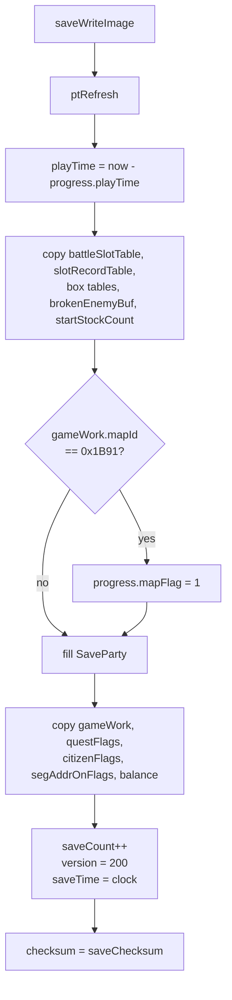

Reading is split in two functions, both called by `Game()` when
`gameWork.loadStage` is not zero. `saveReadImage` restores the play time
reference, the tables and the party. `saveReadGameWork` restores `gameWork`,
the three flag blocks and the balance. They are described in
[Loading into the game](#loading-into-the-game).

## A new game

The title screen (`Title` in `src/ov02/title.c`, see
[title-and-boot.md](../game/title-and-boot.md)) prepares the state for both New
Game and Load Game with `TitleGameInit` in `src/ov02/title_game_init.c`. It
clears `gameWork` with `memset`, clears the script flags with
`xglFlagsInitial`, and calls `menuSceneReset`, `yg2PathResetAll` and
`msgBalanceReset`. `menuSceneReset` calls `ptReset`.

`ptReset` in `src/main/save_party_init.c` resets the party. When the flag
`menuLoadPending` is set it first does the one-time work that must not be
repeated on later resets: it calls `selectionFlagTableInit` and
`configScreenStateReset`, writes the default options with
`saveDataSetDefaults`, applies them to the pads, the sound mode and the display
offset, and reads the two menu text tables `yosikawa\MainMenu.txd` and
`yosikawa\Tutorial.txd` with `menuLoadTxds`. The flag starts as 1, so the first
reset after the program starts does this work. `menuRequestLoad` sets it again,
and the title screen calls that function for its fifth menu group, which starts
a session on map 10.

After that `ptReset` always does the same things:

1. It sets the progress record's `mapId` to -1 and clears `memberMask` and
   `mapFlag`.
2. For each of the ten members it binds the name texts from `MainMenu.txd`
   (entries `i` and `i + 17`), clears the member's `PartyTakenBits` record, and
   fills the `PartyMember` record. Members 0 to 6 get the ids 1 to 7 and the
   `slotRecordTable` records 0 to 6. Members 7 to 9 get the ids 11 to 13 and
   the records 10 to 12.
3. It clears the slots, the roster, the split mode, the front and back index
   and the counts.
4. It stamps the play time reference with the current clock reading.
5. It calls `ptResetStatusBlock`, adds the ten members in the order 1, 4, 5,
   2, 3, 6, 7, 11, 12, 13 with `ptAddMember`, makes slot 0 current with
   `ptSetCurrentSlot(0)`, calls `ptRefresh` and `selectionKeyItemBitsClear`, and
   clears `menuLoadPending`.

The starting values of the characters themselves are not set here. The script
native `ptInit` (`src/main/runtime_menu.c`) calls `ptStateInit` in
`src/main/menu_selection.c`, which initializes the unit data and the boxes
(`dataPlUnitInit`, `dataBoxClearAll`), gives every member 600 skill points and
600 class points, and applies the bonus for save data of the earlier games
described in the next section. Both functions belong to
[party-and-growth.md](../game/party-and-growth.md).

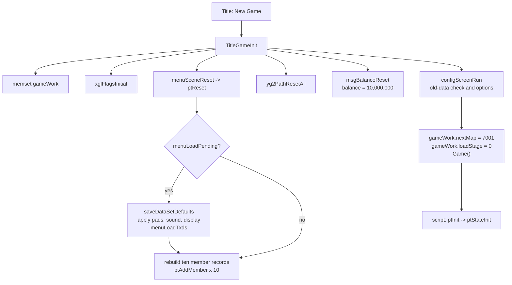

## Save data of the earlier games

A new game looks on the memory cards for saves of three earlier Xenosaga
titles and rewards the player when it finds finished games. The search is the
memory card command `MC_REQ_CHECK_OLD`. The debug callback
`McOldDataCheckCallback` in `src/main/yajima_test.c` prints its three result
kinds as `ep1`, `ep1re` and `freak`, which identifies the three save folders
listed in `xglMcBasePaths`:

| Search mode | Folder prefix | Title (from the debug labels) |
| --- | --- | --- |
| 0 | `/BASLUS-20469Xeno` | Episode I, North American release |
| 1 | `/BISLPS-29005Xeno` | Episode I Reloaded (`ep1re`) |
| 2 | `/BISLPS-25353` | Xenosaga Freaks (`freak`) |

Modes 0 and 1 read every save of the folder family. An Episode I save is
`0x163B0` bytes long (`MC_OLD_SAVE_BYTES`). The scan reads the whole file and
reduces it to eight bytes at the start of the buffer:

| Result byte | Source offset in the old save | Meaning |
| --- | --- | --- |
| 0 | `0x10250` | 1 when the byte there equals 10 (`MC_OLD_CLEAR_VALUE`), else 0. This marks a save made after the end of the game |
| 1, 2, 3 | `0x10418`, `0x10598`, `0x10718` | One byte from each of three records that are `0x180` bytes apart |
| 4 | none | always 0 |
| 5, 6, 7 | `0x10A18`, `0x10B98`, `0x10D18` | The same byte from three more records of the same table |

The six copied bytes come from records 0, 1, 2, 4, 5 and 6 of a table with a
stride of `0x180` bytes. The debug print shows them as two-digit numbers, and
the code that receives them calls them maxima, so they are probably the levels
of six characters. Mode 2 opens the single file `/BISLPS-25353/BISLPS-25353`
and reports two bytes: the byte at `0xA4` as result byte 0 and the byte at
`0x50` as result byte 1.

### The configuration screen

`configScreenRun` in `src/main/save_screen.c` runs between `TitleGameInit` and
the start of `Game()`. It opens a 2 MiB arena at `0x01000000`, allocates a
`0x19000`-byte scan buffer, loads the menu fonts and the background layers and
then calls `configScreenUpdate` once per frame until it returns 1. The memory
card service `xglMcMain` runs every frame and its result is kept in
`mcPortResult`. Start pressed together with the soft reset buttons leaves the
screen at once and sets `CONTROL_SOFT_RESET` in `gameWork.control`, unless a
card operation is running.

The screen first asks a question with two answers (`configCursor` 0 or 1).
The first answer starts the card search, the second goes straight to the
option list. The search and the notices that follow are driven by
`configState`:

| `configState` | Name | What happens |
| --- | --- | --- |
| 0 | `CONFIG_STATE_BROWSE` | The question. Left and Right move the cursor, Circle decides |
| 1 | `CONFIG_STATE_CHECK_CARDS` | Looks at the status of both slots. Starts the search on slot 1 when its card is ready, on slot 2 when only that card is ready, and shows a notice when neither is |
| 2 | `CONFIG_STATE_CARD_NOTICE` | "No usable card" notice, one line per slot, worded by the slot status |
| 3 | `CONFIG_STATE_CARD_A_WAIT` | `MC_REQ_CHECK_OLD` runs on slot 1 |
| 5 | `CONFIG_STATE_CARD_B_START` | Waits for slot 2 to stop being busy, then starts the search there or goes to the result |
| 4 | `CONFIG_STATE_CARD_B_WAIT` | `MC_REQ_CHECK_OLD` runs on slot 2 |
| 10, 19 | `CONFIG_STATE_RESOLVE` | Turns the collected bits into the next notice |
| 15, 16, 17, 18, 11 | notices | One message each, Circle continues |
| 8 | `CONFIG_STATE_NOTICE_DONE` | Message after a hard card error |
| 13 | `CONFIG_STATE_CARD_ERROR` | The card was removed or failed during the search |
| 20 | `CONFIG_STATE_OPEN_LIST` | Fades the option list in (`configFadeStep` rises by 8 per frame) |
| 21 | `CONFIG_STATE_LIST` | The option list |
| 22 | `CONFIG_STATE_ITEM` | The final confirmation |
| 25 | `CONFIG_STATE_CLOSE_LIST` | Fades the list out and returns to the question |

The search reports through `configOldDataCallback`. For an Episode I save
whose result byte 0 is 1 it sets bits `0x01`, `0x04` and `0x18` of
`configNoticePending`, raises the six running maxima with
`oldDataMaximaRaise`, and sets `configOldDataKind` to 2. For an Episode I
Reloaded save it does the same with bit `0x02` instead of `0x01` and kind 1.
For the Freaks file it sets bit `0x08` when result byte 0 is 1, bit `0x10`
when it is 2, and bit `0x04` when result byte 1 is `0x7F`. The end code -2
moves the state machine on to the second slot or to the result, and the error
code -3 ends the search with a notice.

`CONFIG_STATE_RESOLVE` moves the pending bits into `configNoticeShown` step by
step, showing one notice for found clear data (state 15) and one for the
`0x04` bit (state 16). States 17 and 18 tell the player that a card held
nothing new. State 11 is the "nothing found" notice when a card was readable.
Once `configNoticeShown` has bit `0x04` and one of the two low bits, the
screen goes on to the option list without returning to the question.

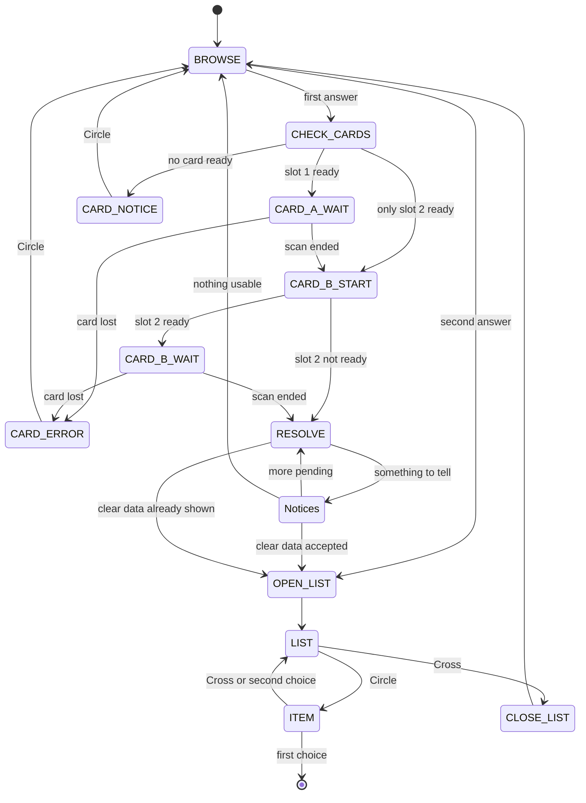

The option list has three rows. Row 0 switches `caption_all` between 0 and 2,
row 1 steps `soundMode` through 0, 1 and 2 and applies it at once with
`soundStereoSet`, and row 2 toggles `dolby_digital`. Up and Down move the
cursor and change the help text at the bottom. Circle opens a yes or no item,
and its first choice ends the screen.

### What the player gets

`oldDataMaximaCopy` hands the result to the rest of the game. It copies the
six maxima and returns `configNoticeShown`. `ptStateInit` in
`src/main/menu_selection.c` tests the two low bits of that value, which are
set only when a finished Episode I or Episode I Reloaded save was found and
shown. When either is set:

- The members in records 0, 1, 2, 4, 5 and 6 each receive 30 skill points
  (`SELECTION_POINTS_PER_MAXIMUM`) per unit of their maximum.
- `dataEtherLearnSet(5, 0x3F)` and `dataEtherLearnSet(2, 0x3F)` teach entry
  `0x3F` to the members with ids 5 and 2.
- `dataBoxIncCategory3(0x45)` adds one of item `0x45` to data box category 3.

`ptStateInit` then calls `configScreenStateReset`, which clears the maxima and
the notice bits, so the bonus is given once. The bits `0x08` and `0x10` set by
the Freaks file are collected, but no reader of them was found in the source.

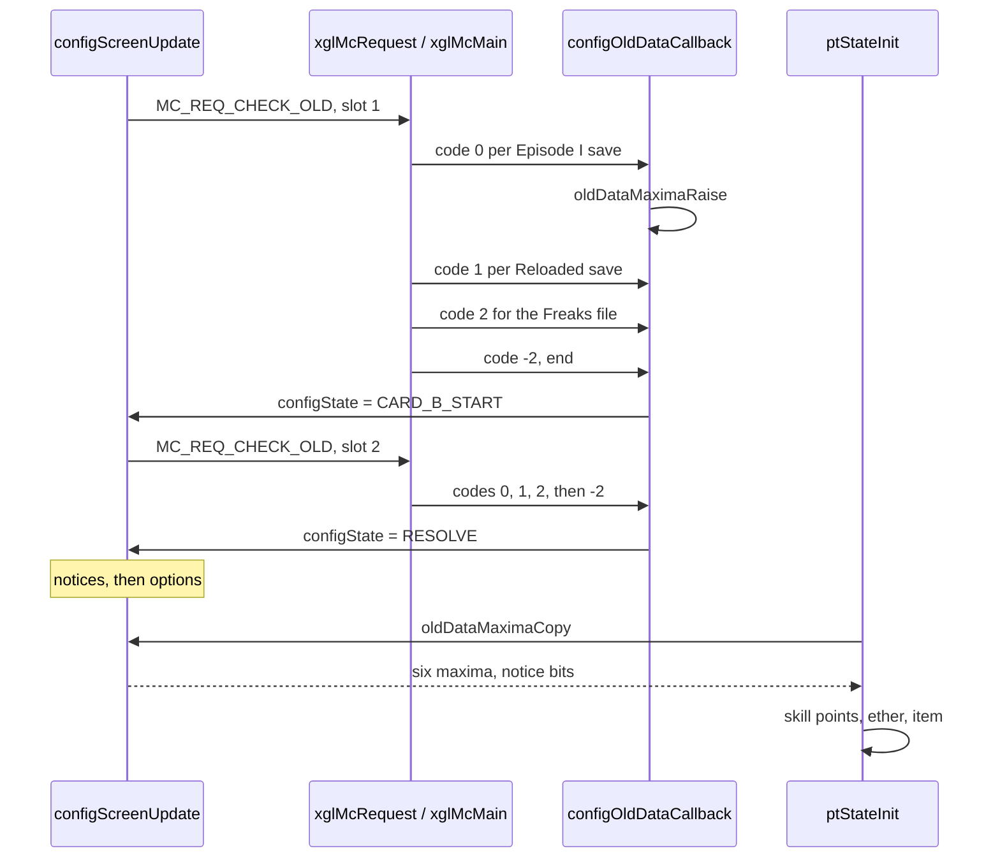

## The memory card library

The memory card code is part of xgl, the system library (see
[xgl.md](../libraries/xgl.md)). It wraps Sony's `sceMc` library, whose calls
are asynchronous: a call starts an operation, and `sceMcSync` later reports
whether it has finished and with what result. The library hides this behind a
queue of requests and one function, `xglMcMain`, that the caller runs once per
frame.

`xglMcInitial` in `src/main/xgl_mc.c` is called once from `InitializeSystem`.
It calls `sceMcInit`, resets the queue with `xglMcReset` and clears the whole
`SaveData` object.

### The blocking helpers

`xglMcEasyLoad(path, buffer, size)` and `xglMcEasySave(path, buffer, size)` in
`src/main/xgl_mc.c` do one whole file transfer on the card in slot 1 and wait
for each step with `sceMcSync(0, ...)`. They check that a card is present with
`sceMcGetInfo`, open the file (read only, or write with create), transfer the
bytes and close the file. `xglMcEasyLoad` returns the number of bytes read or
a negative error. `xglMcEasySave` returns -1 on any error. The only callers
are in the memory card test of `src/main/yajima_test.c`, which writes a dummy
file named `/BISLPS-99999Dummy` (see [debug-tools.md](../game/debug-tools.md)).

### Requests

`xglMcRequest(port, command, param, result)` adds one request to a ring of 16
`McQueueEntry` records, clears `*result` and runs one step of `xglMcMain`.
`port` is the memory card slot, 0 or 1. `param` is a `McRequestParam`:

| Field | Meaning |
| --- | --- |
| `file` | The save number (1 to 20 on the save screen), or -1 for "all" |
| `data` | The buffer: the save image, the card data image or a scan work buffer |
| `size` | Bytes to read or write |
| `callback` | Function called by the list and old-data scans |

| Command | Value | What it does | Result |
| --- | --- | --- | --- |
| `MC_REQ_FREE_SPACE` | 1 | `sceMcGetInfo` with the free space pointer | Free space is written to `*result` |
| `MC_REQ_EXIST` | 2 | With `file` -1: reads the directory of all save folders and marks the numbers found. With a number: opens and closes that save file | Number of folders, or the open result |
| `MC_REQ_LIST` | 3 | Reads every save, one per callback call | See [The list scan](#the-list-scan) |
| `MC_REQ_LOAD` | 4 | Opens the save file, reads `size` bytes, closes | Negative on error |
| `MC_REQ_SAVE` | 5 | Opens the save file for writing, writes `size` bytes, closes, then writes `icon.sys` | Negative on error |
| `MC_REQ_CREATE` | 6 | Creates the save folder and its icon files | Step counter, or negative on error |
| `MC_REQ_FORMAT` | 7 | `sceMcFormat` | |
| `MC_REQ_CHECK_OLD` | 8 | Searches the save folders of the earlier games | Through the callback |
| `MC_REQ_UNFORMAT` | 9 | `sceMcUnformat`, used only by the debug test | |

### Paths and files

All paths are built by `xglMcBuildPath(base, card, selector)` into
`xglMcState.full_path`. The base for this game is `xglMcBasePath`,
`/BASLUS-20892Xeno2`. `card` is the save number, printed as two decimal
digits, or -1 for a `*` wildcard, or -2 for nothing. `selector` chooses what
follows. `xglMcSetFullPath(card, selector)` is the same call with this game's
base.

| Selector | Appended | Example for save 3 |
| --- | --- | --- |
| -1 | nothing | `/BASLUS-20892Xeno203` (the folder) |
| 0 | the path so far, again | `/BASLUS-20892Xeno203/BASLUS-20892Xeno203` (the save file) |
| 1 | `/icon.sys` | `/BASLUS-20892Xeno203/icon.sys` |
| 2 | `/system.ico` | the icon shown in the console browser |
| 3 | `/copy.ico` | the icon shown while copying |
| 4 | `/delete.ico` | the icon shown while deleting |
| 5 | `/dummy.bin` | a filler file |
| a string pointer | `/` and the string | `/BASLUS-20892Xeno203/*` for a directory read |

Each save therefore has its own folder on the card, named after the product
code and the save number, and the save file inside has the same name as the
folder. The create request can write up to six files:

```
/BASLUS-20892Xeno2NN/
    BASLUS-20892Xeno2NN   the save image, 0x5160 bytes
    icon.sys              964 bytes, title and icon settings
    system.ico            icon model
    copy.ico              icon model   (not written by the shipped game)
    delete.ico            icon model   (not written by the shipped game)
    dummy.bin             filler       (not written by the shipped game)
```

The template `carddata.bin` on the discs has only one icon (its `offset[3]`
is 0), so the request ends after `system.ico`. A folder made by the released
game therefore holds three files: the save image, `icon.sys` and
`system.ico`. All three icon names inside `icon.sys` are `system.ico`, and the
icon is the same for every save, a white card with the game logo.

### The state machine

`xglMcMain` first calls `sceMcSync(1, ...)`, the non-blocking form. If the
running card operation has not finished it returns at once. Otherwise it takes
the result and advances by one step according to `xglMcState.state`. Each step
starts at most one new card operation, so a request takes several frames.

While a request is running or queued the function returns `MC_STATUS_BUSY_BOTH`
(`0x00FF00FF`). When idle it returns the status word
`xglMcState.card_status.combined`, which holds one 16-bit status per slot,
slot 1 in the low half. Callers store the word and read it as two shorts
(`mcPortResult[0]` and `mcPortResult[1]` on the save screen).

| Status | Value | Meaning |
| --- | --- | --- |
| `MC_STATUS_NONE` | 0 | No card |
| `MC_STATUS_READY` | 1 | A formatted PS2 memory card |
| `MC_STATUS_UNFORMATTED` | 2 | A PS2 memory card that is not formatted |
| `MC_STATUS_ERROR` | `0x80` | `sceMcGetInfo` reported -1 or -2 |
| `MC_STATUS_PS1_CARD` | `0x81` | A PlayStation memory card |
| `MC_STATUS_POCKETSTATION` | `0x82` | A PocketStation |
| busy | `0xFF` | A request is running |

When the queue is empty the machine keeps the status fresh by itself. In
`MC_STATE_IDLE` it calls `sceMcGetInfo` for one slot and goes to
`MC_STATE_POLL_INFO`. When that call finishes it stores the status of the slot
and returns to idle, where it polls the other slot (`next_card` flips each
time). A queued request is started by `xglMcExecute`, which makes the first
card call of the command and selects the state that follows it.

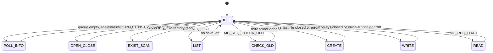

`MC_REQ_FREE_SPACE`, `MC_REQ_FORMAT` and `MC_REQ_UNFORMAT` need no state of
their own. `xglMcExecute` makes the one card call and the machine stays in the
idle and poll cycle.

### Reading and writing a save

`MC_STATE_READ` and `MC_STATE_WRITE` share their steps, counted in
`xglMcState.substate`. Step 0 receives the file descriptor from the open call
and starts `sceMcRead` or `sceMcWrite` with the request's buffer and size.
Step 1 closes the file. A read is then finished.

A write goes on: step 2 opens `icon.sys` of the same folder for writing, step
3 writes the 964-byte `McIconSys` block kept in `xglMcState.icon`, and step 4
closes it. The block was copied there by the create request that always comes
first, with the save number and the play time already written into its title.
Rewriting `icon.sys` after the save file means the card browser of the console
shows the new title only once the image itself is safely on the card.

Any negative result ends the request: the result goes to `*result`, the status
word becomes `MC_STATUS_BUSY_BOTH` until the next status poll replaces it, and
the machine returns to idle.

### Creating a save folder

`MC_REQ_CREATE` prepares the folder for a save. Its buffer is a `McCreateData`
image: a table of sixteen offsets, and at `+0x40` the contents of `icon.sys`.
On the save screen the buffer is the file `carddata.bin`, read from the disc.
The memory card test loads eleven images of the same form,
`yajima\mc\clear.bin`, `chaos.bin`, `jin.bin`, `jr.bin`, `kosmos.bin`,
`momo.bin`, `r02.bin`, `r03.bin`, `r05.bin`, `shion.bin` and `ziggy.bin`, and
reports the three icons of each. The names suggest one icon set per character
and one for a finished game. These eleven files are not on the discs. Only
`carddata.bin` ships, with its single icon (see
[movies-images-and-icons.md](../formats/movies-images-and-icons.md)).

The offset table works as follows. `offset[0]` is the size of the header. The
icon data begins at that size rounded up to 64 bytes. File `k` (1 =
`system.ico`, 2 = `copy.ico`, 3 = `delete.ico`) starts at `offset[k]` rounded
up to 64 bytes, relative to the start of the icon data, and ends at
`offset[k + 1]`.

`xglMcExecute` starts the request with `sceMcMkdir` on the folder. Then
`xglMcCreateStep` runs once per finished card operation:

| Step | Name | Action |
| --- | --- | --- |
| 0 | `MC_CREATE_DELETE_SAVE` | Delete the old save file |
| 1 | `MC_CREATE_DELETE_DUMMY` | Delete the old `dummy.bin` |
| 2 | `MC_CREATE_COPY_ICON` | Copy the `icon.sys` contents from the buffer to `xglMcState.icon` |
| 3 | `MC_CREATE_FILES_START` | Nothing |
| 4, 5, 6 | `system.ico` | Open, write, close |
| 7, 8, 9 | `copy.ico` | Open, write, close |
| 10, 11, 12 | `delete.ico` | Open, write, close |
| 13, 14, 15 | `dummy.bin` | Open, write, close |

A negative result normally ends the request. The first three steps also accept
the result -4 (`MC_RESULT_NO_ENTRY`), which covers the folder call and the two
deletes, because the old files may not exist. Each write adds the file size, rounded up to 1024 bytes, to
`create_index`. The dummy file is then written with `0x42400 - create_index`
bytes taken from the start of the buffer, so the icons and the dummy together
always come to `MC_CREATE_TOTAL_BYTES` (`0x42400`, 271,360 bytes). The likely
purpose is that every save folder takes the same room on the card whatever
its icons are. An image whose `offset[3]` is zero has only one icon, and the
request ends after `system.ico`.

After every step the step number is written to `*result`. The save screen
uses it to size its progress bar. The function returns 1 when the last file is
closed, and -1 on an error with the error code in `*result`.

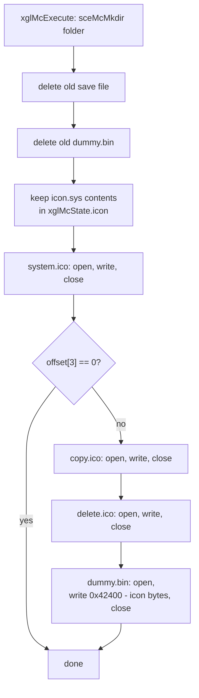

### The save title

Before the create request, the caller calls
`xglMcSetEntryNumbers(buffer, number, clock)`. It writes numbers into the
title text inside the `icon.sys` contents of the buffer, as full-width
Shift-JIS digits (lead byte `0x82`, second byte `0x4F` plus the digit). The
save number goes to bytes `0x11B` and `0x11D` of the buffer, two digits. The
hours of the play time go to `0x120` to `0x123`, with a full-width space
(`0x81 0x40`) in place of a leading zero, and the minutes to `0x127` and
`0x129`. Only the second byte of each digit is written where the template
already holds the lead byte. The card browser of the console therefore shows
the save number and the play time of each save.

### The list scan

`MC_REQ_LIST` reads every save on a card and hands each one to a callback. It
uses a work buffer of the form `McListWork`: 100 slot bytes (one per save
number), the number of the newest save at `+0x64`, a status byte at `+0x65`, a
"has icon" byte at `+0x66`, a directory table behind them (aligned to 64
bytes), and the file contents at `+0x2000`.

1. The directory of `/BASLUS-20892Xeno2*` is read, up to 100 entries. For each
   entry the last two characters of the name give the save number, the slot
   byte is set to 1, and the entry's modification time is compared to find the
   newest save.
2. The callback is called with -1 and the work buffer. It returns the number
   to start from. A negative return means "the newest".
3. `xglMcFindNearestSlot` picks the nearest slot byte that is still 1,
   searching outward in both directions from the wanted number.
4. The directory of that folder is read, up to 16 entries. `has_icon` is set
   when it holds an `icon.sys` of exactly 964 bytes.
5. The save file is opened and `size` bytes are read to `+0x2000`.
6. The file is closed and the slot byte becomes 2. If `has_icon` is not set,
   the data is cleared to zero, so a save without a complete `icon.sys` fails
   the checksum test. The callback is called with the save number and the
   data. A non-negative return becomes the next wanted number.
7. Steps 3 to 6 repeat until no slot byte is 1. The callback is then called
   with -2. A hard error calls it with -3.

`icon.sys` is written last when saving, so a folder without it is a save that
was interrupted. Step 6 makes such a save show up as damaged.

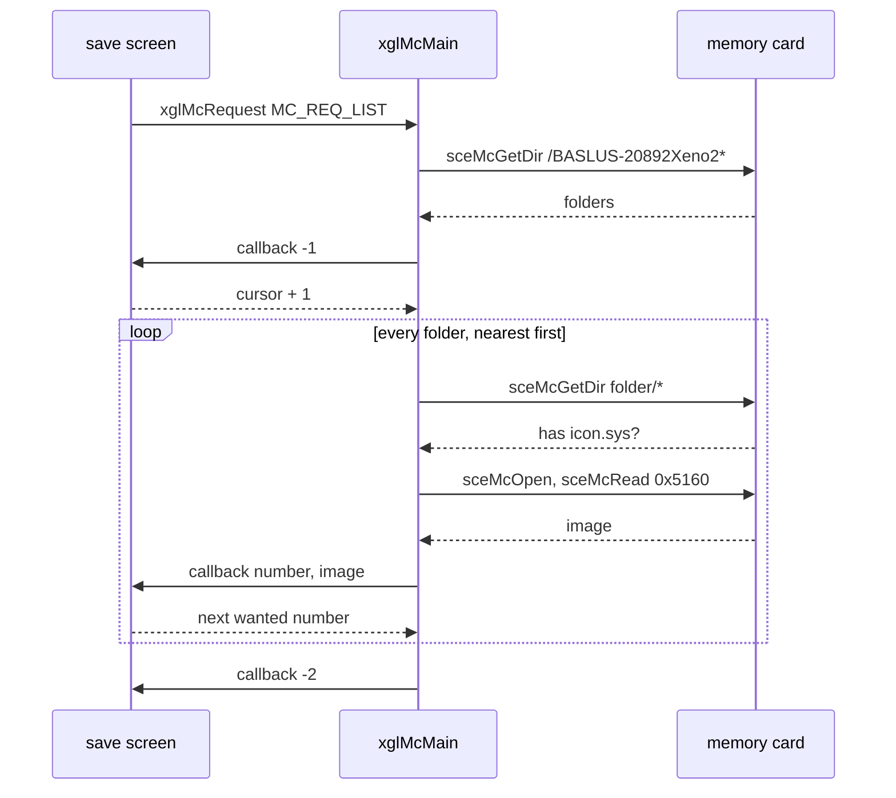

The old-data scan `MC_STATE_CHECK_OLD` reuses the same steps with three
differences. It reads `0x163B0` bytes per file, it does no icon check, and it
walks three folder families in turn. When no save of the current family is
left, `xglMcOpenNearestSave` moves to the next search mode: after mode 0 it
reads the directory of the mode 1 family, after mode 1 it opens the single
mode 2 file, and after mode 2 the scan ends. The reduction of each file to a
few result bytes is described in
[Save data of the earlier games](#save-data-of-the-earlier-games).

## The save and load screen

`MenuFileMain(entryMode)` in `src/main/save_screen.c` is the whole screen. It
does not return until the player leaves. Mode 0 saves, any other mode loads.

| Caller | Mode | When |
| --- | --- | --- |
| `Game()` in `src/main/game_data.c` | 0 | The player presses the button tested as `0x20` in `PadData[0].pressed` while `uwamonoGetNearbyUnitType()` returns 7 or 8, a save point |
| `GameSceneReset` in `src/main/game_over.c` | 0 | The save offered at the end of the game and at the intermission |
| `Title` in `src/ov02/title.c` | 1 | Load Game |
| `src/main/debug_test.c` | 0 or 1 | The debug test menu |

The return value is 1, except when a load was cancelled, which returns 0. The
title screen starts `Game()` with `gameWork.loadStage = 1` only on a return of
1.

### Start-up

In save mode the screen first returns 1 without doing anything when the word
at `sRender + 0x50` is not zero. Otherwise it draws the actors once more,
copies the frame and keeps the picture of the field for the thumbnail.

It then sets control bit `0x04000000`, clears the frame, and opens a 2 MiB
arena (at `0x01000000` in load mode, at the arena's default place in save
mode). All its work buffers come from this arena:

| Buffer | Size | Use |
| --- | --- | --- |
| `xglCdBufferAlloc` | `0x40800` | Disc read buffer |
| `saveScanBuffer` | `0x7160` | `McListWork`: `0x2000` bytes of scan work and one save image |
| `saveSlotTable` | `0x97680` | Twenty `SaveSlot` records of `0x7920` bytes |
| `cardDataBuffer` | `0x42000` | `carddata.bin`, the icon image for `MC_REQ_CREATE` |
| `saveThumbnailBuffer` | `0x7900` | The JPEG of the new thumbnail |
| `saveTextTable` | `0x800` | `yosikawa\Location.txd`, the place names |
| `saveSlotRows` | `0x230` | Twenty position tracks of `0x1C` bytes for the list rows |

In save mode the thumbnail is encoded now (see
[The thumbnail](#the-thumbnail)). The two files are read from the disc, the
fonts and background layers are loaded, and the main loop begins. Each frame
it stores `xglMcMain()` in `mcPortResult`, calls the update function of the
current mode from `saveUiUpdateTable`, and queues `saveScreenDrawCallback` for
drawing. The loop ends when an update function returns a nonzero value.

On the way out the screen releases the background layers and the arena,
restores the frame over 16 frames and starts a fade-in of 30 frames, unless
`CONTROL_SOFT_RESET` is set. It clears control bit `0x04000000` and restores
the pad repeat settings.

### Modes

The screen has four modes, held in `saveUiMode` and changed with
`saveUiSetMode`. Inside a mode, `saveUiState` is the step.

| `saveUiMode` | Update function | Draw hook | Subject |
| --- | --- | --- | --- |
| 0 | `savePortSelectUpdate` | `savePortSelectDraw` | Choosing memory card slot 1, slot 2, or leaving. Also formatting |
| 2 | `saveSlotListUpdate` | none | The list of twenty saves |
| 3 | `saveSlotTransferUpdate` | `saveUiOptionDraw` | The yes or no question and the save or load itself |
| 4 | `saveUiPollButtons` | none | An error message that waits for Circle or Cross |

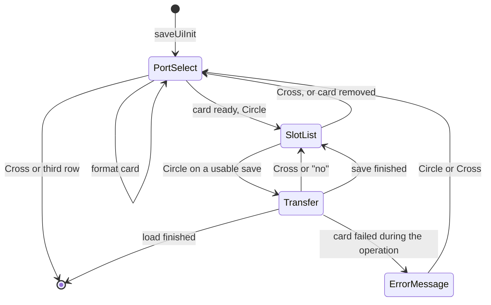

**Mode 0, the card choice.** A three-row list: the two memory card slots and
a third row that leaves the screen. A row for a slot is drawn with a different
text flag, probably dimmed, unless its status is ready, unformatted or error. Circle on a ready card remembers
the slot in `savePort` and goes to the list. Circle on an unformatted card
shows a message in load mode. In save mode it opens a yes or no item (state
`0x11`), and "yes" queues `MC_REQ_FORMAT` and waits in state `0x12` until the
card stops being busy. A card that is ready after the format leads straight to
the list. Circle on a slot with no usable card plays the deny sound and shows
a message. When the screen was opened on the game end map (`gameWork.mapId ==
0x1B91`), leaving asks for confirmation first (state `0x1E`), because the
player would lose the chance to save a finished game.

**Mode 2, the list.** On entry (state 16) the screen queues `MC_REQ_LIST`
with `saveSlotScanCallback` and marks all twenty slots as pending. When the
scan ends, the callback sets state 18, which queues `MC_REQ_FREE_SPACE`. State
19 waits for it, and state 20 turns every slot that is still pending into an
empty slot. From then on (state 0) Up and Down move the cursor by one, L1 and
R1 by three, and the visible band of three rows follows the cursor. Circle
opens the question of mode 3 if the slot can be used. In load mode only a
loaded slot is accepted. In save mode a damaged slot is refused, and an empty
slot is refused with a "not enough free space" message when
`saveCardFreeSpace` is below `0x22`. If the card's status stops being ready or
busy at any time, the screen falls back to mode 0 with a message.

**Mode 3, the transfer.** Described in the next two sections.

**Mode 4, the error message.** Shown when the card failed while saving or
loading. Circle or Cross returns to mode 0.

### Slot records

Each of the twenty list entries is a `SaveSlot` record of `0x7920` bytes. The
first `0x7900` bytes hold the decoded thumbnail, an 88 by 77 picture of 32-bit
pixels. The fields at the end describe the save:

| Offset | Field | Source in the image |
| --- | --- | --- |
| `0x0000` | thumbnail pixels | JPEG at image `+0x174`, decoded with `xglJpegDecode` |
| `0x7900` | `state` | set by the scan |
| `0x7904` | `member_id` | image `0x50D6`, `party.leaderId` |
| `0x7905` | `level` | image `0x50D7`, `party.leaderLevel` |
| `0x7906` | `row_value[7]` | low bytes of image `0x50D8`, `party.slotValues` |
| `0x7910` | `play_time` | image `0x68`, `playTime`, in seconds |
| `0x7914` | `flag` | image `0x50E6`, `party.mapFlag` |
| `0x7918` | `title_text` | place name, from `game.mapId` at image `0x2E98` |
| `0x791C` | `subtitle_text` | second line of the place name |

| `state` | Meaning |
| --- | --- |
| 0 | Not scanned. Also set for every slot while the card is not ready |
| 1 | Pending: the scan has started and has not reached this slot |
| 2 | `SAVE_SLOT_LOADED`: a valid save |
| 3 | `SAVE_SLOT_EMPTY`: no save with this number |
| 4 | `SAVE_SLOT_BAD`: a file that failed the checksum or version test |

`saveSlotScanCallback` is the callback of the list scan. For a save number 1
to 20 it runs `saveChecksum` on the data and compares the checksum and the
version. A good image sets state 2 and is turned into a slot record by
`saveSlotFromData`. Anything else sets state 4. It returns the number plus
one, so the scan walks upward from the cursor.

The place name comes from `saveTextIndexTable`, which maps 53 map ids to two
text indices of `Location.txd`: an area name and a place name.
`saveSlotSetTexts` looks up the saved map id and stores the two text pointers.
A map that is not in the table gets no name.

`saveSlotDrawDetail` draws one entry: the save number, the thumbnail in a
frame, the two lines of the place name, the leader's name with `/ Lv` and the
level, `Time /` with hours, minutes and seconds, up to seven party face icons
from `row_value`, and a mark (text `0x236` of `MainMenu.txd`) when `flag` is
set. An empty slot shows `NO DATA` and a line that depends on the mode. A
damaged slot shows a warning text.

### Saving

Saving one game takes three memory card requests and about thirty frames of
confirmation at the end. The steps of `saveSlotTransferUpdate` in save mode
are:

1. State 0: the yes or no item. On "yes" the screen copies the encoded
   thumbnail from `saveThumbnailBuffer` to `SaveData.thumbnail`, calls
   `saveWriteImage`, writes the save number and the play time into the icon
   title with `xglMcSetEntryNumbers`, and queues `MC_REQ_CREATE` with
   `carddata.bin` as its data.
2. State 16: while the card is busy, the progress total is set to
   `73 * (step + 1)`, where `step` is the create step counter. The progress
   bar drawn by `saveProgressDraw` moves toward that total.
3. State 17: if the card is ready, `MC_REQ_SAVE` is queued with `SaveData` and
   `0x5160` bytes. Otherwise the screen shows the error message of mode 4.
4. State 18: waits for the save to finish, then sets the state to 100.
5. States 100 to 129: count up one per frame.
6. State 130: the accept sound plays, the slot record is rebuilt from
   `SaveData` with `saveSlotFromData`, its state becomes loaded, and the
   screen returns to the list.

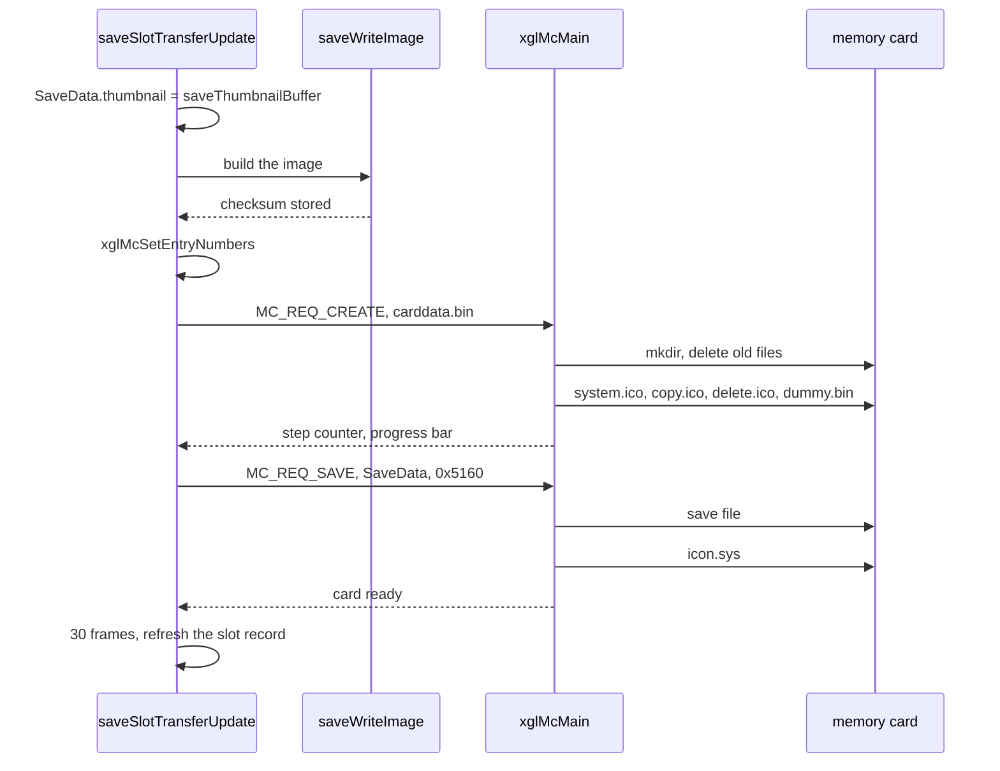

`saveProgressDraw` draws a panel with the text `Saving...` and a bar. The
counter `saveProgressFrame` rises by two per frame while it is more than 64
below the total and by one after that, so the bar slows down near the end of
what is known to be done and never runs ahead of the card.

### Loading

In load mode the "yes" answer queues `MC_REQ_LOAD` with `SaveData` as the
buffer and `0x5160` bytes, and sets state 20. When the card stops being busy
the update function returns 2. That ends the main loop, and `MenuFileMain`
returns 1.

The file is read straight over `SaveData`, without a second checksum test at
this point. The test was made when the list was scanned, and only a slot in
the loaded state can be chosen in load mode. The options in the header take
effect at once because the screens and `padApplySaveSettings` read them from
the image.

### The thumbnail

Every save carries a small picture of the screen at the moment the save screen
was opened. It is stored as a JPEG stream in the `0x1000` bytes at image
offset `0x174`.

`saveThumbnailEncode(quality, output_buffer)` makes it. It first sends the
12-quadword GIF packet `saveThumbnailDma`, which draws the current draw buffer
as a textured sprite, scaled down to 88 by 77 pixels, into the video memory
page at `0x3800`. It then fills a `JpegEncodeRequest` (frame buffer base
`0x3800`, width 8, size 88 by 77, 4:4:4 sampling, the same quality for
luminance and chrominance) and calls `xglJpegEncode`. It returns the size of
the stream.

The stream must fit in 4096 bytes. `MenuFileMain` therefore encodes in a loop:
first with quality 100, then 75, 50 and 25, and from then on with the fallback
quality 10, until the returned size is `0x1000` or less.

For the list, `saveSlotFromData` decodes the stream into the start of the slot
record with `xglJpegDecode` (32-bit pixels, no scaling). `saveThumbnailSprite`
uploads the `0x790` quadwords of the record to video memory at `0x3800` with a
referenced packet and draws them as a sprite with texture coordinates from 0
to 88 and 0 to 77.

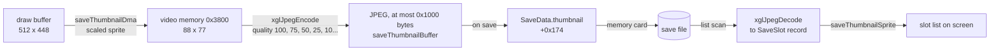

## Loading into the game

After a successful load the title screen sets `gameWork.loadStage` to 1 and
starts `Game()`. Note that `TitleGameInit` ran before the load screen, so
`gameWork` was cleared and the party was reset, and that the save file then
replaced `SaveData` only. The live objects are filled in `Game()`, after the
battle overlay is initialized (`ov01InitAll`):

```c
if (gameWork.loadStage != 0) {
    saveReadImage();
    saveReadGameWork();
    gameWork.loadStage = 1;
}
```

`saveReadImage` calls `cursorBufferTablesInit`, sets the play time reference,
copies the parameter blocks, the member records, the four box tables,
`brokenEnemyBuf` and `startStockCount` back, and rebuilds `ptState` from the
`SaveParty` block. Each stored member id is turned into a pointer with
`ptMemberRecordFindById`, and each `PartyTakenBits` record is copied back to
`ptMemberTakenTable`. It ends with `ptRefresh`.

`saveReadGameWork` copies the saved `GameWork` over `gameWork` and sets
`gameWork.nextMap` to the saved `mapId`, so the field loop loads that map. It
then copies the quest, segment and citizen flags and sets the balance with
`msgBalanceSet`. Four control bits do not survive a load:
`CONTROL_SOFT_RESET` (`0x10000000`), `0x08000000`, `0x04000000` (set by the
save screen itself while it was open) and `CONTROL_CFE_NO_FADE`.

A save made on the game end map is a special case. When the saved `mapId` is
`MAP_ID_GAME_END` (`0x1B91`), both `mapId` and `nextMap` become
`MAP_ID_GAME_END_RESUME` (`0x9EC`, map 2540, where `0x1B91` is map 7057) and the story progress flag is
set to `0x75`. A finished game therefore resumes at a fixed point before the
ending, and its entry in the load list carries the mark described above.

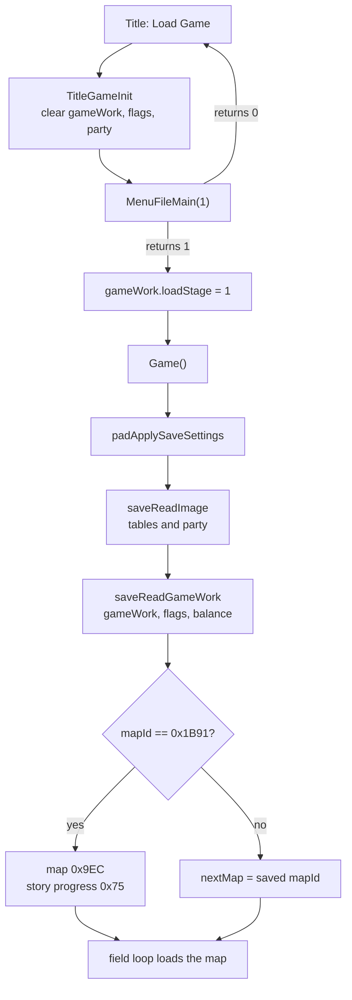

## The hard disk

`src/main/xgl_hdd.c` holds the code for the PlayStation 2 hard disk drive:
running the game from an installed copy, installing that copy, and keeping
saves on the disk. In this release the feature is switched off at its root.
The status probe `xglHddCheckCore` returns -1 without touching the drive.
Every function that needs the drive starts with `xglHddCheck2` or
`xglHddCheck` and gives up when the probe does not return 0. The rest of the
file is described here for what it would do.

`xglHddMount`, called from `xglCdInitial` in `src/main/xgl_cd.c` and from the
title screen, therefore returns -1. The
title screen maps that to `hdd_stage = -1` and shows no hard disk entry in its
menu. `xglHddMcExist`, which the title screen calls to look for saves on the
disk, returns -1 as well.

### The game partition

`decrypt` prepares the partition name. The 50 characters in `partitionname`
are stored with bit 7 of every byte set. Unless the first byte is already `h`,
the function flips bit 7 of each byte, which yields the text
`hdd0:PP.SLPS-29002.XENOSAGA1.DISC1,xeno1d1,xeno1d1`. It then replaces
character 17, the last digit of the product code, with the byte at offset
`0x1A` of the `system_cnf` buffer. The stored name is the one of an earlier
Xenosaga release, and the patched digit is all that would distinguish this
game's partition.

`xglHddMount` would then mount the partition read-only as `pfs0:`. If it does
not exist, the function checks that the disk has more than `0x37FFFF` free
sectors in total and a largest free block above `0x7FFFF` sectors, and
returns 0, "ready to install". If the partition exists, it reads the check
file `pfs0:/xenosaga.hdd` and compares its first 36 bytes with the directory
record of `xenosaga.00` on the disc. A match sets `HddActive` to 1 and returns
1. The archive reader then takes its data from `pfs0:/xenosaga.00` instead of
the disc (see [files-and-resources.md](files-and-resources.md)).

`HddActive` is the switch. `xglHddActivate(state)` sets it (0 off, 1 on, 2
locked, 3 error pending) and returns the previous value, and calls
`xglCdArcCheck` unless the `HDD_ACTIVATE_NO_ARC_CHECK` bit (`0x100`) is given.
`xglHddActivate(-1)` only reads it. When the state is 3, `xglHddCheck` shows
`xglHddErrorScreen`: a full-screen Japanese message that says the application
data on the hard disk cannot be read and that the game continues from the DVD,
with Circle to continue after 30 frames.

### The installer

`xglHddInstall(callback, param)` copies the game to the disk and reports its
progress through the callback (stage number, an offset, and the caller's
parameter). A nonzero return from the callback cancels the copy. The title
screen's caller is described in [title-and-boot.md](../game/title-and-boot.md).

| Stage | Name | Work |
| --- | --- | --- |
| 0 | `HDD_INSTALL_STAGE_BEGIN` | Read `hdd.res` from the disc to `0x01000000` and copy the 80 bytes of `SYSTEM.CNF` into it at `+0x200` |
| 1, 2 | resource read, partition open | Create the partition with the spec `<name>,256M,PFS` and write the image to its header |
| 3 | `HDD_INSTALL_STAGE_EXTEND` | Add 256 MB sub-partitions in a loop until the size passes `0x37FFFF` sectors |
| 4 | `HDD_INSTALL_STAGE_FORMAT` | Format the partition as PFS |
| 5 | `HDD_INSTALL_STAGE_MOUNT` | Mount it read-write as `pfs0:` |
| 6 | `HDD_INSTALL_STAGE_COPY` | Copy `xenosaga.00`, `xenosaga.01` and so on into the single file `pfs0:/xenosaga.00`, in pieces of at most 16 MiB |
| 7 | `HDD_INSTALL_STAGE_FINISH` | Write the 512-byte check file `pfs0:/xenosaga.hdd`, unmount, mount read-only |
| 8 | `HDD_INSTALL_STAGE_DONE` | Finished |

Failures are reported as negative stages (`HDD_INSTALL_FAIL_*`, -1 to -15) and
most of them call `xglHddUninstall`, which unmounts and removes the partition.
During the copy, `xglHddInstallReadCB` reports progress in sixteenths of a
piece, with the total number of pieces in the upper bits of the offset.

### Saves on the disk

The save functions keep the layout of the memory card. Saves live in
`pfs1:/Your Saves` on the shared partition `hdd0:__common`, and
`make_fullpath` appends the same folder and file names that
`xglMcSetFullPath` builds for a card.

| Function | Work |
| --- | --- |
| `xglHddMcExist` | With a number: tests whether that save file can be opened. With -1: reads the directory, marks the saves found and the newest one, like the card's exist scan |
| `xglHddMcLoad` | Mounts read-only, reads the save file, unmounts |
| `xglHddMcCheck` | Tests whether a new save can be made: folder limits and free space |
| `xglHddMcCreate` | Makes `Your Saves` and the save folder as needed, grows the partition by 1 GB when it is full and the disk is large, then writes `icon.sys` (964 bytes) and the icon payload of the card data image |
| `xglHddMcSave` | Mounts read-write and writes the save file |

`xglHddMcCheckCore` asks for room for the data, one `icon.sys`, the icon
payload and seven spare zones. `Judge_MakeNewFolder` refuses a 256th folder in
the root, and `Judge_MakeNewSavedata` refuses when `Your Saves` holds `0x3FE`
entries of other games. The only callers of the load, create and save
functions are in the memory card test of `src/main/yajima_test.c`. The save
screen has no hard disk row.

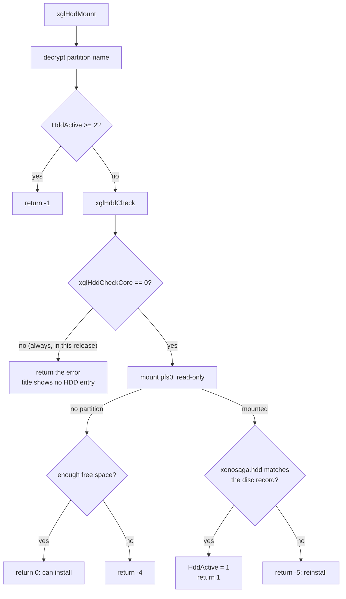

## Snapshots

`src/main/game_snap_shot.c` writes pictures of the screen to the development
host. The file name is `host0:/home/xeno/work/snap/game0000.jpg`, with a
four-digit counter that the functions advance after each picture. In this
release nothing triggers it: `GameSnapShotCheck`, which the pause display, the
battle scene loop and two test programs call every frame, is an empty
function, and the other functions have no callers. They show how the
developers captured pictures and how a second kind of thumbnail was built.

| Function | Work |
| --- | --- |
| `GameSnapShotNumber(number)` | Sets or returns the first digit of the counter |
| `GameSnapShotWriteJpeg(path, quality)` | Encodes the 512 by 448 frame named by `DrawEnv.frame1` into the memory behind `WorkEnd` and writes it to `path` |
| `GameSnapShotExecute(quality, flags)` | Writes the JPEG. With bit 0 of `flags` it also writes a 160-byte `.bin` file with the save time, a zero play time and `gameWork.resourceId`. Advances the counter |
| `GameSnapShotSaveThumbnail(quality, buffer)` | Scales the draw buffer to 128 by 112 at video memory `0x3800` and encodes it |
| `GameSnapShotSave(quality, output)` | Builds one JPEG in memory with the metadata and a thumbnail embedded |
| `GameSnapShotSaveFile(number, data, size)` | Writes a prepared buffer to the numbered file and advances the counter |

A negative `quality` selects a row of `quality_table` (`~quality`, five rows:
100, 90, 75, 50 and 30 for luminance and chrominance, sampling mode 0). A
positive value is used directly for both, with 4:4:4 sampling.

`GameSnapShotSave` produces a JPEG whose first segment is an APP14 marker
(`FF EE`) that carries the 160 bytes of metadata followed by a complete
thumbnail JPEG encoded at quality 50. The full-size picture follows it. The
decoder skips unknown segments by their length, so such a file still decodes
as the large picture. The function returns the total size.

`GameSnapShotSaveThumbnail` is the model for the save screen's
`saveThumbnailEncode`: the same packet and the same steps with a 128 by 112
target instead of 88 by 77.

## The JPEG codec

`src/main/xgl_jpeg.c` is a small baseline JPEG encoder and decoder written
for the console. The encoder serves the save thumbnail and the snapshots. The
decoder serves the thumbnail in the save list and every full-screen picture
the game shows from a `.jpg` file: the logos, the hard disk install screens,
the game over and game end pictures, the disc change screen, the display
adjustment picture, a menu picture and the backdrop pictures of maps.

Both directions use the scratchpad as their work area. The pointer `sw` is set
to `0x70000000`, and the `JpegWork` structure there holds the quantization
tables (`+0xD0` luminance, `+0x1D0` chrominance), the bit buffer, the image
size, the four Huffman tables, the DCT work block, the three DC predictors,
one MCU of pixels (`+0x15A0`) and one MCU of coefficient blocks (`+0x25A0`).
Pixel data moving to or from the Graphics Synthesizer is staged at
`0x70003000`. An MCU, the minimum coded unit, is the block of pixels that is
coded together: 8 by 8 with 4:4:4 sampling, 16 by 8 with 4:2:2 and 16 by 16
with 4:2:0.

### The encoder

`xglJpegEncode(request)` reads its pixels directly from video memory and
writes a complete JFIF file to `request->outputBuffer`. The request is a
`JpegEncodeRequest`:

| Field | Meaning |
| --- | --- |
| `outputBuffer` | Where the file is written |
| `outputSize` | Set to the size of the file |
| `frameBufferBase`, `frameBufferWidth` | The video memory page and its width in units of 64 pixels |
| `originX`, `originY` | Top left corner of the region |
| `width`, `height` | Size of the region |
| `luminanceQuality`, `chrominanceQuality` | 1 to 100 |
| `samplingMode` | `JPEG_SAMPLING_444`, `JPEG_SAMPLING_422` or `JPEG_SAMPLING_420` |

The steps are:

1. `RebuildQuantizeTable` scales the two standard quantization tables
   (`LQTableOrg_1`, `CQTableOrg_2`) by the quality. A quality below 50 gives
   the factor `5000 / quality`, otherwise `200 - 2 * quality`. Each entry
   becomes `(original * factor + 50) / 100`, limited to 1 to 255, and its
   reciprocal is kept for the quantizer.
2. `ExtractHuffmanTableSub` builds the four code tables from the Huffman
   segments of the canned header `headerALL`.
3. The `0x26F`-byte header is copied to the output. The pixel density, the two
   quantization tables (in zigzag order), the image size and the sampling
   factors are patched into it.
4. For each MCU, `sceGsSetDefStoreImage` and `sceGsExecStoreImage` read the
   pixels back from video memory as 24-bit RGB to `0x70003000`. They are
   converted to Y, Cb and Cr with the JFIF weights (`0.299`, `0.587`, `0.114`
   for luminance).
5. `ConvertYUV2MCU` splits the pixels into 8 by 8 blocks, subtracting 128
   from the luminance and averaging the chrominance of two or four pixels for
   the subsampled modes.
6. `FFDCT` runs the forward discrete cosine transform on each block as two
   matrix passes over `dctCosineTable`. `Quantize` multiplies by the
   reciprocals and rounds to the nearest integer.
7. `HuffmanEncode` writes the DC difference from the previous block of the
   same component and the run-length coded AC coefficients in zigzag order
   through `PutBits`. `PutBits` inserts a zero byte after every `0xFF` data
   byte, as the format requires.
8. The last partial byte is flushed and the end marker `FF D9` is written.

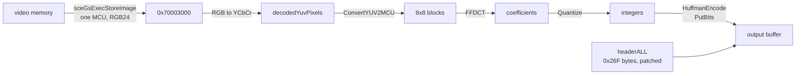

### The decoder

`xglJpegDecode(request)` takes a `JpegDecodeControl`:

| Field | Meaning |
| --- | --- |
| `source` | The JPEG data |
| `destination` | A pixel buffer, or 0 to upload straight to video memory |
| `consumedSize` | Set to the number of bytes parsed |
| `frameBufferBase`, `frameBufferWidth`, `originX`, `originY` | The video memory target when `destination` is 0 |
| `imageLimits` | On entry an optional crop size (0 for none). On return the width and height of the picture |
| `scaleMode` | 0 none, 1 scale Y and chroma by percentages, 2 scale R, G and B by percentages |
| `luminancePercent`, `chrominancePercent` | For scale mode 1 |
| `redPercent`, `greenPercent`, `bluePercent` | For scale mode 2 |
| `pixelFormat` | Bit 0 selects 16-bit RGB555 output in the destination buffer instead of 32-bit |

The function walks the marker segments of the file. Each `0xFF` byte is
followed by a marker byte that selects a parser:

| Marker | Parser | Work |
| --- | --- | --- |
| `D8` (SOI) | none | Start of image |
| `DD` (DRI) | `DefineRestartInterval` | Stores the restart interval |
| `DB` (DQT) | `DefineQuantizeTable` | Loads the luminance table (id 0) or the chrominance table as floats |
| `C0` (SOF0) | `StartOfFrame` | Reads the height, the width and the sampling factors of the first component |
| `C4` (DHT) | `DefineHuffmanTable` | Builds code and symbol pairs, with `0xFE` entries between code lengths and `0xFF` at the end |
| `DA` (SOS) | `StartOfScan` | Decodes the picture |
| `D0` (RST0), `D9` (EOI) | none | End of the walk |
| others | none | Skipped by their length |

`StartOfScan` does the real work. It loads the DCT basis rows and the colour
conversion rows from `imm0_3` and `imm1_4` into VU0 registers, resets the bit
reader and the DC predictors, and then decodes MCU by MCU, left to right and
top to bottom:

1. `HuffmanDecode` reads one block per call: the DC code and its extra bits,
   then AC codes with their zero runs, multiplying each value by its
   quantization entry and storing it in natural order through the `ZigZag`
   table. `decode_sub` matches a code bit by bit against the table, and
   `GetBit` skips the stuffed zero after a `0xFF` byte.
2. MCUs outside the crop window are decoded and then dropped.
3. `FFIDCT` runs the inverse transform on each block with VU0 macro
   instructions, in two passes (see [math.md](../libraries/math.md) for VU0).
4. `ConvertMCU2YUV` gathers the blocks into per-pixel values, repeating each
   chrominance sample over two or four pixels in the subsampled modes.
5. `ConvertYUV2RGB` converts each pixel on VU0, clamps it and packs it to
   four bytes at `0x70003000`.
6. The MCU is delivered. With no destination buffer it is uploaded to video
   memory with `sceGsSetDefLoadImage` and `sceGsExecLoadImage`. With a buffer
   it is copied row by row, clipped at the right edge of the picture, either
   as 32-bit pixels or packed to RGB555.

A restart interval, when the file defines one, resets the bit reader and the
predictors every that many MCUs and steps over the two-byte restart marker.

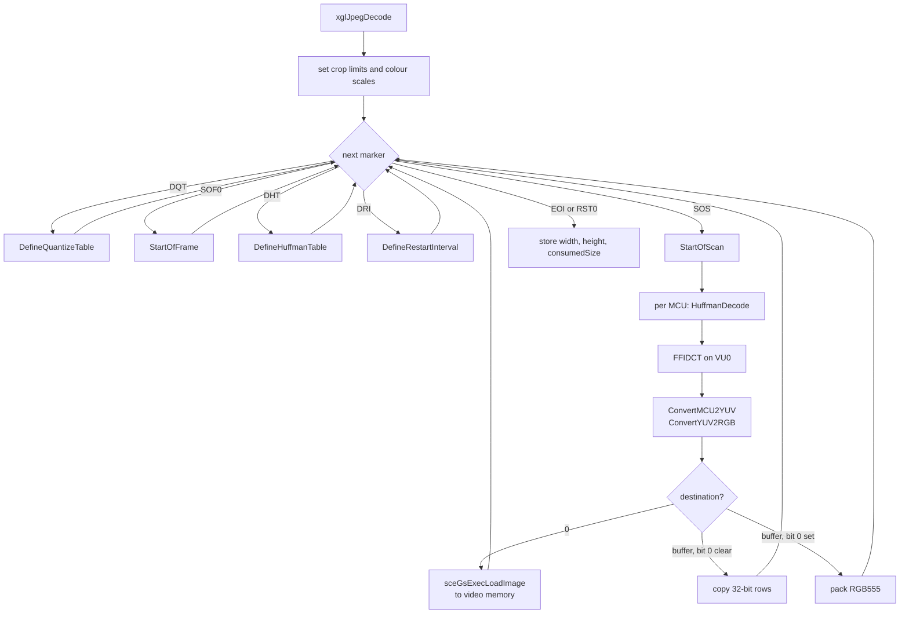

## Scene flags

`src/main/sv_scene_flags.c` is not part of the save system, although its name
suggests saved flags. `svSceneFlags` is a single 32-bit word in memory that is
never copied into `SaveData`. Four small functions work on it:
`svSceneFlagsTest(mask)` returns the masked bits, `svSceneFlagsSet(mask)` sets
them, `svSceneFlagsClear(mask)` clears them and `svSceneFlagsToggle(mask)`
inverts them. The word is read by the effect code in `src/main/sef.c` and
`src/main/sef_print.c` and by `src/main/sv_get_image_item.c` (see
[sef.md](../libraries/sef.md) and [pxy.md](../libraries/pxy.md)).

The same file holds two unrelated helpers. `vu0DirectionToAngles(angles,
direction)` turns a direction vector into a pitch and a yaw: the pitch is
`srsAtan2(-y, sqrt(x*x + z*z))` and the yaw is `srsAtan2(x, z)`.
`lightSetLogDump` walks the vectors of a light set (seven directions, eight
colours, three shadow vectors, three point light positions and three point
light colours) and passes each to a log call that does nothing in this
release.
