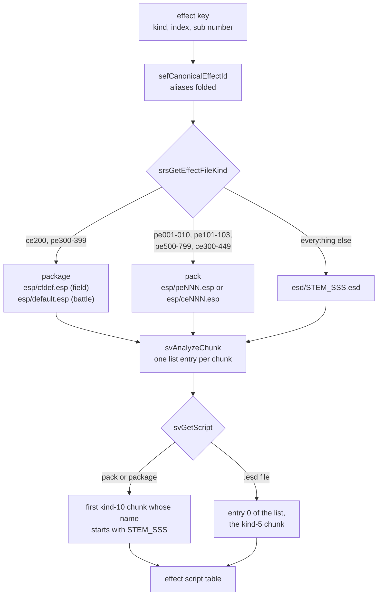
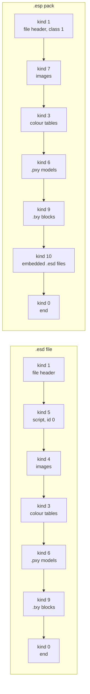
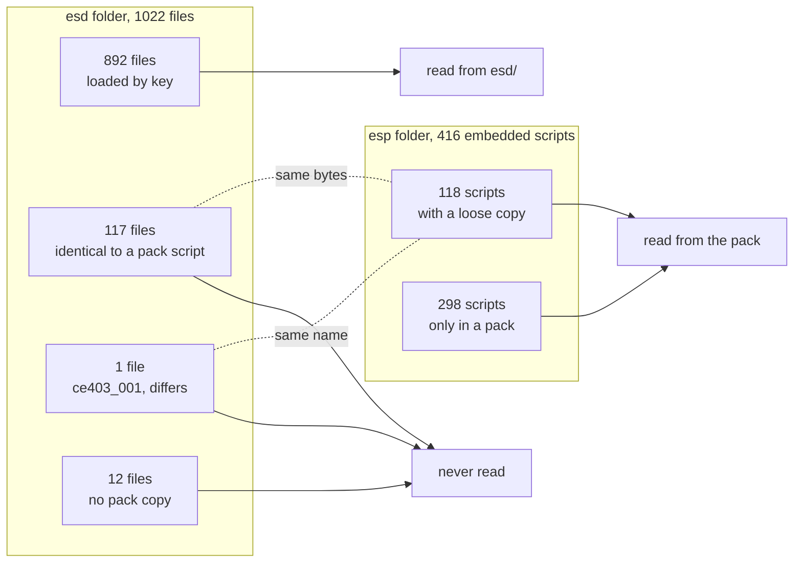
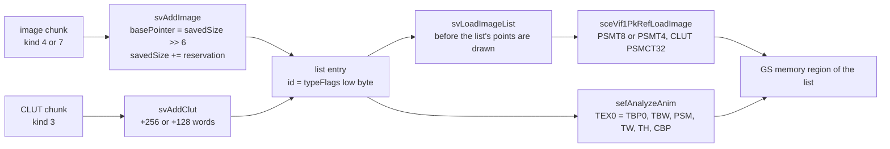
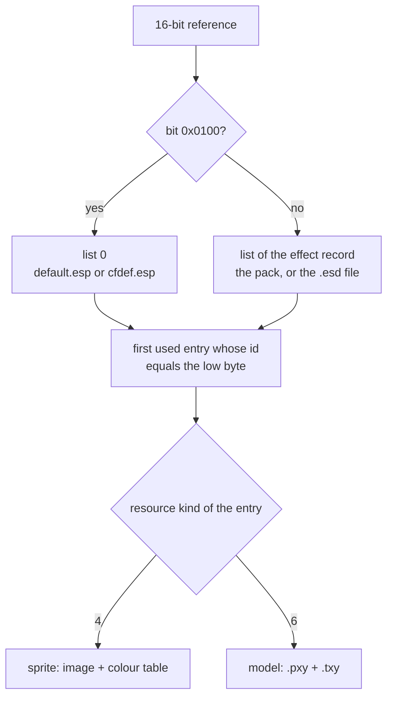
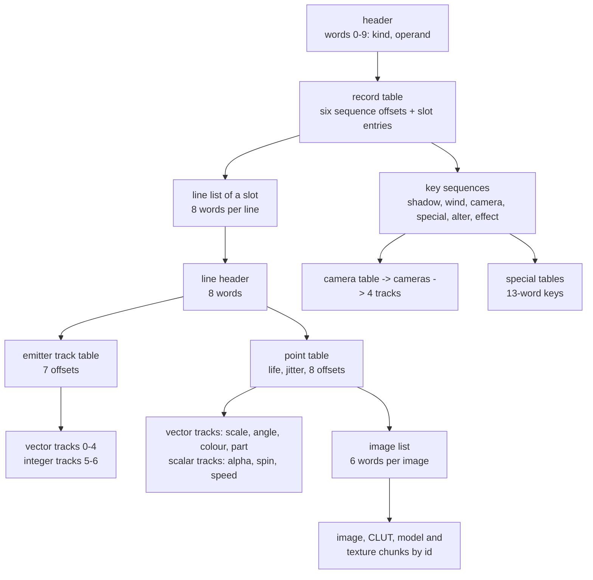
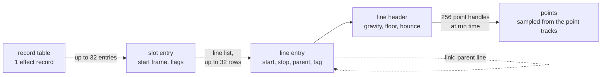
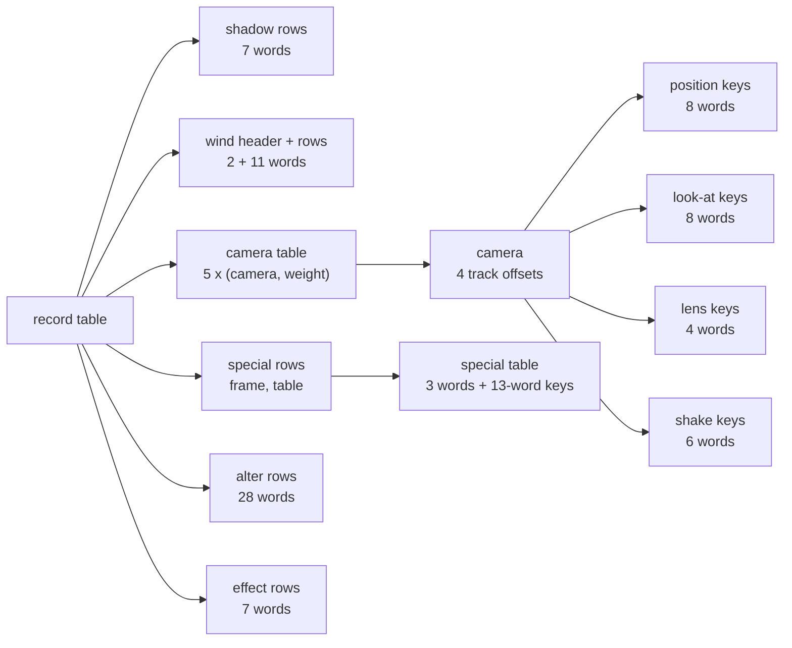
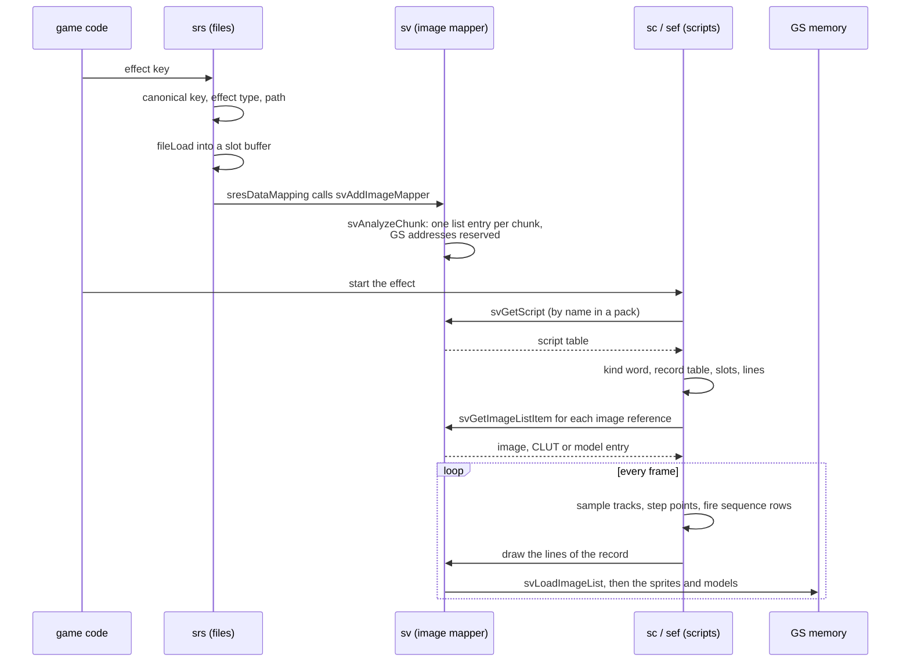

# Effect data files

The visual effects of battles, of the field and of cutscenes are data for the
effect system `sef`: sparks, smoke, slashes, Ether blasts, weapon trails,
screen flashes and the camera work that goes with a technique. That data lives
in `simajiri\` of the disc archive, the folder of the effect programmer. It
holds 1022 `.esd` files with one effect each and 125 `.esp` packs that bundle
the images, models and effects of one character, one enemy type or one scene.

Every `.esd` and `.esp` file is a list of 64-byte aligned chunks. A chunk holds
one indexed picture, one colour table, one `.pxy` model, one `.txy` texture
block or one effect script table. The files have no magic number. The first
four bytes are the size of the file, because the first chunk is a header chunk
whose size field covers the whole file. The script table is a block of 16-bit
words whose parts point at each other with word offsets: a record table per
effect, six key sequences, slots, emitter lines and keyframe tracks.

The layouts on this page were checked with a parser that walks every chunk of
all 1147 files and every structure that can be reached inside the 1438 script
tables. The counts in the text come from that walk. How the effect system runs
the data is described in [sef](../libraries/sef.md) and
[sdv](../libraries/sdv.md).

[← Back to the overview](../README.md) ·
[Files and resources](../architecture/files-and-resources.md)

## Contents

- [The files at a glance](#the-files-at-a-glance)
- [From an effect key to a file](#from-an-effect-key-to-a-file)
- [The chunk container](#the-chunk-container)
- [The .esd files](#the-esd-files)
- [The .esp effect packs](#the-esp-effect-packs)
- [Images and colour tables](#images-and-colour-tables)
- [Models](#models)
- [The effect script table](#the-effect-script-table)
- [The record table](#the-record-table)
- [Slots and line lists](#slots-and-line-lists)
- [Lines](#lines)
- [Key tracks](#key-tracks)
- [The image list of a line](#the-image-list-of-a-line)
- [Key sequences](#key-sequences)
- [The image list of the built-in emitters](#the-image-list-of-the-built-in-emitters)
- [A complete example: ce500_040.esd](#a-complete-example-ce500_040esd)
- [Statistics over all files](#statistics-over-all-files)
- [Old layouts, unused data and limits](#old-layouts-unused-data-and-limits)
- [How the game loads the files](#how-the-game-loads-the-files)

## The files at a glance

All effect files sit in two folders of archive group 00, the group that both
discs share. The 1147 files are byte-identical on disc 1 and disc 2, and none
of them is stored packed. `srsMakeFileName` in `src/main/srs.c` builds every
path from `simajiri/` plus `esd/<name>.esd` or `esp/<name>.esp`.

| Path | Files | Bytes | Smallest | Largest | Median | Contents |
| --- | --- | --- | --- | --- | --- | --- |
| `simajiri\esd\*.esd` | 1022 | 83 217 408 | 256 | 1 019 392 (`ee110_003.esd`) | 31 744 | One effect each: a script table, usually with its own images and models |
| `simajiri\esp\*.esp` | 125 | 9 283 136 | 448 (`pe716.esp`) | 165 440 (`cfdef.esp`) | 76 992 | Packs: images, colour tables, models and embedded `.esd` files |

Thirteen `.esd` files have the minimum size of 256 bytes: a header chunk, a
script chunk with 64 bytes of data and an end chunk. Eleven of them are
`ce200_901.esd` to `ce200_911.esd`, placeholders for the
[built-in emitters](#the-image-list-of-the-built-in-emitters), and the other
two are `pe007_008.esd` and `pe007_009.esd`, effects with an empty record
table.

Unlike Xenosaga Episode I, the folder has no name table file. A file name is
computed from the effect key, as the next section shows. The chunks inside a
file do carry names, the names of the artist's source files. The game uses
them in two places: to find a script inside a pack, and to find the handful of
pictures and models that the coded battle objects ask for by name (see
[resources found by name](#resources-found-by-name)).

The four kinds of content are spread over the two file types as follows.

| Content | In `.esd` files | In `.esp` files |
| --- | --- | --- |
| Effect script tables | 1022, one per file | 416, embedded as whole `.esd` files |
| Indexed images | 4671 | 1138 |
| Colour tables | 4669 | 1123 |
| `.pxy` models | 2029 | 360 |
| `.txy` texture blocks | 1996 | 352 |

## From an effect key to a file

### Stems and naming families

Game code names an effect by a 32-bit **effect key** with three fields: a kind
in bits 28 and 29, an index in bits 12 to 21 and a sub number in bits 0 to 9
(see [sef: effect keys](../libraries/sef.md#effect-keys)). The file name is the
text form of the key, its **stem**. `srsFormatEffectStem` prints the two-letter
prefix of the kind, the index as three digits, an underscore and the sub number
as three digits. The pack of an index has the short stem without the sub
number.

```
key 0x10000033   kind 1, index 0, sub number 51   ->  esd/ce000_051.esd
key 0x00004009   kind 0, index 4, sub number 9    ->  pe004_009, inside esp/pe004.esp
key 0x2006E003   kind 2, index 110, sub number 3  ->  esd/ee110_003.esd
```

All 1022 `.esd` names have the form of two letters, three digits, an
underscore and three digits. 122 of the 125 pack names are a prefix and three
digits. The other three are the two effect packages `default.esp` and
`cfdef.esp` and the stray `pe722_011.esp` (see
[packs that nothing loads](#files-that-nothing-loads)).

| Prefix | Kind | `.esd` files | Indexes with files | `.esp` packs | Used for |
| --- | --- | --- | --- | --- | --- |
| `pe` | 0 | 337 | 44 | 113 | Battle effects. Every key the battle program sends has kind 0 |
| `ce` | 1 | 434 | 35 | 10 | Field and cutscene effects |
| `ee` | 2 | 251 | 9 | none | A third family of single-file effects, named `ee100` to `ee110` |

The index groups the effects. The table lists every index range that has files
on the disc, with the way the game finds the data (the rule is explained
below).

| Stems | `.esd` files | Packs | Data comes from | Notes |
| --- | --- | --- | --- | --- |
| `pe000` | 95 | | `.esd` | Common battle effects, sub numbers 1 to 517 |
| `pe001` to `pe007` | 62 | 7 | pack | One pack per party member. The names of the resources inside suggest `pe001` Ziggy (`zig_*`), `pe002` Jin (`jin_*`), `pe003` chaos (`ch_*`), `pe004` KOS-MOS (`k_*`), `pe005` Jr. (coins and muzzle fire), `pe006` Shion (`sh_*`) and `pe007` MOMO (`mo_*`, `c_mm_*`) |
| `pe014`, `pe050` | 20 | | `.esd` | 4 and 16 effects |
| `pe101` to `pe103` | 18 | 3 | pack | Three more battle packs. The loader treats them like party packs |
| `pe111` to `pe113` | 21 | | `.esd` | 7 effects each, sub numbers 0 to 6 |
| `pe200` | 15 | | `.esd` | |
| `pe300` to `pe350` | none | | package | 8 scripts inside `default.esp` |
| `pe400` | 1 | | `.esd` | |
| `pe501` to `pe579` | none | 76 | pack | One pack per enemy type, 1 to 5 effects each |
| `pe701` to `pe731` | none | 26 | pack | 26 more packs of 1 to 4 effects with the sub numbers 8 to 11 |
| `pe801` to `pe831` | 105 | | `.esd` | 26 indexes with 1 to 7 effects each |
| `ce000` to `ce017` | 273 | | `.esd` | Field effects, grouped by index. Sub number 999 exists in every index from `ce001` to `ce017` |
| `ce051`, `ce052` | 45 | | `.esd` | |
| `ce100`, `ce102` | 18 | | `.esd` | `ce102` also has a sub number 999 |
| `ce200` | 22 | | package | 11 scripts inside `cfdef.esp`. The 22 loose files are never read |
| `ce301` to `ce307`, `ce401` to `ce403` | 28 | 10 | pack | Ten field packs of 2 or 3 effects |
| `ce500`, `ce501` | 48 | | `.esd` | Two sets of 24 effects with the same sub numbers |
| `ee100` to `ee110` | 251 | | `.esd` | Indexes 100 to 103, 105, 106 and 108 to 110 |

### Which file holds an effect

`srsGetEffectFileKind` in `src/main/srs.c` sorts a key into one of three
classes from its kind and index alone, and `srsAnalyzeEftNo` turns the class
into an **effect type** (0, 1 or 9). The class decides where the script and the
images of the effect are looked for. The table repeats the rule and adds what
the disc holds for each class.

| Kind | Index | Class | Path | On the disc |
| --- | --- | --- | --- | --- |
| `ee` | any | `.esd` (type 9) | `esd/eeNNN_SSS.esd` | 251 files |
| `ce` | 200 | package (type 0) | `esp/cfdef.esp` | 11 embedded scripts |
| `ce` | 300 to 449 | pack (type 1) | `esp/ceNNN.esp` | 10 packs, 28 embedded scripts |
| `ce` | other | `.esd` (type 9) | `esd/ceNNN_SSS.esd` | 384 files |
| `pe` | 1 to 10, 101 to 103, 500 to 799 | pack (type 1) | `esp/peNNN.esp` | 112 packs, 367 embedded scripts |
| `pe` | 300 to 399 | package (type 0) | `esp/default.esp` | 8 embedded scripts |
| `pe` | other | `.esd` (type 9) | `esd/peNNN_SSS.esd` | 257 files |

So 892 of the 1022 `.esd` files can be loaded by their key. The other 130 have
a stem whose class is "pack" or "package". The game never opens them, because
it looks for these effects inside a pack. They are leftovers of the build, and
most of them are copies of an embedded script (see
[duplicates](#esd-files-that-are-also-inside-a-pack)).

Several keys share one script. `sefCanonicalEffectId` in `src/main/sef.c` maps
a key to the key whose data is used, before any file name is built.

- `ce200_029`, `ce200_030`, `ce200_035` and `ce200_036` become `ce200_921`,
  `ce200_922`, `ce200_935` and `ce200_936`.
- `ce200_901` to `ce200_939` all become `ce200_900`. The script of that name
  in `cfdef.esp` is the [built-in emitter list](#the-image-list-of-the-built-in-emitters).
- Keys from `pe300_001` to `pe340_999` lose the low four bits of the sub number
  and get 1 instead. That is why `default.esp` holds `pe300_001`, `pe310_001`,
  `pe310_017`, `pe320_001`, `pe330_001` and `pe340_001`: each of these scripts
  serves 15 or 16 neighbouring sub numbers through its
  [variant table](#script-kinds).

Inside a pack or a package, `svGetScript` in `src/main/sv_get_image_item.c`
finds the script by name. It formats the long stem of the canonical key and
returns the first script entry whose chunk name starts with that stem
(`strncmp` over the nine characters of the stem). For an `.esd` file it does
not compare names. It returns the first entry of the file's list, which is
always the script chunk.

The diagram below shows the way from a key to the script table.



## The chunk container

An effect file is a sequence of chunks. Each chunk starts with a 64-byte header
and its data follows at chunk offset 0x40. The first chunk is always a file
header of kind 1 and the last one is an end marker of kind 0.

`svAnalyzeChunk` in `src/main/sv_get_image_item.c` walks the chunks when a
loaded file is registered as an **image mapper** (see
[sef: registering a file](../libraries/sef.md#registering-a-file)). It steps
over kinds 1 and 2 by 0x40 bytes, steps over every other known chunk by its
`byteSize`, and stops at kind 0 or at any kind it does not know. The byte size
of the file header, which is the size of the whole file, is therefore never
used to skip.

```
+0x00  byteSize     u32   size of the chunk with its header, a multiple of 0x40
+0x04  storageSize  u32   data size (scripts, models) or GS memory to reserve (images, CLUTs)
+0x08  kind         s16   0 end, 1 file header, 3 CLUT, 4 and 7 image, 5 script,
                          6 .pxy model, 9 .txy texture block, 10 embedded .esd
+0x0A  typeFlags    u16   low byte: id of the chunk inside the file
+0x0C  width        u16   images and CLUTs only
+0x0E  height       u16   images and CLUTs only
+0x10  bitsPerPixel s16   images and CLUTs only (4 or 8)
+0x12  packClass    u16   written by the conversion tool, never read
+0x14  name         44 bytes, NUL-terminated
+0x40  data
```

| Offset | Size | Type | Source name | Meaning | Values seen |
| --- | --- | --- | --- | --- | --- |
| 0x00 | 4 | u32 | `byteSize` | Chunk size with header. For kind 1 the file size, for kind 0 zero | A multiple of 0x40 in all 20 070 chunks |
| 0x04 | 4 | u32 | `dataSize` (images), unnamed elsewhere | Kinds 5 and 10: `byteSize - 0x40`. Kinds 6 and 9: the exact model size before padding. Kinds 3, 4 and 7: the GS memory to reserve, in bytes | 0 for kinds 0 and 1 |
| 0x08 | 2 | s16 | `kind` | Chunk kind | 0, 1, 3, 4, 5, 6, 7, 9, 10. Kind 2 never occurs |
| 0x0A | 2 | u16 | `typeFlags` | Low byte: the id that image references use. The high byte is 0 in every chunk | 0 to 150 |
| 0x0C | 2 | u16 | `width` | Image or CLUT width in pixels | 8 to 256 |
| 0x0E | 2 | u16 | `height` | Image or CLUT height in pixels | 2 to 256 |
| 0x10 | 2 | s16 | `bitsPerPixel` | Index depth | 4, 8 |
| 0x12 | 2 | u16 | none | Pack class, see [the pack class field](#the-pack-class-field) | 0, 1 |
| 0x14 | 44 | char | `name` | Resource name with extension, NUL-terminated | Up to 25 characters |
| 0x40 | | | | Payload | |

The chunk kinds and what the loader does with them are listed below. The
counts are over all 1147 files.

| Kind | Name extension | Loader | In `.esd` | In `.esp` | Contents |
| --- | --- | --- | --- | --- | --- |
| 0 | none | end of walk | 1022 | 125 | End marker, all 64 bytes zero |
| 1 | none | skipped (0x40) | 1022 | 125 | File header, `byteSize` = file size |
| 3 | `.clt` | `svAddClut` | 4669 | 1123 | Colour table |
| 4 | `.bmp` | `svAddImage` | 4671 | 0 | Indexed image |
| 5 | `.esd` | `svAddScript` | 1022 | 0 | Effect script table |
| 6 | `.pxy` | `svAddModel` | 2029 | 360 | Model |
| 7 | `.bmp` | `svAddImage` | 0 | 1138 | Indexed image, same layout as kind 4 |
| 9 | `.txy` | `svAddModel` | 1996 | 352 | Texture block of a model |
| 10 | `.esd` | `svAddScript2` | 0 | 416 | A complete `.esd` file embedded in a pack |

Kinds 4 and 7 have the same layout and the same loader. Kind 4 appears only in
`.esd` files and kind 7 only in packs. The kind-1 header of an `.esd` file has
every field except `byteSize` and `kind` zero. In a pack it also carries the
pack class.

Each chunk becomes one entry of the mapper's list (`SvTypeListEntry`, 256
entries per list). The entry keeps a pointer to the data at chunk offset 0x40,
a pointer to the name at offset 0x14, the chunk kind as `resourceKind` and the
`typeFlags`. Kind 7 is stored as resource kind 4, kind 9 as resource kind 6 and
kind 10 as resource kind 5, so later code sees only images, colour tables,
models and scripts. The file with the most chunks, `pe813_002.esd`, has 151
besides its header and end, well inside the 256 entries.

The walk was checked on every file. Each chunk size is a multiple of 0x40, the
chunks end exactly at the end of the file, every file starts with kind 1 and
ends with an all-zero kind 0, and the ids are unique inside each file.

The name field holds build leftovers. In 5586 chunks of `.esd` files (2814
images and 2772 colour tables) stray bytes follow the terminating NUL, for
example `stone_.bmp\0mp` in `ce000_003.esd` or `yuki_.bmp\0esd` in
`ce500_040.esd`. They are the tail of a longer name that the conversion tool
wrote into the same buffer before. No chunk name contains a directory, and the
names inside packs have no stray bytes.

### Annotated example: the start of pe007_009.esd

`pe007_009.esd` is one of the smallest files: a script with an empty record
table and nothing else. The whole file is 256 bytes.

```
0000: 00010000 00000000 0100 0000 ...            kind 1, byteSize 0x100 = file size
0040: 80000000 40000000 0500 0000 00000000       kind 5, byteSize 0x80, storageSize 0x40
0050: 00000000 70653030 375f3030 392e6573        +0x14 name "pe007_009.esd"
0060: 64000000 ...
0080: 0300 0600 ffff 0800 ffff 0100 ffff 0000    script words 0-7, the constant header
0090: 3c00 0f00                                  word 8 kind 0x3C, word 9 record table at word 15
0094: 3400 ffff 0400                             words 10-12, constant
009a: ffff ffff                                  words 13-14, pad and shadow sequence (none)
009e: ffff ffff ffff ffff ffff                   words 15-19, five sequence offsets (none)
00a8: ffff ffff 0000 0000 ffff                   words 20-24, end of the slot table
00c0: 00000000 ... (64 zero bytes)               kind 0 end chunk
```

## The .esd files

An `.esd` file holds one effect. Its first chunk after the header is always
the script (kind 5), named like the file and with id 0. Images, colour tables,
models and texture blocks that only this effect uses follow it. The 1022 files
fall into four shapes.

| Chunks after the script | Files |
| --- | --- |
| images, colour tables, models and texture blocks | 514 |
| images and colour tables | 253 |
| none | 131 |
| models and texture blocks | 124 |

The script chunk is 128 to 25 408 bytes long (median 2496, largest in
`pe111_004.esd`). The other chunks are grouped by kind: all images, then all
colour tables, then all models, then all texture blocks. The ids are unique
but not always in file order.

The listing of `ce500_040.esd`, a snow effect of 1280 bytes, shows the usual
form. The file is decoded word by word in
[a complete example](#a-complete-example-ce500_040esd).

```
000000 kind 1  byteSize 0x500                      file header
000040 kind 5  id 0x00  "ce500_040.esd"            script, 0x2C0 bytes
000300 kind 4  id 0x01  "yuki_.bmp"                16x32, 4 bit, storageSize 0x1000
000440 kind 3  id 0x02  "yuki_.clt"                16 colours
0004c0 kind 0                                      end
```

The diagram below shows the chunk order of the two file types.



## The .esp effect packs

An `.esp` pack groups the data that a part of the game needs at once. Its
chunks are images (kind 7), colour tables (kind 3), models (kind 6), texture
blocks (kind 9) and whole `.esd` files (kind 10), always in that order. All 125
packs keep the order.

| Packs | Files | Contents |
| --- | --- | --- |
| `default.esp` | 1 | The battle **effect package**: 22 images, 22 colour tables, 10 models with their texture blocks, and the scripts `pe300_001`, `pe310_001`, `pe310_009`, `pe310_017`, `pe320_001`, `pe330_001`, `pe340_001` and `pe350_001` |
| `cfdef.esp` | 1 | The field effect package: 26 images, 26 colour tables, 5 models, and the scripts `ce200_003`, `004`, `005`, `015`, `016`, `017`, `025`, `026`, `050`, `100` and `900` |
| `pe001.esp` to `pe007.esp` | 7 | Party packs, 7 to 11 scripts each |
| `pe101.esp` to `pe103.esp` | 3 | 6 scripts each (sub numbers 1 to 3 and 8 to 10) |
| `pe501.esp` to `pe579.esp` | 76 | Enemy packs, 1 to 5 scripts each. Indexes 518, 539 and 573 are missing |
| `pe701.esp` to `pe731.esp` | 26 | 1 to 4 scripts each. Indexes 707 and 726 to 729 are missing |
| `ce301.esp` to `ce307.esp`, `ce401.esp` to `ce403.esp` | 10 | Field packs, 2 or 3 scripts each |
| `pe722_011.esp` | 1 | A stray pack, see [packs that nothing loads](#files-that-nothing-loads) |

The package is always in memory as image mapper 0. `srsLoadEspFile` loads
`default.esp` for battle and `cfdef.esp` for the field. Any effect can take
single images or models from it (see [image references](#image-references)),
which is why the packages hold generic pictures such as smoke (`kemuri01_`),
rings (`da_wa2`), flashes and debris.

A pack does not need images of its own. `ce302.esp`, `ce402.esp`, `pe716.esp`
and `pe722_011.esp` hold only scripts, and `pe523.esp` holds 24 images, 24
colour tables and a single script. Several images may share one colour table:
`pe007.esp` has 21 images and 6 colour tables, because the sixteen frames
`c_mm_j00.bmp` to `c_mm_j15.bmp` all use `c_mm_j10.clt`.

The listing of `pe007.esp` shows a typical party pack.

```
000000 kind 1   byteSize 0x12fc0                    file header, class 1
000040 kind 7   id 01 "c_mm_j00.bmp"                32x32, 4 bit
  ...           ids 02-10, "c_mm_j01.bmp" to "c_mm_j15.bmp"
002440 kind 7   id 11 "mo_bira.bmp"                 32x32, 4 bit
002680 kind 7   id 12 "mo_onp-a.bmp"                32x32, 4 bit
0028c0 kind 7   id 13 "mo_onp.bmp"                  32x32, 4 bit
002b00 kind 7   id 14 "mo_zanzou01.bmp"             16x16, 4 bit, storageSize 0xA00
002bc0 kind 7   id 15 "mo_tubu.bmp"                 32x32, 8 bit
003000 kind 3   id 16 "c_mm_j10.clt"                16 colours
003080 kind 3   id 22 "mo_bira.clt"
003100 kind 3   id 24 "mo_onp-a.clt"
003180 kind 3   id 26 "mo_onp.clt"
003200 kind 3   id 29 "mo_zanzou01.clt"
003280 kind 3   id 2a "mo_tubu.clt"                 256 colours
0036c0 kind 6   id 2b "mo_hikari.pxy"               model
003fc0 kind 6   id 2c "mo_kira.pxy"
004dc0 kind 6   id 2d "mo_wak01.pxy"
005ec0 kind 6   id 2e "mo_yumi.pxy"
007300 kind 9   id 2f "mo_hikari.txy"               texture block
  ...           ids 30-32, the other three texture blocks
00ce40 kind 10  id 33 "pe007_005.esd"               embedded effect
00eb00 kind 10  id 34 "pe007_006.esd"
010580 kind 10  id 35 "pe007_007.esd"
011e40 kind 10  id 36 "pe007_008.esd"
011f80 kind 10  id 37 "pe007_009.esd"
0120c0 kind 10  id 38 "pe007_010.esd"
012c00 kind 10  id 39 "pe007_011.esd"
012f80 kind 0                                       end
```

### The pack class field

The u16 at chunk offset +0x12 is a small number that no code reads. It is
probably a pack type written by the conversion tool.

| Value | Where |
| --- | --- |
| 0 | Every chunk of an `.esd` file. Every chunk of `default.esp` and `cfdef.esp`. Colour tables, texture blocks and end chunks of all packs |
| 1 | The file header, the images, the models and the embedded scripts of the other 123 packs |

### Embedded .esd chunks

A kind-10 chunk wraps a complete `.esd` file. Its data at +0x40 is that file
byte for byte: a kind-1 header whose `byteSize` equals `byteSize - 0x40` of the
outer chunk, the kind-5 script chunk with the same name as the outer chunk,
and the kind-0 end. The script table therefore starts at outer chunk offset
0xC0. `svAddScript2` registers it like a kind-5 chunk: data pointer at +0xC0,
name pointer at +0x14 (the outer chunk's name), resource kind 5 and the chunk
id.

The inner chunks are never walked, so images inside an embedded `.esd` would
be ignored. Five embedded files do carry some: `ce403_003.esd` in `ce403.esp`
and `pe007_005.esd`, `pe007_006.esd`, `pe007_007.esd` and `pe007_010.esd` in
`pe007.esp` each hold one image and one colour table after their script. The
other 411 embedded files hold exactly header, script and end.

### .esd files that are also inside a pack

118 embedded scripts also exist as a loose file in `esd\`. For 117 of them the
loose file is byte for byte the embedded file. The exception is
`ce403_001.esd`, whose loose copy differs from the one in `ce403.esp`. The
other 298 embedded scripts have no loose file: these are all scripts of the
packs `pe501` and up, the eight scripts of `default.esp`, and the sub number
11 of each party pack.

All of these loose copies belong to the 130 files that the loader rule sends
to a pack. Such a copy cannot work on its own in any case: its image
references name ids of the pack's chunks (see
[image references](#image-references)), and the loose file holds no images.
A check of all references confirms this. Every reference of every embedded
script finds chunks in its pack or in the package, with the single exception
of the stray `pe722_011.esp`, while 80 of the loose copies have references
that find nothing in their own file.

The remaining twelve of the 130 files are the eleven placeholders
`ce200_901.esd` to `ce200_911.esd`, whose script is nothing but a terminator,
and `pe006_001.esd`, an old script that the pack `pe006.esp` no longer
contains.



## Images and colour tables

### Images

An image chunk (kind 4 or 7) holds an indexed picture of 4 or 8 bits per
pixel. The pixel data starts at chunk offset 0x40 and is
`width × height × bitsPerPixel / 8` bytes long, padded to a multiple of 0x40.
This relation holds for all 5809 images. The loader sends the data to the GS
unchanged, as rows of indices from the top (see
[from the chunk to the GS](#from-the-chunk-to-the-gs)).

| Offset | Size | Type | Source name | Meaning | Values seen |
| --- | --- | --- | --- | --- | --- |
| 0x04 | 4 | u32 | `dataSize` | GS memory the image reserves, in bytes | Equal to the pixel data size in 5249 images, larger in 560 |
| 0x0A | 2 | u16 | `typeFlags` | Image id (low byte) | |
| 0x0C | 2 | u16 | `width` | Width, a power of two | 8 to 256 |
| 0x0E | 2 | u16 | `height` | Height, a power of two | 8 to 256 |
| 0x10 | 2 | s16 | `bitsPerPixel` | 4 or 8 | 3032 images of 4 bits, 2777 of 8 bits |
| 0x40 | | | | Pixel indices | |

The most common formats are listed below. 35 different combinations occur.

| Size | Depth | Images |
| --- | --- | --- |
| 64 × 64 | 4 | 1954 |
| 64 × 64 | 8 | 1501 |
| 128 × 128 | 8 | 579 |
| 32 × 32 | 4 | 517 |
| 32 × 32 | 8 | 362 |
| 128 × 128 | 4 | 276 |
| 16 × 16 | 4 | 155 |
| 256 × 256 | 8 | 150 |
| 256 × 32 | 8 | 40 |
| 64 × 128 | 8 | 33 |
| other sizes | | 242 |

279 images are not square. The widest are strips of 256 × 16 and 256 × 32
pixels, and the tallest are 64 × 256 and 128 × 256.

The source calls the field at +0x04 `dataSize`, but it is not the size of the
pixel data. It is what `svAddImage` adds to the running GS address of the
list. In 560 images it is a whole multiple of the pixel data size: twice in
249 images, 8 times in 83, 32 times in 48, 4 times in 43, and other factors up
to 128. `be_tub.bmp` in `default.esp`, for example, is a 16 × 16 image of 128
bytes that declares 0x780. The larger values are a choice of the conversion
tool that the code does not explain. They only move the next image further up
in GS memory.

### Colour tables

A colour table chunk (kind 3) holds a CLUT of 32-bit entries. Only two forms
exist, and the `width` and `height` fields are fixed per depth.

| Depth | `width` × `height` | `storageSize` | Data | Chunk size | Count |
| --- | --- | --- | --- | --- | --- |
| 4 bits | 8 × 2 | 0x40 | 16 entries, 64 bytes | 0x80 | 3014 |
| 8 bits | 8 × 8 | 0x400 | 256 entries, 1024 bytes | 0x440 | 2778 |

Each entry is the bytes red, green, blue and alpha. The alpha follows the GS
convention where 0x80 is fully opaque. The table of the snow flake in
`ce500_040.esd` shows it: all sixteen entries have the colour `2E 2E 3D` and
differ only in alpha, from 0x01 to 0x7E.

```
0480: 2e2e3d01 2e2e3d2a 2e2e3d16 2e2e3d39    entries 0-3   R G B A
0490: 2e2e3d4f 2e2e3d75 2e2e3d69 2e2e3d6d    entries 4-7
04a0: 2e2e3d71 2e2e3d43 2e2e3d61 2e2e3d67    entries 8-11
04b0: 2e2e3d7e 2e2e3d7c 2e2e3d79 2e2e3d5b    entries 12-15
```

`svLoadClut` uploads a 256-entry table as a 16 × 16 rectangle of PSMCT32
pixels, and the `TEX0` register that the line code builds leaves the CLUT
storage mode at CSM1. The GS reads a CSM1 table in its own swizzled entry
order, so the 256-entry tables are presumably stored in that order in the
file. This was not verified by decoding pictures.

### From the chunk to the GS

Images are not uploaded when the file is loaded. `svAddImage` and `svAddClut`
only give each chunk a place in GS memory, and the draw code uploads a whole
list right before it draws the points that use it (`svLoadImageList`).

Each mapper list keeps a running GS address `savedSize` in 32-bit words. It
starts at `size`: 0xE0000 words (byte 0x380000) for list 0, the package, and
0xF0000 words (byte 0x3C0000) for every other list. All lists except list 0
therefore share the same quarter megabyte at the top of GS memory, which works
because only one list is uploaded at a time.

`svAddImage` sets the entry's `basePointer` to `savedSize >> 6`, the GS block
number, and then adds a reservation.

- The base value is `dataSize >> 2` words.
- For an image that is not square it is multiplied by half the ratio of the
  longer side to the shorter side.
- A square 4-bit image of 16 pixels or less always reserves 0x100 bytes.

`svAddClut` sets `basePointer` the same way and adds 256 words for an 8-bit
table or 128 words for a 4-bit one. The `capacity` field of a list is
0x10000 words, but nothing compares `savedSize` with it. One file passes that
mark: the images and tables of `ee103_038.esd` reserve 0x11100 words.

`svLoadTexture` sends the pixels with `sceVif1PkRefLoadImage`: GS format PSMT8
(0x13) or PSMT4 (0x14), destination block `basePointer`, and
`bufferWidthPixels × height / 16` quadwords read straight from the chunk data.
`bufferWidthPixels` is `width / 2` for a 4-bit image, `width` for an 8-bit
image that is not taller than wide, and `height` for a taller one.
`svLoadClut` sends an 8-bit table as 16 × 16 and a 4-bit table as 8 × 2.

When a line uses an image, `sefAnalyzeAnim` builds its GS `TEX0` register from
the two list entries of an [image record](#the-image-list-of-a-line): `TBP0` =
image `basePointer`, `TBW` = `bufferWidthPixels >> 6`, `PSM` = PSMT8 or PSMT4,
`TW` and `TH` = the size exponents, `TCC` = 1, `CBP` = colour table
`basePointer` and `CLD` = 1.



### Image references

Effect data never names an image. It stores a 16-bit reference whose low byte
is the chunk id. `svGetImageListItem(list, reference)` returns the first used
entry of a list whose id equals the low byte. The high bits tell where to
look.

| Bits | Meaning for the game | Meaning in the files | References |
| --- | --- | --- | --- |
| 0x0100 | The list is forced to 0, the package | A chunk of `default.esp` or `cfdef.esp` | 2087 pairs |
| 0x0200 | Not tested | A chunk of the pack that holds the script | 3128 pairs |
| none | The list of the effect record (`entryId`) | A chunk of the `.esd` file itself | 7559 pairs |
| 0x2000 | Not tested by the lookup. `svAddModel` sets it in the entry | Marks a model. Only set together with 0x0100 or 0x0200 | 944 pairs |

A reference with bit 0x0100 also makes `sefAnalyzeAnim` set image flag 0x2000
on the packet, so the draw code switches to mapper 0 for it. Bit 0x0200 has no
effect in the code: a reference without bit 0x0100 is always looked up in the
mapper of the effect, which is the pack for a pack script and the `.esd` file
otherwise. The conversion tool seems to write it for every pack resource.

References always come in pairs, an image with its colour table or a model
with its texture block. The check of all 12 774 pairs in the scripts of the
current layout gave these results.

| Pair resolves to | Pairs |
| --- | --- |
| Image and colour table in the own file or pack | 7573 |
| Model and texture block in the own file or pack | 2606 |
| Image and colour table in the package | 1890 |
| Model and texture block in the package | 197 |
| Two chunks of an unexpected kind | 18 |
| Nothing (loose copies of pack scripts, and `pe722_011.esp`) | 490 |

Package references of `pe` scripts were resolved in `default.esp` and those of
`ce` and `ee` scripts in `cfdef.esp`. Only 18 pairs of `ee` scripts use the
package at all.



### Resources found by name

A second lookup goes by chunk name instead of id. `svGetResFromName` in
`src/main/sv_get_image_item.c` compares a name with the name of every used
entry of one list (`strcmp`, so the stray bytes after the NUL do not matter).
`svGetPrmFromName` builds on it: for a name that ends in `bmp` it also looks
for the same name with `clt` and returns a `TEX0` value, and for a name that
ends in `pxy` it looks for the same name with `txy` and returns the two data
pointers. The convention that an image and its colour table, and a model and
its texture block, share one base name is therefore part of the format for
these resources.

The callers are the coded battle objects that an
[effect row](#effect-rows) creates (see
[Battle effects](../game/battle-effects.md)). Six names are compiled into the
battle program.

| Name | Looked up in | Found on the disc in |
| --- | --- | --- |
| `de_thun01.pxy` | The package | `default.esp` |
| `kemuri01_.bmp` | The package | `default.esp` (and as a private copy in 32 `.esd` files) |
| `tex_thun01.pxy` | The mapper of the effect | `pe006.esp` and five `pe000` files |
| `sh_hikari.bmp` | The mapper of the effect | `pe006.esp` |
| `tepodon.pxy` | The mapper of the effect | `pe542.esp` |
| `missile.pxy` | The mapper of the effect | `pe014_002.esd`, `pe804_002.esd`, `pe809_002.esd` and `ee102_020.esd` |

The files agree with the scripts. `pe006_005`, `pe542_001` and `pe014_002`
are three of the eight scripts that have an effect sequence, and each of them
sits in the file that holds the picture or model its object type needs.

## Models

Kind 6 chunks hold a `.pxy` model and kind 9 chunks the `.txy` texture block
that goes with it. Both formats are described in
[Models and textures](models-and-textures.md) and
[pxy](../libraries/pxy.md). `svAddModel` records the data at chunk +0x40, the
name at +0x14 and the chunk id with bit 0x2000 added, and stores both kinds as
resource kind 6. A line draws a model when the resource kind of its first
image entry is 6 (see [sef: drawing](../libraries/sef.md#drawing)).

`storageSize` is the exact size of the model data and `byteSize` rounds it up
to a multiple of 0x40 plus the header. Both blocks repeat the size inside:
the u32 at data offset 0x0C of a `.pxy` block and the u32 at data offset 0x08
of a `.txy` block equal `storageSize` in all 2389 and 2348 chunks. All model
chunks start with the magic `pxy\0` and all texture chunks with `txy\0`.

| Chunk | Count | Smallest | Largest | Median |
| --- | --- | --- | --- | --- |
| `.pxy` model (kind 6) | 2389 | 2096 | 325 632 | 4992 |
| `.txy` texture block (kind 9) | 2348 | 144 | 264 976 | 6704 |

The effect models are small: a ring, a beam, a shock wave, a piece of debris.
Their names repeat the family of the effect (`zig_tex_line01.pxy`,
`k_hikari.pxy`, `de_thun01.pxy`). The u32 at data offset 0x04 of a texture
block is 1 in 2155 chunks and 0 in 193. The 193 blocks with 0 are the smallest
ones, such as `box_4.txy` of 144 bytes in `default.esp`.

In all 742 files that hold models, every `.pxy` chunk comes first and every
`.txy` chunk follows, so a model is not stored next to its textures. The
texture names repeat the model names, in the same order in 464 files and in
another order in 256. In 22 files the two sets differ. `pe817_007.esd`, for
example, has nine models `seisan_ww1` to `seisan_ww9` without a texture block
of their own, and `pe537.esp` has the two texture blocks `be_add.txy` and
`be_sub.txy` for the one model `tbe.pxy`. The pairing in the game comes from the
[image records](#the-image-list-of-a-line), which name the model and its
texture block by id, not from the order or the names of the chunks.

## The effect script table

The data of a script chunk (kind 5, or the inner chunk of a kind 10) is called
a script, but it is not a program. It is an array of little-endian 16-bit
words that holds tables, and the tables point at each other with **word
offsets** counted from the start of the script. A reader turns an offset into
an address with `scGetImmAdrImmIdx2` of `src/main/sc_get.c`:
`base + offset * 2`. The offsets 0 and 0xFFFF mean "nothing here". Floats are
stored as two words, low word first, and are not aligned to four bytes inside
the script.

All 1438 scripts were parsed from the top down: 1022 from `.esd` files and 416
from packs. They are 64 to 25 344 bytes long with a median of 3200 bytes. The
parser followed every offset, checked that each table lies inside the script
and that each list reaches its end marker, and found no offset out of range.

### The header

Every script starts with the same ten words. The game reads only words 8 and
9 (`SefScriptRecord` in `src/main/sc_get.c` skips the first 16 bytes).

| Word | Value | Source name | Meaning |
| --- | --- | --- | --- |
| 0 to 7 | `0003 0006 FFFF 0008 FFFF 0001 FFFF 0000` | none | Constant in all 1438 scripts. Never read |
| 8 | 0x3C, 0x3D, 0x3E, 0x3F, 0x49 or 4 | `kind` | Script kind |
| 9 | | `operand` | An offset, a count or a delay, depending on the kind |
| 10... | | `offsets` | Offset table of kinds 0x3E and 0x3F |
| after the offsets | `0034 FFFF 0004` | none | Constant in the 1425 scripts of kinds 0x3C to 0x3F. Never read |

The constant words look like the instructions of a small command language: a
prologue, one command that names the effect table, and an end command with the
number 4. The game does not interpret them. It takes the kind word, finds the
record table and works from there. The eleven placeholder files
`ce200_901.esd` to `ce200_911.esd` hold the end command alone: their word 8 is
4 and nothing else follows.

### Script kinds

`scGetKeyRecord` decides from the kind word where the **record table** of the
effect starts. The table below adds the number of scripts of each kind.

| Kind | Scripts | Word 9 | Following words | Record table |
| --- | --- | --- | --- | --- |
| 0x3C | 1233 | Offset of the record table | | One table |
| 0x3D | 29 | Offset of the record table | | One table. The sprites of the effect are depth sorted (record flag 0x800000) |
| 0x3E | 157 | Stagger delay with bit 0x8000 | Two offsets | Two tables of a group effect: table 0 plays once for the group, table 1 once per target |
| 0x3F | 6 | Number of variants | That many offsets | One table per variant. The variant is the low four bits of the sub number, minus 1 |
| 0x49 | 2 | 7 | Offset of an image list, then 4 | None. The script is the image list of the built-in emitters |
| 4 | 11 | 0xFFFF | | None. Placeholder |

The 29 scripts of kind 0x3D are all field and cutscene effects (`ce` and `ee`
stems). No battle effect uses the depth sort.

Kind 0x3E is the form of the common battle hits: 156 of the 157 scripts are
`pe` effects and one is `ce000_061`. The game keeps word 9 as `scKeyRecordGroupCount`, masked with
0x3FFF because bit 0x4000 is never set in the files. It is the delay in frames
between the records of two targets. The value is 0x8000 (no delay) in 145
scripts, 0x801E (30 frames) in 8 scripts and 0x8001, 0x8002, 0x8003 and 0x8005
in one script each. In 156 scripts the two offsets differ. `ce000_061.esd`
names the same table twice.

Kind 0x3F occurs only in `default.esp`. `srsGetEffectSlot` computes the
variant for keys from `pe300` to `pe340`, which is the range that
`sefCanonicalEffectId` folds onto one script per sixteen sub numbers.

| Script in `default.esp` | Variants | Serves |
| --- | --- | --- |
| `pe300_001` | 3 | `pe300_001` to `pe300_003` |
| `pe310_001` | 11 | `pe310_001` to `pe310_011`, the child hit effects that a battle request can ask for (see [sef: child effects](../libraries/sef.md#child-effects)) |
| `pe310_017` | 5 | `pe310_017` to `pe310_021` |
| `pe320_001` | 9 | `pe320_001` to `pe320_009` |
| `pe330_001` | 3 | `pe330_001` to `pe330_003` |
| `pe340_001` | 3 | `pe340_001` to `pe340_003` |

The eighth script of the package, `pe350_001`, is a plain kind 0x3C script,
because index 350 lies outside the folded range.

The diagram shows what hangs below the header. Every arrow is a word offset.



Tables are shared freely inside a script. A track that several lines use is
stored once and its offset is repeated. Over all scripts, 12 349 emitter track
tables serve 17 704 line headers, and the single-key "no movement" tracks are
referenced thousands of times. Nothing in the format marks a table as shared,
which works because the game keeps all running state (cursors, times) in its
own records and never writes into a script.

## The record table

A record table describes one effect record of the game, a `SefEffectRecord`
(see [sef: effect records](../libraries/sef.md#effect-records)). It has two
parts: the offsets of six **key sequences** and a list of **slot entries**.
`sefCreateScheduler2` in `src/main/sef.c` binds the six sequences, and
`sefInitEffectTbl` reads the slot entries.

The offset that the header gives points at the third word of the table. Two
words sit in front of it. The layout below uses T for that offset.

| Word | Read as | Contents | Present in |
| --- | --- | --- | --- |
| T - 2 | not read | 0xFFFF in all 1526 tables of this layout | |
| T - 1 | `table[-1]` | Offset of the shadow sequence | 4 tables |
| T | `table[0]` | Offset of the wind sequence | 1 table |
| T + 1 | `table[1]` | Offset of the camera table | 288 tables |
| T + 2 | `table[2]` | Offset of the special sequence | 369 tables |
| T + 3 | `table[3]` | Offset of the alter sequence | 325 tables |
| T + 4 | `table[4]` | Offset of the effect sequence | 8 tables |
| T + 5... | `SefEffectLoadEntry[]` | Slot entries of five words | |

962 of the 1594 tables have no sequence at all and consist of slot entries
only. The most common combinations are an alter sequence alone (138 tables), a
camera alone (105), special and alter (102), camera and special (98), a special
alone (96) and camera, special and alter together (65).

A slot entry is a `SefEffectLoadEntry` of ten bytes. Each entry becomes one
**slot** of the record: a start frame plus a list of lines that start relative
to it.

| Word | Size | Type | Source name | Meaning | Values seen |
| --- | --- | --- | --- | --- | --- |
| 0 | 2 | s16 | `key` | Frame at which the slot starts. A negative value ends the list | 0 to 680 |
| 1 | 2 | u16 | | Offset of the slot's line list, or 0xFFFF | Absent in 2196 of 6754 entries |
| 2, 3 | 4 | u32 | `flags` | Slot flags, messages to the battle code | 0 in 4236 entries |
| 4, low byte | 1 | s8 | `link` | Index of another entry whose `link` byte gives the restart frame of the record | -1, and 1 in a single entry |
| 4, high byte | 1 | s8 | `signal` | When not negative: the global effect speed in percent, applied at the start frame | -1 in 6729 entries, else 1 to 100 |

The list ends with the five words `FFFF FFFF 0000 0000 FFFF` in all 1594
tables. The game also stops after 32 entries, and four tables have exactly 32.
Most tables are short: 569 have one entry, 223 have two, and 16 have none.

An entry without a line list is a pure signal. It exists for its flags: at
its start frame the game copies the flag bits to the entry flags of the actors
(see [sef: slots](../libraries/sef.md#slots)). This is how the data tells the
battle when the blow lands. The bits that occur in the files are listed below.

| Bit | Entries | Meaning in the code |
| --- | --- | --- |
| 0 (0x1) | 758 | Sets entry flag 1 on the source actor and raises the hit signal |
| 2 (0x4) | 447 | Sets entry flag 4 on the target actor |
| 3 (0x8) | 354 | Ends the slot at once unless the request allows hit effects |
| 15 (0x8000) | 689 | Sets entry flag 8 on the target |
| 20, 21, 22 | 64, 67, 0 | Choose the source, the partner or the target as the receiver of the other bits |
| 24 to 27 | 101, 64, 39, 62 | A four-bit value that replaces the same bits of the chosen entries |
| 12, 13 | 29, 26 | Copied to the chosen entries |
| 8, 9, 16, 17 | 16, 15, 15, 15 | Copied to the chosen entries |
| others | 1 to 10 each | Bits 1, 4 to 7, 10, 18, 23 and 28 to 30 |

The `signal` byte is rare. 25 entries use it, ten of them with the value 100
to put the speed back to normal and the others with 1 to 80 for slow motion.

```
record table of ce500_040.esd (script words 13 to 29)

 13: FFFF                       T-2  padding
 14: FFFF                       T-1  shadow sequence: none
 15: FFFF FFFF FFFF FFFF FFFF   T    wind, camera, special, alter, effect: none
 20: 0000 001E 0000 0000 FFFF   slot 0: starts at frame 0, line list at word 0x1E,
                                        no flags, link -1, signal -1
 25: FFFF FFFF 0000 0000 FFFF   end of the slot entries
```

## Slots and line lists

The line list of a slot is an array of `SefSlotEntry` records of eight words.
`sefExecEffectData` walks it while the slot runs and starts each line when the
time since the slot start reaches the line's `startTime`.

| Word | Type | Source name | Meaning | Values seen in 20 554 entries |
| --- | --- | --- | --- | --- |
| 0 | u16 | `script` | Offset of the line header | Always present |
| 1 | s16 | `startTime` | Frame at which the line starts, relative to the slot. 0x400 or more ends the list | |
| 2 | s16 | `frame` | Frame at which the line stops emitting. 0 means that the line never stops | 0 in 1476 entries |
| 3 | s16 | `link` | Index of the parent line in the same list, or -1 | A parent in 2017 entries |
| 4 | s16 | `count` | 0 marks a line that ends together with its points | 1 in 19 863, 0 in 691 |
| 5 | s16 | `tag` | Draw order tag inside the effect | 0 in 19 098, else 1 to 100 |
| 6 | s16 | `flags` | Initial line flags | 0 in 18 379, 1 (points follow the emitter) in 2175 |
| 7 | s16 | `inherit` | Nonzero: the line takes the size scale of an actor | 1 in 2922 |

The list ends with the row `FFFF 0400 0400 FFFF 0001 0000 0000 0000` in all
4251 lists. A slot runs at most 32 lines, and four lists have exactly 32. The
common sizes are small: 854 lists have two lines, 707 have one, 587 have four.

A line with a parent emits one set of points for every live point of the
parent line, which is how sparks trail behind a flying fragment. The parent
must be an earlier entry of the same list. One entry in all files names a
later one.

The diagram shows how the three levels nest in a running effect.



## Lines

A **line** is one emitter with its particles, which the code calls points.
The line header is a `SefLineScript` of eight words, read by
`sefInitLineData`.

| Word | Size | Type | Source name | Meaning | Values seen in 17 704 headers |
| --- | --- | --- | --- | --- | --- |
| 0 | 2 | u16 | `tables[0]` | Offset of the emitter track table | |
| 1 | 2 | u16 | `tables[1]` | Offset of the point table | |
| 2, 3 | 4 | float | `gravity` | Gravity of the points | Nonzero in 4358 |
| 4, 5 | 4 | float | `height` | Height of the floor the points bounce on | Nonzero in 332 |
| 6 | 2 | s16 | `collision` | Bounce factor in percent. 0 turns the floor off | 0 in 16 661, else 1 to 100, most often 50 |
| 7 | 2 | s16 | `noAttach` | Nonzero sets line flag 0x100: gravity moves the point at a constant speed | 1 in 6047 |

### The emitter track table

The emitter track table is seven offsets. Each names a
[key track](#key-tracks) that describes the emitter over the life of the line.
Tracks 0 to 4 are vector tracks with a header record in front of the first
key, and tracks 5 and 6 are integer tracks.

| Index | Track | Header record | Notes from the files |
| --- | --- | --- | --- |
| 0 | Start position of new points | Word 6: [position kind](#position-kinds-in-the-files). The other words are 0 | One key in 7856 of 8284 tracks |
| 1 | Extent of the start shape | Word 0: shape kind 0 to 6 | Shape 0 in 2651 tracks, 6 in 653, 5 in 574, 2 in 479, 1 in 415, 4 in 22, 3 in 1. Three tracks hold another value |
| 2 | Target position of new points | Word 6: position kind | One key in 5993 of 6169 tracks |
| 3 | Extent of the target shape | Word 0: shape kind | Shape 0 in 1874 tracks, 1 in 807, 5 in 417, 6 in 196, 2 in 176, 4 in 20. Two tracks hold another value |
| 4 | Direction of the motion | Word 6: direction mode. Word 7: 1 adds a random turn | Mode 33 in 2000 of 3276 tracks, 0 in 964, 8 in 216 |
| 5 | Points per emission | none | First value 1 in 1494 of 4187 tracks, up to 100 |
| 6 | Frames between two emissions | none | First value 1 in 1318 of 3772 tracks, up to 1000 |

`sefGetStartPos` and `sefGetTargetPos` read the shape kind from the header of
tracks 1 and 3 and pass the sampled value of the same track to
`sefGetOfsRange` as the extent of the shape: a radius for the two spheres, the
box sizes for the three boxes, a radius with two tilt angles for the turned
circle, and a radius with a height for the disc (see
[sef: emission shapes](../libraries/sef.md#emission-shapes)). The position
tracks 0 and 2 give the centre of the shape. A track 1 with shape 0 and the
value zero, the most common case, puts every point exactly on the emitter.

### Position kinds in the files

The position kind says what a position is relative to. The code that resolves
it is described in [sef: position kinds](../libraries/sef.md#position-kinds).
The start position tracks of all files use 96 different kinds. The most
common are listed here.

| Kind | Tracks | Meaning |
| --- | --- | --- |
| 0 | 1334 | No reference |
| 64 | 1307 | The source actor |
| 128 | 735 | The target actor |
| 8 | 541 | A world or screen position. A line with this kind draws screen sprites |
| 161 | 387 | Attach point 31 of the target, in a frame that faces from the source to the target |
| 16, 17 | 317, 78 | The parent point, or its part offset |
| 65 to 96 | 2878 | An attach point of the source actor, most often 73, 75, 68, 77 and 69 |
| 129 to 160 | 156 | An attach point of the target actor |
| 32 | 48 | The centre of the group of targets |
| 1 to 7 | 207 | Kind 1 is relative to the camera, kinds 2 to 7 are plain offsets |
| 1025 and up | 208 | Attach points of the part actors of a large unit |

### The point table

The point table is twelve words: four numbers and eight offsets. It describes
one particle from birth to death.

| Word | Type | Meaning | Values seen in 14 547 tables |
| --- | --- | --- | --- |
| 0 | s16 | Life of a point in frames. 0x800 means that the point never ages | 30 in 3015 tables, 20 in 2702, 0x800 in 327, otherwise 1 to 900 |
| 1 | u16 | Not read | 0 |
| 2 | s16 | Random variation of the point's own speed, in percent | 0 in 11 690, 50 in 1612, up to 150 |
| 3 | u16 | Not read | 0 |
| 4 | u16 | Offset of the scale track (vector) | |
| 5 | u16 | Offset of the angle track (vector, two header records) | |
| 6 | u16 | Offset of the colour track (vector) | |
| 7 | u16 | Offset of the alpha track (scalar) | |
| 8 | u16 | Offset of the part track (vector, no header) | Absent in 9492 tables |
| 9 | u16 | Offset of the spin track (scalar, no header) | Absent in 12 527 tables |
| 10 | u16 | Offset of the [image list](#the-image-list-of-a-line) | |
| 11 | u16 | Offset of the speed track (scalar) | |

A line whose point life is 0x800 makes its record persistent: `sefInitLineData`
sets record flag 0x4000000, and such effects are saved and restored with the
field.

The source has two sets of names for these tracks and neither is complete.
The names in the table follow what the point step does with each sample.
Track 11 is called `sizeKeys` in one view of the line and `spinKey` in
another. `sefGetSpeed` adds its sample to a random value and uses the sum as
the length of the step along the direction of track 4, so the table calls it
the speed track.

The headers of the point tracks carry the constants of the particle.

| Track | Header | Contents |
| --- | --- | --- |
| Scale (4) | One record | Words 0 to 5: three floats, the random range that is taken off the scale factor of a new point. A negative y (stored as -0.0) means that the x range applies to all three axes. Words 6 and 7: a float, the base scale: 1.0 in 3197 of 11 584 tracks, 2.0 in 711, 0.5 in 629 |
| Angle (5) | Two records | First record: a vector that gives the line a fixed orientation (nonzero in 4002 of 8785 tracks), the angle kind in word 6 and the placement kind in word 7. Second record: the random range of the start rotation, the angle kind again in word 6 (equal in all 8785 tracks) and the draw mode in word 7 |
| Colour (6) | One record | The random range of the colour factor, with the same rule for a negative y. Words 6 and 7 are 0 |
| Alpha (7) | Two words | Word 0: 0, 1 or 2 (0 in 1581 tracks, 1 in 8017, 2 in 889), from which the draw code takes the blend setting of the line. Word 1: 0 |
| Part (8) | none | Byte 15 of the first key is the fog value of the line (1 in 2135 tracks, 0 in 720) |
| Spin (9) | none | |
| Speed (11) | Two words | A float, the range of the random part of the speed. Nonzero in 2156 of 4371 tracks |

The draw mode in the angle header selects the primitive
(see [sef: primitive families](../libraries/sef.md#primitive-families)).

| Draw mode word | Tracks | Primitive |
| --- | --- | --- |
| 0 | 5686 | Billboard that faces the camera |
| 1 | 1192 | Oriented quad, draw mode 5 |
| 2 | 1249 | Oriented quad, draw mode 7 |
| 4 | 216 | Oriented quad, draw mode 9 |
| 8 | 442 | Fixed quad that ignores the record matrix |

The placement kind of the angle header is 0 in 5310 tracks. Otherwise it names
where the orientation of a point comes from: 64 (the source actor, 1258
tracks), 128 (the target, 647), 0x2000 (the direction of the motion, 324),
0x3000 (an attach point of the source, 313) or 161 (106).

## Key tracks

Everything that changes over time is a track: an array of keys in rising frame
order, closed by a key whose frame is 0x400. Three key layouts exist. The
parser checked for each of the 82 631 distinct tracks that the end key
is reached and that no frame is negative or above 0x400.

A **vector key** (`SefTrackKey16`) is eight words.

| Word | Type | Source name | Meaning |
| --- | --- | --- | --- |
| 0 to 5 | 3 floats | `value` | x, y, z |
| 6 | s16 | `key` | Frame of the key. 0x400 ends the track |
| 7, low byte | s8 | `link` | -1: go on. 0 or more: jump back to the key with this index (a loop) |
| 7, high byte | u8 | | 0xFF or 0. In the part track: 0 or 1 |

A **scalar key** (`SefTrackKey`) is four words.

| Word | Type | Source name | Meaning |
| --- | --- | --- | --- |
| 0 | s16 | `key` | Frame of the key. 0x400 ends the track |
| 1 | s16 | `link` | -1, or the index of the key to jump back to |
| 2, 3 | float | `value` | The value |

An **integer key** (`SefKeyframe`) is four words.

| Word | Type | Source name | Meaning |
| --- | --- | --- | --- |
| 0 | s16 | `frame` | Frame of the key. 0x400 ends the track |
| 1 | s16 | `next` | -1, or the index of the key to jump back to |
| 2 | u16 | `value` | The value, used without blending |
| 3 | u16 | | 0 |

A header record has the size of one key of its track and sits directly in
front of the first key, so the code reads it as key -1 (and -2 for the angle
track). The offset in the table always points at the first real key.

```
vector track with one header record (emitter tracks 0-4, scale, colour)

            words 0-5            word 6        word 7
offset-8    header x, y, z       kind          mode          <- key[-1]
offset      value x, y, z        frame 0       link, pad     <- key[0], the offset points here
offset+8    value x, y, z        frame n       link, pad
...
            x, y, z (not used)   0x0400        FFFF          <- end key
```

A track with a single key before the end key is a constant.
`sefInitLineData` tests for exactly this (`keys[1].key == 0x400`) and then
copies the value once instead of sampling the track for every point. Most
tracks are constants: 7856 of the 8284 start position tracks, 5631 of the
8785 angle tracks and 2917 of the 4371 speed tracks have one key. The tracks
that shape the look of a particle are longer. The alpha track has three keys
in 4083 of 10 487 tracks and four in 3572, the usual fade in, hold and fade
out. The longest tracks have 77 keys (a part track) and 73 keys (an angle
track).

Loops are rare. A key with a link of 0 or more occurs in 197 colour tracks,
171 alpha tracks, 59 angle tracks and 56 scale tracks, mostly in endless
lines that pulse or flicker.

The values between two keys are blended linearly, as described in
[sef: tracks and key sampling](../libraries/sef.md#tracks-and-key-sampling).
The end key of a vector or scalar track still has a value field. The files
hold leftovers there, often the default 1.0 or 128.0 of the editor, and the
game holds the last real key instead of reading them.

## The image list of a line

Word 10 of the point table leads to the image list of the line, an array of
`SefAnalyzeRecord` entries of six words. A header of eight words in front of
the first entry holds four floats, the texture scroll per frame. It is nonzero
in 213 of the 10 008 lists, and such a line is drawn with repeat wrapping.

| Word | Type | Source name | Meaning |
| --- | --- | --- | --- |
| 0 | s16 | `time` | Frame of the point's life at which this image becomes current. 0x400 ends the list |
| 1, low byte | s8 | | Link: -1 steps to the next image, 0 or more jumps back to that entry |
| 1, high byte | u8 | `flags` | Image flags. The game reads them from the first entry only |
| 2 | u16 | `imageId` | [Reference](#image-references) to an image or a model |
| 3 | u16 | `altImageId` | Reference to its colour table, or to the texture block of a model |
| 4 | u16 | `imageId2` | Second image of a two-image point, or 0 |
| 5 | u16 | `altImageId2` | Colour table of the second image, or 0 |

The end entry is `0400 00FE` in every list. 9797 lists have one image. The
others are animations of up to 29 frames, and one list in `pe112_005.esd` has
40 entries. `sefAnalyzeAnim` keeps 30 image packets per line, so the last ten
entries of that list are counted but not stored. 35 entries have a link of 0, which makes the animation loop back to its first
image, and two have a link of 32. Without a link the point stays on the last
image. 311 entries carry a second pair. The first reference names a model
in 942 of 11 757 entries.

The flag byte of the first entry sets the following bits.

| Bit | Lists | Meaning |
| --- | --- | --- |
| 0x01 | 14 | Not explained by the code that was read |
| 0x02 | 607 | With a nonzero draw mode: a quad that is clipped on the CPU |
| 0x04 | 81 | A model point is lit with the applied scene light set |
| 0x08 | 79 | Not explained by the code that was read |
| 0x10 | 522 | Light emitter. The line lights actors and is hidden unless a debug flag is set. 14 of these lists have an empty first entry, which the code allows only together with this bit |
| 0x20 | 637 | Sets line flag 0x4000 |
| 0x40 | 525 | Not explained by the code that was read |
| 0x80 | 294 | The line is drawn without the Z test |

7563 lists have no flag. In 60 later entries the byte is not zero (0x80 in
40, 0x08 in 19), which has no effect.

16 lists consist of the end entry alone. A line with such a list has no image
packet and draws nothing.

## Key sequences

The six sequences of a record table drive the systems around the particles:
the camera, screen filters, weapon trails, coded battle objects, shadows and
wind. They belong to the effect sequence driver, and
[sdv](../libraries/sdv.md) describes what each row does when it fires. This
section gives the layouts and what the files contain.

All sequences except the camera are arrays of fixed-size rows. Word 0 of a row
is its frame. A frame word of 0x400 ends the array, and bit 0x1000 turns the
row into one that waits for the hit signal of the battle
(see [sdv: the key test](../libraries/sdv.md#the-key-test)).

| Sequence | Record table word | Row size | Sequences | Rows | Hit waits |
| --- | --- | --- | --- | --- | --- |
| Shadow | T - 1 | 7 words | 4 | 4 | none |
| Wind | T | 11 words, after a 2-word header | 1 | 2 | none |
| Camera | T + 1 | A table of 10 words, then tracks | 288 tables | 2937 position and look-at keys | 4 shake keys |
| Special | T + 2 | 2 words, each naming a special table | 369 | 568 tables | 41 rows |
| Alter | T + 3 | 28 words | 323 | 1484 | none |
| Effect | T + 4 | 7 words | 8 | 41 | none |



### Shadow rows

A shadow row is an `SdvShadowKey`: frame, flags, a shadow count byte and a
state byte, and four numbers for the shadow of the actor. Only four scripts
have one, each with a single row: `pe806_004.esd` and one script in each of
`pe557.esp`, `pe558.esp` and `pe559.esp`. All four rows have the flags 0x40
(the source actor), a shadow count of 3 or 4 and the state 2.

### Wind rows

A wind sequence has two words in front of its first row, the wind speed in
hundredths and the wind kind, and rows of eleven words (`TiWindKey`): frame,
position kind, an offset of three words, two range bounds, a radius and a
direction of three words. One script on the disc uses it, `pe818_002.esd`. Its
header gives the speed 500 and kind 1, a point wind. The two rows place the
wind at the target actor (position kind 128). One has the radius 500 and the
other the radius 0, which switches the wind off again.

### The camera table and its tracks

The camera table is five pairs of words: the offset of a camera and its
weight in percent. `sdvSelectCamera` rolls a number below 100 and takes the
first of the first four cameras whose running weight total is above the roll.

| Cameras present | Tables |
| --- | --- |
| 1 | 111 |
| 2 | 73 |
| 3 | 40 |
| 4 | 64 |

The four weights add up to 100 in 196 tables. In 59 tables they add up to 0,
so no camera can win the roll and the record only gets the "camera pending"
flag. The other 33 tables have totals between 20 and 90 and so leave the game
camera alone in some of the plays. The fifth pair never names a camera. Its
weight word is 0 except in four tables where it holds a stray number.

A camera is four offsets: the position track, the look-at track, the lens
track and the shake track. 628 cameras exist. 372 of them have no shake
track, 36 have no lens track, 27 have no position track and 27 have no
look-at track.

Position and look-at keys are `SdvCameraKey` records of eight words.

| Word | Type | Source name | Meaning | Values seen in 2937 keys |
| --- | --- | --- | --- | --- |
| 0 | s16 | `frame` | Frame of the key | |
| 1, low byte | u8 | `ease` | Ease mode of the move to the next key | 0 in 2139, 3 in 527, 1 in 146, 2 in 125 |
| 1, high byte | s8 | `blend` | Blend mode | 1 in 1509, 0 in 1428 |
| 2 | s16 | `mode` | 1 for an orbit placement, bit 0x10 for an anchored look-at | 0 in every key |
| 3 | s16 | `scaled` | Nonzero: the offset is scaled with the size of the actor | 1 in 382 |
| 4 to 6 | 3 × s16 | `placement` | Offset in hundredths of a unit | |
| 7 | s16 | `kind` | Actor and part that the point is relative to | 65 in 1747 keys, 0 in 649, 132 in 224, 68 in 118 |

The code knows an orbit placement (pitch, yaw and distance) and a look-at that
stays anchored to a moving actor. No key on the disc asks for either: the
`mode` word is 0 in all 2937 keys, so every camera point is a plain offset
from an actor part.

Lens keys (`SdvLensKey`) are four words: frame, the two mode bytes, the field
of view in degrees and the roll in degrees. The 1185 lens keys use fields of
view from 10 to 102 degrees, most often 40 (276 keys), 50 (139) and 60 (111).
The roll is 0 in 628 keys and otherwise lies between -30 and 38 degrees,
except for four keys with a roll of 320.

Shake keys (`SdvShakeKey`) are six words: frame, wave mask, amplitude,
period, hold and cycle count. 149 shake keys exist. The mask is 2 in 127 of
them, which selects the second of the three camera waves.

The end key of a position or look-at track is a full row of eight words whose
last seven words hold leftovers of the editor. The end key of a lens track is
always `0400 0000 0028 0000`.

### Special rows and special tables

A special row is two words: the frame and the offset of a **special table**
(`SdvSpecialTable`). 223 of the 369 sequences have one row, 78 have two, and
the longest has 23. A record can run six filters at once, so the longer
sequences depend on earlier filters ending by themselves.

The special table starts with three words and continues with keys of 13
words.

| Word | Type | Source name | Meaning | Values seen in 568 tables |
| --- | --- | --- | --- | --- |
| 0, low byte | u8 | `kind` | Kind of filter | See below |
| 0, high byte | s8 | | Enables the part scale | 1 in 16 tables, else 0 |
| 1 | s16 | `part` | Position kind of the filter. 8 means screen coordinates | 8 in 249, 64 in 102, 68 in 66, 161 in 46, 0 in 25 |
| 2 | u16 | `modes` | Alpha type and frame buffer choice | 0 in 396, 0x100 in 109, 0x101 in 48, 0x102 in 8, 1 in 4, 2 in 3 |
| 3... | `SdvSpecialKey[]` | `keys` | 13 words each | 1 to 25 keys, most often 3 |

| Key word | Type | Source name | Meaning |
| --- | --- | --- | --- |
| 0 | u16 | `frame` | Frame, counted from the start of the filter |
| 1 | u16 | `depth` | Depth value |
| 2, 3 | 4 × u8 | `color` | Red, green, blue, alpha |
| 4 to 6 | 3 × s16 | `x`, `y`, `z` | Position |
| 7, 8 | 2 × s16 | `width`, `height` | Size |
| 9, 10 | 2 × s16 | `subWindow2`, `subWindow3` | Extra values of the screen effects |
| 11 | s16 | `intensity` | Strength |
| 12 | u16 | `decrease` | Fade-out rate |

The key list ends at a frame word of 0x400 or more. The value decides how the
filter ends: 0x800 in 475 tables frees the filter one frame after its last
key, and 0x400 in 93 tables holds the last key until the effect is gone.

| Kind | Tables | Filter |
| --- | --- | --- |
| 1 | 89 | Defocus type 1 |
| 4 | 113 | Defocus type 1 with fixed values, a tint of the frame |
| 6 | 17 | Defocus type 6 |
| 7 | 62 | Defocus type 7, placed in the world |
| 10 | 60 | Radial blur |
| 11 | 24 | Ring |
| 12 | 166 | Camera quad |
| 13 | 34 | Jitter grid |
| 14 | 3 | Fade quad |

Kinds 3, 5 and 9, which `sdvDrawSpecial` also handles, do not occur in the
files. The filters themselves are described in
[sdv: specials](../libraries/sdv.md#specials-screen-filters) and
[Screen effects](../libraries/screen-effects.md).

### Alter rows

An alter row is an `SdvAlterEvent` of 28 words. It starts one ribbon trail.
The table repeats the layout with the values found in the 1484 rows.

| Word | Type | Source name | Meaning | Values seen |
| --- | --- | --- | --- | --- |
| 0 | u16 | `frame` | Frame of the row | |
| 1 | s16 | `life` | Life in frames. 2048 never runs out | 10 in 274 rows, 2048 in 92, otherwise 3 to 521 |
| 2, bits 0-3 | | `mode` | Texture mode | 1 in 854, 8 (a single line) in 430, 4 in 187, 0 in 8, 2 in 5 |
| 2, bits 4-15 | | | Follow value | 0 in 1446, 1 in 30, 2 in 8 |
| 3 | u16 | `blend` | Blend mode | 1 in 1432, 2 in 49, 0 in 3 |
| 4 to 7 | 4 × u16 | `rgba` | Colour, low bytes | |
| 8, 9 | 2 × s16 | `parts` | Position kinds of the two edges | 210 pairs, most often 71 and 72 (117 rows) and 69 and 70 (109) |
| 10 | s16 | `maxSamples` | Length of the trail in samples | 10 in 300, 6 in 259, 12 in 194, range 2 to 128 |
| 11 | u16 | `shrink` | Samples removed per frame after the life | |
| 12 | s16 | `imageFrames` | Frames each image is shown | |
| 13 | s16 | `length` | Texture length of the trail | |
| 14, 15 | 2 × s16 | `images[0]` | Image and colour table reference, or negative | Present in 660 rows |
| 16, 17 | 2 × s16 | `images[1]` | Second pair | Present in 2 rows |
| 18 to 21 | 2 floats | `width`, `height` | Ring spacing and half height of a follow trail | |
| 22 to 26 | 5 × 16 bit | `spread`, `spin`, `timeBase`, `timeStep`, `minDelta` | Wave values of a follow trail | |
| 27 | | | Not read | 0 in all rows |

More than half of the trails (824 rows) have no texture and are drawn as a
plain coloured strip. The edge pairs show the use: the neighbouring attach
points 69 and 70, 71 and 72, 73 and 74 are the two ends of a weapon or a limb
of the source actor. Two rows ask for 128 samples, twice the 64 that an alter
record can hold. 13 sequences consist of the end marker alone.

### Effect rows

An effect row is seven words: frame, the type of a coded battle object, the
select of the target part, the select of the owner part and an offset of three
words in thousandths of a unit. `sdvExecEffectSeq` hands the row to `MSeFire`
(see [Battle effects](../game/battle-effects.md)).

Eight scripts have an effect sequence, with 41 rows in total:
`pe006_005` (in `pe006.esp` and as a loose copy), `pe014_002.esd`,
`pe014_004.esd`, `pe050_004.esd`, `pe111_005.esd`, `pe814_002.esd` and
`pe542_001` in `pe542.esp`. The longest has 16 rows.

| Type | Rows | Object |
| --- | --- | --- |
| 8 | 16 | Spray |
| 10 | 8 | Sway |
| 5 | 6 | Tepodon |
| 1 | 3 | Hermite path (eight objects per row) |
| 9 | 3 | Path step (eight objects per row) |
| 3 | 2 | Thunder |
| 11 | 2 | Missile trail |
| 7 | 1 | Wave |

The target select is 161 in 20 rows, 0 in 16, 32 in 3 and 160 in 2.

## The image list of the built-in emitters

The script `ce200_900` in `cfdef.esp` has kind 0x49 and no record table. Its
words 9 to 11 are 7, 0x14 and 4, and at word 0x14 starts a list of 22 rows in
the layout of an [image list](#the-image-list-of-a-line). The game publishes
the address of word 9 in `scKeyRecordEntry`, and `sefCreateEffectCf2` reads
the following word as the offset of the list (`SefEntryHeader.entryIndex`).

The list is the picture catalogue of the 25 built-in particle emitters of the
field (see [sdv: built-in particle emitters](../libraries/sdv.md#built-in-particle-emitters)).
The keys `ce200_901` to `ce200_939` all resolve to this script, and
`sefCreateKindResourceSlot` picks rows by fixed index for each emitter kind.
The `time` word of row n is n + 1, the link byte is 0xFF and all references
have bit 0x0100, so they name chunks of `cfdef.esp` itself.

| Row | Image | Row | Image |
| --- | --- | --- | --- |
| 0 | `km01b.bmp` | 11 | `a_glasshen.bmp` |
| 1 | `takibi01.bmp` | 12 | `a2_glshen.bmp` |
| 2 | `takinoko.bmp` | 13 | `enbur.bmp` |
| 3 | `en02add.bmp` | 14 | `a_en_kk.bmp` |
| 4 | `a_mkhenb.bmp` | 15 | `a2_en_kk.bmp` |
| 5 | `a_mokuhen.bmp` | 16 | `line01.pxy` (a model, with `line01.txy`) |
| 6 | `haen.bmp` | 17 | `look01.bmp` |
| 7 | `a_tekkai.bmp` | 18 | `look02.bmp` |
| 8 | `kmggh.bmp` | 19 | `look03.bmp` |
| 9 | `ggh.bmp` | 20 | `look04.bmp` |
| 10 | `a_kmice64.bmp` | 21 | `look05.bmp` |

Every image is paired with the colour table of the same name. Emitter kinds 0
to 2 use row 0 alone, a smoke puff. Kinds 3 and 4 use rows 1 and 2, the fire
pictures `takibi01` and `takinoko`. Kinds 8 to 10 combine rows 0, 5 and 4,
the smoke with two fragment pictures. No branch of `sefCreateKindResourceSlot` reads row 16, the only model
of the list.

The loose file `ce200_900.esd` holds the same script. It is never opened,
because `ce200` keys are looked up in the package.

## A complete example: ce500_040.esd

`ce500_040.esd` is a field effect of 1280 bytes with one slot, one line and
one image. Its script chunk starts at file offset 0x40 and the script data at
0x80, so script word n is at file offset 0x80 + 2n. The chunk list is shown
under [the .esd files](#the-esd-files).

The header and the record table come first.

```
word  value                                     meaning
0000  0003 0006 FFFF 0008 FFFF 0001 FFFF 0000   constant header
0008  003C                                      kind 0x3C, a plain effect
0009  000F                                      record table at word 0x0F
000A  0034 FFFF 0004                            constant
000D  FFFF                                      padding in front of the table
000E  FFFF                                      shadow sequence: none
000F  FFFF FFFF FFFF FFFF FFFF                  wind, camera, special, alter, effect: none
0014  0000 001E 0000 0000 FFFF                  slot 0: frame 0, line list at 0x1E, no flags
0019  FFFF FFFF 0000 0000 FFFF                  end of the slot entries
```

The slot has one line. The line starts with the slot, stops emitting after
frame 1 and has no parent.

```
001E  002E 0000 0001 FFFF 0001 0000 0000 0001   line header at 0x2E, start 0, stop 1,
                                                no parent, count 1, tag 0, flags 0, inherit 1
0026  FFFF 0400 0400 FFFF 0001 0000 0000 0000   end of the line list

002E  0036 003E                                 emitter track table at 0x36, point table at 0x3E
0030  0000 0000  0000 0000                      gravity 0.0, floor height 0.0
0034  0000 0001                                 no bounce, noAttach 1
0036  0058 0070 0058 0070 0088 00E8 00E8        the seven emitter tracks
003D  0000                                      (not referenced)
003E  003C 0000 0000 0000                       point life 60 frames, no speed variation
0042  00A0 00D8 00B8 00FC FFFF FFFF 0114 00F2   scale, angle, colour, alpha, no part, no spin,
                                                image list, speed
```

The emitter tracks share data. Tracks 0 and 2 are the same track at 0x58, and
tracks 1 and 3 are the same track at 0x70. Tracks 5 and 6 are the same integer
track at 0xE8.

```
0050  0000 0000 0000 0000 0000 0000 0049 0000   header of track 0x58: position kind 73
0058  0000 0000 D70A 3C23 0000 0000 0000 FFFF   key 0: (0.0, 0.01, 0.0) at frame 0
0060  0000 0000 0000 0000 0000 0000 0400 FFFF   end key

0068  0000 ... 0000                             header of track 0x70: shape 0
0070  0000 0000 0000 0000 0000 0000 0000 FFFF   key 0: extent (0, 0, 0) at frame 0
0078  0000 0000 0000 0000 0000 0000 0400 FFFF   end key

0080  0000 ... 0000                             header of track 0x88: direction mode 0
0088  0000 0000 0000 0000 0000 0000 0000 FFFF   key 0: direction (0, 0, 0)
0090  0000 0000 0000 0000 0000 0000 0400 FFFF   end key

00E8  0000 FFFF 0001 0000                       integer key: value 1 at frame 0
00EC  0400 FFFF 0001 0000                       end key
```

Position kind 73 is attach point 8 of the source actor (73 - 65). The points
are born 0.01 units above it, in a sphere of radius 0, one point per emission
and one emission per frame. The direction is zero and so is the speed below,
so a point stays where it was born.

The point tracks follow.

```
0098  0000 0000 0000 8000 0000 8000 CCCD 3F4C   scale header: range 0, uniform (y = -0.0),
                                                base scale 0.8
00A0  0000 3F40 0000 3F80 0000 3FA0 0000 FFFF   scale key 0: (0.75, 1.0, 1.25)
00A8  0000 3F80 0000 3F80 0000 3F80 0400 FFFF   end key

00B0  0000 0000 0000 8000 0000 8000 0000 0000   colour header: range 0, uniform
00B8  0000 4300 0000 4300 0000 4300 0000 FFFF   colour key 0: (128, 128, 128)
00C0  0000 3F80 0000 3F80 0000 3F80 0400 FFFF   end key

00C8  0000 0000 0000 0000 0000 0000 0040 0040   angle header 1: no fixed orientation,
                                                angle kind 64, placement kind 64
00D0  0000 0000 0000 0000 0000 0000 0040 0002   angle header 2: no random rotation,
                                                angle kind 64, draw mode 2
00D8  0000 0000 B8C7 BE32 0000 0000 0000 FFFF   angle key 0: (0.0, -0.1745, 0.0)
00E0  0000 0000 0000 0000 0000 0000 0400 FFFF   end key

00F0  0000 0000                                 speed header: no random part
00F2  0000 FFFF 0000 0000                       speed key 0: 0.0
00F6  0400 FFFF 0000 0000                       end key

00FA  0000 0000                                 alpha header: blend setting 0
00FC  0000 FFFF 0000 4220                       alpha key 0: 40.0 at frame 0
0100  001E FFFF 0000 4220                       alpha key 1: 40.0 at frame 30
0104  003C FFFF 0000 0000                       alpha key 2: 0.0 at frame 60
0108  0400 FFFF 0000 4300                       end key (128.0 is a leftover)
```

The point is an oriented quad (draw mode 2) that takes its orientation from
the source actor (kind 64) and is tilted by -0.1745 radians, which is 10
degrees. It is grey, scaled by the key (0.75, 1.0, 1.25) and the base scale of 0.8,
holds an alpha of 40 for 30 frames and fades out over the second half of its
60 frames.

```
010C  0000 ... 0000 (8 words)                   image list header: no texture scroll
0114  0000 00FF 0001 0002 0000 0000             image 0: from frame 0, link -1, no flags,
                                                image id 1, colour table id 2, no second pair
011A  0400 00FE 0000 0000 0000 0000             end entry
```

The references 1 and 2 have no high bits, so they name chunks of the file
itself: `yuki_.bmp`, a 16 × 32 image of 4 bits, and `yuki_.clt`, the grey ramp
shown under [colour tables](#colour-tables). The rest of the script chunk up
to word 0x140 is zero, apart from two words 0xFFFF at 0x120 that nothing
references.

## Statistics over all files

The numbers in this section count the 1438 scripts of both file types. An
embedded script and its loose copy are counted twice.

| Item | Count |
| --- | --- |
| Scripts | 1438 (1022 in `.esd` files, 416 in packs) |
| Record tables | 1609 |
| Slot entries | 6754 |
| Line lists | 4251 |
| Line entries | 20 554 |
| Line headers | 17 704 |
| Emitter track tables | 12 349 |
| Point tables | 14 547 |
| Image lists | 10 008, with 11 771 entries |
| Camera tables, cameras | 288, 628 |
| Special sequences, special tables | 369, 568 |
| Alter sequences, rows | 323, 1484 |

Records per script:

| Record tables | `.esd` scripts | Pack scripts |
| --- | --- | --- |
| 0 | 12 | 1 |
| 1 | 912 | 351 |
| 2 | 98 | 58 |
| 3, 5, 9, 11 | none | 3, 1, 1, 1 (the variant scripts of `default.esp`) |

The scripts without a record table are the 11 placeholders and the two
built-in emitter lists. 16 record tables exist but have no slot entry, for
example those of `pe007_008` and `pe007_009`.

Lines per record, counted over the slot entries of one record table:

| Lines | Record tables |
| --- | --- |
| 0 | 51 |
| 1 | 177 |
| 2 to 5 | 425 |
| 6 to 10 | 294 |
| 11 to 20 | 314 |
| 21 to 40 | 269 |
| more than 40 | 64 |

The median is 7 lines. The largest effects are `pe050_016.esd` with 118
lines, `ce009_005.esd` with 109, `pe000_045.esd` with 106 and `ce002_022.esd`
with 104. A typical `.esd` script has 6 lines and a typical pack script 15,
because the packs hold the long techniques of characters and enemies. 51
record tables have no line at all and consist of flag entries and sequences.

Use of the sequence types, by record table:

| Sequence | Record tables | Share of 1594 |
| --- | --- | --- |
| Special | 369 | 23 % |
| Alter | 325 | 20 % |
| Camera | 288 | 18 % |
| Effect | 8 | 0.5 % |
| Shadow | 4 | 0.3 % |
| Wind | 1 | 0.1 % |
| none | 962 | 60 % |

Primitive kinds, by angle track and by image entry:

| Primitive | Count |
| --- | --- |
| Billboards (draw mode word 0) | 5686 angle tracks |
| Oriented quads (draw mode words 1, 2 and 4) | 2657 angle tracks |
| Fixed quads (draw mode word 8) | 442 angle tracks |
| Models (first reference names a `.pxy` chunk) | 942 of 11 757 image entries |
| Screen sprites (start position kind 8) | 541 start position tracks |
| Two-image points (second pair present) | 311 image entries |
| CPU-clipped quads (image flag 0x02) | 607 image lists |
| Light emitters (image flag 0x10) | 522 image lists |

Image chunks (see [images](#images) for the full size table):

| Item | Count |
| --- | --- |
| Images | 5809: 4671 in `.esd` files, 1138 in packs |
| 4-bit images | 3032 |
| 8-bit images | 2777 |
| Size and depth combinations | 35 |
| Most common format | 64 × 64, 4 bits (1954 images) |
| Largest format | 256 × 256, 8 bits (150 images) |
| Colour tables | 5792: 3014 of 16 colours, 2778 of 256 colours |
| Models, texture blocks | 2389, 2348 |

## Old layouts, unused data and limits

### Two older record table layouts

83 scripts were written by older versions of the effect editor and keep an
older record table. In both old layouts the table follows the constant words
`0034 FFFF 0004` directly, without the two words that the current layout has
in front of T.

| Layout | Scripts | In front of T | Sequence offsets | Slot entry |
| --- | --- | --- | --- | --- |
| Current | 1526 tables in 1342 scripts | Padding and the shadow offset | 5 | 5 words |
| Without shadow word | 68 | Nothing | 5 | 5 words |
| Four-word entries | 15 | Nothing | 4 | 4 words: start frame, line list, a 16-bit flag word, 0xFFFF |

The 68 scripts of the second kind work unchanged. The game reads the word in
front of T as the shadow sequence offset, and here that word is the constant
4. The "sequence" at word 4 starts with the header word 0xFFFF, which the
[key test](../libraries/sdv.md#the-key-test) treats as a row that waits for
the hit signal with a frame of 0xFFF, a frame no sequence counter reaches. So
the row never fires. These scripts are field and cutscene effects: 62 loose
`.esd` files such as `ce000_003.esd`, `ce102_001.esd` to `ce102_014.esd` and
`ee108_001.esd` to `ee108_004.esd`, and six scripts of `cfdef.esp`.

The 15 scripts of the third kind do not fit the reader. Read with the current
rules, the first slot entry starts at the fifth word of the table and takes
the line list offset of the old entry as its start frame. For
`ce051_001.esd` this gives a slot that starts at frame 25 and has no line
list, so the effect would show nothing. The scripts are `ce000_004`, `015`,
`016`, `017`, `032` and `042`, `ce051_001`, `ee101_001` and `014`,
`ee102_001` to `003`, the loose `pe006_001.esd`, `pe310_009` in `default.esp`
and `pe563_002` in `pe563.esp`. Whether the game ever requests the loadable
ones could not be told from the files.

### Data that nothing references

487 scripts contain words that no offset reaches, 15 395 nonzero words in
total. They are tables that the editor left behind when a line or a sequence
was deleted. The largest remains are in `pe006_001.esd` (2283 words),
`pe563_002` in `pe563.esp` (928 words) and `ce000_015.esd` (858 words), three
of the old-layout scripts.

Other fields that the files carry but the game does not read:

- script words 0 to 7 and the three constant words after the offsets,
- words 1 and 3 of the point table (always 0),
- word 27 of an alter row (always 0),
- the fifth pair of a camera table,
- the value fields of end keys,
- the pack class at chunk offset 0x12, and the bytes after the NUL of a chunk
  name.

### Files that nothing loads

| Files | Count | Why |
| --- | --- | --- |
| Loose `.esd` files with a pack or package stem | 130 | The loader looks for these keys inside a pack. 117 are identical copies of an embedded script (see [duplicates](#esd-files-that-are-also-inside-a-pack)) |
| `pe722_011.esp` | 1 | No key produces a pack name with a sub number. The file holds two scripts, `pe722_010` and `pe722_011`, and no images. Both are shorter versions of the scripts of the same names in `pe722.esp`, and their references name the ids of that pack's chunks |
| `pe310_009` in `default.esp` | 1 script | The key `pe310_009` is folded onto `pe310_001`, whose variant table serves it |
| Images and colour tables inside five embedded `.esd` files | 5 pairs | The chunks inside a kind-10 chunk are never walked (see [embedded .esd chunks](#embedded-esd-chunks)) |

### Limits and how close the files come

| Limit in the code | Value | Largest case on the disc |
| --- | --- | --- |
| Entries of one mapper list | 256 | 151 chunks in `pe813_002.esd` |
| Slots of a record | 32 | 32 slot entries in four record tables |
| Lines of a slot | 32 | 32 line entries in four line lists |
| Image packets of a line | 30 | 40 entries in one list of `pe112_005.esd`, otherwise at most 29 |
| Samples of an alter | 64 | 128 asked for in two rows |
| Filters of a record at once | 6 | 23 rows in one special sequence |
| Buffer of the package | 0x28800 bytes | `cfdef.esp`, 165 440 bytes, 448 bytes below the limit |
| Buffer of a battle pack | 0x1C000 bytes | `pe731.esp`, 114 624 bytes, 64 bytes below the limit |
| Buffer of a field pack | 0x10000 bytes | `ce304.esp`, 63 104 bytes |
| GS words of one list (`capacity`, not enforced) | 0x10000 | 0x11100 in `ee103_038.esd`, otherwise at most 0xF400 |

The pack sizes show that the artists filled the buffers to the last block:
both packages and the largest battle pack end within a few hundred bytes of
their buffer.

## How the game loads the files

The effect resource code `srs` owns the file buffers and the image mapper
`sv` owns the lists of chunks. Both are described in
[sef: effect files and the resource table](../libraries/sef.md#effect-files-and-the-resource-table).
This section follows one file from the disc to a drawn point and names the
format step at each stage.

1. A caller asks for an effect key. `sefCanonicalEffectId` folds aliases and
   `srsAnalyzeEftNo` gives the effect type: 0 for the package, 1 for a pack,
   9 for an `.esd` file.
2. `srsMakeFileName` builds the path under `simajiri/`. The package
   (`esp/default.esp` in battle, `esp/cfdef.esp` in the field) goes to record
   0 of `srsRecordTable`, a pack to one of the eight wait slots and an `.esd`
   file to one of the 48 effect slots. `srsGetFileLen` asks the disc for the
   file size, rounded up to 2048 bytes, to size the buffer of an `.esd` file.
3. `fileLoad` reads the whole file into the buffer. Nothing is decompressed or
   relocated. The file stays in memory exactly as it is on the disc.
4. When the read has finished, `sresDataMapping` calls `svAddImageMapper` for
   the record, and `svAnalyzeChunk` walks the
   [chunks](#the-chunk-container). Each chunk becomes a list entry with a
   pointer into the buffer. Images and colour tables get their place in GS
   memory, but no pixel is sent yet.
5. When the effect starts, `scGetKeyRecord` finds the script with
   `svGetScript`, reads the [kind word](#script-kinds) and returns the offset
   of the record table. `sefCreateScheduler2` binds the six sequences and
   `sefInitEffectTbl` copies the slot entries into the 32 slots of the record.
6. While the record runs, `sefExecEffectData` starts slots and lines at their
   frames. `sefInitLineData` resolves the two tables of the line header into
   pointers to the tracks, and `sefAnalyzeAnim` turns the image list into
   image packets with ready `TEX0` values.
7. Each frame the line step samples the emitter tracks and creates points,
   and the point step samples the point tracks. The sequence executors of
   `sdv` fire their rows.
8. The draw code uploads the images of a mapper list with `svLoadImageList`
   right before it draws the points that use the list, and builds sprites or
   model draws from the points.



Because the script is used in place, an effect costs no memory beyond its
file buffer and the fixed pools of records, lines and points. Unloading an
effect is the reverse of step 3: the records that play the key are deleted,
the mapper list is cleared and the buffer is freed. The pools and the
allocation rules are described in
[sef: pools and limits](../libraries/sef.md#pools-and-limits), and the battle
side of the requests in [Battle effects](../game/battle-effects.md).
