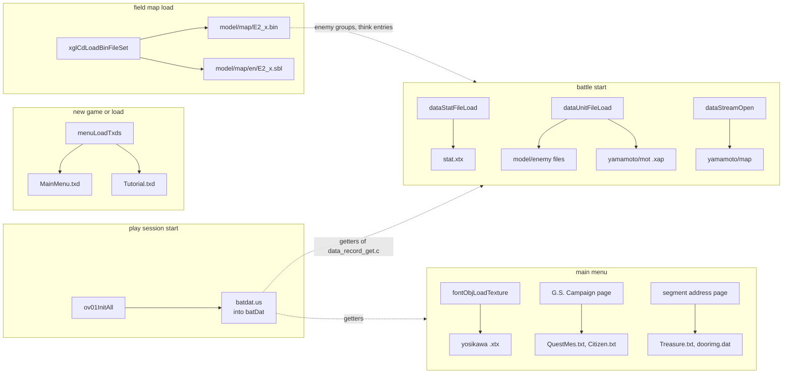
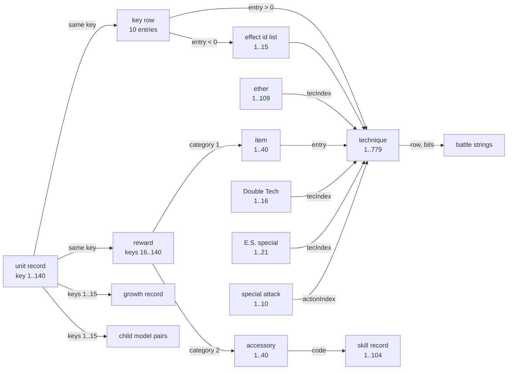
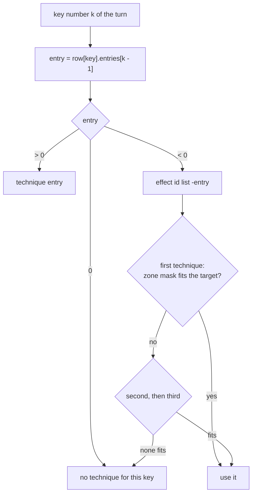
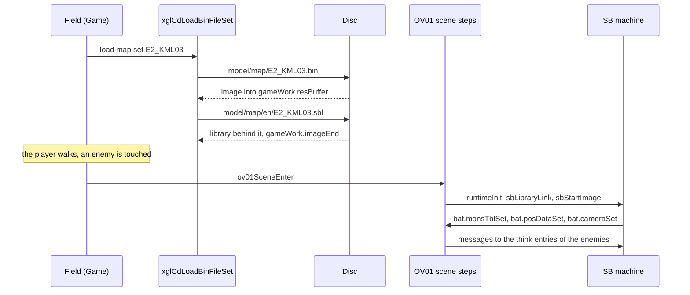
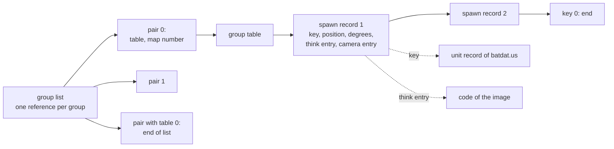
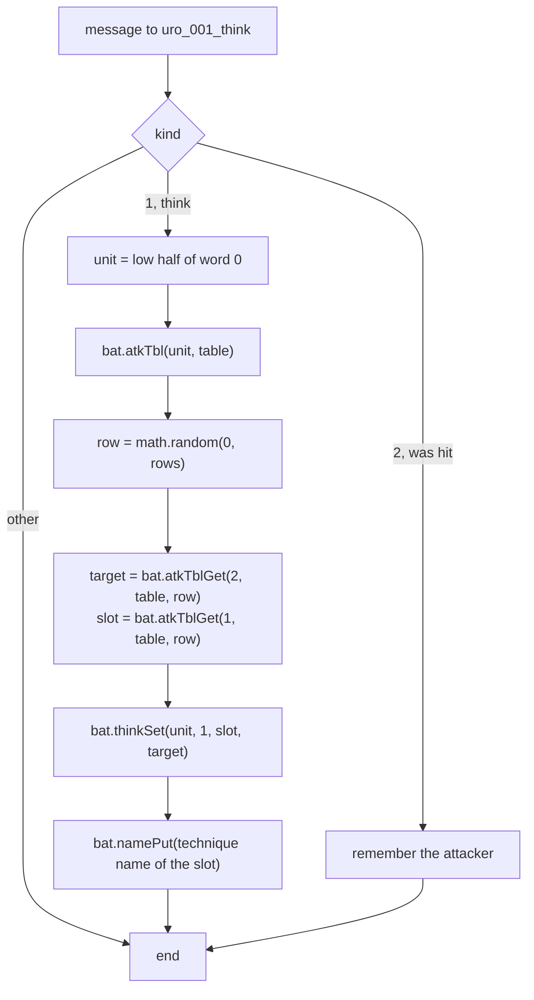
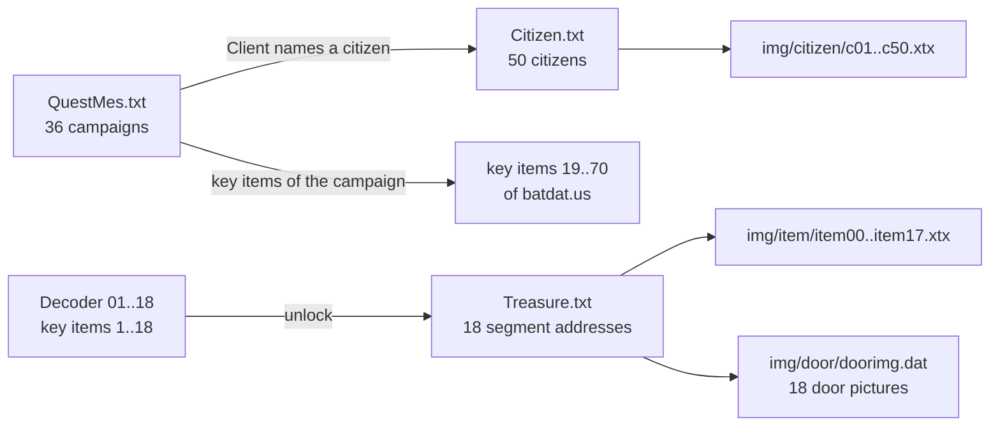

# Game data tables

The battle and growth rules of Xenosaga Episode II live in one binary file,
`yamamoto\batdat.us`. It holds every playable unit and every enemy, all 779
techniques, the ethers, the skills, the items, the accessories of the E.S.,
the key items, the Double Techs, the battle rewards, the experience table and
the growth curves in 19 tables. The decisions of the enemies are not in this
file. They are script images in the `SB` bytecode of the game, one per field
map that has battles, stored next to the map as `model\map\<map>.bin`.

Around these two sit the smaller tables of the menus and of the quest
screens. The directory `yosikawa\` holds the text tables of the main menu
(`.txd`), its textures, its background models and the model of the skill
board. The directory `iwase\` holds the plain text records of the G.S.
Campaign, of the citizens and of the segment address treasures, and the
pictures that go with them. A few picture packs with the extension `.bin`
share one small archive layout, and one file of 16 MiB holds nothing at all.

None of these tables has a magic number or a version field, except the
script images. The code finds every table through an offset header at the
start of the file. All multi-byte values are little-endian. Every file
described here is stored unpacked in the archive, and every one of them is
byte-identical on the two discs.

[← Back to the overview](../README.md) ·
[Files and resources](../architecture/files-and-resources.md)

## Contents

- [Files at a glance](#files-at-a-glance)
- [Shared conventions](#shared-conventions)
- [Battle data (batdat.us)](#battle-data-batdatus)
- [Battle scripts (the think scripts)](#battle-scripts-the-think-scripts)
- [Per-unit battle files](#per-unit-battle-files)
- [The HUD texture stat.xtx](#the-hud-texture-statxtx)
- [Menu data (yosikawa)](#menu-data-yosikawa)
- [Quest tables (iwase)](#quest-tables-iwase)
- [Picture packs and the other .bin files](#picture-packs-and-the-other-bin-files)
- [The .us extension](#the-us-extension)
- [Source files](#source-files)

## Files at a glance

The table lists every file group with its count on one disc, its size and
the code that reads it. All of them are in group 00, the common data that
both discs carry, except `16m.bin`. The parsers named in the later sections
were run on the copies of both discs.

| File | Count | Bytes | Read by | When |
|------|------:|------:|---------|------|
| `yamamoto\batdat.us` | 1 | 75,556 | `dataBatDatLoad` (OV01) | once, when a play session starts |
| `model\map\E2_*.bin` | 113 | 22,380 to 70,004 | `xglCdLoadBinFileSet` | with the field map |
| `model\map\en\E2_*.sbl` | 113 | 116 to 5,228 | `xglCdLoadBinFileSet` | with the field map |
| `yamamoto\stat\stat.xtx` | 1 | 262,224 | `dataStatFileLoad` (OV01) | battle start |
| `yamamoto\mot\*.xap` | 182 | 708 to 526,476 | `dataMotSetLoad`, `dataModelMotLoad`, `dataMotEntryLoad` | battle start, technique start |
| `model\enemy\*.pxy`, `.txy`, `.xhr`, `.epf` | 107, 107, 106, 103 | 400 to 596,448 | `dataUnitFileIdLoad` | battle start |
| `yamamoto\map\*.pxy`, `.txy` | 68, 68 | 16,944 to 1,529,952 | `dataStreamOpen` | battle start |
| `yosikawa\MainMenu.txd` | 1 | 11,224 | `menuLoadTxds` | new game, load |
| `yosikawa\Tutorial.txd` | 1 | 5,512 | `menuLoadTxds` | new game, load |
| `yosikawa\Location.txd` | 1 | 1,139 | the save screen (`save_screen.c`) | save screen opens |
| `yosikawa\*.xtx` | 10 | 46,160 to 262,224 | `fontObjLoadTexture` | menu opens, per page |
| `yosikawa\umn1.jpg` to `umn8.jpg` | 8 | 11,285 to 20,075 | `menuUmnImageLoad` | U.M.N. page |
| `yosikawa\model\*`, `yosikawa\skillmdl\*` | 13, 20 | 480 to 238,896 | `bgLayerLoad`, `menuSkillModelLoadOnce` | menu opens |
| `iwase\QuestMes.txt` | 1 | 39,563 | `yg2PathLoadQuestMessages` | G.S. Campaign screen |
| `iwase\Citizen.txt` | 1 | 10,005 | `yg2PathLoadCitizens` | G.S. Campaign screen |
| `iwase\Treasure.txt` | 1 | 4,141 | `ysegfLoadTreasure` | segment address screen |
| `iwase\img\door\doorimg.dat` | 1 | 191,600 | `ysegfInit` | segment address screen |
| `carddata.bin` | 1 | 8,448 | the save screen | save screen opens |
| `credit.bin` | 1 | 53,248 | `src/ov02/logo.c` | credit roll |
| `yajima\synopsis.bin` | 1 | 524,608 | `src/main/game_disk_change.c` | synopsis |
| `yajima\im.bin` | 1 | 149,120 | `src/main/game_over.c` | intermission |
| `yajima\titlebg2.bin` | 1 | 13,695,104 | `src/ov02/title.c` | title screen |
| `yajima\title.bin`, `title2.bin` | 2 | 917,504 each | `src/ov02/title.c` | title screen |
| `16m.bin` (groups 10 and 20) | 1 | 16,777,216 | nothing | never |

The diagram shows which part of the game reads each group. The battle
overlay OV01 stays loaded during field play, so the main menu calls its table
getters directly and never opens `batdat.us` itself.



## Shared conventions

**One-based ids.** Every table of `batdat.us` is indexed by an id that starts
at 1. The id 0 means "none" and ends every list. The getters of
`src/ov01/data_record_get.c` return `records[id - 1]` and return a null
pointer for an id above the limit that is compiled into each getter. The
limits are fixed numbers in the code. They do not come from the file, and for
two tables they disagree with the file (see
[Keys and key items](#keys-and-key-items)).

**Strings.** Text is EUC-JP: plain ASCII plus two-byte JIS X 0208 characters
with both bytes at 0xA1 or above. The English release still contains
Japanese text in the unused records, such as `予備１` ("spare 1") for the
unit ids 8 to 10. A line break inside a text is written as the two
characters `\` and `n`, 174 times in `batdat.us`. The font code turns the
pair into a new line (see [Text and fonts](text-and-fonts.md)).

**Text pairs.** A record that can be shown in a menu starts with two signed
halfwords, the struct `RecordTexts`. They are the offsets of a name
(`RECORD_TEXT_NAME`, 0) and of a description (`RECORD_TEXT_INFO`, 1), counted
from the start of the record's own table. The strings of a table follow its
last record, in record order and without gaps.

**Unit keys.** The **unit key** names every combatant and is the index of its
record. The source also calls it `charaId` and `key`.

| Keys | Meaning |
|------|---------|
| 1 to 7 | chaos, KOS-MOS, Shion, Jin, Ziggy, MOMO, Jr. |
| 8 to 10 | Unused character slots, named `予備１` to `予備３`, all numbers zero |
| 11 to 13 | E.S. Dinah, E.S. Zebulun, E.S. Asher |
| 14, 15 | Unused E.S. slots, named `予備４` and `予備５` |
| 16 to 140 | Enemies, 125 records |
| 141 to 143 | Not in the file. `batUnitRecordGet` gives such a key the party record named by the battle state's `slotIndex` (see [Battle system](../game/battle.md)) |

**Technique ids.** A **technique** is any action with a hit and damage
formula. One table covers all of them, so the id space is split into ranges
by user. The ranges below follow from the tables that refer to techniques,
and all 779 records were read.

| Technique ids | Count | Referenced by | Meaning |
|---------------|------:|---------------|---------|
| 1 to 7 | 7 | key row 1, effect id lists 1 and 2 | Attacks of chaos |
| 8 to 14 | 7 | key row 2, lists 3 and 4 | Attacks of KOS-MOS |
| 15 to 17 | 3 | lists 5 to 7 | Attacks of Shion |
| 18 to 24 | 7 | key row 4, lists 8 and 9 | Attacks of Jin |
| 25 to 30 | 6 | key row 5, list 10 | Attacks of Ziggy |
| 31 to 33 | 3 | lists 11 to 13 | Attacks of MOMO |
| 34 to 40 | 7 | key row 7, lists 14 and 15 | Attacks of Jr. |
| 41 to 43, 51 to 53, 61 to 63 | 9 | key rows 11 to 13 | The three basic attacks of each E.S. |
| 44 to 50, 54 to 60, 64 to 70 | 21 | E.S. special table | Seven specials per E.S. |
| 71 to 74 | 4 | special attack table | Special attacks of KOS-MOS |
| 75 to 80 | 6 | nothing | Spare records of the same class |
| 81 to 96 | 16 | Double Tech table | Double Techs |
| 97 to 629 | 533 | key rows 16 to 140 (340 of them) | Enemy techniques |
| 630 | 1 | nothing | Spare |
| 631 to 670 | 40 | item table | Effects of the 40 usable items |
| 671 to 779 | 109 | ether table | Effects of the 109 ethers |

## Battle data (batdat.us)

`dataBatDatLoad` in `src/ov01/data_file_load.c` reads the whole file with one
call, `dataFileLoad(dataBatDatPath, &batDat)`. The target `batDat` is a fixed
buffer of the main executable at `0x0061D040`. The file is 75,556 bytes long
and is never written back. `ov01InitAll` calls the loader once when a play
session starts, so the tables stay in memory through field play, menus and
battles (see [Battle engine](../game/battle-engine.md)).

The source comments call the file `bat.dat`. The path in the code and on the
disc is `yamamoto\batdat.us`. Both names mean the same file.

The parser `batdat.py` and the checker `verify_batdat.py` read the file of
both discs. The checker tests 83 structural statements, among them every
size, count and reserved field given in this section. All 83 hold on both
discs.

### Header

The file starts with a count, its own size and one offset per table. The
offsets count from the start of the file, are multiples of 4 and ascend, so
each table ends where the next one starts.

| Offset | Size | Type | Name | Value | Meaning |
|-------:|-----:|------|------|-------|---------|
| 0x00 | 4 | u32 | table count | 19 | Number of offset words that follow the size |
| 0x04 | 4 | u32 | file size | 0x12724 | 75,556, the length of the file |
| 0x08 | 4 | u32 | party unit table | 0x00054 | Read by `batUnitRecordGet` (`BAT_DAT_PARTY_UNITS`) |
| 0x0C | 4 | u32 | enemy unit table | 0x00624 | `BAT_DAT_ENEMY_UNITS` |
| 0x10 | 4 | u32 | `tecTableOffset` | 0x038DC | Techniques |
| 0x14 | 4 | u32 | `tableKeyRowsOffset` | 0x09A3C | Key rows |
| 0x18 | 4 | u32 | `effectIdListTableOffset` | 0x0A52C | Effect id lists |
| 0x1C | 4 | u32 | `slotPairTableOffset` | 0x0A588 | Child model pairs |
| 0x20 | 4 | u32 | `battleLookupTableOffset` | 0x0A63C | Ethers |
| 0x24 | 4 | u32 | `statusTableOffset` | 0x0C304 | Skills and equipment effects |
| 0x28 | 4 | u32 | `itemTableOffset` | 0x0D354 | Accessories |
| 0x2C | 4 | u32 | `hitActionTableOffset` | 0x0DB9C | Usable items |
| 0x30 | 4 | u32 | `batSecretKeyTableOffset` | 0x0E3E8 | Secret Keys |
| 0x34 | 4 | u32 | `batKeyItemTableOffset` | 0x0EBDC | Key items |
| 0x38 | 4 | u32 | `pairLinkTableOffset` | 0x10B10 | Double Techs |
| 0x3C | 4 | u32 | `calcLevelTableOffset` | 0x1101C | E.S. specials |
| 0x40 | 4 | u32 | `tgtIdTableOffset` | 0x11750 | Special attacks of characters |
| 0x44 | 4 | u32 | `tableKeyRecordsOffset` | 0x1194C | Rewards |
| 0x48 | 4 | u32 | `unitExpTableOffset` | 0x1211C | Experience table |
| 0x4C | 4 | u32 | `growthTableOffset` | 0x122A8 | Growth records |
| 0x50 | 4 | u32 | `stringTableOffset` | 0x12488 | Battle strings |

The first table starts at `0x54`, which is 8 plus 19 words. The code never
reads the table count or the file size.

Each getter owns the address of its header word as an external symbol. It
subtracts the position of the word in the header and adds the word, which
gives the address of the table in memory. The table below is the whole file
in address order. The record counts are those of the file.

| # | Offset | End | Record | Records | Texts | Getter |
|--:|-------:|----:|-------:|--------:|:-----:|--------|
| 1 | 0x00054 | 0x00624 | 0x5C | 15 | name | `batUnitRecordGet`, `batUnitNameGet` |
| 2 | 0x00624 | 0x038DC | 0x5C | 125 | name | `batUnitRecordGet`, `batUnitNameGet` |
| 3 | 0x038DC | 0x09A3C | 0x20 | 779 | | `tecRecordGet` |
| 4 | 0x09A3C | 0x0A52C | 20 | 140 | | `tableKeyRowGet` |
| 5 | 0x0A52C | 0x0A588 | 6 | 15 | | `effectIdListGet` |
| 6 | 0x0A588 | 0x0A63C | 12 | 15 | | `slotPairRowGet` |
| 7 | 0x0A63C | 0x0C304 | 12 | 109 | pair | `etherRecordGet` |
| 8 | 0x0C304 | 0x0D354 | 12 | 104 | pair | `skillRecordGet` |
| 9 | 0x0D354 | 0x0DB9C | 16 | 40 | pair | `accessoryRecordGet` |
| 10 | 0x0DB9C | 0x0E3E8 | 16 | 40 | pair | `usableItemRecordGet` |
| 11 | 0x0E3E8 | 0x0EBDC | 4 | 31 | pair | `dataBoxSecretKeyRecordGet` |
| 12 | 0x0EBDC | 0x10B10 | 8 | 107 | pair | `dataBoxKeyItemRecordGet` |
| 13 | 0x10B10 | 0x1101C | 16 | 16 | pair | `pairLinkGet` |
| 14 | 0x1101C | 0x11750 | 16 | 21 | pair | `attackLevelRecordGet` |
| 15 | 0x11750 | 0x1194C | 16 | 10 | pair | `attackTargetRecordGet` |
| 16 | 0x1194C | 0x1211C | 16 | 125 | | `enemyRewardRecordGet` |
| 17 | 0x1211C | 0x122A8 | 4 | 99 | | `dataExpTblGet` |
| 18 | 0x122A8 | 0x12488 | 0x20 | 15 | | `growthRecordGet` |
| 19 | 0x12488 | 0x12724 | 2 | 54 | strings | `stringOffsetsGet`, `tableStringGet` |

A table with texts is laid out as its records followed by its strings. The
text area is padded with fewer than four zero bytes so that the next table
starts on a multiple of 4. The effect id list table, 15 records of 6 bytes,
is followed by two zero bytes for the same reason.

```
batdat.us (75,556 bytes)
+-------------------------------+ 0x00000
| count 19, size, 19 offsets    |
+-------------------------------+ 0x00054
| party units   15 x 0x5C       |  records, then names
| enemy units  125 x 0x5C       |  records, then names
+-------------------------------+ 0x038DC
| techniques   779 x 0x20       |
| key rows     140 x 20         |
| effect lists  15 x 6          |
| child pairs   15 x 12         |
+-------------------------------+ 0x0A63C
| ethers       109 x 12 + texts |
| skills       104 x 12 + texts |
| accessories   40 x 16 + texts |
| items         40 x 16 + texts |
| Secret Keys   31 x 4  + texts |
| key items    107 x 8  + texts |
| Double Techs  16 x 16 + texts |
| E.S. specials 21 x 16 + texts |
| specials      10 x 16 + texts |
+-------------------------------+ 0x1194C
| rewards      125 x 16         |
| experience    99 x 4          |
| growth        15 x 0x20       |
| strings       54 offsets + text|
+-------------------------------+ 0x12724
```

The tables refer to each other by id. The technique table is the hub: ethers,
items, Double Techs and both kinds of specials are menu records that name a
technique, and the key rows name the techniques of the button attacks and of
the enemies.



### Unit records

Tables 1 and 2 hold one record of `0x5C` bytes per unit. Table 1 holds the
keys 1 to 15 and table 2 the keys 16 to 140. `batUnitRecordGet(index)`
returns the record and `batUnitNameGet(index)` the name, which for key 0 is
the string `NULL` of the executable.

The record is the first `0x5C` bytes of a `StatBlock`
(`include/ov01/unit_cmd.h`), the block of numbers that a unit owns during a
battle. `battleEntryLoad` copies the record into the block of an enemy, and
`dataPlUnitInit` builds the party slots from the records 1 to 15. The fields
from `0x5C` on (current HP, status rows, counters) exist only in memory. The
rules that use the fields are described in
[Battle system](../game/battle.md#the-stat-block).

| Offset | Size | Type | Name | Meaning |
|-------:|-----:|------|------|---------|
| 0x00 | 2 | s16 | name offset | Offset of the unit's name from the start of the unit table |
| 0x02 | 4 | s32 | `maxHp` | HP cap, stored at a 2-byte aligned offset and read unaligned |
| 0x06 | 2 | s16 | `maxEp` | EP cap. 99 for 114 of the 125 enemies |
| 0x08 | 2 | s16 | `physAttack` | Physical attack |
| 0x0A | 2 | s16 | `physDefence` | Physical defence |
| 0x0C | 2 | s16 | `magAttack` | Ether attack |
| 0x0E | 2 | s16 | `magDefence` | Ether defence |
| 0x10 | 1 | s8 | `hitRate` | Base of the hit roll, shown as Dexterity |
| 0x11 | 1 | s8 | `evadeRate` | Base of the evade roll |
| 0x12 | 1 | s8 | `valueBias` | Speed, shown as Agility. 1 to 19 in the used records, 6 to 8 for most |
| 0x13 | 1 | s8 | `expLevel` | Level. The party starts at 4 (chaos), 16 (KOS-MOS and Shion), 5 (Jin) and 8 (Ziggy, MOMO, Jr.), the E.S. at 20 or 21, the enemies at 1 or 8 |
| 0x14 | 1 | s8 | `state` | 1 for the characters, 4 for the E.S., 1 to 4 for enemies. At 4 or more the turn of the pose is damped |
| 0x15 | 1 | s8 | `subState` | The move kind of the unit: 0 for characters, 4 for the E.S., 0, 2, 3 or 4 for enemies |
| 0x16 | 1 | s8 | `counterBoostChance` | Chance of a counter Boost. Zero in all 140 records. Scripts and skills set it in memory |
| 0x17 | 1 | s8 | `inflictBase` | Base chance of the unit's status cures: 60 to 100 for the characters, 100 for 120 of the 125 enemies |
| 0x18 | 1 | s8 | `defaultHeightZone` | Zone mask in which the unit can be hit while it stands: 6 (zones B and C) for 111 of the 135 used records, 7 for the E.S. and 9 enemies |
| 0x19 | 1 | u8 | unknown | Zero in all records |
| 0x1A | 2 | s16 | `slidePercent` | Size of the unit's body area in hundredths (`unitDefArea`): 13 to 21 for the characters, 0 to 2,700 for enemies |
| 0x1C | 2 | u16 | `flags` | Unit traits, see below |
| 0x1E | 2 | s16 | `sequenceIndex` | Low half of the unit's effect key: 1 to 7 for the characters, 101 to 103 for the E.S., 501 to 731 for enemies |
| 0x20 | 4 | s8[4] | `breakZones` | The break zone sequence, one zone mask per step, ended by 0 |
| 0x24 | 8 | s8[8] | `attributeReaction` | Reaction to each attack attribute in twentieths: 20 is normal damage |
| 0x2C | 8 | s8[8] | `attributeReactionRoll` | Percent chance that the reaction applies. 100 in every used record |
| 0x34 | 4 | s8[4] | `effectCode` | Skill codes the unit starts with. Only the first byte is used: 0x2C for 31 enemies, zero otherwise |
| 0x38 | 16 | s8[16] | status resistance, row 1 | One byte per status bit of row 1. Bytes 11 to 15 are zero |
| 0x48 | 16 | s8[16] | status resistance, row 2 | One byte per status bit of row 2. Only the bytes 10, 11 and 12 are ever nonzero |
| 0x58 | 4 | u16[2] | `altMask[3]`, `altMask[4]` | Permanent status bits of rows 3 and 4. Zero in all records, filled in memory by skills |

The two resistance arrays are not named in the struct, which shows the bytes
`0x38` to `0x51` as unmodeled and lets the array `altMask` start at `0x52`.
Their meaning follows from `calcStatResist` in `src/ov01/calc.c`, which reads
the signed byte at `stats + 40 + row * 16 + bit index` for the rows 1 and 2.
That is `0x38` plus the bit index for row 1 and `0x48` plus the bit index for
row 2. The data agrees: the party records hold zeros, 111 of the 125 enemy
records hold values from 0 to 120 in the row 1 bytes, and the row 2 bytes
that are set belong to the bits `0x0400`, `0x0800` and `0x1000`, the statuses
that the string table calls H Lost, H Boost Lock and Curse.

The eight attack attributes share one bit order in the whole file. It is the
order of the technique's `actionBits`, of `slotValue`, and of the row 4
guard statuses.

| Index | Bit | Attribute | Evidence in the file |
|------:|-----|-----------|----------------------|
| 0 | 0x01 | Beam | Skill `Beam Coat` guards bit 0x01 of row 4 |
| 1 | 0x02 | Aura | `Aura Coat`, and the technique of the ether Aura Blast has `actionBits` 0x02 |
| 2 | 0x04 | Thunder | `Thunder Coat` |
| 3 | 0x08 | Fire | `Flame Coat`, and Flame Blast has `actionBits` 0x08 |
| 4 | 0x10 | Ice | `Ice Coat` |
| 5 | 0x20 | Pierce | `Spear Coat` |
| 6 | 0x40 | Slash | `Blade Coat` |
| 7 | 0x80 | Strike | `Hammer Coat` |

The labels of the main menu follow the same order: the entries 240 to 247 of
`MainMenu.txd` read `Bm`, `Au`, `Th`, `Fi`, `Ic`, `Pc`, `Sl`, `St`.

The trait bits of `flags` are explained on the
[battle page](../game/battle.md#unit-traits). The file uses them as follows.
The low two bits are a type number. The ether descriptions speak of "B or G
enemy" and "M enemy", and the records fit that reading: the characters have
type 0, the Gnosis records (`gno`) type 1 and the machines and the E.S.
type 2.

| Bits | Records that have it | Meaning |
|------|---------------------:|---------|
| 0x0003 = 0 | 7 characters, 37 enemies | Type 0, very likely the biological type B |
| 0x0003 = 1 | 31 enemies | Type 1, very likely Gnosis, G |
| 0x0003 = 2 | 3 E.S., 57 enemies | Type 2, very likely machines, M |
| 0x0004 | 11 enemies | Cannot be launched into the Air |
| 0x0008 | 4 enemies | Cannot be knocked Down |
| 0x0010 | 3 enemies | Zone hits from the front do not count |
| 0x0020 | 73 enemies | Never guards |
| 0x0040 | 86 enemies | Never evades |
| 0x0080 | 6 enemies | A bit of the unit's motion sequence |
| 0x0100 | chaos, Jin, Ziggy, Jr. | Unknown. No reader was found in the rule code |
| 0x0200 | 27 enemies | Analyze shows "Weak vs. Physical Attacks" |
| 0x0400 | 37 enemies | Analyze shows "Weak vs. Ether Attacks" |
| 0x0800 | 3 E.S., 27 enemies | Has a counter gauge |
| 0x1000 | 1 enemy | Unknown |
| 0x4000 | 1 enemy | Cannot be targeted |

A zone is one bit: 1 is zone A, 2 is zone B and 4 is zone C (see
[Battle system](../game/battle.md#break-zones-break-air-and-down)). The file
has 109 enemy records with a break sequence and 16 without one. The most
common sequences are B B (48 records), C B (13), C C (12) and B C (8). The
longest have four steps, such as C B A A or B C B C. No party record has a
sequence, so the characters and the E.S. cannot be broken.

**Worked example, key 1.** The record of chaos starts at `0x54`.

```
00054  64 05 e8 00 00 00 18 00 10 00 0d 00 13 00 10 00
00064  10 12 07 04 01 00 00 55 06 00 15 00 00 01 03 00
00074  00 00 00 00 14 14 14 14 14 14 14 14 64 64 64 64
00084  64 64 64 64 00 ...
```

The name offset `0x0564` (1,380) is 15 times `0x5C`, the first byte after the
party records, where the string `chaos` stands. HP is `0xE8` (232), EP 24.
The four fighting values are 16, 13, 19 and 16. Hit rate 16, evade rate 18,
speed 7, level 4. `state` is 1, `inflictBase` is `0x55` (85), the zone mask
is 6 and the body size 21. The flags are `0x0100` and the effect sequence
is 3. The break sequence is empty, the eight reactions are `0x14` (20, normal
damage) and the eight chances are `0x64` (100).

**Worked example, key 16.** The first enemy record at `0x624` is the Gnosis
Ai Apaec.

```
00624  ec 2c e0 1f 00 00 63 00 4a 00 1e 00 2a 00 0c 00
00634  37 30 06 01 02 04 00 64 06 00 6d 00 21 04 31 02
00644  02 02 00 00 28 14 3c 0f 0f 14 14 14 64 64 64 64
00654  64 64 64 64 00 00 00 00 28 00 3c 32 32 3c 1e 1e
00664  00 1e 00 00 00 00 00 00 00 00 00 00 00 00 00 00
00674  00 00 0a 0a 00 00 00 00 00 00 00 00
```

The name offset `0x2CEC` (11,500) is 125 times `0x5C`. HP is `0x1FE0`
(8,160), EP 99, the fighting values are 74, 30, 42 and 12, hit rate 55, evade
rate 48, speed 6. The flags `0x0421` mean type 1, never guards, weak against
ether attacks. The break sequence is B B. The reactions are 40 for beam
(double damage), 20 for aura, 60 for thunder (triple damage), 15 for fire and
ice, and 20 for the three physical attributes. The row 1 resistances are 40,
0, 60, 50, 50, 60, 30, 30, 0, 30 and 0 for the bits 0 to 10. The two bytes at
`0x76` and `0x77` give 10 against H Lost and H Boost Lock.

The enemy records come in families that share a name stem. The stem is the
name of the unit's motion file and of its script entries (see
[Battle scripts](#battle-scripts-the-think-scripts)). A record whose name is
only its stem in full-width letters, such as `ＧＮＯ０１３`, is a placeholder
with dummy numbers (8,000 or 800 HP, attack 100).

| Keys | Stem | Names in the file |
|------|------|-------------------|
| 16 to 34 | `gno001` to `gno019` | Ai Apaec, Deion, Aiakos, Kazfa Jina, Okypete, Svarozic, Perun, Stribog, Azazel, Armaros, Zwerg Kape, Ashmed Bapuz, placeholder, Arvakv, Rod Blondel, Wraith Virus, Grips Sister (two records), Wraith Feeler |
| 35 to 52 | `cre001` to `cre018` | Expression, Necessity, Vacillation, Information Type, Infected U.R.T.V., placeholder, Glare, Catharsis, Piercing Scream, Creation Type, Vive II Prototype, Calx II Prototype, Vive II Revised, Calx II Revised, Ortu Ria Kufli, Ortu Ria Lukia, Ortu Ria Hins, placeholder |
| 53 to 65 | `uma001` to `uma013` | Kfuga Lily, E2 Hauser, O-78 Grisly, Ratus TI Mk II, Carnicos I, Testud, Yacud Cannon, Revised Testud, Auto Intercept Pod, Kfuga Valy, Carnicos II, O-78 Grisly 2, placeholder |
| 66 to 80 | `uro001` to `uro015` | Stole Marine, Executus Sagitta, Cera 7 F, Cera 6 F, Executus Arma, Cera 7 S, Cera 6 S, Leviat, Leviat Officer, O-88 Delphinus, Anathema, Maranatha, Anathema Officer, Nova, Crescens |
| 81 to 92 | `uso001` to `uso012` | U-TIC Soldier A, U-TIC Soldier B, P.S.S. - P, P.S.S. - B, P.S.S. - P2, P.S.S. - B2, P.S.S. - C, P.S.S. - A, P.S.S. - S, P.S.S. - F, Ormus Knight A, Ormus Knight B |
| 93 to 95 | `vma001` to `vma003` | VSS Emissive, VSS Rayleigh, VSS Fresnel |
| 96 to 105 | stems of earlier records | Second versions that reuse a model: U-TIC Soldier A and B, Revised E2 Hauser, Infected U.R.T.V., Revised Carnicos I, P.S.S. - P2, P.S.S. - B2, P.S.S. - C, Testud II, O-78 Grisly 2 |
| 106 to 109 | `mon001` to `mon004` | Four placeholders |
| 110 to 140 | `bos001` to `bos031` | Margulis, O-88 Libra, Scutum, Pilum, Level 4, Albedo, Margulis, Scutum, Pilum, Orgulla, E.S. Issachar, Naglfar Cannons, Margulis, Inversion, Cathedral, Proto Ω, Patriarch, Albedo, Scarabeille, Dullea Soul, Nepos Rigas, Mad Skelter, Mikumari, Baal Zebul, Phobos Rigas, four placeholders, Orgulla, Dark Erde Kaiser |

### Technique records

Table 3 holds 779 records of `0x20` bytes, the struct `TecRecord` of
`include/ov01/data_record_get.h`. `tecRecordGet(index)` returns record
`index - 1` and a null pointer for an index of 0 or less. It has no upper
limit. The record is the central structure of the battle rules, and the
[battle page](../game/battle.md#technique) explains what each field does in a
fight. The table here adds the values that the file really contains.

| Offset | Size | Type | Name | Meaning | Values in the file |
|-------:|-----:|------|------|---------|--------------------|
| 0x00 | 1 | u8 | `flags` | Target flags: 0x01 own side, 0x02 other side, 0x04 self, 0x08 all, 0x10 defeated units, 0x20 ranged | 0x02 (361 records), 0x22 (186), 0x2A (142), 0x01 (34), ten other combinations |
| 0x01 | 1 | s8 | `code` | Range shape | 0 (739), 4, 5, 6, 7 |
| 0x02 | 2 | s16 | `scale` | Range size in percent | 0 (446 records), 50 to 2,400 |
| 0x04 | 1 | s8 | `evadeThreshold` | First hit roll | 90 (566 records), 100 (195), 50 to 120 for the rest |
| 0x05 | 1 | s8 | `guardThreshold` | Second hit roll | 85 (696 records), 90 (41), 0 to 100 for the rest |
| 0x06 | 1 | s8 | `type` | 0 physical, 1 ether, 2 item | 459, 281 and 39 records |
| 0x07 | 1 | s8 | `kindBits` | Effect kind of an attack or ether, effect bits of an item | 1 (629 records), 4 (78), 0, 2, 3, 5 to 8, 16, 32, 64 |
| 0x08 | 2 | u16 | `hitFlags` | Hit options | Bits 0x001, 0x004, 0x008, 0x010, 0x020, 0x100, 0x200, 0x400 |
| 0x0A | 1 | s8 | `epCost` | EP cost | 0 (687 records), 2 to 60 |
| 0x0B | 1 | s8 | `waitWeight` | Wait weight added to the user's next turn | 0 (719), 1 to 6 |
| 0x0C | 2 | u16 | `attributeBits` | Low byte: attack attributes. 0x100 knocks Down, 0x200 launches into the Air, 0x400 with both | Bits 0x001 to 0x400 |
| 0x0E | 1 | u8 | `power` | Power | 0 to 250 |
| 0x0F | 3 | s8[3] | `modeGuard` | One byte per unit type | All zero in 754 records |
| 0x12 | 4 | s8[4] | `strikeZones` | Zone mask of each hit of the technique, ended by 0. Bit 0x08 asks for a target that is Down, bit 0x10 for the staging flag | 2 2, 2 4, 4 4, 4 2, 6, 7, 12, 28 and others |
| 0x16 | 1 | s8 | `inflictRate` | Base chance of the status effect | 0, 25 to 100 |
| 0x17 | 1 | s8 | `row` | Status row it inflicts or cures | 0 (633), 1 (105), 2 (17), 3 (10), 4 (14) |
| 0x18 | 2 | u16 | `bits` | Status bits of that row | |
| 0x1A | 2 | s16 | `effectRecord` | Effect record of the technique | 0 to 514 |
| 0x1C | 1 | s8 | `techClass` | Technique class | 0 (574), 1 (16), 2 (79), 3 (30), 4 (21), 5 (10), 6 (4), 7 (2), 9 (40), 10 (3) |
| 0x1D | 1 | s8 | `phase` | Motion phase of the user | 0, 1, 45 to 51 |
| 0x1E | 2 | s16 | `motionIndex` | Nonzero selects a timed motion phase | 0 (729), 168 to 217 |

The classes of `gateFlag` fill the id ranges exactly. The 16 records of
class 1 are the Double Techs 81 to 96. The 21 records of class 4 are the E.S.
specials. The ten records of class 5 are 71 to 80. The 40 records of class 9
are the item effects 631 to 670, and the classes 2 and 3 are the 109 ether
effects: 79 records of class 2 and the 30 records 730 to 759 of class 3,
the combined ethers. The classes 6, 7 and 10 are
the nine basic attacks of the three E.S.

The 50 nonzero values of `timer` are all different and run from 168 to 217.
These are indices of the motion name table `dataMotNameTbl` of
`src/ov01/data_file_load.c`, whose entries 168 to 171 are `kosm_sp01` to
`kosm_sp04`, 172 to 177 empty, 178 to 198 the specials of the three E.S., 199 to 214 `db01` to
`db16` and 215 to 217 `gattai01` to `gattai03`. Technique 71 holds 168,
technique 44 holds 178, technique 81 holds 199 and the three Erde Kaiser
Fury ethers hold 215 to 217. A nonzero `timer` is therefore also the number
of the motion file that the technique plays (see
[Per-unit battle files](#per-unit-battle-files)).

**Worked example, technique 1.** The first record at `0x38DC` is the first
button attack of chaos.

```
038dc  02 00 a0 00 5a 55 00 01 00 00 00 00 82 00 14 00
038ec  00 00 02 02 00 00 00 00 00 00 01 00 00 2d 00 00
```

Target flags `0x02`: one unit of the other side, reached on foot. Range size
160 percent. Hit thresholds 90 and 85. Type 0 (physical), kind 1, no hit
options, no EP cost. `actionBits` is `0x0082`, strike plus aura. Power 20.
The two hits strike zone B and zone B. Effect record 1, class 0, motion
phase `0x2D` (45).

The techniques 1 to 4 strike the zones B B, B C, C C and C B. The main menu
shows the same four zone labels for the first four entries of chaos's Tech
list, whose names are the entries 80 to 83 of `MainMenu.txd`: Spirit Touch,
Angel Blast, Divine Seal and Spirit Cross. The order of the Tech list is a
table in the executable (`attackRecordTable`), so this link between a
technique number and a name is a reading of two parallel orders, not a field
of the file.

### Key rows and effect id lists

Table 4 has 140 rows of ten signed halfwords (`TableKeyRow`), one row per
unit key. `tableKeyRowGet(key)` returns row `key - 1` without a range check.
An entry is 0 (nothing), a technique number, or a negative number `-n` that
names effect id list `n`.

For a character, entry `k - 1` belongs to the **key number** `k` of the
button combination that the player entered (see
[Battle system](../game/battle.md#button-combinations)). For an enemy the
entries are simply its techniques, and the battle script picks one by its
entry index.

| Row | Unit | Entries |
|----:|------|---------|
| 1 | chaos | 0, 0, 1, 2, 3, 4, -1, -2, -2, -2 |
| 2 | KOS-MOS | 0, 0, 8, 9, 10, 11, -3, -4, -4, -4 |
| 3 | Shion | 0, 0, 0, 0, 0, 0, -5, -6, -7, -5 |
| 4 | Jin | 0, 0, 18, 19, 20, 21, -8, -9, -9, -9 |
| 5 | Ziggy | 0, 0, 25, 26, 27, 28, -10, -10, -10, -10 |
| 6 | MOMO | 0, 0, 0, 0, 0, 0, -11, -12, -13, -11 |
| 7 | Jr. | 0, 0, 34, 35, 36, 37, -14, -15, -15, -15 |
| 11 | E.S. Dinah | 41, 42, 43, 0, ... |
| 12 | E.S. Zebulun | 51, 52, 53, 0, ... |
| 13 | E.S. Asher | 61, 62, 63, 0, ... |
| 16 | Ai Apaec | 97, 98, 0, ... |
| 140 | Dark Erde Kaiser | 627, 628, 629, 0, ... |

The entries 0 and 1 of a character are empty because the key numbers 1 and 2
are the first button of a pair and run no technique. The entries 2 to 5 are
the four two-button attacks. The entries 6 to 9 are the Circle attacks, which
cost Stock. Negative entries occur only in the rows 1 to 7. Of the 125 enemy
rows, 114 are used. An enemy has between one and seven techniques, and the
enemy techniques are numbered in the order of the enemy records from 97 to
629.

Table 5 has 15 **effect id lists** of three halfwords each
(`effectIdListGet`). `battleEffectResolve` in `src/ov01/calc.c` walks a list
and returns the first technique whose first zone mask fits the state of the
target: a technique with bit `0x08` needs a target that is Down, one with bit
`0x10` needs the staging flag of the user, and the zone bits must meet the
current height of the target. This is how one button gives a different
attack against an enemy on the ground.

| List | Techniques | List | Techniques | List | Techniques |
|-----:|------------|-----:|------------|-----:|------------|
| 1 | 6, 5 | 6 | 16, 15 | 11 | 31, 31 |
| 2 | 7, 6, 5 | 7 | 17, 15 | 12 | 32, 31 |
| 3 | 13, 12 | 8 | 23, 22 | 13 | 33, 31 |
| 4 | 14, 13, 12 | 9 | 24, 23, 22 | 14 | 39, 38 |
| 5 | 15, 15 | 10 | 30, 29 | 15 | 40, 39, 38 |

For chaos, list 1 tries technique 6 first. Its zone mask is 12, zone C plus
the Down bit, so it is the attack on a downed enemy. If the target stands,
the list falls through to technique 5 with the mask 6, zones B and C.



### Child model pairs

Table 6 has 15 records of 12 bytes, one per party key
(`slotPairRowGet`, valid for the keys 1 to 15). A record is three pairs of
unsigned halfwords (`ShortPair`). `dataPlUnitInit` copies the first halfword
of each pair to `StatBlock.pairFirst[]` and the second to `pairSecond[]`. The
first halfword is the number of a child model in `dataModelNameTbl`, the
weapons and props that a unit carries. The second is the value with which
the model is attached.

| Key | Unit | Pairs (model, attach value) | Models by `dataModelNameTbl` |
|----:|------|-----------------------------|------------------------------|
| 2 | KOS-MOS | (1, 0x4000), (2, 0x4000) | `kos_hw01`, `kos_hw02` |
| 3 | Shion | (8, 0x4001), (7, 0) | `jin_sw01`, `sh_box01` |
| 4 | Jin | (8, 0x4001), (9, 0) | `jin_sw01`, `jin_saya` |
| 6 | MOMO | (0, 0), (10, 0) | `mm_ym01` |
| 7 | Jr. | (11, 0), (12, 1) | `jr_gun01b` twice |
| 13 | E.S. Asher | (20, 10), (19, 11), (21, 0x4008) | `pcr05_sh01`, `pcr05_mg01`, `pcr05_br01` |

The other nine records are zero. The first pair of Shion names model 8, the
sword of Jin. Whether the game ever shows it for her was not established.
The exact meaning of the bit `0x4000` and of the low bits of the attach
value is not known. The low bits are small numbers, as joint numbers are.

### Ethers

Table 7 has 109 records of 12 bytes, the struct `EtherRecord`. The
source calls the table the "battle lookup". `etherRecordGet(index)` accepts
the indices 1 to 109 (`index < 0x6E`). The ether number is also the bit
number in the list of ethers a party member has learned
(see [Party and growth](../game/party-and-growth.md#skills-and-ethers-in-the-source-names)).

| Offset | Size | Type | Name | Meaning |
|-------:|-----:|------|------|---------|
| 0x00 | 2 | s16 | `texts.text[0]` | Offset of the name |
| 0x02 | 2 | s16 | `texts.text[1]` | Offset of the description |
| 0x04 | 2 | | unknown | Zero in all records |
| 0x06 | 2 | u16 | `flags` | 0, `0x4000` or `0x8000` |
| 0x08 | 2 | s16 | `tecIndex` | The technique the ether performs. Always 670 plus the ether number |
| 0x0A | 1 | u8 | `firstCode` | First component of a combined ether, an ether number |
| 0x0B | 1 | u8 | `secondCode` | Second component |

The flag `0x4000` is set on 40 of the first 51 ethers. `calcCopyParaMake`
lets E.S. Zebulun inherit the ethers of its pilot that carry it. The flag
`0x8000` is set on the three Erde Kaiser Fury records only.

| Ethers | Contents | Examples |
|--------|----------|----------|
| 1 to 51 | The ethers of the skill board | 1 Medica, 2 Medica 2, 3 Medica All, 7 Revert, 31 Flame Blast, 38 Prayer, 40 Boost 1, 42 Analyze, 43 Psycho Pocket, 47 Best Ally |
| 52 to 57 | The six ethers that only Shion learns | Erde Storm, Erde Beam, Erde Quake and three records named Erde Kaiser Fury (slash, piercing, thunder) |
| 58, 59 | Spare | `予備１`, `予備２` |
| 60 to 88 | 29 combined ethers | 60 Double Medica (1 + 1), 80 Flame Storm (31 + 31), 85 Flame Burst (31 + 34), 88 Pocket Rare (42 + 43) |
| 89 | Spare combined ether | `合体３０` ("combination 30") |
| 90 to 109 | 20 enemy ethers without description | `敵０1` to `敵20` ("enemy 01" to "enemy 20") |

**Worked example, ether 1.** The record at `0xA63C` is
`1c 05 23 05 00 00 00 40 9f 02 00 00`. The name is at table offset `0x051C`
(1,308, which is 109 times 12, the first byte after the records) and reads
`Medica`. The description at `0x0523` reads `One ally (EP 2)\nLow HP recovery
relative to Ether Attack.` The flags are `0x4000`. The technique is `0x029F`
(671), whose record has target flags `0x21` (own side, ranged), type 1
(ether), kind 2 and an EP cost of 2, the same 2 that the description names.

### Skills and equipment effects

Table 8 has 104 records of 12 bytes, the struct `SkillRecord`.
`skillRecordGet(index)` accepts 1 to 104. One record describes one passive
effect. A character holds such effects as learned and equipped skills, an
E.S. gets them from its accessories, and an enemy record can name one in
`effectCode`.

| Offset | Size | Type | Name | Meaning |
|-------:|-----:|------|------|---------|
| 0x00 | 2 | s16 | `texts.text[0]` | Offset of the name |
| 0x02 | 2 | s16 | `texts.text[1]` | Offset of the description |
| 0x04 | 2 | | unknown | Zero in all records |
| 0x06 | 2 | u16 | `slotFlags` | 0 (66 records), `0x2000` (21), `0x8000` (10) or `0xA000` (7) |
| 0x08 | 2 | u16 | `flags` | The class of the effect in the high byte, parameters in the low byte |
| 0x0A | 2 | u16 | `code` | A selector mask in the high bits and a value in the low seven bits, or a status bit mask |

The battle rules read `flags` and `code` in the ways that
[Battle system](../game/battle.md#skills-and-equipment-in-the-rules)
describes. The file shows how the designers filled them.

| `flags` | Records | Reading of `flags` low byte and `code` | Example |
|---------|--------:|-----------------------------------------|---------|
| `0x8000` | 13 | `code` high bits select the stat, low seven bits are the amount | 29 `STR+2`: code `0x8002`, physical attack plus 2 |
| `0x4000` | 15 | Low nibble is the status row, `code` the permanent status bits | 45 `EP Regen`: flags `0x4003`, code `0x1000`, row 3 bit `0x1000` |
| `0x2000` | 26 | Low nibble is a row mask (1 row 1, 2 row 2), the next nibble the number of 5 percent steps, `code` the status bits whose resistance rises | 5 `Poison Guard`: flags `0x2051`, code `0x0002`, 25 percent for row 1 bit `0x0002` |
| `0x0800` | 11 | Summed by `calcSkill` with a `code` mask: critical, guard, healing and others | 1 `HP Mind 10`: code `0x800A`, healing received plus 10 percent |
| `0x0400` | 6 | Rewards: rare drops, skill points, experience | 21 `Experience Up 10`: code `0x800A` |
| `0x0200` | 5 | The Stock command | 26 `Focus 1`: code `0x800A`, 10 percent EP |
| 0 | 28 | No table-driven effect. The rules test the record number itself (`calcSkillEquChk`) or the record is a spare | 41 `EP Half`, 50 `First Combo` |

The description of record 53, `ST Resist 20`, says "Status effect resistance
+20%". Its fields are flags `0x204F` and code `0xFFFF`: four steps of 5
percent, both rows, every bit. Record 54, `ST Resist 30`, has `0x206F`. The
reading of the two nibbles comes from these matches between text and bytes.

The records form four groups by number.

| Records | Contents |
|---------|----------|
| 1 to 28 | Skills of the first equip tab: `HP Mind 10`, `Poison Guard`, `Expansion Pack`, `Memory`, `Break B10`, `Rapid Refresh`, `Experience Up 10`, `Guard`, `Focus 1`, `Inner Peace` and others |
| 29 to 62 | Skills of the second tab: `STR+2` to `EDEF+2`, `Limiter Up`, `Double Power`, `CRTC+5`, `Rare+10`, `EP Half`, `Revenge Power`, `EP Regen`, `Samurai Soul`, `Last Revenge`, `Ether Burst`, `First Combo`, `Rebound`, `Overload`, `ST Resist 20`, the eight `Coat` skills |
| 63, 64 | `Swimsuit`, the bonus for Episode I save data, and a spare |
| 65 to 104 | The effects of the 40 accessories. Their names are only the numbers `1` to `40` and they have no description |

### Accessories

Table 9 has 40 records of 16 bytes, the struct `EsAccessoryRecord`.
`accessoryRecordGet(index)` accepts 1 to 40. These are the accessories that an
E.S. equips, inventory box 2 (see
[Party and growth](../game/party-and-growth.md#the-boxes)).

| Offset | Size | Type | Name | Meaning |
|-------:|-----:|------|------|---------|
| 0x00 | 2 | s16 | `texts.text[0]` | Offset of the name |
| 0x02 | 2 | s16 | `texts.text[1]` | Offset of the description |
| 0x04 | 6 | | unknown | Zero in all records |
| 0x0A | 2 | s16 | `code` | The skill record the accessory grants. Always 64 plus the accessory number |
| 0x0C | 2 | s8[2] | `mapModel` | Model of the pickup on the field, by player form. (5, 4) in all records |
| 0x0E | 2 | | unknown | Zero in all records |

Accessory 1 is `Auxiliary Armor A`, "Arm +30". Its `code` is `0x41` (65), and
skill record 65 has flags `0x8000` and code `0x401E`: the selector `0x4000`
is physical defence and the amount is 30. Accessory 36, `EMAX300`, grants
record 100, the number that the battle rules test for the energy cap of 300.
Twelve of the 40 records are spares named `予備`. The used ones include `EF
Circuit A`, `Anti-Fire Armor`, `Tuned Circuit`, `Charge Boost`, `Power
Shield`, the `G ... Guard` series, `Quick Charge` and `Auto Recover`.

### Items

Table 10 has 40 records of 16 bytes, the struct `UsableItemRecord`. `usableItemRecordGet`
accepts 1 to 40. These are the usable items, inventory box 1.

| Offset | Size | Type | Name | Meaning |
|-------:|-----:|------|------|---------|
| 0x00 | 2 | s16 | `texts.text[0]` | Offset of the name |
| 0x02 | 2 | s16 | `texts.text[1]` | Offset of the description |
| 0x04 | 2 | u16 | `flags` | Use conditions, tested by `dataSlotKeyTest` |
| 0x06 | 2 | | unknown | Zero in all records |
| 0x08 | 2 | s16 | `entry` | The technique of the item. Always 630 plus the item number |
| 0x0A | 2 | s8[2] | `mapModel` | Model of the pickup on the field, by player form: (0, 2) for the items 1 to 21, (1, 3) for 22 to 40 |
| 0x0C | 2 | s16 | `amount` | Strength of the effect |
| 0x0E | 2 | | unknown | Zero in all records |

What the item does is in its technique. The byte `kindBits` of that record is
a set of effect bits, and `amount` scales it
(see [Battle system](../game/battle.md#item)).

| Items | Names | `flags` | Technique effect bits | `amount` |
|-------|-------|---------|-----------------------|----------|
| 1 to 4 | Med Kit S, M, L, DX | `0xE000` | 0x01, restores HP | 1, 2, 3, 4 quarters of the cap |
| 5 to 7 | Ether Pack S, M, DX | `0xE000` | 0x02, restores EP | 1, 2, 4 |
| 8 to 10 | Rejuvenator M, DX, E | `0xE000` | 0x03, both. Item 10 has target flag 0x08, all allies | 2, 4, 4 |
| 11, 12 | Antidote L, H | `0x4000` | 0x04, cures a status row | 0 (row 1), 1 (row 2) |
| 13, 14 | Revive S, DX | `0x4000` | 0x08, with target flag 0x10 for defeated units | 1, 4 |
| 15 | Boost Max | `0x4000` | 0x40, special | 0 |
| 16 | CF Bomb | 0 | 0x01, aimed at the other side | 0 |
| 17 | Hemlock | `0x4000` | 0x40 | 2 |
| 21 | Bio Sphere | `0x2000` | 0x40 | 1 |
| 22 to 26 | Skill Upgrade A to E | `0x8000` | 0x10, skill points | 10, 30, 50, 100, 500 |
| 27 to 29 | Class Upgrade A to C | `0x8000` | 0x20, class points | 10, 50, 100 |
| 30 to 32 | Nano Repair A, Nano Repair Z, Nano Sphere | `0x9000` | 0x03 and 0x40, E.S. only | 1, 2, 1 |
| 33 to 35 | Scrap Iron, Junked Circuit, Ether Core | 0 | none | 0 |
| 37 to 40 | Awakening I to IV | 0 | none | 0 |

The items 18 to 20 and 36 are spares. The four Awakening items teach a Double
Tech through a script, and their descriptions name the pairs: Jr. and MOMO,
Shion and KOS-MOS, Jin and Shion, chaos and MOMO. The notices 440 to 443 of
`MainMenu.txd` name the four attacks: Silver Duet, Gravity Bomb, Phoenix
Blade and Blessed Miracle, the records 8, 7, 16 and 12 of the Double Tech
table below.

The flag bits are not named in the source. Their distribution suggests
`0x8000` for items that can be used from the main menu, `0x4000` for items
that can be used in a character battle and `0x1000` for E.S. items. This
reading comes from the item list alone.

**Worked example, item 1.** The record at `0xDB9C` is
`80 02 8a 02 00 e0 00 00 77 02 00 02 01 00 00 00`. Name at `0x0280` (640, the
end of the 40 records): `Med Kit S`. Description: `Recover 25% of MAX HP.`
Flags `0xE000`, technique `0x0277` (631), field models 0 and 2, amount 1.
The rule restores `maxHp * amount / 4`, which is the 25 percent of the
description.

### Keys and key items

Tables 11 and 12 hold the names of the inventory boxes 4 and 3. Neither has
battle numbers.

Table 11 has 31 records of 4 bytes, each only a `RecordTexts` pair. They are
the Secret Keys 1 to 31 that open the locked skills of the skill board. The
description of each key names its skill, for example `Key to open the Lv 1
Class H skill, Psycho Pocket.` for key 1 and `Key to open the Lv 4 Class D
skill, Rebound.` for key 31. The 31 keys match the 31 locked positions of
the board (see [Party and growth](../game/party-and-growth.md#skills)).

Table 12 has 107 records of 8 bytes, the struct `TextRecord8`.

| Offset | Size | Type | Name | Meaning |
|-------:|-----:|------|------|---------|
| 0x00 | 2 | s16 | `texts.text[0]` | Offset of the name |
| 0x02 | 2 | s16 | `texts.text[1]` | Offset of the description |
| 0x04 | 2 | s8[2] | `mapModel` | Model of the pickup on the field, by player form |
| 0x06 | 2 | | unknown | Zero in all records |

| Records | Contents | `mapModel` |
|---------|----------|------------|
| 1 to 18 | `Decoder 01` to `Decoder 18`, one per segment address | (7, 3) |
| 19 to 70 | The objects of the G.S. Campaign: `Love Letter`, `ZAZA's Clue 1` to `7`, `Spade Letter`, `Facility Key`, `Spring Seed`, `Sequencer A`, `Wedding Ring`, `Teddy Bear`, `Statue Blueprint`, `Sidney's Letter` and others | (12, 3) |
| 71 to 76 | The six robot parts: right arm, left arm, right leg, left leg, head, body | (10, 10), (11, 11), (8, 8), (9, 9) |
| 77 to 107 | `Secret Key 1` to `Secret Key 31` again, with the description worded `Level 1 Class H` | (0, 0) |

The second copy of the Secret Keys explains a rule of the main menu: every
held key `i` of box 4 adds key item `i + 76` to box 3, so that the keys show
up in the Key Items list.

Both getters are compiled with the limit 99 (`index < 0x64`). The file
disagrees in both directions. `dataBoxSecretKeyRecordGet` accepts the indices
32 to 99, which lie in the text area of table 11 and have no record.
`dataBoxKeyItemRecordGet` returns a null pointer for the records 100 to
107, the Secret Keys 24 to 31, although they exist. The text functions are
not affected, because `dataBoxCategory3TextGet` and
`dataBoxCategory4TextGet` take the address of record 1 and index from there
without a check.

### Double Techs

Table 13 has 16 records of 16 bytes, the struct `DoubleTechRecord`. `pairLinkGet`
accepts 1 to 16. The source says "pair" for a Double Tech.

| Offset | Size | Type | Name | Meaning |
|-------:|-----:|------|------|---------|
| 0x00 | 4 | s16[2] | `texts` | Name and description |
| 0x04 | 4 | | unknown | Zero in all records |
| 0x08 | 2 | s16 | `tecIndex` | The technique, 80 plus the record number |
| 0x0A | 2 | s16 | `requiredLevel` | Stock that both partners need: 1, 2 or 3 |
| 0x0C | 2 | s16 | `slotFirst` | Unit key of the first partner |
| 0x0E | 2 | s16 | `slotSecond` | Unit key of the second partner |

| # | Name | Stock | Partners | # | Name | Stock | Partners |
|--:|------|------:|----------|--:|------|------:|----------|
| 1 | Ice Brand | 2 | Jin, chaos | 9 | Power Strike | 3 | Ziggy, MOMO |
| 2 | Burst Veil | 1 | Shion, MOMO | 10 | Lion Heart | 2 | Jin, Shion |
| 3 | Elemental Nocturne | 2 | Jr., chaos | 11 | Cross Hilbert | 2 | KOS-MOS, MOMO |
| 4 | Archangel's Requiem | 2 | Jr., Shion | 12 | Blessed Miracle | 3 | MOMO, chaos |
| 5 | Dual Spell Ray | 2 | Shion, chaos | 13 | Twin Buster | 3 | Shion, KOS-MOS |
| 6 | Cross Fist | 2 | Ziggy, KOS-MOS | 14 | Grand Ronde | 3 | KOS-MOS, chaos |
| 7 | Gravity Bomb | 2 | Shion, KOS-MOS | 15 | Fiery Ritornelle | 2 | Ziggy, Jr. |
| 8 | Silver Duet | 2 | Jr., MOMO | 16 | Phoenix Blade | 3 | Jin, Shion |

Record 8 at `0x10B80` is `cf 02 db 02 00 00 00 00 58 00 02 00 07 00 06 00`:
technique `0x58` (88), Stock 2, partners 7 (Jr.) and 6 (MOMO). The
descriptions carry the target, the type and the attributes in a fixed form,
for example `Single enemy/E/Non-elemental\nChain of punishment.` for Silver
Duet.

### E.S. specials

Table 14 has 21 records of 16 bytes, the struct `EsSpecialRecord`.
`attackLevelRecordGet` accepts 1 to 21. Seven records belong to each E.S., in
the order Dinah, Zebulun, Asher.

| Offset | Size | Type | Name | Meaning |
|-------:|-----:|------|------|---------|
| 0x00 | 4 | s16[2] | `texts` | Name and description |
| 0x04 | 4 | | unknown | Zero in all records |
| 0x08 | 2 | s16 | `tecIndex` | The technique: 44 to 50, 54 to 60 and 64 to 70 |
| 0x0A | 2 | s16 | `requiredLevel` | Energy the special costs: 100, 200 or 300 |
| 0x0C | 2 | u16 | `entryMask` | The sub pilots who give the special, one bit per character |
| 0x0E | 2 | | unknown | Zero in all records |

The bit of a character in `entryMask` is `0x8000 >> (key - 1)`, as the table
`calcTables.entryMasks` of `src/ov01/calc.c` shows: `0x8000` chaos, `0x2000`
Shion, `0x1000` Jin, `0x0800` Ziggy. The bits of KOS-MOS, MOMO and Jr. never
occur, because these three are the main pilots.

| E.S. | Energy 100 | Energy 200 | Energy 300 |
|------|------------|------------|------------|
| Dinah | Spiral Fist (chaos, Shion, Jin, Ziggy) | Tornado Fist (Shion), Twin Dragons (Jin), Chained Blast (chaos), Meteor Storm (Ziggy) | X-BUSTER (Shion), Iron Blade (Jin) |
| Zebulun | Rain Arrow (all four) | Starlight Arrow (Shion), Golden Bow (Jin), Ice Rondo (chaos), Power Kick (Ziggy) | Aird (all four), Meteor Blast (Ziggy) |
| Asher | Shot Buster (all four) | Gatling Blast (Shion), Wings of Light (Jin), Ice Storm (chaos), Corona Buster (Ziggy) | Odin Buster (chaos, Shion), Moonlight Blade (Jin) |

### Special attacks of characters

Table 15 has 10 records of 16 bytes, the struct `SpecialAttackRecord`.
`attackTargetRecordGet` accepts 1 to 10. Only the first four records are filled. The
others are named `予備１` to `予備６` and hold zeros.

| Offset | Size | Type | Name | Meaning |
|-------:|-----:|------|------|---------|
| 0x00 | 4 | s16[2] | `texts` | Name and description |
| 0x04 | 4 | | unknown | Zero in all records |
| 0x08 | 2 | s16 | `actionIndex` | The technique, 71 to 74 |
| 0x0A | 2 | s16 | `modelIndex` | Extra model of `dataModelNameTbl` that the attack loads, 0 for none |
| 0x0C | 2 | u16 | `modelJoint` | The value with which that model is attached |
| 0x0E | 2 | s16 | `minLevel` | Stock cost |

| # | Name | Technique | Model | Stock |
|--:|------|----------:|-------|------:|
| 1 | MINIGUN | 71 | 3, `kos_sw01` | 1 |
| 2 | MICRO MISSILE | 72 | none | 2 |
| 3 | DRAGON BLADE | 73 | 5, `kos_sw03` | 1 |
| 4 | X-BUSTER | 74 | none | 3 |

All four are weapons of KOS-MOS, the only character who starts with special
attack marks.

### Rewards

Table 16 has 125 records of 16 bytes, one per enemy key from 16 to 140. The
partial struct `EnemyRewardRecord` names its fields.

| Offset | Size | Type | Name | Meaning |
|-------:|-----:|------|------|---------|
| 0x00 | 4 | s32 | `exp` | Experience |
| 0x04 | 2 | s16 | `skillPoints` | Skill points |
| 0x06 | 2 | s16 | `flat` | Class points |
| 0x08 | 1 | u8 | `secondChance` | Percent chance of the normal drop |
| 0x09 | 1 | u8 | `firstChance` | Percent chance of the rare drop |
| 0x0A | 1 | u8 | `secondCategory` | Inventory box of the normal drop: 0 none, 1 item, 2 accessory |
| 0x0B | 1 | u8 | `firstCategory` | Inventory box of the rare drop |
| 0x0C | 1 | u8 | `secondId` | Id of the normal drop in its box |
| 0x0D | 1 | u8 | `firstId` | Id of the rare drop |
| 0x0E | 2 | | unknown | Zero in all records |

The record of Ai Apaec at `0x1194C` is
`00 19 00 00 48 00 00 00 64 0a 01 01 02 03 00 00`: 6,400 experience, 72 skill
points, no class points. The normal drop is item 2 (Med Kit M) at 100
percent, the rare drop item 3 (Med Kit L) at 10 percent. Dark Erde Kaiser,
key 140, pays 96,000 experience, 9,000 skill points and 5,400 class points
and always drops item 26, Skill Upgrade E. In 68 records both drops are
items, in 13 the rare drop is an accessory, and in 10 both are.

`enemyRewardRecordGet(key)` accepts the keys 16 to 143 (`key - 16 < 0x80`),
three more than the table holds. The records for 141 to 143 would be the
first 48 bytes of the experience table. The engine never asks for them,
because a unit with such a key takes its numbers from a party record.

### Experience table

Table 17 has 99 words, the struct `UnitExpEntry`. `dataExpTblGet` returns
the base and the callers index it by level. `calcLvUp` adds entry `n` to the
countdown of a unit that has just reached level `n`, so entry `n` is the
experience a unit of level `n` needs for the next level. The values follow
one formula:
entry 0 is 0 and entry `n` is `10 * (n + 1)²` for `n` from 1 to 98. The table
begins 0, 40, 90, 160, 250 and ends 96,040, 98,010. The checker tests the
formula for every entry.

### Growth records

Table 18 has 15 records of `0x20` bytes, the struct `GrowthRecord`, one per
party key. `growthRecordGet` accepts 1 to 15.

| Offset | Size | Type | Name | Meaning |
|-------:|-----:|------|------|---------|
| 0x00 | 16 | u16[8] | `start` | Start value of the eight growth curves |
| 0x10 | 16 | u16[8] | `target` | Value each curve moves toward |

The eight curves are physical attack, physical defence, ether attack, ether
defence, hit rate, evade rate, HP cap and EP cap, in this order. The formula
that moves a curve at each level is on the
[growth page](../game/party-and-growth.md#the-growth-curves).

| Key | Unit | Start (P.Atk, P.Def, E.Atk, E.Def, hit, evade, HP, EP) | Target |
|----:|------|--------------------------------------------------------|--------|
| 1 | chaos | 16, 13, 19, 16, 16, 18, 232, 24 | 86, 83, 94, 86, 84, 88, 2120, 96 |
| 2 | KOS-MOS | 34, 31, 32, 31, 33, 30, 1066, 30 | 93, 90, 91, 90, 92, 80, 3300, 88 |
| 3 | Shion | 20, 21, 31, 31, 27, 29, 547, 37 | 48, 60, 90, 90, 80, 80, 1720, 90 |
| 4 | Jin | 20, 18, 19, 14, 22, 16, 352, 18 | 91, 88, 88, 83, 92, 80, 2700, 84 |
| 5 | Ziggy | 29, 27, 14, 13, 15, 15, 743, 15 | 97, 96, 50, 51, 76, 60, 4000, 60 |
| 6 | MOMO | 10, 11, 28, 28, 29, 35, 274, 39 | 38, 45, 95, 99, 96, 98, 1580, 99 |
| 7 | Jr. | 25, 15, 23, 19, 32, 26, 343, 19 | 92, 75, 90, 80, 99, 92, 1900, 84 |
| 11 | E.S. Dinah | 320, 299, 348, 294, 36, 30, 11927, 0 | 700, 640, 740, 660, 90, 76, 30000, 0 |
| 12 | E.S. Zebulun | 234, 234, 300, 348, 36, 41, 9354, 52 | 550, 500, 660, 740, 90, 94, 24000, 99 |
| 13 | E.S. Asher | 362, 330, 270, 222, 39, 33, 13442, 0 | 770, 720, 620, 540, 94, 84, 36000, 0 |

The start values repeat the unit record of the same key. The checker
compares all eight values of all 15 keys and finds one difference: the unit
record of MOMO has an ether attack of 29, her growth record starts at 28.
Every target is at least as large as its start. The HP values are unsigned,
which matters for the 36,000 of E.S. Asher.

### Battle strings

Table 19 is a string list without records. It starts with 54 signed
halfwords, each the offset of one string from the start of the table. The
first offset is 108, twice 54, so the strings follow the offsets directly.
`tableStringGet(index, 1)` returns string `index`, numbered from 1.

| Strings | Contents |
|---------|----------|
| 1 to 3 | `Acquired `, `Stole `, `Couldn't steal anything!`, the result lines of drops and of Psycho Pocket |
| 4 to 15 | The twelve row 1 statuses: `L Slow`, `L Poison`, `L Blind`, `L Heavy`, `L Weak`, `L Slow`, `L Ether PD`, `L Ether DD`, `L Poison EP`, `L Resistance D`, `L Junk`, `L Charge Down` |
| 16 to 29 | The fourteen row 2 statuses: `H Stop`, `H Poison`, `H Blind`, `H Heavy`, `H Weak`, `H Slow`, `H Ether PD`, `H Ether DD`, `H Poison EP`, `H Bind`, `H Lost`, `H Boost Lock`, `Curse`, `H Charge Down` |
| 30 to 43 | Row 3 effects: `Beam Sword`, `Aura Sword`, `Thunder Sword`, `Flame Sword`, `Ice Sword`, `Vaccine`, `Speed +25%`, `Speed +50%`, `Charge Time`, `Curse`, `Safety Level`, `Best Ally`, `EP Auto Recover`, `Auto Reflect` |
| 44 to 54 | Row 4 effects: `Aura Veil` (twice), `Thunder Veil`, `Flame Veil`, `Ice Veil`, `Burst Veil`, `Ether Shield`, `Ether Spear`, `Defender`, `Attacker`, `D Field` |

The status names stand in the order of the status bits of each row. This
gives the official names of the effects that the
[battle page](../game/battle.md#status-effects) lists by bit: row 1 bit
`0x0002` is L Poison, row 2 bit `0x0400` is H Lost, row 2 bit `0x1000` is
Curse. String 9 reads `L Slow` a second time in the place of the row 1 bit
`0x0020`, the status that stops a unit from acting and that the skill
`Stun Guard` protects against.

## Battle scripts (the think scripts)

Enemies have no decision code in the executable. Each battle is described by
a script: which enemies appear, where they stand, how the scene is lit, what
the camera does, and how each enemy chooses its action. The source calls it
the think script. The container is the `SB` image of the game's bytecode
machine, with the magic `SB  ` (0x53, 0x42 and two spaces), described on
[Scripts and archives](scripts-and-archives.md). The machine itself is on
[SB virtual machine](../scripting/sb-vm.md#scripts-in-battle).

### Where the scripts live

The think scripts are files of the field maps. A map of `model\map\` is a
set of files with one name: `E2_KML03.pxy`, `.txy`, `.id` and, when battles
can happen on the map, `E2_KML03.bin`. The language library of the script,
with the texts it shows, is `model\map\en\E2_KML03.sbl`. Of the 246 maps, 113
have a `.bin` file, and each of those has its `.sbl` partner.

`xglCdLoadBinFileSet` in `src/main/res_get_path.c` loads the set when the
field enters the map. It builds the map path, replaces the extension with
`.bin`, reads the file into the scene script buffer `gameWork.resBuffer`,
then inserts the two-letter language code from `xglGetLanguageCode` as a
directory and reads the `.sbl` right behind the image, at the size of the
`.bin` rounded up to 64 bytes. `gameWork.imageEnd` points at the library. The
buffer has `0x12000` bytes (73,728). The largest pair on the disc,
`E2_EXB06.bin` with 70,004 bytes and its library with 1,796 bytes, fits.

When a battle starts on the map, the overlay finds the two images through
`ov01ScriptKeyGet` and `ov01ScriptImageGet`, links them and starts the
script (see [Battle engine](../game/battle-engine.md#the-loading-sequence)).



The code also contains a second loader, `dataThinkScriptLoad(index)` in
`src/ov01/data_file_load.c`. It builds `yamamoto\think\thinkNNN.sb` and
`yamamoto\think\jp\thinkNNN.sbl` and is called only by the debug entry of
the overlay. The directory `yamamoto\think\` does not exist on either disc.
Its trace is the source name inside each image: header word 10 of every
`.bin` points at a string such as `think002`, the name the script had before
it was stored with its map. The 95 different images carry 95 different
numbers.

### What was checked

`think.py` parses all 226 files of the two discs (113 per disc, identical)
with the `SB` parser of the scripts page and walks every instruction. No
file has a structural error. All 113 images have the flags word 1, the code
at offset 64 and the entry point at code offset 0.

| Fact | Value |
|------|-------|
| Files per disc | 113 `.bin` and 113 `.sbl` |
| Different images | 95. Eighteen pairs are byte-identical |
| Image size | 22,380 to 70,004 bytes |
| Library size | 116 to 5,228 bytes |
| Named entries per image | 3 to 19, 190 different names in all |
| Natives called | 82: 58 of module `bat`, 23 of `camera`, `math.random` |
| Maps with scripts by area | `EVE` 20, `MOM` 14, `OMG` 13, `EXC` 9, `MID` 9, `SUI` 9, `OLM` 8, `RAV` 7, `SYD` 7, `KML` 6, `EXB` 5, `EXA` 4, `EXD` 1, `MIL` 1 |

The eighteen identical pairs are event battles. A map of the `E2_EVE` family
carries a copy of the script of the map where the event takes place, for
example `E2_EVE63.bin` equals `E2_MID05.bin` and `E2_EVE74.bin` equals
`E2_EXD01.bin`.

### Enemy groups

The first thread of the script sets the battle up. It asks the engine for
the group number that the field chose (`bat.monsSetNoGet`), hands a list of
groups to `bat.monsTblSet` and a position table to `bat.posDataSet`. Both
structures are plain words in the global area of the image. A reference from
one word to another is the index of the target word.

The group list is an array of references, one per group. Each points at a
pair of words: a reference to the group's table and the number of the battle
map. A pair whose first word is 0 ends the list. The table's first word
refers to the spawn records. A spawn record has five words and is the struct
`TgtSlot` of `include/ov01/tgt_select.h`. A record with unit key 0 ends the
group.

| Word | Name | Meaning |
|-----:|------|---------|
| 0 | `charaId` | Unit key of the enemy, 16 to 140 |
| 1 | `position` | Row of the position table where it stands |
| 2 | `direction` | Facing in degrees |
| 3 | `spawnArgC` | Code address of the enemy's think entry |
| 4 | `spawnArgD` | Code address of the enemy's camera entry |



`monstbl.py` follows these references in all 113 images. It finds 452
groups. A group has one to five enemies: 74 groups have one, 184 two, 151
three, 37 four and 6 five, which matches the five enemy entries of the unit
table. Every unit key is in the range 16 to 140, and 110 of the 125 enemy
keys are used. Every think entry and camera entry is the address of a named
entry of the same image. The map number is an index of `dataMapNameTbl`, the
table of the battle maps in `yamamoto\map\`.

The position table is an array of records of four words: x, y and z in
hundredths of a unit and a fourth word that is -1 in the record that ends
the table (`EffectPosRecord` in `src/ov01/effect_pos.c`). Most scripts have
several tables, for the different formations of an encounter, with 2 to 14
positions each. One table has 41.

**Worked example, `E2_KML03.bin`.** The image carries the source name
`think002` and 14 groups, all on battle map 1. Its first groups are:

| Group | Enemies (name, position, degrees) | Think entry | Camera entry |
|------:|-----------------------------------|-------------|--------------|
| 0 | Stole Marine at 7, 0. Stole Marine at 8, 0 | `uro_001_think_c` | `uro_001_cam` |
| 1 | Stole Marine at 7, 0. Stole Marine at 8, 0 | `uro_001_think` | `uro_001_cam` |
| 2 | Stole Marine at 5, 0. Kfuga Lily at 11, 0 | `uro_001_think`, `uma_001_think` | `uro_001_cam`, `uma_001_cam` |
| 3 | Stole Marine at 5, 0. Kfuga Lily at 9, 0. Kfuga Lily at 10, -90 | as above | as above |

Stole Marine is unit key 66 with the stem `uro001`, Kfuga Lily is key 53
with the stem `uma001`. Group 0 uses a different think entry for the same
enemy. The same image also has an entry `how_to_play`, which three images carry.
By its name it is the battle tutorial.

### Entry names

The name table of an image lists its entries. The names follow the stems of
the unit records, with an underscore before the number.

| Name pattern | Count of different names | Role |
|--------------|-------------------------:|------|
| `<stem>_think`, for example `uro_001_think`, `bos_018_think` | 104 with the variants | The think entry of one enemy type. Six variants exist, such as `uro_001_think_c`, `bos_013_think_B` and `uma_004b_think` |
| `<stem>_cam` | 59 | The camera entry of one enemy type, which stages its attacks |
| `free_cam` | 1, in 20 images | Camera entry shared by bosses |
| `cameraObj` | 1, in all 95 images | The camera thread of the battle |
| `EnemyNBoostCall`, `NBoostRenkei` | 2, in 78 images each | Shared routines for the Boost of enemies |
| `turncheck`, `turnHPcheck`, `bossChange`, `CreateDoppel`, `PodCreate1`, `KaizerOff`, `how_to_play` and others | 23 | Special logic of single battles |

One image holds the think entries of every enemy type that can appear on its
map, so a common enemy has a copy of its routine in many images.
`cre_001_think` occurs in 10 of the 95 images, `uma_012_think` in 9.

### What a think entry does

A think entry is a script thread that waits for messages. The engine sends
message kind 1 when the enemy must choose an action, and kind 2 after the
enemy was hit (see [Battle system](../game/battle.md#enemy-thinking)). The
entry `uro_001_think` of `E2_KML03.bin` is a short and typical example. For
kind 1 it does this:

1. It takes the unit index from the low half of the first message word.
2. `bat.atkTbl(unit, table)` fills a table in the globals with every legal
   pair of technique slot and target. The slots are the entries of the
   unit's key row in `batdat.us`.
3. `math.random` picks one row, and two calls of `bat.atkTblGet` read its
   target and its slot.
4. `bat.thinkSet(unit, 1, slot, target)` queues the technique and ends the
   thinking.
5. A small subroutine shows the name of the technique with `bat.namePut`.
   For slot 0 the text is `Y Raid Bash (Pierce)`, for slot 1 `Smoothbore E1
   (Beam)`.

The last step shows where the names of enemy techniques are stored. They are
strings of the library image, not of `batdat.us`. The technique records 97
to 629 have no text at all.



Boss entries are longer. They read HP with `bat.unitParaGet`, count turns,
change their own break sequence and weaknesses with `bat.unitParaSet`, call
`bat.counterBoost` after a hit and create helpers with `bat.unitCreate`.

### Natives the scripts call

The table lists the most used natives with the number of call sites in the
95 different images and the number of images that use them. All of them are
described on [Native functions](../scripting/natives.md#the-bat-module).

| Native | Call sites | Images | Use |
|--------|-----------:|-------:|-----|
| `camera.SetRefCamActR` | 14,269 | 95 | Camera staging of attacks |
| `camera.SetBank`, `SetPers`, `MoveCamMode`, `Move` | 4,848 to 9,731 each | 95 | Camera staging |
| `math.random` | 3,634 | 95 | Choices |
| `bat.unitParaGet` | 3,366 | 95 | Reads a number of a unit |
| `bat.thinkSet` | 1,474 | 95 | Queues the chosen command |
| `bat.namePut` | 1,137 | 95 | Shows the name of a technique |
| `bat.unitTblBitGet` | 1,132 | 95 | Which unit entries are occupied |
| `bat.actorGet` | 915 | 95 | Actor of a unit, as camera anchor |
| `bat.unitParaSet` | 751 | 76 | Changes a number of a unit |
| `bat.msgPut` | 551 | 84 | Battle messages and enemy speech |
| `bat.setLight` | 388 | 95 | Lights of the battle map |
| `bat.posDataSet` | 345 | 95 | Selects a position table |
| `bat.boost`, `bat.counterBoost` | 299, 175 | 94, 64 | Boost of enemies |
| `bat.atkTbl`, `bat.atkTblGet` | 123, 246 | 94 | Legal technique and target pairs |
| `bat.unitStatGet` | 244 | 93 | Reads status bits |
| `bat.streamPlay` | 162 | 12 | Voice lines of boss battles |
| `bat.monsTblSet`, `bat.monsSetNoGet`, `bat.cameraSet`, `bat.bgmPlay` | 95 to 105 each | 95 | Scene set-up, once per image |
| `bat.unitCreate`, `bat.unitBind` | 37, 34 | 20, 18 | Enemies created during the battle |

## Per-unit battle files

A unit of a battle needs a model, motions and a voice bank. None of these
are tables, but their names are tied to the unit keys of `batdat.us` through
four name tables in `src/ov01/data_file_load.c`. The formats of the files
belong to other pages: `.pxy` and `.txy` to
[Models and textures](models-and-textures.md), `.xhr` and `.xap` to
[Skeletons and motion](skeletons-and-motion.md), `.epf` to
[Effects](effects.md) and the voice banks to [Sound](sound.md). How the
engine loads them into data slots is on
[Battle engine](../game/battle-engine.md#file-names).

### Motion files in yamamoto\mot

`yamamoto\mot\` holds 182 `.xap` motion packages from 708 to 526,476 bytes.
`dataMotNameTbl` has 218 entries. The first 141 are indexed by the unit key,
so the motion file of an enemy is `yamamoto\mot\<stem>.xap` with the stem of
its record. The entries above 140 belong to child models and to techniques.

| Table index | Names | Files on the disc | Used for |
|-------------|-------|------------------:|----------|
| 1 to 7 | `chao00`, `kosm00`, `shio00`, `jin00`, `zigg00`, `momo00`, `jr00` | 7 | Battle motions of the characters |
| 11 to 13 | `pcr02`, `pcr03`, `pcr05` | 3 | E.S. Dinah, Zebulun, Asher |
| 16 to 140 | `gno001` to `bos031`, 115 different stems | 102 | Enemies |
| 150 to 155 | `sh_box01`, `jin_sw01`, `jin_saya`, `mm_ym01`, `jr_gun01`, `jr_gun02` | 6 | Child models. The index is the model number plus 143 |
| 168 to 171 | `kosm_sp01` to `kosm_sp04` | 4 | Special attacks of KOS-MOS, techniques 71 to 74 |
| 178 to 198 | `pcr02_sp01` to `pcr05_sp07` | 21 | E.S. specials, techniques 44 to 70 |
| 199 to 214 | `db01` to `db16`, loaded with `_a` or `_b` appended | 32 | Double Techs, one file per partner |
| 215 to 217 | `gattai01` to `gattai03` | 3 | The three Erde Kaiser Fury ethers |

The numbers from 168 on are the values of the technique field `timer`, as
shown under [Technique records](#technique-records). `extra.py` compares the
table with the directory on both discs. Thirteen enemy stems have no motion
file: the placeholders `gno013`, `cre006`, `cre018`, `uma013`, `mon001` to
`mon004` and `bos026` to `bos029`, and `bos007`, the second Margulis record.
Four files are named by no table entry: `kos_hw01.xap`, `kos_hw02.xap`,
`kos_sw01.xap` and `kos_sw03.xap`, motions of the weapons of KOS-MOS.

### Enemy models in model\enemy

`model\enemy\` holds the battle models of the enemies: 107 `.pxy` models
(12,912 to 596,448 bytes), 107 `.txy` textures (2,704 to 271,824), 106
`.xhr` hierarchies (400 to 18,256) and 103 `.epf` files (432 to 1,072), all
named with the stems of the unit records. `dataUnitFileIdLoad` does not
build the name from the stem. It takes a file id from `unitFileIdGet(key)`,
which reads the table `otherUnitFileIds` of `src/ov01/effect_pos.c` for the
keys 16 to 140, and lets `xglCdBuildFileName` turn the id into a path. Then
`dataModelFilesLoad` appends the four extensions in the order `.epf`,
`.xhr`, `.txy`, `.pxy`. A missing file simply gets size 0.

Of the 115 enemy stems, 104 have a model. The eleven without one are the
twelve stems without a motion file except `cre006` and `uma013`, which have
a model but no motion. Three models are named by no unit record: `gno021`,
`npcr15` and `tyusya`. `gno021` has no `.xhr`, and `cre006`, `npcr15`,
`tyusya` and `uma013` have no `.epf`.

The file id table also shows which records share a model. The keys 96 to
105, the second versions of ten enemies, carry the ids of the first
versions, and the keys 106 to 109 (`mon001` to `mon004`) carry the ids of
the first four Gnosis records.

The characters and the E.S. take their battle model from the model
directories of the field (`model\char\pc\`, `model\robo\pc_robo\`), chosen
by the cloth id of the party member (see
[Party and growth](../game/party-and-growth.md#cloth-ids-and-models)).

### Battle maps in yamamoto\map

`yamamoto\map\` holds the stages on which battles are fought: 68 `.pxy`
models (18,928 to 1,529,952 bytes) with 68 `.txy` texture files (16,944 to
1,026,288). `dataMapNameTbl` has 67 names in the entries 1 to 67, and the
map number of an enemy group in a battle script is an index of this table.
The table starts with `KML_B01`, `KML_B02`, `KML_B03`, `MID_B01`. Later
entries are named like field maps (`E2_OLM15`, `E2_EVE27`), which are the
stages of event battles, and `batle_bg` is the stage of the debug battle.

Three names of the table have no file: `SPA_B01`, `E2_MID06` and
`E2_JSY06`. Four files have no name in the table: `E2_MOM28`, `E2_OMG09`,
`E2_RAV13` and `E2_SUI08`.

## The HUD texture stat.xtx

`yamamoto\stat\stat.xtx` is one texture file of 262,224 bytes with the magic
`XTX` and a zero byte. It is the whole art of the battle HUD: the status
records of the party, the command panel, the button icons, the zone marks,
the turn order, the Event Slot, the damage digits and the frames of the
lists. The `.xtx` container is described on
[Models and textures](models-and-textures.md).

`dataStatFileLoad` reads it at the start of every battle into a buffer of
`0x41000` bytes from the overlay heap (`DATA_STAT_BUF_SIZE`). The file size
of `0x40050` bytes is a header of `0x50` bytes plus `0x40000` bytes of
picture data, so it fits with room to spare. The object made by
`menuStatPreObjCreate` uploads the texture once per frame with
`xglPacketTextureTrans`, before any HUD object draws
(see [Battle engine](../game/battle-engine.md#the-hud)). The file is the only
one in its directory.

## Menu data (yosikawa)

The directory `yosikawa\` belongs to the main menu and to the screens built
on the same code: the save screen, the battle result screen, the G.S.
Campaign page and the segment address page. It has 25 files of its own and
two sub-directories with 33 more. How the menu uses them is on
[Main menu](../game/main-menu.md#files-the-menu-reads).

### The .txd text tables

A `.txd` file is a table of strings. It starts with one 32-bit offset per
string, counted from the start of the file, and the strings follow as
NUL-terminated EUC-JP text in the same order. The file has no count. The
first offset divided by 4 is the number of entries, because the first string
starts right after the last offset.

| Offset | Size | Type | Name | Meaning |
|-------:|-----:|------|------|---------|
| 0 | 4 × n | u32[n] | offsets | Offset of string `i` from the start of the file. `offsets[0]` is `4 × n` |
| 4 × n | to the end | char | strings | The `n` strings, each ended by a zero byte, in offset order, without gaps |

The reader is one line. `txdTableEntry(table, index)` in
`src/main/txd_table_entry.c` returns `table + table[index]`. There is no
range check, and an index is the plain position in the file, from 0.

`txd.py` checks all three files of both discs: the first offset is a
multiple of 4, every offset lies inside the file, the offsets ascend, the
strings are contiguous and the last string ends exactly at the end of the
file.

| File | Bytes | Entries | Empty | Buffer | Loaded by |
|------|------:|--------:|------:|--------|-----------|
| `yosikawa\MainMenu.txd` | 11,224 | 569 | 148 | `menuMainTxdBuffer`, 16 KiB | `menuLoadTxds` in `src/main/save_party_init.c` |
| `yosikawa\Tutorial.txd` | 5,512 | 255 | 8 | `menuTutorialTxdBuffer`, 8 KiB | `menuLoadTxds` |
| `yosikawa\Location.txd` | 1,139 | 79 | 0 | `saveTextTable`, 0x800 bytes | the save screen in `src/main/save_screen.c` |

`menuLoadTxds` queues both reads and waits for them. It runs when a game is
started or loaded, so the two tables stay in memory for the whole session.
`menuMainTxdEntry(index)` and `menuTutorialTxdEntry(index)` in
`src/main/pt_member.c` are the accessors that the menu code calls.

```
MainMenu.txd
+--------------------------+ 0x0000
| offsets[0]   = 0x08E4    |  569 entries x 4 bytes
| offsets[1]   = 0x08EA    |
| ...                      |
| offsets[568]             |
+--------------------------+ 0x08E4
| "chaos\0"                |  entry 0
| "KOS-MOS\0"              |  entry 1
| ...                      |
| "Data is corrupted.\0"   |  entry 568
+--------------------------+ 0x2BD8
```

**MainMenu.txd** holds every text of the menu that is not a name from
`batdat.us`. An empty string keeps a number free, so the entries form blocks
with fixed starts.

| Entries | Contents |
|---------|----------|
| 0 to 16, 17 to 33 | Member names, twice: `chaos` to `Jr.`, `E.S. Dinah`, `E.S. Zebulun`, `E.S. Asher`, `Canaan`, `Allen` and `-reserve-` |
| 34 | The style string printed before a panel: `$init;$bg2;$shadow+1,+3,000000;$zoom13;$han1;$xx0,21;$colc0c0c0;` |
| 54 to 76 | The skill board: `Level 1` to `Level 4`, `Class A` to `Class H`, `Required C.Pt:`, `Required S.Pt:`, `Learn ?`, `Class Bonus:` |
| 80 to 178 | The names of the Tech list, in the order of the table `attackRecordTable`: seven of chaos (`Spirit Touch` to `Heaven's Wrath`), seven of KOS-MOS (`T-ARTS 1` to `T-ARTS 7`), Shion, Jin, Ziggy, MOMO and Jr., the attacks and specials of the three E.S. (132 to 158), the 16 Double Techs (159 to 174) and the four special attacks (175 to 178) |
| 180 to 196 | Page titles: `Items`, `Key Items`, `Equipped Skills`, `Ether Skills`, `Battle Party`, `Tutorial` |
| 200 to 233 | The Episode I clear data check and its memory card messages |
| 239 to 247 | Attribute marks: `None`, `Bm`, `Au`, `Th`, `Fi`, `Ic`, `Pc`, `Sl`, `St` |
| 262 to 336 | Words of the Tech descriptions: `Equip`, `Remove`, targets (`Single`, `All`), zones (`B B`, `B C`, `C C`, `C B`, `A/B/C`), types (`Physical`, `Ether`, `Support`), ranges, attributes, conditions (`Air`, `Down`), `100%` to `300%` |
| 338 to 340 | Analyze results: `Weak vs. Physical Attacks.`, `Weak vs. Ether Attacks.`, `Unable to analyze.` |
| 342 to 391 | The Options page: setting names, values and help texts |
| 400 to 452 | Help lines of the menu pages and the four "Learned ... Double Attack" notices |
| 469 to 496 | The U.M.N. page: destinations such as `Old Miltia (14 years ago)`, `Ormus Stronghold`, `Ω System`, and the start type choice `Character` or `E.S.` |
| 512 to 568 | The save screen: `Save`, `Load`, `MEMORY CARD slot 1`, format, overwrite and error messages |

The texts use the control codes of the font code: `$rx` and `$ry` move the
pen, `$zoom` changes the size, `$col` the colour, and `&01` or `&03` insert a
button picture (see [Text and fonts](text-and-fonts.md)). Two entries, 318 and 399, are
notes of the developers in Japanese. Entry 399 reads `以下雑用データ`
("miscellaneous data below").

The zone labels 279 to 282 and the technique names 80 to 83 are the link
between this file and the technique records that the
[worked example](#technique-records) uses.

**Tutorial.txd** is the script of the skill tutorial. Each entry is one
line. A line that starts with `%` is a command, a line that is only `*`
starts a chapter, and every other line is text for the help line. The
commands are explained on
[Main menu](../game/main-menu.md#the-skill-tutorial). The file uses these:

| Command | Lines | Command | Lines |
|---------|------:|---------|------:|
| `%p` wait for a button | 50 | `%f0` to `%f2` move the focus | 13 |
| `%t15` to `%t75` wait frames | 47 | `%m0` to `%m4` prompt layouts | 9 |
| `%c+`, `%c-` move a list | 22 | `%g`, `%g0` open or learn | 5 |
| `%a0` to `%a6` place the band | 17 | `%j02`, `%j04` jump | 2 |
| `%l0` to `%l2` toggle a display bit | 16 | `%P`, `%s`, `%r`, `%e` | 5 |

Five lines are chapter marks. The first entries read `Skill Tutorial`,
`%p`, `*`, `You can customize the abilities of your characters\nby learning
skills.`, `%p`. The file has no byte above 0x7F.

**Location.txd** holds the place names of the save screen.
`saveTextIndexTable` maps a map id to two entries: an area name and a place
name. The entries 0 to 16 are areas (`Old Miltia`, `Second Miltia`,
`Sakura's World`, `Yuriev Institute`, `Elsa`, `Ormus Stronghold`,
`Foundation`, `Labyrinthos`, `Ω System`, `Heaven's Ruins`). The entries 17
to 60 are places inside them (`Ad Tower`, `Park`, `Windmills`, `Dock`,
`Hangar`, `Great Door`, `Tower`). The entries 61 to 78 are the labels of
special saves and late additions (`Next Stage`, `Cleared Data`,
`U.M.N. Center`, `Space Port`).

### Textures, pictures and models

The other files of the directory are textures and models in the common
formats. They are listed here because their names are fixed in the menu
code.

| File | Bytes | Read by | Contents |
|------|------:|---------|----------|
| `font.xtx` | 262,224 | `fontObjLoadTexture(0)` | Glyph strips and base cells of the sprite layer |
| `obj01.xtx` | 262,224 | `fontObjLoadTexture(3)` | Menu cells: frames, cards, icons |
| `bg01.xtx` | 246,960 | `fontObjLoadTexture(2)` | Background cells |
| `g2_00.xtx`, `g2_01.xtx` | 262,224 each | `fontObjLoadTexture(4)`, `(5)` | The G.S. Campaign screen |
| `seg01.xtx` | 262,224 | `fontObjLoadTexture(6)` | The segment address screen and the save screen |
| `ctrl_pic.xtx`, `ctrl01.xtx` | 182,448 and 259,248 | `fontObjLoadTexture(8)`, `(9)` | The controller picture of the Options page |
| `battle01.xtx` | 46,672 | slot 7 of `fontObjTexturePathTable` | Named in the table. No call with this slot number was found |
| `g2_02.xtx` | 46,160 | slot 10 of the table | Named in the table. No call with this slot number was found |
| `umn1.jpg` to `umn8.jpg` | 11,285 to 20,075 | `menuUmnImageLoad` | The pictures of the eight U.M.N. destinations |
| `atk.pxy`, `atk.txy` | 16,944 and 32,368 | nothing | Copies in the root of the directory. The menu reads the pair in `model\` |
| `model\back`, `midle`, `front` (`.pxy`, `.txy`, two `.xhr`), `model\menubg.xap` | 480 to 91,152 | `bgLayerLoad` in `src/main/bg_layer.c` | The three background layers of the menu and their animation |
| `model\atk`, `model\rsv` (`.pxy`, `.txy`) | 15,648 to 61,344 | `menuSkillModelLoadOnce(0)`, `(1)` | The two models beside the party lists, for the battle party and the reserve |
| `skillmdl\skilplate01` to `05`, `skilball01` to `04` (`.pxy`, `.txy`) | 2,608 to 238,896 | `menuSkillModelLoadOnce(2..10)` | The skill board: the plates of the four levels and the balls that stand for classes and skills |

The table `fontObjTexturePathTable` of `src/main/font_obj.c` also names
`yosikawa\bg00.xtx`, a file that is not on the disc. Its slot is marked -1
and is never loaded. The directory `skillmdl\` holds ten `.pxy` and ten
`.txy` files. The menu's file list `menuSkillModelFileNames` names nine of
the pairs. The tenth, `skil.pxy` and `skil.txy`, is named by no path in the
source.

## Quest tables (iwase)

The directory `iwase\` holds the data of two screens of the main menu: the
G.S. Campaign page with its 36 campaigns and 50 citizens, and the segment
address page with its 18 doors and treasures. The screens are described on
[G.S. Campaign](../game/gs-campaign.md). The line syntax of the three text
files, with its tags, quotes and escapes, is on
[Text and fonts](text-and-fonts.md). This section says what the records mean
and what the files really contain.

### The three text tables

All three files are Shift-JIS text with CR LF line ends. A record is opened
by a line `No.` and a number, wrapped in braces, and holds one tagged,
quoted string per field. The reader `yg2PathReadTaggedText` never looks at
the `No.` lines or the braces. It searches for the next expected tag, so the
order of the fields in the file must be the order in which the loader asks
for them. `misc.py` checks on both discs that every file has exactly the
expected number of records, that every record has every tag once and in the
loader's order, and that no field is longer than the field of the record
struct it is copied to.

| File | Bytes | Records | Tags per record, in order | Loader |
|------|------:|--------:|---------------------------|--------|
| `QuestMes.txt` | 39,563 | 36 | `Subject`, `Locate`, `Client`, `MesIPG`, `MesSCD`, `MesFLD`, `UkunSCD`, `UkunFLD` | `yg2PathLoadQuestMessages` |
| `Citizen.txt` | 10,005 | 50 | `Name`, `Sex`, `Age`, `Hobby`, `Profile` | `yg2PathLoadCitizens` |
| `Treasure.txt` | 4,141 | 18 | `Item`, `Locate`, `Expl` | `ysegfLoadTreasure` |

**QuestMes.txt** has one record per G.S. Campaign. `Subject` is the title
shown in the list, `Locate` the place of the client and `Client` the name of
the citizen who asks. The three `Mes` fields are the client's message in the
three states of a campaign: in progress (`IPG`), succeeded (`SCD`) and failed
(`FLD`). The two `Ukun` fields are the long comments of the guide character
of the page after success and after failure. The first record is the
campaign `Send Him My Love!` of the client `Jacqueline` on `Second Miltia`.
Its key item is record 19 of the key item table of `batdat.us`, the
`Love Letter`.

The longest fields come close to the limits of the record struct
`YgQuestRecord`. The longest `Subject` is 31 bytes with its terminator, in a
field of 31. The longest `Locate` is 17 of 17. The messages stay far below
their limits: at most 124 of 257 bytes, and 356 of 1,025 for a comment.

**Citizen.txt** has one record per citizen of the campaign network: name,
sex, age as text, hobby and a profile of a few lines. Record 1 is `Sikes`,
`Male`, `28 years old`, `Visiting hot springs`, a delivery man. Record 2 is
`Jacqueline`, 16 years old, the client of the first campaign. The pictures
of the citizens are the 50 files `iwase\img\citizen\c01.xtx` to `c50.xtx` of
20,560 bytes each, with the shared mask `ctz_alpha.xtx`.

**Treasure.txt** has one record per segment address: the treasure behind the
door, where the door is, and an explanation. Record 1 is `Secret Key 8`
behind the door in the `Restricted Area`, with the explanation `Unlocks the
Level 2 Class H skill, Boost 1 (increase Boost by 1).` The file still
contains the column rulers of its author. Between the fields stand lines of
digits such as `0102030405060708`, which mark the width that a text may
have. The reader skips them because they carry no tag. The pictures of the
treasures are `iwase\img\item\item00.xtx` to `item17.xtx` with the mask
`item_alpha.xtx`, 19 files of 23,120 bytes.



### The second set of text files

Next to each file stands a second one: `QuestMes2.txt` (8,349 bytes),
`Citizen2.txt` (8,989) and `Treasure2.txt` (1,887). They have the same
records and tags in the same order, 36, 50 and 18 records, and pass the same
structure check. Their strings are Japanese: 3,169, 4,175 and 800 bytes are
above 0x7F, against one or two such bytes in the English files. No path in
the source names them. They are the Japanese originals of the three tables,
left on the disc. One field of `Treasure2.txt` is 130 bytes long after
conversion, more than the 121 bytes of the `explanation` field, so this file
could not even be loaded safely by the English executable.

### doorimg.dat

`iwase\img\door\doorimg.dat` holds the pictures of the 18 doors in one file
of 191,600 bytes. It starts with a count and one offset per picture.

| Offset | Size | Type | Name | Meaning |
|-------:|-----:|------|------|---------|
| 0x00 | 4 | u32 | count | 18 |
| 0x04 | 4 × 18 | u32[18] | offsets | Offset of each picture from the start of the file. The first is `0x50` |
| 0x4C | 4 | | padding | Zero |
| 0x50 | 18 × 10,640 | | pictures | 18 complete `.xtx` textures of 10,640 bytes each |

Every picture is a full `.xtx` file with its own header, whose size word is
10,640. The offsets step by exactly 10,640 and the last picture ends at the
end of the file. All 18 pictures are different. `ysegfInit` reads the file
whole and addresses picture `i` through word `i + 1`. The code never reads
the count. The shared alpha mask of the doors is the separate file
`door_alpha.xtx`, itself 10,640 bytes.

### Files of iwase that nothing reads

`iwase\avitest.ipu` (81,936 bytes) is a short test movie in the IPU format.
`iwase\ukun00.pxy` (111,856 bytes) is a copy of the guide model. The G.S.
Campaign page loads the guide from `model\char\citizen\ukun00.pxy`. No path
in the source names either file.

## Picture packs and the other .bin files

The extension `.bin` is used for four unrelated things. In `model\map\` it
is a script image, described above. In the root and in `yajima\` it is a
small archive of pictures, a raw picture, or nothing.

### The picture pack layout

Five files share one archive layout. A header of words is followed by the
items, each aligned to 64 bytes.

| Offset | Size | Type | Name | Meaning |
|-------:|-----:|------|------|---------|
| 0x00 | 4 | u32 | `4 × n` | Four times the number of items |
| 0x04 | 4 × n | u32[n] | ends | End of item `i`, counted from the base |
| | | | padding | Zero bytes up to the base |
| base | | | items | Item 0 starts at the base. Item `i + 1` starts at the end of item `i`, rounded up to 64 |

The base is the header size `4 × n + 4`, rounded up to a multiple of 64. The
size of item `i` is its end minus its start. The padding between items and
after the last one is zero, and the file ends at the rounded end of the last
item. `secarc.py` checks all of this for the five files on both discs.

```
credit.bin (53,248 bytes)
+----------------------------+ 0x0000
| 0x18  = 4 x 6 items        |
| ends: 0x1736 0x34E2 0x7BC5 |
|       0x92C1 0xB579 0xCFA1 |
| zero padding               |
+----------------------------+ 0x0040  base
| item 0: JPEG, 5,942 bytes  |
| padding to 64              |
+----------------------------+ 0x0040 + 0x1740
| item 1: JPEG, 7,586 bytes  |
| ...                        |
+----------------------------+ 0xD000
```

| File | Items | Contents | Reader |
|------|------:|----------|--------|
| `carddata.bin` | 2 | The memory card icon data: an item of 964 bytes with the magic `PS2D` and an item of 7,330 bytes | The save screen reads it into `cardDataBuffer` |
| `credit.bin` | 6 | Six JPEG pictures of 5,825 to 18,117 bytes, the bands of the credit roll | `src/ov02/logo.c` |
| `yajima\synopsis.bin` | 2 | Two `.xtx` textures of 262,224 bytes, the two text panels of the synopsis | `src/main/game_disk_change.c` |
| `yajima\im.bin` | 4 | Four JPEG pictures of 23,207 to 57,673 bytes, the intermission screens | `src/main/game_over.c` |
| `yajima\titlebg2.bin` | 190 | The scene behind the title screen: 71 items with the magic `XAC `, 71 with `FAC `, 13 with `XCM `, 12 `.pxy` models, 12 `.txy` textures, 11 `.xhr` hierarchies | `src/ov02/title.c` |

The pictures themselves belong to
[Movies, images and icons](movies-images-and-icons.md), and the cutscene
items of `titlebg2.bin` to [Skeletons and motion](skeletons-and-motion.md).

The readers turn the header into pointers in place, and they do not all do
it the same way. The reader of `credit.bin` computes the base as
`(word0 + 0x43) & ~0x3F` and rounds every end up to 64 before it adds the
base, which is exactly the layout above. The readers of `im.bin`,
`synopsis.bin` and `titlebg2.bin` round only the header size and then add
the base to each end word as it is. In `titlebg2.bin` every end is already a
multiple of 64, so nothing is lost. In `im.bin` and `synopsis.bin` the ends
are not multiples of 64, so the pointer of every item after the first lands
in the zero padding in front of the item, up to 63 bytes early. For the
second panel of `synopsis.bin` the end word is `0x40050` and the texture
starts at `0x40080`, which makes the pointer 0x30 bytes early. Whether the
picture decoders tolerate the leading zero bytes was not followed up here.

### title.bin and title2.bin

`yajima\title.bin` and `yajima\title2.bin` have no header at all. Each is
917,504 bytes, which is 512 × 448 × 4: one full screen of 32-bit pixels. The
fourth byte of every pixel is an alpha value from 0 to 128. The title code
picks the file by the disc in the drive: `xglCdDiskCheck` returns 1 or 2 and
`titleDisc1Path` or `titleDisc2Path` is read behind the object texture
`yajima\titleobj.xtx`. Both files are on both discs, and the two pictures
differ, as the title screen names the disc (see
[Title and boot](../game/title-and-boot.md)).

### 16m.bin

`16m.bin` is the first file of the story group of each disc, `XENOSAGA.10`
on disc 1 and `XENOSAGA.20` on disc 2. It is 16,777,216 bytes long, exactly
16 MiB, and every byte is zero. No path in the source names it. It is very
likely filler that pushes the story data away from the start of the group
on the disc. Every other file described here is in group 00.

## The .us extension

Three files have the extension `.us`: `yamamoto\batdat.us` and the two font
textures `font0.us` and `font1.us` in the root (492,352 bytes each, see
[Text and fonts](text-and-fonts.md)). The three have nothing in common but
the extension. It very likely marks the files that were replaced for the
North American release, since all three hold text or glyphs. The same idea
shows in the language directories: the
script libraries are in `en\`, while the debug loader of the think scripts
still asks for `jp\`.

## Source files

| File | Contents |
|------|----------|
| `src/ov01/data_file_load.c` | `dataBatDatLoad`, `dataStatFileLoad`, `dataThinkScriptLoad`, the unit file loaders and the name tables `dataMotNameTbl`, `dataModelNameTbl`, `dataMapNameTbl`, `dataVoiceNameTbl` |
| `src/ov01/data_record_get.c`, `include/ov01/data_record_get.h` | One getter per table of `batdat.us`, the text getters and the record structs |
| `include/ov01/unit_cmd.h` | `StatBlock`, whose first `0x5C` bytes are a unit record |
| `src/ov01/calc.c` | The battle rules that read the records: `calcStatResist`, `battleEffectResolve`, `calcSkill`, `calcTables.entryMasks` |
| `src/ov01/think_dispatch.c` | `thinkDispatch`, `atkTblBuild`, `unitParaFieldGet`: the services behind the natives that think scripts call |
| `src/ov01/sb_natives.c`, `src/ov01/sb_natives_unit.c` | The `bat` natives, among them `monsTblSet` and `posDataSet` |
| `src/ov01/effect_pos.c` | The position table of a battle script and the file id tables of the units |
| `src/ov01/scene_load.c` | Spawns the enemies of the selected group from their `TgtSlot` records |
| `src/main/res_get_path.c` | `xglCdLoadBinFileSet`, which loads a map's `.bin` and `.sbl` |
| `src/main/save_party_init.c` | `menuLoadTxds`, the paths of the two menu text tables, the Tech list table |
| `src/main/txd_table_entry.c` | `txdTableEntry`, the reader of the `.txd` format |
| `src/main/menu_scene.c` | The file lists of the menu models and of the U.M.N. pictures |
| `src/main/menu_draw.c` | The text and sprite layer that prints the `.txd` strings |
| `src/main/font_obj.c` | `fontObjTexturePathTable`, the texture names of `yosikawa\` |
| `src/main/yg2path.c` | The G.S. Campaign page: `QuestMes.txt`, `Citizen.txt`, the tagged text reader |
| `src/main/ysegf.c` | The segment address page: `Treasure.txt`, `doorimg.dat`, the file helpers |
| `src/main/save_screen.c` | `Location.txd` and `carddata.bin` |
| `src/main/game_disk_change.c`, `src/main/game_over.c` | The readers of `synopsis.bin` and `im.bin` |
| `src/ov02/title.c`, `src/ov02/logo.c` | The readers of `title.bin`, `title2.bin`, `titlebg2.bin` and `credit.bin` |
