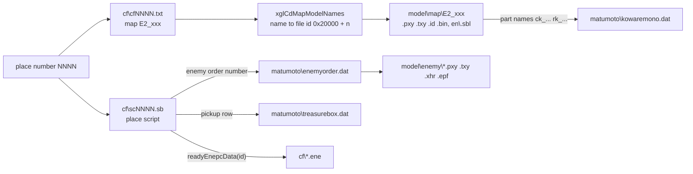
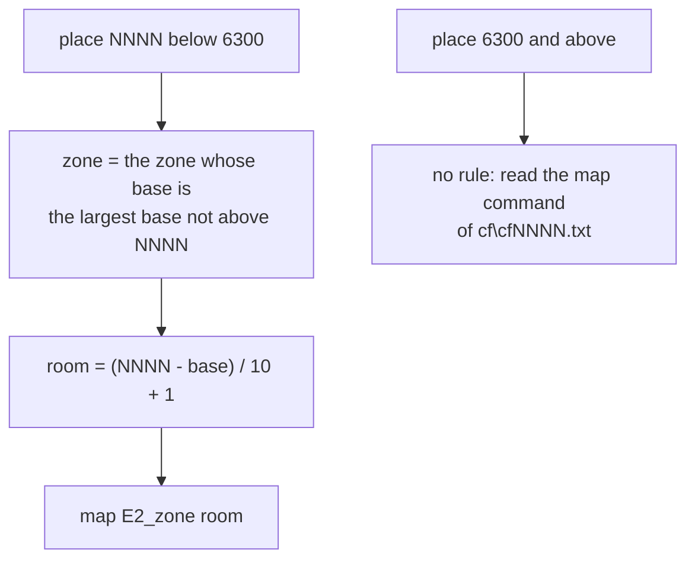
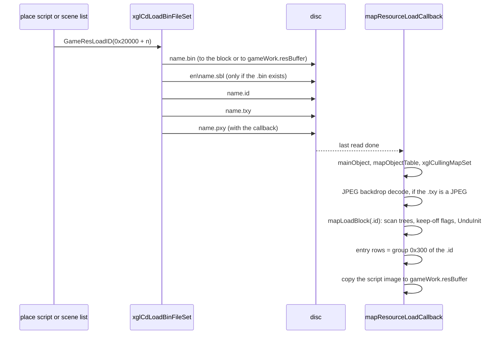
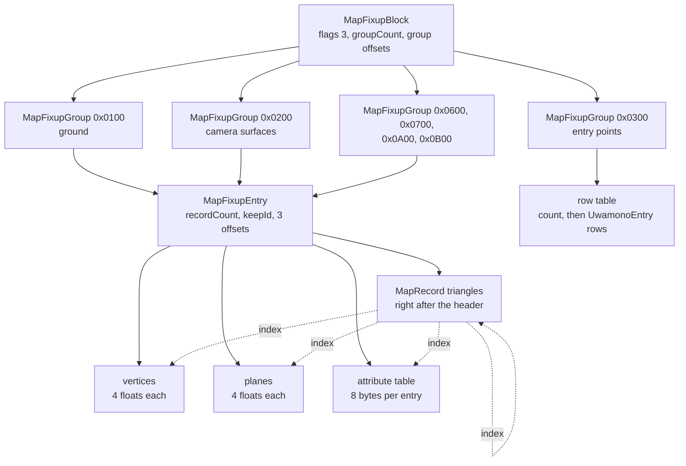
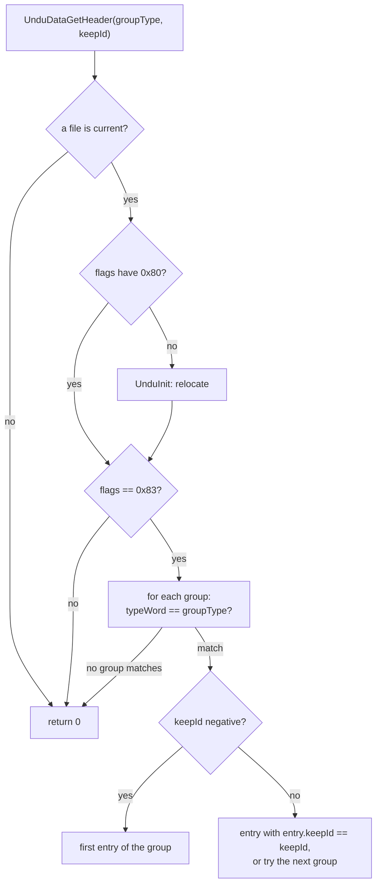
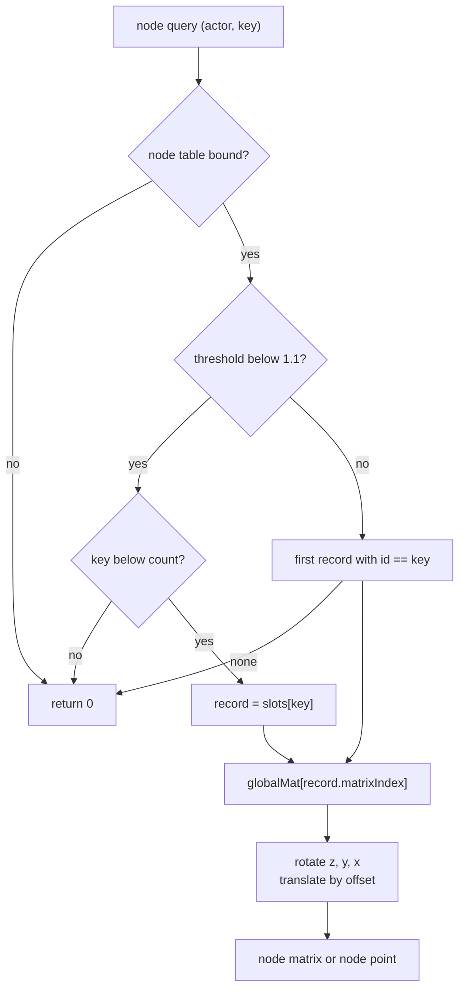
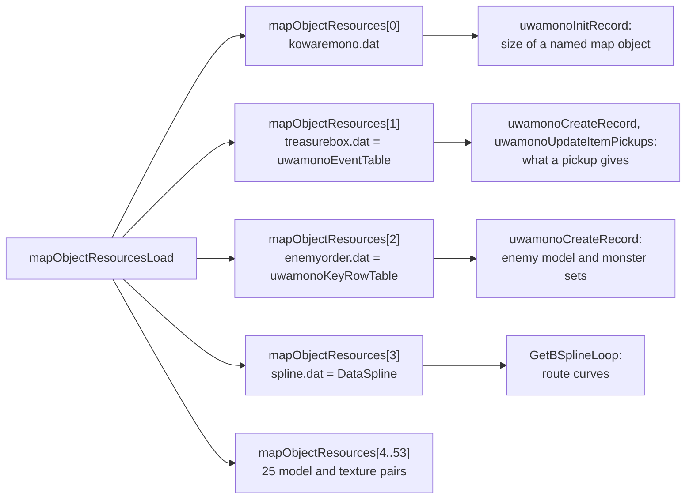
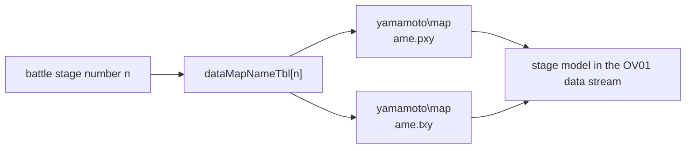

# Maps and field data

A field map of Xenosaga Episode II is a set of up to five files in
`model\map\` that share one name: the scenery model (`.pxy`), its textures
(`.txy`), a collision and layout file (`.id`), the script image of the map
(`.bin`) and the language library of that script (`.sbl`, one directory
deeper). The `.id` file holds the floors the characters walk on, the surfaces
the camera rides on, the zones that pick a camera, a footstep sound or a light
set, the keep-off areas that scripts switch on and off, and the entry points
where a place puts the player. Around the maps sit smaller families of field
data: the node tables of the models (`.epf`), the behaviour presets of field
enemies and NPCs (`.ene`), the four tables of `matumoto\` that describe
breakable objects, pickups, enemy placements and spline weights, the map
object models of `model\mobj\` and the battle stages of `yamamoto\map\`.

Every byte layout on this page was checked with a parser on every file of its
kind on both discs: all 214 `.id` files, all 249 `.epf` files, the four `.ene`
files, the four tables of `matumoto\`, and the directory contents of
`model\map\`, `model\mobj\` and `yamamoto\map\`. All of these files are in
archive group 00, which is byte-identical on the two discs, so every count
holds for both. How the game uses the data at run time is explained in
[Map and units](../game/map-and-units.md),
[Field enemies](../game/field-enemies.md), [The field game](../game/field.md)
and [Events](../scripting/events.md).

[← Back to the overview](../README.md) · [Files and resources](../architecture/files-and-resources.md)

## Contents

- [The formats at a glance](#the-formats-at-a-glance)
- [The map directory](#the-map-directory)
- [Place numbers and maps](#place-numbers-and-maps)
- [The map block in memory](#the-map-block-in-memory)
- [Map models, textures and scripts](#map-models-textures-and-scripts)
- [Collision and layout data (.id)](#collision-and-layout-data-id)
- [Node tables (.epf)](#node-tables-epf)
- [Field character presets (.ene)](#field-character-presets-ene)
- [The tables of matumoto](#the-tables-of-matumoto)
- [Map object models (model\mobj)](#map-object-models-modelmobj)
- [Battle stages (yamamoto\map)](#battle-stages-yamamotomap)
- [Files nothing loads](#files-nothing-loads)
- [Source files](#source-files)

## The formats at a glance

Every file of this family lives in archive group 00 (see
[Files and resources](../architecture/files-and-resources.md) for groups and
packing). None of them is stored packed, so the bytes on the disc are the
bytes the code sees.

| Files | Directory | Count | Size range | Total | First reader |
| --- | --- | --- | --- | --- | --- |
| `<map>.pxy` | `model\map\` | 246 | 15,280 – 3,025,696 | 305,672,992 | `xglCdLoadBinFileSet` |
| `<map>.txy` | `model\map\` | 246 | 39,728 – 6,143,088 | 199,147,360 | `xglCdLoadBinFileSet` |
| `<map>.id` | `model\map\` | 214 | 1,040 – 186,960 | 4,619,472 | `xglCdLoadBinFileSet`, `UnduInit` |
| `<map>.bin` | `model\map\` | 113 | 22,380 – 70,004 | 5,797,728 | `xglCdLoadBinFileSet` |
| `<map>.sbl` | `model\map\en\` | 113 | 116 – 5,228 | 101,068 | `xglCdLoadBinFileSet` |
| `*.epf` | `model\char\`, `model\enemy\`, `model\robo\`, `model\mobj\` | 249 | 80 – 1,072 | | `xglCdLoadFileSet`, `dataFileSlotLoad` (OV01) |
| `*.ene` | `cf\` | 4 | 3,120 | 12,480 | `xglCdLoadEneFile` |
| `kowaremono.dat` | `matumoto\` | 1 | 24,624 | | `mapObjectResourcesLoad` |
| `treasurebox.dat` | `matumoto\` | 1 | 4,104 | | `mapObjectResourcesLoad` |
| `enemyorder.dat` | `matumoto\` | 1 | 8,208 | | `mapObjectResourcesLoad` |
| `spline.dat` | `matumoto\` | 1 | 10,760 | | `mapObjectResourcesLoad` |
| unit models `.pxy`, `.txy` | `matumoto\` | 27 + 27 | 3,600 – 131,824 | | `mapObjectResourcesLoad` |
| `mobjNNN.*` | `model\mobj\` | 402 | 80 – 1,085,200 | 23,096,175 | `xglCdLoadFileSet` |
| stage `.pxy`, `.txy` | `yamamoto\map\` | 68 + 68 | 16,944 – 1,529,952 | 95,298,112 | `dataMapSetLoad` (OV01) |

`model\map\` holds 932 files in all: 819 in the directory itself and the 113
language libraries in `model\map\en\`. Its files add up to 515,338,620 bytes.

The files reference each other only by name and number. A scene resource
script names a map with its `map` command. The name gives a file id through
the table `xglCdMapModelNames`, and the file id gives the five files of the
set. The place script creates enemies by an order number, which
`enemyorder.dat` turns into a model id and a list of monster sets, and it
creates pickups by a row number of `treasurebox.dat`. The names of the parts
inside the map model select rows of `kowaremono.dat`.



## The map directory

### Naming

A map name has one of two forms. A field map is `E2_<zone><two digits>`, for
example `E2_KML01` or `E2_MOM27`. The zone is a three-letter code of an area
of the game, and the number counts the rooms of that area. The second form is
`CFEVE<two digits>`, 21 sets that hold only a model and textures. Two names
carry a variant letter, `E2_EVS02b` and `E2_EVS03b`.

The code does not spell out what the zone codes mean. The first line of a
scene resource script often names the background music of the place, which
gives a hint for some of them: the `KML` places play `001_milchia`, the `KUK`
places play `103_kukai`. These readings are not confirmed by the code.

The table lists the zones with the number of sets on the disc, the number
that have an `.id` file, and the triangles their `.id` files hold. The place
base is explained in [Place numbers and maps](#place-numbers-and-maps).

| Zone | Sets | With `.id` | Place base | Triangles in all `.id` | Smallest and largest `.id` (triangles) |
| --- | --- | --- | --- | --- | --- |
| `KML` | 11 | 11 | 1010 | 2,982 | 18 – 825 |
| `MID` | 9 | 8 | 1210 | 2,560 | 164 – 424 |
| `VEC` | 3 | 3 | 1410 | 744 | 123 – 349 |
| `MIL` | 17 | 16 | 1510 | 7,285 | 14 – 1,553 |
| `UZU` | 3 | 3 | 1810 | 1,604 | 14 – 1,483 |
| `UMN` | 4 | 4 | 1910 | 2,094 | 132 – 778 |
| `MOM` | 27 | 27 | 2010 | 32,228 | 16 – 3,549 |
| `ELS` | 8 | 8 | 2510 | 1,748 | 25 – 398 |
| `SYD` | 20 | 20 | 3010 | 4,016 | 14 – 557 |
| `OLM` | 18 | 18 | 3410 | 5,620 | 14 – 2,072 |
| `DYU` | 6 | 5 | 3810 | 1,747 | 233 – 606 |
| `KUK` | 14 | 14 | 4010 | 3,731 | 14 – 672 |
| `SUI` | 12 | 12 | 4310 | 14,313 | 14 – 3,432 |
| `RAV` | 15 | 14 | 4610 | 5,326 | 38 – 927 |
| `OMG` | 21 | 20 | 5010 | 7,659 | 14 – 1,088 |
| `JSY` | 5 | 5 | 5310 | 167 | 31 – 39 |
| `EXA` | 7 | 7 | 5510 | 13,371 | 14 – 4,995 |
| `EXB` | 7 | 7 | 5710 | 1,816 | 126 – 354 |
| `EXC` | 11 | 11 | 5910 | 5,030 | 14 – 1,548 |
| `EXD` | 1 | 1 | 6110 | 675 | 675 |
| `EVE` | 20 | 0 | | | |
| `EVS` | 5 | 0 | | | |
| `CFEVE` | 21 | 0 | | | |

The 265 names on the disc add up to 214 `.id` files with 114,716 triangles.

### The name table

The table `xglCdMapModelNames` in `src/main/res_get_path.c` turns a name into
a file id. Entry 0 is the directory `model\map\`, and entry n is the name of
file id `0x20000 + n`. The table has 361 names. How ids and name tables work
for all kinds of resource is explained in
[File ids and file groups](../architecture/files-and-resources.md#file-ids-and-file-groups).

264 of the 361 names have files on the disc. The other 97 do not:
`kowashi_chara`, `kowashi_robo`, `idtest`, `camera_test`, `E2_TST01` to
`E2_TST06`, five placeholders `dummy_0b` to `dummy_0f`, `E2_SPA01`,
`E2_JSY06` to `E2_JSY08`, 72 of the `E2_EVE` names (`01` to `26`, `28` to
`62`, `76` to `79` and `86` to `91`), `E2_EVS04` to `E2_EVS09` and `CFEVE22`.
The first names of the list are test maps of the developers. "Kowashi"
is Japanese for "breaking", so `kowashi_chara` and `kowashi_robo` were
probably the test rooms for breaking objects on foot and with an E.S.

One set on the disc has no name in the table and can therefore never be
loaded: `E2_DYU12` (a model and textures, no `.id`).

### Which files a set has

A set is identified by the files it has. The disc holds five combinations.

| Files | Sets | Which |
| --- | --- | --- |
| `.pxy`, `.txy`, `.id` | 124 | Field maps without a script of their own |
| `.pxy`, `.txy`, `.id`, `.bin`, `.sbl` | 90 | Field maps with a map script |
| `.pxy`, `.txy` | 28 | The 21 `CFEVE` sets, the 5 `EVS` sets, `E2_DYU12` and `E2_RAV14` |
| `.pxy`, `.txy`, `.bin`, `.sbl` | 4 | `E2_MID09`, `E2_MIL15`, `E2_OMG19`, `E2_EVE27` |
| `.bin`, `.sbl` | 19 | `E2_EVE63` to `E2_EVE75` and `E2_EVE80` to `E2_EVE85` |

So 246 names have a model, and 214 of those have collision. A map without an
`.id` has no floor and no entry points. `UnduCheck` then only adds the
requested move to the position, and nothing can be probed. The 32 models
without collision are backdrops for cutscenes. 35 places use one of them, for
example place 8003 with `CFEVE01`.

No `.id` exists without a model. Every `.bin` has its `.sbl`, and the other
way round.

### Identical files

Some files are byte-identical copies of each other. The same data is stored
once per name because the loader always reads `<name>.<extension>`.

| Type | Identical groups |
| --- | --- |
| `.pxy` | none |
| `.txy` | `E2_SYD16` = `E2_SYD17`, `E2_SUI11` = `E2_SUI12`, `E2_OMG19` = `CFEVE20`, `E2_JSY02` = `E2_JSY03` = `E2_JSY04` = `E2_JSY05` |
| `.id` | `E2_SUI11` = `E2_SUI12` |
| `.bin` | 18 pairs, each a field map and an `E2_EVE` name (see below) |

18 of the 19 names that have only a script image repeat the image of a field
map byte for byte: `E2_EVE63` = `E2_MID05`, `64` = `E2_MID06`, `65` =
`E2_MID09`, `66` = `E2_MOM18`, `67` = `E2_SYD02`, `68` = `E2_OLM09`, `69` =
`E2_OLM15`, `70` = `E2_OLM05`, `71` = `E2_SUI08`, `72` = `E2_OMG09`, `73` =
`E2_OMG18`, `74` = `E2_EXD01`, `75` = `E2_MIL15`, `81` = `E2_MOM17`, `82` =
`E2_MOM28`, `83` = `E2_RAV13`, `84` = `E2_OMG19` and `85` = `E2_EVE27`. Only
`E2_EVE80.bin` is a script of its own. No scene resource script names any of
these 19 sets, so what loads them could not be determined from the scene
scripts.

## Place numbers and maps

The game is divided into places. A place has a four-digit number NNNN, a
scene resource script `cf\cfNNNN.txt` and a place script `cf\scNNNN.sb` (see
[Place numbers](../scripting/events.md#place-numbers)). The map of a place is
named by the `map` command of its scene resource script, for example
`map E2_KML01` in `cf1010.txt`. The command is described in
[The commands](../scripting/events.md#the-commands).

The disc has 314 scene resource scripts. 311 of them name at least one map:
302 name one, 8 name two and one (`cf8010.txt`) names three. The three
scripts without a map are `cf7011`, `cf7039` and `cf8070`. Together the
scripts name 238 different maps, each of which exists on the disc. The maps
named most often are `E2_MIL07`, `E2_UMN03` and `E2_DYU01`, six places each.

For the places below 6300 the number follows from the map name. Every zone
has a base, the place of its room 01, and room nn is at `base + 10 * (nn -
1)`. `cf1010.txt` loads `E2_KML01`, `cf1020.txt` loads `E2_KML02`, and
`cf2270.txt` loads `E2_MOM27`. The bases are listed in the zone table above.
211 of the 215 places below 6300 follow this rule. The four exceptions are
1100 (`E2_KML09`, the same map as 1090), 1820 (`E2_UZU06`), 1830 (`E2_UZU08`)
and 2160 (`E2_MOM15`, the same map as 2150).

Above that the numbers stand for story steps, not for rooms.

| Places | Count with a map | Maps |
| --- | --- | --- |
| 1010 – 6110 | 215 | One room of one zone each, by the rule above |
| 6300 – 6318 | 14 | Field maps reused for events: `CFEVE21`, `E2_MID09`, `E2_MOM18`, `E2_SYD02`, `E2_OLM05` and others |
| 7000 – 7999 | 2 | `E2_KML` maps |
| 8000 – 8099 | 80 | Cutscene places: 26 map commands name a `CFEVE` backdrop, the others field maps of 15 zones |

Eight map models are named by no scene resource script: `E2_DYU12`,
`E2_EVE27`, `E2_EVS02`, `E2_EVS02b`, `E2_EVS03`, `E2_EVS03b`, `E2_KML10` and
`E2_MOM16`. All but `E2_DYU12` are in the name table, so a script can still
load them with `runtime.mapChange` (see
[Changing the map model](../scripting/events.md#changing-the-map-model)).



## The map block in memory

A map is one resource of kind `RES_KIND_MAP` (`0x20000`). The loader
`xglCdLoadBinFileSet(file_id, slot, tag)` in `src/main/res_get_path.c`
builds the whole map in one block of the resource system. The block starts
with a header of `0x40` bytes (`GAME_RES_NAME_HEADER_SIZE`), which the loader
clears and then fills with the address of each file. The field code later
reads the same header as `MainActive` through `gameWork.active`.

| Offset | Size | Loader field (`CdFileSetHeader`) | Field code (`MainActive`) | Meaning |
| --- | --- | --- | --- | --- |
| 0x00 | 4 | `pxy` | `object` | The `.pxy` scenery model |
| 0x04 | 4 | `txy` | `jpegData` | The `.txy` texture file, or 0 |
| 0x08 | 4 | `xhr` | | Not used for maps, 0 |
| 0x0C | 4 | `epf` | `block` | The `.id` collision and layout file, or 0 |
| 0x10 | 4 | `xap` | `imageHead` | The `.bin` script image, or 0 |
| 0x14 | 4 | `xapBytes` | `imageOffset` | Size of the `.bin` file rounded up to 64 bytes |
| 0x20 | 4 | | `jpegStream` | Set by the callback when the textures are a JPEG backdrop |
| 0x24 | 4 | | `pending` | The decoded backdrop |
| 0x28 | 8 | | `offsetY`, `offsetX`, `height`, `width` | Scroll offset and size of the backdrop |
| 0x30 | 16 | | `view` | Projected origin of the backdrop |

The loader reuses the header type of the character sets, which is why the
`.id` pointer sits in the field called `epf` and the script image in the
field called `xap`.

The files follow the header in the fixed order `.bin`, `.sbl`, `.id`, `.txy`,
`.pxy`. Each file that exists is rounded up to 64 bytes
(`GAME_RES_BLOCK_ALIGN`), and the model, which comes last, to a whole
2,048-byte sector. A file that does not exist takes no space and leaves its
pointer 0. The model is read with the caller's callback, so the callback runs
when the whole set is in memory.

```
map resource block (RES_KIND_MAP)
+0x00 +----------------------------------+
      | CdFileSetHeader / MainActive     |  0x40 bytes
+0x40 +----------------------------------+
      | <name>.bin                       |  script image (space is reserved even when
      +----------------------------------+   the image is read to the script buffer)
      | <lang>\<name>.sbl                |  language library of the script
      +----------------------------------+  64-byte aligned
      | <name>.id                        |  collision and layout
      +----------------------------------+  64-byte aligned
      | <name>.txy                       |  textures, or JPEG backdrop
      +----------------------------------+  64-byte aligned
      | <name>.pxy                       |  scenery model, rounded to 2,048
      +----------------------------------+
```

The path of the library is the path of the image with the two-letter
language code added as a directory (`xglGetLanguageCode`), so
`model\map\E2_KML05.bin` goes with `model\map\en\E2_KML05.sbl`. The library is
only looked for when the image exists.

The two script files can land in two places. In a synchronous load (a
resource id with its high bit set) they are read into the block, the library
right behind the image. Otherwise the image is read straight to the script
buffer `gameWork.resBuffer`, the library behind it at the rounded image size,
and `gameWork.imageEnd` is set to the library. The space in the block is
reserved in both cases. The callback later copies 0x12000 bytes (73,728) from
the image address in the header to the script buffer and sets
`gameWork.imageEnd` to the buffer plus the rounded image size. The largest
image and its library together need 71,812 bytes (`E2_EXB06`: 70,004 bytes
rounded to 70,016, plus 1,796), so every pair on the disc fits in that copy.

When the load completes, `mapResourceLoadCallback` in
`src/main/game_map_object.c` hands each part to its user. The steps of the
callback are listed in
[The map resource](../game/map-and-units.md#the-map-resource). The diagram
below shows the order of the reads and what becomes of each file.



## Map models, textures and scripts

A map `.pxy` is an ordinary model file and a map `.txy` an ordinary texture
file. Their layouts are described in
[Models and textures](models-and-textures.md) and, from the side of the
code, in [The `.pxy` file](../libraries/pxy.md#the-pxy-file). The map code
adds three things to them.

**The second pack.** A map model can carry a second model pack behind the
first. The header field `subPackOffset` of the first pack gives its offset.
The callback stores the address in `mapObjectTable`. The parts of the first
pack are the fixed scenery. The entries of the second pack are the movable
and breakable objects of the map: doors, crates, switches. A place script
turns an entry into a map unit by its entry number, and `uwamonoInitRecord`
reads the entry name with `pxyGetEntry` to find the row of `kowaremono.dat`
that gives the unit its size (see [kowaremono.dat](#kowaremonodat)).

**JPEG backdrops.** Two texture files do not start with the `txy` magic but
with the JPEG marker bytes `FF D8 FF E0`: `E2_MIL01.txy` (1,216,000 bytes) and
`E2_KUK01.txy` (1,207,424 bytes). These two maps are pre-rendered pictures.
The file has three parts.

| Part | Size in `E2_MIL01.txy` | Contents |
| --- | --- | --- |
| JPEG stream | 298,473 bytes | A baseline JPEG picture of 1,024 by 896 pixels |
| Padding | 23 bytes | Up to the next multiple of 64 bytes |
| Alpha plane | 917,504 bytes | One byte per pixel, 1,024 by 896 |

The callback decodes the picture into a 0x400000-byte buffer of 4 bytes per
pixel and then walks the alpha plane. It starts at the JPEG size rounded up to
64 (`(consumedSize + 0x3F) & ~0x3F`) and stores each byte, halved, as the
alpha byte of its pixel. In both files the plane starts exactly at that
offset and ends exactly at the end of the file. `E2_KUK01.txy` has a JPEG
stream of 289,905 bytes and the same plane size. The two maps are the first
rooms of their zones, places 1510 and 4010. They still have a model
(`E2_MIL01.pxy` is 41,552 bytes, `E2_KUK01.pxy` 314,080 bytes) and an `.id`
file like every other field map.

**Script images.** 113 sets have a `.bin` file. All 113 start with the magic
`SB  `, so each is a script image of the SB virtual machine, and each `.sbl`
starts with `SBL `. No `.bin` file under `model\` is anything else. The image
format is described in
[Scripts and archives](scripts-and-archives.md) and
[The image](../scripting/sb-vm.md#the-image). 95 of the 113 images and 71 of
the 113 libraries are distinct files.

## Collision and layout data (.id)

The `.id` file is the collision and layout data of a map. The code calls it
"undulation" (the `Undu*` functions in `src/main/undulate.c`) after the relief
of the ground, and its error message calls it "ID data". It holds triangle
meshes sorted into groups by purpose, and one table of entry points. The
behaviour of the queries is explained in
[The collision mesh](../game/map-and-units.md#the-collision-mesh).

There are 214 files, all in `model\map\`, from 1,040 bytes (`E2_KUK18.id`, 14
triangles) to 186,960 bytes (`E2_EXA02.id`, 4,995 triangles). The median is
11,600 bytes. Together they hold 1,322 meshes with 114,716 triangles and
93,238 vertices, plus 818 entry points. Every file size is a multiple of 16.
213 files are distinct (`E2_SUI11.id` and `E2_SUI12.id` are equal).

### Offsets and relocation

All numbers are little-endian. Every pointer field in the file is a byte
offset from the start of the file. `UnduInit(block)` turns them into
addresses by adding the address of the file, then sets bit `0x80`
(`MAP_BLOCK_FIXED_UP`) in the first byte, so a loaded file reads `0x83`
(`MAP_BLOCK_LOADED`) there. A second call sees the bit and does nothing.

`UnduInit` accepts only a first byte of 3 (`MAP_BLOCK_VALID`). Any other
value prints a message that says the ID data is of an unknown version and
leaves the map without collision. All 214 files have the value 3.

The first two bytes of a file therefore read `03 02`, `03 04`, `03 05`,
`03 06` or `03 07`. The second byte is not part of a version. It is the
number of groups in the file.

### The overall layout

A file is a tree of three levels. The header lists the groups. A group has a
type and lists its entries. An entry is one triangle mesh with its own vertex
array, plane array and attribute table, or, in the group of type `0x300`, a
table of entry points.

The tool that wrote the files placed the regions in a fixed order: the
header, then for each group its group record followed by its entries, each
entry complete with all its arrays. Every group record after the first
starts on a 16-byte boundary, and every entry does too. The gaps this leaves
are 4, 8 or 12 zero bytes long. The parser found no other unused byte in any
file.

```
.id file, offsets from the file start
+--------------------------------------+ 0x00
| header: 03, groupCount, 0, 0         |
| group offsets   groupCount x 4       |
+--------------------------------------+ 4 + 4 * groupCount  (first group, not aligned)
| group record: type, entryCount, flag |
| entry offsets   entryCount x 4       |
+--------------------------------------+ 16-byte aligned
| entry header (16 bytes)              |
| triangles       recordCount x 16     |
| vertices        n x 16               |
| planes          n x 16               |
| attribute table (copy), padded to 16 |
+--------------------------------------+
| next entry of the group ...          |
+--------------------------------------+ 16-byte aligned
| next group record ...                |
+--------------------------------------+ end of file
```

The diagram below shows which structure points at which.



### The header

| Offset | Size | Type | Field (`MapFixupBlock`) | Meaning | Values seen |
| --- | --- | --- | --- | --- | --- |
| 0x00 | 1 | u8 | `flags` | 3 in the file, `0x83` after `UnduInit` | 3 in all files |
| 0x01 | 1 | u8 | `groupCount` | Number of groups | 2 in 1 file, 4 in 12, 5 in 76, 6 in 111, 7 in 14 |
| 0x02 | 2 | | | Not read | 0 in all files |
| 0x04 | 4 × n | offset[] | `firstGroup` | Offset of each group record | The first is always `4 + 4 * groupCount` |

### Group records

| Offset | Size | Type | Field (`MapFixupGroup`) | Meaning | Values seen |
| --- | --- | --- | --- | --- | --- |
| 0x00 | 2 | u16 | `typeWord` | What the meshes of the group are for | `0x0100`, `0x0200`, `0x0300`, `0x0600`, `0x0700`, `0x0A00`, `0x0B00` |
| 0x02 | 1 | u8 | `entryCount` | Number of entries | 1 – 31 |
| 0x03 | 1 | u8 | `relocated` | 0: `UnduInit` relocates the three offsets inside each entry. Not 0: the entries hold no offsets | 1 in every `0x0300` group, 0 in all others |
| 0x04 | 4 × n | offset[] | `firstEntry` | Offset of each entry | |

The groups always appear in ascending order of their type. Seven types exist
on the disc.

| Type | Files | Entries | Triangles | Contents | Asked for by |
| --- | --- | --- | --- | --- | --- |
| `0x0100` | 214 | 243 | 67,514 | Ground: the floors the player, enemies and units stand on | The player and enemy probes, `Get_Attr`, `unduGetSlotHeight`, `resJumpPointsBuild` |
| `0x0200` | 188 | 386 | 898 | Camera surfaces: where the camera position and its look-at point may be | `GameCameraChangeID` |
| `0x0300` | 214 | 214 | none | Entry points (818 rows) | `mapResourceLoadCallback` |
| `0x0600` | 213 | 223 | 26,621 | Camera areas: which camera record is active where the player stands | `cameraSetIndex` |
| `0x0700` | 213 | 220 | 13,667 | Footstep materials | `Sound_FootStep` |
| `0x0A00` | 125 | 125 | 5,741 | Light areas | `uwamonoStartAreaBlend` |
| `0x0B00` | 27 | 125 | 275 | Keep-off zones | `mapLoadBlock`, native `id.keepoff` |

Only `E2_OLM05.id` has two groups, the ground and the entry points. The 12
files with four groups have no camera surfaces and no light areas. The
most common shape, 99 files, has the six groups `0x0100`, `0x0200`, `0x0300`,
`0x0600`, `0x0700` and `0x0A00`.

`Get_EnemyIDPos` in `src/main/get.c` asks for a group of type `0x0800`. No
file on the disc has one, so that lookup always returns 0, and
`mapSetupCollisionObject` then falls back to the first ground entry.

### Mesh entries

An entry of a mesh group (`MapFixupEntry`, also named `MapRecordGroup`) starts
with a 16-byte header. The triangles follow it directly.

| Offset | Size | Type | Field | Meaning | Values seen |
| --- | --- | --- | --- | --- | --- |
| 0x00 | 2 | u16 | `recordCount` | Number of triangles | 1 – 2,395 |
| 0x02 | 2 | u16 | `keepId` | Number of the entry inside its group, the key of `UnduDataGetHeader` | 1, 2, 3 … (see below) |
| 0x04 | 4 | offset | `vertices` | Vertex array | Always `entry + 16 + 16 * recordCount` |
| 0x08 | 4 | offset | `planes` | Plane array | 0 in keep-off entries |
| 0x0C | 4 | offset | `kindTable` | Attribute table | 0 in keep-off entries |
| 0x10 | 16 × n | `MapRecord[]` | `records` | The triangles | |

The arrays of an entry lie back to back in the order triangles, vertices,
planes, attribute table, in every one of the 1,197 entries that have all
four. The vertex count and the plane count are not stored. They follow from
the offsets: the vertices end where the planes begin, and the planes end
where the attribute table begins.

The entry numbers count up from 1 in file order in the groups `0x0100`,
`0x0600`, `0x0700` and `0x0B00`. In the camera surface group they are the
camera surface numbers that camera records refer to, and they have gaps in
56 of the 188 files (the highest is 19).

A file can hold several ground entries. 187 files have one, 26 have two and
`E2_SYD04.id` has four. They are alternative floors of similar size, for
example 2,392 and 2,395 triangles in `E2_EXA02.id`. An actor is bound to one
of them by its ground number: the field code calls `UnduDataGetHeader(0x100,
groundId)`. The largest single mesh has 2,395 triangles, which is below the
limit of 3,073 (`MAP_SCAN_MAX_RECORDS`) above which a mesh gets no scan tree
(see [The scan tree](../game/map-and-units.md#the-scan-tree)).

### Triangles

A triangle (`MapRecord`) is 16 bytes.

| Offset | Size | Type | Field | Meaning | Values seen |
| --- | --- | --- | --- | --- | --- |
| 0x00 | 2 | u16 | `kind` | Index into the attribute table of the entry | 0 – 30, and `0xFFFF` (see below) |
| 0x02 | 6 | s16[3] | `neighbour` | Index of the triangle across edge 0, 1 and 2, or -1 for an open edge | |
| 0x08 | 6 | u16[3] | `vertexIndex` | Indices of the three vertices in the vertex array | |
| 0x0E | 2 | u16 | `planeIndex` | Index into the plane array | |

All indices are plain element numbers, not byte offsets. Edge i runs from
vertex i to vertex i + 1 (edge 2 from vertex 2 back to vertex 0).
`mapStepRecord` relies on this when a move leaves a triangle: it finds the
edge the move crosses and continues in `records + neighbour[i]`.

The neighbour links were checked against the vertex positions. All 276,984
links point at a triangle of the same entry. In the meshes outside the
keep-off group, every one of the 276,684 links points at a triangle that
really has the two end points of that edge among its vertices. 276,901 links
are answered by a link back from the neighbour and 83 are not. 67,164 edges
are open. An open edge stops a move, or, with the slide mode of the probe,
turns it along the edge.

The inside test works in the X/Z plane only (`mapPointOutsideTriangle`), so a
mesh is used from above. With vertices A, B and C, the value `(B.x - A.x) *
(C.z - A.z) - (B.z - A.z) * (C.x - A.x)` is negative in 114,230 triangles,
positive in 246 and zero in 240. The 240 triangles with zero area can never
contain a point.

### Vertices and planes

A vertex is 16 bytes: three floats x, y and z and a fourth float w. In the
six groups other than the keep-off group, w is 0 in every one of the 92,586
vertices. Triangles of one entry share vertices through their indices.

A plane is 16 bytes: four floats. `mapPlaneDistance(origin, vertex0, plane)`
computes the height of the surface under a point as

```
height = vertex0.y + (vertex0.x - origin.x) * plane.x + (vertex0.z - origin.z) * plane.z
```

where `vertex0` is the first vertex of the triangle. The x and z members of
the plane are therefore the slopes of the surface, and the code reads neither
y nor w. In the files, y is 1.0 in 29,467 of the 68,063 planes and w is 0 in
all of them. A flat floor has the plane (0, 1, 0, 0). The formula was
checked on all triangles: the heights it gives for the second and third
vertex agree with their stored y within 0.02 in 114,435 of the 114,441
triangles that have a plane. Triangles with the same slope share one plane, so
a flat floor needs a single plane entry.

### The attribute table

The `kind` of a triangle is an index. The attribute itself is a 32-bit code
in the attribute table (`MapRecordKind`, 8 bytes per entry). A query copies
the code of the triangle it lands on into `MapCollisionObject.kind`.

| Offset | Size | Type | Field | Meaning | Values seen |
| --- | --- | --- | --- | --- | --- |
| 0x00 | 4 | s32 | `kindCode` | The attribute code | see the next sections |
| 0x04 | 4 | | | Not read | 0 in every entry of every copy |

A file has one list of codes, and every mesh entry of the file is followed by
its own copy of the whole list. All copies inside a file are equal, in all
214 files. The list has no stored length. With its padding it has 2 to 40
entries, always an even number, because a list with an odd number of codes
gets one zero entry to fill 16 bytes. 118 files end with such an entry
beyond the highest index in use.

Codes can repeat in the list. Each group uses its own indices, so the code 0
appears once for the plain ground and again for the plain camera surface. The
high byte of a code tells the family, which normally matches the group.

| Code | Family | Entries in the 214 lists |
| --- | --- | --- |
| `0x0000` – `0x00FF` | Plain ground, walls, drop edges | 498 |
| `0x0100` – `0x01FF` | Jump areas | 454 |
| `0x0200` – `0x02FF` | Elevator platforms | 50 |
| `0x0300` – `0x03FF` | Camera areas | 996 |
| `0x0400` – `0x04FF` | Footstep materials | 338 |
| `0x0500` – `0x05FF` | Light areas | 253 |
| `0x10000` – `0x108FF` | Slopes and moving floors | 107 |

Eight triangles of the camera surface group of `E2_DYU03.id` have the kind
`0xFFFF`, far beyond the 18 entries of that file's table. The camera probes
of that group never read the attribute of a neighbour (they run with flag
`0x800`), and a hit on one of these triangles would read a word 524,280
bytes behind the table.

### Ground attributes (group 0x0100)

The ground group has 67,514 triangles. The table shows every code found
there, how often, and the code that reads it. The behaviour is explained in
[Triangles and attributes](../game/map-and-units.md#triangles-and-attributes).

| Code | Triangles | Read by | Meaning |
| --- | --- | --- | --- |
| `0` | 57,564 | | Plain ground |
| `3` | 2,286 | `CheckWallAttr` | Wall: no probe may step onto it from a neighbour, unless its flags have `0x800` |
| `0x13` | 21 | `CheckWallAttr` | Wall only for probes whose `probeEnabled` byte is 1, which is the player |
| `4` | 63 | `UnduCheckSubCheckAll`, `UnduCheckSubCrossCheck` | Skipped by height scans. Leaving it over an open edge sets bit `0x10` of the probe result and rescans all triangles, so the walker drops to the floor below |
| `0x100` – `0x110` | 6,018 | `uwamonoPlayerUpdate`, `resJumpPointsBuild` | Jump area n = code & 0x1F. Standing on it sends event 3 with n + 1 to the place script (see [Jump points](../scripting/events.md#jump-points)) |
| `0x200` – `0x202` | 508 | `UnduCheckResultCheck`, `CheckWallAttr`, `uwamonoPlayerUpdate` | Platform of elevator n = code & 0xF. The height comes from the elevator |
| `0x302`, `0x306` | 10 | | Camera area codes inside the ground mesh. Nothing tests them there |
| `0x10000` – `0x10002` | 542 | `uwamonoPlayerUpdate` | Walking speed factor 0.5 (only `0x10000` occurs) |
| `0x10008` – `0x1000E` | 427 | `uwamonoPlayerUpdate` | Scripted slope 1 to 7 of `gameWork.slopes`, filled by the native `id.slopeSet` |
| `0x10103` – `0x10800` | 75 | `uwamonoPlayerUpdate` | Moving floor: bits 8 – 11 pick a direction from `uwamonoSlopeDirectionTable`, bits 0 – 1 a strength |

The jump areas are by far the largest special class: 3,268 triangles of area
0, 2,240 of area 1, 314 of area 2 and so on down to area 16 (4 triangles).
Among the moving floors the values are `0x10103` (2), `0x10200` (37),
`0x10202` (3), `0x10203` (2), `0x10303` (7), `0x10400` (2) and `0x10800`
(22). Slopes and moving floors are explained in
[Slopes](../game/map-and-units.md#slopes).

The table `eneTerritoryID` in `src/main/get.c` lists enemy territory codes
from `0x08000000` to `0x1F000000`, and `Check_Straight` compares the ground
attribute with them. No `.id` file contains such a code. The highest code on
the disc is `0x10800`.

### Camera surfaces (group 0x0200)

A camera surface is a small mesh, usually a rectangle of two triangles, that
floats above the room. The 386 entries hold 898 triangles, 2.3 on average.
`GameCameraChangeID(mode)` looks up the entry whose number is the camera
surface number of the active camera record and binds the two probes
`CamLookAt` and `cameraPositionProbe` to it, falling back to the first entry
when the number does not exist. The camera position is then kept on that
surface (see
[Camera areas and probes](../game/field.md#camera-areas-and-probes)).

The triangles carry the code 0 in 882 cases. Eight triangles carry `0x408`,
a footstep code that nothing reads here, and eight have the broken index
described above.

### Entry points (group 0x0300)

The group of type `0x0300` has one entry in every file, and its `relocated`
byte is 1 because the entry holds no offsets. The entry is a 16-byte header
with the row count in its first two bytes, followed by the rows. The code
reads the header through the mesh entry type, so the row count is the field
`recordCount`.

| Offset | Size | Type | Field | Meaning | Values seen |
| --- | --- | --- | --- | --- | --- |
| 0x00 | 2 | u16 | `recordCount` | Number of rows | 1 – 20 |
| 0x02 | 14 | | | Not read | 0 in all files |
| 0x10 | 16 × n | `UwamonoEntry[]` | | The rows | |

A row (`UwamonoEntry`) is 16 bytes.

| Offset | Size | Type | Field | Meaning | Values seen |
| --- | --- | --- | --- | --- | --- |
| 0x00 | 12 | float[3] | `x`, `y`, `z` | Position | |
| 0x0C | 2 | s16 | `angle` | Heading in 4096ths of a full turn | 2047 in 348 rows, 0 in 143, ±1023 in 214 |
| 0x0E | 2 | u16 | `key` | The key the row is searched by | 0 – 19, 90, 91, 100 – 104, 201, 202 |

`mapResourceLoadCallback` stores the entry in `uwamonoEntryCountPtr` and the
rows in `uwamonoEntries`. `uwamonoFindEntry(key)` searches the rows for a key
and `uwamonoGetEntryPose(key, out)` returns the position and the angle as
`angle / 4096 * 2π` radians. The value 2047 is half a turn less one step.

The key is the entry key of a place change (`gameWork.entryKey`, see
[Place numbers](../scripting/events.md#place-numbers)). Key 0 exists in all
214 files and key 1 in 210. Two to four rows is the usual size: 54 files have
2 rows, 64 have 3 and 44 have 4. The keys 100 to 104 appear in 24 files and
201 and 202 in 46. Their use depends on the place scripts, which pass the key
with the destination when they change place.

### Camera areas (group 0x0600)

The camera area mesh covers the floor again, cut into zones. The low byte of
the code plus 1 is the number of the camera record that is active while the
player stands in the zone (`cameraUpdateFrame` reads `(unsigned char)
probe->kind + 1`). Camera records are set up by the place script (see
[Camera areas and probes](../game/field.md#camera-areas-and-probes)).

The 26,621 triangles use the codes `0x300` to `0x314`, that is camera
records 1 to 21. The first zones are the largest: 9,223 triangles for
`0x300`, 6,686 for `0x301`, 2,218 for `0x302`, 3,173 for `0x303`. Nine
triangles carry the code 0. A file can have two camera area entries (10
files), selected with `cameraSetIndex`.

### Footstep materials (group 0x0700)

The footstep mesh also covers the floor. `Sound_FootStep` probes it under
every walking character and reads the low byte of the code as the surface
number. `resFootMaterialIndex` accepts a code only when its high part is
`0x400`, and maps the surface number through `footMaterialIndexTable` (56
entries) to one of 14 material names in `footMaterialKeys`. A place loads the
sound banks of its materials with the `foot` command of its scene resource
script (see [Footsteps](../game/map-and-units.md#footsteps)). The same low
byte plus 1 is the surface number of the footstep effect that
`Sound_FootStep` creates, so the effect follows the raw number in the file
and the sound follows the material.

| Material | Name | Surface numbers | Triangles |
| --- | --- | --- | --- |
| 0 | `kon` | 0, and every number not listed below | 1,018 |
| 1 | `rai` | 1 | 21 |
| 2 | `gla` | 2 | 450 |
| 3 | `flo` | 3 | 1,838 |
| 4 | `iro` | 4 | 328 |
| 5 | `sto` | 5 | 3,593 |
| 6 | `car` | 6 | 268 |
| 7 | `woo` | 7 | 396 |
| 8 | `clo` | 8 | 10 |
| 9 | `wat` | 9 – 18 | 409 |
| 10 | `tur` | 19 – 23 | 1,051 |
| 11 | `ear` | 29 – 31 | 2,621 |
| 12 | `sno` | 40 | 732 |
| 13 | `san` | 49 | 915 |

The names are three-letter keys of sound banks. Several read like
abbreviations of English or Japanese words for materials (`gla` glass, `iro`
iron, `sto` stone, `car` carpet, `woo` wood, `wat` water, `ear` earth, `sno`
snow, `san` sand, and `kon` probably "konkuriito", concrete), but the code
gives no meaning. Material 0 collects the surface number 0 (892 triangles)
and the one other number in the files that the table maps to 0, surface 39
(code `0x427`, 126 triangles). The most common single codes are `0x405`
(3,593 triangles), `0x41F` (2,608) and `0x403` (1,838). 17 triangles of this
group carry codes of other families (`0x100`, `0x101`, `0x302`), which
`resFootMaterialIndex` rejects.

### Light areas (group 0x0A00)

The light area mesh has one entry per file. `uwamonoStartAreaBlend` probes
it under every unit. When the code has both bits of `0x500` set, the low
byte plus 1 is the number of the light set the unit blends to, and otherwise
the unit uses light set 0. The light sets are the 16 entries of
`gameWork.lights`, filled by the place script (see
[Light areas](../game/map-and-units.md#light-areas)).

The 5,741 triangles use `0x500` (3,384), `0x501` (1,685), `0x502` (293),
`0x503` (264), `0x504` (66), `0x505` (39) and `0x506` (4), that is light
sets 1 to 7. Six triangles carry the code 0.

### Keep-off zones (group 0x0B00)

A keep-off zone is an area that a script can close for the player, for
example the gap behind a gate. 27 files have a keep-off group, with 1 to 31
entries. The entry number `keepId` is the zone number.

A keep-off entry is a bare mesh. Its `planes` and `kindTable` offsets are 0,
and only the triangles and the vertices exist. The vertex array runs to the
end of the entry. In 124 of the 125 entries it holds one vertex more than the
triangles use, and in one entry three more.

The fourth float of the vertices has a meaning here. In all 652 vertices of
all keep-off entries, y is the bottom and w the top of the zone, and all
vertices of one entry carry the same pair. `mapPushOutOfKeepOff` reads the
pair from the first vertex and ignores a zone when the point is below y or
above w. Inside the height range it pushes the point out over the nearest
open edge of the zone (see
[Keep-off zones](../game/map-and-units.md#keep-off-zones)).

The `kind` field of a keep-off triangle is not an index, because there is no
table. The code never reads it. The values are 0 to 6 in 217 triangles and
`0xFFFF` in 58.

`mapLoadBlock` clears the 32 keep-off flags (`elvKeepOffFlags`) to 1 and then
stores the address of each keep-off entry, with bit 0 set, in the flag of its
zone number. All zones are thus active when a map is loaded. The native
`id.keepoff(no, keep)` clears a flag or sets it again. The highest zone
number on the disc is 31, which is the last usable index.

### Looking up an entry

`UnduDataGetHeader(groupType, keepId)` finds an entry of the current file. It
walks the groups and compares the whole type word. A negative `keepId`
returns the first entry of the group. Otherwise it returns the entry whose
`keepId` matches, or 0.



`mapRegisterBlock` in `src/main/map_scan_node.c` reads the same file before
it is relocated. It walks the groups whose `relocated` byte is 0 in file
order and builds a scan tree for each entry until its four slots are full.
With the group order of the files this gives trees to the first four of the
ground and camera surface entries, and, when those are fewer than four, to
the camera area and footstep meshes. In 83 files the four trees go to one
ground mesh, one camera surface, the camera areas and the footsteps. The
trees are built in memory and are not part of the file.

### Example: E2_KUK18.id

`E2_KUK18.id` is the smallest file (1,040 bytes). It is the map of place
4180, a short corridor. It has five groups: one ground mesh of 8 triangles,
one camera surface, two entry points, one camera area and one footstep mesh,
the last three with 2 triangles each.

```
00000000: 03 05 00 00 18 00 00 00 90 01 00 00 50 02 00 00  flags 3, 5 groups at 0x18, 0x190, 0x250,
00000010: 90 02 00 00 50 03 00 00                          0x290, 0x350
00000018:                         00 01 01 00 20 00 00 00  group 0x0100: 1 entry, relocate, entry at 0x20
00000020: 08 00 01 00 b0 00 00 00 50 01 00 00 60 01 00 00  entry: 8 triangles, number 1, vertices 0xB0,
                                                           planes 0x150, attributes 0x160
00000030: 00 00 ff ff 01 00 ff ff 04 00 08 00 03 00 00 00  triangle 0: kind 0, neighbours -1, 1, -1,
                                                           vertices 4, 8, 3, plane 0
00000040: 00 00 ff ff 03 00 00 00 08 00 00 00 03 00 00 00  triangle 1: kind 0, neighbours -1, 3, 0
00000070: 01 00 ff ff 05 00 ff ff 02 00 09 00 06 00 00 00  triangle 4: kind 1, vertices 2, 9, 6
000000b0: 00 00 80 bf f0 4f 04 32 00 00 80 c0 00 00 00 00  vertex 0: (-1.0, 0.0, -4.0), w 0
000000d0: 00 00 40 bf f0 4f 04 32 34 0c ce 40 00 00 00 00  vertex 2: (-0.75, 0.0, 6.439)
00000150: 00 00 00 00 00 00 80 3f 00 00 00 00 00 00 00 00  plane 0: (0, 1, 0, 0), a flat floor
00000160: 00 00 00 00 00 00 00 00 00 01 00 00 00 00 00 00  attribute 0: 0        attribute 1: 0x100
00000170: 00 00 00 00 00 00 00 00 00 03 00 00 00 00 00 00  attribute 2: 0        attribute 3: 0x300
00000180: 05 04 00 00 00 00 00 00 00 00 00 00 00 00 00 00  attribute 4: 0x405    padding entry
00000190: 00 02 01 00 a0 01 00 00 00 00 00 00 00 00 00 00  group 0x0200: 1 entry at 0x1A0
000001a0: 02 00 01 00 d0 01 00 00 10 02 00 00 20 02 00 00  entry: 2 triangles, number 1
000001b0: 02 00 ff ff 01 00 ff ff 00 00 01 00 03 00 00 00  triangle 0: kind 2 (attribute 0)
00000250: 00 03 01 01 60 02 00 00 00 00 00 00 00 00 00 00  group 0x0300: 1 entry, no relocation, at 0x260
00000260: 02 00 00 00 00 00 00 00 00 00 00 00 00 00 00 00  2 rows
00000270: 00 00 00 00 00 00 00 00 00 00 00 00 ff 07 00 00  row 0: (0, 0, 0), angle 2047, key 0
00000280: 00 00 20 b6 f0 4f 04 32 00 00 80 3f ff 07 01 00  row 1: (0, 0, 1.0), angle 2047, key 1
00000290: 00 06 01 00 a0 02 00 00 00 00 00 00 00 00 00 00  group 0x0600: 1 entry at 0x2A0
00000350: 00 07 01 00 60 03 00 00 00 00 00 00 00 00 00 00  group 0x0700: 1 entry at 0x360
```

The ground mesh has 10 vertices and one plane. Six of its triangles use
attribute 0, plain ground. They form a rectangle from x = -1 to 1 and z = -4
to 2. Triangles 4 and 5 use attribute 1, the code `0x100`: a narrower strip
from z = 2.287 to 6.439 at the far end of the corridor, jump area 0. A player
who walks onto it sends event 3 with the number 1 to the place script, which
answers with the change to the next place.

The camera surface is a rectangle at the height y = 5, from x = -1 to 1 and
z = -4 to 1.5, with attribute 2 (code 0). The camera area is a rectangle from
x = -2 to 2 and z = -4.81 to 7.19 with attribute 3 (`0x300`), so camera
record 1 is active everywhere. The footstep mesh is a rectangle from x = -4
to 3 and z = -6 to 8 with attribute 4 (`0x405`), surface 5, the material
`sto`. Each of the four meshes is followed by its own copy of the six-entry
attribute table, the last entry being the padding.

The two entry points stand at the origin and one unit further along z, both
with the angle 2047, a heading of half a turn.

### Statistics

| Measure | Value |
| --- | --- |
| Files | 214 (213 distinct) |
| Total size | 4,619,472 bytes |
| Triangles per file | 14 (14 files) to 4,995 (`E2_EXA02`), median 273 |
| Triangles in all files | 114,716 |
| Largest files | `E2_EXA02` 4,995, `E2_MOM27` 3,549, `E2_SUI03` 3,432, `E2_EXA03` 3,349, `E2_MOM14` 3,315 |
| Smallest files | `E2_KUK18`, `E2_KUK19`, `E2_EXA07`, `E2_EXC11`, `E2_MIL16`, `E2_MIL17` and others with 14 triangles |
| Mesh entries | 1,322 |
| Vertices | 93,238 |
| Planes | 68,063 |
| Entry point rows | 818 |
| Open edges | 67,164 of 344,148 |

The zone `MOM` alone holds 32,228 triangles, 28% of the total, in its 27
files, and the three zones `MOM`, `SUI` and `EXA` together hold more than
half.

## Node tables (.epf)

An `.epf` file is the node table of a model. A node is a named point on the
skeleton: a place where an effect, a weapon or a hit mark is attached. The
file gives each node the number of the bone matrix it rides on and a fixed
offset and rotation relative to that bone.

The disc has 249 `.epf` files, 136 of them distinct, from 80 to 1,072 bytes.
They belong to the character and object sets and are loaded with them (see
[Character and object sets](../architecture/files-and-resources.md#character-and-object-sets)).

| Directory | Files |
| --- | --- |
| `model\enemy\` | 103 |
| `model\robo\gattai_robo\` | 81 |
| `model\char\pc\` | 35 |
| `model\robo\pc_robo\` | 12 |
| `model\mobj\` | 10 |
| `model\robo\npc_robo\` | 5 |
| `model\char\npc\` | 2 (`sakura00`, `virgil00`) |
| `model\char\cf_npc\` | 1 (`urtvf00`) |

### Loading

In the field, `xglCdLoadFileSet` reads `<name>.epf` into the block of the
model set and stores its address in the header word at `0x0C`. The loaders
copy that word to `actor->rsrc[XAct_Rsrc_EntryTableC]`, and
`XenoActorAllocMatrices` binds it to the motion package with
`tiMRPackageSetEntryTableC` (see [Actors](../libraries/actors.md) and
[Binding data](../libraries/animation.md#binding-data)). In battle the OV01
loader `dataFileSlotLoad` reads the same file as the fourth file of a model
(`pxy`, `txy`, `xhr`, `epf` in `src/ov01/data_file_load.c`). A model without
an `.epf` file has a null node table, and every node query on it returns 0.

### Layout

The file is a 16-byte header followed by the node records. The header is
`struct TiNodeTable` in `include/main/TiMRPackage.h`.

| Offset | Size | Type | Field | Meaning | Values seen |
| --- | --- | --- | --- | --- | --- |
| 0x00 | 4 | char[4] | | Magic `EPF ` (with a space). Not read by the code | all 249 files |
| 0x04 | 4 | float | `version` | Format version. Below 1.1 the records are indexed, otherwise keyed | 1.1 in 244 files, 1.0 in 5 |
| 0x08 | 4 | u32 | `count` | Number of records | 2 – 33 |
| 0x0C | 4 | u32 | | Not read. The size of the header | 16 in all files |
| 0x10 | | | `slots` | The records | |

The version decides the record type. In all 249 files the file size is
exactly `16 + count * 32` for version 1.1 and `16 + count * 28` for version
1.0.

A keyed record (`TiNodeKey`, version 1.1) is 32 bytes.

| Offset | Size | Type | Field | Meaning | Values seen |
| --- | --- | --- | --- | --- | --- |
| 0x00 | 4 | s32 | `id` | Node number the record is searched by | 0 – 31 |
| 0x04 | 4 | s32 | `matrixIndex` | Index of the bone matrix in the actor's global matrices | 0 – 76 |
| 0x08 | 12 | float[3] | `offset` | Translation relative to the bone | |
| 0x14 | 12 | float[3] | `rotation` | Rotation about x, y and z in radians | within ±2π |

An indexed record (`TiNodeSlot`, version 1.0) is the same without the `id`,
28 bytes. The node number is then the position of the record in the file.
The five files of the old version are `model\enemy\gno021.epf`,
`model\mobj\mobj024.epf`, `model\robo\npc_robo\npcr12_mg01.epf`,
`model\robo\npc_robo\npcr12_rf01.epf` and `model\robo\pc_robo\pcr05_gn01.epf`.

```
.epf, version 1.1                         .epf, version 1.0
+0x00  "EPF "                             +0x00  "EPF "
+0x04  1.1                                +0x04  1.0
+0x08  count                              +0x08  count
+0x0C  16                                 +0x0C  16
+0x10  id, matrixIndex,                   +0x10  matrixIndex,
       offset[3], rotation[3]   32 bytes         offset[3], rotation[3]   28 bytes
+0x30  next record                        +0x2C  next record
```

### How the nodes are used

Two functions read the table. `tiMRPackageGetNodePoint(pack, key, dst,
apply)` in `src/main/TiDynamicsColl.c` returns the offset of a node, and with
`apply` set transforms it by the bone matrix, which gives the world position
of the node. `tiMRPackageGetNodeMatrix(handle, key, out, useBaseMatrix)` in
`src/main/TiPartsAnim.c` builds the full matrix of the node: it starts from
the bone matrix (or from the unit matrix), applies the rotations in the order
z, y, x where they are not zero, and then the translation.

Both functions take the indexed path when the version is below 1.1 and reject
a key at or above `count`. On the keyed path they walk the records and take
the first one whose `id` equals the key.

The effect system asks for nodes 0 to 31 of every actor it tracks
(`sefUpdateEntryTransforms` in `src/main/sef.c`), which is why no file has an
`id` above 31. An effect then names the node it is attached to by that
number (see [sef](../libraries/sef.md)).



### Contents

The node numbers form families. The 81 `gattai_robo` files all hold the same
27 numbers, 0 to 25 and 31, and that list is the most common one overall (90
files). 18 files hold 0 to 11 with 30 and 31, the usual list of a party
character. The map objects use small lists such as 0 to 4.

| Node numbers | Files that have them |
| --- | --- |
| 0, 1 | 248 |
| 2 – 4 | 243 – 247 |
| 5 – 11 | 225 – 236 |
| 12 – 25 | 113 – 198, falling with the number |
| 26 – 29 | 10 – 24 |
| 30 | 30 |
| 31 | 216 |

Two files break the usual order of ascending numbers. `gno015.epf` lists its
numbers in text order (0, 1, 10, 11 … 19, 2, 20 …), which does not matter for
a keyed search. `bos019.epf` holds node 27 twice. The search returns the first
record, so the second can never be reached.

The start of `model\char\pc\shion00.epf` (464 bytes, 14 records):

```
00000000: 45 50 46 20 cd cc 8c 3f 0e 00 00 00 10 00 00 00  "EPF ", version 1.1, 14 records, header 16
00000010: 00 00 00 00 00 00 00 00 00 00 00 00 85 eb d1 3f  node 0: matrix 0, offset (0, 1.64, 0),
00000020: 00 00 00 00 00 00 00 00 00 00 00 00 00 00 00 00          no rotation
00000030: 01 00 00 00 00 00 00 00 00 00 00 00 66 66 a6 3f  node 1: matrix 0, offset (0, 1.3, 0)
00000040: 00 00 00 00 00 00 00 00 00 00 00 00 00 00 00 00
00000050: 02 00 00 00 1d 00 00 00 8c 03 de 3c 5c 5f 87 be  node 2: matrix 29, offset (0.027, -0.264, 0),
00000060: fb ee 39 a5 db 0f 49 40 db 0f c9 bf 00 00 00 00          rotation (pi, -pi/2, 0)
```

## Field character presets (.ene)

An `.ene` file is a table of behaviour presets for the field enemies and NPCs
of a place. A preset is a ready-made set of sizes, speeds, sight values and
timers, so that many characters of one type share one set. The behaviour
itself is explained in [Field enemies](../game/field-enemies.md).

### Loading

The files are resources of kind `RES_KIND_ENE` (`0x80000`). The name table
`xglCdCfEnemyNames` lists 59 names in `cf\`: `enemy001` to `enemy019`,
`enemy_001` to `enemy_020` and `npc_001` to `npc_020`. Only four of them exist
on the disc: `enemy001.ene`, `enemy010.ene`, `enemy_001.ene` and
`npc_001.ene`, file ids `0x80001`, `0x8000A`, `0x80014` and `0x80028`.

A place script loads a table with the native `enepc.readyEnepcData(id)`
(`enepcReadyEnepcData` in `src/main/runtime_enepc.c`). It calls
`GameResLoadID` until the load is accepted and stores the address in
`enepcParamSets`. `xglCdLoadEneFile` reads the single file with the extension
`.ene`, rounded up to one sector. The native `enepc.setParams` then picks a
preset by its number (see
[Setting the parameters](../game/field-enemies.md#setting-the-parameters)).
`uwamonoResetRecords` clears the pointer when the units of a place are
reset.

### Layout

Each of the four files is 3,120 bytes: 65 records of `0x30` bytes
(`EnepcParamSet` in `src/main/runtime_enepc.c`), with no header and no count.
Unused records are zero.

| Offset | Size | Type | Field | Copied to | Meaning |
| --- | --- | --- | --- | --- | --- |
| 0x00 | 4 | float | `height` | `record->extent.y` | Body height |
| 0x04 | 4 | float | `extent` | `record->extent.x`, `actor->radius` | Body radius |
| 0x08 | 4 | float | `movementFloats[0]` | `state->wanderStep` | Longest step of the random walk |
| 0x0C | 4 | float | `movementFloats[1]` | `state->leashRange` | Distance to the player at which a chase is given up |
| 0x10 | 4 | float | `movementFloats[2]` | `state->moveSpeed` | Step per frame while walking |
| 0x14 | 4 | float | `movementFloats[3]` | `state->pursuitSpeed` | Step per frame while chasing |
| 0x18 | 4 | float | `angleDegrees` | `state->fanWidth` | Opening angle of the sight fan in degrees, converted to radians |
| 0x1C | 4 | float | `rangeFloats[0]` | `state->fanLength` | Length of the sight fan |
| 0x20 | 4 | float | `rangeFloats[1]` | `state->noticeRange` | Hearing distance |
| 0x24 | 4 | | | | Not read, 0 in all records |
| 0x28 | 2 | s16 | `stateShorts[0]` | `state->pauseTime` | Frames of a pause |
| 0x2A | 2 | s16 | `stateShorts[1]` | `state->pauseCycle` | Pause cycle: one pause in this many walking steps |
| 0x2C | 2 | s16 | `stateShorts[2]` | `state->threatTime` | Frames of a threat pose |
| 0x2E | 2 | s16 | `stateShorts[3]` | `state->threatCycle` | Threat cycle: one threat in this many walking steps |

The meanings of the behaviour values are those of the state block, explained
in [The behaviour block](../game/field-enemies.md#the-behaviour-block).

`enepcStoreParams` skips a float that is -1.0 and a short that is -1, so a
preset could leave single values untouched. No record on the disc uses that.

### Contents

| File | Records in use | Contents |
| --- | --- | --- |
| `enemy_001.ene` | 14 (0 – 13) | The largest table: small bodies (height 1.8, radius 0.5, walk 0.04, chase 0.08, view 120°, sight 5) and large ones (height 8, radius 4 or 5, walk 0.1, chase 0.2, sight 20) |
| `enemy010.ene` | 3 | Three test rows with rising values (view 60°, 120°, 240°) |
| `enemy001.ene` | 2 | Two equal rows (height 2, radius 1, view 60°, sight 5) |
| `npc_001.ene` | 2 | Two NPC rows: height 1.75 and 1.6, radius 0.4, walk 0.025, no chase, no sight, pauses of 72 frames |

Record 0 of `enemy_001.ene`:

```
00000000: 66 66 e6 3f 00 00 00 3f 00 00 00 40 00 00 00 41  height 1.8, radius 0.5, step 2.0, leash 8.0
00000010: 0a d7 23 3d 0a d7 a3 3d 00 00 f0 42 00 00 a0 40  walk 0.04, chase 0.08, view 120, sight 5.0
00000020: 00 00 a0 40 00 00 00 00 1e 00 03 00 1e 00 03 00  hearing 5.0, unused, pause 30, 1 in 3, threat 30, 1 in 3
```

Which place scripts load which of the four tables is written in the bytecode
of the scripts and was not traced.

## The tables of matumoto

`matumoto\` holds 58 files: four data tables and 27 pairs of unit models and
textures. `mapObjectResourcesLoad` in `src/main/game_camera.c` loads 54 of
them once when the field starts, in the order of the name list
`mapObjectResourceNames`, and keeps the addresses in `mapObjectResources`
(see [Shared unit resources](../game/map-and-units.md#shared-unit-resources)).
Each file is read by name with `GameResLoadName`, which puts a `0x40`-byte
name header in front of the data.

The three tables `kowaremono.dat`, `treasurebox.dat` and `enemyorder.dat`
have the same shape: 513 fixed-size rows without a header. The code works
with 512 rows in each case, so the last row is spare. In all three it is
zero.



### kowaremono.dat

"Kowaremono" is Japanese for "breakable thing". The file describes the
standard shapes of the breakable and movable objects that map models contain.
It is 24,624 bytes, 513 rows of 48 bytes (`UwamonoNameRow` in
`src/main/runtime_menu.c`). Rows 0 to 374 are in use and the rest is zero.

| Offset | Size | Type | Field | Meaning | Values seen |
| --- | --- | --- | --- | --- | --- |
| 0x00 | 12 | char[12] | `name` | Name of the object type, compared with the entry name of the map model | 7 characters, a NUL, then four spaces |
| 0x0C | 1 | u8 | `level` | Strike level needed to break the object | 0 (182 rows), 1 (46), 2 (147) |
| 0x0D | 1 | u8 | `searchMode` | Collision shape | 0 (30 rows), 1 (213), 2 (132) |
| 0x0E | 1 | u8 | `effectNumber` | Break effect number: the effect is `0x100C8000 \| (motion + 900)` | 0, 6 – 11, 15 – 17 |
| 0x0F | 1 | | | Not read | 0 |
| 0x10 | 12 | float[3] | `scaleX`, `scaleY`, `scaleZ` | Size of the object: width, height, depth | 0.05 – 25.0 |
| 0x1C | 4 | float | | Not read | 1.0 in all rows |
| 0x20 | 2 | s16 | `breakSound` | Break sound number: the sound is `0x02000000 + breakSound` | 5, 6, 7 |
| 0x22 | 14 | | | Not read | 0 in all rows |

`uwamonoInitRecord` reads the name of the map model entry behind a unit and
scans the rows until one matches over its whole length. The unit then gets
half of `scaleX` and `scaleZ` and the full `scaleY` as its extent, the level
and the shape of the row, the break effect and the break sound (see
[Shape by type or by name](../game/map-and-units.md#shape-by-type-or-by-name)
and [Breakable objects](../game/map-and-units.md#breakable-objects)). The
scan stops at the first row whose name starts with a zero byte, or after 512
rows.

The 375 names follow one scheme, `<scale>_<shape><size><material>`.

| Part | Values | Meaning seen in the rows |
| --- | --- | --- |
| Scale | `ck`, `rk` | `ck` rows have sizes from 0.3 to 5. `rk` rows are exactly five times as large (1.5 to 25). The code clears unit flag `0x100000` for `ck` names and sets it for `rk` names, so `ck` objects are broken on foot and `rk` objects with an E.S. |
| Shape | `s`, `c`, `r` | `s` and `r` rows have `searchMode` 1, a box. `c` rows have `searchMode` 2. `s` rows are square in plan, `r` rows are wider than deep |
| Size | a letter and a digit | For the `s` and `c` shapes of the `ck` scale the letter is the width (`a` = 1, `b` = 2, `c` = 3, `d` = 4, `e` = 5) and the digit the height. `f3`, `g5` and `h8` are cubes of 0.3, 0.5 and 0.8, `i5` is 1.5 wide and 0.5 high, `j2` 1.5 wide and 2 high. The `r` shapes have their own widths and depths (`ra` 2 by 0.5, `rb` 2 by 1, `rc` 3 by 1.5, `rd` 4 by 2.5, `re` 1.5 by 0.5) |
| Material | `m`, `w`, `g` | Selects the effect and the sound: `m` rows have effects 6 – 8 and sound 6, `w` rows 9 – 11 and sound 5, `g` rows 15 – 17 and sound 7 |

Within a material the effect number rises with the level: level 0 takes the
first of the three numbers, level 1 the second, level 2 the third. The
letters probably stand for metal, wood and glass, which the code does not
confirm.

The names split into 187 `ck` rows and 188 `rk` rows. Besides the regular
shapes each scale has a row `ck_door` or `rk_door` (1.5 by 2.25 by 0.05 for
`ck`) and 15 rows `ck_sp01` to `ck_sp15` (`rk_sp01` to `rk_sp15`) with a
size of 0, 1, 0, level 0 and shape 0.

Row 9, `ck_sb2m`:

```
000001b0: 63 6b 5f 73 62 32 6d 00 20 20 20 20 01 01 07 00  "ck_sb2m", level 1, shape 1, effect 7
000001c0: 00 00 00 40 00 00 00 40 00 00 00 40 00 00 80 3f  size 2.0 x 2.0 x 2.0, 1.0
000001d0: 06 00 00 00 00 00 00 00 00 00 00 00 00 00 00 00  sound 6
```

A door is handled before the name test. When the entry name of the map model
starts with `door`, `uwamonoInitRecord` takes the size from the row it is
looking at, which is always row 0, `ck_sf3m` with a size of 0.3. The rows
`ck_door` and `rk_door` are never used for doors, because an entry name that
starts with `door` returns before any name is compared.

### treasurebox.dat

The file lists what the item pickups and treasure boxes of the whole game
give. It is 4,104 bytes, 513 rows of 8 bytes (`UwamonoEventRow` in
`include/main/ytachi_test.h`), loaded as `uwamonoEventTable`. Rows 0 to 264
are in use and the rest is zero.

| Offset | Size | Type | Field | Meaning | Values seen |
| --- | --- | --- | --- | --- | --- |
| 0x00 | 2 | s16 | | Not read | 0 in 220 used rows, 1 in 45 |
| 0x02 | 2 | s16 | `type` | What the row gives | 0 – 4 |
| 0x04 | 2 | s16 | `id` | Number of the thing in its own table | 1 – 76 |
| 0x06 | 2 | s16 | `count` | How many | 1 – 6, 10, 20 |

A place script creates a pickup with a row number. The row number is also
the index of the flag `gameWork.eventFlags[row]` (512 flags), which is set
when the pickup is taken, and a pickup whose flag is set is not created
again. `uwamonoCreateRecord` uses `type` and `id` to choose the model of the
pickup, and `uwamonoUpdateItemPickups` adds the reward `count` times (see
[Item pickups](../game/map-and-units.md#item-pickups)).

| `type` | Rows | `id` range | Gives |
| --- | --- | --- | --- |
| 1 | 130 | 1 – 32 | `count` of hit action `id` (`dataBoxIncCategory1`). Counts: 1 in 78 rows, 2 in 29, up to 20 in one |
| 2 | 18 | 16 – 36 | `count` of item `id` (`dataBoxIncCategory2`). The count is 1 in all 18 rows |
| 3 | 30 | 1 – 31 | `count` of entry `id` of data box category 4. The count is 1 in all 30 rows |
| 4 | 75 | 1 – 76 | `count` of entry `id` of data box category 3. The count is 1 in all 75 rows |
| 0 | 12 | 1 – 15 | Nothing: no case handles type 0, so the pickup only sets its flag and shows an empty name |

The inventories behind the four types are described in
[Party and growth](../game/party-and-growth.md). The 12 rows of type 0 are
rows 28 to 30, 35 to 37, 92, 93, 136, 139, 142 and 143.

```
00000000: 00 00 01 00 01 00 01 00   row 0: type 1, id 1, count 1
00000008: 00 00 01 00 01 00 02 00   row 1: type 1, id 1, count 2
00000010: 01 00 02 00 13 00 01 00   row 2: first word 1, type 2, id 19, count 1
00000840: 00 00 04 00 07 00 01 00   row 264: type 4, id 7, count 1 (the last row in use)
```

### enemyorder.dat

The file lists the enemies that places put on their maps. It is 8,208 bytes,
513 rows of 16 bytes (`UwamonoKeyRow`), loaded as `uwamonoKeyRowTable`. Rows 0
to 232 are in use and the rest is zero.

| Offset | Size | Type | Field | Meaning | Values seen |
| --- | --- | --- | --- | --- | --- |
| 0x00 | 2 | s16 | `key` | Order number the place script passes when it creates the enemy | 101 – 1301 |
| 0x02 | 1 | u8 | `gateIfClear` | Not 0: the enemy comes back after it was beaten, while control bit `0x800` is clear | 0 or 1 |
| 0x03 | 1 | u8 | `gateIfSet` | The same while control bit `0x800` is set | 0 or 1 |
| 0x04 | 4 | s32 | `value` | File id of the enemy model | `0x18001` – `0x18052`, `0x19002` – `0x19019` |
| 0x08 | 8 | u8[8] | `bytes` | Eight monster set numbers, copied to `state->groups` | 0 – 13 |

`uwamonoCreateRecord` searches the 512 rows for the key, checks the beaten
flag `gameWork.rowFlags[set][row]` against the gate byte, and creates the
enemy from the model id (see
[Creating a character](../game/field-enemies.md#creating-a-character)). When
the enemy touches the player, `Check_Encount` picks one of the eight monster
set numbers at random and passes it to the battle (see
[The request](../game/field-enemies.md#the-request)).

The 233 keys are grouped by hundreds, one group per area: 101 to 119, 201 to
220, 301 to 319, 401 to 421, 501 to 525, 601 to 625, 701 to 715, 801 to 823,
901 to 929, 1001 to 1012, 1101 to 1111, 1201 to 1213 and 1301. Inside a
group the keys count up without gaps, and the rows are sorted by key.

225 rows name an enemy model of `model\enemy\` (`0x18001` is `uso001`, used
by 47 rows) and 7 a boss model (`0x19002` to `0x19019`). One row, key 915,
has a model id of 0 and eight zero bytes.

The two gate bytes are (0, 0) in 119 rows, (1, 1) in 76, (1, 0) in 22 and
(0, 1) in 16. An enemy with (0, 0) stays away for good once it is beaten.

```
00000000: 65 00 00 00 03 80 01 00 00 00 00 00 00 00 00 00   key 101, no return, model 0x18003, sets all 0
00000010: 66 00 01 00 03 80 01 00 01 01 01 01 06 06 06 06   key 102, returns while bit 0x800 is clear,
                                                            model 0x18003, sets 1 1 1 1 6 6 6 6
00000020: 67 00 01 00 03 80 01 00 06 06 02 02 03 03 04 04   key 103: sets 6 6 2 2 3 3 4 4
```

Repeating a number in the eight bytes makes that monster set more likely,
because the pick is uniform over the eight positions.

### spline.dat

`spline.dat` (10,760 bytes) is a table of 1,345 rows of four signed 16-bit
weights. Every row adds up to 24,576 (6 × 4,096), give or take one. It is
loaded as `mapObjectResources[3]`, and `uwamonoResetRecords` stores the
address in `DataSpline`.

`GetBSplineLoop(frame, count, period, points, destination)` in
`src/main/get.c` evaluates a closed cubic B-spline through `count` control
points, the curve that enemies follow on their routes (see
[Routes and splines](../game/field-enemies.md#routes-and-splines)). It
computes `phase = (frame % period) * (2048 / period)` and reads the four
weights at byte offset `4304 + phase` (`GET_BSPLINE_WEIGHTS_OFFSET`), then
divides the weighted sum of four consecutive points by 24,576
(`GET_BSPLINE_WEIGHT_SCALE`). Since a row is 8 bytes, byte offset 4304 is row
538, and phases that are multiples of 8 land on rows 538 to 793.

The phase is a byte offset, not a row number. The constant 2048
(`GET_BSPLINE_PHASES`) is the byte length of the 256 rows of one segment.
Both calls, in `Enemy_Route_Chase` of `src/main/enemy_1.c`,
pass a period of 32 (`UWAMONO_SPLINE_STEPS`). The step is then 64 bytes, so
a route point owns 32 frames and each frame moves 8 rows ahead: the game
uses only every eighth row of the block, rows 538, 546 and so on up to 786.
A period that does not divide 256 would give a phase that is no multiple of
8, and the four weights would then be read across two rows. With a period
of 30, for example, the second frame would read (4492, 0, 3679, 16354),
which is no valid set of weights. The game never does this.

The table is five blocks of 269 rows. Each block holds the weights of one
segment of a cubic B-spline for t = k / 256, k = 0 to 268: 257 rows for t
from 0 to 1 and 12 rows that run past t = 1.

| Block | Rows | Byte offset | First row | Row at t = 1 | Segment |
| --- | --- | --- | --- | --- | --- |
| 0 | 0 – 268 | 0x0000 | (24576, 0, 0, 0) | | First segment of an open curve, starts on the first point |
| 1 | 269 – 537 | 0x0868 | (6144, 14336, 4096, 0) | | Second segment |
| 2 | 538 – 806 | 0x10D0 | (4096, 16384, 4096, 0) | (0, 4096, 16384, 4096) | Uniform middle segment |
| 3 | 807 – 1075 | 0x1938 | (4096, 16384, 4096, 0) | | Second-to-last segment |
| 4 | 1076 – 1344 | 0x21A0 | (4096, 14336, 6144, 0) | | Last segment, ends on the last point |

The code reads only block 2, the right one for a closed loop. Row 538 is
(4096, 16384, 4096, 0), the weights 1/6, 4/6, 1/6 and 0 of a uniform cubic
B-spline at t = 0, and row 794 is the same shifted by one point. The rows
past t = 1 give extrapolated weights, some of them negative (row 1,344 is
(0, 83, -3703, 28197)). Blocks 0, 1, 3 and 4 are never read.

```
000010d0: 00 10 00 40 00 10 00 00   row 538, t = 0:     (4096, 16384, 4096, 0)
000010d8: d0 0f 00 40 30 10 00 00   row 539, t = 1/256: (4048, 16384, 4144, 0)
```

### Unit models

The 27 model pairs of `matumoto\` are ordinary `.pxy` and `.txy` files (see
[Models and textures](models-and-textures.md)). 25 pairs are loaded and give
the built-in unit types their models.

| Unit type | Model | Model size | Unit |
| --- | --- | --- | --- |
| 0 – 3 | `Tra001` – `Tra004` | 6,288 – 11,600 | Traps |
| 4, 5, 6 | `Tre001`, `Tre002`, `Tre101` | 24,368 – 26,752 | Treasure boxes |
| 7, 8 | `Save_P`, `Save_P2` | 12,304 | Save points |
| 9 | `Evs_P` | 13,216 | A symbol drawn like a save point |
| 10, 11 | `Ret_P`, `Ret_P2` | 12,208 | Return point symbols |
| 12, 13 | `Item001`, `Item002` | 6,960 | Item pickups |
| 14, 15, 16 | `Item101`, `Item102`, `Item103` | 16,448 – 20,432 | Item pickups |
| 17 – 24 | `Item003` – `Item010` | 10,976 – 44,832 | Item pickups |

The model of type t is `mapObjectResources[(t + 2) * 2]` and its texture the
next entry (`MAP_MODEL_SLOT`). Two pairs are in the directory but not in the
name list: `Tre102.pxy` with `Tre102.txy`, and `look.pxy` with `look.txy`.

## Map object models (model\mobj)

`model\mobj\` holds the models of the map objects that a place loads by name:
props, machines and other things that are not part of the map model. A
scene resource script names them with its `mobj` command
(192 uses in the 314 scripts), and the name table `xglCdMobjModelNames` turns
the name into a file id of kind `0x70000`.

The table has 324 slots: `mobj000` to `mobj299`, with letter variants for
some numbers (`mobj015a`, `mobj015b`, `mobj028a` to `mobj028c`, `mobj029a` to
`mobj029f`, `mobj030a` to `mobj030f`, `mobj031a` to `mobj031f`, `mobj032a`,
`mobj032b`, `mobj039a`, `mobj039b`, `mobj072b`, `mobj153a` to `mobj153c`). The
slot of `mobj153` itself holds the placeholder `_`.

The disc holds 138 of these objects in 402 files.

| Files of a set | Sets | Meaning |
| --- | --- | --- |
| `.pxy`, `.txy`, `.xhr` | 105 | Model, textures and a hierarchy |
| `.pxy`, `.txy` | 23 | Model and textures only |
| `.pxy`, `.txy`, `.xhr`, `.epf` | 9 | With a node table |
| `.pxy`, `.txy`, `.xhr`, `.epf`, `.jrd` | 1 | `mobj139`, with a leftover text file |

| Extension | Files | Size range | Format |
| --- | --- | --- | --- |
| `.pxy` | 138 | 2,144 – 976,464 | Model, see [Models and textures](models-and-textures.md) |
| `.txy` | 138 | 144 – 1,085,200 | Textures |
| `.xhr` | 115 | 320 – 3,920 | Hierarchy, see [Skeletons and motion](skeletons-and-motion.md) |
| `.epf` | 10 | 80 – 688 | Node table, see [Node tables](#node-tables-epf) |
| `.jrd` | 1 | 139 | Text, not loaded |

A map object is loaded by `xglCdLoadFileSet`, the loader of the character
sets, so it has the same block header and the same file order. One
difference is in the motion file: a map object whose own `motion\<name>.xap`
is missing gets no motion file, where a character would fall back to
`man.xap` (see
[Character and object sets](../architecture/files-and-resources.md#character-and-object-sets)).

The ten objects with a node table are `mobj000`, `mobj024`, `mobj064`,
`mobj139`, `mobj159`, `mobj163`, `mobj250`, `mobj251`, `mobj256` and
`mobj259`.

## Battle stages (yamamoto\map)

`yamamoto\map\` holds the 3D stages of the battles: 68 models and 68 texture
files, ordinary `.pxy` and `.txy` data, from 16,944 to 1,529,952 bytes and
95,298,112 bytes in all. There is no collision file, because battles need no
floor.

`dataMapSetLoad(buffer, count, index)` in `src/ov01/data_file_load.c` loads a
stage by its number. `dataMapNameGet` takes the name from the table
`dataMapNameTbl` (68 entries, entry 0 empty), and `dataMapFileLoad` loads the
files of that name from the directory `yamamoto\map\` (`mapDirPath`). How the battle
uses the stage is described in [The battle engine](../game/battle-engine.md).

Most stages are models made for battle. Their names are a zone code, `_B`
and a number.

| Stage numbers | Names |
| --- | --- |
| 1 – 3, 42 | `KML_B01` – `KML_B03`, `E2_KML_B04` |
| 4 – 7, 59, 65 | `MID_B01` – `MID_B04`, `MID_B06`, `MID_B05` |
| 8 – 13, 46, 47 | `MOM1_B01` – `MOM1_B03`, `MOM2_B01` – `MOM2_B03`, `MOM1_B04`, `MOM2_B04` |
| 14 – 16 | `SYD_B01` – `SYD_B03` |
| 17 | `SPA_B01` (no files on the disc) |
| 18 – 22 | `OLM_B01` – `OLM_B05` |
| 23 – 25, 52 | `SUI_B01` – `SUI_B03`, `E2_SUI_B04` |
| 26 – 28, 53, 60 | `RAV_B01` – `RAV_B03`, `RAV_B05`, `RAV_B04` |
| 29 – 32, 54, 56 | `OMG_B01` – `OMG_B04`, `OMG_B06`, `OMG_B05` |
| 33 – 41, 58, 61 – 63 | `EXA_B01`, `EXA_B02`, `EXB_B01`, `EXC_B01` – `EXC_B06`, `EXD_B01`, `EXC_B07` – `EXC_B09` |
| 66, 67 | `batle_bg`, `BSP_B01` |

Ten stage numbers carry the name of a field map instead, for battles that
take place in the room itself.

| Stage | Name | Files in `yamamoto\map\` | Compared with `model\map\` |
| --- | --- | --- | --- |
| 43 | `E2_MID06` | none | |
| 44 | `E2_MID09` | `.pxy`, `.txy` | Both byte-identical |
| 45 | `E2_MIL15` | `.pxy`, `.txy` | Both different (the model is 437,040 bytes against 357,008, the textures have the same size but other bytes) |
| 48 | `E2_SYD02` | `.pxy`, `.txy` | Both different |
| 49 | `E2_OLM05` | `.pxy`, `.txy` | Both byte-identical |
| 50 | `E2_OLM09` | `.pxy`, `.txy` | Both byte-identical |
| 51 | `E2_OLM15` | `.pxy`, `.txy` | Both byte-identical |
| 55 | `E2_OMG18` | `.pxy`, `.txy` | Both different |
| 57 | `E2_JSY06` | none | |
| 64 | `E2_EVE27` | `.pxy`, `.txy` | The textures are byte-identical, the model differs (1,452,032 bytes against 1,446,176) |

Of the 136 files, 9 are byte-identical copies of a file in `model\map\`: the
model and textures of `E2_MID09`, `E2_OLM05`, `E2_OLM09` and `E2_OLM15`, and
the textures of `E2_EVE27`. 15 more have the name of a field map file but
other contents, probably versions of the room prepared for battle. The
remaining 112 files exist only here.

Three table names have no files (`SPA_B01`, `E2_MID06`, `E2_JSY06`), so the
stages 17, 43 and 57 cannot be loaded. Four pairs of files are in the
directory but not in the table: `E2_MOM28`, `E2_OMG09`, `E2_RAV13` and
`E2_SUI08`. All four differ from the field map of the same name.



## Files nothing loads

Some files of these directories are never opened by the code, and some names
the code knows have no file.

| File | Why it is never read |
| --- | --- |
| `model\map\E2_DYU12.pxy`, `.txy` | The name is not in `xglCdMapModelNames` |
| `matumoto\Tre102.pxy`, `.txy` | Not in `mapObjectResourceNames` |
| `matumoto\look.pxy`, `.txy` | Not in `mapObjectResourceNames` |
| `model\mobj\mobj139.jrd` | No code builds a name with this extension |
| `yamamoto\map\E2_MOM28`, `E2_OMG09`, `E2_RAV13`, `E2_SUI08` (`.pxy`, `.txy`) | Not in `dataMapNameTbl` |
| Blocks 0, 1, 3 and 4 of `spline.dat` | `GetBSplineLoop` reads only rows 538 to 793 |
| Rows 171 and 359 of `kowaremono.dat` (`ck_door`, `rk_door`) | Doors take their size from row 0 |

`mobj139.jrd` is a text file of 139 bytes, written by the tool that exported
the model. It names the rows of the joint table of `mobj139`:

```
//  definition of row of joint. this version is 0.2

//  row of common joint
#define   mobj139_top  0
#define   move  1
#define   Jbody  2
```

A second file of this kind, `model\robo\pc_robo\pcr05.jrd` (855 bytes), is
on the disc as well.

The other direction also occurs. The code can ask for files that the disc
does not have: 97 map names, 55 of the 59 `.ene` names, three battle stage
names and a collision group of type `0x0800`. Each of these requests fails
quietly: a missing file of a set leaves its pointer 0, and a missing group
makes the lookup return 0.

## Source files

| File | Contents |
| --- | --- |
| `src/main/undulate.c`, `include/main/undulate.h` | The `.id` reader: `UnduInit`, `mapLoadBlock`, `UnduDataGetHeader`, the probe `UnduCheck`, wall and keep-off tests, and the structures `MapFixupBlock`, `MapFixupGroup`, `MapFixupEntry`, `MapRecord` |
| `src/main/map_scan_node.c` | The scan trees built over the meshes of an `.id` file, the keep-off flags |
| `src/main/res_get_path.c` | The name tables of maps, map objects and `.ene` files, the loaders `xglCdLoadBinFileSet`, `xglCdLoadFileSet` and `xglCdLoadEneFile`, the footstep material tables, `resJumpPointsBuild` |
| `src/main/game_map_object.c`, `include/main/game_map_object.h` | `mapResourceLoadCallback`, which takes the map block apart, the JPEG backdrop, the indices of `mapObjectResources` |
| `src/main/game_data.c`, `include/main/game_data.h` | `MainActive`, `UwamonoEntry`, the file names of `matumoto\` |
| `src/main/game_camera.c` | `mapObjectResourcesLoad`, the camera users of groups `0x0200` and `0x0600`, the ground attributes of the player |
| `src/main/uwamono_record.c` | `uwamonoFindEntry`, `uwamonoGetEntryPose`, `uwamonoUpdateItemPickups` (the reader of `treasurebox.dat`) |
| `src/main/uwamono_objx.c` | `uwamonoCreateRecord`, the reader of `enemyorder.dat` and of the pickup rows |
| `src/main/uwamono_record_init.c` | `uwamonoInitRecord` and `UwamonoNameRow`, the reader of `kowaremono.dat` |
| `src/main/runtime_uwamono_door.c` | The natives `uwamono.setDoorAll` and `uwamono.setKowaremonoAll`, which override the values a unit took from `kowaremono.dat` |
| `src/main/enemy_1.c` | `Enemy_Init` and the enemy probes that bind an actor to a ground entry |
| `src/main/set_motion.c` | `Check_Encount`, which picks a monster set from the row of `enemyorder.dat`, and `Set_Spline_By_Route` |
| `src/main/get.c` | `GetBSplineLoop` (the reader of `spline.dat`), `Get_Attr`, `Check_Undu`, `eneTerritoryID` |
| `src/main/ytachi_test.c`, `include/main/ytachi_test.h` | `mapSceneScriptLoad`, `uwamonoResetRecords`, the row types `UwamonoKeyRow` and `UwamonoEventRow` |
| `src/main/runtime_enepc.c`, `src/main/runtime_enepc.c` | `EnepcParamSet`, `enepcSetParams`, `enepcStoreParams` and `enepcReadyEnepcData`, the readers of the `.ene` presets |
| `src/main/uwamono_event_check.c`, `src/main/uwamono_light_blend.c`, `src/main/elevator.c` | The users of the footstep, light area and keep-off groups |
| `include/main/TiMRPackage.h`, `src/main/TiDynamicsColl.c`, `src/main/TiPartsAnim.c` | `TiNodeTable` and the two node queries that read an `.epf` file |
| `src/ov01/data_file_load.c` | The battle stage table `dataMapNameTbl` and the loaders of `yamamoto\map\` |
