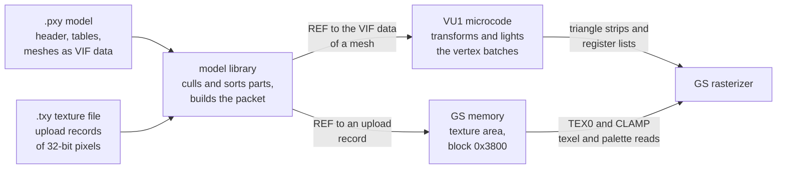
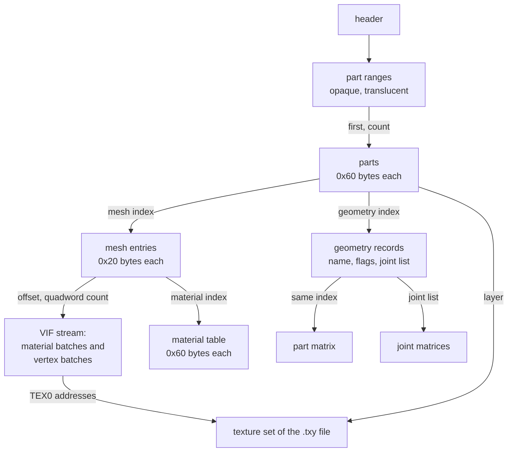
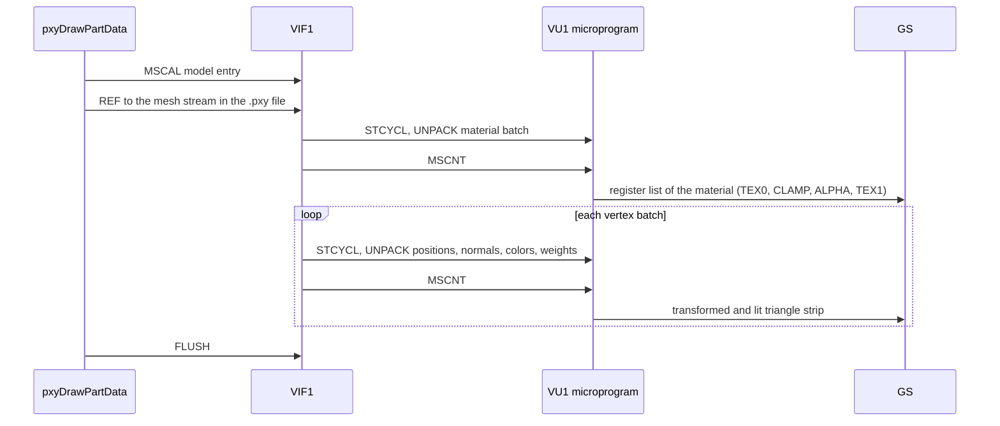
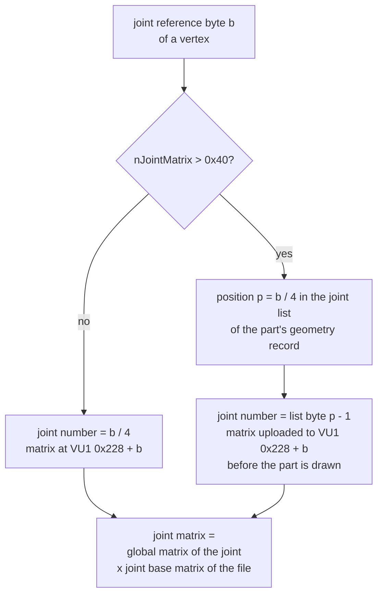
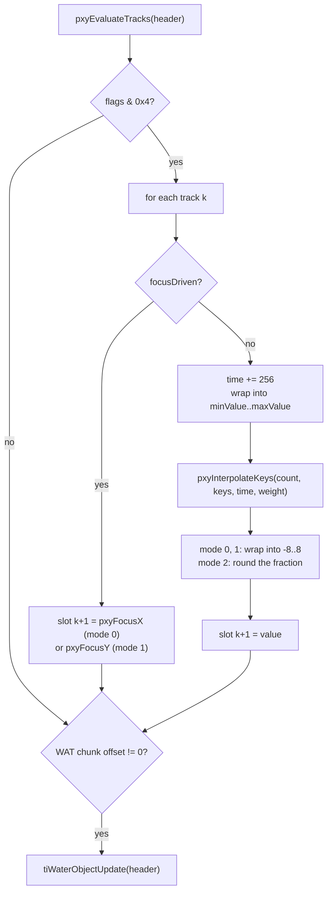
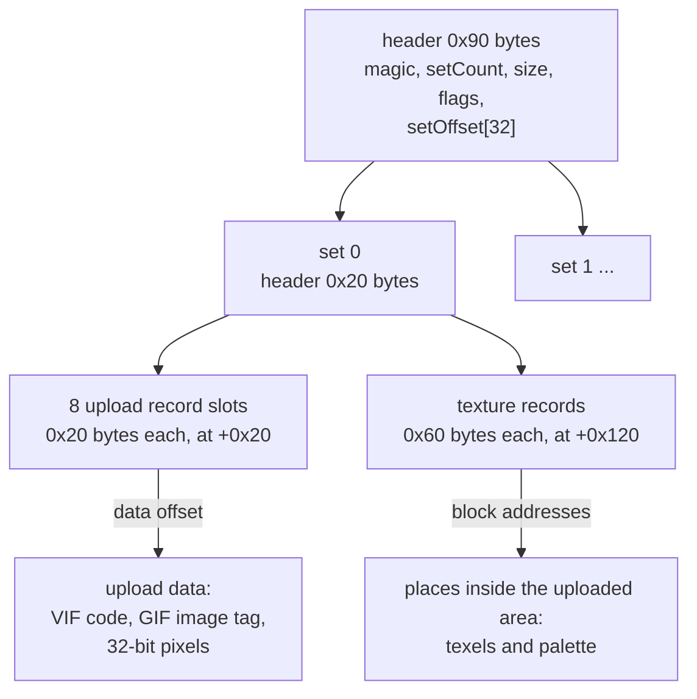
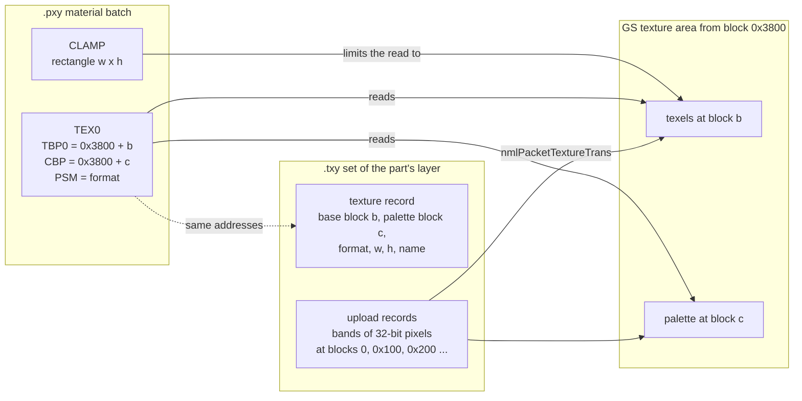
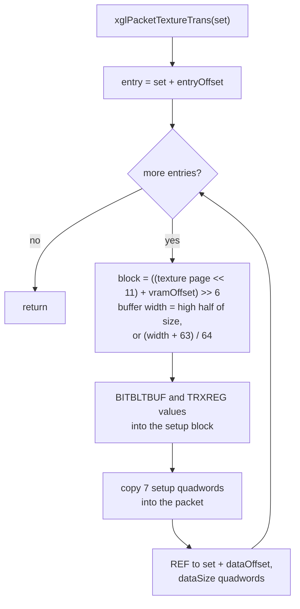

# Models and textures

Every 3D object of the game is a `.pxy` model file: the party members, the E.S. machines, the enemies, the rooms and streets of the maps, the treasure chests and the small models of the menus. Its colors come from a `.txy` texture file of the same name. A model holds data that is ready for the vector unit VU1. Its vertices are stored as VIF commands that the renderer sends to VU1 without changing them, and its materials are stored as lists of Graphics Synthesizer (GS) register values inside the same command stream. A texture file holds image uploads that are ready for the GS: rectangles of 32-bit pixels that land at fixed places of video memory, where the texture registers of the model read them as 8-bit, 4-bit or 32-bit textures with their palettes.

The two files are tied together by video memory addresses, not by names or numbers. A material of the model says "read 8-bit texels at block `0x3800` with the palette at block `0x3810`", and the texture file of the same name is built so that its upload puts exactly those texels and that palette there. The library that draws both is the model library, described in [pxy](../libraries/pxy.md). The layout of video memory and the texture area are described in [Rendering](../architecture/rendering.md).

Two smaller formats share this page. A `.xtx` file is a list of plain image uploads for 2D screens: menu sheets, portraits, button pictures. A `.txd` file, despite its name, holds no pixels. It is a table of text strings that the menus read through `txdTableEntry`.

[← Back to the overview](../README.md) · [Files and resources](../architecture/files-and-resources.md)

## Contents

- [Files at a glance](#files-at-a-glance)
- [How the files were checked](#how-the-files-were-checked)
- [PXY models](#pxy-models)
  - [Who loads a model](#who-loads-a-model)
  - [File layout](#file-layout)
  - [The header](#the-header)
  - [Model flags](#model-flags)
  - [Part ranges](#part-ranges)
  - [The material table](#the-material-table)
  - [Geometry records](#geometry-records)
  - [Matrices and joints](#matrices-and-joints)
  - [Mesh entries](#mesh-entries)
  - [Parts](#parts)
  - [The VIF stream of a mesh](#the-vif-stream-of-a-mesh)
  - [Material batches](#material-batches)
  - [Vertex batches](#vertex-batches)
  - [Skinning data](#skinning-data)
  - [Tracks](#tracks)
  - [The sort table](#the-sort-table)
  - [The WAT chunk](#the-wat-chunk)
  - [The second model of a file](#the-second-model-of-a-file)
  - [A worked example: Item001.pxy](#a-worked-example-item001pxy)
  - [A character example: chaos00.pxy](#a-character-example-chaos00pxy)
  - [Statistics](#statistics)
- [TXY texture files](#txy-texture-files)
  - [Who loads a texture file](#who-loads-a-texture-file)
  - [Layout](#layout)
  - [Texture sets](#texture-sets)
  - [Upload records](#upload-records)
  - [Texture records](#texture-records)
  - [How a model finds its texels](#how-a-model-finds-its-texels)
  - [Pixel formats, palettes and mipmaps](#pixel-formats-palettes-and-mipmaps)
  - [A worked example: Item001.txy](#a-worked-example-item001txy)
  - [JPEG files with the txy ending](#jpeg-files-with-the-txy-ending)
  - [Statistics of the texture files](#statistics-of-the-texture-files)
- [XTX texture sheets](#xtx-texture-sheets)
- [TXD string tables](#txd-string-tables)
- [Unknown fields](#unknown-fields)
- [Source files](#source-files)

## Files at a glance

All four formats are in archive group 00 of both discs. The two discs carry the same files: every `.pxy`, `.txy`, `.xtx` and `.txd` file of disc 2 has the same path and the same content hash as on disc 1. All counts on this page are therefore counts of one disc.

None of the model files is packed. One `.xtx` file, `yajima\titleobj.xtx`, is stored packed and is 51,920 bytes after decoding. The archive and its packing are described in [Scripts and archives](scripts-and-archives.md).

| Directory | `.pxy` | `.txy` | Size range of the `.pxy` files | Contents |
| --- | --- | --- | --- | --- |
| `model\char\pc` | 37 | 37 | 8,000 to 264,272 | Party members in their costumes, with separate weapon models such as `jin_sw01` |
| `model\char\npc` | 39 | 39 | 97,312 to 235,952 | Named characters |
| `model\char\cf_npc` | 72 | 72 | 111,744 to 221,440 | More characters, the `cf_npc` set |
| `model\char\citizen` | 71 | 71 | 13,216 to 121,584 | Citizens |
| `model\enemy` | 107 | 107 | 12,912 to 596,448 | Enemies |
| `model\robo\pc_robo` | 18 | 18 | 21,200 to 4,015,328 | E.S. of the party |
| `model\robo\npc_robo` | 23 | 23 | 107,648 to 815,184 | Other E.S. and machines |
| `model\robo\gattai_robo` | 81 | 81 | 453,632 to 502,928 | E.S. models of the `gattai_robo` set |
| `model\map` | 246 | 246 | 15,280 to 3,025,696 | Field and battle maps |
| `model\mobj` | 138 | 138 | 2,144 to 976,464 | Map objects `mobjNNN` |
| `yamamoto\map` | 68 | 68 | 18,928 to 1,529,952 | More maps. Some are byte-identical copies of files in `model\map`, for example `E2_OLM15.pxy` |
| `matumoto` | 27 | 27 | 3,600 to 44,832 | Field markers and pick-ups: `Item001`, `Tre001`, `Tra001`, `Save_P`, `Evs_P`, `look` |
| `yosikawa`, `yosikawa\model`, `yosikawa\skillmdl` | 1, 5, 10 | 1, 5, 10 | 3,264 to 63,024 | Menu models: background layers, the skill plates and balls |
| `iwase` | 1 | 0 | 111,856 | `ukun00.pxy`, the only model without a texture file |
| Total | 944 | 943 | 473.0 MiB in all | |

The `.txy` files take 286.3 MiB. Two of the 943, `model\map\E2_KUK01.txy` and `model\map\E2_MIL01.txy`, hold a JPEG picture instead of a texture file, see [JPEG files with the txy ending](#jpeg-files-with-the-txy-ending).

| Directory | `.xtx` | Sizes | Contents |
| --- | --- | --- | --- |
| `iwase\img` | 71 | 10,640 to 23,120 | Pictures of the G.S. Campaign screens: citizens, items, doors |
| `yosikawa` | 10 | 46,160 to 262,224 | Menu sheets: `font`, `bg01`, `obj01`, `g2_00` to `g2_02`, `seg01`, `battle01`, `ctrl01`, `ctrl_pic` |
| `omiya` | 2 | 3,536 and 30,800 | `botan.xtx` (button marks of the message window) and `talk01.xtx` |
| `yamamoto\stat` | 1 | 262,224 | `stat.xtx`, the battle status sheet |
| `yajima` | 1 | 51,920 | `titleobj.xtx`, the title screen sheet |
| Total | 85 | 3.8 MiB | |

The three `.txd` files are `yosikawa\Location.txd` (1,139 bytes), `yosikawa\MainMenu.txd` (11,224 bytes) and `yosikawa\Tutorial.txd` (5,512 bytes).

The diagram below shows the path of the two main formats from the disc to the screen. The model data goes through VU1, which turns it into GS primitives. The texture data goes straight into GS memory, where the primitives read it.



## How the files were checked

Each layout on this page was checked by a parser that read every file of its type. The parsers checked that sizes add up, that offsets stay inside the file, that tables do not overlap and that fields described as constant are constant. The results are quoted in the sections as "checked on N files".

| Format | Files read | What was checked |
| --- | --- | --- |
| `.pxy` | 944 files, 1,201 models (257 files hold a second model) | Header, all tables, the tiling of the file by its tables, every VIF command of every mesh (924,590 batches), the triangle count of the header against the strips |
| `.txy` | 941 files (the other two are JPEG) | Header, 1,232 sets, 6,521 upload records with their VIF and GIF headers, 92,784 texture records |
| `.pxy` with its `.txy` | 300 pairs | The texture addresses of the materials against the texture records and the uploaded blocks |
| `.xtx` | 85 files, 91 entries | Header, entry table, upload headers, end of file |
| `.txd` | 3 files | Offset table and strings |

The cross-check between models and textures ran on 300 pairs: all of `matumoto`, all of `model\char` and the first 54 files of `model\enemy`. The map files were not part of that sample. Statements that rest on the cross-check say so.

## PXY models

### Who loads a model

A model file is loaded whole into memory by the resource manager, usually as part of a file set with its texture file, its `.xhr` hierarchy and its `.xap` motions (see [Files and resources](../architecture/files-and-resources.md) and [Skeletons and motion](skeletons-and-motion.md)). The file image is used in place. Nothing is unpacked or converted, and the vertex data is never copied.

The actor library keeps the file as resource 0 (`XAct_Rsrc_MDL`) of an actor and the texture file as resource 1 (`XAct_Rsrc_TEX`). `XenoActorDisp` in `src/main/xenoActor.c` checks the three letters `p`, `x`, `y`, reads the bounding sphere, builds the joint matrices and calls `pxySubmitModel`. Actors are explained in [Actors](../libraries/actors.md). The map code in `src/main/game_map_object.c` submits the map model and its objects in the same way, and the menus load their small models by path (`src/main/menu_scene.c`, `src/main/bg_layer.c`, `src/main/game_data.c`). The effect system can also draw a model: `svGetPrmFromName` in `src/main/sv_get_image_item.c` resolves a resource name that ends in `pxy` to the model chunk of an effect file and to the texture chunk with the ending `txy`.

The reader of the format is `pxySubmitModel` with its helpers in `src/main/nml_model_set.c` and `src/main/pxy_packet_state.c`. The header structure is `PxyHeader` in `include/main/pxy_packet_state.h`. The code reaches every table through a byte offset from the start of the file, which it writes as `PXY_HEADER_AT(header, offset)`.

### File layout

A model file starts with a header of 0x4b0 bytes. Only the first 0x100 bytes of it hold data. The rest is zero in every file. All offsets in the header are byte offsets from the start of the file, and every table is aligned to 16 bytes.

The tables follow the header in the same order in every file. The two part ranges and the material table sit at fixed offsets. The geometry records and the matrices come next. The mesh data, which is by far the largest part, follows them. The small tables that describe the meshes and the parts come after the mesh data, then the optional tracks and the sort table, and last a chunk with the tag `WAT `. A map file can end with a complete second model.

The parser checked on all 944 files that these tables tile the file: there is no overlap, the gaps between tables are zero bytes of less than 16 bytes, and the last table ends at the end of the file. Three files have 4 or 16 unused bytes at the end, and the two files of version 0.14 have a small block before the geometry records that the later version does not have.

```
+0x000   header                     0x4b0 bytes, zero from +0x100
+0x4b0   part ranges                2 records of 0x20 bytes: "non-alpha", "alpha"
+0x4f0   material table             materialCount records of 0x60 bytes
         geometry records           geometryCount records of 0x70 bytes
         joint base matrices        nJointMatrix matrices of 0x40 bytes
         default joint matrices     nJointMatrix matrices of 0x40 bytes
         default part matrices      geometryCount matrices of 0x40 bytes
         mesh data                  VIF streams, one per mesh entry, back to back
         mesh entries               meshCount records of 0x20 bytes
         parts                      partCount records of 0x60 bytes
         track header, track records, track offset table    (model flag 0x4)
         sort table                 records of 0x10 bytes    (model flag 0x1000)
         "WAT " chunk               0x10 bytes or a water table
         second model               a complete model with its own header (map files)
```

The parts are the records the renderer walks. A part names one mesh entry, one geometry record and one layer. The mesh entry gives the place of the VIF stream and the material. The geometry record gives the name of the piece and its matrix. The layer selects a texture set of the `.txy` file. The diagram shows these links.



### The header

The table lists every field of the first 0x100 bytes. The names in code style are the fields of `PxyHeader`. Fields without such a name are not declared in the structure, and their meaning comes from the files.

| Offset | Size | Type | Name | Meaning |
| --- | --- | --- | --- | --- |
| +0x00 | 4 | char[4] | `magic` | `pxy` and a zero byte |
| +0x04 | 4 | float | `version` | 0.15 in 942 files, 0.14 in two (`matumoto\look.pxy`, `yamamoto\map\batle_bg.pxy`). `pxySubmitModel` refuses a model when `(int)(version * 10)` is not positive |
| +0x08 | 4 | u32 | `flags` | Model flags, see [Model flags](#model-flags) |
| +0x0c | 4 | u32 | `fileSize` | Size of this model in bytes. Equal to the file length in every file. In a file with a second model the size of the first header covers both |
| +0x10 | 0x20 | char[0x20] | `name` | Model name, zero filled. Usually the file name without the ending |
| +0x30 | 4 | int | `layerCount` | Number of layers. Equal to the number of sets of the `.txy` file in all 300 pairs of the cross-check |
| +0x34 | 4 | int | `entryCount` | Number of geometry records. Equal to +0x60 in all 1,201 models |
| +0x38 | 4 | int | | Number of records of the material table |
| +0x3c | 4 | int | `entryTableOffset` | Offset of the mesh entries (`PxyTableEntry`) |
| +0x40 | 4 | int | `partOffset` | Offset of the parts (`PxyPart`) |
| +0x44 | 4 | int | | Number of part ranges, always 2 |
| +0x48 | 4 | int | `partCount` | Number of parts |
| +0x4c | 4 | int | | Offset of the mesh data, the start of the first VIF stream |
| +0x50 | 4 | int | | Number of mesh entries |
| +0x54 | 4 | int | `rangeOffset` | Offset of the part ranges, always 0x4b0 |
| +0x58 | 4 | int | `materialOffset` | Offset of the material table, always 0x4f0 |
| +0x5c | 4 | int | `nJointMatrix` | Number of joint matrices. 0 for a rigid model |
| +0x60 | 4 | int | `geometryCount` | Number of geometry records |
| +0x64 | 4 | int | `jointMatrixOffset` | Offset of the joint base matrices |
| +0x68 | 4 | int | `entryMatrixOffset` | Offset of the default part matrices |
| +0x6c | 4 | int | `geometryOffset` | Offset of the geometry records |
| +0x70 | 4 | int | `defaultJointOffset` | Offset of the default joint matrices |
| +0x74 | 4 | int | `trackHeaderOffset` | Offset of the track header, 0 without tracks |
| +0x78 | 4 | int | `trackTableOffset` | Offset of the track offset table |
| +0x7c | 4 | | | 0 in version 0.15. An offset in the two files of version 0.14 |
| +0x80 | 16 | float[4] | `sphere` | Bounding sphere of the model: center x, y, z and the radius in the fourth float |
| +0x90 | 16 | float[4] | `minX`, `minZ` | Lower corner of the bounding box: x, y, z and one more float. The code reads only x (+0x90) and z (+0x98) |
| +0xa0 | 16 | float[4] | `maxX`, `maxZ` | Upper corner of the bounding box. The code reads only x (+0xa0) and z (+0xa8) |
| +0xb0 | 4 | | | 0 in version 0.15 |
| +0xb4 | 4 | int | | Number of triangles of the model. Equal to the number of triangles that the strips of all meshes give, in all 1,201 models |
| +0xb8 | 4 | | | 0 in version 0.15 |
| +0xbc | 4 | int | | A second count. It is never smaller than the triangle count and its meaning is not known |
| +0xc0 | 4 | int | `waterOffset` | Offset of the `WAT ` chunk. Not zero in any file |
| +0xc4 | 4 | int | | Size of the `WAT ` chunk in bytes: 0x10 in 937 files, 0xc in the two files of version 0.14, larger in the five files with a water table |
| +0xc8 | 4 | int | `trackOffset` | Offset of the header of the track entries of model flag 0x10. 0 in every file |
| +0xcc | 4 | int | `entryOffsets` | Offset table of those entries. 0 in every file |
| +0xd0 | 4 | int | `subPackOffset` | Offset of the second model, 0 if there is none |
| +0xd4 | 20 | | | 0 in every file |
| +0xe8 | 4 | int | `sortEntryOffset` | Offset of the sort table, 0 without one |
| +0xec | 4 | int | | Offset of the end of the sort table |
| +0xf0 | 16 | | | 0 in every file |

The header of `PxyHeader` in the source has three names that say less than the files do. `waterOffset` is the offset of the `WAT ` chunk and is set in every model. `entryCount` is the same number as `geometryCount`. `materialOffset` is the offset of the material table.

### Model flags

The flags at +0x08 select the special paths of the model library. What each bit does in the code is described in [pxy: the .pxy file](../libraries/pxy.md#the-pxy-file). The table gives the short meaning and the number of models, out of 1,201, that have the bit.

| Bit | Models | Meaning in the code |
| --- | --- | --- |
| 0x0001 | 315 | The model uses the environment microcode and its parts are culled one by one. 314 map models and one map object have it |
| 0x0002 | 564 | The model is tested against the culling volumes and fades with distance. Characters, enemies, E.S. and map objects |
| 0x0004 | 804 | The model has tracks at +0x74 and +0x78 |
| 0x0008 | 261 | The model is always visible. All 257 second models have it, and four models of `matumoto` |
| 0x0010 | 0 | The model has track entries at +0xc8 and +0xcc. No file on the disc uses them |
| 0x0020 | 36 | The Z-write pre-pass is enabled for the translucent parts |
| 0x0040 | 0 | The model takes part in the water reflection pass. No file sets it. The pass is selected by the caller instead |
| 0x0080 | 256 | Overlay model. Only second models have it, all but one of them |
| 0x0100 | 471 | The model takes part in the glow source pass |
| 0x0200 | 7 | The translucent parts form leader and follower groups |
| 0x0400 | 0 | The model has parts that sample the screen. No file sets it |
| 0x0800 | 6 | The model is drawn in the early source pass |
| 0x1000 | 1 | The translucent parts are sorted with the sort table (`model\enemy\gno019.pxy`) |
| 0x2000 | 6 | The geometry records carry the shadow bit 0x100000 |
| 0x80000000 | 0 | The file is scrambled and `pxyDescrambleHeader` must decode it. No file on the disc is scrambled |

The flag pairs follow the directories closely. Map files are 0x1, 0x5, 0x101 or 0x105, with 0x20, 0x200, 0x800 added on a few. Their second models are 0x88, 0x8c, 0x188 or 0x18c. Characters are 0x2 or 0x6. Enemies and E.S. add 0x100. The menu and marker models of `matumoto` and `yosikawa` are 0x0, 0x4, 0x100 or 0x104.

### Part ranges

Two records of 0x20 bytes at 0x4b0 split the parts into the opaque ones and the translucent ones. The source declares the record as `PxyPartRange` in `src/main/nml_model_set.c`.

| Offset | Size | Type | Name | Meaning |
| --- | --- | --- | --- | --- |
| +0x00 | 16 | char[16] | | Name, padded with spaces: `non-alpha` in record 0, `alpha` in record 1 |
| +0x10 | 4 | int | | Kind: 0 for the opaque range, 1 for the translucent range |
| +0x14 | 4 | int | `first` | Index of the first part of the range |
| +0x18 | 4 | int | `count` | Number of parts of the range |
| +0x1c | 4 | | | 0 |

In every file the opaque range starts at part 0, the translucent range starts where the opaque range ends, and the two counts add up to `partCount`. Two files, `model\mobj\mobj096.pxy` and `model\mobj\mobj246.pxy`, have no parts and an all-zero second record apart from its name. The actor code reads the word at +0x18 of the second record under the name `count`: a model with translucent parts gets its Z-write pre-pass from it.

### The material table

The material table at 0x4f0 has one record of 0x60 bytes per material. It reads like the material list of the modelling tool: the names are `lambert2`, `phong1`, `blinn18` or the name the artist gave, such as `mizu01` for water or `EXA06_parts_road_01`.

The game code does not read this table. `pxySubmitModel` stores its address in the model packet (field `materialOffset`), and no drawing function uses it. Everything the renderer needs from a material is repeated inside the VIF stream of each mesh, see [Material batches](#material-batches). The table is still the best description of a material in the file, and the parser checked it against the VIF streams.

| Offset | Size | Type | Meaning |
| --- | --- | --- | --- |
| +0x00 | 0x20 | char[0x20] | Material name, zero filled |
| +0x20 | 4 | u32 | Flags. 169 different values occur. Bit 0x1 is set in 71,272 of 71,983 records |
| +0x24 | 4 | int | Shading type: 0, 1, 2, 3, 5, 6, 7, 8 or 10. The first material batch of a mesh repeats it in 55,349 of 55,802 meshes |
| +0x28 | 2 | u16 | Low half of the texture word. Its high byte is the highest mipmap level (0 to 5) and its low byte is a small number, 0 in most records |
| +0x2a | 2 | u16 | Texture number. It is the index of the texture record in the `.txy` file for most materials, see [How a model finds its texels](#how-a-model-finds-its-texels) |
| +0x2c | 4 | int | Mode, 0 to 3. Mode 3 always goes with type 10 and mode 2 mostly with type 0 |
| +0x30 | 4 | float | A shading value, 0, 0.25 or 0.5 in most records. The material batch repeats it next to the specular color |
| +0x34 | 4 | int | Always -1 |
| +0x38 | 4 | int | 10, or 0 when the mode is 2 |
| +0x3c | 4 | float | Opacity. 1.0 for a solid material, for example 0.65486 for the water material `mizu01` of `E2_MIL15.pxy` |
| +0x40 | 16 | float[4] | Texture window: u offset, u scale, v offset, v scale |
| +0x50 | 16 | float[4] | 0 in the samples |

The texture window is the place of the texture inside the texture sheet in sheet units. A texture of 64 by 16 pixels in a sheet of 1024 by 512 pixels has the scales 0.0625 and 0.03125. The cross-check found the two scales equal to texture width and height divided by the sheet size in all 1,218 materials it could match.

The names give a likely reading of the shading type: materials named `lambert` have type 10, `phong` materials have type 5 or 8 and `blinn` materials type 7, while the map materials with artist names have type 0. This is an observation on the names and not something the code confirms, because the type is consumed by the VU1 microcode.

### Geometry records

A geometry record names one piece of the model, for example `chaos00_body`, `chaos00_face` or `chaos00_hairA`. There is one record of 0x70 bytes per piece, and the pieces are what the game can hide or show by name. `pxyFindEntryIndex` and `XenoActorFindPart` compare a name with the start of each record. `XenoActorHidePart` and `XenoActorShowPart` set and clear the bit of a piece in the visibility words of the actor.

| Offset | Size | Type | Meaning |
| --- | --- | --- | --- |
| +0x00 | 0x20 | char[0x20] | Name of the piece, zero filled |
| +0x20 | 4 | u32 | Flags. 0 in 15,998 of 20,405 records, 0x1 in 3,571, 0x4000 in 711, 0x100000 in 62, 0x20000 in 59, 0x20001 in 4 |
| +0x24 | 12 | | 0 in every record |
| +0x30 | 0x40 | u8[0x40] | Joint list: the joints that skin this piece, each stored as joint number plus one, ended by a zero byte. Empty for a rigid piece |

The actor code reads one flag. Bit 0x100000 marks a piece that casts a shadow, in models with the header flag 0x2000. The other flag bits are not read by the code in `src/main/xenoActor.c`, `src/main/nml_model_set.c` or `src/main/pxy_packet_state.c`.

The joint list matters for large skeletons, see [Skinning data](#skinning-data). It is filled in 7,712 records, also in models where the code does not need it.

### Matrices and joints

Three matrix tables follow the geometry records. A matrix is 0x40 bytes, four rows of four floats.

| Table | Header field | Count | Use |
| --- | --- | --- | --- |
| Joint base matrices | `jointMatrixOffset` (+0x64) | `nJointMatrix` | The actor code multiplies the global matrix of each joint of the skeleton by the base matrix of the same joint and passes the result with `pxySetJointMatrices`. The base matrix moves a vertex from model space into the space of its joint |
| Default joint matrices | `defaultJointOffset` (+0x70) | `nJointMatrix` | The joint matrices `pxySubmitModel` uses when the caller gives none. They show the model in its rest pose |
| Default part matrices | `entryMatrixOffset` (+0x68) | `geometryCount` | One matrix per geometry record, for a rigid model. A caller that animates the pieces replaces them with `pxySetPartMatrices` |

A model with `nJointMatrix` above zero is a skinned model. 566 of the 1,201 models are skinned and 20 of them have more than 0x40 joints. The joints of the file are the joints of the `.xhr` hierarchy that belongs to the model. The debug check quoted in [Actors](../libraries/actors.md) compares the two counts. The hierarchy file itself is described in [Skeletons and motion](skeletons-and-motion.md).

### Mesh entries

A mesh entry describes one block of mesh data. The source calls the record `PxyTableEntry`. It declares only the first two fields. The rest comes from the files.

| Offset | Size | Type | Name | Meaning |
| --- | --- | --- | --- | --- |
| +0x00 | 4 | u32 | `offset` | Offset of the VIF stream from the start of the file, a multiple of 16 |
| +0x04 | 4 | u32 | `count` | Size of the stream in quadwords of 16 bytes |
| +0x08 | 4 | int | | Index of the material in the material table |
| +0x0c | 4 | int | | A number that equals the index of the entry in 55,075 of 55,802 entries |
| +0x10 | 16 | float[4] | | Bounding sphere of the mesh: center and radius |

The streams of the entries lie back to back in the file: each stream starts where the previous one ends, in all 55,802 entries. `pxyDrawPartData` adds a DMA reference tag with `offset` and `count` to the packet, so VIF1 reads the stream straight from the file image.

### Parts

A part is the unit of drawing: one mesh with one layer and one matrix. The source declares it as `PxyPart` in `include/main/pxy_packet_state.h`.

| Offset | Size | Type | Name | Meaning |
| --- | --- | --- | --- | --- |
| +0x00 | 4 | int | | Always 1 |
| +0x04 | 4 | int | `entryIndex` | Index of the mesh entry. The code reads it as a 16-bit value |
| +0x08 | 4 | int | `layer` | Layer of the part, smaller than `layerCount`. The code reads one byte |
| +0x0c | 4 | | | 0 |
| +0x10 | 4 | int | `matrixIndex` | Index of the geometry record. It selects the part matrix, the visibility bit and the joint list |
| +0x14 | 4 | int | `index` | Index of the part's byte in the per-part flag bytes of the model packet. Never larger than the index of the part |
| +0x18 | 4 | u32 | `flags` | Part flags |
| +0x1c | 4 | int | `styleLevel` | 0 in 58,446 parts, 1 in 409, 2 in 250. Sent to VU1 with the part state |
| +0x20 | 16 | float[4] | `boundsMin` | Lower corner of the bounding box |
| +0x30 | 16 | float[4] | `boundsMax` | Upper corner of the bounding box |
| +0x40 | 16 | float[4] | `sphere` | Bounding sphere: center and radius |
| +0x50 | 16 | float[4] | | A second vector of the same form. The code does not read it |

Most meshes belong to one part. 3,156 of the 55,802 meshes are used by two parts and 49 by four parts, which is how a mesh is drawn in more than one layer or pass.

The part flags decide in which passes a part is drawn. Their effect in the code is listed in [pxy: Parts](../libraries/pxy.md#parts). The table gives the number of parts, out of 59,105, that have each bit.

| Bit | Parts | Short meaning in the code |
| --- | --- | --- |
| 0x00001 | 22,364 | Not read by the draw code of the model library |
| 0x00002 | 115 | Drawn in the Z-write pre-pass |
| 0x00008 | 5,918 | View data relative to the part's own bone matrix |
| 0x00010 | 8,862 | Left out when the whole model is drawn translucent |
| 0x00040 | 13 | Alpha correction bit written while the part is drawn |
| 0x00080 | 17 | Leader of a translucent group |
| 0x00100 | 17 | Depth is cleared after the part where the frame alpha bit is set |
| 0x00200 | 48 | Follower of a group |
| 0x00800 | 2,705 | Skipped by the frame-mask pass |
| 0x01000 | 11,075 | Receives no projected shadows |
| 0x02000 | 5,607 | Drawn only in the glow source pass |
| 0x04000 | 27 | Sets its own frame write mask |
| 0x10000 | 113 | Belongs to the early source pass |
| 0x20000 | 20 | Used by shadow caster mode 2 |

Bits 0x4, 0x20 and 0x8000, which the code also tests, are not set on any part of the disc.

### The VIF stream of a mesh

The data of a mesh is a stream of VIF commands, the command language of the PS2 vector interface. The VIF path and the VU1 are explained in [Rendering](../architecture/rendering.md). The stream uses only four commands, and the parser found no other command in any of the 55,802 streams.

| Command | Count in all files | Use |
| --- | --- | --- |
| `STCYCL` with the value 0x0101 | 924,590 | Starts a batch. It sets the write cycle so that an unpack fills VU1 memory without gaps |
| `UNPACK` | 1,955,657 | Copies an array into VU1 data memory |
| `MSCNT` | 924,590 | Ends a batch. It continues the microprogram, which consumes the arrays of the batch |
| `NOP` | 88,071 | Padding between batches, to keep the data aligned |

A stream is a row of **batches**. Each batch is `STCYCL`, one or more `UNPACK` commands and `MSCNT`. Every unpack has two flag bits set: the address is relative to the current buffer base of VU1 (the `TOPS` register), and 8-bit values are unsigned. The first unpack of a batch always writes 32-bit vectors to address 0.

There are two kinds of batch, and the first word of the batch tells them apart. When bit 15 of the first word is set, the batch is a **vertex batch** and the low 15 bits are the vertex count. Otherwise the batch is a **material batch** and the first word is the shading type. Every stream starts with a material batch. A stream can change the material in the middle: the 55,802 streams hold 234,622 material batches and 689,968 vertex batches.

The model library does not look inside the stream. Before the reference to the stream it sends the state the microcode needs (matrices, lights, the flag word, the part style) and an `MSCAL` with the model entry of the loaded microprogram. Then VIF1 runs through the stream, and each `MSCNT` gives one batch to the microprogram. The sequence is shown below.



### Material batches

A material batch is one unpack of 16 to 97 quadwords. It is the material in the form the microcode and the GS use: two GIF packets with register values, and the shading parameters between them. Almost all batches have 17 quadwords (209,045 of 234,622). 19,048 have 18, and 5,250 have 19.

The batch starts with two header quadwords. The second one is a GIF tag that announces a list of register writes in the address-plus-data form, in which each quadword holds a 64-bit register value and a register number.

| Quadword | Word | Meaning |
| --- | --- | --- |
| 0 | 0 | Shading type, the same set of values as in the material table |
| 0 | 1 | Always 1 |
| 0 | 2 | 10 or 0, the value at +0x38 of the material record |
| 0 | 3 | The u scale of the texture window, a float |
| 1 | 0 to 2 | GIF tag: 7, 8 or 9 register writes, end of packet, address-plus-data format |
| 1 | 3 | The v scale of the texture window, a float |

The register rows follow. In the first seven rows the register number is zero in the file. The microcode owns the register numbers: the camera constants in VU1 memory hold templates for the writes to `TEX0_1`, `CLAMP_1`, `ALPHA_1`, `ALPHA_2`, `TEX1_1` and `TEX1_2` (see [pxy: Constants of a camera](../libraries/pxy.md#constants-of-a-camera)). By their order and their values the seven rows read as follows.

| Row | Register value | Values found |
| --- | --- | --- |
| 2 | `TEX0` of the texture | Texture base, format, sheet size and palette address, see [How a model finds its texels](#how-a-model-finds-its-texels). All zero in the 1,506 batches without a texture |
| 3 | `TEX0` of a second texture | Zero in 215,571 batches. Filled in the batches with eight register rows |
| 4 | `CLAMP` | The wrap modes and the texture rectangle |
| 5 | `ALPHA` | 0x44 (normal blending) in 206,386 batches, 0x48 (additive) in 28,142, 0x42 (subtractive) in 94 |
| 6 | A second `ALPHA` value | Always 0x68 with the float 128.0 in the second word: source color times a fixed value plus destination |
| 7 | `TEX1` | 0x60 (linear filtering, no mipmaps) in 229,036 batches. The other values select trilinear filtering with 0 to 6 mipmap levels |
| 8 | A second `TEX1` value | Always 0x60. The third word holds a float in batches with a second texture |

Rows 7 and 8 carry extra numbers in their unused words, for example the scales of the second texture.

A batch with **eight** register rows has a second texture. Its row 3 is the `TEX0` of that texture, and the extra row 9 is a write to `CLAMP_2` with its register number 0x09 stored in the file. The shading parameters of these batches have flag 0x8. In `matumoto\Evs_P.pxy` the material `Phong00` uses this form: the first texture is its color and the second, 32 by 32 pixels with its own palette, is a likely highlight or environment picture.

A batch with **nine** register rows has a mipmapped texture. The two extra rows are writes to `MIPTBP1_1` (0x34) and `MIPTBP2_1` (0x36), the registers that hold the addresses of mipmap levels 1 to 6, again with the register numbers stored in the file. Their `TEX1` row has a level count above zero, and the shading parameters have flag 0x40. Mipmapped materials are found in the maps, for example the road material `EXA06_parts_road_01` of `model\map\E2_EXA04.pxy` with five levels.

After the register rows comes a second GIF tag for one register write, and then the shading parameters. `r` in the table is the index of the second GIF tag, which is 9, 10 or 11.

| Quadword | Content |
| --- | --- |
| `r` | GIF tag: one register write, end of packet, address-plus-data format. The same three words in all 234,622 batches |
| `r + 1` | Word 0: flags of the batch. Word 1: 0. Word 2: the float 1.0 in the samples. Word 3: the opacity of the material |
| `r + 2` | Three floats, a color that is zero for most materials and gray for shiny ones (0.1947 for `mizu01`), and an integer, 3 or 0 |
| `r + 3` | Four floats, the material color. (1, 1, 1, 1) in the samples |
| `r + 4` | The texture window: u offset, u scale, v offset, v scale |
| `r + 5` | A list header: the number of animation frames `n` and `n + 1`. (0, 1) without animation |
| then | `n` rows, each a write to `TEX0_1` (register number 0x06 stored in the file) with the texture address of one frame |
| then | A second list header (0, 1) |
| last | A zero quadword |

The frame list is how a material plays a **texture animation**. The water material `mizu01` of `model\map\E2_MIL15.pxy` has a list of 30 `TEX0` values that differ only in the texture base, 30 pictures of 64 by 64 pixels in the same sheet. The material `blinn18` of `model\mobj\mobj120.pxy` has three. 1,277 batches have such a list, with 2 to 78 frames. Which frame is shown is a value the track system computes, see [Tracks](#tracks). Three batches of the two version 0.14 files have 16 quadwords and lack the second list header.

The flags of the batch at `r + 1` tell the microcode which of these things are present.

| Bit | Batches | Meaning |
| --- | --- | --- |
| 0x0004 | 233,116 | The material has a texture. The 1,506 batches without it have an all-zero `TEX0` row |
| 0x0008 | 19,048 | Second texture. Exactly the batches with eight register rows |
| 0x0010 | 80,444 | The vertex batches that follow carry a face vector array (true for 679,011 of 689,968 vertex batches) |
| 0x0040 | 5,586 | Mipmapped texture. Exactly the batches with nine register rows |
| 0x0001, 0x0002, 0x0020, 0x0400, 0x0800, 0x1000, 0x2000, 0x4000 | 12,094 / 48,447 / 60,430 / 28,236 / 4,432 / 111 / 2,939 / 2,454 | Not established. The microcode reads them |

The layout of a plain batch of 17 quadwords is drawn below.

```
quadword  0   type | 1 | 10 or 0 | u scale
          1   GIF tag: 7 registers, A+D            | v scale
          2   TEX0   texture base, format, palette
          3   TEX0   second texture (zero)
          4   CLAMP  wrap modes and rectangle
          5   ALPHA  blend equation of the material
          6   ALPHA  fixed blend, 128.0
          7   TEX1   filter and mipmap levels
          8   TEX1   second value
          9   GIF tag: 1 register, A+D
         10   flags | 0 | 1.0 | opacity
         11   highlight color r, g, b | 3 or 0
         12   material color r, g, b, a
         13   u offset | u scale | v offset | v scale
         14   0 | 1          frame list header, no frames
         15   0 | 1          second list header
         16   zero
```

### Vertex batches

A vertex batch holds one or more triangle strips of at most 30 vertices in all. Its arrays lie at fixed distances in VU1 memory, and every distance is a multiple of the vertex count `n`. The first unpack writes the header, the positions and the normals in one piece of `2n + 1` vectors. The other arrays are optional and have their own unpack commands.

| VU1 address | Unpack format | Rows | Content |
| --- | --- | --- | --- |
| 0 | four 32-bit values | 1 | Header: `0x8000 + n`, the end mark, 0, the vertex type |
| 1 | four floats | `n` | Position x, y, z. The fourth float is the texture coordinate u |
| `n + 1` | four floats | `n` | Normal x, y, z. The fourth float is the texture coordinate v, and its lowest bit is the strip restart flag |
| `2n + 1` | four bytes | `n` or 1 | Vertex colors r, g, b, a. One row when the whole batch has one color |
| `3n + 1` | four floats | `n` | Face vectors, only in rigid batches of materials with flag 0x10 |
| `4n + 1` | two or four floats | `n` | Skin weights |
| `5n + 1` | four bytes | `n` | Joint references |

The header word 1 is 3 in the last vertex batch of a mesh and 0 in all others, in all 689,968 batches. The header word 3 is the **vertex type**. Its lowest bit says that the color array has one row per vertex. The remaining bits are the skin code: 0 for a rigid batch, 1 for one joint per vertex, 2 for two weights and 4 for four weights.

| Vertex type | Batches | Colors | Skinning | Arrays after the first unpack |
| --- | --- | --- | --- | --- |
| 0 | 103,159 | One color | Rigid | Color, sometimes face vectors |
| 1 | 426,432 | Per vertex | Rigid | Colors, sometimes face vectors |
| 2 | 96,185 | One color | One joint | Color, joint references |
| 3 | 30,386 | Per vertex | One joint | Colors, joint references |
| 4 | 17,189 | One color | Two weights | Color, weights as two floats, joint references |
| 5 | 5,318 | Per vertex | Two weights | Colors, weights as two floats, joint references |
| 8 | 9,691 | One color | Four weights | Color, weights as four floats, joint references |
| 9 | 1,608 | Per vertex | Four weights | Colors, weights as four floats, joint references |

The parser checked on every batch that the arrays present agree with the type: the color count with bit 0, the joint references and the weights with the skin code.

**Texture coordinates** ride in the fourth float of the position and the normal. They are already scaled into the texture sheet: a vertex of `Item001.pxy` has u between 0 and 0.0625, the width of its texture in a sheet of 1024 pixels. The microcode therefore needs no scaling for the plain case, and the texture window of the material batch is used for scrolling and animation.

**Strips.** The vertices of a batch are a triangle strip. A vertex whose v coordinate has the lowest bit of its bit pattern set starts a new strip, so it and the vertex after it draw no triangle. With this rule the strips of all meshes of a model give exactly the triangle count at +0xb4 of the header, in all 1,201 models. The flag never occurs on the first two or the last two vertices of a batch. The whole disc holds 9,846,277 vertices and 6,149,439 triangles.

**Normals** have length 1 in 9,835,602 of the 9,846,277 vertices.

**Face vectors** are a fourth array that only rigid batches have. For 95 percent of the triangles the vector stored at the last vertex of a triangle is the unit normal of that triangle with the opposite sign. A likely use is back-face removal or flat lighting in the microcode. The C code never touches the array.

**Colors** are four bytes in the order red, green, blue, alpha, with 0x80 as the neutral value. `Item001.pxy` uses 0x73, 0x73, 0x73, 0x80 on all its vertices. Maps carry their baked lighting in this array.

The layout of the arrays in VU1 memory for a batch with all arrays is shown below.

```
address   0        header   0x8000+n | end mark | 0 | type
          1        position 0        x  y  z  u
          ...
          n        position n-1
          n+1      normal 0          x  y  z  v (bit 0 = restart)
          ...
          2n       normal n-1
          2n+1     colors            r g b a       (n rows or 1 row)
          3n+1     face vectors      x  y  z  0    (rigid batches)
          4n+1     weights           w0 w1 [w2 w3] (skin code 2 or 4)
          5n+1     joint references  j0 j1 j2 j3   (skin code 1, 2 or 4)
```

### Skinning data

A skinned vertex names up to four joints. The joint references are four bytes per vertex. An unused slot holds 0xff. Every used byte is a multiple of 4, in all 2,462,256 skinned vertices: the byte is the distance in quadwords from the start of the joint matrix area of VU1, where each matrix takes four quadwords. Byte 0 is the first matrix, byte 4 the second.

With skin code 1 a vertex has one joint and no weights. With skin code 2 or 4 the weight array gives one float per joint. The weights of a vertex add up to 1 and the number of weights that are not zero equals the number of used joint references, in all 710,478 weighted vertices.

What "first matrix" means depends on the size of the skeleton, because of how `pxyUploadBoneMatrices` in `src/main/pxy_packet_state.c` fills VU1.

- A model with **up to 0x40 joints** has its whole joint table in VU1, at address 0x228. A joint reference divided by 4 is then the joint number. The parser found every such number below `nJointMatrix` in the 2,320,487 vertices of these models.
- A model with **more than 0x40 joints** cannot keep its table in VU1. Before each part the code reads the joint list of the part's geometry record (the bytes at +0x30), and uploads only the listed matrices, the first at 0x228, the second at 0x22c and so on. A list byte is the joint number plus one, and a zero byte ends the list. A joint reference divided by 4 is then the position in that list. Twenty models work this way, among them the large E.S. models.



### Tracks

A track is a small keyed animation that belongs to the model and does not move bones. The materials use the track values to scroll a texture, to switch the frame of a texture animation or to move the eyes of a face. 804 of the 1,201 models have header flag 0x4 and carry tracks. 6,059 tracks exist in all. 184 models have two tracks and 94 have one.

The header field +0x74 points at a track header and +0x78 at a table of offsets. `pxyEvaluateTracks` in `src/main/nml_model_set.c` walks them every time the model is submitted. The structures are `PxyTrack` and `PxyTrackRecord` in that file.

| Offset | Size | Type | Name | Meaning |
| --- | --- | --- | --- | --- |
| +0x00 | 4 | float | `weight` | Passed to `pxyInterpolateKeys`. A value of 0.2 or more enables stepped keys |
| +0x04 | 4 | int | `count` | Number of tracks |
| +0x08 | 8 | | | 0 |

The offset table has `count` words. Each is the offset of a track record from the start of the file.

| Offset | Size | Type | Name | Meaning |
| --- | --- | --- | --- | --- |
| +0x00 | 4 | int | `count` | Number of keys. 2 in 3,463 of the 6,059 tracks, 3 in 1,041 |
| +0x04 | 4 | int | `minTime` | First time of the track |
| +0x08 | 4 | int | `maxTime` | Last time of the track |
| +0x0c | 4 | | | 0 |
| +0x10 | 4 | int | `time` | Running time in 24.8 fixed point. 0 in the file. The game adds 256 per frame and so writes into the file image |
| +0x14 | 4 | float | `leafValue` | A fixed value, used only by the track entries of flag 0x10 |
| +0x18 | 1 | s8 | `mode` | 0, 1, 2 or 5 |
| +0x19 | 1 | s8 | `focusDriven` | 1 when the value comes from the caller instead of the keys |
| +0x1a | 6 | | | 0 |
| +0x20 | 16 each | float[4] | `keys` | One row per key: the time, the value and two more floats |

The value of track `k` is stored in slot `k + 1` of a table of 32 floats that is sent to VU1 address 0x370, where the microcode finds it. The mode says how the value is treated.

| Mode | Tracks | Treatment in `pxyEvaluateTracks` |
| --- | --- | --- |
| 0 | 2,502 | The value is kept between -8 and 8 by adding or subtracting 8. With `focusDriven` (137 tracks) the value is `pxyFocusX` |
| 1 | 1,992 | The same, and with `focusDriven` (137 tracks) the value is `pxyFocusY` |
| 2 | 211 | A value whose fraction is one half or more is pushed up by one half. A likely use is the frame number of a texture animation |
| 5 | 1,354 | No special treatment |

Modes 0 and 1 wrap at 8, which fits a texture coordinate offset that may run on without limit: they are the u and v scroll of a material. The focus-driven pairs belong to faces. `chaos00.pxy` has exactly two tracks, mode 0 and mode 1, both focus driven, and the actor code feeds them from the look direction with `pxySetFocus`. A likely reading is that they shift the eye texture so that the pupils follow the target. How a material names the track it uses is inside the microcode and its material flags and was not established.



The code has a second track system for header flag 0x10 (`PxyTrackEntry`, with loops and up to 31 branches per entry). No model on the disc has that flag, and the two header fields that would point at its tables are zero in every file.

### The sort table

One model, `model\enemy\gno019.pxy`, has header flag 0x1000 and a sort table. The table lies between the offsets at +0xe8 and +0xec and has 37 records of 0x10 bytes. The source declares the record as `PxySortEntry`.

| Offset | Size | Type | Name | Meaning |
| --- | --- | --- | --- | --- |
| +0x00 | 12 | float[3] | | A position in the space of a joint or part |
| +0x0c | 2 | s16 | `matrix` | Index of the matrix that moves the position, for example 28 |
| +0x0e | 2 | s16 | `key` | A group number, or -1 |

The library uses the table to sort the translucent groups of the model by depth inside the model, see [pxy: Sorting translucent groups inside a model](../libraries/pxy.md#sorting-translucent-groups-inside-a-model).

### The WAT chunk

Every model ends with a chunk that starts with the four letters `WAT ` (with a space). The header field +0xc0 holds its offset and +0xc4 its size. In 1,191 of the 1,201 models the chunk is an empty stub of 16 bytes with a count of zero. Ten models have a real water table. They are the first and the second model of five map files: `E2_KUK11`, `E2_MID02`, `E2_MOM04`, `E2_MOM10` and `E2_OLM14` in `model\map`. In each of these files the two models carry a table of the same size and the same item count.

`pxyEvaluateTracks` calls `tiWaterObjectUpdate` in `src/main/TiWater.c` when the offset is not zero, which is always. That function looks at the count of the chunk and does nothing when it is zero. Otherwise it registers the table with `tiWaterRegisterSub`, steps the water simulation and asks the model library for the screen copy pass and a draw callback. The water surface is not part of the meshes. It is a grid that the water code builds and animates from the table.

The chunk header is `TiWaterSub` in `include/main/TiWatSim.h`.

| Offset | Size | Type | Name | Meaning |
| --- | --- | --- | --- | --- |
| +0x00 | 4 | char[4] | `magic` | `WAT ` |
| +0x04 | 4 | float | | 1.0 in every file |
| +0x08 | 4 | u32 | `active` | Number of water items: 0, 1 or 2 |
| +0x0c | 4 | | | Not read by the code. Holds varying values, also in the empty stubs |
| +0x10 | 0x110 each | `TiWatSimItem` | `items` | The water items |

A water item is one rectangular grid of water.

| Offset | Size | Type | Name | Meaning |
| --- | --- | --- | --- | --- |
| +0x00 | 4 | u32 | `flags` | Bit 0x4 draws the surface pass, bit 0x2 the depth pass. The game sets 0x100 after the item is set up |
| +0x04 | 4 | int | `cell_count` | Number of grid cells |
| +0x08 | 4 | int | `cols` | Columns of the grid |
| +0x0c | 4 | int | `rows` | Rows of the grid |
| +0x10 | 16 | float[4] | `translate` | Position of the grid |
| +0x24 | 4 | float | `rotateY` | Rotation about the vertical axis |
| +0x30 | 16 | float[4] | `scale` | Scale of the grid |
| +0x40, +0x48 | 4 each | float | `grid_origin_x`, `grid_origin_z` | Origin of the grid |
| +0x50 | 4 | float | `cell_spacing` | Distance between cells |
| +0x54 | 4 | float | `wave_speed` | Speed of the waves |
| +0x58 | 4 | float | `drop_amount` | Strength of a disturbance |
| +0x60 | 8 | float[2] | `drawPair` | Two values sent to the water microcode |
| +0x68 | 8 | pointer[2] | `height_buffer_a`, `height_buffer_b` | Filled by the game from the two offsets below |
| +0x70 | 4 | u32 | `height_offset_a` | Offset of the first height array from the start of the chunk |
| +0x74 | 4 | u32 | `height_offset_b` | Offset of the second height array |
| +0x78 | 4 | u32 | `mask_offset` | Offset of the cell mask |
| +0x7c | 4 | u32 | `normals_offset` | Offset of the normal array |
| +0x90 | 0x40 | matrix | `transform` | Filled by the game: translate, rotate, scale |
| +0xd0 | 0x40 | matrix | `matrix` | Filled by the game: the inverse of `transform` |

The four arrays lie behind the items inside the chunk. In all twelve items of the disc the two height arrays are `4 * cell_count` bytes apart, and so are the mask and the normal array, which fits one 32-bit value per cell. The water simulation itself is described in [Animation](../libraries/animation.md).

### The second model of a file

257 files hold two models. The header field +0xd0 of the first model is the offset of a complete second model with its own header, tables, mesh data and `WAT ` chunk. The second model has the same name as the first, and all its offsets count from its own header. 221 of these files are in `model\map`, 34 in `yamamoto\map` and 2 in `model\mobj`.

The split follows the flags. The first model of a map has flag 0x1 and holds the fixed scenery, which is culled part by part. The second model has flags 0x88 or 0x8c: it is always visible, it is an overlay batch and its pieces take their own part matrices. It holds the pieces of the map that move or change, such as doors, lifts and animated props. The map object code in `src/main/game_map_object.c` looks pieces up by name in the second model first, and `XenoActorHidePart` keeps a second set of visibility bits (`subVisibility`) for it. The second model is submitted with its own `pxySubmitModel` call.

Both models of a file use the same `.txy` file.

### A worked example: Item001.pxy

`matumoto\Item001.pxy` is the pick-up marker of the field, a file of 6,960 bytes (0x1b30) with one material, one piece and one mesh. Its tables are listed below.

| Offset | Size | Content |
| --- | --- | --- |
| 0x0000 | 0x4b0 | Header: version 0.15, flags 0, name `Item001`, 1 layer, 1 geometry, 1 material, 1 mesh, 1 part, 0 joints, 112 triangles |
| 0x04b0 | 0x40 | Ranges: `non-alpha` first 0 count 1, `alpha` first 1 count 0 |
| 0x04f0 | 0x60 | Material `lambert2`: flags 0x101, type 10, mode 3, texture 0, opacity 1.0, window (0, 0.0625, 0, 0.03125) |
| 0x0550 | 0x70 | Geometry `Item001`, flags 0, no joint list |
| 0x05c0 | 0x40 | One default part matrix |
| 0x0600 | 0x14a0 | Mesh 0: 0x14a quadwords of VIF data |
| 0x1aa0 | 0x20 | Mesh entry: offset 0x600, count 0x14a, material 0 |
| 0x1ac0 | 0x60 | Part 0: mesh 0, layer 0, geometry 0, flags 0 |
| 0x1b20 | 0x10 | `WAT ` stub |

The bounding sphere of the header is centered at (0, 0.297, 0) with the radius 0.319, and the box runs from (-0.204, 0.070, -0.093) to (0.204, 0.524, 0.093). The marker is 0.41 units wide. The character models are about 1.7 units tall, so one unit is a likely meter.

The mesh stream starts at 0x600 with `STCYCL`, an unpack of 17 quadwords and `MSCNT`. This is the material batch. Its rows are the following.

| Row | Words (hex) | Reading |
| --- | --- | --- |
| 0 | `0000000a 00000001 0000000a 3d800000` | Type 10, 1, 10, u scale 0.0625 |
| 1 | `00008007 10000000 0000000e 3d000000` | GIF tag for 7 registers, v scale 0.03125 |
| 2 | `69343800 20070206` | `TEX0`: texture base 0x3800, buffer width 16, format 8-bit, sheet 1024 by 512, texture alpha on, modulate, palette at 0x3810 in 32-bit format |
| 3 | zero | No second texture |
| 4 | `000fc00a 0000003c` | `CLAMP`: region clamp in both directions, u from 0 to 63, v from 0 to 15 |
| 5 | `00000044` | `ALPHA`: normal blending |
| 6 | `00000068 43000000` | Fixed blend, 128.0 |
| 7, 8 | `00000060` | `TEX1`: linear filtering |
| 9 | `00008001 10000000 0000000e` | GIF tag for 1 register |
| 10 | `00000005 00000000 3f800000 3f800000` | Flags 0x5, opacity 1.0 |
| 11 | zero | No highlight color |
| 12 | four times `3f800000` | Color (1, 1, 1, 1) |
| 13 | `00000000 3d800000 00000000 3d000000` | Window (0, 0.0625, 0, 0.03125) |
| 14, 15 | `00000000 00000001` | Two empty lists |
| 16 | zero | End |

The texture is 64 by 16 pixels, so the clamp rectangle ends at 63 and 15 and the scales are 64/1024 and 16/512.

The first vertex batch follows at 0x71c: `STCYCL`, an unpack of 61 vectors to address 0 and an unpack of 30 colors to address 61, then `MSCNT`. The header is `0000801e 00000000 00000000 00000001`: 30 vertices, not the last batch, type 1 (rigid with a color per vertex). The first position is (-0.0389, 0.4874, -0.0384) with u = 0.01189, and the first normal is (0.6175, 0.6890, -0.3794) with v = 0. All 30 colors are 0x73, 0x73, 0x73, 0x80.

### A character example: chaos00.pxy

`model\char\pc\chaos00.pxy` is chaos in his normal costume, 225,616 bytes. It shows the tables of a skinned model.

| Item | Value |
| --- | --- |
| Header | Version 0.15, flags 0x6 (culled and faded by distance, has tracks), 1 layer |
| Counts | 14 materials, 7 geometry records, 7 meshes, 11 parts, 36 joints, 2,987 triangles |
| Bounds | Sphere at (0, 0.850, 0.017) with radius 0.953. Box from (-0.402, 0, -0.136) to (0.402, 1.701, 0.171), a figure 1.70 units tall |
| Ranges | 7 opaque parts, then 4 translucent parts |
| Geometry | `chaos00_body` (27 joints in its list), `chaos00_eri` (the collar, 2 joints), `chaos00_face` (9 joints), `chaos00_hairA` (1 joint) and three more |
| Meshes | 0x2100 to 0x36ba0, the largest 0x197c quadwords (the body) |
| Tracks | Two, at 0x370b0 and 0x370f0, modes 0 and 1, both focus driven, two keys each |
| `WAT ` | Stub at 0x37140 |

The layout of the file is: header, 14 materials at 0x4f0, 7 geometry records at 0xa30, 36 joint base matrices at 0xd40, 36 default joint matrices at 0x1640, 7 part matrices at 0x1f40, the mesh data from 0x2100, the mesh entries at 0x36ba0, the parts at 0x36c80, the track header at 0x370a0, the two tracks, the track offset table at 0x37130 and the `WAT ` stub.

The body mesh uses the skin codes 4, 2 and 1 side by side: 36 of its vertex batches have type 8, 48 have type 4 and 4 have type 2. Since the model has 36 joints, the whole joint table is in VU1 and a joint reference byte is four times the joint number. The joint lists of the geometry records are filled all the same. The first bytes of the body list are 1, 10, 6, 2, 11, 12, which name the joints 0, 9, 5, 1, 10 and 11.

The eleven parts reuse the seven meshes. Parts 0 to 2 draw the face, the body and the collar. Parts 3 to 6 draw the eyelashes (`chaos00_matu`) and the three hair pieces in the opaque range, with the part flags 0x11. Parts 7 to 10 draw the same four meshes again in the translucent range, with the same flags. The eyelash and hair textures are the ones whose texture records carry the mark at +0x1c, so a likely reading is that these pieces are drawn once for their solid texels and once for their soft edges.

### Statistics

The numbers below are totals over the 944 files of one disc.

| Item | Count |
| --- | --- |
| Files, models | 944, 1,201 |
| Skinned models, models with more than 0x40 joints | 566, 20 |
| Joints | 16,669 |
| Materials | 71,983 |
| Geometry records | 20,405 |
| Mesh entries | 55,802 |
| Parts | 59,105 |
| Material batches, vertex batches | 234,622, 689,968 |
| Vertices, triangles | 9,846,277, 6,149,439 |
| Models with 1, 2, 3, 4, 8 and 23 layers | 804, 356, 33, 2, 4, 2 |
| Models with tracks | 804 |
| Models with a water table | 10 |

## TXY texture files

### Who loads a texture file

A texture file is loaded whole next to its model and stays in memory as long as the model. `nmlModelSetTexture(block)` in `src/main/nml_model_set.c` selects it for the next model. The call checks that the pointer is 16-byte aligned and that the file starts with `txy`. `pxySubmitModel` copies the pointer into the model packet (`textureTable`).

The pixels are sent to the GS only when a part is drawn. `nmlPacketAddTexture` in `src/main/pxy_packet_state.c` runs before each part and calls `nmlPacketTextureTrans(table, layer, base)` when the texture file or the layer differs from the last upload. The base is `sRenderTextureBase << 5`, the first block of the texture area. Since every texture set is built for the same area, only one set can be in video memory at a time, and the draw order groups parts by model and by layer to save uploads. The upload path and its cache are described in [pxy: Texture upload](../libraries/pxy.md#texture-upload).

### Layout

A texture file has a header of 0x90 bytes, then one or more texture sets, then the pixel data of all sets. The header is `TxyBlock` in `include/main/pxy_packet_state.h`.

| Offset | Size | Type | Name | Meaning |
| --- | --- | --- | --- | --- |
| +0x00 | 4 | char[4] | `magic` | `txy` and a zero byte |
| +0x04 | 4 | int | `setCount` | Number of texture sets |
| +0x08 | 4 | u32 | `size` | Size of the file in bytes. Equal to the file length in all 941 files |
| +0x0c | 4 | u32 | `flags` | 0 in all 941 files |
| +0x10 | 0x80 | int[32] | `setOffset` | Offset of each set from the start of the file. Unused slots are zero |

The table of set offsets has room for 32 sets. The structure in the source declares 8, and the largest files (`model\map\E2_EVS02.txy` and `E2_EVS03.txy`) use 23. The first set always starts at 0x90.

The `flags` word has one bit the code knows. When bit 31 is set, `nmlModelSetTexture` rewrites every byte from +0x10 up to `size` the first time the file is selected, and then clears the bit: a byte of 1 becomes 0xff, any other nonzero byte is decreased by one. No file on the disc has the bit, so this pass never runs on the shipped data. The same holds for the scramble bit of the model header.



### Texture sets

A set is everything one layer of the model needs in video memory. It starts with a header of 0x20 bytes. The code declares it as `XglPacketSet` in `src/main/pxy_packet_state.c` and reads only the record count.

| Offset | Size | Type | Meaning |
| --- | --- | --- | --- |
| +0x00 | 4 | int | Always 64 |
| +0x04 | 4 | int | Always 16 |
| +0x08 | 4 | int | Always 512, the width of the upload area in 32-bit pixels |
| +0x0c | 4 | int | Always 128 |
| +0x10 | 4 | | 0 |
| +0x14 | 4 | int | Number of upload records, 1 to 8 |
| +0x18 | 4 | int | Number of texture records |
| +0x1c | 4 | | 0 |
| +0x20 | 0x100 | | Eight slots for upload records |
| +0x120 | | | The texture records |

The four constants at the start are the same in all 1,232 sets. They read like the page size of the GS in 32-bit format (64 by 32 pixels would be the page, 64 and 16 are close to it) and the size of the area, but the height of 128 does not match the sets that upload up to 256 rows, so their exact meaning is open.

A model with several layers has one set per layer. In the 300 checked pairs `setCount` equals `layerCount` of the model. The texture records are stored again in every set: the table is identical in all sets of a file, and each texture record names the set that holds its pixels.

### Upload records

An upload record describes one rectangle of 32-bit pixels that is sent to the GS. The code declares it as `XglPacketRecord`.

| Offset | Size | Type | Name | Meaning |
| --- | --- | --- | --- | --- |
| +0x00 | 4 | int | `dataOffset` | Offset of the upload data from the start of the file |
| +0x04 | 4 | u16 + pad | `destX` | Destination block, relative to the first block of the texture area. A multiple of 0x100 in all 6,521 records |
| +0x08 | 4 | s16 + pad | `width` | Width in pixels, 16 to 512 |
| +0x0c | 4 | s16 + pad | `height` | Height in pixels, 32 in almost all records |
| +0x10 | 4 | | | 0 |
| +0x14 | 4 | int | `count` | Size of the upload data in quadwords: `width * height / 4 + 2` |
| +0x18 | 4 | int | | Width divided by 8 |
| +0x1c | 4 | int | | Height divided by 8 |

The upload data is a ready piece of VIF and GIF data.

| Offset | Size | Content |
| --- | --- | --- |
| +0x00 | 12 | Three VIF `NOP` words |
| +0x0c | 4 | VIF `DIRECT` with the quadword count `count - 1` |
| +0x10 | 16 | GIF tag in image mode for `width * height / 4` quadwords, end of packet |
| +0x20 | `width * height * 4` | Pixels, four bytes each, row by row |

The parser checked the quadword count, the VIF word and the GIF tag on all 6,521 records, and that the last record ends at the end of the file.

`nmlPacketTextureTrans` walks the records of a set from the last to the first. For each one it adds a `FLUSH`, a transfer header built by `sceGsSetDefLoadImage` (destination block `base + originX`, buffer width 8, 32-bit format, the width and height of the record) and a DMA reference to the upload data in the file image. The pixels go from main memory to the GS without a copy.

The records cut the upload into **bands** of 32 rows. In the 32-bit format with a buffer width of 512 pixels, one band of 512 by 32 pixels is exactly eight GS pages, which is 0x100 blocks. That is why the destination blocks are multiples of 0x100: record `i` fills the band that starts at block `i * 0x100`. A band is as wide as the data in it needs. The most common record sizes are 512 by 32 (2,765 records), 128 by 32 (1,173) and 256 by 32 (1,150). A full set of 8 bands is 512 by 256 pixels of 32 bits, which is 512 KiB, the whole texture area.

### Texture records

A texture record describes one texture inside the uploaded area. There are 92,784 of them. The game code does not read them: the model carries the same addresses in its material batches. They are the index of the file, and they give each texture a name, such as `chaos00_face` or `item0000`.

| Offset | Size | Type | Meaning |
| --- | --- | --- | --- |
| +0x00 | 4 | int | Texture base block, relative to the first block of the texture area |
| +0x04 | 4 | int | Pixel format as a GS number: 19 (8-bit indexed) in 73,475 records, 20 (4-bit indexed) in 18,973, 0 (32-bit) in 336 |
| +0x08 | 4 | int | Width in pixels |
| +0x0c | 4 | int | Height in pixels |
| +0x10 | 4 | int | x position of the texture in the sheet, in pixels of its own format |
| +0x14 | 4 | int | y position of the texture in the sheet |
| +0x18 | 4 | int | Palette base block, relative to the first block of the texture area |
| +0x1c | 4 | int | 0 or 1. It is 1 in 4,687 records, for example on the hair and eyelash textures of `chaos00`. A likely meaning is "has transparent texels" |
| +0x20 | 4 | int | x position of the palette in the upload area, in 32-bit pixels |
| +0x24 | 4 | int | y position of the palette in the upload area |
| +0x28 | 4 | int | 0 or 1, meaning not established (1 in 16,016 records) |
| +0x2c | 4 | int | Width of the sheet in pixels of the texture's format: 1024 for indexed textures, 512 for 32-bit textures |
| +0x30 | 4 | int | Index of the set that holds the texture, which is the layer |
| +0x34 | 4 | int | Mipmap level: 0 for a plain texture, -1 for the base picture of a mipmapped texture, 1 and up for its smaller levels |
| +0x38 | 8 | | 0 |
| +0x40 | 0x20 | char[0x20] | Name of the texture, zero filled |

The base block and the position say the same thing twice. The texture `chaos00_kutu` lies at x 128, y 0 of the 8-bit sheet. One GS page of the 8-bit format is 128 by 64 pixels and 32 blocks, so the texture starts one page to the right, at block 32, and its record holds the base block 32. The texture `chaos00_zubon` at x 0, y 128 starts two page rows down, at block 2 * 8 * 32 = 512.

### How a model finds its texels

The `TEX0` value of a material batch holds absolute block addresses. In all 234,622 material batches of the disc the texture base is 0x3800 or higher. 0x3800 is the first block of the texture area, `sRenderTextureBase << 5`, for the screen mode the game uses (see [Rendering](../architecture/rendering.md)). A model file therefore only works with the texture area at that address.

The link between the two files is:

- `TEX0` texture base = 0x3800 + the base block of a texture record,
- `TEX0` palette base = 0x3800 + the palette block of that record,
- `TEX0` pixel format = the format of the record.

The cross-check found a texture record for every one of the 6,581 textured material batches of the 300 pairs, and found the blocks of the texture and of its palette inside the area that the upload records of the record's set write, for all 5,584 texture records of those pairs. The 24 untextured batches of the sample have an all-zero `TEX0`.

The `TEX0` value does not describe the texture as its own small picture. It always declares the whole sheet: buffer width 16 and a size of 1024 by 512 pixels for 8-bit textures (194,417 batches), 1024 by 1024 for 4-bit textures (37,802 batches), and buffer width 8 with 512 by 256 for 32-bit textures (897 batches). The texture is the corner of that sheet which starts at its base block. Three things keep the drawing inside the real texture:

- the texture coordinates of the vertices are already scaled to the sheet,
- the texture window of the material holds the scales `width / sheet width` and `height / sheet height`,
- the `CLAMP` register holds the rectangle of the texture.

The `CLAMP` value uses the region modes of the GS. A texture that repeats has region repeat with the mask `width - 1` (1,199 of the 1,218 matched materials of the sample), which wraps the coordinates inside the texture. A texture that does not repeat has region clamp with the limits 0 and `width - 1`. Over the whole disc 178,478 batches repeat in both directions and 48,426 clamp in both.

The texture number of the material record (+0x2a) is the index of the texture record for most materials, but not for all: in the sample it pointed at the record with the right addresses for 1,218 of 2,090 first materials of a mesh. Models with mipmaps, several layers or texture animations number their textures differently. The block addresses are what binds the two files.



### Pixel formats, palettes and mipmaps

Every upload is in the 32-bit format, whatever the format of the textures. The file holds the bytes of video memory as they must lie there, cut into bands of 32-bit pixels. A texture of 8 or 4 bits is then read from the same memory with its own format. This works because a GS page holds the same 8,192 bytes in every format: one page is 64 by 32 pixels of 32 bits, 128 by 64 pixels of 8 bits or 128 by 128 pixels of 4 bits. Inside a page the GS orders the blocks and the bytes differently for each format, so the pixels of the upload look scrambled when they are viewed as a 32-bit picture. To get a texture out of the file, a tool has to copy the bands into a model of GS memory block by block and read the texture back with the block and column order of its own format. A decode of `chaos00_face` done this way for this page gave a recognizable face, with some noise left that points at an error in the reader's palette order and not in the layout.

An 8-bit texture has a palette of 256 colors, stored as a square of 16 by 16 pixels of 32 bits, which is four blocks. A 4-bit texture has 16 colors in a rectangle of 8 by 2 pixels inside one block. The `TEX0` values select 32-bit palette entries in all but 895 batches, where the palette format field is 1. The palettes of a set lie in the uploaded area like the textures. In `chaos00.txy` they fill the right end of the third and fourth band, at x 192 to 255.

Textures of one file can share a palette: `chaos00_tehira` and `chaos00_tehira2` both use palette block 868.

A mipmapped texture is stored as several texture records with the same name pattern: the base picture with level -1 and the smaller pictures with levels 1, 2, 3 and up. 1,440 base records exist in the first sets, with 1,439 records of level 1, 1,436 of level 2 and 1,339 of level 3. The material batch of such a texture has the two extra register rows `MIPTBP1_1` and `MIPTBP2_1` with the block addresses of the levels and a `TEX1` value with the level count. The samples with mipmaps that were looked at are map models.

A texture animation needs no special record. Its frames are ordinary textures of the set, and the frame list of the material batch holds one `TEX0` value per frame.

### A worked example: Item001.txy

`matumoto\Item001.txy` is 3,632 bytes (0xe30) and belongs to the model of the first worked example.

| Offset | Content |
| --- | --- |
| 0x000 | Header: `txy`, 1 set, size 0xe30, flags 0, set offset 0x90 |
| 0x090 | Set header: 64, 16, 512, 128, 0, 1 upload record, 1 texture record, 0 |
| 0x0b0 | Upload record: data at 0x210, block 0, 48 by 16 pixels, 194 quadwords, 6, 2 |
| 0x1b0 | Texture record `item0000`: base block 0, format 19, 64 by 16 pixels at (0, 0), palette block 16 at (32, 0), sheet width 1024, set 0, level 0 |
| 0x210 | Upload data: VIF `DIRECT` for 193 quadwords, GIF image tag for 192 quadwords, 3,072 bytes of pixels |

The upload is 48 by 16 pixels of 32 bits. Its left 32 by 16 pixels are four blocks, blocks 0 to 3 of the area, and they hold the 64 by 16 texels of 8 bits. The right 16 by 16 pixels are block 16 and hold the palette. Block 16 is the block at x 32, y 0 of a 32-bit page, which is why the palette position of the record is (32, 0) and its block is 16.

The material batch of `Item001.pxy` matches: texture base 0x3800 + 0, palette 0x3800 + 16 = 0x3810, format 8-bit, clamp rectangle 0 to 63 and 0 to 15.

### JPEG files with the txy ending

Two files in `model\map` have the ending `.txy` but hold a JPEG picture: `E2_KUK01.txy` (1,207,424 bytes) and `E2_MIL01.txy` (1,216,000 bytes). Both are baseline JFIF pictures of 1024 by 896 pixels with three components, and the two pictures differ. Their models, `E2_KUK01.pxy` and `E2_MIL01.pxy`, are ordinary model files with `TEX0` values like every other map.

`nmlModelSetTexture` rejects a block that does not start with `txy`, so the game cannot draw these two maps with textures from these files. A likely reading is that the two files are leftovers of the map tools, a reference picture saved under the name of the texture file. The JPEG pictures the game does show are described in [Movies, images and icons](movies-images-and-icons.md).

Four more files are empty texture files of 144 bytes with zero sets: `mobj103.txy`, `mobj132.txy`, `mobj133.txy` and `mobj134.txy` in `model\mobj`. Their models have no textured material.

### Statistics of the texture files

| Item | Count |
| --- | --- |
| Texture files with the `txy` magic | 941 |
| Files with 0, 1, 2, 3, 4, 8 and 23 sets | 4, 723, 190, 17, 2, 3, 2 |
| Sets | 1,232 |
| Upload records | 6,521 |
| Sets with 4 and with 8 upload records | 581, 463 |
| Texture records | 92,784 |
| 8-bit, 4-bit and 32-bit texture records | 73,475, 18,973, 336 |
| Different texture sizes | 495 |
| Most common sizes | 32 by 32 (16,778), 64 by 64 (15,751), 16 by 16 (7,784), 128 by 128 (6,731) |
| Largest size | 512 by 512 (1,310 records) |

## XTX texture sheets

A `.xtx` file is a list of image uploads without any texture description. The 2D screens use it: the caller knows where its pictures lie in the sheet and builds its own `TEX0` value. The reader is `xglPacketTextureTrans(set)` in `src/main/xgl_packet.c`, with the structures `XglTextureTransSet` and `XglTextureTransEntry` in `include/main/xgl_packet.h`. The debug viewer has a second reader, `xglTexUploadList` in `src/main/debug_test.c`.

The header is 16 bytes.

| Offset | Size | Type | Name | Meaning |
| --- | --- | --- | --- | --- |
| +0x00 | 4 | char[4] | | `XTX` and a zero byte. The code does not test it |
| +0x04 | 4 | u32 | | Size of the file in bytes. Equal to the file length in all 85 files |
| +0x08 | 4 | int | `count` | Number of entries: 1 in 82 files, 3 in three files |
| +0x0c | 4 | u32 | `entryOffset` | Offset of the entry table, always 16 |

Each entry is 20 bytes.

| Offset | Size | Type | Name | Meaning |
| --- | --- | --- | --- | --- |
| +0x00 | 2 | u16 | `size` (low half) | Width in pixels |
| +0x02 | 2 | u16 | `size` (high half) | Buffer width in units of 64 pixels: 8 in 77 entries, 4 in 14. When it is 0 the code computes it from the width |
| +0x04 | 4 | u32 | `height` | Height in pixels |
| +0x08 | 4 | u32 | `vramOffset` | Destination as an offset from the start of the texture area in 32-bit words. A multiple of 64 words, which is one block |
| +0x0c | 4 | u32 | `dataSize` | Size of the upload data in quadwords: `width * height / 4 + 2` |
| +0x10 | 4 | u32 | `dataOffset` | Offset of the upload data from the start of the file |

The upload data has the same form as in a `.txy` file: three VIF `NOP` words, a `DIRECT` code, a GIF image tag and the 32-bit pixels. The parser checked all of this on the 91 entries, and that the entries follow each other without gaps up to the end of the file.

For each entry `xglPacketTextureTrans` computes the destination block `((sRenderTextureBase << 11) + vramOffset) >> 6`, writes it with the buffer width into a `BITBLTBUF` value, writes width and height into a `TRXREG` value, copies its fixed setup block of seven quadwords (`textureTransGifSetupTable`) into the packet and adds a DMA reference to the upload data.



The files fall into a few shapes.

| Shape | Files | Entries |
| --- | --- | --- |
| Small picture | The 71 files of `iwase\img` | One entry of 80 by 64 (51 files), 80 by 72 (19 files) or 80 by 33 pixels (`door_alpha.xtx`), at offset 0 |
| Full sheet | `yosikawa\font.xtx`, `g2_00`, `g2_01`, `obj01`, `seg01` | One entry of 256 by 256 pixels with buffer width 4: 256 KiB, half of the texture area |
| Status sheet | `yamamoto\stat\stat.xtx` | One entry of 512 by 128 pixels |
| Sheet with two extras | `yosikawa\bg01.xtx`, `ctrl01.xtx`, `ctrl_pic.xtx` | A first entry of 256 by 128 pixels at offset 0 and two entries of 128 pixels width at the word offsets 0x8000 and 0x9000 |
| Other single pictures | `omiya\botan.xtx` (48 by 18), `omiya\talk01.xtx` (80 by 96), `yajima\titleobj.xtx` (120 by 108), `yosikawa\battle01.xtx` (112 by 104), `yosikawa\g2_02.xtx` (120 by 96) | One entry at offset 0 |

As in the texture files, the pixels are bytes of video memory uploaded in the 32-bit format. Whether a sheet is then read as a 32-bit picture or as an indexed picture with a palette is the choice of the screen that draws it, and it is described with those screens: [Fonts and text](../libraries/fonts-and-text.md), [UI windows](../libraries/ui-windows.md), [G.S. Campaign](../game/gs-campaign.md), [Main menu](../game/main-menu.md) and [Title and boot](../game/title-and-boot.md).

The callers load the files by path. `talk_script.c` loads `omiya\talk01.xtx`, `text_tag.c` loads `omiya\botan.xtx`, `font_obj.c` has a table of eleven `yosikawa` paths, ten of which exist on the disc (`yosikawa\bg00.xtx` does not), `yg2path.c` and `ysegf.c` build the paths of the `iwase\img` pictures from a format string and the ending `.xtx`, `data_file_load.c` in OV01 loads `yamamoto\stat\stat.xtx` and `title.c` in OV02 loads `yajima\titleobj.xtx`.

## TXD string tables

The three `.txd` files in `yosikawa` are tables of text strings. They hold no image data. The name of the reader, `txdTableEntry(table, index)` in `src/main/txd_table_entry.c`, shows the format in one line: it returns `table + table[index]`.

A file starts with a table of 32-bit offsets, one per string, each counted from the start of the file. The first offset is therefore also the size of the table, and the number of strings is the first offset divided by 4. The strings follow, each ended by one zero byte, in the order of the table, up to the end of the file.

| File | Size | Strings | Empty strings | First strings |
| --- | --- | --- | --- | --- |
| `yosikawa\Location.txd` | 1,139 | 79 | 0 | `Old Miltia`, `Second Miltia`, `Second Miltia`, `Sakura's World`, `Yuriev Institute` |
| `yosikawa\MainMenu.txd` | 11,224 | 569 | 148 | `chaos`, `KOS-MOS`, `Shion`, `Jin`, `Ziggy`, `MOMO` |
| `yosikawa\Tutorial.txd` | 5,512 | 255 | 8 | `Skill Tutorial`, `%p`, `*`, `You can customize the abilities of your characters\nby learning skills.` |

The parser checked on the three files that the offsets rise, that each string has exactly one zero byte at its end and that the last string ends at the end of the file. The strings are plain text with a few bytes above 0x7f (6 in `Location.txd`, 138 in `MainMenu.txd`) and the control marks of the text system, such as `%p` and the two characters `\n`. The character codes and control marks are described in [Text and fonts](text-and-fonts.md). The menu reads its labels with `menuMainTxdEntry`, see [Main menu](../game/main-menu.md), and the place names of `Location.txd` are a likely source of the location line of the save screen, see [Save data](../architecture/save-data.md).

## Unknown fields

The following fields were found in the files and could not be given a meaning from the files or from the code.

| Where | Field | Observed values |
| --- | --- | --- |
| Model header | +0xbc | A count that is never below the triangle count. Equal to it in `Item001` (112), twice the count in `Evs_P` (328 against 164), 3,480 against 2,987 in `chaos00` |
| Model header, version 0.14 | +0x7c, +0xb0 to +0xbc | An offset to a small block before the geometry records, and the values 8, 0x10, 0x18, 0x30 or 0x3c0, 0x780, 0x3c0, 0x780 |
| Material record | Flags at +0x20 | 169 values. Bits by frequency: 0x1, 0x4, 0x8, 0x40, 0x10000000, 0x10, 0x2, 0x400, 0x4000, 0x8000000, 0x100, 0x80, 0x200, 0x800, 0x20000000 |
| Material record | Low byte of +0x28 | 0 in most records, 1 in 11,290, up to 12 |
| Geometry record | Flags 0x1, 0x4000, 0x20000 | Not read by the code that was examined |
| Mesh entry | +0x0c | Equal to the entry index in 55,075 of 55,802 entries |
| Part | +0x50 | A second sphere-like vector |
| Part | Flag 0x1 | Set on 22,364 parts and not read by the draw code |
| Material batch | Flags 0x1, 0x2, 0x20, 0x400, 0x800, 0x1000, 0x2000, 0x4000 | Read by the microcode |
| Material batch | Quadword `r + 2`, word 3 | 3 or 0 |
| Track record | Mode 5 | 1,354 tracks. The C code treats it like no mode at all |
| Track key | Third and fourth float | Zero in the samples |
| `WAT ` chunk | +0x0c | Varying, not read |
| Texture set header | +0x00 to +0x0c | 64, 16, 512, 128 in every set |
| Texture record | +0x28 | 0 or 1 |

## Source files

| File | Contents |
| --- | --- |
| `src/main/nml_model_set.c` | `nmlModelSetTexture` (selects a texture file, first-use pass), `pxySubmitModel` (reads the model header), `pxyEvaluateTracks`, `pxyTrackStoreFocus`, `pxyFindEntryIndex`, `pxyGetEntry`, `pxyDescrambleHeader`, the structures `PxyPartRange`, `PxySortEntry`, `PxyTrackRecord`, `PxyTrack`, `PxyTrackEntry` |
| `src/main/pxy_packet_state.c` | `nmlPacketAddTexture` and `nmlPacketTextureTrans` (upload of a texture set), `pxyUploadBoneMatrices` (joint matrices and joint lists), `pxyDrawPartData` (reference to the mesh stream), the structures `XglPacketSet` and `XglPacketRecord` |
| `include/main/pxy_packet_state.h` | `PxyHeader`, `PxyPart`, `PxyTableEntry`, `TxyBlock`, `PxyPacket` |
| `src/main/xenoActor.c` | The actor's use of a model: magic check, geometry lookup by name (`XenoActorFindPart`, `XenoActorHidePart`, `XenoActorShowPart`), the shadow bit of a geometry record, the second model |
| `include/main/xenoActor.h` | The resource indices `XAct_Rsrc_MDL` and `XAct_Rsrc_TEX` |
| `src/main/sv_get_image_item.c` | `svGetPrmFromName`: an effect names a model chunk (`pxy`) and its texture chunk (`txy`) |
| `src/main/game_map_object.c` | Map models, their second model and the pieces looked up by name |
| `src/main/TiWater.c`, `include/main/TiWatSim.h` | `tiWaterObjectUpdate`, `tiWaterRegisterSub`, the structures `TiWaterSub` and `TiWatSimItem` of the `WAT ` chunk |
| `src/main/xgl_packet.c`, `include/main/xgl_packet.h` | `xglPacketTextureTrans`, `XglTextureTransSet`, `XglTextureTransEntry`: the reader of `.xtx` files |
| `src/main/txd_table_entry.c` | `txdTableEntry`, the reader of `.txd` string tables |
| `src/main/xgl_render.c` | `asVramBase`, the table of video memory pages that puts the texture area at page 0x1c0, block 0x3800 |
