# Movies, images and icons

Xenosaga Episode II shows pre-rendered pictures in three ways. The long story
movies are CRI Sofdec files (`.sfd`): MPEG-1 program streams that carry one
video stream, a stereo ADX sound stream and a Dolby Digital (AC-3) sound
stream. They are decoded by the CRI Sofdec library that is linked into the
executable. Short silent clips for the monitors and holograms inside real-time
cutscenes are IPU movies (`.ipu`). An IPU movie is a plain stream of
compressed frames that the image decoding unit of the PlayStation 2 (the IPU)
reads directly. Still pictures are baseline JPEG files that the game decodes
in software with `xglJpegDecode`.

This page describes how these files are laid out on the two discs. Every
layout was checked with a parser on every file of its type, and against the
code that reads the file. The page also covers the text files that hold the
movie captions, the small archives that pack several pictures into one file
(`im.bin`, `credit.bin`, `synopsis.bin`, `titlebg2.bin`), the raw title
pictures, and `carddata.bin`, the template for the `icon.sys` file and the 3D
icon of every memory card save. The players and decoders themselves are
described in [xgl](../libraries/xgl.md) and
[Cutscenes](../scripting/cutscenes.md), and this page links there for their
behaviour.

[← Back to the overview](../README.md) ·
[Files and resources](../architecture/files-and-resources.md)

## Contents

1. [The files of this family](#1-the-files-of-this-family)
2. [Sofdec movies](#2-sofdec-movies)
3. [Movie caption files](#3-movie-caption-files)
4. [IPU movies](#4-ipu-movies)
5. [JPEG pictures](#5-jpeg-pictures)
6. [Offset-table archives](#6-offset-table-archives)
7. [The title pictures](#7-the-title-pictures)
8. [carddata.bin, the memory card icon template](#8-carddatabin-the-memory-card-icon-template)
9. [Save thumbnails](#9-save-thumbnails)
10. [Files the code names that are not on the discs](#10-files-the-code-names-that-are-not-on-the-discs)
11. [Open questions](#11-open-questions)
12. [Source files](#source-files)

## 1. The files of this family

The game data is stored in archive groups. Group 00 holds the common data and
is identical on both discs. Group 10 holds the story data of disc 1 and group
20 the story data of disc 2. The groups, the directory format and the ARX
packing are described in
[Files and resources](../architecture/files-and-resources.md). Paths on this
page are archive paths, written the way the game writes them, with `\`.

The table lists every file of this family. The sizes are the sizes of the
files as the game sees them. Only `title.bin` and `title2.bin` are ARX packed
on the disc, and their stored sizes are given in
[section 7](#7-the-title-pictures).

| Format | Files | Total size | Location | Read by |
| --- | --- | --- | --- | --- |
| `.sfd` Sofdec movie | 50 | 6,245,572,608 bytes | `movie\` of group 10 (21) and group 20 (29) | `GameMpeg2Play` through the wrapper in `src/main/movie_player.c` and the CRI `mwPly` library |
| `.txt` movie captions | 45 | 98,406 bytes | `movie\en\` of group 10 (20) and group 20 (25) | `caption_convert` in `src/main/game_movie.c` |
| `.ipu` IPU movie | 89 | 83,307,918 bytes | `movie\cfevent\` of group 00 (20), group 10 (36) and group 20 (33) | `xglMovieOpen` and `xglMoviePlay`, called by the `cfe` cutscene player |
| `avitest.ipu` | 1 | 81,936 bytes | `iwase\` of group 00 | nothing |
| `.jpg` JPEG picture | 34 | 1,517,133 bytes | `yajima\` (4), `yajima\synopsis\` (22), `yosikawa\` (8), all group 00 | `xglJpegDecode` |
| `.txy` with a JPEG picture | 2 | 2,423,424 bytes | `model\map\E2_MIL01.txy`, `model\map\E2_KUK01.txy`, group 00 | the map loader in `src/main/game_map_object.c` |
| `im.bin`, four JPEG pictures | 1 | 149,120 bytes | `yajima\` | `Intermission` |
| `credit.bin`, six JPEG pictures | 1 | 53,248 bytes | root of group 00 | `logoShowSlides` (OV02) |
| `synopsis.bin`, two text panels | 1 | 524,608 bytes | `yajima\` | `GameSynopsis` |
| `titlebg2.bin`, the title scene | 1 | 13,695,104 bytes | `yajima\` | `Title` (OV02) |
| `title.bin`, `title2.bin`, raw pictures | 2 | 917,504 bytes each | `yajima\` | `Title` (OV02) |
| `carddata.bin`, icon template | 1 | 8,448 bytes | root of group 00 | the save screen and `xglMcRequest` |

Group 00 is the same on both discs, so every file in it exists twice with the
same bytes. The counts above count such a file once. The directory names
below the root (`yajima`, `yosikawa`, `iwase`) are probably the names of the
staff members who made the files.

Each kind of file has its own reader. The Sofdec movies go to the CRI
library, which demultiplexes the stream, decodes the video in software and
plays the sound. The game only uploads the finished frames. The IPU movies
skip that library. `xglMoviePlay` feeds them to the IPU by DMA and sends the
decode commands itself. The JPEG pictures never touch the IPU. `xglJpegDecode`
decodes them on the main processor, with the vector unit VU0 for the inverse
transform, into a buffer of 32-bit pixels. The icon template is not decoded
at all. The game copies parts of it to the memory card, and the browser of
the console draws the icon.

The diagram below shows which code reads each kind of file.

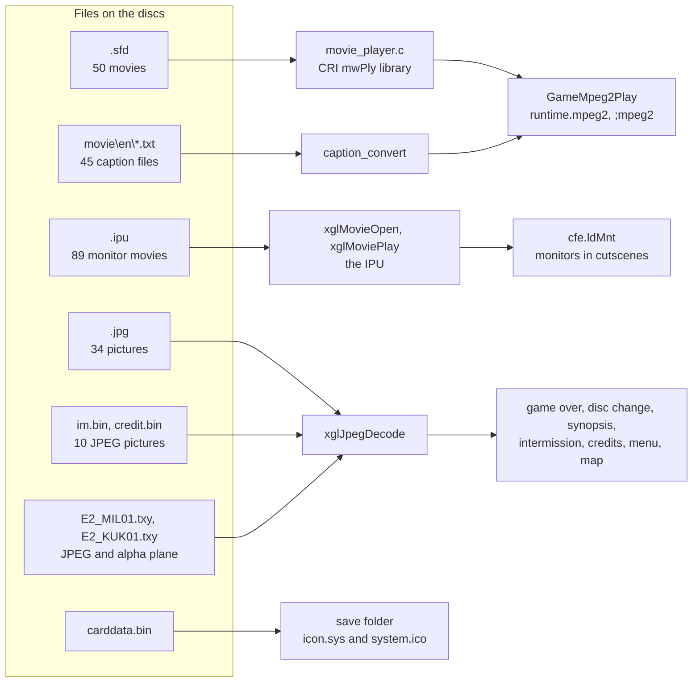

## 2. Sofdec movies

### 2.1 Where they are and who plays them

The 50 `.sfd` files hold all the full-motion video of the game, 2 hours, 7
minutes and 1 second in total (228,407 frames). The 21 movies of disc 1 are
in `movie\` of group 10 and last 59 minutes and 58 seconds together. The 29
movies of disc 2 are in `movie\` of group 20 and last 67 minutes and 3
seconds. No movie exists on both discs.

The names follow one pattern. 47 movies are called `s` plus six digits, for
example `s010100` or `s032110`. The first two digits rise through the story
from `01` to `10`, and the split between the discs falls inside chapter `04`
(`s040100` is the last movie of disc 1, `s040110` the first of disc 2). The
three other movies are `s06over`, `EP07` and `EPSTAFF`. `EPSTAFF` is 5
minutes and 32 seconds long and is probably the staff roll with its closing
scene, since its caption file holds dialogue of the epilogue. The meaning of
the digits beyond the chapter is read from the names only and is not used by
any code.

One function plays every movie. `GameMpeg2Play(name)` in
`src/main/game_movie.c` takes the name without the directory and without the
extension. It appends `.sfd` (`movieFileSuffix`), and `moviePlayerStartFile`
in `src/main/movie_player.c` puts `movie\` in front (`moviePathPrefix`). The
name is therefore looked up in the story group of the disc in the drive.
Three callers exist.

| Caller | File | Use |
| --- | --- | --- |
| `mpeg2` | `src/main/runtime.c` | the script native `runtime.mpeg2(name)`, see [Natives](../scripting/natives.md) |
| `resCmdMpeg2` | `src/main/res_get_path.c` | the scene resource script command `;mpeg2`, see [Events](../scripting/events.md) |
| the movie list | `src/main/yajima_test.c` | a developer test screen, see [Debug tools](../game/debug-tools.md) |

The same function builds the path of the caption file from the movie name. It
writes `movie/`, the two-letter language code from `xglGetLanguageCode`, a
`/`, and the movie name with `.txt` in place of `.sfd`. Only the directory
`movie\en\` exists on the discs, so only the language code `en` finds a file.
The caption files are described in [section 3](#3-movie-caption-files).

A name that starts with `EP` sets the local flag `skip_hidden`. For such a
movie the pause screen does not offer the skip with the triangle button, so
`EP07` and `EPSTAFF` cannot be skipped. The player loop, the pause and the
skip are described in
[Cutscenes: movies](../scripting/cutscenes.md#movies).

The diagram below shows how one name becomes the two files of a movie.

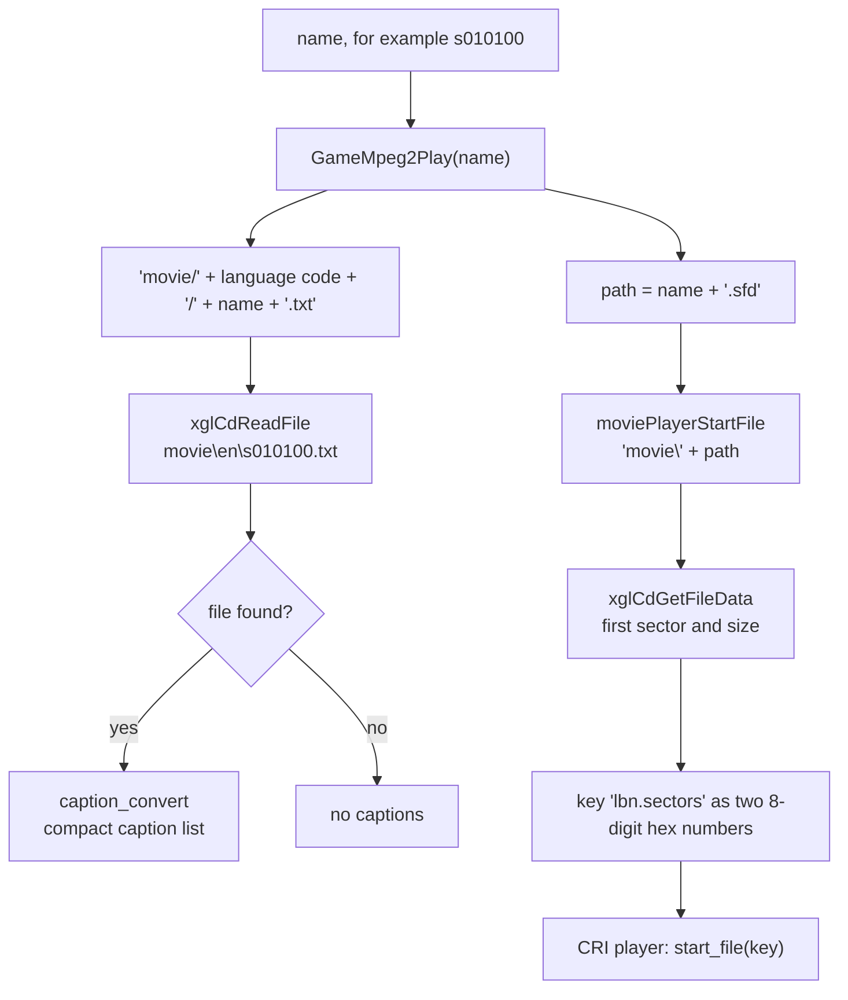

### 2.2 The program stream

A Sofdec file is an MPEG-1 system stream (ISO 11172-1), the same container
that Video CDs use. It is a chain of packs. Every pack in these files is
exactly 2,048 bytes long, one disc sector, so every file size is a multiple
of 2,048. All 3,049,546 packs of the 50 files start on a sector boundary with
the pack start code `00 00 01 BA`. Values in the MPEG layers are big-endian.

A pack starts with a 12-byte pack header.

| Offset | Size | Field | Notes |
| --- | --- | --- | --- |
| `0x00` | 4 | pack start code | `00 00 01 BA` |
| `0x04` | 5 | system clock reference | the bits `0010`, then 33 bits of clock in units of 1/90,000 second, split 3, 15 and 15 with a marker bit after each part. The top bits `0010` mark the MPEG-1 form of the header |
| `0x09` | 3 | multiplex rate | a marker bit, 22 bits in units of 50 bytes per second, a marker bit. The value is 268,275 in every pack of every file, which is 13,413,750 bytes per second |

After the pack header come one or more packets. A packet starts with the
prefix `00 00 01`, a stream identifier byte and a 16-bit length that counts
the bytes after the length field.

| Identifier | Meaning | Where |
| --- | --- | --- |
| `BB` | system header | the first packet of pack 0 and of pack 1 |
| `BE` | padding stream, filled with `FF` | fills the rest of a pack that is not full |
| `BF` | private stream 2, the Sofdec headers | pack 2 and pack 3, see [section 2.3](#23-the-sofdec-header-packs) |
| `C0` | audio stream 0, ADX | from pack 4 on |
| `C1` | audio stream 1, AC-3 | from pack 5 on |
| `E0` | video stream 0, MPEG-1 video | from pack 6 on |

An audio or video packet has a short header of its own after the length:
optional `FF` stuffing bytes, a two-byte buffer field that starts with the
bits `01`, and then the time stamps. The bits `0010` announce a 5-byte
presentation time stamp, the bits `0011` a presentation and a decoding time
stamp of 5 bytes each, and the single byte `0F` means no time stamp. The
stream data follows up to the end of the packet. The time stamps use the same
33-bit form and the same 90,000 units per second as the clock in the pack
header. The first time stamp of the video stream and of both audio streams is
0 in every file.

The buffer field holds the size of the decoder buffer that the stream
expects. It is `40 04` in every audio packet (scale 0, size 4, so 4 × 128 =
512 bytes) and `60 2E` in every video packet (scale 1, size 46, so 46 × 1,024
bytes). The same two values stand in the system headers.

Every pack after the first four carries exactly one audio or video packet,
and a padding packet behind it when the data does not fill the sector. This
holds for all 50 files: the number of packs is always the number of `C0`,
`C1` and `E0` packets plus 4. A stream never shares a pack with another
stream.

The two system headers describe the streams. Pack 0 holds the header for the
audio streams and pack 1 the header for the video stream. Both are the same
in all 50 files.

| Bytes | Pack 0 | Pack 1 |
| --- | --- | --- |
| rate bound, 3 bytes | `88 2F E7`, again 268,275 | `88 2F E7` |
| audio bound, flags | `0A`: 2 audio streams, fixed bit rate flag set | `02`: 0 audio streams, fixed bit rate flag set |
| video bound | `20`: 0 video streams | `21`: 1 video stream |
| reserved | `FF` | `FF` |
| stream entries | `C0 C0 04` and `C1 C0 04` | `E0 E0 2E` |

The last sector of every file is not a pack. It starts with the end code
`00 00 01 B9` and is filled with `FF` bytes up to its end.

```
.sfd file, 2,048 bytes per row
+----------------------------------------------------------------------+
| pack 0: pack header | BB system header, audio C0 C1 | BE padding     |
+----------------------------------------------------------------------+
| pack 1: pack header | BB system header, video E0    | BE padding     |
+----------------------------------------------------------------------+
| pack 2: pack header | BF "SofdecStream" file header                  |
+----------------------------------------------------------------------+
| pack 3: pack header | BF "CRITAGS" encoder record   | BE padding     |
+----------------------------------------------------------------------+
| pack 4: pack header | C0 packet: ADX header and first blocks         |
+----------------------------------------------------------------------+
| pack 5: pack header | C1 packet: first AC-3 frames                   |
+----------------------------------------------------------------------+
| pack 6: pack header | E0 packet: sequence header, first picture      |
+----------------------------------------------------------------------+
| ... one C0, C1 or E0 packet per pack, in the order of their clock    |
+----------------------------------------------------------------------+
| last sector: 00 00 01 B9, then FF                                    |
+----------------------------------------------------------------------+
```

The diagram below shows the layers of one pack.

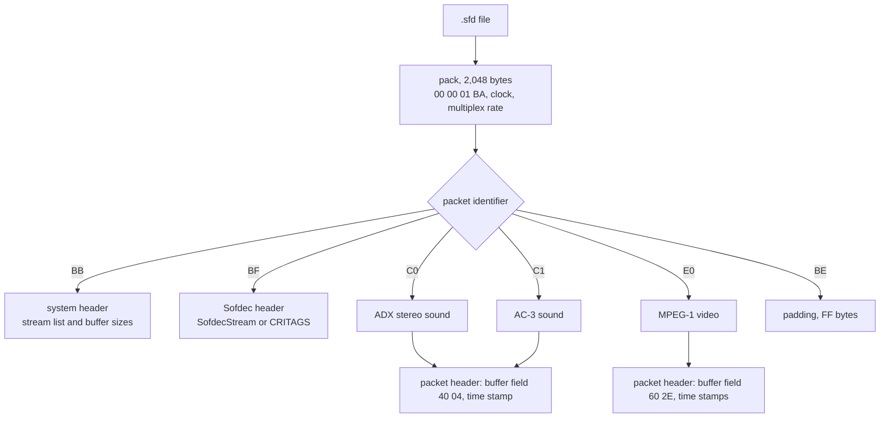

### 2.3 The Sofdec header packs

Packs 2 and 3 hold one private stream 2 packet (`BF`) each. These two packets
are what makes an MPEG stream a Sofdec file. They were written by the CRI
multiplexer and are read by the CRI library. The game code never looks at
them.

The packet of pack 2 has a payload of 2,030 bytes. It starts with 14 zero
bytes. The table gives offsets from the start of the payload, which is file
offset `0x1012`. The numbers in this packet are little-endian.

| Offset | Size | Field | Value |
| --- | --- | --- | --- |
| `0x00` | 14 | zero | |
| `0x0E` | 24 | signature | `SofdecStream`, padded with spaces |
| `0x26` | 2 | unknown, probably a format version | `02 15` in all files |
| `0x28` | 6 | zero | |
| `0x2E` | 12 | file name | the name padded to 8 characters with spaces, then `.sfd`, for example `s020100 .sfd` |
| `0x3A` | 12 | date and time of the multiplexing | digits `YYYYMMDDhhmm`, for example `200409151731` |
| `0x46` | 8 | zero | |
| `0x4E` | 32 | multiplexer | `SFM Ver.2.21 2003-08-27 CRI-MW`, padded with spaces |
| `0x6E` | 4 | pack size | 2,048 |
| `0x72` | 4 | unknown | 0 |
| `0x76` | 4 | unknown | 2 |
| `0x7A` | 4 | unknown, equal to the pack size | 2,048 |
| `0x7E` | 32 | zero | |
| `0x9E` | 4 | stream counts, one byte each | `04 02 01 01`: 4 elementary streams, 2 audio, 1 video, 1 private |
| `0xA2` | 4 | multiplex rate in bytes per second | 13,413,750 in all files, 50 times the rate in the pack headers |
| `0xA6` | 4 | length of the sound in milliseconds | within 32 ms of the AC-3 stream length in 48 files |
| `0xAA` | 4 | length of the video in milliseconds | within 1.5 ms of frames × 1001 / 30 in all files |
| `0xAE` | 4 | number of video frames | equal to the number of picture headers in the video stream in all 50 files |
| `0xB2` | to the end | zero | |

The dates fall into two groups. 43 movies were multiplexed on 15 September
2004, most of them within three hours. Seven movies were multiplexed again in
November 2004: `s040110` on 4 November, `s080810` and `s080830` on 10
November, and `s010100`, `s010310`, `s010700` and `s020700` on 25 November.
These are probably late corrections.

The packet of pack 3 is a text record of the video encoder. It starts with
the tag `CRITAGS` and ends with `CRITAGE`. Inside are named sections
(`SFVFTRS`, `SFV:TOP`, `SFV:DCD`, `SFV:ECD`, `SFV:SRC`, `SFV:BTM`,
`SFVFTRE`), each a list of text fields separated by zero bytes and spaces.
The fields repeat what the video stream itself says and add the settings of
the encoder. For `s010100` the readable fields are these.

| Text | Meaning |
| --- | --- |
| `V029970` | 29.970 frames per second |
| `15337` | number of frames |
| `IPB` | the picture types used |
| `512`, `448` | picture size |
| `7000000`, `7000000` | bit rate settings of the encoder in bits per second. The same number is `MOVIE_MAX_BIT_RATE` in `src/main/movie_player.c` |
| `CRI_SVE 3.81` | the CRI video encoder |
| `TMPGLib 1.95.14` | the MPEG encoding library used by it |
| `Sofdec Elem Stm` | the kind of source |

The meaning of the remaining fields of this record was not established.

### 2.4 Annotated start of a movie

The dump below shows the start of `movie\s020100.sfd` of group 10, the
shortest movie (180 frames, 5,005,312 bytes, 2,444 sectors).

```
offset  bytes                                 meaning
000000  00 00 01 BA                           pack 0: pack start code
000004  21 00 01 00 01                        clock 0 (0010, then 33 bits with marker bits)
000009  88 2F E7                              multiplex rate 268,275 x 50 bytes per second
00000C  00 00 01 BB 00 0C                     system header, 12 bytes follow
000012  88 2F E7 0A 20 FF                     rate bound, 2 audio streams, 0 video streams
000018  C0 C0 04  C1 C0 04                    stream C0 and C1: buffer scale 0, size 4
00001E  00 00 01 BE 07 DC                     padding packet, 2,012 bytes follow
000024  0F FF FF FF ...                       no time stamp, FF up to offset 0x800

000800  00 00 01 BA 21 00 01 00 1D 88 2F E7   pack 1, clock 14
00080C  00 00 01 BB 00 09                     system header, 9 bytes follow
000812  88 2F E7 02 21 FF                     rate bound, 0 audio streams, 1 video stream
000818  E0 E0 2E                              stream E0: buffer scale 1, size 46
00081B  00 00 01 BE 07 DF 0F FF ...           padding

001000  00 00 01 BA 21 00 01 00 39 88 2F E7   pack 2, clock 28
00100C  00 00 01 BF 07 EE                     private stream 2, 2,030 bytes follow
001012  00 x 14                               zero
001020  53 6F 66 64 65 63 53 74 72 65 61 6D   "SofdecStream"
001038  02 15                                 unknown, probably a version
001040  73 30 32 30 31 30 30 20 2E 73 66 64   "s020100 .sfd"
00104C  32 30 30 34 30 39 31 35 31 37 33 31   "200409151731"
001060  53 46 4D 20 56 65 72 2E 32 2E 32 31   "SFM Ver.2.21 2003-08-27 CRI-MW  "
001080  00 08 00 00 00 00 00 00 02 00 00 00   2,048, 0, 2
00108C  00 08 00 00                           2,048
0010B0  04 02 01 01                           4 streams: 2 audio, 1 video, 1 private
0010B4  76 AD CC 00                           13,413,750 bytes per second
0010B8  60 17 00 00                           sound length 5,984 ms
0010BC  77 17 00 00                           video length 6,007 ms
0010C0  B4 00 00 00                           180 frames

001800  00 00 01 BA ...                       pack 3
00180C  00 00 01 BF ...  "CRITAGS" ...        the encoder record

002000  00 00 01 BA ...                       pack 4
00200C  00 00 01 C0 07 E7                     audio stream 0, 2,023 bytes follow
002012  40 04                                 buffer field: scale 0, size 4
002014  21 00 01 00 01                        presentation time stamp 0
002019  80 00 01 1C 03 12 04 02               ADX header: data at 0x120, coding 3, block 18,
                                              4 bits per sample, 2 channels
002021  00 00 BB 80  00 04 5F DE              48,000 Hz, 286,686 samples
002029  01 F4 04 00                           high-pass 500 Hz, version 4, flags 0

003000  00 00 01 BA ...                       pack 6
00300C  00 00 01 E0 07 EE                     video stream 0, 2,030 bytes follow
003012  60 2E                                 buffer field: scale 1, size 46
003014  31 00 01 00 01  11 00 01 00 01        presentation and decoding time stamps
00301E  00 00 01 B3                           sequence header
003022  20 01 C0                              512 x 448
003025  C4                                    aspect code 12, frame rate code 4 (29.97)
003026  FF FF E4 42                           bit rate 0x3FFFF, buffer size 136

4C5800  00 00 01 B9 FF FF FF ...              last sector: end code and FF fill
```

### 2.5 The video stream

Stream `E0` is MPEG-1 video (ISO 11172-2) in all 50 files. No file has a
sequence extension, which an MPEG-2 stream would carry. Each stream has
exactly one sequence header, at its very start.

| Field of the sequence header | Value | Files |
| --- | --- | --- |
| picture size | 512 × 448 | 50 |
| aspect ratio code | 12 | 50 |
| frame rate code | 4, which is 30000/1001 = 29.97 frames per second | 50 |
| bit rate | `0x3FFFF`, the value for a variable bit rate | 50 |
| decoder buffer size, in units of 16,384 bits | 144 (28 files), 128 (13 files), 136 (9 files) | 50 |

The picture size is the size of the frame buffer of the game, so a movie
frame is shown without scaling. `moviePlayerParamsInit` creates the player
for exactly this size (`MOVIE_WIDTH` 512, `MOVIE_HEIGHT` 448).

The stream uses all three MPEG picture types. Across the 50 files there are
15,827 intra pictures, 62,237 predicted pictures and 150,343 bidirectional
pictures. That is about one intra picture in every 14 or 15 frames and two
bidirectional pictures between the others. The frame count of a movie in the
tables of this page is the number of picture start codes (`00 00 01 00`) in
the video stream. It agrees with the frame count field of the `SofdecStream`
header in every file.

The video takes most of the space. The video packets of all movies carry
5,315,794,960 bytes of stream data, 85 percent of the files. That is an
average of about 5.6 million bits per second of video, below the 7 million of
the encoder setting.

### 2.6 The audio streams

Every movie carries its sound twice. Stream `C0` is CRI ADX, the same codec
as the music and voice files of the game (see
[Sound formats](sound.md) and [Audio](../architecture/audio.md)). Stream `C1`
is Dolby Digital. Both streams cover the whole movie.

The ADX stream starts with a normal ADX header, big-endian, in the first `C0`
packet. All 50 movies use the same parameters.

| Offset | Size | Field | Value in all 50 movies |
| --- | --- | --- | --- |
| `0x00` | 2 | signature | `80 00` |
| `0x02` | 2 | offset of the sample data minus 4 | `0x011C`, so the data starts at `0x120` |
| `0x04` | 1 | coding type | 3, standard ADX |
| `0x05` | 1 | block size in bytes | 18 |
| `0x06` | 1 | bits per sample | 4 |
| `0x07` | 1 | channels | 2 |
| `0x08` | 4 | sample rate | 48,000 Hz |
| `0x0C` | 4 | number of samples | 286,686 (`s020100`) to 24,565,341 (`s010100`) |
| `0x10` | 2 | high-pass frequency | 500 Hz |
| `0x12` | 1 | version | 4 |
| `0x13` | 1 | flags | 0, not encrypted |
| `0x11A` | 6 | `(c)CRI` | the bytes just before the sample data |

One ADX block holds 32 samples of one channel in 18 bytes, and the blocks of
the two channels alternate. A stereo stream at 48,000 Hz therefore runs at
432,000 bits per second. The byte counts confirm the layout in every file:
the `C0` payload is 288 header bytes, 36 bytes for every 32 samples, and one
closing block of 18 bytes.

The AC-3 stream starts directly with a sync frame (`0B 77`). The header of
the first frame gives the parameters.

| Field | Value | Files |
| --- | --- | --- |
| sample rate code | 0, which is 48,000 Hz | 50 |
| frame size code | 30, which is 448,000 bits per second and 1,792 bytes per frame | 50 |
| bit stream identification | 8 | 50 |
| bit stream mode | 0, complete main service | 50 |
| channel mode 7 with the low-frequency channel on | 3 front and 2 rear channels plus LFE, 5.1 | 48 |
| channel mode 2 | 2 channels, stereo | 2: `s040110` and `s06over` |

The `C1` payload is a whole number of 1,792-byte frames in every file. One
frame holds 1,536 samples, 32 milliseconds.

The game creates the player for one of the two streams according to the
sound option of the player. `GameMpeg2Play` passes `SaveData.dolby_digital`
to `movieRenderBufferSize` and `movieRenderBufferAlloc`. When the option is
on, `movieRenderBufferAlloc` first locks the ADX manager with `ADXM_Lock`,
and after creating the player it adds a second work block and calls
`mwPlyCreateStm(handle, block, size)`. `moviePlayerStartFile` then does not
set the playback volume. When the movie ends, `moviePlayerDestroy` calls
`mwPlyDestroyStm`, unlocks the ADX manager and reopens the sound slots of the
game with `soundSlotsReopen`. The game code does not name a stream number
anywhere. The likely reading is that the extra object makes the library send
the AC-3 stream to the digital output of the console unchanged, while without
it the library decodes the ADX stream and plays it at the volume from
`seVolumeCurve`.

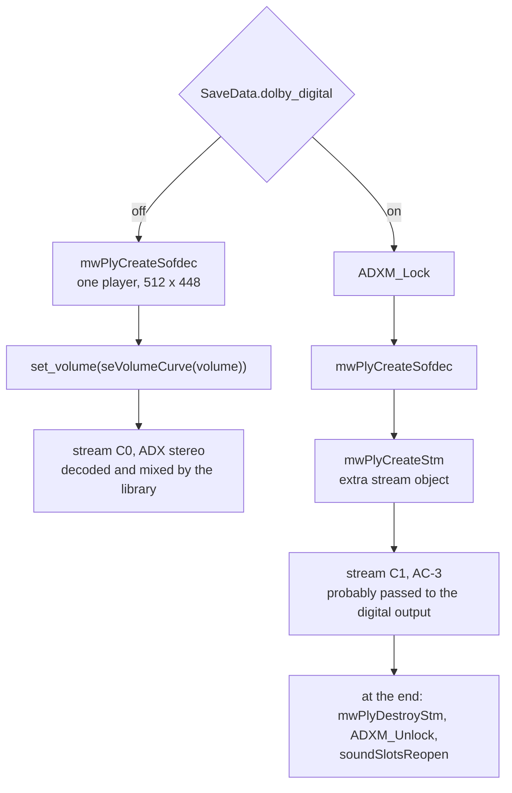

### 2.7 How the player reads the stream

The game never parses the stream itself. `moviePlayerStartFile` looks the
file up with `xglCdGetFileData` and gets the first sector and the stored size
in bytes. It prints both as the text `%08x.%08x`, the sector number and the
size in sectors, and passes this key to the `start_file` method of the CRI
player. The library reads the sectors of the file on its own from then on. A
movie must therefore be stored unpacked and in one piece, which is the case
for all 50 files. Three movies of each disc cross the boundary between two
1 GiB pieces of their group, which does not matter because the pieces follow
each other on the disc.

The player object is created by `mwPlyCreateSofdec` from the parameters that
`moviePlayerParamsInit` fills in.

| Parameter | Value | Meaning |
| --- | --- | --- |
| `file_type` | 1 | the Sofdec file type |
| `max_bit_rate` | 7,000,000 | the highest bit rate the stream may have |
| `max_width`, `max_height` | 512, 448 | the picture size |
| `frame_pool_count` | 3 | decoded frames kept in the pool |
| `stream_count` | 1 | one movie at a time |
| `base`, `size` | work area | the size comes from `mwPlyCalcWorkCprmSfd` |
| `composition_mode` | 0 | no composition |

`moviePlayerLibraryInit` starts the library once with `mwPlyInitSfdFx` and
the number 59.94 (`movieFrameRate`), which is probably the field rate of the
display. Each call of `moviePlayerUpdate` asks the library for the frame that
is due with `mwPlyGetCurFrm`. The frame record gives the address of a
finished picture of 32-bit pixels, its width and height, and a stamp. The
picture is stored as 16 × 16 pixel blocks, column by column. The DMA chain
built by `makeGstransChain` uploads it to video memory block by block, and a
second packet copies the uploaded page to the page on screen. The stamp of
the frame goes to `player.frame_stamp`, which drives the captions. The player
record, the upload chain and the loop around them are described in
[Cutscenes: the player wrapper](../scripting/cutscenes.md#the-player-wrapper).

The sequence below shows the way of the data during playback.

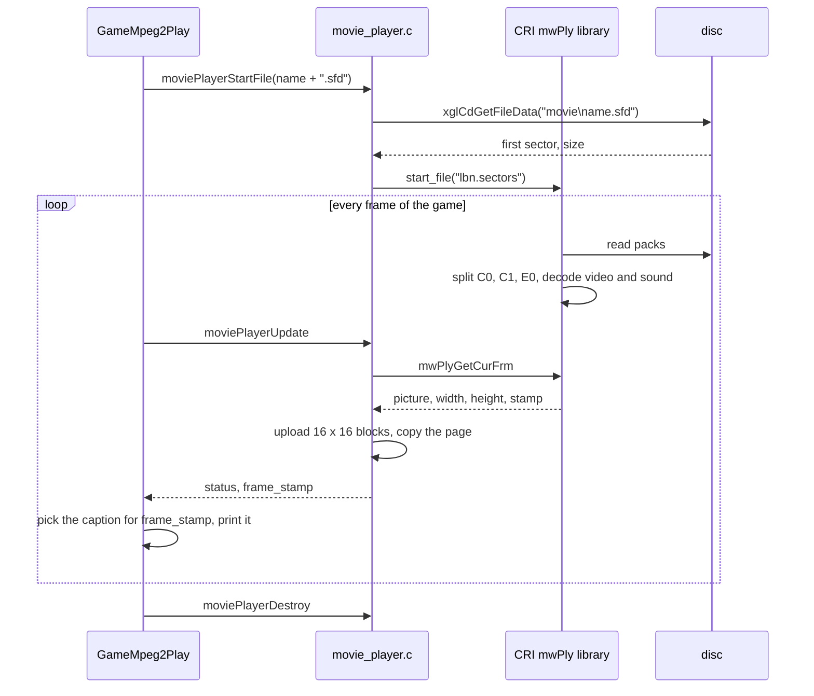

### 2.8 Statistics

| Statistic | Value |
| --- | --- |
| Files | 50: 21 in group 10, 29 in group 20 |
| Total size | 6,245,572,608 bytes: 3,021,203,456 in group 10, 3,224,369,152 in group 20 |
| Packs | 3,049,546 of 2,048 bytes, plus one end sector per file |
| Frames | 228,407: 107,828 on disc 1, 120,579 on disc 2 |
| Running time | 2:07:01 at 29.97 frames per second |
| Longest movie | `s010100`, 15,337 frames, 8 minutes 31.7 seconds, 422,352,896 bytes |
| Shortest movie | `s020100`, 180 frames, 6.0 seconds, 5,005,312 bytes |
| Video | MPEG-1, 512 × 448, 29.97 frames per second, in all files |
| Sound | ADX stereo 48,000 Hz and AC-3 448 kbit/s in all files, AC-3 in 5.1 in 48 files |
| Padding | 838,584 bytes of `BE` packets in all files together |
| Movies with captions | 45: 20 on disc 1, 25 on disc 2 |

The sound and the picture of a movie do not always have the same length. In
38 files the ADX stream and the video agree within a tenth of a second. In
ten files they differ by more than a quarter of a second. The sound is
shorter than the picture by 7.3 seconds in `s100700`, by 2.0 seconds in
`s021200`, by 1.3 seconds in `s010700` and by 1.2 seconds in `s090600`. In
`s06over` the sound is 0.8 seconds longer than the picture.

### 2.9 All Sofdec movies

The table lists every movie. All of them are 512 × 448 at 29.97 frames per
second with ADX stereo sound at 48,000 Hz. "Length" is frames × 1001 / 30000.
"ADX samples" is the sample count of the ADX header. "AC-3" is the channel
layout of stream `C1`. "Captions" is the number of timed entries of the
caption file, and in brackets how many of them carry text. "Muxed" is the
date from the `SofdecStream` header.

| Movie | Group | Size in bytes | Frames | Length | ADX samples | AC-3 | Captions (with text) | Muxed |
| --- | --- | --- | --- | --- | --- | --- | --- | --- |
| `s010100` | 10 | 422,352,896 | 15,337 | 8:31.7 | 24,565,341 | 5.1 | 175 (119) | 20041125 |
| `s010310` | 10 | 324,261,888 | 11,720 | 6:31.1 | 18,767,548 | 5.1 | 101 (70) | 20041125 |
| `s010610` | 10 | 108,623,872 | 4,409 | 2:27.1 | 7,058,251 | 5.1 | 46 (31) | 20040915 |
| `s010700` | 10 | 205,570,048 | 7,120 | 3:57.6 | 11,342,949 | 5.1 | 40 (24) | 20041125 |
| `s010800` | 10 | 94,932,992 | 3,405 | 1:53.6 | 5,453,448 | 5.1 | 33 (21) | 20040915 |
| `s020100` | 10 | 5,005,312 | 180 | 0:06.0 | 286,686 | 5.1 | 4 (2) | 20040915 |
| `s020310` | 10 | 88,006,656 | 3,254 | 1:48.6 | 5,210,004 | 5.1 | none | 20040915 |
| `s020500` | 10 | 146,804,736 | 4,664 | 2:35.6 | 7,469,862 | 5.1 | 35 (20) | 20040915 |
| `s020520` | 10 | 150,896,640 | 5,182 | 2:52.9 | 8,304,296 | 5.1 | 45 (27) | 20040915 |
| `s020700` | 10 | 128,923,648 | 4,389 | 2:26.4 | 7,032,625 | 5.1 | 69 (43) | 20041125 |
| `s021200` | 10 | 84,699,136 | 3,268 | 1:49.0 | 5,137,933 | 5.1 | 47 (32) | 20040915 |
| `s030500` | 10 | 280,659,968 | 9,683 | 5:23.1 | 15,508,293 | 5.1 | 148 (95) | 20040915 |
| `s030920` | 10 | 111,187,968 | 4,126 | 2:17.7 | 6,608,201 | 5.1 | 34 (21) | 20040915 |
| `s031000` | 10 | 68,190,208 | 2,248 | 1:15.0 | 3,598,795 | 5.1 | 22 (12) | 20040915 |
| `s031300` | 10 | 142,766,080 | 6,178 | 3:26.1 | 9,878,668 | 5.1 | 88 (58) | 20040915 |
| `s031610` | 10 | 54,251,520 | 2,097 | 1:10.0 | 3,356,954 | 5.1 | 23 (12) | 20040915 |
| `s031700` | 10 | 64,403,456 | 2,066 | 1:08.9 | 3,308,906 | 5.1 | 24 (13) | 20040915 |
| `s031800` | 10 | 98,562,048 | 3,701 | 2:03.5 | 5,938,733 | 5.1 | 46 (27) | 20040915 |
| `s032010` | 10 | 223,457,280 | 7,496 | 4:10.1 | 12,003,992 | 5.1 | 86 (59) | 20040915 |
| `s032110` | 10 | 138,835,968 | 4,456 | 2:28.7 | 7,133,526 | 5.1 | 40 (23) | 20040915 |
| `s040100` | 10 | 78,811,136 | 2,849 | 1:35.1 | 4,524,520 | 5.1 | 27 (15) | 20040915 |
| `s040110` | 20 | 212,828,160 | 8,650 | 4:48.6 | 13,853,840 | 2.0 | 61 (35) | 20041104 |
| `s050210` | 20 | 61,356,032 | 2,351 | 1:18.4 | 3,763,760 | 5.1 | 36 (20) | 20040915 |
| `s050400` | 20 | 257,284,096 | 8,291 | 4:36.6 | 13,277,264 | 5.1 | 55 (30) | 20040915 |
| `s050610` | 20 | 14,401,536 | 420 | 0:14.0 | 671,071 | 5.1 | 2 (1) | 20040915 |
| `s060200` | 20 | 182,466,560 | 5,774 | 3:12.7 | 9,246,037 | 5.1 | 45 (28) | 20040915 |
| `s060310` | 20 | 50,210,816 | 1,550 | 0:51.7 | 2,480,878 | 5.1 | 11 (6) | 20040915 |
| `s060400` | 20 | 19,359,744 | 585 | 0:19.5 | 935,335 | 5.1 | none | 20040915 |
| `s06over` | 20 | 7,421,952 | 210 | 0:07.0 | 374,844 | 2.0 | none | 20040915 |
| `s080110` | 20 | 54,521,856 | 2,674 | 1:29.2 | 4,239,436 | 5.1 | 29 (15) | 20040915 |
| `s080500` | 20 | 19,634,176 | 584 | 0:19.5 | 933,733 | 5.1 | none | 20040915 |
| `s080810` | 20 | 254,844,928 | 9,657 | 5:22.2 | 15,465,050 | 5.1 | 91 (56) | 20041110 |
| `s080830` | 20 | 38,123,520 | 1,365 | 0:45.5 | 2,182,980 | 5.1 | 10 (6) | 20041110 |
| `s080900` | 20 | 376,014,848 | 14,090 | 7:50.1 | 22,550,528 | 5.1 | 196 (119) | 20040915 |
| `s081100` | 20 | 131,977,216 | 3,796 | 2:06.7 | 6,078,072 | 5.1 | 8 (4) | 20040915 |
| `s090410` | 20 | 17,889,280 | 796 | 0:26.6 | 1,273,272 | 5.1 | 5 (3) | 20040915 |
| `s090500` | 20 | 13,015,040 | 405 | 0:13.5 | 647,046 | 5.1 | none | 20040915 |
| `s090510` | 20 | 159,412,224 | 5,303 | 2:56.9 | 8,491,684 | 5.1 | 64 (37) | 20040915 |
| `s090600` | 20 | 261,636,096 | 8,634 | 4:48.1 | 13,770,557 | 5.1 | 107 (61) | 20040915 |
| `s090700` | 20 | 31,442,944 | 945 | 0:31.5 | 1,486,285 | 5.1 | 8 (4) | 20040915 |
| `s100110` | 20 | 62,609,408 | 2,025 | 1:07.6 | 3,241,638 | 5.1 | 37 (23) | 20040915 |
| `s100400` | 20 | 41,392,128 | 1,722 | 0:57.5 | 2,757,955 | 5.1 | 27 (15) | 20040915 |
| `s100410` | 20 | 79,196,160 | 3,616 | 2:00.7 | 5,789,784 | 5.1 | 60 (38) | 20040915 |
| `s100500` | 20 | 68,782,080 | 3,195 | 1:46.6 | 5,117,112 | 5.1 | 47 (26) | 20040915 |
| `s100600` | 20 | 152,365,056 | 5,317 | 2:57.4 | 8,515,707 | 5.1 | 76 (50) | 20040915 |
| `s100700` | 20 | 109,334,528 | 4,447 | 2:28.4 | 6,771,565 | 5.1 | 60 (36) | 20040915 |
| `s100800` | 20 | 103,407,616 | 5,320 | 2:57.5 | 8,520,512 | 5.1 | 78 (46) | 20040915 |
| `s101210` | 20 | 186,347,520 | 6,244 | 3:28.3 | 9,998,789 | 5.1 | 74 (47) | 20040915 |
| `EP07` | 20 | 39,622,656 | 2,655 | 1:28.6 | 4,255,452 | 5.1 | 33 (21) | 20040915 |
| `EPSTAFF` | 20 | 217,470,976 | 9,958 | 5:32.3 | 15,950,335 | 5.1 | 87 (49) | 20040915 |

## 3. Movie caption files

### 3.1 Where they are

The subtitles of the movies are not part of the video. Each movie has a small
text file with the same name in a language directory next to it:
`movie\en\s010100.txt` belongs to `movie\s010100.sfd`. The discs hold 45 such
files, 20 in group 10 and 25 in group 20, between 751 and 6,723 bytes long
and 98,406 bytes in total. Five movies have no caption file: `s020310` on
disc 1 and `s060400`, `s06over`, `s080500` and `s090500` on disc 2. For them
`xglCdReadFile` returns a negative size and the movie plays without captions.

`movie\en\` is the only language directory. The code builds the directory
name from `xglGetLanguageCode`, which picks one of the nine codes `en`, `jp`,
`en`, `de`, `fr`, `it`, `es`, `zh`, `ko` by the value of the caption option
`SaveData.caption_all` (`src/main/xgl_timer0.c`). The values 0 and 2 give
`en`. The value 1 gives `jp`, a directory that does not exist, so no caption
file is found then. The option and its screen are described in
[Save data](../architecture/save-data.md).

### 3.2 The text format

A caption file is plain text with one entry per line. The lines end with a
single line feed (`0A`) in all 45 files. The parser also accepts carriage
returns. The format below is what `caption_nextline` and `caption_getparam`
in `src/main/game_movie.c` read, and a model of these two functions was run
over every file to check it.

| Line | Meaning |
| --- | --- |
| starts with `;` | comment, skipped. Empty lines are skipped too |
| starts with a digit or `+` | an entry: a time stamp, then spaces or tabs, then the text up to the end of the line |
| starts with anything else | the end of the captions. All 45 files use the word `end` |

The time stamp is a list of decimal numbers separated by colons. The parser
adds each number to a running total, multiplies the total by 60 at the first
colon and by 30 at the second. A stamp `mm:ss:ff` is therefore
`(mm × 60 + ss) × 30 + ff`, a frame number at 30 frames per second. A stamp
without colons is a plain frame number, and a leading `+` makes the stamp
relative to the entry before. Every entry on the discs uses the form with two
colons. No entry uses `+`.

Inside the text, three characters have a meaning.

| Text | Meaning | Use on the discs |
| --- | --- | --- |
| `\` and the character after it | starts a further line of the same caption. The files write `\n`, and the parser drops the `n` without looking at it | 33 files have captions of two lines, none has more |
| `@` at the start of a line | replaced by a space. A caption that starts this way is shown even when the caption option is off | never used |
| `[base/ruby]` | ruby text, a small reading aid above a word. Expanded to the control strings `$rubyb;`, `$rubys;` and `$rubye;` of the font system | never used |

An entry with a stamp and no text is an empty caption. It clears the screen
at that time. 940 of the 2,440 timed entries are of this kind: almost every
line of dialogue has its own stamp for the moment it disappears.

The first entry of every file has the stamp `00:00:00` and holds only a
control string for the font system, `$ay390;$xx0,22;` in 44 files and
`$ay350;$xx0,40;` in `s040110.txt`. `caption_convert` treats an entry at time
0 specially: it becomes the header of the converted list and is the current
caption from the first frame until the first timed entry is reached. The
control codes are described in
[Fonts and text](../libraries/fonts-and-text.md).

Every file starts with the same block of comment lines in Japanese. They are
the notes of the format's author and say the same as the tables above. In
translation:

```
;Caption sample (a line that starts with ; is a comment)
;There is no limit on the file size.
;frame             text (\n for a line break)
;min:sec:frame     text (\n for a line break)
;A + at the start of the line makes the stamp relative
;A [ in the text starts ruby. Write it as [kanji/ruby].
;Frame 0 gives the initialisation string. $ay sets the Y coordinate, $xx0, sets the line spacing.
```

Nine commented sample entries follow, then a comment with a file name, a
ruler line for the text width, the entries, the line `end` and a last comment
that says a line starting with `end` terminates the file. In twelve files the
file name in the comment is the name of another movie (`s020100.txt` says
`;s010800.txt`), a trace of copying one file to start the next.

### 3.3 Encoding

The files are EUC-JP text. All 45 decode without error as EUC-JP, and none
decodes as Shift-JIS. The comment block is Japanese. The captions themselves
are English and almost pure ASCII. Only two kinds of two-byte characters
occur in caption text, in 24 lines of 11 files.

| Bytes | EUC-JP character | Use |
| --- | --- | --- |
| `A1 BD` | `―`, a long dash | 21 lines, for a sentence that breaks off: `What the―` |
| `A4 A2`, `A4 A3` | the hiragana `あ` and `ぃ` | 3 lines, where an accented letter belongs: `clich` + `A4 A2` and `p` + `A4 A3` + `che` |

The second row is the way this game writes accented Latin letters. The
English font puts such letters on the code points of the hiragana row, so
`A4 A2` is drawn as `é` and `A4 A3` as `ê` ("cliché", "ma pêche"). This
reading follows from the words. The character tables of the fonts are
described in [Text and fonts](text-and-fonts.md).

### 3.4 Annotated example

`movie\en\s020100.txt` of group 10 is the shortest file with dialogue of its
own kind: two location captions. After the comment block it reads as follows
(tabs shown as spaces).

```
;s010800.txt

;        00------05--------10--------15--------20--------25
00:00:00    $ay390;$xx0,22;
00:01:01    Fourteen years later
00:03:01
00:03:16    Second Miltian government offices
00:05:16


end
;(a line that starts with "end" terminates the file)
```

`caption_convert` turns this into one header and four timed entries.

| Stamp | Frames | Text | Effect |
| --- | --- | --- | --- |
| `00:00:00` | 0 | `$ay390;$xx0,22;` | header, current from the start |
| `00:01:01` | 31 | `Fourteen years later` | shown at frame 31 |
| `00:03:01` | 91 | empty | cleared at frame 91 |
| `00:03:16` | 106 | `Second Miltian government offices` | shown at frame 106 |
| `00:05:16` | 166 | empty | cleared at frame 166 |

The movie `s020100.sfd` has 180 frames, so the last stamp lies 14 frames
before its end.

### 3.5 From the file to the screen

`GameMpeg2Play` reads the file into the start of its work buffer and calls
`caption_convert`, which rewrites the text in place into a compact list: the
header text, then for every entry a 16-bit little-endian time and the text
with a zero byte at its end, and a last record with the time `0xFFFF`. Every
line of text gets two bytes in front, the control code 1 and the complement
of half the line width in pixels, which centre the line. The converted form
and the drawing are described in
[Cutscenes: movie captions](../scripting/cutscenes.md#movie-captions).

During playback the loop compares the time of the next entry with
`player.frame_stamp`, the stamp of the movie frame last taken from the CRI
library, and moves on by at most one entry per frame of the game. The files
show that the stamps are movie frame numbers: in 44 of the 45 files the last
stamp is not larger than the frame count of the movie, and it usually lies
within a few seconds of the end. The exception is `s090410.txt`, whose last
entry, an empty one, has the stamp 800 while the movie has 796 frames. That
entry is never reached, which changes nothing because the movie ends first.

The time is stored in 16 bits, so a stamp can be at most 65,535 frames, a
little over 36 minutes. The largest stamp on the discs is 14,978, in
`s010100.txt`.

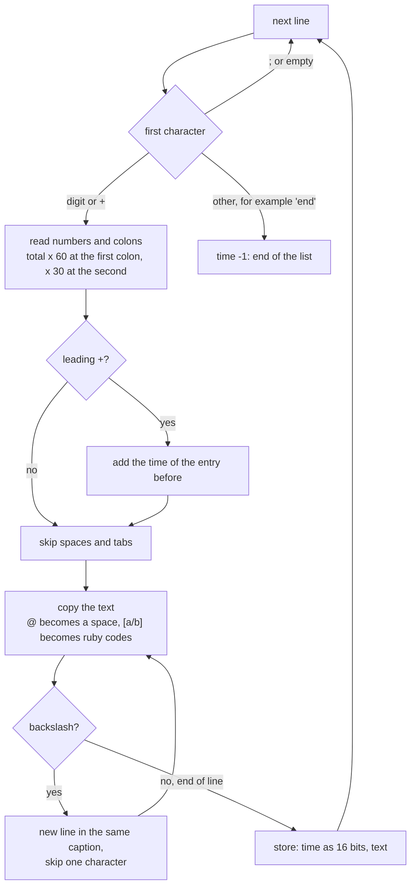

### 3.6 Statistics and oddities

| Statistic | Value |
| --- | --- |
| Files | 45, all in `movie\en\` |
| Timed entries | 2,440: 1,500 with text and 940 empty |
| Entries per file | 2 (`s050610.txt`) to 196 (`s080900.txt`) |
| Longest line of text | 51 bytes |
| Lines per caption | at most 2 |
| Header string | `$ay390;$xx0,22;` (44 files), `$ay350;$xx0,40;` (`s040110.txt`) |
| Stamp form | `mm:ss:ff` in every entry |

The stamps should rise through a file, and in 41 files they do. Five entries
in four files have a stamp that is smaller than the one before, clearly a
typing error in the minutes.

| File | Entry | Stamp in the file | Stamps around it |
| --- | --- | --- | --- |
| `s100600.txt` | `They long to collide with their anti-existence.` | `00:04:15` | `02:29:15` before, `02:32:16` after |
| `s100700.txt` | `What's with that face?` | `00:17:15` | `01:02:25` before, `01:05:20` after |
| `s100700.txt` | `We really are nothing more\nthan instruments of war.` | frame 525 | frame 870 before |
| `s010100.txt` | `you're a Realian who's been especially` | frame 3,621 | frame 3,625 before |
| `s030500.txt` | `Looks like ma pêche managed to protect` | frame 7,595 | frame 7,600 before |

The loop in `GameMpeg2Play` handles such an entry without harm. It advances
when the frame stamp has reached the time of the next entry, and a time in
the past is reached at once. The caption therefore appears one frame after
the entry before it, which in these five cases is the empty entry that
cleared the caption before. The line is shown a little early instead of at
its intended time.

## 4. IPU movies

### 4.1 Where they are and who plays them

The 89 IPU movies are the moving pictures on monitors, holograms and windows
inside the real-time cutscenes. They are short, silent and small, between a
single frame and 43 seconds. All of them are in directories called
`movie\cfevent\`: 20 in group 00, for monitors that can appear on both discs,
36 in group 10 and 33 in group 20.

The names show the use. The files of group 00 are called `moni_` plus a
number (twelve files, some with `_h` or `_l` at the end), `moni_110`,
`moni_111`, `moni_Frame01`, `moni_Frame02`, `noise077`, `noise_umn`,
`noise_umn_l` and `s-monitor`. The files of the story groups carry the number
of their scene, for example `s-02-04-10-01.ipu` or `s-024_monitor.ipu`, and
one is called `021400.ipu`.

The only player is the `cfe` cutscene system. The script command `cfe.ldMnt`
(`cfeCmdLoadMonitor` in `src/main/cfePlugIn.c`) takes a file name, asks for
the file size, reads the whole file into memory and opens it with
`xglMovieOpen(&entry->movie, 0)`. The null name tells the player that the
movie is already in memory. The movie loops (`loop` is 1). Each frame of the
cutscene, `cfeEntryTableUpdate` decodes one movie frame with `xglMoviePlay`
and draws it as a textured rectangle in the scene. Up to 16 monitors can be
loaded. The monitor tracks and the drawing are described in
[Cutscenes: monitors](../scripting/cutscenes.md#monitors), the player in
[xgl: IPU movies](../libraries/xgl.md#ipu-movies).

One more file has the extension: `iwase\avitest.ipu` in group 00. It has no
valid header and no code names it. It is described in
[section 4.7](#47-avitestipu).

### 4.2 File layout

An IPU file has a 16-byte header and then the frames, one after the other.
The header is little-endian. The layout was checked on all 89 files.

| Offset | Size | Field | Notes |
| --- | --- | --- | --- |
| `0x00` | 4 | signature `ipum` | `XglMovieSourceHeader.signature`, checked by `xglMovieOpen` against `0x6D757069` |
| `0x04` | 4 | file size minus 8 | true in all 89 files. Never read by the player |
| `0x08` | 2 | width in pixels | a multiple of 16 |
| `0x0A` | 2 | height in pixels | a multiple of 16 |
| `0x0C` | 2 | frame count | `XglMovieSourceHeader.frameCount` |
| `0x0E` | 2 | zero | zero in all files. Probably the high half of a 32-bit frame count |

Each frame is one byte of flags ([section 4.3](#43-the-frame-flags-byte)),
then the macroblocks of the picture as a bit stream, then zero bits up to the
next byte boundary, then the 4-byte code `00 00 01 B0`. After the last frame
comes the end code `00 00 01 B1`, so the last eight bytes of every file are
`00 00 01 B0 00 00 01 B1`. These are the only start codes in the files: the
number of `00 00 01 B0` codes equals the frame count of the header in all 89
files, and no other byte follows a `00 00 01` prefix. In 1,466 of the 11,879
frames a whole zero byte sits before the `B0` code, probably because the bit
stream ended exactly on a byte boundary and the encoder still added a padding
byte.

The macroblock data is what the IPU's `IDEC` command decodes: the intra
macroblocks of an MPEG-2 picture without slice headers, with four luminance
blocks and two chrominance blocks per 16 × 16 pixel macroblock. There is no
prediction between frames, so every frame can be decoded alone. There is no
table of frame offsets either. The frames can only be found by decoding or by
searching for the `B0` codes.

```
ipum file
+--------------------------------------------------------------+
| header, 16 bytes: "ipum", size - 8, width, height, frames    |
+--------------------------------------------------------------+
| frame 0: flags byte | macroblock bits | 0 padding | 00 00 01 B0
+--------------------------------------------------------------+
| frame 1: flags byte | macroblock bits | 0 padding | 00 00 01 B0
+--------------------------------------------------------------+
| ...                                                          |
+--------------------------------------------------------------+
| frame n-1: flags byte | macroblock bits | 0 padding | 00 00 01 B0
+--------------------------------------------------------------+
| 00 00 01 B1   end of the stream                              |
+--------------------------------------------------------------+
```

### 4.3 The frame flags byte

The first byte of every frame sets the decoding mode of the IPU for that
frame. `xglMoviePlay` reads it with the IPU's `FDEC` command, which shows the
next 32 bits of the input, and keeps the top byte. A second `FDEC` consumes
the 8 bits. The player then writes `(flags & 0xFB) << 16` to the IPU control
register `IPU_CTRL` and sends the decode command `IDEC` with bit 24 set from
flag bit 2. The meaning of each bit therefore comes from the fields of
`IPU_CTRL` and `IDEC`.

| Bit | Mask | Goes to | Meaning |
| --- | --- | --- | --- |
| 0–1 | `0x03` | `IPU_CTRL` bits 16–17, IDP | intra DC precision: 0 = 8 bits, 1 = 9 bits, 2 = 10 bits |
| 2 | `0x04` | `IDEC` bit 24, DTD | each macroblock has a DCT type bit (frame or field DCT) |
| 3 | `0x08` | `IPU_CTRL` bit 19 | none, always 0 in the files |
| 4 | `0x10` | `IPU_CTRL` bit 20, AS | alternate scan order |
| 5 | `0x20` | `IPU_CTRL` bit 21, IVF | intra VLC format, the second table for AC coefficients |
| 6 | `0x40` | `IPU_CTRL` bit 22, QST | non-linear quantiser scale |
| 7 | `0x80` | `IPU_CTRL` bit 23, MP1 | MPEG-1 bit stream, never set in the files |

Every frame of a file uses the same flags byte. Three values occur.

| Flags | Meaning | Files |
| --- | --- | --- |
| `0x76` | 10-bit DC, DCT type bits, alternate scan, intra VLC table, non-linear quantiser | 64 |
| `0x62` | 10-bit DC, intra VLC table, non-linear quantiser | 24 |
| `0x74` | as `0x76`, with 8-bit DC | 1, `021400.ipu` |

The 24 files with `0x62` are the twelve `moni_0xx` files, `moni_110` and
`moni_111` of group 00, `s-02-02-00-00`, `s-03-04-10-00` and `s-03-04-10-01`
of group 10, and `s-05-02-00_00` and the six `s-09-03-00-0x` files of group
20. The different settings probably come from different settings of the
conversion tool, since the player handles all of them the same way.

### 4.4 Annotated example

The dump below shows the header and the last bytes of
`movie\cfevent\moni_040.ipu` of group 00.

```
offset  bytes                                   meaning
000000  69 70 75 6D                             "ipum"
000004  84 1C 03 00                             0x031C84 = 203,908 = file size - 8
000008  80 00                                   width 128
00000A  70 00                                   height 112
00000C  3C 00 00 00                             60 frames
000010  62                                      frame 0 flags: 10-bit DC, intra VLC table,
                                                non-linear quantiser
000011  51 FC 3F 68 D1 A3 0C 37 ...             macroblock bits of frame 0
...
031C7C  A3 0C 37 1A 34 68 C3 0C                 end of the macroblocks of frame 59
031C84  00 00 01 B0                             end of frame 59
031C88  00 00 01 B1                             end of the stream (file size 0x031C8C)
```

The 60 frames of this file take between 540 and 4,970 bytes each. The
picture has 8 × 7 = 56 macroblocks, so the largest frame spends 89 bytes on a
macroblock.

### 4.5 How `xglMoviePlay` walks the stream

`xglMovieOpen` checks the signature and copies the width, the height and the
frame count. It does not use the size at offset 4. From the picture size it
computes `stripQwords`, the size of one row of macroblocks in decoded form
(64 quadwords of 32-bit pixels per macroblock), and `imageQwords` for the
whole picture. For a movie in memory, the way the cutscene player uses it, it
points the input DMA at the source plus 16 bytes, past the header, with a
count of `(sourceSize - 1) / 16` quadwords. The player can also stream a
movie from the disc through a ring of two halves and a chain of four DMA
tags. Only a developer test uses that mode (see
[section 10](#10-files-the-code-names-that-are-not-on-the-discs)).

Each call of `xglMoviePlay` decodes one frame. It restores the bit position
of the IPU from the end of the frame before, peeks at the flags byte with
`FDEC 0`, consumes it with `FDEC 8`, sets `IPU_CTRL` and sends `IDEC` with
quantiser scale code 1 and 32-bit output. While the IPU decodes, the player
takes the output one strip of 16 pixel rows at a time. The cutscene player
uses the memory mode (`transMode` `0xFF`): each strip arrives in the
scratchpad in macroblock order and is copied into the frame buffer of the
monitor in scan-line order. When the picture is done the player sends
`FDEC 0x20`, which skips the 32 bits of the `00 00 01 B0` code. It then saves
`IPU_BP`, the bit position, so the next call can start at the next flags
byte. When the frame counter reaches the frame count of the header, the
player rewinds to offset 16 if looping is on, or stops. The `00 00 01 B1` end
code is therefore never read.

The sequence below shows what happens to the bytes of one frame.

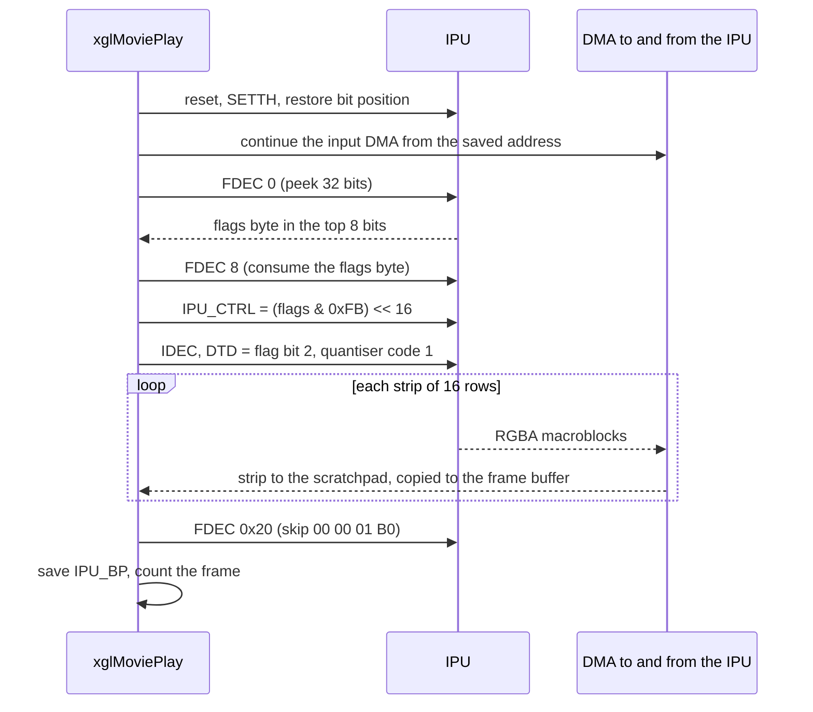

### 4.6 Variants and statistics

The monitor movies come in four picture sizes. A quarter of the screen in
each direction is 128 × 112 and half of the screen is 256 × 224. The two
square sizes are probably textures for monitors that are not shaped like the
screen.

| Size | Files | Flags values | Where |
| --- | --- | --- | --- |
| 256 × 224 | 64 | `0x76` (52), `0x62` (12) | 8 in group 00, 32 in group 10, 24 in group 20 |
| 128 × 112 | 12 | `0x62` | group 00, the `moni_0xx` files |
| 128 × 128 | 12 | `0x76` | 3 in group 10, 9 in group 20 |
| 256 × 256 | 1, `021400.ipu` | `0x74` | group 10 |

| Statistic | Value |
| --- | --- |
| Files | 89: 20 in group 00, 36 in group 10, 33 in group 20 |
| Total size | 83,307,918 bytes: 15,992,387 in group 00, 40,354,824 in group 10, 26,960,707 in group 20 |
| Frames | 11,879 by the headers: 2,648, 5,775 and 3,456 |
| Most common frame counts | 150 (12 files), 30 (11), 60 (9), 76 (7), 120 (5) |
| Single-frame files | 3: `s-03-04-10-00`, `s-09-02-00-00`, `s-09-02-00-02`, still pictures stored as movies |
| Longest movie | `021400.ipu`, 1,310 frames |
| Largest file | `s-03-07-00-01.ipu`, 4,201,631 bytes, 510 frames |
| Smallest file | `s-09-02-00-00.ipu`, 1,254 bytes, 1 frame |
| Bytes per macroblock, file average | 11 (`021400`) to 97 (`s-09-02-00-04`) |

Many files have nearly the same size for every frame, for example 8,086 to
8,265 bytes in `moni_Frame01.ipu`. The encoder was probably given a fixed
size per frame. The cutscene player decodes one movie frame per frame of the
cutscene, so a movie of 150 frames lasts five seconds when the cutscene runs
at 30 frames per second. The column "At 30 per second" in the table of
[section 4.8](#48-all-ipu-movies) uses that rate.

### 4.7 avitest.ipu

`iwase\avitest.ipu` in group 00 is 81,936 bytes long. Its first 16 bytes are
zero, where a header should be, and the 81,920 bytes after them look like
frame data: they begin with `62`, a valid flags byte, followed by macroblock
bits. The data contains no `00 00 01` start code at all, so it holds less
than one complete frame, or a frame in an older form without the end code.
81,920 is exactly `0x14000`, so the file is probably a buffer dump from a
conversion test. `xglMovieOpen` would reject it because the signature is
missing, and no code names the file.

### 4.8 All IPU movies

"Frame size" is the smallest and the largest frame of the file in bytes,
including the flags byte and the `B0` code.

| Movie | Group | Size in bytes | Picture | Frames | At 30 per second | Flags | Frame size in bytes |
| --- | --- | --- | --- | --- | --- | --- | --- |
| `moni_002_h` | 00 | 615,433 | 128 × 112 | 150 | 5.0 s | `0x62` | 3,330 to 4,452 |
| `moni_003_h` | 00 | 610,276 | 128 × 112 | 150 | 5.0 s | `0x62` | 3,388 to 4,370 |
| `moni_005_h` | 00 | 615,812 | 128 × 112 | 150 | 5.0 s | `0x62` | 3,443 to 4,449 |
| `moni_013_h` | 00 | 122,735 | 128 × 112 | 30 | 1.0 s | `0x62` | 3,320 to 4,405 |
| `moni_014_h` | 00 | 122,924 | 128 × 112 | 30 | 1.0 s | `0x62` | 3,180 to 4,555 |
| `moni_015_h` | 00 | 123,508 | 128 × 112 | 30 | 1.0 s | `0x62` | 2,946 to 4,705 |
| `moni_039` | 00 | 616,230 | 128 × 112 | 150 | 5.0 s | `0x62` | 2,790 to 4,651 |
| `moni_040` | 00 | 203,916 | 128 × 112 | 60 | 2.0 s | `0x62` | 540 to 4,970 |
| `moni_044_l` | 00 | 580,816 | 128 × 112 | 150 | 5.0 s | `0x62` | 3,241 to 4,254 |
| `moni_047_h` | 00 | 616,394 | 128 × 112 | 150 | 5.0 s | `0x62` | 3,037 to 4,534 |
| `moni_047_l` | 00 | 304,026 | 128 × 112 | 150 | 5.0 s | `0x62` | 1,641 to 2,107 |
| `moni_048_l` | 00 | 913,942 | 128 × 112 | 450 | 15.0 s | `0x62` | 912 to 4,023 |
| `moni_110` | 00 | 2,486,190 | 256 × 224 | 120 | 4.0 s | `0x62` | 19,462 to 23,368 |
| `moni_111` | 00 | 2,312,256 | 256 × 224 | 120 | 4.0 s | `0x62` | 18,039 to 20,297 |
| `moni_Frame01` | 00 | 1,021,967 | 256 × 224 | 124 | 4.1 s | `0x76` | 8,086 to 8,265 |
| `moni_Frame02` | 00 | 1,022,816 | 256 × 224 | 124 | 4.1 s | `0x76` | 8,028 to 8,270 |
| `noise077` | 00 | 988,542 | 256 × 224 | 120 | 4.0 s | `0x76` | 8,011 to 8,436 |
| `noise_umn` | 00 | 989,560 | 256 × 224 | 120 | 4.0 s | `0x76` | 8,152 to 8,735 |
| `noise_umn_l` | 00 | 488,613 | 256 × 224 | 120 | 4.0 s | `0x76` | 4,033 to 4,196 |
| `s-monitor` | 00 | 1,236,431 | 256 × 224 | 150 | 5.0 s | `0x76` | 8,089 to 8,664 |
| `021400` | 10 | 3,710,022 | 256 × 256 | 1310 | 43.7 s | `0x74` | 2,802 to 2,976 |
| `s-005_monitor_00` | 10 | 1,235,999 | 256 × 224 | 150 | 5.0 s | `0x76` | 8,205 to 8,317 |
| `s-02-02-00-00` | 10 | 1,260,295 | 256 × 224 | 76 | 2.5 s | `0x62` | 16,486 to 16,671 |
| `s-02-03-05-00` | 10 | 2,802,415 | 256 × 224 | 169 | 5.6 s | `0x76` | 16,479 to 16,962 |
| `s-02-03-05-01` | 10 | 1,376,629 | 256 × 224 | 83 | 2.8 s | `0x76` | 16,483 to 16,956 |
| `s-02-04-10-01` | 10 | 689,669 | 128 × 128 | 211 | 7.0 s | `0x76` | 2,613 to 3,547 |
| `s-02-04-10-02` | 10 | 750,617 | 256 × 224 | 131 | 4.4 s | `0x76` | 5,491 to 5,763 |
| `s-02-04-10-03` | 10 | 667,252 | 128 × 128 | 181 | 6.0 s | `0x76` | 2,919 to 3,979 |
| `s-02-04-10-04` | 10 | 1,910,107 | 256 × 224 | 291 | 9.7 s | `0x76` | 6,335 to 6,622 |
| `s-02-04-10-05` | 10 | 692,813 | 128 × 128 | 188 | 6.3 s | `0x76` | 3,004 to 3,998 |
| `s-02-08-00-00` | 10 | 497,268 | 256 × 224 | 30 | 1.0 s | `0x76` | 16,389 to 16,677 |
| `s-02-14-00-00` | 10 | 494,633 | 256 × 224 | 60 | 2.0 s | `0x76` | 8,208 to 8,357 |
| `s-02-14-00-01` | 10 | 1,631,387 | 256 × 224 | 198 | 6.6 s | `0x76` | 8,182 to 8,342 |
| `s-024_monitor` | 10 | 1,895,172 | 256 × 224 | 230 | 7.7 s | `0x76` | 1,331 to 16,178 |
| `s-024_monitor_01` | 10 | 494,184 | 256 × 224 | 60 | 2.0 s | `0x76` | 8,129 to 8,306 |
| `s-026_monitor` | 10 | 1,070,512 | 256 × 224 | 130 | 4.3 s | `0x76` | 8,143 to 8,387 |
| `s-026_monitor_01` | 10 | 494,176 | 256 × 224 | 60 | 2.0 s | `0x76` | 8,125 to 8,301 |
| `s-026c_monitor` | 10 | 494,736 | 256 × 224 | 60 | 2.0 s | `0x76` | 8,206 to 8,399 |
| `s-027_monitor` | 10 | 633,417 | 256 × 224 | 77 | 2.6 s | `0x76` | 7,663 to 8,254 |
| `s-028_monitor` | 10 | 584,981 | 256 × 224 | 71 | 2.4 s | `0x76` | 8,146 to 8,368 |
| `s-028_monitor_01` | 10 | 494,376 | 256 × 224 | 60 | 2.0 s | `0x76` | 8,129 to 8,278 |
| `s-03-04-10-00` | 10 | 16,241 | 256 × 224 | 1 | 0.0 s | `0x62` | 16,221 to 16,221 |
| `s-03-04-10-01` | 10 | 993,752 | 256 × 224 | 60 | 2.0 s | `0x62` | 14,713 to 17,580 |
| `s-03-07-00-00` | 10 | 782,847 | 256 × 224 | 95 | 3.2 s | `0x76` | 8,229 to 8,315 |
| `s-03-07-00-01` | 10 | 4,201,631 | 256 × 224 | 510 | 17.0 s | `0x76` | 8,225 to 8,316 |
| `s-03-07-00-02` | 10 | 634,966 | 256 × 224 | 77 | 2.6 s | `0x76` | 8,229 to 8,386 |
| `s-03-08-00_00` | 10 | 2,516,843 | 256 × 224 | 152 | 5.1 s | `0x76` | 16,012 to 16,583 |
| `s-03-08-00_01` | 10 | 466,818 | 256 × 224 | 76 | 2.5 s | `0x76` | 6,100 to 6,246 |
| `s-03-08-00_02` | 10 | 835,183 | 256 × 224 | 136 | 4.5 s | `0x76` | 6,097 to 6,242 |
| `s-03-08-00_03` | 10 | 664,093 | 256 × 224 | 108 | 3.6 s | `0x76` | 6,038 to 6,194 |
| `s-03-08-00_04` | 10 | 351,559 | 256 × 224 | 75 | 2.5 s | `0x76` | 4,672 to 4,834 |
| `s-03-08-00_05` | 10 | 804,985 | 256 × 224 | 131 | 4.4 s | `0x76` | 6,126 to 6,345 |
| `s-03-09-10-00` | 10 | 1,235,284 | 256 × 224 | 150 | 5.0 s | `0x76` | 7,974 to 8,240 |
| `s-03-09-10-01` | 10 | 494,020 | 256 × 224 | 77 | 2.6 s | `0x76` | 1,226 to 10,470 |
| `s-03-09-10-02` | 10 | 1,242,092 | 256 × 224 | 151 | 5.0 s | `0x76` | 7,849 to 8,235 |
| `s-03-09-10-03` | 10 | 1,233,850 | 256 × 224 | 150 | 5.0 s | `0x76` | 7,788 to 8,286 |
| `s-04_monitor` | 20 | 1,070,616 | 256 × 224 | 130 | 4.3 s | `0x76` | 8,139 to 8,277 |
| `s-05-01-00-00` | 20 | 329,162 | 256 × 224 | 40 | 1.3 s | `0x76` | 7,884 to 8,254 |
| `s-05-02-00_00` | 20 | 1,960,182 | 256 × 224 | 158 | 5.3 s | `0x62` | 12,213 to 12,476 |
| `s-06-03-20-00` | 20 | 1,277,592 | 256 × 224 | 240 | 8.0 s | `0x76` | 5,058 to 5,344 |
| `s-06-03-20-01` | 20 | 733,386 | 256 × 224 | 180 | 6.0 s | `0x76` | 3,834 to 4,090 |
| `s-08-03-00-00` | 20 | 1,258,541 | 256 × 224 | 76 | 2.5 s | `0x76` | 16,324 to 16,683 |
| `s-08-03-00-01` | 20 | 1,258,513 | 256 × 224 | 76 | 2.5 s | `0x76` | 16,292 to 16,656 |
| `s-08-03-00-02` | 20 | 1,259,976 | 256 × 224 | 76 | 2.5 s | `0x76` | 16,473 to 16,771 |
| `s-08-03-00-03` | 20 | 1,259,961 | 256 × 224 | 76 | 2.5 s | `0x76` | 16,455 to 16,770 |
| `s-08-04-00` | 20 | 624,621 | 256 × 224 | 76 | 2.5 s | `0x76` | 7,998 to 8,257 |
| `s-09-02-00-00` | 20 | 1,254 | 128 × 128 | 1 | 0.0 s | `0x76` | 1,234 to 1,234 |
| `s-09-02-00-01` | 20 | 1,233,565 | 256 × 224 | 150 | 5.0 s | `0x76` | 7,729 to 8,387 |
| `s-09-02-00-02` | 20 | 3,074 | 256 × 224 | 1 | 0.0 s | `0x76` | 3,054 to 3,054 |
| `s-09-02-00-03` | 20 | 399,859 | 128 × 128 | 140 | 4.7 s | `0x76` | 2,540 to 2,917 |
| `s-09-02-00-04` | 20 | 432,852 | 128 × 128 | 70 | 2.3 s | `0x76` | 5,124 to 6,469 |
| `s-09-02-00-05` | 20 | 2,921,388 | 128 × 128 | 506 | 16.9 s | `0x76` | 4,845 to 6,011 |
| `s-09-02-00-06` | 20 | 73,011 | 128 × 128 | 30 | 1.0 s | `0x76` | 2,205 to 2,487 |
| `s-09-03-00-00` | 20 | 309,998 | 256 × 224 | 30 | 1.0 s | `0x62` | 10,201 to 10,343 |
| `s-09-03-00-01` | 20 | 497,605 | 256 × 224 | 30 | 1.0 s | `0x62` | 16,519 to 16,663 |
| `s-09-03-00-02` | 20 | 496,080 | 256 × 224 | 30 | 1.0 s | `0x62` | 15,803 to 16,587 |
| `s-09-03-00-03` | 20 | 496,352 | 256 × 224 | 30 | 1.0 s | `0x62` | 15,858 to 16,592 |
| `s-09-03-00-04` | 20 | 497,250 | 256 × 224 | 30 | 1.0 s | `0x62` | 16,406 to 16,622 |
| `s-09-03-00-05` | 20 | 496,160 | 256 × 224 | 30 | 1.0 s | `0x62` | 15,933 to 16,596 |
| `s-09-04-00-00` | 20 | 993,774 | 256 × 224 | 60 | 2.0 s | `0x76` | 16,287 to 16,634 |
| `s-09-04-00-01` | 20 | 993,794 | 256 × 224 | 60 | 2.0 s | `0x76` | 16,286 to 16,701 |
| `s-09-04-00-02` | 20 | 1,192,432 | 256 × 224 | 72 | 2.4 s | `0x76` | 16,352 to 16,632 |
| `s-09-04-00-03` | 20 | 1,192,444 | 256 × 224 | 72 | 2.4 s | `0x76` | 16,321 to 16,664 |
| `s10-01-00_01` | 20 | 917,281 | 128 × 128 | 321 | 10.7 s | `0x76` | 2,400 to 2,966 |
| `s10-01-00_02` | 20 | 1,183,745 | 256 × 224 | 180 | 6.0 s | `0x76` | 6,296 to 6,613 |
| `s10-01-00_03` | 20 | 529,681 | 128 × 128 | 200 | 6.7 s | `0x76` | 2,238 to 2,724 |
| `s10-01-00_04` | 20 | 383,059 | 128 × 128 | 125 | 4.2 s | `0x76` | 2,572 to 3,180 |
| `s10-01-00_05` | 20 | 564,428 | 256 × 224 | 115 | 3.8 s | `0x76` | 4,629 to 4,919 |
| `s10-01-00_06` | 20 | 119,071 | 128 × 128 | 45 | 1.5 s | `0x76` | 2,226 to 2,740 |

## 5. JPEG pictures

### 5.1 The pictures

The full-screen still pictures of the game are JPEG files. There are 34
`.jpg` files, all in group 00, and twelve more JPEG streams inside other
files. All of them are baseline JPEG (`SOF0`) with 8-bit samples and three
components, and all of them were parsed segment by segment for this page.

| Picture | Size | Sampling | Bytes | Shown by |
| --- | --- | --- | --- | --- |
| `yajima\gameov1.jpg` | 512 × 448 | 4:4:4 | 11,337 | `GameOver` (`src/main/game_over.c`). The words "GAME OVER" in pale green, widely spaced, on black |
| `yajima\end.jpg` | 512 × 448 | 4:4:4 | 4,848 | `GameEnd`, the screen after the ending that offers to save clear data. The words "TO BE CONTINUED" on black |
| `yajima\diskchg.jpg` | 512 × 448 | 4:4:4 | 32,295 | `GameDiskChange` (`src/main/game_disk_change.c`), behind the "Please insert DISC 2" messages. A rendered E.S. standing on a white floor |
| `yajima\mnt_set.jpg` | 512 × 448 | 4:4:4 | 24,164 | the screen position setting in `src/main/tya_display_setting.c`. A grey frame with a cross, arrows at the four edges, the label "CENTER" and the legend "accept", "cancel", "default" next to three button symbols |
| `yajima\synopsis\01.jpg` to `22.jpg` | 512 × 448 | 4:2:0 | 51,374 to 71,050 | `GameSynopsis`, the story summary when a save is loaded. A darkened scene picture with the heading "The Story So Far..." and the summary text painted into it |
| `yosikawa\umn1.jpg` to `umn8.jpg` | 448 × 32 | 4:4:4 | 11,285 to 20,075 | `menuUmnImageLoad` and `menuUmnImageDecode` in `src/main/menu_scene.c`. Wide strips cut from views of eight places |
| four pictures in `yajima\im.bin` | 512 × 448 | 4:4:4 | 23,207 to 57,673 | `Intermission`, see [section 6.2](#62-imbin) |
| six pictures in `credit.bin` | 512 × 448 | 4:4:4 | 5,825 to 18,117 | `logoShowSlides`, see [section 6.3](#63-creditbin) |
| `model\map\E2_MIL01.txy`, `E2_KUK01.txy` | 1,024 × 896 | 4:4:4 | 298,473 and 289,905 | the map loader, see [section 5.4](#54-map-pictures-with-an-alpha-plane) |

The full-screen pictures have the size of the frame buffer, 512 × 448. Each
screen reads the file, decodes it with `xglJpegDecode` into a buffer of
32-bit pixels and sends the buffer to the display page every frame with
`DrawImage`, which transfers `0x7000` quadwords twice, 917,504 bytes or
512 × 448 × 4. The screens and their fades are described in
[Title and boot](../game/title-and-boot.md).

The pictures were decoded to check what they show, and the last column of
the table describes them. The text of a picture is part of the picture. The
game over screen, the "TO BE CONTINUED" screen and the legend of the screen
position setting are not printed with the font system. They are pixels of
the JPEG file.

The same holds for the story summary. Each of the 22 synopsis pictures is a
complete page: a dimmed still of a scene, the game logo in the upper right
corner, the heading "The Story So Far..." and one paragraph of English text,
all painted into the picture. Picture `01` begins "T.C. 4753 - Fourteen Years
Ago - Old Miltia", and picture `04` begins "T.C. 4767 - Present Day". The
game holds no text for the summary anywhere else, so a translation of the
summary would mean new pictures. Some neighbouring pictures carry the same
paragraph over a different still (`09` and `10`, `13` and `14`).

The synopsis pictures are chosen by story progress. `GameSynopsis` reads the
8-bit progress flag `0x191`, walks a table of 21 thresholds and writes the
number of the picture, from `01` to `22`, into the path
`yajima\synopsis\00.jpg`. The 22 files are the only pictures with 4:2:0
sampling. They also carry a comment segment
`Creator: PolyView® Version 4.112 by Polybytes`, `Quality: 85`, and an ICC
colour profile in an `APP2` segment. Their luminance table is indeed the
standard JPEG table scaled for quality 85. The pictures of `yajima\`,
`im.bin`, `credit.bin` and the two map pictures use the standard table at
quality 80, except `gameov1.jpg` and `mnt_set.jpg`, which were saved by other
programs with their own tables.

The eight `umn` strips are 448 × 32 pixels. `menuUmnImageLoad(count)`
reserves one buffer of `0xE000` bytes for the file and one of `0xE000` bytes
per picture, which is exactly 448 × 32 × 4, and reads `umn1.jpg`.
`menuUmnImageDecode` decodes each file as it arrives and asks for the next
one, up to `count`. The strips are pictures for the main menu, described in
[Main menu](../game/main-menu.md). Each strip is a wide and very flat cut
from a view of a place: a street at night with a neon sign, a field of wind
turbines under a blue sky, a snow landscape, a dark machine hall, a purple
vortex, a red desert of rock, a hangar with green and yellow lights, and a
symmetric blue structure.

### 5.2 What the game decoder accepts

`xglJpegDecode` in `src/main/xgl_jpeg.c` is a small decoder written for these
files. It does not check much, so a JPEG file must follow its assumptions.
The parser scans the data for the next `FF` byte, reads the marker after it
and calls a handler. It stops at the first `RST0` or `EOI` marker that it
meets outside a segment. The table lists what each handler expects.

| Marker | Handler | What it accepts |
| --- | --- | --- |
| `SOI` | none | ignored |
| `DQT` | `DefineQuantizeTable` | one 8-bit table per segment. It copies `length - 3` values into the luminance table when the table id byte is 0 and into the chrominance table otherwise |
| `SOF0` | `StartOfFrame` | height and width, and the sampling factors of the first component only: `0x11` (4:4:4), `0x21` (4:2:2) or `0x22` (4:2:0, also the default) |
| `DHT` | `DefineHuffmanTable` | one or more tables per segment. Class and id `0x00` is DC luminance, `0x01` DC chrominance, `0x10` AC luminance, anything else AC chrominance |
| `DRI` | `DefineRestartInterval` | the restart interval. Restart markers inside the scan are stepped over |
| `SOS` | `StartOfScan` | skips a fixed 12 bytes, so the scan must name exactly three components. The tables are chosen by component, not by the selectors in the scan header |
| others | default | skipped by their length (`APPn`, `COM` and so on) |

`StartOfFrame` reads neither the sample precision nor the component count,
so a 12-bit or greyscale picture would be decoded wrongly. There is no
handler for progressive JPEG (`SOF2`), and only one luminance and one
chrominance set of tables exist. Every JPEG stream on the discs meets these
limits: all 46 are `SOF0` with 8 bits and three components, the chrominance
components are sampled `0x11`, and every scan header is 12 bytes long. Ten
files differ in one detail, the layout of the `DQT` segment, which is
described in the next section.

After the scan, `StartOfScan` returns the address of the first `FF` byte in
the scan data that is not followed by `00`. In a file without restart
markers that is the `EOI` marker. In a file with restart markers it is the
first `RST0`, and the marker loop stops there. `consumedSize` then points
into the middle of the file. This matters only to the map loader, which uses
`consumedSize` to find the data behind the JPEG stream, and its two files
have no restart markers. Nine files on the discs use restart markers:
`mnt_set.jpg` with an interval of 64 blocks and seven of the `umn` strips
(all except `umn2` and `umn3`) with an interval of 56, one row of blocks.

The diagram below shows the parse loop.

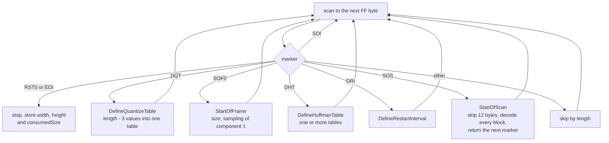

The decoder writes its output in one of three ways, chosen by the request.
With a destination buffer it stores 32-bit pixels, or 16-bit pixels when bit
0 of `pixelFormat` is set. Without a destination it uploads every block to
video memory as it is decoded. All screens on this page use the 32-bit
buffer. The request and the fade factors are described in
[xgl: JPEG](../libraries/xgl.md#jpeg).

### 5.3 Two quantization tables in one segment

The JPEG standard allows one `DQT` segment to hold several tables. Ten files
on the discs use that: `gameov1.jpg`, `mnt_set.jpg` and the eight `umn`
strips have a single `DQT` segment of length 132 with the luminance table
(id 0) followed by the chrominance table (id 1). The other 36 streams have
one segment of length 67 per table.

`DefineQuantizeTable` reads one table per segment. For the long segment it
sees the id byte 0 and copies `132 - 3 = 129` values into the luminance
table. `JpegWork` keeps that table at offset `0xD0` as 64 floats, and the
chrominance table follows directly at `0x1D0`. The first 64 values fill the
luminance table correctly. The 65th value is the id byte of the second
table, 1, and it lands in the first entry of the chrominance table. The real
chrominance values follow one place too late, and the last of them is
written to the float after the chrominance table, at offset `0x2D0`. That
area belongs to the encoder, which rebuilds it before every encode, so the
overflow itself is harmless.

The effect on the picture depends on the table. The table below gives the
first eight chrominance values in the order of the file (zig-zag order).

| File | Table in the file | Table the game uses |
| --- | --- | --- |
| `mnt_set.jpg` | 3, 3, 3, 5, 4, 5, 9, 6 | 1, 3, 3, 3, 5, 4, 5, 9 |
| `gameov1.jpg` | 1, 1, 1, 1, 1, 1, 2, 1 | 1, 1, 1, 1, 1, 1, 1, 2 |
| `umn1.jpg` and five more strips | 1, 1, 1, 1, 1, 1, 1, 1 | 1, 1, 1, 1, 1, 1, 1, 1 |
| `umn2.jpg`, `umn3.jpg` | 1, 1, 1, 1, 1, 1, 2, 1 | 1, 1, 1, 1, 1, 1, 1, 2 |

In `mnt_set.jpg` the chrominance DC coefficient of every block is scaled by
1 instead of 3, and each AC coefficient uses the step of its neighbour. The
average colour of every 8 × 8 block therefore loses two thirds of its
saturation, so the screen position picture is probably shown with paler
colours than its file holds. In `gameov1.jpg` and the `umn` strips nearly all
values are 1 and the shift changes almost nothing. The JPEG streams that the
game writes itself (save thumbnails and snapshots) use one `DQT` segment per
table, as the fixed header `headerALL` of the encoder shows, so the decoder
reads its own output correctly.

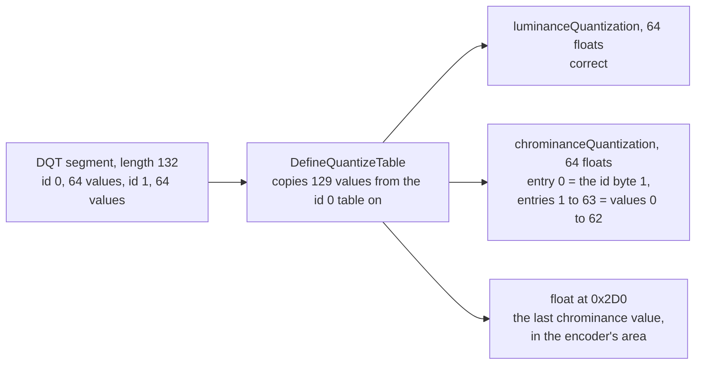

### 5.4 Map pictures with an alpha plane

Two files in `model\map\` have the extension `.txy` but do not hold a
texture pack: `E2_MIL01.txy` (1,216,000 bytes) and `E2_KUK01.txy` (1,207,424
bytes). Every other `.txy` file on the discs starts with the signature `txy`
(see [Models and textures](models-and-textures.md)). These two start with a
JPEG stream. They belong to the maps `E2_MIL01` and `E2_KUK01`, which have a
painted background.

The map loader in `src/main/game_map_object.c` recognises them by their first
word. When the texture data of a map starts with `FF D8 FF E0`
(`JPEG_MAGIC_WORD`), it allocates `0x400000` bytes, decodes the picture into
them as 32-bit pixels and then fills in the alpha channel from a second part
of the file.

| Part | `E2_MIL01.txy` | `E2_KUK01.txy` |
| --- | --- | --- |
| JPEG stream, 1,024 × 896, 4:4:4, quality 80 | `0x000000` to `0x048DE9` | `0x000000` to `0x046C71` |
| zero bytes up to the next multiple of 64 | to `0x048E00` | to `0x046C80` |
| alpha plane, 1,024 × 896 bytes | `0x048E00` to `0x128E00` | `0x046C80` to `0x126C80` |

The alpha plane holds one byte per pixel in the order of the picture. The
loader finds it at `source + ((consumedSize + 63) & ~63)` and stores
`byte >> 1` in the fourth byte of each decoded pixel, which maps the range 0
to 255 to the range 0 to 127 that the Graphics Synthesizer uses for full
opacity. In both files more than 99 percent of the plane is 0. Both pictures
are painted views of a coastal city from the air, with a network of white
roads drawn over it and a few highlighted buildings. `E2_MIL01` looks down on
a peninsula, and `E2_KUK01` shows the city in front of mountains with a huge
red tower at the right edge. The few alpha bytes that are not 0 probably mark
the places on the picture. The picture is
1,024 × 896 pixels, four screens. 1,024 × 896 × 4 bytes is 3,670,016, which
fits in the `0x400000` bytes of the buffer. How the map shows the picture is
described in [Map and units](../game/map-and-units.md).

```
E2_MIL01.txy
+--------------------------------------------------------------+
| JPEG stream: SOI, APP0, DQT, DQT, SOF0 1024 x 896, DHT x 4,  |
| SOS, scan data, EOI                          298,473 bytes   |
+--------------------------------------------------------------+
| zero padding to a multiple of 64                  23 bytes   |
+--------------------------------------------------------------+
| alpha plane, one byte per pixel              917,504 bytes   |
+--------------------------------------------------------------+
```

## 6. Offset-table archives

### 6.1 The common layout

Five files of this family, and several other files of the game, pack a list
of items into one file in the same simple way. The file starts with a table
of 32-bit little-endian words, and the items follow, each starting on a
multiple of 64 bytes.

| Word | Meaning |
| --- | --- |
| 0 | size of the table in bytes. Divided by 4 it is the number of items `n` |
| 1 to `n - 1` | end of item 0 to item `n - 2`, counted from the data base |
| `n` | end of the last item. This word lies just behind the declared table size |

The data base is the table size rounded up to a multiple of 64. Item 0
starts at the data base. Every other item starts at the end of the item
before it, rounded up to a multiple of 64. The gaps are filled with zero
bytes. In all five files the file ends at the end of the last item rounded
up to 64.

The readers turn the table into pointers in place. `Intermission`,
`GameSynopsis` and `titleTableReadNotify` all use the same lines: they
replace word 0 with the address of the data base and add that address to the
words 1 to `n - 1`. This gives the unrounded ends, not the rounded starts.
The readers that need exact starts round the value up themselves
(`logoShowSlides`, `xglMcCreateStep`). `Intermission` does not round. It
hands the unrounded address to `xglJpegDecode`, whose marker loop skips the
zero bytes of the gap until it finds the `FF` of the next picture.

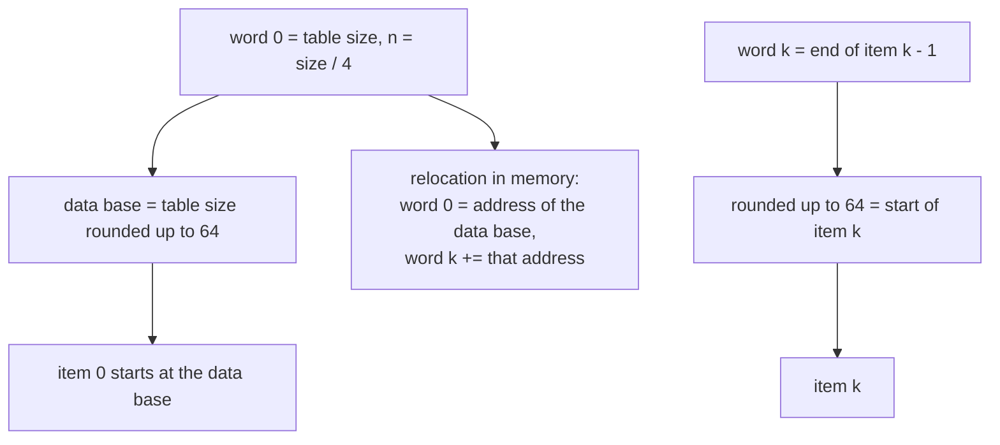

### 6.2 im.bin

`yajima\im.bin` (149,120 bytes) holds the four pictures of the intermission
screen, which is shown between chapters and offers to save. `Intermission(chapter)`
in `src/main/game_over.c` reads the file, relocates the table and decodes
the picture with the index `chapter`.

```
offset  bytes                                   meaning
000000  10 00 00 00                             table size 16: 4 items
000004  6B 7B 00 00                             end of picture 0: 0x7B6B (file 0x7BAB)
000008  C9 5C 01 00                             end of picture 1: 0x15CC9
00000C  A7 B7 01 00                             end of picture 2: 0x1B7A7
000010  34 46 02 00                             end of picture 3: 0x24634
000040  FF D8 FF E0 00 10 4A 46 49 46 ...       picture 0, a JPEG stream
007BAB  00 x 21                                 gap
007BC0  FF D8 FF E0 ...                         picture 1
```

| Picture | File offset | Length | Size | Shows |
| --- | --- | --- | --- | --- |
| 0 | `0x00040` | 31,595 | 512 × 448, 4:4:4 | two young men, one with orange hair and one with silver hair, on a red background |
| 1 | `0x07BC0` | 57,673 | 512 × 448, 4:4:4 | an E.S. in space among red sparks |
| 2 | `0x15D40` | 23,207 | 512 × 448, 4:4:4 | a man in a kimono with a drawn sword in front of a full moon, with black bars on both sides |
| 3 | `0x1B800` | 36,468 | 512 × 448, 4:4:4 | a woman with dark hair and a woman with long blue hair and red eyes |

The pictures are character art without any text. By their looks, picture 0
shows Canaan and chaos, picture 2 Jin Uzuki and picture 3 Shion and KOS-MOS.
These names are a reading of the art and are not stated by any code. The
question "Save game data?" is printed over the picture by the font system.

### 6.3 credit.bin

`credit.bin` (53,248 bytes) lies in the root of group 00. It holds six
512 × 448 pictures for `logoShowSlides` in `src/ov02/logo.c`, the credit and
notice screens that the game shows when it starts. The function reads the
file to `0x01000000`, takes the item count from word 0 (`24 / 4 = 6`) and
decodes every picture into its own buffer, 1 MiB apart from `0x01100000` on.
It then shows the pictures one after the other. The start-up sequence is
described in [Title and boot](../game/title-and-boot.md).

| Picture | File offset | Length | Shows |
| --- | --- | --- | --- |
| 0 | `0x0040` | 5,942 | the red Namco logo |
| 1 | `0x1780` | 7,586 | the logo of the developer Monolith Soft, a dark tower with small lettering below it |
| 2 | `0x3540` | 18,117 | the Sofdec logo and the ADX logo of CRI Middleware |
| 3 | `0x7C40` | 5,825 | the KORG logo |
| 4 | `0x9340` | 8,825 | the Dolby Digital and Pro Logic II logo |
| 5 | `0xB5C0` | 6,689 | the words "Produced by NAMCO" |

All six are white or coloured marks on a black background. The pictures name
the makers of the libraries that this page meets everywhere: Sofdec and ADX
for the movies and their sound, KORG for the sound driver, Dolby for the
AC-3 stream of the movies.

### 6.4 synopsis.bin

`yajima\synopsis.bin` (524,608 bytes) holds the two text panels that
`GameSynopsis` and `GameSynopsisCrossfadeWait` draw over the synopsis picture.
The first panel is shown at once. When the screen is ready the second panel
fades in while the first fades out, and the game waits for the circle button.

The file has two items of 262,224 bytes. Each is a complete `XTX` texture
file with a `0x50`-byte header and one 512 × 128 picture of 32-bit pixels
(262,144 bytes). The `XTX` format is described in
[Models and textures](models-and-textures.md). The synopsis code does not
parse the header. It takes the pixels at item start plus `0x50` and uploads
`0x2000` quadwords of them as a 512 × 64 picture, so only the upper half of
each texture is used. The pixels with a non-zero alpha lie in rows 11 to 31
of the first panel and rows 9 to 35 of the second, well inside that half.

| Item | File offset | Content |
| --- | --- | --- |
| 0 | `0x00040` | `XTX` header, 512 × 128 pixels, the panel that fades out. It shows the word "Loading..." in a typewriter face, in the right half |
| 1 | `0x400C0` | `XTX` header, 512 × 128 pixels, the panel that fades in. It shows a red circle button symbol and "button: Start" on a thin glowing line |

The two panels are therefore the status line of the synopsis screen. While
the game data is loading the screen says "Loading...". When everything is
ready the line changes to the prompt for the circle button. Both texts are
drawn pixels, like the summary itself.

### 6.5 titlebg2.bin

`yajima\titlebg2.bin` (13,695,104 bytes) is the largest archive of this
kind. It holds the 3D scenes that play behind the title menu: 190 items that
are complete files of other formats.

| Signature | Items | Bytes | Format |
| --- | --- | --- | --- |
| `pxy` | 12 | 6,768,000 | models, see [Models and textures](models-and-textures.md) |
| `txy` | 12 | 5,910,208 | texture packs |
| `XHR` | 11 | 16,384 | skeleton hierarchies, see [Skeletons and motion](skeletons-and-motion.md) |
| `XAC` | 71 | 972,992 | motion curves |
| `FAC` | 71 | 10,304 | face animation curves |
| `XCM` | 13 | 16,448 | camera animation records |

The items come in a fixed order. A model is a `pxy`, a `txy` and, for
everything but the background of the first scene, an `XHR`. After the models
of a scene come pairs of `XAC` and `FAC`, one pair per actor, and then one
`XCM` record that ends the scene. The 13 camera records are at the indices
12, 40, 53, 71, 82, 93, 104, 111, 125, 138, 156, 171 and 189.

The code addresses the items by index. `titleTableLists` in
`src/ov02/title.c` has 13 byte lists, one per scene. A list starts with the
index of the first motion pair and the number of items that must be loaded
before the scene can start. Then come the model indices of the actors up to
`0xFF`, and then pairs of a model index and a placement number. For actor
number `p` of a list with `n` actors the motion is item `head + 2p`, the face
animation item `head + 2p + 1`, and the camera record item `head + 2n`. The
first list, for example, is `08 0D 02 05 FF ...`: two actors with the models
at items 2 and 5, their motions at items 8 to 11, and the camera record at
item 12. The camera record carries the frame range of the scene in two 16-bit
fields at `+0x08` and `+0x0A` (`TiCameraRecord.frameStart`, `frameEnd`). In
item 12 they are 0 and 200.

The file is read in the background while the title is already on screen.
`Title` starts the read with the callback `titleTableReadNotify`. On every
progress report the callback counts how many table words point below the
number of bytes read so far. That is the number of complete items. A scene
starts when its list's item count is reached, so the first scene can run
while the rest of the 13 MiB is still being read. The title scene itself is
described in [Title and boot](../game/title-and-boot.md).

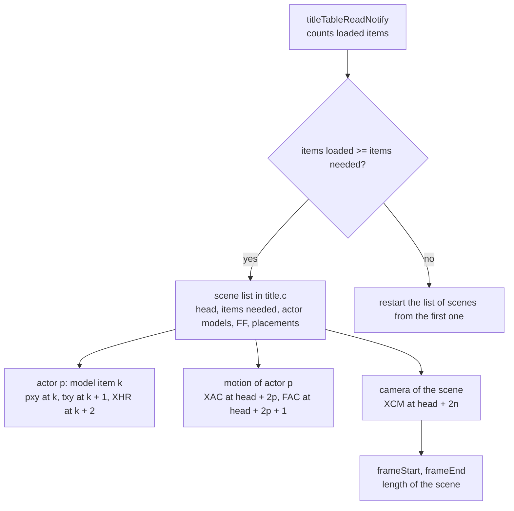

## 7. The title pictures

`yajima\title.bin` and `yajima\title2.bin` are the logo layer of the title
screen. They are two of the three ARX packed files of the discs (the third is
`yajima\titleobj.xtx`). `title.bin` is stored in 235,168 bytes and
`title2.bin` in 235,188 bytes, and both unpack to 917,504 bytes.

The unpacked file has no header. It is one picture of 512 × 448 pixels with
four bytes per pixel (red, green, blue, alpha), 512 × 448 × 4 = 917,504
bytes. The first pixel is `FF FF FF 00`, white and fully transparent. The
alpha channel uses 129 different values, 0 to 128, as the Graphics
Synthesizer expects, and 174,751 of the 229,376 pixels are fully transparent.

`Title` in `src/ov02/title.c` picks the file by the disc in the drive:
`xglCdDiskCheck` returns 1 or 2, and the function reads `title.bin` for disc
1 and `title2.bin` for disc 2. The draw callback sends the picture to video
memory in two halves of `0x7000` quadwords (`TITLE_TEXTURE_QWC`) and draws it
over the 3D scene.

The picture holds the title logo: the word "Xenosaga" in dark blue letters
with a white glow, a registered trademark sign, "EPISODE", a large "II"
with the curved E.S. figure of the logo behind it, and the subtitle
"Jenseits von Gut und Böse". Near the bottom stands the copyright line
"© 2001 2004 NAMCO LTD., ALL RIGHTS RESERVED.". Below the trademark sign,
at the right end of the logo, a small label says "DISC 1" in `title.bin` and
"DISC 2" in `title2.bin`. The two files differ in only 25 pixels, all inside
the rectangle from x 436 to 441 and y 158 to 166, and these pixels are the
digit of that label. Everything else is the same picture.

```
title.bin / title2.bin, 512 x 448 pixels, 4 bytes each
+----------------------------------------------------+
|                                                    |
|            X e n o s a g a  (R)                    |
|               EPISODE       DISC n  <- 25 pixels   |
|                  II                                |
|          Jenseits von Gut und Böse                 |
|                                                    |
|                                                    |
|   (c) 2001 2004 NAMCO LTD., ALL RIGHTS RESERVED.   |
+----------------------------------------------------+
```

## 8. carddata.bin, the memory card icon template

### 8.1 Layout

`carddata.bin` (8,448 bytes, in the root of group 00) is the template for
every save folder. It holds the contents of the `icon.sys` file and one 3D
icon. The save screen reads it into `cardDataBuffer` when it opens
(`src/main/save_screen.c`) and passes it to the create request of the memory
card library. The save folder and its files are described in
[Save data: creating a save folder](../architecture/save-data.md#creating-a-save-folder).

The file is an offset-table archive of the kind described in
[section 6.1](#61-the-common-layout), with two items. The code knows the
table as `McCreateData.offset[16]` in `src/main/xgl_mc_request.c`.

| Offset | Size | Field | Value |
| --- | --- | --- | --- |
| `0x00` | 4 | `offset[0]`, table size | 8 |
| `0x04` | 4 | `offset[1]`, end of `icon.sys` from `0x40` | `0x3C4` (964) |
| `0x08` | 4 | `offset[2]`, end of the icon from `0x40` | `0x20A2` |
| `0x0C` | 4 | `offset[3]` | 0: there is no second icon |
| `0x10` | `0x30` | zero | |
| `0x40` | 964 | `icon.sys` contents, `McCreateData.icon` | `PS2D` |
| `0x404` | `0x3C` | zero | |
| `0x440` | 7,330 | the icon, written as `system.ico` | `0x00010000` |
| `0x20E2` | 30 | zero | |

`xglMcCreateStep` writes file `k` of the folder from the start
`offset[k]` rounded up to 64 to the end `offset[k + 1]`, both counted from
`0x40`. File 1 is `system.ico`, file 2 `copy.ico` and file 3 `delete.ico`.
Because `offset[3]` is 0, the request ends after `system.ico`. A save folder
of the released game therefore holds the save file, `icon.sys` and
`system.ico` only, and neither the two other icon files nor the filler file
`dummy.bin` that the code can write.

### 8.2 icon.sys

The `icon.sys` part is the standard 964-byte description of a PlayStation 2
save. The browser of the console shows its title and uses its colours and
lights to draw the icon.

| Offset in `icon.sys` | File offset | Size | Field | Value |
| --- | --- | --- | --- | --- |
| `0x000` | `0x040` | 4 | identifier | `PS2D` |
| `0x004` | `0x044` | 2 | reserved | 0 |
| `0x006` | `0x046` | 2 | title line break, in bytes | 30 |
| `0x008` | `0x048` | 4 | reserved | 0 |
| `0x00C` | `0x04C` | 4 | background alpha | 64 |
| `0x010` | `0x050` | 4 × 16 | background colours of the four corners (four 32-bit numbers each) | black, black, grey 128, grey 128 |
| `0x050` | `0x090` | 3 × 16 | light directions (float x, y, z, w) | (0.5, 0.5, 0.7071), 0, 0 |
| `0x080` | `0x0C0` | 3 × 16 | light colours (float r, g, b, a) | (0.8, 0.8, 0.8), 0, 0 |
| `0x0B0` | `0x0F0` | 16 | ambient light (float r, g, b, a) | (0.3, 0.3, 0.3) |
| `0x0C0` | `0x100` | 68 | title, Shift-JIS | `ＸｅｎｏｓａｇａＥＰＩＩ−００［００：００］` |
| `0x104` | `0x144` | 64 | icon file for the list | `system.ico` |
| `0x144` | `0x184` | 64 | icon file for copying | `system.ico` |
| `0x184` | `0x1C4` | 64 | icon file for deleting | `system.ico` |
| `0x1C4` | `0x204` | 512 | reserved | zero |

All three icon names are `system.ico`, which is why one icon file is enough.
The title is written in full-width Shift-JIS characters of two bytes each.
The line break value 30 splits it after the fifteenth character, so the
browser shows "ＸｅｎｏｓａｇａＥＰＩＩ−００" on the first line and
"［００：００］" on the second.

```
offset  bytes                                            meaning
0040    50 53 32 44                                      "PS2D"
0044    00 00 1E 00                                      reserved, line break at byte 30
0048    00 00 00 00 40 00 00 00                          reserved, background alpha 64
0100    82 77 82 85 82 8E 82 8F 82 93 82 81 82 87 82 81  "Ｘｅｎｏｓａｇａ"
0110    82 64 82 6F 82 68 82 68 81 7C                    "ＥＰＩＩ−"
011A    82 4F 82 4F                                      "００", the save number
011E    81 6D                                            "［"
0120    82 4F 82 4F 81 46 82 4F 82 4F                    "００：００", hours and minutes
012A    81 6E                                            "］"
0144    73 79 73 74 65 6D 2E 69 63 6F 00                 "system.ico"
```

Before each save the save screen calls
`xglMcSetEntryNumbers(buffer, number, clock)`, which writes the save number
and the play time over the zeros of the title. It changes the second byte of
the digits at file offsets `0x11B` and `0x11D` for the save number, the four
bytes `0x120` to `0x123` for the hours (with a full-width space in place of a
leading zero) and the second bytes at `0x127` and `0x129` for the minutes.
The offsets in the code agree with the template byte for byte. The patching
is described in
[Save data: the save title](../architecture/save-data.md#the-save-title).

### 8.3 The 3D icon format

The icon at `0x440` uses the standard icon format of the console, the format
that its memory card browser draws. All values are little-endian. An icon is
a model of `vertex count` vertices, drawn as triangles in vertex order. It
can have several shapes, which are complete sets of vertex positions, and an
animation that blends between them. A texture of 128 × 128 pixels can follow.

| Offset | Size | Field | `carddata.bin` |
| --- | --- | --- | --- |
| `0x00` | 4 | identifier | `0x00010000` |
| `0x04` | 4 | number of shapes | 1 |
| `0x08` | 4 | texture type | `0x0E` |
| `0x0C` | 4 | a float | 0.0 |
| `0x10` | 4 | vertex count, a multiple of 3 | 36 |
| `0x14` | | vertex records | |

Each vertex record holds one position for every shape, then one normal, one
texture coordinate pair and one colour. With one shape a record is
`1 × 8 + 16 = 24` bytes.

| Size | Field |
| --- | --- |
| 8 per shape | position x, y, z and w, 16-bit signed. The w value is 1,024 in every vertex |
| 8 | normal x, y, z and w, 16-bit signed |
| 4 | texture u and v, 16-bit, `0x1000` = 1.0 |
| 4 | colour red, green, blue and alpha, one byte each |

The animation section follows the vertices. It starts with a 20-byte header,
then one record per animated shape. Each record has a shape number, a key
count and that many keys. A key is a time in frames and a weight, both
floats.

| Offset | Size | Field | `carddata.bin` |
| --- | --- | --- | --- |
| `0x00` | 4 | animation identifier | 1 |
| `0x04` | 4 | frame length | 1 |
| `0x08` | 4 | animation speed (float) | 1.0 |
| `0x0C` | 4 | play offset | 0 |
| `0x10` | 4 | number of frame records | 1 |
| `0x14` | 8 | record: shape number 0, key count 1 | |
| `0x1C` | 8 | key: time 0.0, weight 1.0 | |

The texture type is a set of bits. Bit 2 (`0x04`) says that a texture
follows the animation, and bit 3 (`0x08`) says that it is compressed. Both
are set here. A compressed texture starts with a 32-bit byte count and then
holds 16-bit codes. A code below `0xFF00` is a repeat count, followed by one
16-bit pixel that is repeated that many times. A code of `0xFF00` or more
means that `0x10000 - code` literal pixels follow. The pixels are 16-bit with
five bits each for red, green and blue and the top bit for alpha.

```
.ico data
+------------------------------------------------------------+
| header, 20 bytes: 0x00010000, shapes, texture type, f, n    |
+------------------------------------------------------------+
| vertex 0: shape 0 xyzw | ... | normal | uv | rgba           |
| ... n vertices, (shapes x 8 + 16) bytes each                |
+------------------------------------------------------------+
| animation header, 20 bytes: 1, frame length, speed, ...     |
| frame record: shape, key count, keys (time, weight) ...     |
+------------------------------------------------------------+
| texture, when texture type & 4:                             |
|   compressed (type & 8): byte count, run-length codes       |
|   else: 128 x 128 pixels of 16 bits                         |
+------------------------------------------------------------+
```

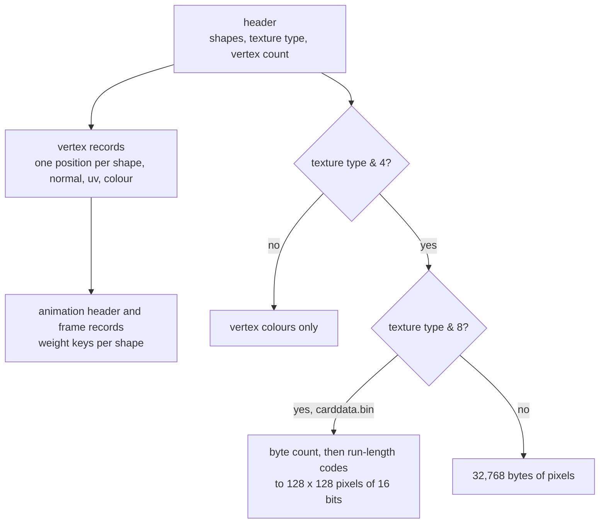

### 8.4 The icon of the game

The icon of `carddata.bin` is very small: 7,330 bytes, against tens of
kilobytes for a modelled figure. It has one shape, 36 vertices and so 12
triangles. The positions run from -10,240 to 10,240 in x, from -12,640 to 0
in y and from -1,024 to 1,024 in z. Twelve triangles with these bounds are
the six faces of a flat box, a plate that stands on the origin and is ten
times wider than it is thick. Every vertex has the colour `7F 7F 7F 80`,
neutral grey. The texture coordinates run from 0 to `0x1000` in u and from 0
to 2,528 in v.

The animation has one frame, one shape and one key with weight 1, so the
icon does not move. The compressed texture takes 6,410 bytes: the byte count
6,406 and codes that expand to exactly 16,384 pixels, 128 × 128. 13,991 of
the pixels are white (`0xFFFF`) and the rest uses 577 other colours. The
texture ends exactly at the end offset `0x20A2`.

The texture was expanded and looked at. It shows the title logo of the game
on white, in the upper two thirds of the square: "Xenosaga", "EPISODE", the
"II" with the E.S. figure and the subtitle, the same artwork as `title.bin`
without the glow, the disc label and the copyright line. The v coordinates of
the model end at 2,528 of 4,096, so the plate shows the part of the texture
that holds the logo. The save icon of the game is therefore a white card
with the game logo on it, the same for every save and every character.

```
offset  bytes                                            meaning
0440    00 00 01 00 01 00 00 00 0E 00 00 00 00 00 00 00  identifier, 1 shape, type 0x0E, 0.0
0450    24 00 00 00                                      36 vertices
0454    00 D8 A0 CE 00 FC 00 04                          vertex 0: (-10240, -12640, -1024, 1024)
045C    00 00 00 00 00 F0 00 04                          normal (0, 0, -4096, 1024)
0464    00 00 00 00                                      u 0, v 0
0468    7F 7F 7F 80                                      colour
...
07B4    01 00 00 00 01 00 00 00 00 00 80 3F 00 00 00 00  animation 1, frame length 1, speed 1.0, offset 0
07C4    01 00 00 00                                      1 frame record
07C8    00 00 00 00 01 00 00 00                          shape 0, 1 key
07D0    00 00 00 00 00 00 80 3F                          key: time 0, weight 1.0
07D8    06 19 00 00                                      texture: 6,406 bytes of codes follow
07DC    4D 01 FF FF                                      333 pixels of 0xFFFF
07E0    FD FF DD FB 58 EB DD FB                          3 literal pixels
```

### 8.5 How a save folder uses it

When the player saves, the save screen sends `MC_REQ_CREATE` with the loaded
template as its buffer. `xglMcCreateStep` deletes an old save file and an old
`dummy.bin` if they exist, keeps the 964 bytes at `0x40` in `xglMcState.icon`
and writes the 7,330 bytes at `0x440` as `system.ico`. The save file is
written next, and `icon.sys` is written last from the kept copy, so a folder
without `icon.sys` marks a save that was interrupted. The same buffer serves
the hard disk path `xglHddMcCreate`. Both are described in
[Save data](../architecture/save-data.md).

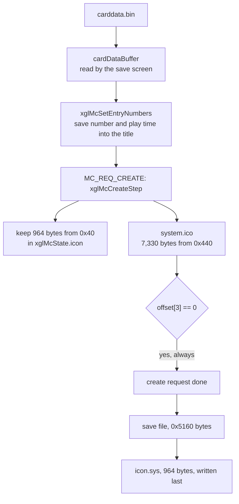

## 9. Save thumbnails

A save file carries a small picture of the screen at the moment the save
screen was opened. It is not a file on the disc. The game makes it with its
own JPEG encoder and stores it inside the save image, in the `0x1000` bytes
at offset `0x174` (`SaveData.thumbnail`).

`saveThumbnailEncode` in `src/main/save_screen.c` first draws the frame
buffer as a sprite scaled down to 88 × 77 pixels into video memory, then
calls `xglJpegEncode` with 4:4:4 sampling and the same quality for luminance
and chrominance. The save screen repeats the encode with the qualities 100,
75, 50, 25 and then 10 until the stream fits in 4,096 bytes.

The stream is a normal baseline JPEG file. `xglJpegEncode` starts every
stream with the fixed 623-byte header `headerALL` and patches the picture
size, the sampling and the two quantization tables into it. The header shows
the layout of every thumbnail.

| Offset | Segment | Content |
| --- | --- | --- |
| `0x000` | `SOI` | `FF D8` |
| `0x002` | `APP0` | `JFIF`, version 1.01, density fields at offset 14 |
| `0x014` | `DQT` | table 0, luminance, 64 values at offset 25 |
| `0x059` | `DQT` | table 1, chrominance, 64 values at offset 94 |
| `0x09E` | `SOF0` | 8 bits, height and width at offset 163, three components |
| `0x0B1` | `DHT` × 4 | the standard JPEG Huffman tables: DC luminance, AC luminance, DC chrominance, AC chrominance |
| `0x263` | `SOS` | three components, 12 bytes |
| `0x26F` | scan data | then `EOI` |

The quantization tables are the standard JPEG tables (`LQTableOrg_1`,
`CQTableOrg_2`) scaled by the usual quality rule in `RebuildQuantizeTable`.
When the load screen lists the saves, it decodes each thumbnail with
`xglJpegDecode` into 32-bit pixels and draws it next to the save. The
encoder, the screen snapshots made with the same encoder and the save screen
are described in
[Save data: the thumbnail](../architecture/save-data.md#the-thumbnail).

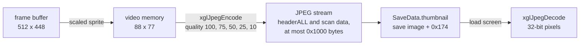

## 10. Files the code names that are not on the discs

The code contains paths of files in this family that the released discs do
not hold. The archive directories of both discs were searched for each of
them. All of these readers are developer screens or code for the hard disk,
so nothing in a normal game needs the files.

| Path in the code | Used by | What it would be |
| --- | --- | --- |
| `yajima\mc\clear.bin`, `chaos.bin`, `jin.bin`, `jr.bin`, `kosmos.bin`, `momo.bin`, `r02.bin`, `r03.bin`, `r05.bin`, `shion.bin`, `ziggy.bin` | the memory card test in `src/main/yajima_test.c` | eleven icon templates in the form of `carddata.bin`, by their names one per party member and one for clear data. `McFileSectionsReport` prints the three icons of each |
| `yajima\thumb.jpg` | the same test | a thumbnail picture that the test copies into the save data |
| `yajima\ipu_101.ipu` | the IPU movie test in `src/main/yajima_test.c` | an IPU movie that the test streams from the disc with `xglMovieOpen(&info, "yajima\\ipu_101.ipu")`, the only use of the streaming mode |
| `yajima\check.txt` | the kanji check in `src/main/yajima_test.c` | a text whose two-byte characters the test lists |
| `data\yajima\hddi.bin` | `TitleHddInstall` in `src/ov02/title_hdd_install.c` | an archive with a `0x40`-byte table and five JPEG pictures, one for every fifth of the install progress |
| `hdd.res` | `xglHddInstall` in `src/main/xgl_hdd.c` | the icon and description that the installer writes into the hard disk partition |

The eleven icon names suggest that the developers planned or tested a save
icon for each character. The released game has a single template with a
single flat icon ([section 8.4](#84-the-icon-of-the-game)). The developer
screens are described in [Debug tools](../game/debug-tools.md), the hard
disk code in [Save data: the hard disk](../architecture/save-data.md#the-hard-disk).

No file on the discs has the extension `.ico`, `.sys` or `.res`. The icon
files and `icon.sys` of a save exist only on the memory card, where the game
writes them from `carddata.bin`.

## 11. Open questions

- The fields at `0x26`, `0x72`, `0x76` and `0x7A` of the `SofdecStream`
  header and most text fields of the `CRITAGS` record are not understood.
  The game does not read them.
- Which of the two sound streams the CRI library plays is not visible in the
  game code. The reading in [section 2.6](#26-the-audio-streams) rests on the
  option name `dolby_digital` and on the calls around `mwPlyCreateStm`.
- The unit of `frame_stamp` is taken from the caption files, whose stamps
  stay inside the frame counts of their movies. The CRI library that fills
  the stamp was not examined.
- The reading of `A4 A2` and `A4 A3` as accented letters follows from the
  words in three caption lines.
- Why `E2_MIL01` and `E2_KUK01` store their picture as a JPEG with an alpha
  plane under the extension `.txy` is not known.
- The float at offset `0x0C` of the icon header is 0.0 here. Its meaning is
  not known.
- `iwase\avitest.ipu` has no start code and no header. What it was cut from
  is not known.
- Which characters and which E.S. the pictures of `im.bin` and
  `diskchg.jpg` show is read from the art only.
- What the non-zero bytes of the alpha planes of the two map pictures mark
  was not examined.

## Source files

| File | Contents |
| --- | --- |
| `src/main/game_movie.c` | `GameMpeg2Play`, the caption parser `caption_nextline`, `caption_getparam` and `caption_convert`, the movie and caption path strings |
| `src/main/movie_player.c`, `include/main/movie_player.h` | the wrapper around the CRI Sofdec player: creation parameters, `moviePlayerStartFile`, `moviePlayerUpdate`, the frame upload chain |
| `src/main/xgl_1.c`, `include/main/xgl_1.h` | the IPU movie player: `XglMovieSourceHeader`, `xglMovieOpen`, `xglMoviePlay`, `xglMovieRewind`, `xglMovieClose` |
| `src/main/cfePlugIn.c`, `src/main/cfeEvaluate.c` | `cfeCmdLoadMonitor` and `cfeEntryTableUpdate`, the users of the IPU player |
| `src/main/xgl_jpeg.c`, `include/main/xgl_jpeg.h` | the JPEG decoder and encoder, `JpegWork`, `headerALL` |
| `src/main/game_over.c` | `DrawImage`, `GameEnd`, `GameOver`, `Intermission` and the archive relocation for `im.bin` |
| `src/main/game_disk_change.c` | `GameDiskChange`, `GameSynopsis`, `GameSynopsisCrossfadeWait`, the paths of `diskchg.jpg`, `synopsis.bin` and the synopsis pictures |
| `src/main/tya_display_setting.c`, `src/main/game_over_095.c` | the screen position setting with `mnt_set.jpg`, a helper that loads and decodes a picture file |
| `src/main/menu_scene.c` | `menuUmnImageLoad`, `menuUmnImageDecode` and the `umn` file names |
| `src/main/game_map_object.c` | the map loader that decodes a JPEG map picture and its alpha plane |
| `src/ov02/logo.c` | `logoShowSlides` and `credit.bin` |
| `src/ov02/title.c` | `Title`, `titleTableReadNotify`, `titleRunScene`, the scene lists and the paths of the title files |
| `src/ov02/title_hdd_install.c` | the install screens and the path of `hddi.bin` |
| `src/main/save_screen.c` | the save screen: `cardDataBuffer`, `saveThumbnailEncode` |
| `src/main/xgl_mc_request.c`, `include/main/xgl_mc_request.h` | `McCreateData`, `McIconSys`, `xglMcCreateStep`, `xglMcSetEntryNumbers` |
| `src/main/xgl_timer0.c` | `xglGetLanguageCode` |
| `src/main/yajima_test.c` | the developer tests that name the missing files |
| `src/main/runtime.c`, `src/main/res_get_path.c` | the two script entries that start a movie |
