# Scripts and archives

Almost everything Xenosaga Episode II reads from its two DVDs sits inside the
`XENOSAGA.nn` archive files. An archive group is a directory file followed by
data pieces, and the game finds a file by walking a compact list of
front-coded names. Three files of each disc are also packed with a small word
compressor called ARX.

Inside the common archive group lie the files that tell the game what a place
is and what happens there. A scene resource script (`cf\cfNNNN.txt`) is a short
text file that lists the map, the models, the effects and the sounds of a
place. A script image (`cf\scNNNN.sb`, magic `SB  `) is compiled bytecode for
the SB virtual machine: it sets the place up, reacts to the player and plays
the cutscenes. Every script image comes with a library (`.sbl`, magic `SBL `)
that holds its strings in one language. The battle maps carry script images of
the same format under the extension `.bin`, and four small `.ene` files hold
parameter presets for the field enemies and the people who walk around.

All layouts below hold for every file of their kind on both North American
discs: 4 directory files, 6 packed files, 465 script images, 465 libraries,
314 scene resource scripts and 4 preset files. Each was parsed field by field,
and each section says what was checked. The code that reads the files is named
with every format, and the pages linked from the sections describe what the
game does with the data.

[← Back to the overview](../README.md) · [Files and resources](../architecture/files-and-resources.md)

## Contents

- [Files at a glance](#files-at-a-glance)
- [How the files fit together](#how-the-files-fit-together)
- [The XENOSAGA.nn archive groups](#the-xenosagann-archive-groups)
- [Packed files (ARX)](#packed-files-arx)
- [SB script images](#sb-script-images)
- [The bytecode as the compiler writes it](#the-bytecode-as-the-compiler-writes-it)
- [SBL libraries](#sbl-libraries)
- [Natives in the scripts](#natives-in-the-scripts)
- [Threads and their names](#threads-and-their-names)
- [The place script](#the-place-script)
- [The cutscene script](#the-cutscene-script)
- [The battle scripts of the maps](#the-battle-scripts-of-the-maps)
- [Scene resource scripts (.txt)](#scene-resource-scripts-txt)
- [Enemy preset files (.ene)](#enemy-preset-files-ene)
- [Leftovers and oddities](#leftovers-and-oddities)
- [Unknowns](#unknowns)
- [Source files](#source-files)

## Files at a glance

The table lists the formats of this page with their place in the archives.
Every file of the table is in group 00, the common group, so both discs hold
the same bytes. The sizes are the sizes in bytes of the smallest and the
largest file and of all files together.

| Format | Directory | Files | Smallest | Largest | Total | Read by |
| --- | --- | ---: | ---: | ---: | ---: | --- |
| Archive directory `XENOSAGA.n0` | disc root | 2 per disc | 4,096 | 108,544 | | `xglCdArcInit` in `src/main/xgl_cd.c` |
| Packed file (ARX stream) | `yajima\` | 3 | 28,408 | 235,188 | 498,764 | `xglArxExtract` |
| Place and cutscene script `.sb` | `cf\` | 352 | 156 | 117,004 | 7,124,576 | `mapSceneScriptLoad` in `src/main/ytachi_test.c` |
| Library of a place script `.sbl` | `cf\en\` | 352 | 64 | 29,200 | 589,220 | `mapSceneScriptLoad` |
| Battle script of a map `.bin` | `model\map\` | 113 | 22,380 | 70,004 | 5,797,728 | `xglCdLoadBinFileSet` in `src/main/res_get_path.c` |
| Library of a battle script `.sbl` | `model\map\en\` | 113 | 116 | 5,228 | 101,068 | `xglCdLoadBinFileSet` |
| Scene resource script `.txt` | `cf\` | 314 | 30 | 549 | 53,766 | `resLoadCfFile`, `resScriptRun` in `src/main/res_get_path.c` |
| Enemy preset file `.ene` | `cf\` | 4 | 3,120 | 3,120 | 12,480 | `xglCdLoadEneFile` in `src/main/res_get_path.c` |

The directory `cf\` holds 670 files: 352 `.sb`, 314 `.txt` and 4 `.ene`. Its
only subdirectory is `cf\en\` with the 352 libraries. The two letters `cf` are
the prefix the developers used for the field part of the game, and they
return in many names of the source (`cfe`, `jumpCF`, `resLoadCfFile`).

## How the files fit together

A place of the game is a four-digit number, the place number (see
[Events and the story flow](../scripting/events.md#place-numbers)). The number
selects up to three files in `cf\`. The scene resource script `cfNNNN.txt`
names what must be in memory. The script image `scNNNN.sb` is the program of
the place, and `en\scNNNN.sbl` is the table of its strings.

When the play session enters a place, `resLoadCfFile` reads the resource
script and `resScriptRun` turns its lines into a list of resources. The map
named there is a file set of `model\map\`: the model `.pxy`, the textures
`.txy`, the collision data `.id` and, for a map that can host a battle, a
second script image `.bin` with its own library in `model\map\en\`. Then
`mapSceneScriptLoad` reads the place script and its library into one buffer,
links the script against the native functions of the executable and starts its
first thread.

From then on the script drives the place. It calls natives such as
`runtime.setNumber` to create objects, `enepc.setParams` to give an enemy its
route and one of the presets of an `.ene` file, and `runtime.jumpCF` to leave
for another place. A cutscene is nothing but a place whose script feeds keys
to the `cfe` player and then steps it once per frame. When a battle starts,
the overlay links and starts the `.bin` image of the current map as the battle
script.

The diagram shows the files of one place and the code that reads each of
them.

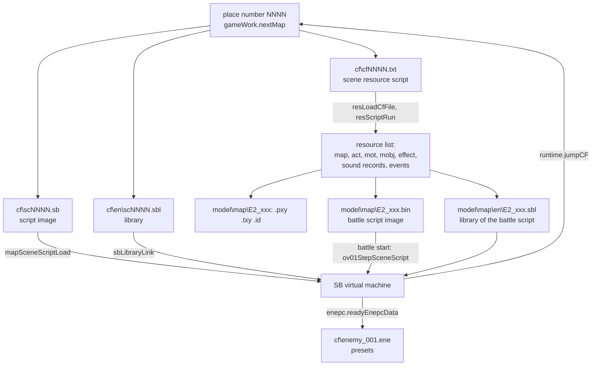

The virtual machine itself, with its threads, its stack and the effect of
every opcode, is described in [The SB virtual machine](../scripting/sb-vm.md).
The natives are listed in [Native functions](../scripting/natives.md). This
page describes the bytes of the files and what the 465 compiled scripts
really contain.

## The XENOSAGA.nn archive groups

### Groups and pieces

The root of each disc holds the executable, the two overlays, the `IOP`
folder and a set of files named `XENOSAGA.nn`. These files form archive
groups. The file `XENOSAGA.n0` is the directory of group `n0`, and the files
`XENOSAGA.n1`, `.n2` and so on are its data pieces. A piece is exactly 1 GiB
(1,073,741,824 bytes) long, except the last piece of a group.

A group is one continuous run of 2048-byte sectors: first the directory
file, then the pieces in order. Every position in a directory is a sector
number counted from the first sector of `XENOSAGA.n0`. The reader never opens
a piece by name. `xglCdGetFilePos` in `src/main/xgl_cd.c` looks up the disc
position of the directory file once and adds the sector number of the record
(`position->lbn = entry->lbn + entry->file_lbn_offset`). This only works
because the pieces lie one after another on the DVD. Eight files of the discs
cross the border between two pieces, and the reader does not notice.

| Disc | Executable | Common group | Story group |
| --- | --- | --- | --- |
| 1 | `SLUS_208.92` | `XENOSAGA.00`, `.01`, `.02` | `XENOSAGA.10`, `.11` to `.14` |
| 2 | `SLUS_211.33` | `XENOSAGA.00`, `.01`, `.02` | `XENOSAGA.20`, `.21` to `.24` |

Group 00 is the same on both discs, byte for byte. It holds everything the
game needs at any time: models, maps, scripts, effects, sound banks, menus,
and the short cutscenes. A story group holds the heavy data of one half of
the story.

| Group | Directory sectors | Size of `.n0` | Directory records | File records | Packed files | Sectors in the group | File data |
| --- | ---: | ---: | ---: | ---: | ---: | ---: | ---: |
| 00 | 53 | 108,544 | 60 | 8,605 | 3 | 605,194 | 1,172.4 MiB |
| 10 (disc 1) | 3 | 6,144 | 53 | 233 | 0 | 1,666,995 | 3,255.6 MiB |
| 20 (disc 2) | 2 | 4,096 | 41 | 192 | 0 | 1,672,390 | 3,266.2 MiB |

The two story groups have the same shape. Each starts with the file
`16m.bin`, 16 MiB of zero bytes, which is the first record of the directory
and the last file on the disc. The rest is cutscene data, sorted by scene
number. The scene numbers show where the story is cut: group 10 holds the
scenes `S-01-03-00` to `S-03-20-00`, and group 20 holds `S-04-02-00` to
`S-10-02-00`.

| Directory of a story group | Group 10 | Group 20 | Contents |
| --- | ---: | ---: | --- |
| root | 1 | 1 | `16m.bin` |
| `motion\cfevent\` | 90 | 42 | Cutscene motion packs `.xap`, and three `.dev` files in group 20 |
| `movie\` | 21 | 29 | Sofdec movies `.sfd` |
| `movie\cfevent\` | 36 | 33 | Small movies `.ipu` shown on monitors inside cutscenes |
| `movie\en\` | 20 | 25 | Caption texts `.txt` of the movies |
| `sound\adx\cfevent\S-xx-xx-xx\` | 65 | 62 | Voice streams `.adx`, one directory per scene (45 and 33 directories) |

The game keeps up to three directories in memory, in the array
`ArcHeader[0..2]`. On these discs `xglCdArcInit` loads `xenosaga.00` and then
`xenosaga.10` or, when that file is missing, `xenosaga.20`. `xglCdDiskCheck`
accepts a disc only when one of the two story directories exists and is at
most `0x1800` bytes long, which is three sectors and exactly the size of
`XENOSAGA.10`. The code also has a path for a dual-layer disc that loads all
three directories, and a path for a hard disk install that takes group 00 from
`pfs0:/xenosaga.00`. How the game starts the library and changes the disc is
described in
[Files and resources](../architecture/files-and-resources.md).

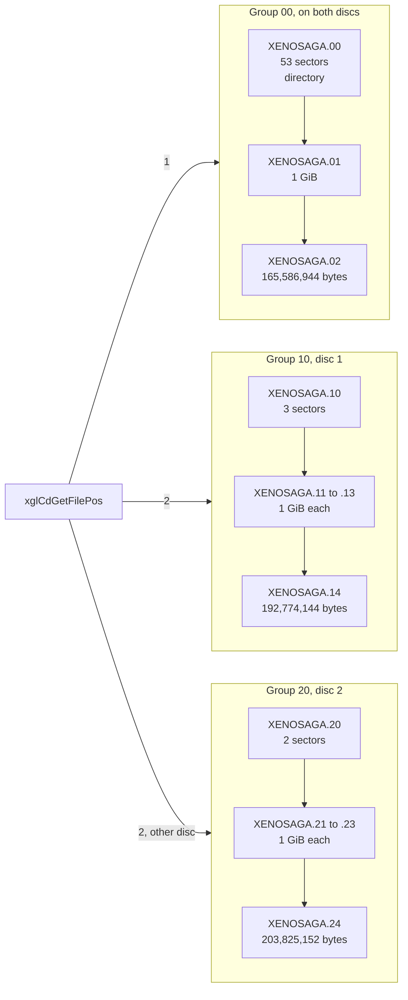

### The directory file

A directory file is a list of records without any index. Its first byte is
the number of sectors of the file itself: 53, 3 and 2 for the three
directories, which equals the file size divided by 2048 in all of them. The
records follow from byte 1, back to back and without alignment. A zero byte
ends the list. The rest of the last sector is filled with the padding pattern
described under [Padding](#padding).

| Offset | Size | Contents |
| --- | --- | --- |
| `0` | 1 | Number of directory sectors |
| `1` | variable | Records |
| after the last record | 1 | `0x00`, the end of the list |
| up to the end of the file | variable | Padding pattern |

Every record starts with a flags byte.

| Bits | Constant in `src/main/xgl_cd.c` | Meaning |
| --- | --- | --- |
| 7 (`0x80`) | `ARC_RECORD_DIRECTORY` | The record is a directory record |
| 6 (`0x40`) | `ARC_RECORD_PACKED` | The file is packed. Only file records carry the bit |
| 0 to 5 (`0x3F`) | `ARC_RECORD_LENGTH_MASK` | Length `L` of the record up to the end of its name part, counting the flags byte |

A **directory record** is `L` bytes long.

| Offset | Size | Name | Meaning |
| --- | --- | --- | --- |
| `+0` | 1 | flags | `0x80 + L` |
| `+1` | 1 | levels up | Number of directory levels to leave before this directory is entered |
| `+2` | `L - 2` | name record | The name of the directory, front-coded |

A **file record** is `L + 7` bytes long, or `L + 10` bytes when the file is
packed.

| Offset | Size | Name | Meaning |
| --- | --- | --- | --- |
| `+0` | 1 | flags | `L`, plus `0x40` for a packed file |
| `+1` | `L - 1` | name record | The file name, front-coded |
| `+L` | 3 | sector | Little endian. First sector of the file, counted from the start of `XENOSAGA.n0` |
| `+L+3` | 4 | stored size | Little endian. Bytes stored in the archive |
| `+L+7` | 3 | decoded size | Little endian. Size after unpacking. Present only when bit 6 is set |

The 3-byte sector field limits a group to 16,777,216 sectors, which is
32 GiB. The 3-byte decoded size limits a packed file to 16 MiB. The stored
size has four bytes, which the movies of the story groups need.

### Front-coded names

A name record does not always hold a whole name. It can say "keep the name
that is there and overwrite its tail", which makes a run of similar names
very small. `xglCdArcNameExpand` expands a record into a name buffer at a
given start position. The record begins with a count byte.

| Count byte | Bytes that follow | Effect |
| --- | --- | --- |
| `0x00` | A string with its zero byte | The string replaces the name at the position |
| any other value | `n` bytes, where `n` is the low nibble | The bytes are copied over the old name, starting `b + 1` characters before its end, where `b` is the high nibble |

In the second form the characters in front of the copy stay as they are. The
characters behind the copy stay as well, so a record can change letters in
the middle of a name and keep its extension. When the copy reaches past the
old end, the record carries the new zero byte itself.

The first records of `XENOSAGA.00` show all cases. The bytes are from offset 1
of the file.

```
35                                                   53 directory sectors

0b  00 "font0.us" 00            35 00 00  40 83 07 00
    L = 11, complete name       sector 53, 492,352 bytes         -> font0.us

03  31 "1"                      26 01 00  40 83 07 00
    L = 3, count 0x31: 1 byte, 4 characters before the end
    "font0.us" -> "font1.us"    sector 294, 492,352 bytes        -> font1.us

0d  7b "credit.bin" 00          40 02 00  00 d0 00 00
    count 0x7b: 11 bytes, 8 characters before the end
    the copy covers the whole old name and brings its own end    -> credit.bin

0e  8c "arddata.bin" 00         62 2c 00  00 21 00 00
    count 0x8c: 12 bytes, 9 characters before the end
    "c" stays, "redit.bin" is replaced                           -> carddata.bin

89  00  00 "sound" 00
    directory record, L = 9, 0 levels up, complete name          -> sound\

87  00  00 "vsf" 00
    directory record, 0 levels up, inside sound\                 -> sound\vsf\

0d  00 "SYS_SE.prj" 00          17 02 00  d0 03 00 00            -> sound\vsf\SYS_SE.prj

05  23 "vsf"                    18 02 00  90 3a 01 00
    count 0x23: 3 bytes, 3 characters before the end
    "SYS_SE.prj" -> "SYS_SE.vsf"                                 -> sound\vsf\SYS_SE.vsf
```

The directory `cf\` begins at offset `0xE45A` of the same file, right after
the last file of `motion\cfevent\`.

```
86  02  53 "cf" 00
    directory record, L = 6, 2 levels up: leave cfevent\ and motion\
    count 0x53: 3 bytes, 6 characters before the end of "motion"  -> cf\

0d  00 "cf1010.txt" 00          9d d0 00  8b 00 00 00
    complete name, sector 53,405, 139 bytes                       -> cf\cf1010.txt

03  51 "2"                      9e d0 00  bd 00 00 00
    count 0x51: 1 byte, 6 characters before the end
    "cf1010.txt" -> "cf1020.txt", sector 53,406, 189 bytes        -> cf\cf1020.txt

03  51 "3"                      9f d0 00  ea 00 00 00             -> cf\cf1030.txt
```

A file record of this kind costs 10 bytes: one for the flags, two for the
name, three for the sector and four for the size. Over the 8,605 files of
group 00 the mean record is 12.3 bytes long, and only 92 records carry a
complete name. That is how the names and positions of 8,605 files fit into
53 sectors.

Two details of the example matter for a reader of the format. A directory
record that leaves levels is coded against the name of the directory it
replaces: `cf` is written over `motion`, not over the last file name. And a
directory record with 0 levels up is expanded at the position where the file
names of the current directory are written, so a complete name is the normal
case there.

### Walking the tree

The records are a depth-first walk of the directory tree. All files of a
directory come first and its subdirectories follow. The reader,
`xglCdGetFilePosSub`, keeps one name buffer of 256 bytes and an array of 16
positions (`ARC_DIRECTORY_DEPTH_MAX`), one for each depth. The position of a
depth is the place in the buffer where names of that depth start.

1. A directory record first subtracts its levels-up byte from the depth. If
   the byte is not zero, the name is cut at the end of the directory name of
   the new depth.
2. The name record is expanded at the position of the depth.
3. A backslash is appended, the depth goes up by one, and the position of the
   new depth is the byte behind the backslash.
4. A file record expands its name record at the position of the current
   depth. The buffer then holds the full path of the file.

The root has no name, so a path looks like `font0.us` or
`sound\vsf\battle\x.vsf`. The deepest files of the discs are four levels
down, for example `sound\adx\cfevent\S-01-03-00\` in the story groups.

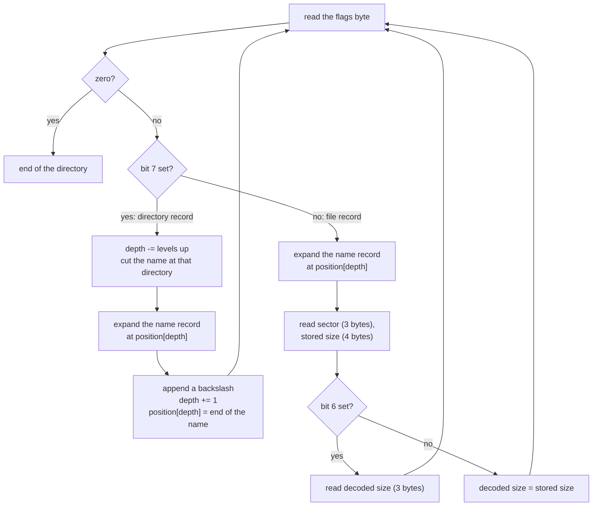

### Lookup order

There is no hash and no sorted table. A lookup is a linear walk of the
records, made cheap by one trick. `xglCdGetFilePos` works in these steps.

1. A leading `data\` is dropped from the requested path. Many path strings
   in the code start with this directory name, and the archives do not have
   it.
2. Every `/` of the path is rewritten to `\`. A path that starts with `\` is
   left alone, because that form names a file on the development host.
3. The directories in memory are searched in order: group 00 first, then the
   story group. The first match wins. No path exists in both groups of a
   disc, so the order never decides anything on these discs.
4. A path found in no directory is looked up as a loose file of the disc, in
   upper case and with the ISO 9660 version suffix (`\NAME;1`). This is how
   `XENOSAGA.00` itself, `SYSTEM.CNF`, the overlays and the IOP modules are
   found.

Inside one directory `xglCdGetFilePosSub` first counts the backslashes of the
requested path and measures the length of its directory part. It packs the
two numbers into one word. While it walks the records it keeps the same pair
for the path it is building. A file record is expanded and compared only when
the two words are equal, which means the walk stands in a directory of the
same depth and the same name length as the request. All other file records
are skipped by their length alone. For a record that passes the test the
whole path is compared byte by byte. The comparison is case sensitive.

A match returns the sector, the stored size, the packed bit and the decoded
size. The caller then reads whole sectors, `roundup(stored size, 2048)`
bytes, so a buffer also receives the padding of the last sector.

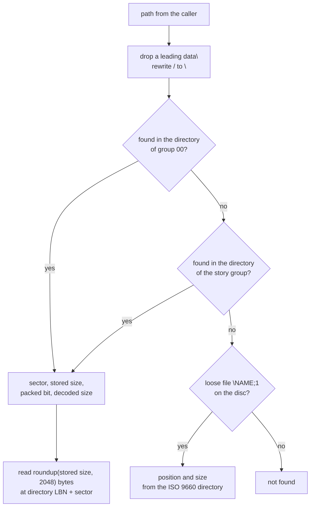

### File data and order on the disc

Every file starts on a sector border. In all four groups of the two discs
the files cover every sector behind the directory exactly once. There is no
gap between two files, no overlap, and nothing behind the last file.

The order of the data is close to the order of the records, but not equal.
In group 00 fifteen of the 8,604 steps from one record to the next go
backwards on the disc. In the story groups three steps do, and one of them
is `16m.bin`, the first record and the last file. Sound and movie streams
(`xglCdStreamOpen`) use the same lookup and then read the stored bytes
directly from the disc position.

### Padding

A file rarely ends on a sector border. The unused end of its last sector is
not zero. It is filled with a 32-byte pattern, the text
`MONOLITHSOFT Xenosaga Episode.2` and a zero byte, repeated to the end of the
sector.

```
4d 4f 4e 4f 4c 49 54 48  53 4f 46 54 20 58 65 6e   MONOLITHSOFT Xen
6f 73 61 67 61 20 45 70  69 73 6f 64 65 2e 32 00   osaga Episode.2.
```

The pattern is not restarted for each file. Its phase is the absolute byte
offset in the group modulo 32, as if the whole group had been filled with the
pattern before the files were written into it. The slack behind the last
record of each directory file follows the same rule. All 17,487 padded file
tails of the two discs match the pattern byte for byte (8,558 in group 00,
209 in group 10, 162 in group 20, with group 00 counted once per disc). The
remaining files end exactly on a sector border. No code reads the pattern.

The padding has one visible effect. Because the reader always reads whole
sectors, the bytes behind the end of a file in memory are this text and not
zeros. A parser must take the size of a file from the directory and never
from a terminator behind the data.

## Packed files (ARX)

### Where packing is used

A packed file is stored as one ARX stream. The packed bit of its directory
record is set, the stored size is the length of the stream, and the decoded
size is the length of the file the caller receives. Only three files of each
disc are packed, all of them in `yajima\`, the directory of the title screen.

| File | Stored | Decoded | Ratio | Contents |
| --- | ---: | ---: | ---: | --- |
| `yajima\titleobj.xtx` | 28,408 | 51,920 | 55% | Texture of the title screen objects. The decoded file starts with `XTX` like the 84 other `.xtx` files |
| `yajima\title.bin` | 235,168 | 917,504 | 26% | A raw picture: 512 x 448 pixels of 4 bytes |
| `yajima\title2.bin` | 235,188 | 917,504 | 26% | A second picture of the same size |

The packed bit and the stream agree on every one of the 17,635 directory
records of the two discs: a file starts with the bytes `ARX` and a zero byte
if and only if its packed bit is set. No other file contains an ARX stream.

### Layout

An ARX stream is a sequence of little-endian 32-bit words.

| Word | Constant in `src/main/xgl_timer0.c` | Contents |
| --- | --- | --- |
| 0 | `ARX_MAGIC_WORD` | `0x00585241`, the bytes `ARX` and a zero byte |
| 1 | `ARX_SIZE_WORD` | Decoded size in bytes. Equals the decoded size of the directory record |
| 2 | `ARX_STREAM_SIZE_WORD` | Size of the whole stream in bytes, the 136 bytes of header and table included. Equals the stored size of the directory record |
| 3 | `ARX_FLAGS_WORD` | Must be 0 |
| 4 to 33 | `ARX_TABLE_WORD` | A table of 30 words |
| 34 on | `ARX_DATA_WORD` | The code stream |

The packer works on whole 32-bit words. It picks the 30 words that occur most
often in the file, such as 0 or a common pixel colour, and stores them in the
table. Every word of the file is then written either as a short code that
names a table entry or as a literal.

### The code stream

The code stream is a sequence of 32-bit words that are used in two ways
through one read pointer. A word can be a container of bits, consumed from
bit 31 down. Or it can be a literal that is copied to the output as it is. A
new container is fetched only when a bit is needed and none is left, so
containers and literals are mixed freely.

For each output word the decoder `xglArxExtract` does this.

1. Read one bit.
2. If it is 0, the next word of the stream is the output word.
3. If it is 1, count the 1 bits that follow up to the next 0 bit. The count
   `p` selects a class of the table.
4. Read `p + 1` more bits, most significant first. They are the index `i`
   inside the class. The bits may lie in two containers.
5. The output word is `table[(2 << p) - 2 + i]`.

| Bits after the first 1 | Class `p` | Index bits | Table entries | Cost of the word |
| --- | ---: | ---: | --- | ---: |
| `0` | 0 | 1 | 0 and 1 | 3 bits |
| `10` | 1 | 2 | 2 to 5 | 5 bits |
| `110` | 2 | 3 | 6 to 13 | 7 bits |
| `1110` | 3 | 4 | 14 to 29 | 9 bits |

A table word thus costs 3 to 9 bits and any other word costs 33 bits. The
decoder stops after `ceil(decoded size / 4)` words. In all six streams it
then stands exactly at the end of the stored bytes.

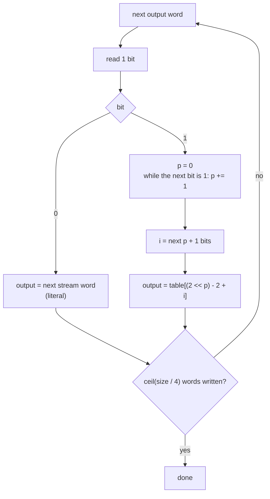

### Decoding in place

The reader does not need a second buffer for a packed file.
`xglCdReadFilePart` reads the stream to the end of the caller's buffer, at
`buffer + roundup(decoded size) - roundup(stored size)`, and the decoder
writes the output from the start of the same buffer. The table is copied to
free work memory first, because the output soon overwrites the header. Near
the end the write position can catch up with the read position. The decoder
then moves the unread rest of the stream next to its copy of the table and
goes on from there. The two title pictures exercise this branch. The steps
are described in
[Files and resources](../architecture/files-and-resources.md).

The function `extract` in `xgl_cd.c` decodes whatever starts with the magic
and a zero flags word, whether the packed bit is set or not. The bit only
decides where the stored bytes are read to. A read with mode bit 1
(`CD_READ_NO_EXTRACT`) skips the decoding and hands the stream to the caller.

## SB script images

A script image is the compiled form of one script. The file is read into
memory without any conversion and the virtual machine runs it where it lies.
All offsets in the file count from its first byte. The machine that runs the
code is described in [The SB virtual machine](../scripting/sb-vm.md). This
section describes the file.

The same format is used by two sets of files. The 352 files `cf\scNNNN.sb`
are the scripts of the places and cutscenes. The 113 files
`model\map\E2_xxxxx.bin` are the battle scripts that belong to the maps. All
statements of this section were checked on the 465 files of both sets.

### Header

The header is 64 bytes long. The code names its first ten words in the struct
`SbImageHeader` of `include/ov01/sb_vm.h`. The files have one more word and
five words of zeros behind it.

| Offset | Size | Field | Contents in the file |
| --- | --- | --- | --- |
| `0x00` | 4 | `magic` | The bytes `SB  ` (`53 42 20 20`), the word `0x20204253` |
| `0x04` | 4 | `flags` | 1 in every file. `sbLinkImage` sets bit 31 (`SB_IMAGE_LINKED`) in memory when the image is linked |
| `0x08` | 4 | `entry` | Code position where the first thread starts, in 16-bit units. 0 in 439 files, 132 in 14 files and 735 in 12 files |
| `0x0C` | 4 | `name_count` | Number of entries of the name table. 0 to 45 |
| `0x10` | 4 | `import_count` | Number of native imports. 2 to 67 |
| `0x14` | 4 | `code_offset` | Offset of the code. `0x40` in every file |
| `0x18` | 4 | `global_offset` | Offset of the globals, which is also the end of the code. A multiple of 4 |
| `0x1C` | 4 | `keys` | Equal to `name_offset` in every file, so it marks the end of the globals. `sbLibraryLink` overwrites it in memory with the address of the library |
| `0x20` | 4 | `name_offset` | Offset of the name table. A multiple of 4 |
| `0x24` | 4 | `import_offset` | Offset of the import words. A multiple of 4 |
| `0x28` | 4 | not in the struct | Offset of the source name, a string at the end of the file. A multiple of 4 |
| `0x2C` | 20 | not in the struct | Zero in every file |

The word at `0x04` is most likely a format version. The value never changes,
and the linker only ever adds its own bit to it.

The sections follow the header in a fixed order without gaps, except for
zero bytes that bring each section to a multiple of 4.

```
0x00       +--------------------------------------+
           | header, 64 bytes                     |
0x40       +--------------------------------------+  code_offset
           | code: 16-bit units                   |
           |   a 0x0000 unit (opcode 0) pads the  |
           |   code to a multiple of 4 bytes      |
           +--------------------------------------+  global_offset
           | globals: 32-bit words                |
           |   variables with their start values, |
           |   arrays, message records            |
           +--------------------------------------+  name_offset (= word 0x1C)
           | name table: name_count * 8 bytes     |
           | name strings, zero bytes to align    |
           +--------------------------------------+  import_offset
           | import words: import_count * 4 bytes |
           | owner names, method names,           |
           | zero bytes to align                  |
           +--------------------------------------+  word 0x28
           | source name, zero bytes to align     |
           +--------------------------------------+  end of the file
```

### Code

The code is a stream of little-endian 16-bit units. An instruction is one
unit with the opcode, followed for some opcodes by a 32-bit operand that is
stored as two units, low half first. The operand therefore starts at an
address that is often not a multiple of 4. The only instruction of another
length is the switch (opcode `0x25`), which takes `4 * count + 5` units. The
lengths come from the table `sbOpLengths` in `src/ov01/sb_vm.c`.

The code has no length field. It ends where the globals start, so its length
is `(global_offset - code_offset) / 2` units. A disassembly that starts at
unit 0 and steps by the instruction lengths ends exactly on that border in
all 465 files, and it meets no opcode above `0x2D`. When the instructions
take an odd number of units, one more unit with the value 0 follows, which is
the no-operation opcode. This happens in 231 files, and it is the only use of
opcode 0.

| Set | Files | Code units | Instructions | Longest code |
| --- | ---: | ---: | ---: | ---: |
| `cf\*.sb` | 352 | 2,776,626 | 1,400,238 | 41,824 units |
| `model\map\*.bin` | 113 | 2,732,562 | 1,209,458 | 32,764 units |

Every position inside the code, such as a jump target, the entry of a thread
or a value of the name table, is the index of a unit and is absolute. Nothing
in the code is relative.

### Globals

The globals are 32-bit words between `global_offset` and `name_offset`. The
file holds their start values, and the machine reads and writes them in
place. The area holds the plain variables of the script, its arrays, and the
16-byte records that receive messages. Nothing in the header tells these
apart. The place scripts have 0 to 9,955 global words, and the scripts with
many words are the cutscenes, whose camera keys are stored as arrays. The
battle scripts have 264 to 959 words.

A variable that stands for an array or a record does not hold the data. It
holds the index of the first word of the data. In `cf\sc1290.sb` global 1 has
the start value 2, and the words 2 to 5 are the message record of the first
handler thread. The script passes the value of global 1 to the receive
instruction and then reads the fields as global 2, 4 and 5. The same pattern
lets a script pass an array to a native: it pushes the value of the variable,
which is the index, and the native turns it into an address with
`vmEntryGet`.

### Name table

The name table gives names to code positions. It has `name_count` entries of
8 bytes, the struct `SbNameEntry`, and the strings follow the last entry.

| Offset | Size | Field | Meaning |
| --- | --- | --- | --- |
| `+0` | 4 | `name_offset` | Offset of a zero-terminated name, counted from the start of the name table |
| `+4` | 4 | `value` | A code position |

In all files the entries are sorted by rising code position, and the strings
lie in the same order directly behind the entries.

The files show what the table is for. Every position that a script starts as
a thread has a name: all 3,768 thread-start instructions of the 465 files
push a position that is in the name table. No function that is called with
the call instruction has one. The table is therefore the list of the threads
of a script, with the names the script author gave them. The first thread has
no entry, because its position is the `entry` word of the header.

The engine uses the table in two ways. `resParseJumpTarget` looks up the name
`mapjump` to find the thread that holds the exits of a place (see
[The place script](#the-place-script)). `sbThreadEnqueueByName` can send a
message to a thread by name, although no code of the game calls it.

### Imports

A script does not hold addresses of native functions. It names each native it
needs by two strings: the owner, which is the module of the native, and the
method. The import section has `import_count` 32-bit words, and a block of
strings follows the last word.

| Bits of an import word | Meaning |
| --- | --- |
| 31 to 16 | Offset of the owner name, counted from the start of the string block |
| 15 to 0 | Offset of the method name, counted from the same place |

The string block holds each owner name once, then all method names. The
import section of `cf\sc1290.sb` shows the form. It starts at `0x5D0`, has 6
words, and its strings start at `0x5E8`.

```
0x5D0  0d 00 00 00   owner 0x00 "runtime"   method 0x0D "mapChange"
0x5D4  17 00 00 00   owner 0x00 "runtime"   method 0x17 "message"
0x5D8  1f 00 08 00   owner 0x08 "talk"      method 0x1F "isDispMsg"
0x5DC  29 00 08 00   owner 0x08 "talk"      method 0x29 "check"
0x5E0  2f 00 08 00   owner 0x08 "talk"      method 0x2F "smsg"
0x5E4  34 00 00 00   owner 0x00 "runtime"   method 0x34 "jumpCF"

0x5E8  "runtime" 00 "talk" 00 "mapChange" 00 "message" 00
       "isDispMsg" 00 "check" 00 "smsg" 00 "jumpCF" 00
```

In the code a native call is opcode `0x15` with a 32-bit operand. In the file
the operand is the index of an import word. Linking replaces it.
`sbLinkImage` first calls `sbFindNative(owner, method)` for every import and
writes the result, the native id, over the import word. Then it walks the
code and writes the native id of the import over the operand of every
opcode `0x15`. After that a call costs no name lookup. The owners and their
tables are described in [Native functions](../scripting/natives.md).

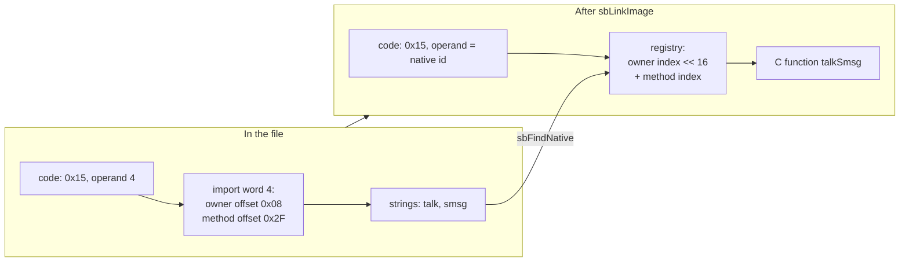

Every import of every file is used by at least one call, and every import
names a native that the executable provides. The figures are in
[Natives in the scripts](#natives-in-the-scripts).

### Source name

The last section is one zero-terminated string, found through the word at
`0x28`. No code reads it. In the place scripts it is the path of the source
file without its extension, relative to a script directory, and its first
part is the name of a directory of a script writer or of a group of scripts.
The file name part always equals the name of the `.sb` file.

| Source directory | Files | Place numbers |
| --- | ---: | --- |
| `nakahara\` | 209 | 1010 to 8093: most places and most cutscenes |
| `koji\` | 55 | 1090 to 6010 |
| `fuji\` | 43 | 1610, 7001 to 7099 and 8070: the steps that play movies and chain scenes |
| `yonesaka\` | 23 | 1410 to 6300 |
| `kuramoto\` | 12 | 6302 to 6318 |
| `event\` | 10 | Ten cutscenes from 8038 to 8099 |

In the battle scripts the string is `think` and three digits, for example
`think106` in `model\map\E2_EVE27.bin`. The source calls the battle script
the think script, and the development loader `dataThinkScriptLoad` in
`src/ov01/data_file_load.c` still builds the path
`yamamoto\think\thinkNNN.sb`. No such directory is on the discs. The compiled
think scripts were stored under the names of the maps they belong to.

### A whole file

`cf\sc7099.sb` is 176 bytes long and shows every section except the name
table. It belongs to place 7099, a step of the story flow that sets a flag
and plays a movie.

```
00000000: 53 42 20 20 01 00 00 00  00 00 00 00 00 00 00 00   magic, flags 1, entry 0, 0 names
00000010: 02 00 00 00 40 00 00 00  84 00 00 00 84 00 00 00   2 imports, code 0x40, globals 0x84, 0x84
00000020: 84 00 00 00 84 00 00 00  a4 00 00 00 00 00 00 00   names 0x84, imports 0x84, source name 0xA4
00000030: 00 00 00 00 00 00 00 00  00 00 00 00 00 00 00 00
00000040: 04 00 91 01 00 00 28 00  04 00 08 00 00 00 28 00   code, 34 units
00000050: 04 00 89 00 00 00 28 00  04 00 03 00 00 00 15 00
00000060: 00 00 00 00 19 00 06 00  00 00 20 00 2a 00 04 00
00000070: 01 00 00 00 15 00 01 00  00 00 19 00 07 00 00 00
00000080: 00 00 17 00 08 00 00 00  10 00 00 00 72 75 6e 74   import words 0x00000008, 0x00000010
00000090: 69 6d 65 00 73 65 74 46  6c 61 67 00 6d 70 65 67   "runtime" "setFlag" "mpeg2"
000000a0: 32 00 00 00 66 75 6a 69  5c 73 63 37 30 39 39 00   "fuji\sc7099"
```

The globals and the name table are empty, so three offsets have the same
value `0x84`. The code disassembles to sixteen instructions.

```
unit  code                 instruction             meaning
0000  0004 0191 0000       push 401                argument 1, value
0003  0028                 push type 1             argument 1 is an integer
0004  0004 0008 0000       push 8                  argument 2, value
0007  0028                 push type 1
0008  0004 0089 0000       push 137                argument 3, value
000B  0028                 push type 1
000C  0004 0003 0000       push 3                  argument count
000F  0015 0000 0000       native import 0         runtime.setFlag(401, 8, 137)
0012  0019                 drop                    the result is not used
0013  0006 0000 0020       push 0x200000           argument 1: string key 0
0016  002A                 push type 3             argument 1 is a string
0017  0004 0001 0000       push 1                  argument count
001A  0015 0001 0000       native import 1         runtime.mpeg2("t010700")
001D  0019                 drop
001E  0007 0000 0000       push code position 0    the entry of this thread
0021  0017                 end thread              the first thread ends itself
```

The string `t010700` is not in this file. Key 0 names entry 0 of the library
`cf\en\sc7099.sbl`, which is 76 bytes long and holds this one string. The
natives `runtime.setFlag` and `runtime.mpeg2` are described in
[Native functions](../scripting/natives.md), and the movie player in
[Cutscenes](../scripting/cutscenes.md).

## The bytecode as the compiler writes it

The virtual machine defines 46 opcodes, and several of them do the same
thing. Four opcodes push their operand, two skip it, and eight push a small
constant. The code of the machine cannot tell why. The 465 compiled scripts
can: the script compiler uses each of these opcodes for one kind of value.

### Opcode use

The table counts every instruction of both sets. The handler names are those
of `sbOpHandlers` in `src/ov01/sb_vm.c`, and the effect of each handler on the
stack is listed in
[The SB virtual machine](../scripting/sb-vm.md#instruction-set).

| Opcode | Handler | Place scripts | Files | Battle scripts | Files | Use by the script compiler |
| ---: | --- | ---: | ---: | ---: | ---: | --- |
| `0x00` | `sbOpNop` | 176 | 176 | 55 | 55 | Padding unit at the end of the code |
| `0x01` | `sbOpBinary` | 20,376 | 318 | 42,523 | 113 | Operators of expressions |
| `0x02` | `sbOpNopOperand02` | 0 | 0 | 0 | 0 | Never used |
| `0x03` | `sbOpPushWord` | 11,800 | 316 | 48,584 | 113 | Index of a global word |
| `0x04` | `sbOpPushWord04` | 466,013 | 352 | 322,560 | 113 | Integer constant |
| `0x05` | `sbOpNopOperand05` | 0 | 0 | 0 | 0 | Never used |
| `0x06` | `sbOpPushWord06` | 11,458 | 339 | 2,360 | 113 | String key (`0x200000` + index) |
| `0x07` | `sbOpPushWord07` | 6,117 | 352 | 1,936 | 113 | Code position of a thread |
| `0x08` | `sbOpPushGlobal` | 15,588 | 316 | 68,871 | 113 | Value of a global |
| `0x09` | `sbOpPushLocal` | 554 | 17 | 35,645 | 113 | Value of a local |
| `0x0A` | `sbOpStoreGlobal` | 7,676 | 296 | 36,054 | 113 | Assignment to a global |
| `0x0B` | `sbOpStoreLocal` | 3 | 3 | 31 | 10 | Assignment to a local |
| `0x0C` | `sbOpStoreGlobalKeep` | 0 | 0 | 0 | 0 | Never used |
| `0x0D` | `sbOpStoreLocalKeep` | 0 | 0 | 0 | 0 | Never used |
| `0x0E` | `sbOpJump` | 14,959 | 310 | 34,292 | 113 | `goto`, loops, `break`, entry of a `switch` |
| `0x0F` | `sbOpJumpIfZero` | 11,465 | 318 | 28,881 | 113 | `if` and loop conditions |
| `0x10` | `sbOpJumpIfNotZero` | 0 | 0 | 0 | 0 | Never used |
| `0x11` | `sbOpEnterFrame` | 1,024 | 216 | 13,893 | 113 | Start of a call of a script function |
| `0x12` | `sbOpCall` | 1,024 | 216 | 13,893 | 113 | Call of a script function |
| `0x13` | `sbOpReturn` | 747 | 217 | 11,099 | 113 | Return |
| `0x14` | `sbOpReturnValue` | 8 | 3 | 3,131 | 113 | Return with a value |
| `0x15` | `sbOpCallNative` | 114,504 | 352 | 88,445 | 113 | Native call |
| `0x16` | `sbOpSpawn` | 2,946 | 315 | 822 | 113 | Start of a thread |
| `0x17` | `sbOpKillThread` | 1,692 | 352 | 186 | 113 | End of a thread |
| `0x18` | `sbOpDup` | 0 | 0 | 0 | 0 | Never used |
| `0x19` | `sbOpDrop` | 108,077 | 352 | 75,927 | 113 | Unused result of a native |
| `0x1A` | `sbOpLoadGlobal` | 3,561 | 316 | 7,806 | 113 | Read through an index (arrays, message fields) |
| `0x1B` | `sbOpLoadLocal` | 0 | 0 | 0 | 0 | Never used |
| `0x1C` | `sbOpEnd` | 2,125 | 316 | 2,447 | 113 | End of a handler pass |
| `0x1D` | `sbOpYield` | 0 | 0 | 0 | 0 | Never used |
| `0x1E` | `sbOpWaitFrames` | 3,449 | 254 | 5,541 | 113 | Wait |
| `0x1F` | `sbOpSend` | 0 | 0 | 16 | 4 | Message to another thread |
| `0x20` | `sbOpReceive` | 734 | 236 | 721 | 113 | Message poll of a handler |
| `0x21` | `sbOpIncGlobal` | 695 | 145 | 2,794 | 113 | `++` on a global |
| `0x22` | `sbOpIncLocal` | 0 | 0 | 0 | 0 | Never used |
| `0x23` | `sbOpDecGlobal` | 61 | 7 | 1,899 | 113 | `--` on a global |
| `0x24` | `sbOpDecLocal` | 0 | 0 | 0 | 0 | Never used |
| `0x25` | `sbOpSwitch` | 2,045 | 217 | 4,295 | 113 | `switch` |
| `0x26` | `sbPushConst0` | 123,527 | 351 | 66,319 | 113 | Constant 0, and the value of an omitted argument |
| `0x27` | `sbPushConst0Op27` | 48,329 | 325 | 34 | 3 | Type word 0: omitted argument |
| `0x28` | `sbPushConst1` | 407,258 | 352 | 284,331 | 113 | Type word 1: integer |
| `0x29` | `sbPushConst2` | 0 | 0 | 0 | 0 | Never used |
| `0x2A` | `sbPushConst3` | 11,458 | 339 | 2,381 | 113 | Type word 3: string |
| `0x2B` | `sbPushConst4` | 745 | 235 | 207 | 113 | Type word 4: thread |
| `0x2C` | `sbPushConst5` | 44 | 21 | 1,479 | 113 | Type word 5: global array |
| `0x2D` | `sbPushConst6` | 0 | 0 | 0 | 0 | Never used |
| | All instructions | 1,400,238 | 352 | 1,209,458 | 113 | |

Twelve opcodes never occur: the two no-operations with an operand (`0x02`,
`0x05`), the two store instructions that keep the value (`0x0C`, `0x0D`), the
jump when not zero (`0x10`), the duplicate (`0x18`), the indexed read of a
local (`0x1B`), the yield (`0x1D`), the increment and decrement of a local
(`0x22`, `0x24`), and the constants 2 and 6 (`0x29`, `0x2D`). The compiler
has only one conditional jump and builds every condition for it. A loop that
must give up the frame uses a wait and never the yield.

Two opcodes carry the whole weight of the format. The integer push `0x04` and
the type word `0x28` together make up 57 percent of all instructions, because
every argument of every native call is a pair of them.

### Kinds of constants

The four push opcodes with an operand separate four kinds of values.

| Opcode | Kind of value | What follows it in the files |
| --- | --- | --- |
| `0x03` | Index of a global word | An indexed access in 57,452 of 60,384 cases: store (42,857), read (9,250), increment (3,385) or decrement (1,960). In the other cases it is the base of an array, and an index is added to it first |
| `0x04` | Integer constant | Anything |
| `0x06` | String key | The type word 3 (`0x2A`) in all 13,818 cases |
| `0x07` | Code position of a thread | A thread start (3,768), a thread end (1,878), a receive (1,104), the type word 4 (952), a call that passes the thread to a script function (335) or a send (16). There is no other case |

A tool can therefore find every string reference and every thread reference
of a script without running it. The operand of `0x06` is always
`0x200000 + index`, the tag that `vmKeyedEntryGet` expects, and the index is
always below the entry count of the library that belongs to the script.

### Type words

Every argument of a native call is two stack words, the value and a type
word (see
[Native functions](../scripting/natives.md#the-calling-convention)). The
compiler pushes the type word with one of the one-unit constant opcodes, and
it uses these opcodes for nothing else.

| Opcode | Pushes | Type of the argument | Uses | Value pushed before it |
| --- | ---: | --- | ---: | --- |
| `0x27` | 0 | Omitted argument | 48,363 | Always the constant 0 (`0x26`) |
| `0x28` | 1 | Integer | 691,589 | A constant, a variable or an expression |
| `0x2A` | 3 | String | 13,839 | A string key (`0x06`), or in 21 cases of the battle scripts a variable that holds one |
| `0x2B` | 4 | Thread | 952 | Always a code position (`0x07`) |
| `0x2C` | 5 | Array | 1,523 | Always the value of a global, which is the index of the array data |

Type 2 never occurs, and the opcode that would push it (`0x29`) is unused.
The natives only test two things: `vmArgTagIsZero` tests for type 0, and a
few natives test for type 3, the string. `talk.smsg` does it with the
constant `SCRIPT_ARG_STRING` of `src/main/talk_natives.c`: a first argument of
another type is taken as a list of strings in the globals. `talk.msgDtl`,
`talk.menuAddItem`, `runtime.setNumber` and `uwamono.setKowaremonoAll` make
the same test on one of their arguments.
Types 4 and 5 are never tested by the code. They are what the compiler knew
about the argument.

The opcode `0x26` is the constant 0 in expressions and the value word of an
omitted argument. The opcode `0x27` pushes the same number, and the files
show the reason for having both: `0x27` is the type word, `0x26` the value.

### The shape of a native call

A call with `n` arguments is always written the same way: `n` pairs of value
and type, then the argument count as an integer constant, then opcode `0x15`.
A call without arguments pushes the count with `0x26`. The native leaves one
result word, and the next instruction decides what happens to it.

| Instruction after a native call | Cases | Share |
| --- | ---: | ---: |
| Drop (`0x19`): the result is not used | 183,990 | 90.7% |
| Anything else: the result is a value in an expression, an argument or an assignment | 18,959 | 9.3% |

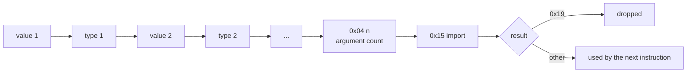

### Statements

The control flow of the source language can be read from fixed patterns.

An `if` is the condition followed by a jump when zero (`0x0F`) to the end of
the block. A `while` loop adds a jump back to the condition. The comparison
and logic operators are all the two-operand instruction `0x01`. The operators
that occur are add, subtract, multiply, divide, remainder, the bit operators,
the two shifts, the six comparisons and the logical `and` and `or`. The
negation operator never occurs. A negative constant is stored as a negative
operand.

A `switch` has a striking form. The compiler first emits the bodies of the
cases, each ended by a jump to the end. In front of them stands a jump to the
switch instruction, which comes last, and its targets point back at the
bodies. An empty case is a lone jump to the end, and the default target is
one more such jump.

```
  00087  push global index 4          the value to switch on
  0008A  indexed read
  0008B  jump 000CA                   go to the switch
  0008E  ...                          body of case 0
  000AB  jump 000D7
  000AE  ...                          body of case 11
  000C4  jump 000D7
  000C7  jump 000D7                   default: nothing
  000CA  switch 2 cases, default 000C7:  0 -> 0008E,  11 -> 000AE
  000D7  ...                          behind the switch
```

`resParseJumpTarget` relies on exactly this shape when it reads the exits of
a place from the `mapjump` thread: it follows the first jump to the switch
and then reads the body of every case.

A call of a script function is the enter instruction `0x11`, the arguments as
plain values without type words, and the call `0x12`. Functions are rare in
place scripts, which have 1,024 calls in 216 files, and central in the battle
scripts, which have 13,893. Locals follow the same split: 554 reads of a
local in the place scripts, 35,645 in the battle scripts.

## SBL libraries

A library holds the strings of one script image. The script refers to a
string by a key, a small number with a tag, and a native turns the key into
an address when it needs the text. The 465 libraries of the disc were all
parsed, and each was checked against its script.

### Layout

A library reuses the 64-byte header of a script image with other meanings.

| Offset | Size | Field of `SbImageHeader` | Contents in a library |
| --- | --- | --- | --- |
| `0x00` | 4 | `magic` | The bytes `SBL ` (`53 42 4C 20`), the word `0x204C4253` |
| `0x04` | 4 | `flags` | 1 in every file |
| `0x08` | 4 | `entry` | Number of entries. 0 to 364 |
| `0x0C` | 4 | `name_count` | 1 in 464 files and 0 in `cf\en\sc6307.sbl`. Not read by the code |
| `0x10` | 4 | `import_count` | 0 |
| `0x14` | 4 | `code_offset` | Offset of the index array. `0x40` in every file |
| `0x18` | 4 | `global_offset` | Offset of the string data. Always `0x40 + 4 * entries` |
| `0x1C` | 36 | | Zero in every file |

The index array has one 32-bit word for each entry: the offset of the string,
counted from the start of the string data. The strings are zero-terminated
and lie in the order of the index, each directly behind the one before, so
the first offset is 0. The file ends behind the last string with zero bytes
up to a multiple of 4. A library without entries is the bare header, 64 bytes
long, and 13 place scripts have such a library.

```
0x00   +----------------------------------+
       | header, 64 bytes                 |
       |   0x08: entry count n            |
       |   0x14: 0x40                     |
       |   0x18: 0x40 + 4 * n             |
0x40   +----------------------------------+
       | index: n offsets of 4 bytes      |
       +----------------------------------+  string data
       | string 0, 00                     |
       | string 1, 00                     |
       | ...                              |
       +----------------------------------+
```

The smallest example is `cf\en\sc7099.sbl`, the library of the script shown
above.

```
00000000: 53 42 4c 20 01 00 00 00  01 00 00 00 01 00 00 00   "SBL ", 1, 1 entry, 1
00000010: 00 00 00 00 40 00 00 00  44 00 00 00 00 00 00 00   index at 0x40, strings at 0x44
00000020: 00 00 00 00 00 00 00 00  00 00 00 00 00 00 00 00
00000030: 00 00 00 00 00 00 00 00  00 00 00 00 00 00 00 00
00000040: 00 00 00 00 74 30 31 30  37 30 30 00               offset 0, "t010700"
```

### Keys

A key is `0x200000 + index`. The tag in bits 20 to 23 is `VM_KEY_TAG_ENTRY`,
and `vmKeyedEntryGet` in `src/ov01/sb_natives.c` refuses any other tag and
any index that is not below the entry count. The address of the string is
`library + global_offset + index_array[index]`. The library of a script is
found through the image of the calling thread, so a script can only reach its
own strings.

The script compiler numbers the strings in the order in which the source
uses them, and it stores equal strings twice when the source has them twice.
In all 465 pairs the highest key of the code is the last entry of the
library, and in 462 pairs every entry is referenced by a push instruction.
The three exceptions keep keys as start values of global arrays and read
them through an index: the battle scripts `model\map\E2_KML03.bin` and
`E2_KML04.bin`, and the place script `cf\sc1610.sb`, whose library holds a
list of 66 item names from `Med Kit S` to `Auto Recover` for a table of its
globals. With these arrays counted, every entry of every library is used.

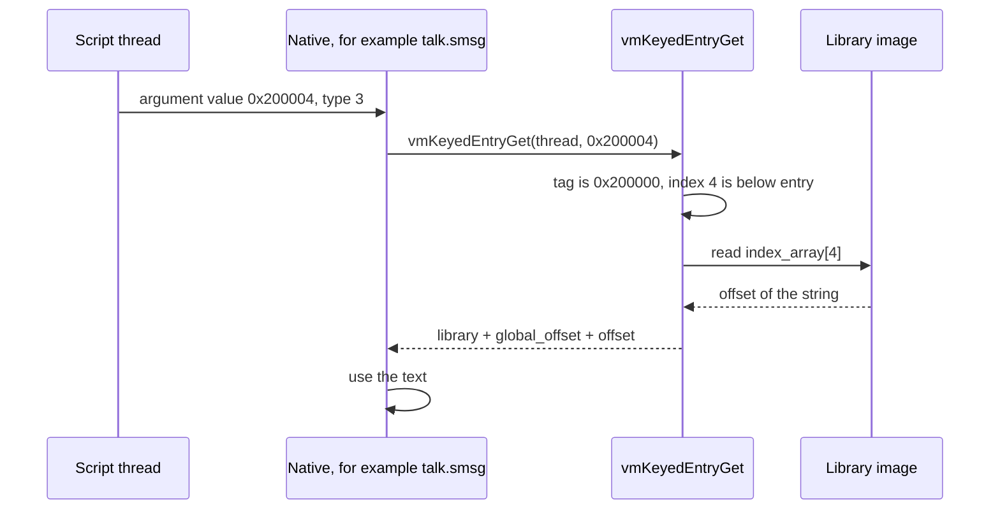

### What the strings are

The libraries hold every string of a script, whatever it is for. Dialogue is
the largest part, but file names, voice stream names and effect names are
strings as well. The native that receives a key shows the kind of the string.

| Native that takes the string | References | Kind of string | Example |
| --- | ---: | --- | --- |
| `cfe.setMes` | 3,892 | Subtitle of a cutscene and the name of its voice stream | `The Zohar Project?`, `cfevent/S-02-08-00/S02_08_00` |
| `talk.msgDtl` | 3,886 | A line of a conversation, with the speaker in brackets | `[chaos]It's a save point.` |
| `talk.smsg` | 1,563 | A short message | |
| `runtime.setNumber` | 810 | Name of an effect or of a resource | `ce000_062` |
| `talk.menuAddItem` | 534 | A line of a choice menu | |
| `cfe.ldMt` | 462 | Motion pack of a cutscene | `motion/cfevent/shion_all.xap` |
| `uwamono.setKowaremonoAll` | 74 | A name for a breakable object | |
| `cfe.ldMnt` | 69 | Movie for a monitor in a cutscene | `movie\cfevent\s-02-08-00-00.ipu` |
| `runtime.mpeg2` | 52 | Movie | `t010700` |
| `runtime.adxload`, `adxplay`, `adx`, `bgm` | 71 | Sound stream or music | |
| `samp.fontPut` | 28 | Debug text | |
| `cfe.ldSnd`, `cfe.ldMpDev` | 17 | Music of a cutscene, collision file of a cutscene map | |
| `bat.namePut` | 1,363 | Name of an attack shown in battle, with a camera tag | `$zoom13;Regenerate Consciousness` |
| `bat.msgPut` | 688 | Battle message | |
| `bat.streamPlay` | 303 | Voice stream of a battle line | `battle/albd_bat_c_26` |
| `bat.partsHide`, `bat.partsShow` | 6 | Name of a model part | |

The 352 libraries of `cf\en\` hold 7,660 strings, the longest of 1,588
bytes. The 113 libraries of `model\map\en\` hold 2,039 strings. Most strings
are plain ASCII. Dialogue uses double-byte characters for some symbols, such
as the button signs and the long dash, and control sequences such as `\n` as
two visible characters. The character encoding and the control codes are
described in [Text and fonts](text-and-fonts.md). A few scripts still hold
test messages in Japanese, for example `cf\sc1290.sb`, whose library has two
Shift-JIS strings.

### One library per language

The script image has no text, so the same image serves every language.
`mapSceneScriptLoad` builds the path `cf\xx\scNNNN.sbl` and lets
`xglGetLanguageCode` write a two-letter code over `xx`. `xglCdLoadBinFileSet`
does the same for `model\map\xx\`. The North American discs have only the
directory `en` in both places, and `xglGetLanguageCode` returns `en` for the
language setting of this version.

The two files are read into one buffer, the library directly behind the
script, and `sbLibraryLink` stores the address of the library in the `keys`
word of the script header. Many libraries have the same bytes because their
scripts use the same strings: the 352 files of `cf\en\` have 315 different
contents, and the 113 files of `model\map\en\` have 71.

## Natives in the scripts

The executable provides 268 natives in 17 tables (see
[Native functions](../scripting/natives.md)). The import sections of the 465
scripts show which of them the shipped game really uses. Every call
instruction was counted, so the numbers below are call sites in the code, not
calls at run time.

### Imports against the tables

The two sides fit without a gap. The scripts import 227 different natives.
All 227 exist in the tables of the executable, so no script asks for a name
that the game does not provide. This matters because `sbLinkImage` fails on
the first unknown import, and a failed link stops the game. In the other
direction, 41 natives of the tables are imported by no script.

| Owner | Natives in the table | Called by place scripts | Called by battle scripts | Call sites in `cf\` | Call sites in `model\map\` | Never called |
| --- | ---: | ---: | ---: | ---: | ---: | --- |
| `objx` | 15 | 13 | 0 | 11,226 | 0 | `setStepMove`, `setStepRotate` |
| `enepc` | 18 | 16 | 0 | 3,912 | 0 | `setGroup`, `disableDrawFlags` |
| `runtime` | 34 | 31 | 0 | 22,849 | 0 | `changeRobo`, `sePos`, `seVol` |
| `ladder` | 2 | 2 | 0 | 84 | 0 | none |
| `camera` | 50 | 21 | 23 | 13,031 | 67,907 | `reset`, `AngleMode`, `cfChange`, `cfNorth`, `SetRefActR`, `GetRefAng`, `SetCamAct`, `SetCamActR`, `SetCamAct2`, `SetCamAct2R`, `SetCamAct3`, `OffsCamPos`, `OffsCamAng`, `GetCamAng`, `WaitMoveRef` |
| `math` | 4 | 3 | 1 | 103 | 4,437 | `atan` |
| `menu` | 11 | 10 | 0 | 153 | 0 | `umnReturn` |
| `uwamono` | 5 | 4 | 0 | 1,891 | 0 | `setCollisionScale` |
| `cfe` | 29 | 27 | 0 | 50,780 | 0 | `ldDev`, `setMesScr` |
| `id` | 7 | 6 | 0 | 465 | 0 | `preload` |
| `talk` | 16 | 14 | 0 | 9,356 | 0 | `resume`, `enableFlags` |
| `g2path` | 4 | 4 | 0 | 511 | 0 | none |
| `seg` | 2 | 2 | 0 | 112 | 0 | none |
| `samp` | 2 | 2 | 0 | 31 | 0 | none |
| `deb` | 1 | 0 | 0 | 0 | 0 | `put` |
| `bat` | 63 | 0 | 58 | 0 | 16,101 | `plPosInit`, `bgmStop`, `runEffSet`, `unitDefAreaGet`, `thinkSetEnd` |
| `Samplefade` | 5 | 0 | 0 | 0 | 0 | `ColorSet`, `Fadein`, `Fadeout`, `Colorfade`, `Colorfade2` |
| All | 268 | 155 | 82 | 114,504 | 88,445 | 41 natives |

The place scripts and the battle scripts use separate worlds. The place
scripts import natives of 14 owners and never `bat`. The battle scripts
import only `bat`, `camera` and `math`. This matches the two native sets that
the engine registers, the field set and the battle set. The two sets overlap
in `camera` and `math`, and even there the scripts differ: the place scripts
use the `cf` camera natives and the battle scripts use the camera moves
around actors (`SetRefCamActR`, `SetRefCamAct3R`).

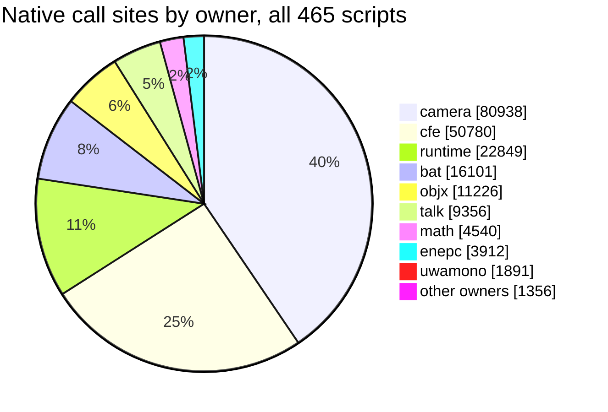

### Natives that no script calls

The 41 unused natives fall into a few groups.

- `Samplefade`, 5 natives. The table is never registered, so a script could
  not link against it anyway.
- `deb.put`, an empty function, and the two empty functions `cfe.ldDev` and
  `cfe.setMesScr`. Of the six empty natives that
  [Native functions](../scripting/natives.md) lists, only `talk.disableFlags`
  is still imported, by one script.
- 15 camera natives, among them `reset`, `AngleMode`, all `SetCamAct`
  variants and both `Offs` natives.
- 5 battle natives: `plPosInit`, `bgmStop`, `runEffSet`, `unitDefAreaGet` and
  `thinkSetEnd`.
- 13 single natives of the field owners: `objx.setStepMove`,
  `objx.setStepRotate`, `enepc.setGroup`, `enepc.disableDrawFlags`,
  `runtime.changeRobo`, `runtime.sePos`, `runtime.seVol`, `math.atan`,
  `menu.umnReturn`, `uwamono.setCollisionScale`, `id.preload`, `talk.resume`
  and `talk.enableFlags`.

The debug owner `samp` is not dead. 17 place scripts still call
`samp.fontPut` and 3 call `samp.padRead`.

### Call sites of every native

The table lists the 227 natives that are imported, grouped by owner in the
order of the tables and sorted by use inside an owner. The last column gives
the argument counts that the scripts pass, read from the count that is pushed
in front of each call.

| Native | Sites in `cf\` | Files | Sites in `model\map\` | Files | Argument counts seen |
| --- | ---: | ---: | ---: | ---: | --- |
| `objx.move` | 3,863 | 205 | 0 | 0 | 5, 7 |
| `objx.rotate` | 1,981 | 196 | 0 | 0 | 5 |
| `objx.disableFlags` | 1,966 | 155 | 0 | 0 | 2, 3 |
| `objx.getParam` | 1,378 | 134 | 0 | 0 | 2 |
| `objx.enableFlags` | 1,052 | 111 | 0 | 0 | 2, 3 |
| `objx.scale` | 470 | 46 | 0 | 0 | 5 |
| `objx.setParent` | 200 | 54 | 0 | 0 | 2, 3 |
| `objx.transparent` | 139 | 25 | 0 | 0 | 3 |
| `objx.setPair` | 98 | 53 | 0 | 0 | 2 |
| `objx.changeId` | 59 | 26 | 0 | 0 | 2 |
| `objx.setRotateTurn` | 9 | 4 | 0 | 0 | 2 |
| `objx.footId` | 7 | 5 | 0 | 0 | 2 |
| `objx.offsetPivot` | 4 | 1 | 0 | 0 | 4 |
| `enepc.setParamsAll` | 1,100 | 161 | 0 | 0 | 15, 16, 17, 20 |
| `enepc.Algorithm` | 737 | 137 | 0 | 0 | 3 |
| `enepc.lookat` | 598 | 57 | 0 | 0 | 5, 6 |
| `enepc.motion` | 328 | 82 | 0 | 0 | 6 |
| `enepc.defaultMotion` | 310 | 56 | 0 | 0 | 3 |
| `enepc.setParams` | 279 | 94 | 0 | 0 | 7 |
| `enepc.enableDrawFlags` | 218 | 214 | 0 | 0 | 2, 3 |
| `enepc.ExMotion` | 94 | 33 | 0 | 0 | 2 |
| `enepc.setSE` | 87 | 33 | 0 | 0 | 4 |
| `enepc.readyEnepcData` | 81 | 81 | 0 | 0 | 1 |
| `enepc.Encount` | 33 | 25 | 0 | 0 | 2 |
| `enepc.setBattle` | 23 | 12 | 0 | 0 | 2 |
| `enepc.motionFace` | 11 | 1 | 0 | 0 | 3 |
| `enepc.setTogether` | 5 | 3 | 0 | 0 | 2, 3 |
| `enepc.Extra` | 4 | 1 | 0 | 0 | 2 |
| `enepc.Resigne` | 4 | 2 | 0 | 0 | 1 |
| `runtime.setNumber` | 6,083 | 212 | 0 | 0 | 3, 4, 5 |
| `runtime.getFlag` | 3,182 | 186 | 0 | 0 | 2 |
| `runtime.setLight` | 2,345 | 216 | 0 | 0 | 8 |
| `runtime.setFlag` | 2,285 | 297 | 0 | 0 | 3 |
| `runtime.setPlayer` | 1,772 | 170 | 0 | 0 | 5, 9, 11, 12 |
| `runtime.se` | 1,593 | 141 | 0 | 0 | 3 |
| `runtime.Fade` | 961 | 102 | 0 | 0 | 5 |
| `runtime.jumpCF` | 856 | 349 | 0 | 0 | 2, 3, 4 |
| `runtime.message` | 745 | 235 | 0 | 0 | 2 |
| `runtime.setLocater` | 526 | 144 | 0 | 0 | 10 |
| `runtime.Vibration` | 388 | 25 | 0 | 0 | 4 |
| `runtime.Item` | 281 | 49 | 0 | 0 | 3, 4 |
| `runtime.bgmsePos` | 262 | 67 | 0 | 0 | 4 |
| `runtime.mapChange` | 238 | 238 | 0 | 0 | 1 |
| `runtime.GetAnalogR` | 194 | 3 | 0 | 0 | 1, 2 |
| `runtime.bgmse` | 192 | 86 | 0 | 0 | 3 |
| `runtime.setFog` | 182 | 175 | 0 | 0 | 8 |
| `runtime.bgmFade` | 176 | 23 | 0 | 0 | 2 |
| `runtime.setItai` | 158 | 72 | 0 | 0 | 2, 5, 8, 9, 10 |
| `runtime.System` | 120 | 64 | 0 | 0 | 1 |
| `runtime.TimeAttack` | 70 | 20 | 0 | 0 | 2 |
| `runtime.setElevator` | 60 | 38 | 0 | 0 | 3 |
| `runtime.mpeg2` | 52 | 42 | 0 | 0 | 1 |
| `runtime.adxload` | 39 | 16 | 0 | 0 | 1 |
| `runtime.adxplay` | 39 | 16 | 0 | 0 | 0, 1 |
| `runtime.progEffect` | 26 | 22 | 0 | 0 | 2 |
| `runtime.nextBgm` | 15 | 14 | 0 | 0 | 1 |
| `runtime.setLastDan` | 5 | 5 | 0 | 0 | 0 |
| `runtime.setMapColor` | 2 | 2 | 0 | 0 | 3 |
| `runtime.adx` | 1 | 1 | 0 | 0 | 1 |
| `runtime.bgm` | 1 | 1 | 0 | 0 | 1 |
| `ladder.setLadder` | 42 | 24 | 0 | 0 | 3 |
| `ladder.setEntrance` | 42 | 22 | 0 | 0 | 4 |
| `camera.SetRefCamActR` | 0 | 0 | 16,971 | 113 | 8 |
| `camera.SetBank` | 290 | 82 | 11,492 | 113 | 1 |
| `camera.SetPers` | 1,416 | 214 | 10,191 | 113 | 1 |
| `camera.MoveCamMode` | 0 | 0 | 7,050 | 113 | 0 |
| `camera.Move` | 572 | 206 | 5,768 | 113 | 3 |
| `camera.SetRefCamAct3R` | 0 | 0 | 4,413 | 113 | 11 |
| `camera.MoveRefMode` | 3 | 3 | 3,331 | 113 | 0 |
| `camera.SetCamPos` | 1,452 | 214 | 923 | 113 | 3 |
| `camera.MoveBank` | 0 | 0 | 1,837 | 87 | 3 |
| `camera.mode` | 1,117 | 306 | 113 | 113 | 2 |
| `camera.cfSet` | 1,024 | 213 | 0 | 0 | 1 |
| `camera.cfRotRange` | 1,024 | 213 | 0 | 0 | 4 |
| `camera.cfCamID` | 1,024 | 213 | 0 | 0 | 1 |
| `camera.MoveCamStop` | 0 | 0 | 998 | 113 | 0 |
| `camera.SetCamAng` | 886 | 213 | 92 | 30 | 3 |
| `camera.SetRefAct` | 963 | 213 | 0 | 0 | 5 |
| `camera.SetRefPos` | 9 | 8 | 946 | 113 | 3 |
| `camera.cfLock` | 886 | 213 | 0 | 0 | 1 |
| `camera.MovePers` | 0 | 0 | 886 | 87 | 3 |
| `camera.cfBattleCam` | 802 | 121 | 0 | 0 | 1 |
| `camera.MoveRefStop` | 0 | 0 | 771 | 113 | 0 |
| `camera.cfHokan` | 724 | 120 | 0 | 0 | 2 |
| `camera.MovePersStop` | 0 | 0 | 599 | 113 | 0 |
| `camera.MoveBankStop` | 0 | 0 | 599 | 113 | 0 |
| `camera.SetRefAng` | 486 | 135 | 0 | 0 | 2 |
| `camera.PosReset` | 322 | 73 | 0 | 0 | 0 |
| `camera.GetRefPos` | 5 | 5 | 287 | 113 | 1 |
| `camera.GetCamPos` | 0 | 0 | 287 | 113 | 1 |
| `camera.RefLock` | 0 | 0 | 174 | 87 | 0 |
| `camera.HandShake` | 0 | 0 | 169 | 85 | 0 |
| `camera.cfSelectCHG` | 20 | 9 | 0 | 0 | 1 |
| `camera.WaitMoveCam` | 0 | 0 | 9 | 8 | 0 |
| `camera.cfRangeMode` | 5 | 5 | 0 | 0 | 1 |
| `camera.CamLock` | 0 | 0 | 1 | 1 | 0 |
| `camera.Shake` | 1 | 1 | 0 | 0 | 5 |
| `math.random` | 73 | 8 | 4,437 | 113 | 2 |
| `math.cos` | 23 | 3 | 0 | 0 | 1 |
| `math.sin` | 7 | 3 | 0 | 0 | 1 |
| `menu.ptChangeMode` | 42 | 21 | 0 | 0 | 1 |
| `menu.ptGetLeader` | 39 | 13 | 0 | 0 | 1 |
| `menu.ptJoin` | 33 | 14 | 0 | 0 | 1 |
| `menu.ptLeave` | 25 | 7 | 0 | 0 | 1 |
| `menu.ptTent` | 4 | 4 | 0 | 0 | 0 |
| `menu.ptSet` | 3 | 3 | 0 | 0 | 1, 4 |
| `menu.ptInit` | 2 | 2 | 0 | 0 | 0 |
| `menu.ptClear` | 2 | 2 | 0 | 0 | 0 |
| `menu.ptSetPilot` | 2 | 2 | 0 | 0 | 2 |
| `menu.ptSetArray` | 1 | 1 | 0 | 0 | 2 |
| `uwamono.setKowaremonoAll` | 698 | 112 | 0 | 0 | 12 |
| `uwamono.setCollisionSize` | 459 | 141 | 0 | 0 | 4 |
| `uwamono.setDoorAll` | 439 | 119 | 0 | 0 | 13 |
| `uwamono.SendSignal` | 295 | 44 | 0 | 0 | 2 |
| `cfe.stKyLgt` | 24,650 | 92 | 0 | 0 | 5 |
| `cfe.stKyAtHd` | 9,419 | 74 | 0 | 0 | 5 |
| `cfe.stKyMp` | 4,261 | 50 | 0 | 0 | 5, 6 |
| `cfe.stKyScrEff` | 3,198 | 87 | 0 | 0 | 5 |
| `cfe.stKyMnt` | 2,442 | 21 | 0 | 0 | 5 |
| `cfe.setMes` | 1,946 | 93 | 0 | 0 | 5 |
| `cfe.stKyEf` | 1,583 | 26 | 0 | 0 | 5 |
| `cfe.stKyFog` | 859 | 67 | 0 | 0 | 4 |
| `cfe.ldAt` | 608 | 92 | 0 | 0 | 1 |
| `cfe.ldMt` | 462 | 87 | 0 | 0 | 3 |
| `cfe.stKyAtPrts` | 108 | 14 | 0 | 0 | 6 |
| `cfe.ldMp` | 103 | 93 | 0 | 0 | 1 |
| `cfe.init` | 93 | 93 | 0 | 0 | 0 |
| `cfe.stFdIn` | 93 | 93 | 0 | 0 | 1 |
| `cfe.stFrm` | 93 | 93 | 0 | 0 | 1 |
| `cfe.stKyCm` | 93 | 93 | 0 | 0 | 4 |
| `cfe.allocMes` | 93 | 93 | 0 | 0 | 1 |
| `cfe.stStrtFrm` | 93 | 93 | 0 | 0 | 1 |
| `cfe.stEndFrm` | 93 | 93 | 0 | 0 | 1 |
| `cfe.destroy` | 93 | 93 | 0 | 0 | 0 |
| `cfe.stKyAt` | 92 | 92 | 0 | 0 | 5 |
| `cfe.stFdOut` | 80 | 80 | 0 | 0 | 1 |
| `cfe.ldEf` | 76 | 26 | 0 | 0 | 3 |
| `cfe.ldMnt` | 69 | 21 | 0 | 0 | 1 |
| `cfe.stKySnd` | 63 | 14 | 0 | 0 | 5 |
| `cfe.ldSnd` | 14 | 14 | 0 | 0 | 1 |
| `cfe.ldMpDev` | 3 | 3 | 0 | 0 | 2 |
| `id.elvMove` | 181 | 38 | 0 | 0 | 5 |
| `id.keepoff` | 125 | 25 | 0 | 0 | 2 |
| `id.elvActive` | 113 | 38 | 0 | 0 | 2 |
| `id.slopeSet` | 37 | 12 | 0 | 0 | 4 |
| `id.elvNoOut` | 7 | 2 | 0 | 0 | 2 |
| `id.preren` | 2 | 2 | 0 | 0 | 2 |
| `talk.msgDtl` | 3,886 | 131 | 0 | 0 | 2 |
| `talk.wait` | 2,447 | 109 | 0 | 0 | 0 |
| `talk.smsg` | 1,563 | 148 | 0 | 0 | 1 |
| `talk.menuAddItem` | 534 | 106 | 0 | 0 | 2 |
| `talk.menuGetResult` | 532 | 106 | 0 | 0 | 1 |
| `talk.isDispMsg` | 167 | 166 | 0 | 0 | 0 |
| `talk.check` | 140 | 140 | 0 | 0 | 0 |
| `talk.slotWinOpen` | 27 | 7 | 0 | 0 | 2 |
| `talk.slotWinGetResult` | 27 | 7 | 0 | 0 | 0 |
| `talk.winClose` | 16 | 6 | 0 | 0 | 0 |
| `talk.reset` | 12 | 1 | 0 | 0 | 0 |
| `talk.menuDeptQuest` | 2 | 1 | 0 | 0 | 4 |
| `talk.menuDeptGetResult` | 2 | 1 | 0 | 0 | 0 |
| `talk.disableFlags` | 1 | 1 | 0 | 0 | 1 |
| `g2path.getQuestFlag` | 298 | 43 | 0 | 0 | 1 |
| `g2path.setQuestFlag` | 85 | 21 | 0 | 0 | 2 |
| `g2path.setCitizenFlag` | 64 | 22 | 0 | 0 | 2 |
| `g2path.getCitizenFlag` | 64 | 22 | 0 | 0 | 1 |
| `seg.getAddrOn` | 58 | 18 | 0 | 0 | 1 |
| `seg.addrOn` | 54 | 18 | 0 | 0 | 2 |
| `samp.fontPut` | 28 | 17 | 0 | 0 | 3 |
| `samp.padRead` | 3 | 3 | 0 | 0 | 1 |
| `bat.unitParaGet` | 0 | 0 | 4,134 | 113 | 2, 3 |
| `bat.thinkSet` | 0 | 0 | 1,812 | 113 | 4 |
| `bat.namePut` | 0 | 0 | 1,363 | 113 | 5 |
| `bat.unitTblBitGet` | 0 | 0 | 1,351 | 113 | 0 |
| `bat.unitParaSet` | 0 | 0 | 1,117 | 91 | 3 |
| `bat.actorGet` | 0 | 0 | 1,080 | 113 | 1 |
| `bat.msgPut` | 0 | 0 | 709 | 101 | 6 |
| `bat.setLight` | 0 | 0 | 460 | 113 | 7 |
| `bat.boost` | 0 | 0 | 382 | 112 | 1 |
| `bat.posDataSet` | 0 | 0 | 369 | 113 | 1 |
| `bat.partyDataGet` | 0 | 0 | 304 | 113 | 2, 3 |
| `bat.streamPlay` | 0 | 0 | 303 | 21 | 1 |
| `bat.unitStatGet` | 0 | 0 | 296 | 111 | 3 |
| `bat.atkTblGet` | 0 | 0 | 282 | 111 | 3 |
| `bat.counterBoost` | 0 | 0 | 232 | 79 | 1 |
| `bat.plDirInit` | 0 | 0 | 194 | 67 | 2 |
| `bat.setMoveCmd` | 0 | 0 | 174 | 80 | 1 |
| `bat.atkTbl` | 0 | 0 | 141 | 111 | 2 |
| `bat.partyDataSet` | 0 | 0 | 127 | 106 | 3 |
| `bat.bgmPlay` | 0 | 0 | 123 | 113 | 1 |
| `bat.setFog` | 0 | 0 | 116 | 108 | 8 |
| `bat.monsTblSet` | 0 | 0 | 113 | 113 | 2 |
| `bat.monsSetNoGet` | 0 | 0 | 113 | 113 | 0 |
| `bat.cameraSet` | 0 | 0 | 113 | 113 | 1 |
| `bat.unitLoadWait` | 0 | 0 | 94 | 27 | 0 |
| `bat.msgPutWait` | 0 | 0 | 81 | 27 | 0 |
| `bat.ETGet` | 0 | 0 | 70 | 26 | 0 |
| `bat.tecParaGet` | 0 | 0 | 53 | 39 | 2 |
| `bat.unitCreate` | 0 | 0 | 47 | 27 | 5 |
| `bat.VPadSet` | 0 | 0 | 43 | 2 | 1 |
| `bat.unitBind` | 0 | 0 | 41 | 23 | 2 |
| `bat.decoDisp` | 0 | 0 | 39 | 17 | 1 |
| `bat.cfFlagSet` | 0 | 0 | 24 | 24 | 1 |
| `bat.unitStatSet` | 0 | 0 | 21 | 9 | 3 |
| `bat.unitDirGet` | 0 | 0 | 18 | 9 | 1 |
| `bat.pari` | 0 | 0 | 14 | 6 | 7 |
| `bat.decoDisp2` | 0 | 0 | 14 | 2 | 1 |
| `bat.loadEffect` | 0 | 0 | 11 | 7 | 2 |
| `bat.loadWaitEffect` | 0 | 0 | 11 | 7 | 0 |
| `bat.unitMotWait` | 0 | 0 | 9 | 3 | 1 |
| `bat.createEffect` | 0 | 0 | 9 | 6 | 2, 3 |
| `bat.VPadDisable` | 0 | 0 | 9 | 3 | 0 |
| `bat.bgmFade` | 0 | 0 | 8 | 4 | 2 |
| `bat.thinkSet2` | 0 | 0 | 8 | 8 | 4 |
| `bat.arrowOn` | 0 | 0 | 8 | 3 | 3 |
| `bat.arrowOff` | 0 | 0 | 8 | 3 | 0 |
| `bat.frameCntGet` | 0 | 0 | 7 | 5 | 0 |
| `bat.unitLoad` | 0 | 0 | 6 | 6 | 1 |
| `bat.unitBind2` | 0 | 0 | 6 | 4 | 2 |
| `bat.unitDirChk` | 0 | 0 | 6 | 6 | 2 |
| `bat.scale` | 0 | 0 | 6 | 3 | 2 |
| `bat.VPadEnable` | 0 | 0 | 6 | 3 | 0 |
| `bat.stockGet` | 0 | 0 | 4 | 1 | 1 |
| `bat.unitFade` | 0 | 0 | 3 | 1 | 3 |
| `bat.partsHide` | 0 | 0 | 3 | 1 | 2 |
| `bat.partsShow` | 0 | 0 | 3 | 1 | 2 |
| `bat.createEffectPos` | 0 | 0 | 2 | 1 | 3 |
| `bat.initLight` | 0 | 0 | 1 | 1 | 0 |

Some lines of this table say something about the natives themselves. The
argument counts confirm the optional arguments that the C code allows:
`runtime.jumpCF` is called with 2, 3 and 4 arguments, `objx.move` with 5 and
7, `enepc.setParamsAll` with 15, 16, 17 and 20. `cfe.setMes` is always called
with 5 arguments, so the 3-argument form that the code also accepts is never
used. `cfe.stKyMp` is called with 6 arguments in 3,756 places and with 5 in
505.

## Threads and their names

A script is a set of threads. The first thread starts at the `entry` word,
and every further thread is started by the script itself with opcode `0x16`.
Each started thread has an entry in the name table, so the tables are a
census of what the scripts do.

| Set | Files with a name table | Entries | Different names |
| --- | ---: | ---: | ---: |
| `cf\*.sb` | 316 of 352 | 2,125 | 692 |
| `model\map\*.bin` | 113 of 113 | 927 | 190 |

The most frequent names of the place scripts are the standard handlers of a
place. Many others are Japanese words in Latin letters, written by the script
authors for one place.

| Thread name | Files | Role |
| --- | ---: | --- |
| `mapjump` | 214 | Exits of the place. Receives the events of slot 3 and calls `runtime.jumpCF` |
| `locater` | 214 | Locators, the trigger areas of the map. Receives the events of slot 2 |
| `kowaremono` | 177 | Breakable objects (`kowaremono` is Japanese for "breakable thing"). Receives the events of slot 1 |
| `talk` | 142 | Conversations. Polls `talk.check` and shows the messages |
| `EOB` | 116 | End of battle. Receives the events of slot 6 |
| `scene` | 93 | The frame loop of a cutscene |
| `obj0` | 90 | Animation of map objects |
| `ele1`, `ele1_kasoku`, `ele1_gensoku`, `ele2` | 25, 17, 17, 7 | Elevators, with their acceleration (`kasoku`) and deceleration (`gensoku`) phases |
| `mes1` | 23 | A message of the place |
| `GetItem` | 20 | Item pickups. Receives the events of slot 8 |
| `quest_count` | 20 | Counting for a G.S. Campaign quest |
| `timeattackOLM` | 14 | The timer of the places 3440 to 3580 |
| `segment` | 12 | A segment address door |
| `boss`, `norikae` | 10, 10 | A boss encounter, a change of the ridden E.S. (`norikae` is "transfer") |
| `battleEnd` | 6 | End of battle in the story steps 7008 to 7056 |

The battle scripts have their own standard names: `cameraObj` in all 113
files, `EnemyNBoostCall` and `NBoostRenkei` in 90, and one pair
`<enemy>_think` and `<enemy>_cam` for each kind of enemy that can appear on
the map, for example `uro_010_think` and `uro_010_cam`.

### How a handler thread waits for events

The place scripts show how the event system of the engine is used. The
engine sends a message to a thread when something happens on the map, and the
script says which thread wants which kind of message with
`runtime.message(slot, thread)` (see
[Events and the story flow](../scripting/events.md#events-sent-to-scripts)).
The second argument has type 4 and is the code position of the thread.

| Slot | Registrations | Thread that registers | Event |
| ---: | ---: | --- | --- |
| 1 | 173 | `kowaremono` | A breakable object was hit |
| 2 | 206 | `locater` | The player touched a locator |
| 3 | 212 | `mapjump` | The player reached an exit |
| 4 | 6 | `mapjump` | A ladder event |
| 5 | 4 | `mapjump` | A ladder event |
| 6 | 122 | `EOB` in 116 files, `battleEnd` in 6 | A battle ended. The first message word is the result |
| 8 | 21 | `GetItem` | An item was picked up |

Slots 0 and 7 are registered by no script. The events the engine sends on
them therefore reach nobody in the shipped game.

Every handler has the same body. It asks for the next message of its own
queue with opcode `0x20`. The instruction copies the message into a record of
four global words: the kind, the sender and two arguments. If there was a
message, the handler compares the kind with its slot number and switches on
the arguments. Then it reaches opcode `0x1C`, which ends the pass and
rewinds the thread to its entry. In the next frame the thread runs the same
code again. The handler of `cf\sc1290.sb` for the exits shows the pattern.

```
mapjump:
  00203  push global 17              index of the message record (words 18 to 21)
  00206  push code position 00203    this thread
  00209  receive                     1 when a message was taken
  0020A  jump if zero 0026B
  0020D  push global index 18        message kind
  00210  indexed read
  00211  push 3
  00214  equal
  00217  jump if zero 0026B          not an exit event
  0021A  push global index 20        first argument: number of the exit
  0021D  indexed read
  0021E  jump 0025A                  to the switch
  00221  push 1010, type 1           case 1:
  00225  push 1, type 1
  00229  push 2                        two arguments
  0022C  native runtime.jumpCF         go to place 1010, entry 1
  0022F  drop
  00230  jump 0026B
  00233  ...                         case 2: runtime.jumpCF(1010, 2)
  00245  ...                         case 3: runtime.jumpCF(1020, 1)
  00257  jump 0026B                  default
  0025A  switch 3 cases, default 00257:  1 -> 00221,  2 -> 00233,  3 -> 00245
  0026B  end of the pass             rewind to 00203, run again next frame
```

This `mapjump` thread is also data. `resParseJumpTarget` in
`src/main/res_get_path.c` reads it without running it: it finds the thread
through the name table, follows the jump to the switch, and collects the
place number of each `runtime.jumpCF` call. The game uses the list to load
the neighbour places in the background.

## The place script

214 of the 352 scripts in `cf\` are place scripts: they have a `mapjump`
thread and set up a map on which the player walks. Their sizes run from
1,588 to 85,356 bytes. They all have the same frame.

### The first thread

The first thread is the set-up code. It runs once and ends itself. Counted
over the 214 scripts, its natives appear in a stable order.

1. `runtime.mapChange(map)` is the first native call in all 214 scripts. Its
   argument is the file id of the map model, for example `0x20022`.
2. `enepc.readyEnepcData` follows in the 81 scripts that place enemies or
   walking people. It loads an `.ene` preset file.
3. `runtime.bgmse` and `runtime.setNumber` come next. `setNumber` is the
   most frequent native of the place scripts with 6,083 call sites. It
   creates the numbered objects of the place: effects, models and
   characters.
4. `objx.move`, `objx.rotate` and `objx.scale` put the objects in place.
5. `enepc.setParams` or `enepc.setParamsAll`, `enepc.Algorithm` and
   `enepc.defaultMotion` configure the enemies and people.
   `uwamono.setDoorAll`, `uwamono.setKowaremonoAll` and
   `uwamono.setCollisionSize` configure doors and breakable objects.
   `runtime.setLocater` defines the trigger areas, `runtime.setElevator` and
   the `id` natives the elevators.
6. `runtime.getFlag` tests guard many of these calls, so that the place
   looks different as the story goes on.
7. For each handler the thread is started with opcode `0x16` and registered
   with `runtime.message`. This is the last block in most scripts.
8. The thread ends itself: it pushes its own entry position and runs opcode
   `0x17`. All 214 first threads end this way.

The functions these natives call are described in
[Native functions](../scripting/natives.md),
[Map and units](../game/map-and-units.md) and
[Field enemies](../game/field-enemies.md).

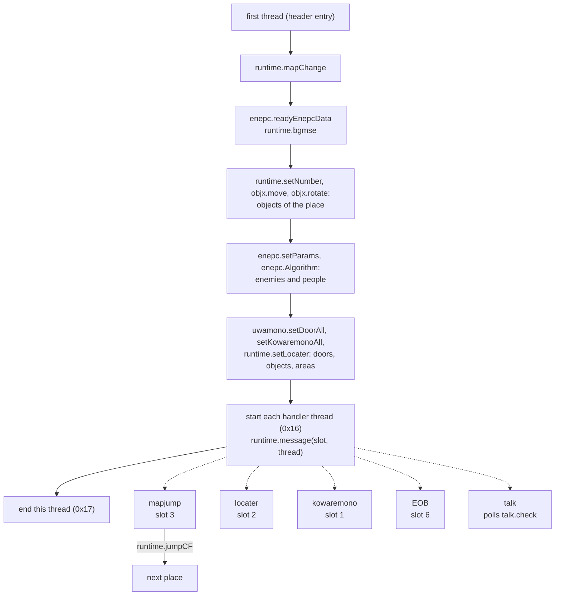

### A small place script

`cf\sc1290.sb` is the smallest script with the full frame, 1,588 bytes. Its
first thread is 91 units long.

```
  00000  push 131106, type 1, count 1
  00007  native runtime.mapChange          mapChange(0x20022)
  0000A  drop
  0000B  push code position 00203          mapjump
  0000E  start thread
  0000F  push 3, type 1                    slot 3
  00013  push code position 00203, type 4  the thread
  00017  push 2                            two arguments
  0001A  native runtime.message            message(3, mapjump)
  0001D  drop
  0001E  start thread 0005B                locater
  00022  ...     runtime.message(2, locater)
  00031  start thread 000D8                kowaremono
  00035  ...     runtime.message(1, kowaremono)
  00044  start thread 00158                EOB
  00048  ...     runtime.message(6, EOB)
  00057  push code position 00000
  0005A  end thread                        the first thread is done
```

The `talk` thread of the same script is the simplest conversation handler.
It is not driven by a message. It calls `talk.check` in every pass, which
returns the number of the person the player talks to or -1, stores the result
in a global and switches on it.

```
talk:
  00114  push 0                            no arguments
  00115  native talk.check
  00118  push global index 11
  0011B  store                             global 11 = result
  0011C  push global 11
  0011F  push -1
  00122  not equal
  00125  jump if zero 00157
  00128  push global 11
  0012B  jump 0014A                        to the switch
  0012E  push 0x200000, type 3, count 1    case 11: string 0 of the library
  00135  native talk.smsg
  00138  drop
  00139  jump 00157
  0013C  push 0x200001, type 3, count 1    case 12: string 1
  00143  native talk.smsg
  00146  drop
  00147  jump 00157
  0014A  switch 2 cases, default 00157:  11 -> 0012E,  12 -> 0013C
  00157  end of the pass
```

Larger places differ in size and not in kind. Their handlers have more cases,
their cases call more natives, and they start further threads for
elevators, doors and scripted scenes inside the place.

### Scripts without a map

The 37 scripts from `sc7001.sb` to `sc7099.sb` and a few others have no
`mapjump` thread, and most have no name table at all. They are steps of the
story flow: they set flags, play a movie with `runtime.mpeg2`, change the
party with the `menu` natives, and jump on with `runtime.jumpCF`. The example
`cf\sc7099.sb` under [A whole file](#a-whole-file) is one of them. Six of
them have a `battleEnd` thread and start a fixed battle. Place 7001 is the
first place of a new game.

## The cutscene script

93 scripts have a thread named `scene` and drive the `cfe` cutscene player:
80 of the scripts from `sc8001.sb` on and the 13 scripts `sc6302.sb` to
`sc6318.sb`. The `cfe` natives make up 50,780 call sites, a quarter of all
native calls on the disc, because a cutscene is written out key by key. The
player itself is described in [Cutscenes](../scripting/cutscenes.md).

### The order of the calls

All 93 scripts use the `cfe` natives in the same order. The list below gives
the order in which each native first appears in a script, with the number of
scripts that use it. Not one pair of natives appears in the opposite order in
any script.

| Step | Native | Scripts | Thread |
| ---: | --- | ---: | --- |
| 1 | `camera.mode(1, 0)`, before any `cfe` call | 93 | first |
| 2 | `cfe.init` | 93 | first |
| 3 | `cfe.stStrtFrm`, `cfe.stEndFrm` | 93 | first |
| 4 | `cfe.ldMp` | 93 | first |
| 5 | `cfe.ldAt` | 92 | first |
| 6 | `cfe.ldMt` | 87 | first |
| 7 | `cfe.ldEf` | 26 | first |
| 8 | `cfe.ldMnt` | 21 | first |
| 9 | `cfe.ldSnd` | 14 | first |
| 10 | `cfe.ldMpDev` | 3 | first |
| 11 | `cfe.allocMes`, then every `cfe.setMes` | 93 | first |
| 12 | `cfe.stKyCm` | 93 | first |
| 13 | `cfe.stKyMp` | 50 | first |
| 14 | `cfe.stKyAt`, `cfe.stKyAtHd`, `cfe.stKyAtPrts` | 92, 74, 14 | first |
| 15 | `cfe.stKyEf` | 26 | first |
| 16 | `cfe.stKyLgt` | 92 | first |
| 17 | `cfe.stKyFog` | 67 | first |
| 18 | `cfe.stKyMnt` | 21 | first |
| 19 | `cfe.stKyScrEff` | 87 | first |
| 20 | `cfe.stKySnd` | 14 | first |
| 21 | `cfe.stFdIn(30)` | 93 | `scene` |
| 22 | `cfe.stFrm` | 93 | `scene` |
| 23 | `cfe.stFdOut(30)` | 80 | `scene` |
| 24 | `cfe.destroy` | 93 | `scene` |

Three points of this order are worth stating, because the code of the
natives does not force them.

- The frame range is set right after `cfe.init`, before anything is loaded.
- The loaders run in the order map, actors, motions, effects, monitors,
  sound. The subtitles are allocated and filled before the first key.
- The keys are written track kind by track kind, the camera first and the
  sound last. All keys of a script are written by the first thread before
  the first frame is played.

The scripts do not call `cfe.stFrm` in a loop instruction. The `scene` thread
runs one pass per frame and ends with opcode `0x1C`, which rewinds it to its
entry, exactly like an event handler.

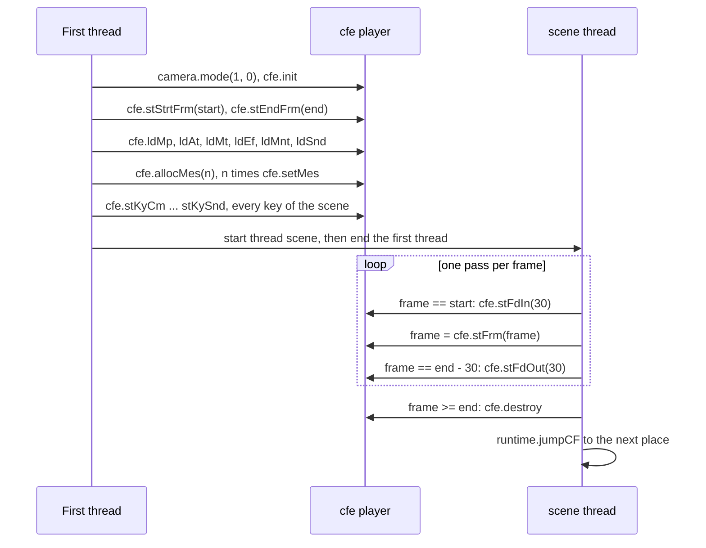

### A small cutscene script

`cf\sc8096.sb` is the smallest cutscene, 2,108 bytes, a title card that shows
the text `U.M.N. Control Center` over a map. Its first thread is shown here in
a shortened form. Three globals hold the frame counter (global 0), the start
frame (global 1) and the end frame (global 2).

```
  00000  camera.mode(1, 0)
  0000D  cfe.init()
  00012  global 1 = 0
  00017  global 2 = 330
  0001E  global 0 = global 1
  00025  cfe.stStrtFrm(global 1)
  00030  cfe.stEndFrm(global 2)
  0003B  cfe.ldMp(131429)                       map file id 0x20165
  00046  cfe.allocMes(1)
  00051  cfe.setMes("U.M.N. Control Center", 15, 284, "", 0)
  0006A  global 3 = 0
  0006F  while global 3 < 96:
  0007B      cfe.stKyCm(global[5 + global 3], global[5 + global 3 + 1],
                        global[5 + global 3 + 2], global[5 + global 3 + 3])
  000C4      global 3 = global 3 + 4
  000D4  cfe.stKyFog(0, 0, 1, 41728)            eight fog keys, written one by one
  ...
  0017A  cfe.stKyScrEff(2, 0, 0, 1, 512)        six screen effect keys
  ...
  00212  start thread 0021A                     scene
  00216  end thread 00000
```

The camera keys are not written as constants in the code. They are an array
of 24 records of four words in the globals, and a loop passes one record per
call. This is why the cutscene scripts have large global areas: the 93
cutscenes hold 328,075 of the 338,284 global words of all place scripts. The
largest, `cf\sc8014.sb`, is 117,004 bytes long.

The `scene` thread is the same in every cutscene up to the constants.

```
scene:
  0021A  if global 0 == global 1:               first frame
  00226      cfe.stFdIn(30)
  00231  global 0 = cfe.stFrm(global 0)         play one frame, get the next time
  0023F  if global 0 == global 2 - 30:
  00251      cfe.stFdOut(30)                    start the fade 30 frames before the end
  0025C  if global 0 >= global 2:
  00268      cfe.destroy()
  0026D      if 43 <= runtime.getFlag(401, 8) and runtime.getFlag(401, 8) < 44:
  0029B          runtime.jumpCF(8025, 0)        second argument 0, third omitted
             else:
  002AB          runtime.jumpCF(1910, 0)
  002B8      wait 100 frames
  002BC  end of the pass
```

What follows `cfe.destroy` is the link to the story. 68 cutscenes only jump
to the next place. 13 start a battle with `enepc.Encount` and register an
`EOB` thread, 6 set a control bit with `runtime.System`, and 5 change the
party with `menu.ptJoin` or `menu.ptLeave`. The last one is `cf\sc8096.sb`,
which reads a flag with `runtime.getFlag` to choose
between two places.

## The battle scripts of the maps

113 of the 246 map models in `model\map\` come with a script image of the
same name and the extension `.bin`. This is the battle script of the map,
which the source calls the think script. `xglCdLoadBinFileSet` in
`src/main/res_get_path.c` reads it as a part of the map file set, together
with its library from `model\map\en\`, into the buffer `gameWork.resBuffer`.
When a battle starts, `ov01StepSceneScript` in `src/ov01/scene_load.c` links
the image against the battle natives and starts its first thread (see
[The SB virtual machine](../scripting/sb-vm.md#scripts-in-battle)).

The files are ordinary SB images, and everything said about the header, the
sections and the compiler patterns above was checked on them as well. They
differ from the place scripts in content.

| Property | Place scripts `cf\*.sb` | Battle scripts `model\map\*.bin` |
| --- | --- | --- |
| Files | 352 | 113 |
| Size | 156 to 117,004 bytes | 22,380 to 70,004 bytes |
| Owners imported | 14 field owners | `bat`, `camera`, `math` |
| Calls of script functions | 1,024 | 13,893 |
| Reads of locals | 554 | 35,645 |
| Messages sent between threads (`0x1F`) | 0 | 16, in 4 files |
| `math.random` call sites | 73 | 4,437 |
| Source name | `author\scNNNN` | `thinkNNN` |

The maps with a battle script, counted by the area code in their name, are
`EVE` (20), `MOM` (14), `OMG` (13), `EXC`, `MID` and `SUI` (9 each), `OLM`
(8), `RAV` and `SYD` (7 each), `KML` (6), `EXB` (5), `EXA` (4), `EXD` and
`MIL` (1 each).

The first thread of a battle script sets the battle up. In
`model\map\E2_SUI07.bin`, the smallest file, it reads as follows.

```
  00000  camera.mode(1, 0)
  0000D  bat.cameraSet(thread cameraObj)        the thread that receives camera events
  00018  start thread cameraObj
  0001C  global 49 = bat.monsSetNoGet()         which enemy group is fought
  00024  bat.monsTblSet(array global 64, global 49)
  00033  bat.posDataSet(array global 71)
  0003E  bat.plDirInit(0, 160)
  0004B  bat.plDirInit(1, -160)
  0005A  start thread uro_010_think             the enemy logic
  0005E  start thread uro_010_cam               the camera work of that enemy
  00062  start thread EnemyNBoostCall
  00066  bat.bgmPlay(2)
  00071  end thread 00000
```

The arguments with type 5 are the arrays of the globals: the enemy group
table and the position table of the map. The threads named `<enemy>_think`
decide what an enemy does in its turn, and the threads named `<enemy>_cam`
move the camera for its actions, which explains why `camera` natives make up
three quarters of the native calls in these files. What the tables hold and
how the battle uses the think threads is described in
[Game tables](game-tables.md) and [Battle rules and flow](../game/battle.md).

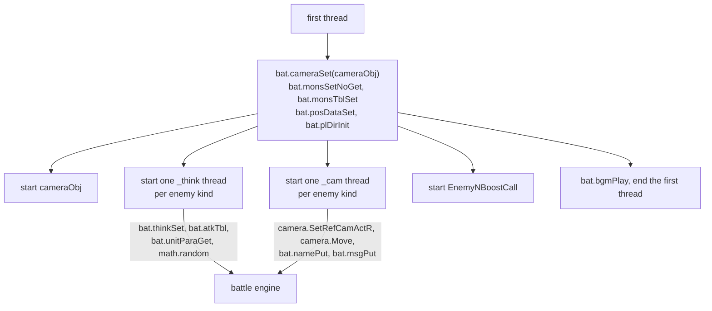

## Scene resource scripts (.txt)

A scene resource script lists what a place needs in memory. It is a text
file `cf\cfNNNN.txt` of at most one disc sector. `resLoadCfFile` reads it
into a buffer of 2,048 bytes and `resScriptRun` parses it, both in
`src/main/res_get_path.c`. The parser and what each command adds to the
resource list are described in
[Events and the story flow](../scripting/events.md#the-scene-resource-script).

### The files

There are 314 files, from 30 to 549 bytes long. Every one of them starts with
the four characters `#scn`, which the parser tests as the word `0x6E637323`,
and every one has a line `#end`.

Every `.txt` file has a script image of the same number. The reverse does not
hold: 38 of the 352 script images have no resource script. These are
`sc1290.sb` and 37 of the story steps `sc7005.sb` to `sc7099.sb`, which load
nothing or play only a movie. The code allows this, because `resLoadCfFile`
tests the file size first and starts no read when the file does not exist.

### Grammar

The files were written by hand in a text editor, and it shows.

- A line ends with a carriage return and a line feed. 221 files use this
  pair on every line, and 93 files have some lines that end with a line feed
  alone.
- A line is a command word, white space and one argument. The white space is
  spaces in 1,497 lines and tabs in 1,468, often mixed.
- A list argument separates its items with commas and no spaces.
- Empty lines are frequent, 762 in all.
- No line starts with `;`. The parser treats such a line as a comment, but no
  file of the disc has one.
- Model names are written in upper case in some files (`MAN2_01`, `MOBJ082`)
  and in lower case in others (`uso001`, `mobj199`).

### Commands that occur

`resCommandTable` has 13 entries. Twelve of them occur in the files, and no
line of any file starts with a word that is not in the table.

| Command | Lines | Files | Different arguments | Argument in the files |
| --- | ---: | ---: | ---: | --- |
| `act` | 1,035 | 233 | 305 | Name of a character, enemy or E.S. model, for example `uso001` or `MAN2_01` |
| `effect` | 524 | 142 | 276 | Name of an effect, for example `ce000_062` |
| `map` | 321 | 311 | 238 | Name of a map model, `E2_xxxxx` for a place and `CFEVExx` for a cutscene set |
| `bgm` | 308 | 308 | 27 | Music name such as `001_milchia`. Two names in 14 files, and an empty argument in 79 |
| `mapse` | 224 | 224 | 178 | One sound bank name (46 files) or two (178 files), for example `CF_KML,CF_KML02` |
| `foot` | 211 | 211 | 53 | One to four footstep materials of three letters: `flo`, `sto`, `kon`, `iro`, `gla`, `car`, `wat`, `rai`, `woo`, `tur`, `ear` and others |
| `mobj` | 192 | 78 | 110 | Name of a map object model, for example `mobj199` |
| `enefoot` | 65 | 65 | 46 | One to three enemy model names, for example `uro008,uma010` |
| `mot` | 44 | 28 | 23 | Name of a motion pack, for example `MOTION_EXT03` |
| `bgmvol` | 36 | 36 | 3 | `127` in 24 files, `60` in 7, `0` in 5 |
| `save` | 4 | 4 | 4 | `0`, `1`, `2`, `3`, one file each |
| `disk` | 1 | 1 | 1 | `2`, in `cf8070.txt` |
| `;mpeg2` | 0 | 0 | 0 | Never occurs |

The thirteenth entry of the table is named `;mpeg2`.
[Events and the story flow](../scripting/events.md#the-commands) explains
that the parser can never reach it, because a line that starts with `;` is
skipped as a comment before the command search. The files agree: no line of
any of the 314 files starts with `;`, so the command is neither reachable nor
attempted. Movies are started by the script image with `runtime.mpeg2`, which
52 call sites in 42 scripts do.

Three files have no `map` line: `cf7011.txt`, `cf7039.txt` and `cf8070.txt`.
They hold only `save` and `disk` commands. Seven files name two or more maps.

### Examples

`cf\cf1010.txt` is the resource script of place 1010. The command words and
arguments are separated by tabs in the first lines and by spaces in the
others.

```
#scn

bgm		001_milchia
map		E2_KML01
mapse	CF_KML
effect ce000_062
effect ce200_903
effect ce001_999
foot kon

#end

```

The place script `cf\sc1010.sb` then refers to the same effects by name: the
first three strings of its library `cf\en\sc1010.sbl` are `ce000_062`,
`ce200_903` and `ce001_999`, and it passes them to `runtime.setNumber`.

`cf\cf1220.txt` is a place with an enemy. The `act` line loads the enemy
model, `enefoot` its footstep sounds, and the eight effects at the end are
the encounter effects of that enemy.

```
#scn

bgm		002_milchia2nd
map		E2_MID02
mapse	CF_MID,CF_MID02
act		uso001
effect 	ce002_015
effect 	ce002_015
effect 	ce002_017
effect 	ce002_006
foot		kon,iro,wat
enefoot uso001
effect		ce500_010
effect		ce501_010
...
#end
```

`cf\cf8070.txt` is the resource script of the disc change. It is the only
file with a `disk` line, and its place script is one of the story steps.

```
#scn

save	1
disk	2

#end
```

The command `save 1` requests the chapter intermission with the save offer,
and `disk 2` requests the second disc (see
[Events and the story flow](../scripting/events.md#the-disc-change)). The
four `save` commands of the disc are in `cf7011.txt` (0), `cf8070.txt` (1),
`cf7039.txt` (2) and `cf8060.txt` (3).

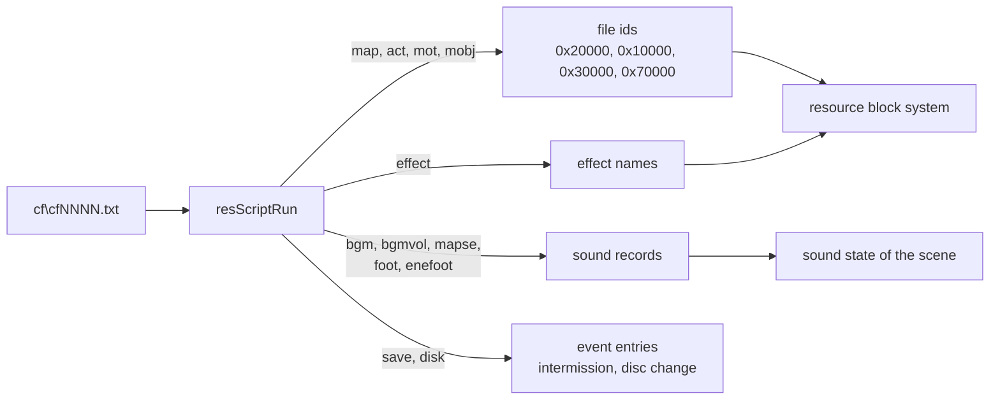

### Text behind the end

The parser stops at `#end`, so anything behind that line is free. 289 of the
314 files have something there.

| Bytes behind `#end` | Files | Meaning |
| --- | ---: | --- |
| A line of Shift-JIS text, `83 65 83 58 83 67 97 70` | 217 | "For testing" in Japanese, a remark that was copied from file to file |
| A single zero byte | 69 | |
| A line of Shift-JIS text that reads "chapter interval save" with a full-width digit 1, 2 or 3 | 3 | A remark in `cf8070.txt`, `cf7039.txt` and `cf7011.txt`, the files with a lone `save` command |
| Nothing but line ends | 25 | |

## Enemy preset files (.ene)

The four `.ene` files in `cf\` are script-side data: tables of parameter
presets for the enemies and people that walk on a map. A place script loads
one table and then gives each character one preset of it by number.

### Loading

The files are resources of the kind `RES_KIND_ENE` (`0x80000`). The file
names come from the table `xglCdCfEnemyNames` in `src/main/res_get_path.c`,
which lists 59 names in `cf\`: `enemy001` to `enemy019`, `enemy_001` to
`enemy_020` and `npc_001` to `npc_020`. Only four of these files are on the
disc.

A script loads a table with the native `enepc.readyEnepcData(resource id)`
(`enepcReadyEnepcData` in `src/main/runtime_enepc.c`). The native calls
`GameResLoadID`, which ends in `xglCdLoadEneFile`, and stores the address of
the loaded file in the pointer `enepcParamSets`. Later
`enepc.setParams(key, unused, preset, ...)` (`enepcSetParams` in
`src/main/runtime_enepc.c`) reads record `preset` of the table and hands its
values to `enepcStoreParams`.

| File | Resource id | Records in use | Loaded by |
| --- | --- | ---: | --- |
| `cf\enemy_001.ene` | `0x80014` | 14 | 79 place scripts |
| `cf\npc_001.ene` | `0x80028` | 2 | 2 place scripts |
| `cf\enemy001.ene` | `0x80001` | 2 | No script |
| `cf\enemy010.ene` | `0x8000A` | 3 | No script |

The 81 call sites of `enepc.readyEnepcData` pass only the two ids `0x80014`
and `0x80028`. The files `enemy001.ene` and `enemy010.ene` are leftovers.
The 279 call sites of `enepc.setParams` pass the preset numbers 0 to 13, or
omit the preset, and `enemy_001.ene` has exactly the records 0 to 13 filled.

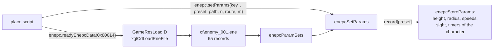

### Layout

Each file is 3,120 bytes long: 65 records of 48 bytes, without a header and
without a count. Unused records are all zero. The record is the struct
`EnepcParamSet` of `src/main/runtime_enepc.c`. The meaning of each field
follows from the field of the character state that `enepcStoreParams` writes
it to.

| Offset | Type | Field in `EnepcParamSet` | Stored to | Meaning |
| --- | --- | --- | --- | --- |
| `0x00` | `float` | `height` | `record->extent.y` | Height of the character |
| `0x04` | `float` | `extent` | `actor->radius`, `record->extent.x` | Radius of the character |
| `0x08` | `float` | `movementFloats[0]` | `state->wanderStep` | Step of the wandering movement |
| `0x0C` | `float` | `movementFloats[1]` | `state->leashRange` | Distance the character may leave its area |
| `0x10` | `float` | `movementFloats[2]` | `state->moveSpeed` | Normal speed |
| `0x14` | `float` | `movementFloats[3]` | `state->pursuitSpeed` | Speed while it follows the player |
| `0x18` | `float` | `angleDegrees` | `state->fanWidth`, converted to radians | Width of the field of view in degrees |
| `0x1C` | `float` | `rangeFloats[0]` | `state->fanLength` | Length of the field of view |
| `0x20` | `float` | `rangeFloats[1]` | `state->noticeRange` | Distance at which the character notices the player without seeing it |
| `0x24` | 4 bytes | not named | not read | Zero in all 260 records |
| `0x28` | `short` | `stateShorts[0]` | `state->pauseTime` | Time of one wandering phase, in frames |
| `0x2A` | `short` | `stateShorts[1]` | `state->pauseCycle` | A count for the choice of the next phase |
| `0x2C` | `short` | `stateShorts[2]` | `state->threatTime` | Time of one waiting phase, in frames |
| `0x2E` | `short` | `stateShorts[3]` | `state->threatCycle` | A second count |

A value of -1 in a field means "leave the present value", because
`enepcStoreParams` skips every parameter that equals -1. No record of the
four files uses this. How the field enemy code uses the values is described
in [Field enemies](../game/field-enemies.md).

The first three records of `cf\enemy_001.ene` show typical values.

| Record | Height | Radius | Wander step | Leash | Speed | Pursuit speed | View angle | View length | Notice range | Timers |
| ---: | ---: | ---: | ---: | ---: | ---: | ---: | ---: | ---: | ---: | --- |
| 0 | 1.8 | 0.5 | 2.0 | 8.0 | 0.04 | 0.08 | 120 | 5.0 | 5.0 | 30, 3, 30, 3 |
| 1 | 8.0 | 4.0 | 10.0 | 30.0 | 0.10 | 0.20 | 120 | 20.0 | 20.0 | 30, 3, 30, 3 |
| 2 | 1.8 | 1.4 | 2.0 | 8.0 | 0.04 | 0.08 | 120 | 5.0 | 5.0 | 30, 3, 30, 3 |

Record 0 is a creature of human size, and record 1 is one that is 8 units
high with a view of 20 units. The two records of `cf\npc_001.ene` describe
people: a height of 1.75 and 1.6, a radius of 0.4, a speed of 0.025, no
pursuit speed and no field of view.

## Leftovers and oddities

The files keep some traces of how they were made.

- The padding text `MONOLITHSOFT Xenosaga Episode.2` fills every unused byte
  of the archives.
- `16m.bin`, 16 MiB of zeros, is the first record of each story directory
  and the last file of each disc.
- The source name at the end of every script image keeps the directory names
  of the script authors, and the battle scripts keep their old names
  `think000` and up.
- `cf\sc1290.sb` has no resource script, and its library holds two test
  messages in Shift-JIS. Its handlers have cases without bodies. It looks
  like the template the place scripts were started from.
- 217 resource scripts end with the same Japanese remark, "for testing".
- `cf\enemy001.ene` and `cf\enemy010.ene` are loaded by no script, and 55
  of the 59 names in `xglCdCfEnemyNames` have no file.
- The item name list of `cf\en\sc1610.sbl` contains an entry named `spare`.
- 17 place scripts still call the debug native `samp.fontPut`.
- Every library that has entries stores 1 in the unused word at `0x0C`
  except `cf\en\sc6307.sbl`, which stores 0.

## Unknowns

- The word at `0x04` of both image formats is 1 in all 930 files. It is
  taken to be a format version.
- The word at `0x0C` of a library (1 in 464 files, 0 in one) is not read by
  any code. Its meaning is not known.
- The five zero words at `0x2C` of a script image and the nine zero words at
  `0x1C` of a library are probably reserved.
- Type word 2 is never pushed. The source language most likely had a type
  for it that the scripts of this game do not use.
- The four bytes at `0x24` of an `.ene` record are zero everywhere and are
  not read.
- The dual-layer and hard disk paths of `xglCdArcInit` and the unused classes
  of the ARX table could not be checked against files, because these discs
  do not use them.

## Source files

| File | Contents |
| --- | --- |
| `src/main/xgl_cd.c` | The archive reader: `xglCdArcInit`, `xglCdDiskCheck`, `xglCdGetFilePos`, `xglCdGetFilePosSub`, `xglCdArcNameExpand`, the read functions and `extract` |
| `src/main/xgl_timer0.c` | `xglArxExtract`, the ARX decoder, and `xglGetLanguageCode` |
| `include/ov01/sb_vm.h` | `SbImageHeader`, `SbNameEntry`, `SB_IMAGE_LINKED` |
| `src/ov01/sb_vm.c` | The virtual machine: `sbIsSbImage`, `sbIsSblImage`, `sbLinkImage`, `sbLibraryLink`, `sbOpLength`, `sbOpHandlers` |
| `src/ov01/sb_natives.c` | The argument readers of the natives and `vmKeyedEntryGet`, the reader of library keys |
| `src/main/ytachi_test.c` | `mapSceneScriptLoad`, which loads `cf\scNNNN.sb` and its library |
| `src/main/res_get_path.c` | The scene resource script (`resLoadCfFile`, `resScriptRun`, `resCommandTable`), `resParseJumpTarget`, the file name tables, `xglCdLoadBinFileSet` and `xglCdLoadEneFile` |
| `src/main/runtime_enepc.c` | `enepcReadyEnepcData`, which loads an `.ene` file |
| `src/main/runtime_enepc.c` | `EnepcParamSet`, `enepcSetParams` and `enepcStoreParams` |
| `src/main/runtime.c` | `runtimeMessage`, the registration of handler threads |
| `src/ov01/scene_load.c` | `ov01StepSceneScript`, which links and starts the battle script |
| `src/ov01/data_file_load.c` | `dataThinkScriptLoad`, the development loader of think scripts |
