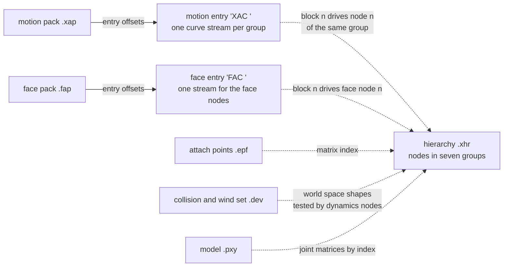
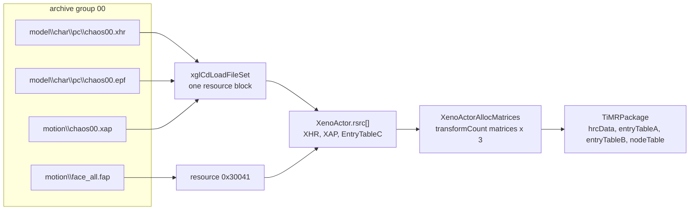
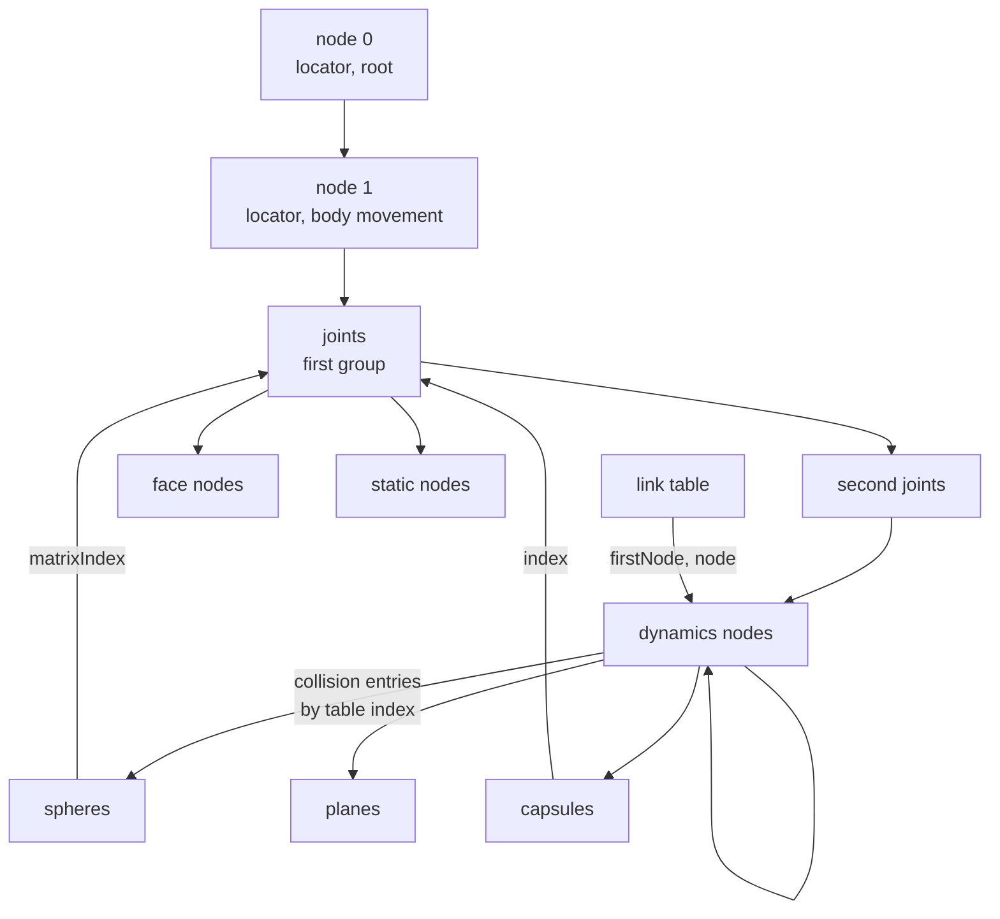
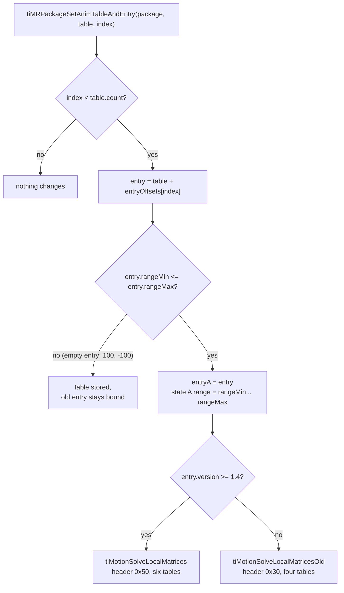
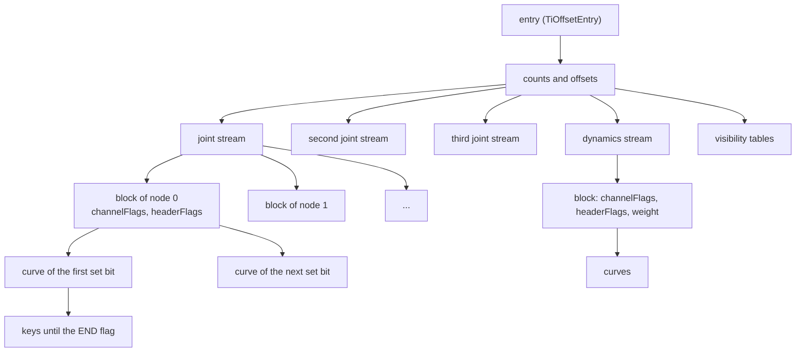
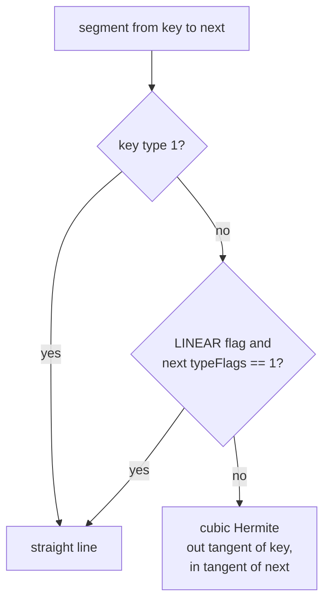
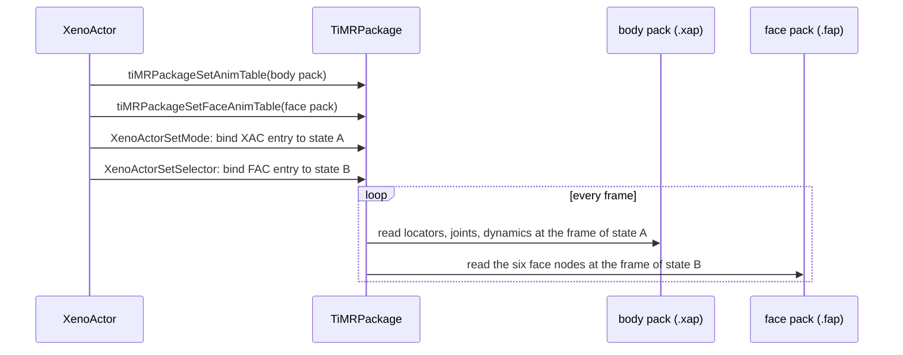

# Skeletons and motion

Every animated model of Xenosaga Episode II hangs on a hierarchy of nodes and
is moved by curves. The hierarchy is a `.xhr` file. It lists the joints of the
body, the nodes of the face, the simulated nodes of hair and cloth, the fixed
attach nodes and the collision shapes that keep hair out of the body. The
movement comes in motion packs (`.xap`), which collect motion entries, one per
motion. Each entry holds one stream of curves per node group. The face has a
pack of its own, `motion\face_all.fap`, shared by every character.

Around these two formats sit a few small ones. A `.dev` file is the collision
and wind set of one cutscene location. A `.epf` file lists the attach points of
a model. Two `.jrd` text files are joint name lists that the authoring tool
left on the disc.

Every layout below was checked with a parser against every file of its type
on both discs. How the game evaluates the data at run time (the motion clock,
blending, the aim solver, the hair simulation) is described in
[Animation](../libraries/animation.md). The actor that owns a hierarchy and
its motion tables is described in [Actors](../libraries/actors.md). Fields
carry the names used in the game's source code wherever one exists.

[← Back to the overview](../README.md) · [Files and resources](../architecture/files-and-resources.md)

## Contents

- [The files at a glance](#the-files-at-a-glance)
- [Conventions shared by all formats](#conventions-shared-by-all-formats)
- [Hierarchies (XHR)](#hierarchies-xhr)
- [Motion packs (XAP)](#motion-packs-xap)
- [Curves](#curves)
- [Visibility tables](#visibility-tables)
- [The face motion pack (FAP)](#the-face-motion-pack-fap)
- [Battle motion files](#battle-motion-files)
- [Cutscene motion packs](#cutscene-motion-packs)
- [The menu background files](#the-menu-background-files)
- [Collision and wind sets (DEV)](#collision-and-wind-sets-dev)
- [Attach point tables (EPF)](#attach-point-tables-epf)
- [Joint name lists (JRD)](#joint-name-lists-jrd)
- [Unknowns](#unknowns)
- [Source files](#source-files)

## The files at a glance

The table lists every place where the disc stores skeleton and motion data.
Group `00` is the common archive that both discs carry with identical bytes.
Groups `10` and `20` are the story archives of disc 1 and disc 2. None of
these files is packed, so the stored size is the size in memory.

| Format | Magic | Where | Files | Total size | Smallest, largest | Read by |
| --- | --- | --- | --- | --- | --- | --- |
| Hierarchy | `XHR ` | `model\char\pc` | 37 | 216,064 | 320, 17,424 | `xglCdLoadFileSet`, `dataModelFilesLoad` |
| Hierarchy | `XHR ` | `model\char\npc` | 39 | 242,704 | 2,880, 18,192 | `xglCdLoadFileSet` |
| Hierarchy | `XHR ` | `model\char\cf_npc` | 72 | 235,296 | 2,480, 5,536 | `xglCdLoadFileSet` |
| Hierarchy | `XHR ` | `model\char\citizen` | 71 | 175,520 | 480, 3,248 | `xglCdLoadFileSet` |
| Hierarchy | `XHR ` | `model\enemy` | 106 | 404,480 | 400, 18,256 | `xglCdLoadFileSet`, `dataModelFilesLoad` |
| Hierarchy | `XHR ` | `model\mobj` | 115 | 55,520 | 320, 3,920 | `xglCdLoadFileSet` |
| Hierarchy | `XHR ` | `model\robo\pc_robo`, `npc_robo`, `gattai_robo` | 18, 23, 81 | 405,360 | 320, 6,320 | `xglCdLoadFileSet`, `dataModelFilesLoad` |
| Hierarchy | `XHR ` | `yosikawa\model` | 2 | 960 | 480, 480 | `bgLayerLoad` |
| Motion pack | `XAP ` | `motion` | 169 | 9,915,252 | 32, 447,672 | `xglCdLoadFileSet`, `xglCdLoadXapFile` |
| Face motion pack | `FAP ` | `motion\face_all.fap` | 1 | 32,124 | | `xglCdLoadXapFile`, `dataFaceFileLoad` |
| Cutscene motion pack | `XAP ` | `motion\cfevent` (group 00) | 67 | 7,524,000 | 324, 826,244 | `cfeCmdLoadMotion` |
| Cutscene motion pack | `XAP ` | `motion\cfevent` (group 10) | 90 | 7,771,084 | 636, 315,188 | `cfeCmdLoadMotion` |
| Cutscene motion pack | `XAP ` | `motion\cfevent` (group 20) | 39 | 3,024,472 | 4,856, 295,088 | `cfeCmdLoadMotion` |
| Battle motion file | `XAP ` | `yamamoto\mot` | 182 | 23,113,676 | 708, 526,476 | `dataMotFileLoad`, `dataMotSlotLoad` |
| Motion pack | `XAP ` | `yosikawa\model\menubg.xap` | 1 | 1,268 | | `bgLayerLoad` |
| Motion pack | `XAP ` | `model\char\pc\jin_sw01.xap` | 1 | 1,156 | | nothing (copy of `yamamoto\mot\jin_sw01.xap`) |
| Collision and wind set | `DEV ` | `motion\cfevent` (group 20) | 3 | 3,184 | 960, 1,200 | `cfeCmdLoadMapCollision` |
| Attach point table | `EPF ` | next to the hierarchies under `model\` | 249 | 172,412 | 80, 1,072 | `xglCdLoadFileSet`, `dataModelFilesLoad` |
| Joint name list | text | `model\mobj\mobj139.jrd`, `model\robo\pc_robo\pcr05.jrd` | 2 | 994 | 139, 855 | nothing |

There are 564 hierarchies and 550 motion packs in all. The packs hold 8,587
entries. 4,340 of them carry data and 4,247 are empty place holders. The data
entries add up to 403,534 frames, which is 3 hours and 44 minutes of
animation at 30 frames per second.

A hierarchy and a motion are matched only by position. Neither file stores a
name or an id of the other. The first node block of a joint stream drives the
first node of the hierarchy, the second block the second node, and so on. The
game always loads a model together with the motion pack that was made for it,
and the loader picks the pack by file name.

The diagram shows how the formats refer to each other.



## Conventions shared by all formats

All numbers are little-endian. Floats are 32-bit IEEE 754. Angles are in
radians, with one exception that is named where it occurs. Lengths are in
world units. In the rest pose of `model\char\pc\chaos00.xhr` the second
locator, which carries the body, sits at y = 0.98 and the thigh bone is 0.405
long, so one unit is close to one metre.

Motion time is counted in frames of 1/30 second. The curve reader converts a
frame number to seconds with the constant 0.0333333351 (`xacKeyOriginScale`).
Key frames are stored as signed 16-bit integers. The frame range of a motion
entry is stored as two floats.

Every file starts with a four-character magic whose fourth character is a
space (`XHR `, `XAP `, `XAC `, `FAP `, `FAC `, `DEV `, `EPF `), followed by a
version float. The game never tests a magic. It only tests the version floats
of the hierarchy and of the motion entries.

Many bytes of these files are leftovers of the tool that wrote them. Fields
that the game fills at run time, and padding between fields, were written from
uninitialised memory. They hold fragments of strings such as `|Jhead|`,
`My Documen`, `/maya` or `actionOptionsFor`. The tables below mark such
fields as "leftover". A leftover field has no stable value, and nothing reads
it before the game writes it.

The **matrix index** of a node is its position in the file order of the node
groups, counted from 0. Parent links, collision records, attach points and
the model all refer to nodes by this index.

## Hierarchies (XHR)

### Purpose and location

A hierarchy describes the skeleton of one model. It sits next to the model
file with the same base name: `model\char\pc\chaos00.pxy`, `chaos00.txy`
(textures), `chaos00.xhr` and `chaos00.epf`. The loader `xglCdLoadFileSet` in
`src/main/res_get_path.c` reads the four files and the motion pack into one
resource block, see
[Files and resources](../architecture/files-and-resources.md). The battle
overlay loads the same files itself with `dataModelFilesLoad`
(`src/ov01/data_file_load.c`).

The actor stores the address of the file as `rsrc[XAct_Rsrc_XHR]` and hands it
to the animation library with `tiMRPackageSetHrcData`. From then on the file
is the structure `TiHrcData` (`include/main/TiMRPackage.h`). The file needs no
relocation, because every reference inside it is a byte offset from the start
of the file or a matrix index.

`XenoActorAllocMatrices` reads `transformCount` and allocates three arrays of
that many 64-byte matrices: the local matrices, the global matrices and the
blend matrices. When `dynamicsCount` is not zero it also allocates one 64-byte
simulation body per dynamics node.

The diagram follows the files of one field model from the disc into the
motion package.



### Layout

The file is a header, then the node groups in matrix index order, then the
collision tables, the link table and the static nodes. This order was the same
in all 564 files.

```
0x000  header (0x70 bytes)
0x070  2 locators              0x40 bytes each
0x0F0  joints                  0x50 bytes each, jointCount - 2 records
       second joints           0x50 bytes each          (joint2Offset)
       third joints            0x50 bytes each          (joint3Offset, always empty)
       face nodes              0x70 bytes each          (skipOffset)
       dynamics nodes          0xB0 bytes + 0x10 per collision entry (dynamicsOffset)
       collision spheres       0x30 bytes each          (sphereOffset)
       collision planes        0xD0 bytes each          (matrixOffset)
       collision capsules      0xE0 bytes each          (capsuleOffset)
       link table              0x10 bytes per record    (linkCellOffset)
       static nodes            0x40 bytes each          (staticOffset)
end of file
```

The static nodes are last in the file but their matrix indices come after the
dynamics nodes. The matrix index order is: locators, joints, second joints,
third joints, face nodes, dynamics nodes, static nodes.

An offset of an empty table is still filled in. It points at the place where
the table would start, which is the start of the next table or the end of the
file.

### Header

| Offset | Size | Type | Name | Meaning |
| --- | --- | --- | --- | --- |
| 0x00 | 4 | char[4] | | Magic `XHR ` |
| 0x04 | 4 | float | `version` | 2.3 in 464 files, 2.4 in 100 files. `tiMRPackageUpdate` stops with the assert `illegal xhr version` below 2.3 |
| 0x08 | 4 | u32 | | Size of the file in bytes |
| 0x0C | 4 | u32 | `transformCount` | Number of nodes of all groups |
| 0x10 | 4 | int | `jointCount` | The two locators plus the joints of the first group |
| 0x14 | 4 | int | `joint2Count` | Second joints |
| 0x18 | 4 | int | `joint3Count` | Third joints. 0 in every file |
| 0x1C | 4 | int | `skipCount` | Face nodes |
| 0x20 | 4 | int | `dynamicsCount` | Dynamics nodes |
| 0x24 | 4 | int | `staticCount` | Static nodes |
| 0x28 | 4 | int | `joint2Offset` | Offset of the second joints |
| 0x2C | 4 | int | `joint3Offset` | Offset of the third joints |
| 0x30 | 4 | int | `skipOffset` | Offset of the face nodes |
| 0x34 | 4 | int | `dynamicsOffset` | Offset of the dynamics nodes |
| 0x38 | 4 | int | `staticOffset` | Offset of the static nodes |
| 0x3C | 4 | u32 | `sphereCount` | Collision spheres |
| 0x40 | 4 | u32 | `matrixCount` | Collision planes |
| 0x44 | 4 | u32 | `capsuleCount` | Collision capsules |
| 0x48 | 4 | int | `linkCellCount` | Cells of the link table |
| 0x4C | 4 | int | `sphereOffset` | Offset of the spheres |
| 0x50 | 4 | int | `matrixOffset` | Offset of the planes |
| 0x54 | 4 | int | `capsuleOffset` | Offset of the capsules |
| 0x58 | 4 | int | `linkCellOffset` | Offset of the link table |
| 0x5C | 20 | | | Leftover in 563 of 564 files. See [Unknowns](#unknowns) for the word at 0x5C |
| 0x70 | 0x80 | `TiHrcLocator[2]` | `locators` | The two locators |
| 0xF0 | | `TiHrcJoint[]` | `joints` | The first joint group |

The parser checked on all 564 files that the size field equals the file size,
that `transformCount` is the sum of the six group counts, that every group
offset is the end of the group before it, and that the tables after the
dynamics nodes tile the rest of the file without a gap.

The difference between version 2.3 and version 2.4 is the `id` of the static
nodes, see [Static nodes](#static-nodes). All record sizes are the same in
both versions.

### Locators

Every hierarchy starts with exactly two locators. Node 0 is the root of the
model, with parent -1 in every file. Node 1 has parent 0 in every file and
carries the movement of the whole body. `tiMotionSolveLocalMatrices`
multiplies its translation by the scale vector of the package, and the actor
reads the translation of its global matrix back after every update.

| Offset | Size | Type | Name | Meaning |
| --- | --- | --- | --- | --- |
| 0x00 | 4 | int | `parent` | Matrix index of the parent, -1 for the root |
| 0x04 | 12 | float[3] | `translationDefault` | Rest translation |
| 0x10 | 12 | float[3] | `rotationDefault` | Rest rotation angles X, Y, Z |
| 0x1C | 12 | float[3] | `scaleDefault` | Rest scale |
| 0x28 | 12 | float[3] | `scale` | Run-time: scale of the last solved frame. Leftover in the file |
| 0x34 | 4 | int | `flags` | Run-time: bit 0x2 is set from the motion data. Leftover in the file |
| 0x38 | 8 | | | Leftover |

The three default vectors are the rest pose. A channel that has no curve in
the current motion takes its default.

### Joints

The three joint groups share one record, `TiHrcJoint` of 0x50 bytes. The
first group holds the bones of the body. The second group holds extra bones
that hang on it. Most dynamics chains start on one of them, so they are
probably the roots of hair strands and cloth parts. They are animated the
same way. The split exists because the motion data has a
separate stream for each group, so a motion made for a body without the
extras still fits.

| Offset | Size | Type | Name | Meaning |
| --- | --- | --- | --- | --- |
| 0x00 | 4 | int | `parent` | Matrix index of the parent |
| 0x04 | 12 | float[3] | `translationDefault` | Rest translation, the offset of the bone from its parent |
| 0x10 | 12 | float[3] | `orient` | Fixed joint orientation, applied before the animated rotation |
| 0x1C | 12 | float[3] | `rotationDefault` | Rest rotation angles |
| 0x28 | 12 | float[3] | `scaleDefault` | Rest scale |
| 0x34 | 12 | float[3] | `scale` | Run-time, leftover in the file |
| 0x40 | 4 | float | `rotationScale` | Multiplier of the animated rotation angles. 1.0 in all 14,812 joints |
| 0x44 | 4 | int | `flags` | Run-time, leftover in the file |
| 0x48 | 8 | | | Leftover |

`orient` is not zero in 3,106 of the 14,491 first joints and in 306 of the
321 second joints. It is the joint orientation of the modelling tool. Typical
values are multiples of pi/2, which turn the bone axis of a chain.

In every file a parent has a smaller matrix index than its child. The solver
relies on this, because it chains the global matrices in index order. A joint
of the first group has a locator or another first joint as its parent. A
second joint hangs on a first joint (283 cases) or on another second joint
(38 cases).

### Face nodes

A face node (`TiHrcSkip`, 0x70 bytes) is a bone of the face: the eyes, the
eyelids, the jaw. The solver functions call these records "skip nodes"
because the body solver skips them. They are driven by the face motion pack
and its own clock, see [The face motion pack (FAP)](#the-face-motion-pack-fap).

| Offset | Size | Type | Name | Meaning |
| --- | --- | --- | --- | --- |
| 0x00 | 4 | int | `parent` | Matrix index of the parent, a first joint in all 828 records (the head) |
| 0x04 | 4 | u32 | `limitFlags` | One bit per rotation limit: 0x1 and 0x2 for X minimum and maximum, then Y and Z. 0 in every record |
| 0x08 | 4 | int | `flags` | Run-time, leftover in the file |
| 0x0C | 12 | float[3] | `translationDefault` | Rest translation. Not zero in every record |
| 0x18 | 12 | float[3] | `orient` | Fixed orientation. Zero in every record |
| 0x24 | 12 | float[3] | `rotationDefault` | Rest rotation angles |
| 0x30 | 12 | float[3] | `scaleDefault` | Rest scale, (1, 1, 1) in every record |
| 0x3C | 12 | float[3] | `scale` | Run-time, leftover in the file |
| 0x48 | 4 | | | Leftover |
| 0x4C | 24 | float[6] | `limit` | Minimum and maximum angle for X, Y and Z |
| 0x64 | 12 | | | Leftover |

The limit feature is present but switched off in the shipped data. All 828
face nodes have `limitFlags` 0, and all six limits hold the same pair,
-6.2832 and 6.2832 (minus and plus 2 pi).

138 files have face nodes, and each of them has exactly 6. The face pack
animates the same six nodes on every character, which is why one pack can
serve all of them.

### Dynamics nodes

A dynamics node (`TiHrcDynamics`) is a bone that the game simulates: a hair
strand segment, a ribbon, a piece of cloth. The record has a fixed part of
0xB0 bytes and is followed by one 16-byte collision entry for every shape the
node is tested against. The records therefore have different lengths, and the
solver walks them by adding `0xB0 + 16 * (sphereCount + matrixCount +
capsuleCount)`.

| Offset | Size | Type | Name | Meaning |
| --- | --- | --- | --- | --- |
| 0x00 | 4 | int | `parent` | Matrix index of the parent |
| 0x04 | 4 | u32 | `solverFlags` | Bits 0x2 and 0x4 zero the local z and y of the simulated point. 0 in 868 records, 3 in 4 |
| 0x08 | 4 | float | `boneLength` | Length used by the solver, 0.039 to 2.71 |
| 0x0C | 4 | float | `gravity` | 0.0 to 0.2, most often 0.01 |
| 0x10 | 4 | float | `damping` | The velocity is scaled by it after each step. 0.0 to 1.0, most often 0.3 and 0.2 |
| 0x14 | 4 | float | `pullScale` | How strongly the point is pulled to its target. 0.0 to 0.7, most often 0.1 |
| 0x18 | 4 | float | `windMultiplier` | Multiplies the wind push. 1.0 in 710 records, 0.0 in 82, 0.5 in 76, 0.9 in 4 |
| 0x1C | 4 | u32 | `sphereCount` | Number of sphere entries that follow |
| 0x20 | 4 | u32 | `matrixCount` | Number of plane entries that follow |
| 0x24 | 4 | u32 | `capsuleCount` | Number of capsule entries that follow |
| 0x28 | 4 | int | `flags` | Run-time, leftover in the file |
| 0x2C | 4 | float | `weight` | Run-time: the animation weight, written from the motion data every frame. Leftover in the file |
| 0x30 | 16 | Vector4 | `translationDefault` | Rest translation, w = 1.0 |
| 0x40 | 12 | float[3] | `orient` | Fixed orientation, not zero in 712 of 872 records |
| 0x4C | 4 | float | | 1.0 in every record |
| 0x50 | 12 | float[3] | `rotationDefault` | Rest rotation angles |
| 0x5C | 4 | float | | 1.0 in every record |
| 0x60 | 12 | float[3] | `scaleDefault` | Rest scale |
| 0x6C | 4 | float | | 1.0 in every record |
| 0x70 | 12 | float[3] | `scale` | Run-time, leftover in the file |
| 0x7C | 20 | | | Leftover |
| 0x90 | 16 | float[4] | | A vector with w = 1.0 in every record, for example (0.024, 0.648, 0.101, 1). Its use was not established |
| 0xA0 | 16 | float[4] | | (0, 0, 0, 1) in every record |
| 0xB0 | 16 each | `TiCollEntry[]` | `entries` | The collision entries |

A collision entry (`TiCollEntry`) is a 4-byte `recordIndex` followed by 12
leftover bytes. The first `sphereCount` entries index the sphere table of the
file, the next `matrixCount` entries the plane table and the last
`capsuleCount` entries the capsule table. All 4,900 entries of the disc index
a record that exists.

A dynamics node hangs on a second joint (252 cases), on another dynamics node
(569 cases, the next segment of a strand) or directly on a first joint
(51 cases). What the simulation does with the parameters is described in
[Animation: dynamics](../libraries/animation.md).

### Static nodes

A static node (`TiHrcStatic`, 0x40 bytes) is a fixed transform under a joint.
Nothing animates it. Its matrix follows its parent, so it marks a place on
the body: the palm of a hand for a weapon, a hard point of an E.S. for a
gun.

| Offset | Size | Type | Name | Meaning |
| --- | --- | --- | --- | --- |
| 0x00 | 4 | int | `parent` | Matrix index of the parent, a first joint in 165 records and a second joint in 2 |
| 0x04 | 12 | float[3] | `offset` | Translation |
| 0x10 | 12 | float[3] | `rotation` | Rotation angles |
| 0x1C | 12 | float[3] | `scale` | Scale, (1, 1, 1) in 163 of 167 records |
| 0x28 | 16 | | | Leftover |
| 0x38 | 4 | int | `id` | Version 2.4 only: the id that `XenoActorAttachChildToJoint` searches for |
| 0x3C | 4 | | | Leftover |

`XenoActorAttachChildToJoint(actor, child, jointId)` in
`src/main/xenoActor.c` hangs a child actor on a static node. For a hierarchy
of version 2.4 it searches the static nodes for the `id`. For version 2.3 it
uses `jointId` as the index into the static table and the field at 0x38 is
leftover. The bytes agree with the code: the 125 static nodes of the
version 2.4 files hold the ids 0 to 11, 77, 80 and 81, and the 42 static
nodes of the version 2.3 files hold 0 or random values.

### Collision tables of the body

The three collision tables describe solid shapes that move with the body. The
dynamics nodes are pushed out of them so that hair does not sink into a
shoulder. Every record names a node by matrix index and is placed relative to
that node. Parts of every record are work space that the game fills each
frame.

A sphere (`TiCollSphere`, 0x30 bytes):

| Offset | Size | Type | Name | Meaning |
| --- | --- | --- | --- | --- |
| 0x00 | 4 | int | `matrixIndex` | The node the sphere moves with |
| 0x04 | 4 | float | `radius` | Radius |
| 0x08 | 4 | u32 | `flags` | Bit 0 disables the push-out. The other bits are leftover. Bit 0 is clear in all 161 records |
| 0x0C | 4 | | | Leftover |
| 0x10 | 16 | Vector4 | `src` | Centre in the space of the node, w = 1.0 |
| 0x20 | 16 | Vector4 | `center` | Run-time: the centre in model space. The file holds a copy of `src` or leftover bytes |

A plane (`TiCollPlane`, 0xD0 bytes) keeps a point on one side of a plane, a
floor for the hair:

| Offset | Size | Type | Name | Meaning |
| --- | --- | --- | --- | --- |
| 0x00 | 4 | int | `index` | The node the plane moves with, -1 for none |
| 0x04 | 4 | u32 | `flags` | Bit 0 disables the push-out, clear in all 25 records |
| 0x08 | 8 | | | Leftover |
| 0x10 | 64 | Matrix4 | `matrix_10` | Plane space to node space |
| 0x50 | 64 | Matrix4 | `matrix_50` | Node space to plane space, the inverse of `matrix_10` |
| 0x90 | 64 | Matrix | `matrix_90` | Run-time: the inverse of the global matrix of the node. Leftover in the file |

A capsule (`TiCollCapsule`, 0xE0 bytes) is the shape used for limbs:

| Offset | Size | Type | Name | Meaning |
| --- | --- | --- | --- | --- |
| 0x00 | 4 | int | `index` | The node the capsule moves with |
| 0x04 | 4 | u32 | `flags` | Bit 0 disables the push-out, clear in all 269 records |
| 0x08 | 8 | | | Leftover |
| 0x10 | 4 | float | `radius` | 1.0 in every record |
| 0x14 | 4 | float | `height` | 1.0 in every record |
| 0x18 | 8 | | | 0.0 and 1.0 in the records inspected |
| 0x20 | 64 | Matrix4 | `matrix_20` | Capsule space to node space |
| 0x60 | 64 | Matrix4 | `matrix_60` | Node space to capsule space |
| 0xA0 | 64 | Matrix | `matrix_a0` | Run-time, leftover in the file |

Every capsule of the disc is a unit capsule. Its real size and position are
in the two matrices, which hold a scale. In the first capsule of
`model\char\pc\jin00.xhr` the diagonal of `matrix_60` is about (0.95, 0.41,
5.2) and `matrix_20` is its inverse.

### The link table

The link table ties dynamics nodes to each other with a rest length, so that
neighbouring strands of a skirt or a cape keep their distance. It is a run of
16-byte records (`TiLinkRecord`). A cell header is followed by its links.

| Record | Offset | Type | Name | Meaning |
| --- | --- | --- | --- | --- |
| Cell header | 0x00 | int | `firstNode` | Matrix index of the node the links start from |
| | 0x04 | int | `linkCount` | Number of link records that follow |
| | 0x08 | 8 bytes | | Leftover |
| Link | 0x00 | float | `restLength` | Distance to keep |
| | 0x04 | int | `node` | Matrix index of the node at the other end |
| | 0x08 | 8 bytes | | Leftover |

`linkCellCount` counts the cells, not the records. 20 files have a link
table. They hold 214 cells with 230 links, one or two links per cell. Both
ends of every link are dynamics nodes. `tiDynamicsSolveCellPairs` in
`src/main/TiWindBase.c` walks the table.

The diagram shows how the parts of one hierarchy refer to each other.



### Example: chaos00.xhr

`model\char\pc\chaos00.xhr` is the field model of chaos. It is 3,536 bytes
long and has version 2.4. Its header reads:

```
00000000: 5848 5220 9a99 1940 d00d 0000 2700 0000  XHR ...@....'...
00000010: 1e00 0000 0100 0000 0000 0000 0600 0000  ................
00000020: 0100 0000 0100 0000 b009 0000 000a 0000  ................
00000030: 000a 0000 a00c 0000 900d 0000 0100 0000  ................
00000040: 0000 0000 0000 0000 0000 0000 600d 0000  ............`...
00000050: 900d 0000 900d 0000 900d 0000 6365 5368  ............ceSh
00000060: 6170 6531 0037 3700 7c00 002f 6d61 7961  ape1.77.|../maya
```

The size is 0xDD0. There are 39 nodes: 30 in `jointCount` (2 locators and 28
joints), 1 second joint, no third joint, 6 face nodes, 1 dynamics node and 1
static node. The second joints start at 0x9B0, which is 0xF0 + 28 * 0x50. The
face nodes start at 0xA00, the dynamics node at 0xCA0. The one sphere is at
0xD60 and the static node at 0xD90. The plane, capsule and link offsets all
point at 0xD90, where those empty tables would start. The 20 bytes from 0x5C
are leftover text.

The nodes of this file, as the parser prints them:

| Index | Group | Parent | Rest translation | Notes |
| --- | --- | --- | --- | --- |
| 0 | locator | -1 | (0, 0, 0) | Root |
| 1 | locator | 0 | (0, 0.980, 0) | Body, hip height |
| 2 | joint | 1 | (0, 0, 0) | Hip, `orient` (-pi/2, 0, -pi/2) |
| 3 to 6 | joint | chain from 2 | (0.102, 0, 0.064), (0.405, 0, 0), (0.375, 0, 0), (0.133, 0, 0) | One leg: thigh, knee, ankle, toe |
| 7 to 10 | joint | chain from 2 | mirrored in z | The other leg |
| 11 to 13 | joint | chain from 1 | (0, 0, 0), (0.118, 0, 0), (0.118, 0, 0) | Spine |
| 14 to 20 | joint | from 13 | (0.174, -0.015, 0.045) and on | One arm with hand and fingers |
| 21 to 27 | joint | from 13 | mirrored | The other arm |
| 28, 29 | joint | 13, 28 | (0.236, 0, 0), (0.080, 0, 0) | Neck and head |
| 30 | second joint | 29 | (0.075, -0.138, 0) | Root of the hair at the back of the head |
| 31 to 36 | face | 29 | (0.118, 0.017, 0.064), (0.118, 0.017, -0.064), ... | Six face bones under the head |
| 37 | dynamics | 30 | (0.123, 0, 0) | The simulated hair segment |
| 38 | static | 25 | (0.008, 0, 0.047) | Attach node on a hand, `id` 77 |

The sphere has `matrixIndex` 28 (the neck), radius 0.101 and the centre
(0.154, -0.035, 0) in the space of that joint. The dynamics node lists it as
its only collision entry, so the hair of chaos is kept out of a ball around
the base of his head.

### Statistics

All numbers are over the 564 files of group 00.

| Count | Smallest | Median | Largest | Sum | Files that have any |
| --- | --- | --- | --- | --- | --- |
| Nodes (`transformCount`) | 3 | 36 | 90 | 17,807 | 564 |
| `jointCount` | 3 | 30 | 78 | 15,619 | 564 |
| Second joints | 0 | 0 | 16 | 321 | 80 |
| Third joints | 0 | 0 | 0 | 0 | 0 |
| Face nodes | 0 | 0 | 6 | 828 | 138 |
| Dynamics nodes | 0 | 0 | 44 | 872 | 82 |
| Static nodes | 0 | 0 | 12 | 167 | 44 |
| Spheres | 0 | 0 | 8 | 161 | 52 |
| Planes | 0 | 0 | 8 | 25 | 9 |
| Capsules | 0 | 0 | 15 | 269 | 57 |
| Link cells | 0 | 0 | 16 | 214 | 20 |

| Directory | Files | Nodes, smallest | Median | Largest | Version 2.3 | Version 2.4 |
| --- | --- | --- | --- | --- | --- | --- |
| `model\char\pc` | 37 | 3 | 40 | 85 | 9 | 28 |
| `model\char\npc` | 39 | 35 | 40 | 68 | 37 | 2 |
| `model\char\cf_npc` | 72 | 30 | 36 | 50 | 64 | 8 |
| `model\char\citizen` | 71 | 5 | 30 | 33 | 71 | 0 |
| `model\enemy` | 106 | 4 | 40 | 90 | 70 | 36 |
| `model\mobj` | 115 | 3 | 3 | 48 | 95 | 20 |
| `model\robo\gattai_robo` | 81 | 43 | 43 | 43 | 81 | 0 |
| `model\robo\npc_robo` | 23 | 3 | 45 | 78 | 18 | 5 |
| `model\robo\pc_robo` | 18 | 3 | 29 | 59 | 17 | 1 |
| `yosikawa\model` | 2 | 5 | 5 | 5 | 2 | 0 |

The smallest possible hierarchy has three nodes: the two locators and one
joint. Most map objects (`model\mobj`) are of this kind. Their file is 320
bytes long. The 81 files of `model\robo\gattai_robo` all have the same 43
nodes and the same size of 3,520 bytes, but no two of them have the same
bytes. Their 81 attach point tables are three distinct files, each stored 27
times.

The human body skeleton has `jointCount` 30 in most character files: the two
locators and the 28 bones shown in the example. The largest files belong to
characters with long hair and coats. `model\char\pc\jin00.xhr` has 85 nodes,
34 of them dynamics nodes, with 3 spheres, 11 capsules and 8 link cells.

## Motion packs (XAP)

### Purpose and location

A motion pack is a numbered list of motions for one skeleton. The game calls
the number of a motion its "mode". `XenoActorSetModeInSlot(actor, slot, mode)`
selects entry `mode` of the pack in `rsrc[XAct_Rsrc_XAP + slot]`, see
[Actors](../libraries/actors.md).

The packs come from four places:

- `motion\` holds the field packs. A model named `chaos00` uses
  `motion\chaos00.xap`. Background people share packs such as `man.xap`,
  `woman.xap`, `soldm.xap` or `kenkyuf.xap`, chosen by the table
  `xglCdXapGroups`. The rules are described in
  [Files and resources](../architecture/files-and-resources.md).
- `motion\cfevent\` holds the packs of the cutscenes, see
  [Cutscene motion packs](#cutscene-motion-packs).
- `yamamoto\mot\` holds the packs of the battle, see
  [Battle motion files](#battle-motion-files).
- `yosikawa\model\menubg.xap` animates the menu background.

Like the hierarchy, a pack is used in place. Every reference inside it is a
byte offset.

### Pack header

The file is the structure `OffsetTable` of `include/main/TiMRPackage.h`.

| Offset | Size | Type | Name | Meaning |
| --- | --- | --- | --- | --- |
| 0x00 | 4 | char[4] | | Magic `XAP `, or `FAP ` for the face pack |
| 0x04 | 4 | float | | Version, 1.2 in all 550 packs. The game does not read it |
| 0x08 | 4 | u32 | `count` | Number of entries |
| 0x0C | 4 each | int[] | `entryOffsets` | Byte offset of each entry from the start of the file |

The first entry starts right after the offset list, at `0x0C + 4 * count`.
The offsets rise, and each entry ends where the next begins. The last entry
ends at the end of the file. This held for all 550 packs.

`tiMRPackageSetAnimTableAndEntry(package, table, index)` in
`src/main/TiMRPackage.c` is the reader. It rejects an index at or above
`count`, adds `entryOffsets[index]` to the address of the table and binds
the entry.

### Entries

An entry is the structure `TiOffsetEntry`. It starts with a 16-byte head.

| Offset | Size | Type | Name | Meaning |
| --- | --- | --- | --- | --- |
| 0x00 | 4 | char[4] | | Magic `XAC ` for a body motion, `FAC ` for a face motion |
| 0x04 | 4 | float | `version` | 1.2, 1.3 or 1.4. `tiMRPackageUpdate` stops with an assert below 1.2 |
| 0x08 | 4 | float | `rangeMin` | First frame |
| 0x0C | 4 | float | `rangeMax` | Last frame |

**Empty entries.** An entry may be only these 16 bytes, with `rangeMin`
100.0 and `rangeMax` -100.0. `tiMRPackageSetAnimData` binds an entry only when
`rangeMin <= rangeMax`, so such an entry is refused and the previous motion
stays bound. `tiMRPackageIsAnimEntryValid` lets a caller ask first. Empty
entries keep the motion numbers of a pack fixed when a model has no motion
for a number. 4,247 of the 8,587 entries of the disc are empty, and all of
them have exactly this form.



A full entry continues with a table of counts and offsets. Its layout depends
on the version. All offsets are byte offsets from the start of the entry.

Version 1.4 (`TiXacTables2`), header size 0x50, used by 4,309 of 4,340 full
entries:

| Offset | Size | Type | Name | Meaning |
| --- | --- | --- | --- | --- |
| 0x10 | 4 | int | `jointCount` | Blocks of the joint stream. The two locators count |
| 0x14 | 4 | int | `joint2Count` | Blocks of the second joint stream |
| 0x18 | 4 | int | `skipCount` | Blocks of the face stream. 0 in every `XAC ` entry, 6 in every `FAC ` entry |
| 0x1C | 4 | int | `dynamicsCount` | Blocks of the dynamics stream |
| 0x20 | 4 | u32 | `visibilityCount` | Number of visibility tables. Leftover in `FAC ` entries |
| 0x24 | 4 | int | `joint3Count` | Blocks of the third joint stream |
| 0x28 | 8 | | | Leftover. The source names the word at 0x28 `skipOffset`, but only the reader for versions below 1.4 uses it |
| 0x30 | 4 | int | `jointOffset` | Offset of the joint stream, 0x50 in every entry |
| 0x34 | 4 | int | `joint2Offset` | Offset of the second joint stream |
| 0x38 | 4 | int | | Offset of the face stream (`unmodeled_38` in the source). `tiMotionSolveSkipNodes` reads it |
| 0x3C | 4 | int | `dynamicsOffset` | Offset of the dynamics stream |
| 0x40 | 4 | int | `visibilityOffset` | Offset of the visibility tables. Leftover in `FAC ` entries |
| 0x44 | 4 | int | `joint3Offset` | Offset of the third joint stream |
| 0x48 | 8 | | | Leftover |
| 0x50 | | | | Start of the stream data |

Versions 1.2 and 1.3 (`TiXacTables1`), header size 0x30, used by 31 entries:

| Offset | Size | Type | Name | Meaning |
| --- | --- | --- | --- | --- |
| 0x10 | 4 | int | `jointCount` | Blocks of the joint stream |
| 0x14 | 4 | int | `joint2Count` | Blocks of the second joint stream |
| 0x18 | 4 | int | | Blocks of the face stream (`unmodeled_18`). 0 in all 31 entries |
| 0x1C | 4 | int | `dynamicsCount` | Blocks of the dynamics stream |
| 0x20 | 4 | int | `jointOffset` | Offset of the joint stream, 0x30 in every entry |
| 0x24 | 4 | int | `joint2Offset` | Offset of the second joint stream |
| 0x28 | 4 | int | | Offset of the face stream (`unmodeled_28`). `tiMotionSolveSkipNodesOld` reads it |
| 0x2C | 4 | int | `dynamicsOffset` | Offset of the dynamics stream |
| 0x30 | | | | Start of the stream data |

`tiMRPackageUpdate` picks the reader by the version of the bound entry:
`tiMotionSolveLocalMatricesOld` below 1.4 and `tiMotionSolveLocalMatrices`
from 1.4 on. The old layout has no third joint stream and no visibility
tables. The difference between 1.2 and 1.3 is inside the dynamics stream, see
[Node blocks](#node-blocks).

The streams of an entry lie one after another without gaps, in this order:
joints, second joints, third joints, dynamics, visibility. The offset of an
empty stream points at the place where it would start. The parser walked
every stream of every entry and checked that the streams tile the entry from
the end of the header to the start of the next entry. This held for all
4,340 full entries.

```
entry + 0x00   'XAC ' version rangeMin rangeMax
entry + 0x10   counts and offsets (0x40 bytes in version 1.4)
entry + 0x50   joint stream:        jointCount node blocks (2 locators first)
               second joint stream: joint2Count node blocks
               third joint stream:  joint3Count node blocks
               dynamics stream:     dynamicsCount node blocks with a weight
               visibility tables:   visibilityCount tables
next entry
```

### Node blocks

A stream has no index. It is a run of node blocks, one per node, in the order
of the nodes in the hierarchy. A node block is a 4-byte header
(`TiXacTransformHeader`) followed by one curve for every channel that the
header announces.

| Offset | Size | Type | Name | Meaning |
| --- | --- | --- | --- | --- |
| 0x00 | 2 | u16 | `channelFlags` | One bit per channel that has a curve |
| 0x02 | 2 | u16 | `headerFlags` | Bit 0x1: the node undoes the scale of its parent. The other bits are leftover |
| 0x04 | 4 | float | `weight` | Only in the dynamics stream of versions 1.3 and 1.4: the animation weight |

| Bit of `channelFlags` | Channel |
| --- | --- |
| 0x001, 0x002, 0x004 | Translation X, Y, Z |
| 0x008, 0x010, 0x020 | Rotation X, Y, Z |
| 0x040, 0x080, 0x100 | Scale X, Y, Z |

The curves follow in bit order. A channel without a bit takes the rest value
of the node from the hierarchy. A block with `channelFlags` 0 is only its
header, and the node stands in its rest pose for the whole motion.

A block of the dynamics stream is 8 bytes long before its curves, because of
the `weight`. In an entry of version 1.2 the dynamics blocks have the 4-byte
header, and the game uses a weight of 0.5 for every node
(`tiMotionSolveLocalMatricesOld`). The weight says how much of the node
follows its curves and how much the simulation, see
[Animation](../libraries/animation.md). On the disc the weight is 0.0 in
23,078 dynamics blocks, 1.0 in 169, 0.2 in 140, 0.3 in 48, 0.7 in 8 and 0.9
in 1.

Bit 0x1 of `headerFlags` is copied into bit 0x2 of the `flags` of the node
(`xacEvalTransJoint` and its siblings in `src/main/TiXacAnimCurve.c`). It is
set in about a quarter of the joint blocks, in every third joint block and in
every face block. In 1,997 of the 172,350 blocks the whole word holds a
leftover value such as 0x3B, and the game still takes its lowest bit.

The stream of an entry may be shorter than the group of the hierarchy. The
solver then gives the remaining nodes their rest pose. It may also be longer.
The solver loops over the nodes of the hierarchy, so surplus blocks are never
read. Both cases occur on the disc. Comparing each pack with the hierarchy of
the same base name gave equal counts in 2,317 entries, a shorter stream in
127 and a longer one in 62.

The third joint stream is a special case of this. 30 entries of eight
cutscene packs (`motion\cfevent\BE6302.xap` and others) carry a third joint
stream of 32 blocks. No hierarchy on the disc has third joints, so these
blocks are never played.



### Example: the first motion of chaos00.xap

`motion\chaos00.xap` is 261,980 bytes long and holds 22 entries, none of them
empty. The pack header and the head of entry 0:

```
00000000: 5841 5020 9a99 993f 1600 0000 6400 0000  XAP ...?....d...
00000010: 2c14 0000 e437 0000 d058 0000 c47b 0000  ,....7...X...{..
...
00000064: 5841 4320 3333 b33f 0000 0000 0000 9842  XAC 33.?.......B
00000074: 1e00 0000 0100 0000 0000 0000 0100 0000  ................
00000084: 0000 0000 0000 0000 7330 305f 736b 625f  ........s00_skb_
00000094: 5000 0000 bc13 0000 c013 0000 c013 0000  P...............
000000a4: c813 0000 c013 0000 747c 0000 0003 3b00  ........t|....;.
000000b4: ff01 0000 0040 0000 0000 0000 0040 0000  .....@.......@..
```

The pack has version 1.2 and 0x16 = 22 entries. Entry 0 is at 0x64, which is
0x0C + 4 * 22. It is an `XAC ` entry of version 1.4 that runs from frame 0 to
frame 76.0, a loop of 2.5 seconds. It has 30 joint blocks, 1 second joint
block, no face block, 1 dynamics block, no visibility table and no third
joint block. These are the counts of `chaos00.xhr`. The joint stream is at
0x50, the second joint stream at 0x13BC and the dynamics stream at 0x13C0.
The visibility and third joint offsets both point at 0x13C8, the end of the
entry. The words at 0x28, 0x2C, 0x48 and 0x4C are leftover (`s00_skb_`).

The first block, at file offset 0xB4, belongs to the root locator. Its
`channelFlags` are 0x1FF, so it has nine curves. Each is a single key
`0040 0000` plus a float: type 0 with the END flag at frame 0. The values are
0, 0, 0, 0, 0, 0, 1, 1, 1. The root does not move.

The block of node 1 has `channelFlags` 0x03F, translation and rotation. Most
other joints have 0x038, rotation only. The knees and elbows (nodes 4, 8, 16
and 23) have 0x020 and four joints of the arms have 0x008, a single axis
each. The second joint block and the dynamics block
have `channelFlags` 0 and `headerFlags` 1. The dynamics weight is 0.0, so
the hair segment is left to the simulation.

### Statistics

| Where | Packs | Entries per pack (smallest, median, largest) | Full entries | Empty entries | Frames per motion (smallest, median, largest) | Total length |
| --- | --- | --- | --- | --- | --- | --- |
| `motion` (with `face_all.fap`) | 170 | 1, 5, 51 | 1,006 | 107 | 1, 76, 742 | 51.8 min |
| `motion\cfevent`, all groups | 196 | 1, 4, 51 | 1,073 | 36 | 1, 150, 933 | 102.6 min |
| `yamamoto\mot` | 182 | 1, 51, 51 | 2,258 | 4,054 | 1, 28, 680 | 68.7 min |
| `yosikawa\model` | 1 | 2 | 2 | 0 | 600, 1,200 | 1.0 min |
| `model\char\pc` | 1 | 51 | 1 | 50 | 70 | 2.3 s |

The frames of a motion are `rangeMax - rangeMin`. `rangeMin` is 0.0 in 4,245
of the 4,340 full entries and a small whole number in most others. Five
entries have a fractional `rangeMax`, for example 80.005 in entry 5 of
`motion\chaos_all.xap`. The longest motion is entry 0 of
`yosikawa\model\menubg.xap` with 1,200 frames, 40 seconds.

| Entry kind | Version | Entries | Where |
| --- | --- | --- | --- |
| `XAC ` | 1.4 | 4,290 full, 4,247 empty | Everywhere |
| `XAC ` | 1.3 | 27 | `motion\girl.xap` (6), `motion\kidf.xap` (5), `motion\woman.xap` (2), `yamamoto\mot\gno002.xap` (1), `gno003.xap` (9), `jin00.xap` (4) |
| `XAC ` | 1.2 | 4 | `motion\boy.xap` (2), `motion\cfevent\allen_all.xap` (2) |
| `FAC ` | 1.4 | 19 | `motion\face_all.fap` |

| Stream | Entries that have it | Blocks (smallest, median, largest) | Blocks in all |
| --- | --- | --- | --- |
| Joints | 4,321 | 3, 30, 73 | 139,095 |
| Second joints | 1,511 | up to 25 | 8,737 |
| Third joints | 30 | 32 | 960 |
| Dynamics | 1,610 | up to 45 | 23,444 |
| Face | 19 | 6 | 114 |
| Visibility tables | 31 | up to 20 | 519 |

## Curves

### Keys

A curve is a run of keys (`TiXacKey`, `include/main/TiXacAnimCurve.h`). There
is no key count. The last key carries a flag. A key starts with two 16-bit
words.

| Offset | Size | Type | Name | Meaning |
| --- | --- | --- | --- | --- |
| 0x00 | 2 | u16 | `typeFlags` | Bits 0 to 11: the key type. Bit 14 (0x4000, `XAC_KEY_END`): last key of the curve. Bit 15 (0x8000, `XAC_KEY_LINEAR`): straight segment to the next key |
| 0x02 | 2 | s16 | `origin` | Frame number of the key |
| 0x04 | 4 to 12 | | `payload` | Tangents and value, by type |

The type gives the size of the key and the place of its value.

| Type | Size | Payload | Tangents |
| --- | --- | --- | --- |
| 0 | 8 | float value | Both 0.0: the curve is flat at the key |
| 1 | 8 | float value | None. The segment that starts here is always a straight line |
| 2 | 12 | float tangent, float value | One angle for both sides |
| 3 | 12 | u16 in tangent, u16 out tangent, float value | Two angles, each stored as an integer in units of 0.0001 radian |
| 5 | 16 | float in tangent, float out tangent, float value | Two angles |

Type 4 is named `XacKeyType_Hermite` in an assert text of `xacEvalCurve`. The
reader stops when it meets one, and no file contains it. Bits 12 and 13 of
`typeFlags` are 0 in every key.

A tangent is the slope angle of the curve in a diagram of value over time in
seconds. An angle of 0 is a flat tangent. The files store the angle in the
range from 0 to 2 pi: a slightly falling tangent is written as 6.279, not as
-0.004. The largest type 3 tangent on the disc is 62,831, which is 2 pi in
units of 0.0001.

The functions `xacGetKeyValue` (`src/main/TiXacAnimCurve.c`),
`xacGetKeyOutTangentAngle` and `xacGetKeyInTangentAngle`
(`src/main/TiVu0.c`) read the three parts of a key by its type.

### How a curve is evaluated

`xacEvalCurve(frame, cursor)` walks the keys from the first to the one with
the END flag and returns the value at `frame`. The full description is in
[Animation](../libraries/animation.md). The rules that matter for the data
are these:

1. A frame before the first key takes the frame of the first key.
2. A frame at or after the last key takes the value of the last key.
3. Otherwise the segment `[key.origin, next.origin)` that contains the frame
   decides.
4. The segment is a straight line when the key is of type 1, or when the key
   has the LINEAR flag and the `typeFlags` word of the next key is exactly 1.
5. Every other segment is a cubic Hermite curve through the two values, with
   the slope `tan(out tangent)` at its start and `tan(in tangent)` at its
   end, over the time `(next.origin - key.origin) / 30` seconds.

Rule 4 makes the LINEAR flag weaker than its name. It only takes effect when
a plain type 1 key follows. A key with the flag that is followed by any other
key starts a cubic segment. This happens 102,479 times on the disc.

The cubic reader has no tangent for a type 1 key and stops with an assert
when it is asked for one. The data never asks. The parser checked every one
of the 2,455,426 cubic segments: none ends in a type 1 key, and no type 1
key is the last key of a curve.



### Example: one curve of chaos00.xap

The block of node 4 of entry 0 of `motion\chaos00.xap` starts at file offset
0x31C with the header `2000 0000`: one curve, rotation Z. Node 4 is the knee
of the first leg in `chaos00.xhr`. The curve is at 0x320 and has seven
type 2 keys of 12 bytes each.

| Offset | Bytes | Flags | Frame | Tangent | Value |
| --- | --- | --- | --- | --- | --- |
| 0x320 | `0200 0000 b3ecc840 2de73f3e` | | 0 | 6.2789 | 0.187405 |
| 0x32C | `0200 1300 754ac840 a813383e` | | 19 | 6.2591 | 0.179762 |
| 0x338 | `0200 2000 b3e7c840 10ad303e` | | 32 | 6.2783 | 0.172535 |
| 0x344 | `0200 2700 2c81173c b87a313e` | | 39 | 0.0092 | 0.173320 |
| 0x350 | `0200 3d00 06e4913c db2f3a3e` | | 61 | 0.0178 | 0.181823 |
| 0x35C | `0280 4b00 e307c940 4afc3f3e` | LINEAR | 75 | 6.2822 | 0.187486 |
| 0x368 | `0240 4c00 0dfcc840 2de73f3e` | END | 76 | 6.2808 | 0.187405 |

The first key and the last key have the same value, so the motion loops
without a jump. The knee angle falls from 0.1874 to a low point of 0.1725
near frame 34 and rises again. The tangents confirm this: they are just
below 2 pi (falling) up to frame 32 and just above 0 (rising) at frames 39
and 61. The key at frame 75 has the LINEAR flag, but the key after it is
0x4002 and not 1, so the last segment is cubic like the others.

Evaluating the curve by the rules above gives these values. The parser
models `xacEvalCubicKeys` and `xacBuildCubicSegment` of
`src/main/xac_eval.c` step by step.

| Frame | 0 | 6 | 12 | 18 | 24 | 30 | 36 | 42 | 48 | 54 | 60 | 66 | 72 | 76 |
| --- | --- | --- | --- | --- | --- | --- | --- | --- | --- | --- | --- | --- | --- | --- |
| Value | 0.18741 | 0.18624 | 0.18412 | 0.18054 | 0.17605 | 0.17302 | 0.17259 | 0.17423 | 0.17610 | 0.17832 | 0.18124 | 0.18474 | 0.18718 | 0.18741 |

For frame 6 the segment is the first one. Its start time is 0 s and its end
time is 19/30 = 0.6333 s. The slopes are tan(6.2789) = -0.00429 and
tan(6.2591) = -0.02410 per second. The Hermite polynomial through (0,
0.187405) and (0.6333, 0.179762) with these slopes gives 0.18624 at
0.2 seconds.

### Statistics

The numbers cover every curve of the 550 motion packs and the 3 `.dev`
files: 540,131 curves with 5,018,682 keys in 172,374 blocks.

| Key type | Keys | Share | With END | With LINEAR |
| --- | --- | --- | --- | --- |
| 0 (flat) | 768,188 | 15.3 % | 276,094 | 53,892 |
| 1 (linear) | 1,752,783 | 34.9 % | 0 | 0 |
| 2 (one tangent) | 2,493,051 | 49.7 % | 264,037 | 318,723 |
| 3 (two 16-bit tangents) | 4,529 | 0.09 % | 0 | 206 |
| 5 (two float tangents) | 131 | 0.003 % | 0 | 0 |

| Segment kind | Segments | Share |
| --- | --- | --- |
| Cubic | 2,455,426 | 54.8 % |
| Linear, starts at a type 1 key | 1,752,783 | 39.1 % |
| Linear, LINEAR flag and plain type 1 key next | 270,342 | 6.0 % |

Every curve ends in a type 0 or a type 2 key. 281,675 curves, 52 % of all,
are a single key and hold a constant. 121,466 curves have ten keys or more.
The long runs of type 1 keys are probably sampled motion, joined by straight
lines, and the type 2 keys the hand-set keys of the animators.

| Channel | Curves |
| --- | --- |
| Translation X, Y, Z | 31,112, 31,038, 30,911 |
| Rotation X, Y, Z | 124,461, 114,002, 128,134 |
| Scale X, Y, Z | 26,653, 26,841, 26,907 |

The first key is at frame 0 in 537,683 curves. The others start at a later
frame, most often 48, 94 or 4. 74 curves have two keys on the same frame, a LINEAR
key followed by a type 1 key. The linear reader counts a span of zero frames
as one frame, and the segment between the two is never selected, so the pair
acts as a jump in the value.

## Visibility tables

A motion entry of version 1.4 can carry visibility tables after its streams.
One table (`XacCurveKeyTable`) is a key count followed by pairs of floats.

| Offset | Size | Type | Name | Meaning |
| --- | --- | --- | --- | --- |
| 0x00 | 4 | int | `count` | Number of keys |
| 0x04 | 8 each | float, float | `keys` | Frame and value of each key |

The tables lie back to back. `tiMotionUpdateVisibility` in
`src/main/TiMotionSolver.c` walks them with `xacFindVisibilityKey`, which
returns a flag and the address of the next table. Table n belongs to
geometry n of the model. The flag is 1 when the value of the key that covers
the current frame is not 0.0. The function then clears bit n of the hide mask
of the actor (`XenoActor.visibility`), and sets it when the flag is 0. The
mask goes to the model library with `pxySetHideMask`. A value other than 0.0
therefore means "shown" and 0.0 means "hidden".

Only 31 entries have visibility tables: the two entries of
`yosikawa\model\menubg.xap` (4 and 10 tables) and 29 entries of four battle
packs (`yamamoto\mot\uma002.xap`, `uma005.xap`, `uma011.xap`, `uso002.xap`,
with 3 to 20 tables). All 519 tables hold a single key at frame 0.0 with the
value 1.0. In the shipped data the tables only switch their parts on, and no
motion hides a part through them.

## The face motion pack (FAP)

`motion\face_all.fap` (32,124 bytes) is the one face pack of the game. It has
the layout of a motion pack with two differences: the magic is `FAP `, and
its 19 entries have the magic `FAC `.

A `FAC ` entry uses the version 1.4 header. Its only stream is the face
stream: `skipCount` is 6 and the word at 0x38 is 0x50. The joint, second
joint and third joint offsets also hold 0x50 with counts of 0. The
visibility fields hold leftover bytes, which is harmless because the
visibility reader only looks at the body entry. Every entry runs from frame
1.0 to frame 120.0.

The six blocks of an entry drive the six face nodes of the hierarchy in
order. In 17 of the 19 entries the first two blocks have `channelFlags` 0x30
(rotation Y and Z) and the other four have 0x20 (rotation Z only). Entries 6
and 7 add rotation X, and on some blocks rotation Y, on blocks 2 to 4. All blocks have bit 0x1 of
`headerFlags` set.

The actor binds this pack as its second motion table
(`rsrc[XAct_Rsrc_SlotTableB]`, `tiMRPackageSetFaceAnimTable`) with a clock of
its own, state B of the motion package. `XenoActorSetSelector(actor, n)`
picks entry n. The field loads the pack once as resource `0x30041` and keeps
it for the whole session. The battle takes the same resource when it is in
memory and otherwise reads the file itself (`dataFaceFileLoad` in
`src/ov01/data_file_load.c`). The cutscene player attaches it to every actor
whose hierarchy has a `skipCount` other than 0 (`cfeLoadActorObject` in
`src/main/cfePlugIn.c`), see [Cutscenes](../scripting/cutscenes.md).

The loader `xglCdLoadXapFile` builds the file name from the resource id. It
tries the extension `.xap` first and `.fap` second, which is how
`motion\face_all` resolves to the `.fap` file.



## Battle motion files

The 182 files of `yamamoto\mot\` are ordinary motion packs. The battle
overlay builds the path from the directory, a name and `.xap`
(`dataMotFileLoad` and `dataMotSlotLoad` in `src/ov01/data_file_load.c`) and
loads the file into the data area of a unit. How the battle chooses a motion
number is described in [Battle engine](../game/battle-engine.md).

The files differ from the field packs in their shape. 120 of them have
exactly 51 entries, most of which are empty. The entry number is a fixed
motion number of the battle, and a unit fills only the numbers it has. The
other files are small add-on packs with 1 entry (8 files), 3 entries
(32 files) or 4 entries (22 files).

| Name pattern | Files | What they are |
| --- | --- | --- |
| `shio00`, `kosm00`, `chao00`, `jr00`, `momo00`, `zigg00`, `jin00` | 7 | The seven party members |
| `kos_hw01`, `kos_sw01`, `kosm_sp01`, `jr_gun01`, `jin_sw01`, `jin_saya`, `sh_box01`, `mm_ym01`, ... | 14 | Weapons and special equipment of the party members |
| `pcr02`, `pcr03`, `pcr05` and `pcrNN_sp01` to `_sp07` | 24 | The E.S. and their special attacks |
| `db01_a` to `db16_b` | 32 | Double attacks, two files per attack |
| `gattai01` to `gattai03` | 3 | Combined E.S. attacks |
| `bosNNN`, `creNNN`, `gnoNNN`, `umaNNN`, `uroNNN`, `usoNNN`, `vmaNNN` | 102 | Enemies, named like their models in `model\enemy` |

Entry 0 is filled in all 182 files. In the 51-entry files the numbers used
most are 27 to 30, 41 and 44 (each in more than 100 files), and the numbers
7, 11, 12, 15, 16, 26, 36 and 39 are empty in every file.
`yamamoto\mot\shio00.xap`, the pack of Shion, fills 2 of its first 19
numbers: entry 0 with 90 frames and entry 1 with 52 frames. Each has 30
joint blocks, 15 second joint blocks and 30 dynamics blocks.

The battle motions are short. Their median length is 28 frames, less than a
second, against 76 frames in the field packs. 1,853 of the 4,529 type 3
keys of the disc are in these files, and none of the 131 type 5 keys.

`model\char\pc\jin_sw01.xap` is an exact copy of
`yamamoto\mot\jin_sw01.xap`. It lies between the model files of Jin's sword,
where no loader looks for a `.xap`.

## Cutscene motion packs

The cutscene player loads motion packs by name with the script command
`cfe.ldMt` (`cfeCmdLoadMotion` in `src/main/cfePlugIn.c`). The command takes
an actor number, a slot and a name, loads the file with `GameResLoadName` and
stores it as `rsrc[XAct_Rsrc_XAP + slot]` of the actor. For slot 0 it also
selects motion 0 and face entry 0. The commands and the cutscene scripts are
described in [Cutscenes](../scripting/cutscenes.md).

The packs lie in `motion\cfevent\` of three archives.

| Archive | Files | Name pattern | Contents |
| --- | --- | --- | --- |
| Group 00 | 33 | `<actor>_all.xap` | Shared acting motions of one character, usable in any scene |
| Group 00 | 19 | `hanyou_mobjNNN.xap` | Motions of map objects ("hanyou" means general purpose) |
| Group 00 | 13 | `BE63NN.xap` | Not established. Eight of them carry the unused third joint stream |
| Group 00 | 2 | `bos011.xap`, `mobj_...xap` | Single objects |
| Group 10 | 90 | `NNNNNN_<actor>.xap` | The motions of one actor in one scene of disc 1 |
| Group 20 | 39 | `NNNNNN_<actor>.xap` | The same for disc 2 |

The six digits of a scene pack are the scene number, for example
`090305_jin.xap` and `090305_shion.xap` for scene 090305. The entries of a
scene pack are the cuts of the scene in order. `090305_jin.xap` starts with
motions of 76, 174, 50, 186, 50 and 258 frames. Cutscene motions are long:
the median is 150 frames and the longest is 933 frames, 31 seconds.

Two scene packs are stored in both story groups with identical bytes, and
one field pack of `motion\` has an identical copy in `motion\cfevent\`.

## The menu background files

`bgLayerLoad` in `src/main/bg_layer.c` reads three files by fixed path for
the animated background of the main menu: the hierarchies
`yosikawa\model\midle.xhr` and `yosikawa\model\front.xhr` and the motion pack
`yosikawa\model\menubg.xap`. The function copies the first 512 bytes of each
hierarchy out of its read buffer. Both files are 480 bytes long, so the copy
holds the whole file. Each has 5 nodes: the two locators and three joints.

The pack has two entries, one for each layer. Entry 0 runs 1,200 frames with
4 visibility tables, entry 1 runs 600 frames with 10 visibility tables. Both
have 5 joint blocks.

## Collision and wind sets (DEV)

### Purpose and location

A `.dev` file is the collision and wind set of one cutscene location
(`TiGlobalCollSet`, `include/main/TiGlobalColl.h`). It holds shapes in world
space that the dynamics nodes of every actor are pushed out of, such as the
seat a character sits on, and up to eight animated wind sources.

Only three such files exist, all in `motion\cfevent\` of group 20:
`050105.dev` (1,200 bytes), `090305.dev` (1,024 bytes) and `090900.dev`
(960 bytes). They are named after scene numbers of disc 2.

The script command `cfe.ldMpDev` (`cfeCmdLoadMapCollision`) loads the file
`motion/cfevent/<name>` and stores it as the collision set of a map group.
While that map is shown, `cfeEvaluate.c` makes the set current with
`tiGlobalCollSetHandle`. The similar command `cfe.ldDev` (`cfeCmdLoadDev`)
does nothing.

### Layout

| Offset | Size | Type | Name | Meaning |
| --- | --- | --- | --- | --- |
| 0x00 | 4 | char[4] | | Magic `DEV ` |
| 0x04 | 4 | float | | Version, 0.5 in all three files. Not read |
| 0x08 | 4 | u32 | | 0 |
| 0x0C | 4 | u32 | | 385, 86 and 150 in the three files. Not read, meaning not established |
| 0x10 | 16 | int[4] | `windDirOffsets` | Offsets of the four directional wind blocks |
| 0x20 | 16 | int[4] | `windPointOffsets` | Offsets of the four point wind blocks |
| 0x30 | 4 | u32 | `sphereCount` | Spheres |
| 0x34 | 4 | u32 | `planeCount` | Planes |
| 0x38 | 4 | u32 | `cylinderCount` | Cylinders |
| 0x3C | 4 | int | `sphereEntriesOffset` | Offset of the spheres, 0x60 |
| 0x40 | 4 | int | `planeEntriesOffset` | Offset of the planes |
| 0x44 | 4 | int | `cylinderEntriesOffset` | Offset of the cylinders |
| 0x48 | 24 | | | 0 |
| 0x60 | | | | Spheres, planes, cylinders, then the eight wind blocks |

All offsets count from the start of the file. The shapes and the wind blocks
follow the header without gaps in the order of the table, and the last wind
block ends at the end of the file. This held for the three files.

The shape records are read by `src/main/TiGlobalColl.c`.

| Shape | Size | Fields |
| --- | --- | --- |
| Sphere | 0x20 | 0x00 float `radius`. 0x04 two zero words and 1.0. 0x10 Vector4 `centre` in world space |
| Plane | 0x80 | 0x00 Matrix4 `toWorld`. 0x40 Matrix4 `toLocal`. A point with local y below 0 is lifted to y = 0 |
| Cylinder | 0x90 | 0x00 float `radius`. 0x04 float `halfHeight`. 0x08 0.0 and 1.0. 0x10 Matrix4 `toWorld`. 0x50 Matrix4 `toLocal` |

`050105.dev` has one sphere, one plane and one cylinder. Its sphere has a
radius of 0.077 at (-3.28, 1.44, -8.02). Its cylinder has radius and half
height 1.0 and takes its real size from its matrices, like the capsules of a
hierarchy. `090305.dev` has four spheres with radii from 0.10 to 0.24 and
`090900.dev` has two spheres of radius 0.15.

### Wind blocks

A wind block is a node block like those of a motion stream, with twelve
channels instead of nine: a 4-byte header and then twelve curves.
`xacReadWindDirCurves` and `xacReadWindPointCurves` do not look at the
channel bits. They always read twelve curves. The header word is 0x0FFF in
all 24 blocks, and the second word is leftover.

| Curve | Meaning (`src/main/TiWindAnim.c`) |
| --- | --- |
| 0 | Enabled. When it evaluates to 0.0 the source is switched off and the other curves are not read |
| 1 to 3 | Position X, Y, Z |
| 4 to 6 | Rotation X, Y, Z of the direction (directional winds only) |
| 7 | Speed of the oscillation |
| 8, 9 | The two bounds of the oscillation |
| 10 | Not 0.0: the wind has no radius and reaches everything |
| 11 | Radius |

`tiWindAnimUpdate(time)` evaluates the eight blocks of the current set and
feeds the four directional and four point sources of the wind system, see
[Animation: wind](../libraries/animation.md).

In the three files of the disc every one of the 288 wind curves is a single
type 0 key with the value 0.0. Each block is 100 bytes long. All eight wind
sources of all three sets are therefore switched off, and the files act only
through their collision shapes.

```
050105.dev (1,200 bytes)
0x000  header
0x060  sphere      0x20
0x080  plane       0x80
0x100  cylinder    0x90
0x190  directional wind 0..3   4 x 100 bytes
0x320  point wind 0..3         4 x 100 bytes
0x4B0  end
```

## Attach point tables (EPF)

A `.epf` file lists named points on a skeleton: where a weapon is held, where
an effect starts, where the camera looks. It is the structure `TiNodeTable`.
The actor keeps it as `rsrc[XAct_Rsrc_EntryTableC]` and the animation library
reads it in `tiMRPackageGetNodeMatrix` (`src/main/TiPartsAnim.c`) and
`tiMRPackageGetNodePoint` (`src/main/TiDynamicsColl.c`).

| Offset | Size | Type | Name | Meaning |
| --- | --- | --- | --- | --- |
| 0x00 | 4 | char[4] | | Magic `EPF ` |
| 0x04 | 4 | float | `version` | Version: 1.1 in 244 files, 1.0 in 5 files |
| 0x08 | 4 | u32 | `count` | Number of entries, 2 to 33 |
| 0x0C | 4 | u32 | | 16 in every file, the offset of the entries |
| 0x10 | | | `slots` | The entries |

For a version below 1.1 an entry is a `TiNodeSlot` of 0x1C bytes, and the
point number is the index of the entry. From 1.1 on an entry is a `TiNodeKey`
of 0x20 bytes with the point number in front, and the table is searched for
it.

| Offset (1.1) | Offset (1.0) | Type | Name | Meaning |
| --- | --- | --- | --- | --- |
| 0x00 | | int | `id` | Point number, 0 to 31 on the disc |
| 0x04 | 0x00 | int | `matrixIndex` | The node the point hangs on |
| 0x08 | 0x04 | float[3] | `offset` | Position relative to the node |
| 0x14 | 0x10 | float[3] | `rotation` | Rotation angles relative to the node |

The file size is `0x10 + count * 0x20`, or `0x10 + count * 0x1C` for version
1.0, in all 249 files. Every `matrixIndex` is a valid node of the hierarchy
of the same base name. 246 of the files have such a hierarchy.

In `model\char\pc\chaos00.epf` (14 entries) point 0 is 1.7 above the root
(node 0) and point 1 is 1.3 above it, the height of the head and of the
chest. Point 2 hangs on node 29, the head.

## Joint name lists (JRD)

Two text files give the names of the joints of a model. They are C header
fragments written by the export tool. No code reads them.

`model\mobj\mobj139.jrd` in full:

```
//  definition of row of joint. this version is 0.2

//  row of common joint
#define   mobj139_top  0
#define   move  1
#define   Jbody  2
```

The lines end in a single line feed. Each `#define` gives the matrix index of
a node of the first group. `model\robo\pc_robo\pcr05.jrd` (855 bytes) has 36
definitions, 0 to 35, and `pcr05.xhr` has a `jointCount` of 36.
`mobj139.xhr` has a `jointCount` of 3. The lists cover exactly the locators
and the first joint group.

The files show the naming scheme of the skeletons, which also appears in the
leftover bytes of the hierarchies. Node 0 is `<model>_top` and node 1 is
`move`. The joints are named in romanised Japanese with a `J` prefix and `_L`
or `_R` for the side:

| Name | Body part | Name | Body part |
| --- | --- | --- | --- |
| `Jhip` | Hip | `JsebA` to `JsebC` | Spine (*sebone*) |
| `Jmomo` | Thigh | `JkataA`, `JkataB` | Shoulder |
| `JhizaA`, `JhizaB` | Knee | `JudeA` to `JudeC` | Arm |
| `Jkuru` | Ankle (*kurubushi*) | `Jhiji` | Elbow |
| `Jtuma` | Toe (*tsumasaki*) | `Jhand`, `Jyubi` | Hand and fingers |
| `Jheel` | Heel | `JkubiA`, `JkubiB` | Neck |

## Unknowns

- The word at 0x5C of a hierarchy. `XenoActorDrawMotion` tests bit 0x4 of it
  together with the face node count before it takes a focus point from the
  first face node. In the files the word is part of a leftover text run, and
  the bit is clear in all 138 files that have face nodes. Whether the game
  sets the word at run time was not established.
- The vector at 0x90 of a dynamics node and the constant vector at 0xA0.
- `gravity` and `boneLength` of a dynamics node are named after their use in
  the solver. Their unit and exact effect belong to
  [Animation](../libraries/animation.md).
- The word at 0x0C of a `.dev` file (385, 86, 150).
- The words at 0x18 of a capsule record and at 0x04 of a `.dev` sphere.
- Which game object each static node `id` (0 to 11, 77, 80, 81) and each
  attach point number (0 to 31) stands for. The numbers are chosen by the
  callers of `XenoActorAttachChildToJoint` and `XenoActorMulMatrix`.
- The purpose of the version 1.2 float of the pack header. Nothing reads it.

## Source files

| File | What it reads |
| --- | --- |
| `include/main/TiMRPackage.h` | `TiHrcData`, `TiHrcLocator`, `TiHrcJoint`, `TiHrcSkip`, `TiHrcDynamics`, `TiHrcStatic`, `OffsetTable`, `TiOffsetEntry`, `TiXacTables1`, `TiXacTables2`, `TiNodeTable` |
| `include/main/TiXacAnimCurve.h` | `TiXacKey`, `TiXacTransformHeader`, `XacCurveKeyTable` |
| `include/main/TiDynamicsColl.h` | `TiCollSphere`, `TiCollPlane`, `TiCollCapsule` |
| `include/main/TiWindBase.h` | `TiLinkRecord` |
| `include/main/TiGlobalColl.h` | `TiGlobalCollSet` |
| `src/main/TiXacAnimCurve.c` | Keys, curves, node blocks, wind blocks, visibility tables |
| `src/main/xac_eval.c` | Linear and cubic segments |
| `src/main/TiVu0.c` | The tangents of a key |
| `src/main/TiMotionSolver.c` | The streams of an entry in node order, both entry layouts, visibility |
| `src/main/TiMRPackage.c` | Pack header, entry binding, version checks |
| `src/main/TiPartsAnim.c` | Attach point tables |
| `src/main/TiGlobalColl.c`, `src/main/TiWindAnim.c` | Collision and wind sets |
| `src/main/TiCameraSolver.c` | Camera records. They use the same curves but are no files of their own: the title screen takes them from its table file `yajima\titlebg2.bin`, see [Animation](../libraries/animation.md) |
| `src/main/xenoActor.c` | Matrix allocation from the hierarchy, static node ids, the hide mask |
| `src/main/cfePlugIn.c` | `cfe.ldMt`, `cfe.ldMpDev`, `cfe.ldDev` |
| `src/main/res_get_path.c` | File sets, the `.xap` and `.fap` loader, shared motion groups |
| `src/main/bg_layer.c` | The menu background files |
| `src/ov01/data_file_load.c` | Battle model files, battle motion files, the face pack |
