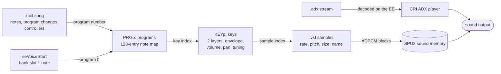
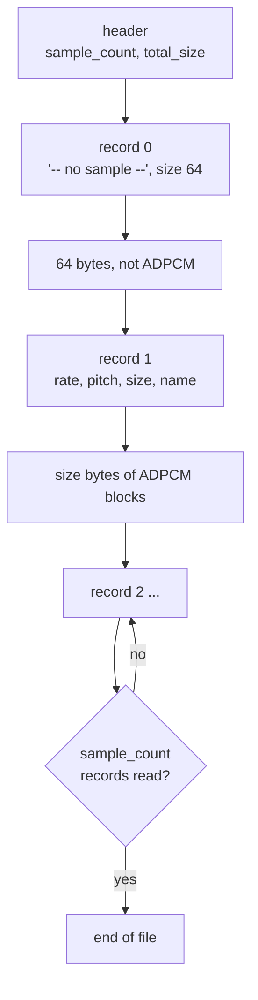
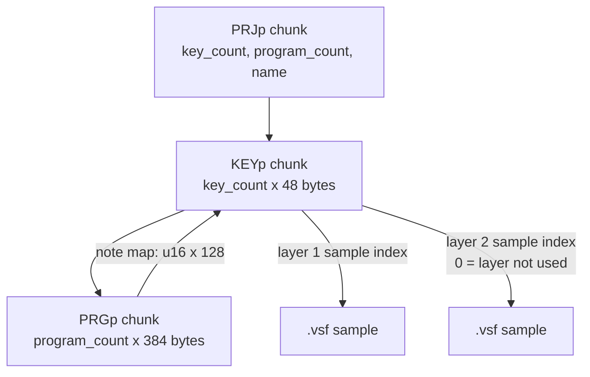
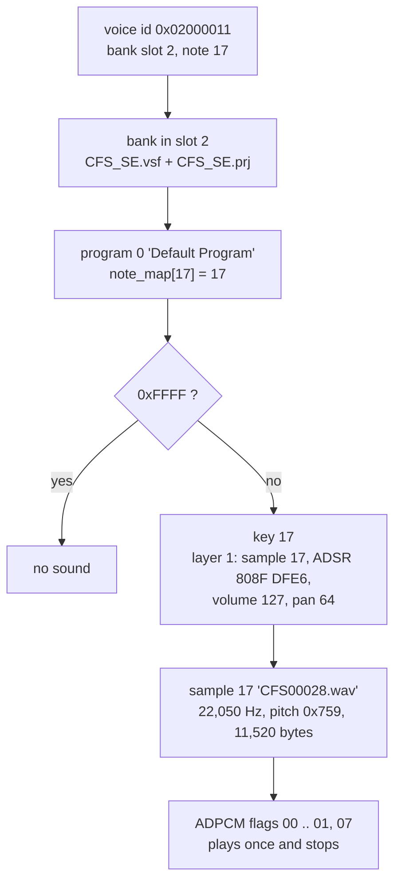
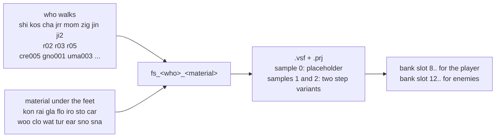
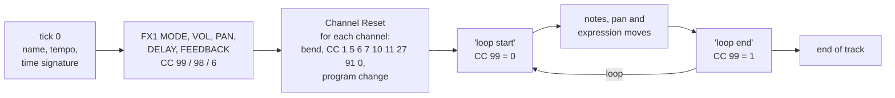
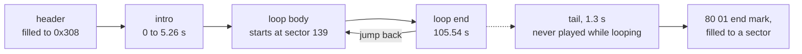

# Sound files

The sound data of Xenosaga Episode II comes in two families, one for each of
the two sound systems of the game. The KORG sound driver (`KORGIVAG.IRX` on
the IOP, which names itself "KORG IOP Sound Driver") plays everything that is
built from short samples: the sequenced music of the field, menu sounds,
ambient loops, footsteps and battle grunts. Its data is a *bank*, a pair of
files with the same name. The `.vsf` file (magic `VSFp`) holds the samples as
SPU2 ADPCM. The `.prj` file (magic `PRJp`) is the project that turns the
samples into playable keys and programs. A song adds a third file, a Standard
MIDI File (`.mid`, magic `MThd`), that plays the bank.

The second family is recorded audio. The battle music, the title music,
voiced lines in battle and the sound tracks of cutscenes are CRI ADX streams
(`.adx`), read from the disc and decoded while they play.

The KORG driver is a third-party module and its code is not part of the
game's source. The `.vsf` and `.prj` layouts below are therefore read from the
bytes of the files themselves, and every structural statement was checked by
a parser on all files of the type. The meaning of a field is taken from the
values it holds, from the way the game addresses a sound and from the text
strings of the driver module. Where a meaning is only a likely reading, the
text says so. How the game loads and plays the data is described in
[Audio](../architecture/audio.md).

[← Back to the overview](../README.md) · [Files and resources](../architecture/files-and-resources.md)

## Contents

- [Files at a glance](#files-at-a-glance)
- [How the files work together](#how-the-files-work-together)
- [VSF sample banks](#vsf-sample-banks)
- [SPU2 ADPCM](#spu2-adpcm)
- [PRJ projects](#prj-projects)
- [From a note to a sound](#from-a-note-to-a-sound)
- [Bank names](#bank-names)
- [Banks and sound memory](#banks-and-sound-memory)
- [Songs: Standard MIDI Files](#songs-standard-midi-files)
- [ADX streams](#adx-streams)
- [Unused, missing and duplicate files](#unused-missing-and-duplicate-files)
- [Source files](#source-files)

## Files at a glance

All sound files sit in the archives as plain files. None of them is packed
(the archive packing is described in
[Files and resources](../architecture/files-and-resources.md)). Every KORG
file is in archive group 00, the common data that both discs carry, and the
two copies are byte-identical. The ADX streams of the story cutscenes are in
the story group of each disc, group 10 on disc 1 and group 20 on disc 2.

| Type | Extension | Magic | Directory | Files | Bytes | Loaded by |
| --- | --- | --- | --- | --- | --- | --- |
| Sample bank | `.vsf` | `VSFp` | `sound\vsf\` (920), `sound\vsf\battle\` (123), `sound\smf\` (31) | 1,074 | 74,234,968 | `seBankLoadFile`, `seBankLoadMemory` |
| Project | `.prj` | `PRJp` | the same three directories, one next to each `.vsf` | 1,074 | 870,624 | `seBankLoadFile`, `seBankLoadMemory` |
| Song | `.mid` | `MThd` | `sound\smf\` | 31 | 702,325 | `seBgmLoad` |
| Stream, common | `.adx` | `80 00` | `sound\adx\` (31), `sound\adx\battle\` (480), `sound\adx\cfevent\` (18), `yajima\` (1) in group 00 | 530 | 157,047,916 | `adxSetSlotFile`, `titleStartBgm` |
| Stream, story | `.adx` | `80 00` | `sound\adx\cfevent\` in group 10 (65) and group 20 (62) | 127 | 481,317,355 | `adxSetSlotFile` from the cutscene player |

The directory `sound\smf\` holds 93 files: 31 songs, each made of a `.mid`,
a `.vsf` and a `.prj` with the same name. The 657 ADX streams together hold
3 hours and 22 minutes of audio.

Sizes vary widely. The smallest bank is 336 bytes (an empty footstep bank)
and the largest is `battle\bos031.vsf` with 721,752 bytes. Projects run from
544 to 5,680 bytes, songs from 352 bytes (`203_game_over.mid`) to 51,110
bytes (`002_milchia2nd.mid`). The longest stream is the cutscene track
`S02_21_00.adx` with 15,351,394 bytes and 284 seconds.

## How the files work together

A KORG bank is loaded into a numbered *bank slot* of the driver. The game
never reads a bank file from the disc itself. `seBankLoadFile` in
`src/main/se_bank_load.c` looks the `.vsf` up, takes its first sector and
gives only that sector number to the driver (`korgEvagLoadVsfCdSector2`).
It then does the same for the `.prj` (`korgEvagLoadPrjCdSector`) and, for a
song, `seBgmLoad` does it for the `.mid` (`korgEvagLoadSmfCdSector`). The
driver gets no file length. All three formats are self-delimiting, which is
what makes this possible: a `.vsf` states its sample count and its total
data size in the header, a `.prj` is a list of chunks with sizes, and a MIDI
file has its chunk lengths. The battle overlay is the one exception. It
reads the two bank files into EE memory and hands the driver two pointers
(`seBankLoadMemory`).

Inside a bank the files refer to each other by index. A MIDI note selects a
*program* of the project through the channel's program number. The program
maps each of the 128 note numbers to a *key*. A key names one or two samples
of the `.vsf` by index and adds an envelope, a volume, a pan and tuning. The
driver sends the sample data to the sound memory of the SPU2 when the bank
is loaded and starts a voice there when a note arrives.

Sound effects use the same path without a MIDI file. The game sends a bank
select, a program change to program 0 and a note-on as single MIDI messages
(`seVoiceStart`), so "sound N of bank B" is simply note N of the bank in
slot B. The ADX streams stand apart. They need no bank and no sound memory,
only one of the two ADX players of the game.



The table below lists who names which file. The names are built by code or
come from scene data, never from the bank files.

| File | Named by | Where the name comes from |
| --- | --- | --- |
| `sound\vsf\SYS_SE` | `main()` | fixed in the code |
| `sound\vsf\CFS_SE` | `resResetDescriptorTables`, `seStateRestore` | `cfsSeBankName` in `src/main/res_get_path.c` |
| `sound\vsf\CF_*` | `seBankSetName` | the `mapse` command of a scene resource script |
| `sound\vsf\break_*`, `fs_*` | `seFootBanksLoad`, the `enefoot` command | built from a character or enemy key and a material key |
| `sound\smf\<song>` | `seBgmPlay` | the `bgm` command of a scene resource script, the script native `bgm`, or fixed names |
| `sound\vsf\battle\*` | `dataBattleSeLoad`, `dataVoiceFilesLoad` in `src/ov01/data_file_load.c` | `bts_se` is fixed, the others are voice names of battle units |
| `sound\adx\*` | `adxSetSlotFile` | fixed names, script natives, cutscene message records, battle tables |

## VSF sample banks

### Layout

A `.vsf` file is a 24-byte header followed by the samples, one after
another. Each sample is a 40-byte record directly followed by its ADPCM
data. There is no offset table. A reader walks the samples by adding
`40 + size` to reach the next one. All numbers are little-endian.

```
VSF file
+0x0000  "VSFp"
+0x0004  u32 0x10               size of the header payload that follows
+0x0008  u32 sample_count
+0x000C  u32 total_size         sum of the data sizes of all samples
+0x0010  8 bytes                not meaningful (see below)
+0x0018  sample 0:  40-byte record, then its data
+....    sample 1:  40-byte record, then its data
+....    ...
+size    end of file = 0x18 + 40 x sample_count + total_size
```

The layout holds for all 1,074 files: the magic, the value `0x10` at offset
4, the walk over `sample_count` records ending exactly at the end of the
file, and `total_size` being the exact sum of the data sizes.

### Header

| Offset | Size | Type | Name used here | Meaning | Values seen |
| --- | --- | --- | --- | --- | --- |
| `0x00` | 4 | char[4] | `magic` | `VSFp` | always |
| `0x04` | 4 | u32 | `header_size` | Bytes of header that follow this field | `0x10` in every file |
| `0x08` | 4 | u32 | `sample_count` | Number of samples | 2 to 51 |
| `0x0C` | 4 | u32 | `total_size` | Sum of the `size` fields of all samples, the room the bank needs in sound memory | 192 to 720,768 |
| `0x10` | 4 | u32 | (unknown) | Not meaningful | 0 in 868 files, 2 in 108, other values in 98 |
| `0x14` | 4 | u32 | (unknown) | Not meaningful | `0x10000` in 742 files, 0 in 93, `0x1000` in 7, other values in 232 |

The two words at `0x10` and `0x14` follow no rule. Many of the odd values
look like memory addresses of a desktop program (`0x77D0590C`,
`0x77CF44FA`), and files that are otherwise built the same way differ in
them. They are most likely memory of the authoring tool that was written
out with the header. The driver's log line for a bank
(`Bank %d  VAG Addr %08d  Avail %08x` in the module's strings) prints an
address and the room that is left, which fits `total_size` being the value
the driver needs from the header.

### Sample records

| Offset | Size | Type | Name used here | Meaning | Values seen |
| --- | --- | --- | --- | --- | --- |
| `0x00` | 4 | u32 | (unknown) | Not meaningful | 0 in 6,932 records, address-like values in 21 |
| `0x04` | 4 | u32 | (unknown) | Not meaningful | 0 in 6,932 records, address-like values in the same 21 |
| `0x08` | 2 | u16 | `rate` | Sample rate in Hz | 8,000 to 48,000 |
| `0x0A` | 2 | u16 | `root_key` | Most likely the MIDI note at which the sample plays at its own rate | 60 in every record |
| `0x0C` | 4 | u32 | `pitch` | SPU2 pitch value of the sample: `rate x 4096 / 48000`, rounded down | exact in all 6,953 records |
| `0x10` | 4 | u32 | (unknown) | Not meaningful | 0 in 5,871 records, address-like values in 1,082 |
| `0x14` | 4 | u32 | `size` | Bytes of ADPCM data that follow the record | multiple of 64 in every record |
| `0x18` | 16 | char[16] | `name` | Name of the source wave file | |
| `0x28` | `size` | | | The ADPCM data | |

The SPU2 plays a voice at 48,000 Hz when its pitch register is `0x1000`.
A sample recorded at 22,050 Hz therefore has `pitch` `0x759`
(22050 × 4096 / 48000 = 1881.6). The field repeats what `rate` already says,
in the form the sound chip wants. The driver prints both for each sample it
loads (`VAG:%03d Size:%08x Fs:%05d Addr=%08x`).

The name keeps the file name of the source recording. It is cut to 16 bytes
without a terminating zero when the original name was longer: 1,283 of the
3,733 real samples have such a full field (`08 Sio_eisyou.wa`,
`025_syn_bass_1lo`). Shorter names end with a zero and zero padding. Most
names end in `.wav`, a few in `.aif`.

### Placeholder samples

Sample 0 of every bank is a placeholder with the name `-- no sample --`.
It has rate 48,000 and 64 bytes of data. The data is not ADPCM. In 3,127
placeholders it is the same 64 bytes, sixteen little-endian words that look
like addresses (`0x0055B108`, `0x00557B40`, `0x00AB8B30` ...), and the rest
hold other leftovers of the same kind.

Placeholders also fill the gaps of a bank. A bank is addressed by note
number, so a sound that must be note 12 needs eleven samples in front of
it. Of the 6,953 sample records on the disc, 3,220 are placeholders and
3,733 are real samples. The voice bank of a battle character shows the
effect: `battle\shion.vsf` has 24 samples, and only 9 of them are
recordings.

### Sample data

A real sample is a run of 16-byte SPU2 ADPCM blocks (see
[SPU2 ADPCM](#spu2-adpcm)). Every one of the 3,733 real samples starts with
a block of 16 zero bytes. After it there are two shapes.

A one-shot sample (3,425 samples) has data blocks with flag `0x00`, a last
data block with flag `0x01` and then the fixed end block
`00 07 77 77 77 77 77 77 77 77 77 77 77 77 77 77`. That is the classic end
of a Sony VAG file. The end block marks itself as loop start and loop end at
once without the repeat bit, so a voice that reaches it stops.

A looping sample (308 samples) has flag `0x02` on its data blocks, flag
`0x06` on the block where the loop starts and flag `0x03` on its last
block. The loop starts on the first data block in 55 samples and later in
the other 253, which gives an attack part that plays once followed by a
loop.

After the last block the data is filled with zero blocks to a multiple of
64 bytes (0 to 3 blocks). The sizes of all samples of a bank add up to
`total_size`.

```
one-shot sample                          looping sample
block  flags                             block  flags
0      00  (16 zero bytes)               0      00  (16 zero bytes)
1      00  data                          1      02  data, played once
...    00  data                          ...    02
n-2    00  data                          k      06  loop start
n-1    01  last data block               ...    02
n      07  end block 00 07 77 77 ...     n      03  loop end, jump back to k
       00  zero blocks to 64 bytes              00  zero blocks to 64 bytes
```

Six samples of song banks do not follow the shapes exactly. `HITOCH.wav`
in `007_ormus_inside.vsf`, `010_ep_h_la.wav` in `103_kukai.vsf`, `groc.wav`
in `104_robo_lab.vsf`, `05_mero.wav` in `105_vector_2nd.vsf` and
`12_sin.wav` in both `004_deepzone2.vsf` and `107_home.vsf` carry one or two
blocks of stray bytes among their last blocks, with flag or coding bytes
that no ADPCM block has.

The diagram below shows how a reader walks a bank.



### Sample rates and lengths

The effect banks are recorded at low rates to save sound memory. The song
banks use higher rates for their instruments.

| Rate | Samples in effect banks | Samples in song banks |
| --- | --- | --- |
| 22,050 Hz | 2,593 | 60 |
| 16,000 Hz | 323 | 17 |
| 11,025 Hz | 23 | 2 |
| 8,000 Hz | 3 | 0 |
| 44,100 Hz | 1 | 324 |
| 32,000 Hz | 1 | 146 |
| 24,000 Hz | 0 | 43 |
| within 60 Hz of a standard rate | 36 | 139 |
| other | 2 | 20 |

The rows "within 60 Hz" and "other" are instrument samples that were tuned
by changing their rate, for example `015_3syn3.wav` at 22,055 Hz and
`harp.wav` at 44,052 Hz in `201_menu.vsf`. A few cents of tuning cost
nothing this way.

A block holds 28 sound samples, so a sample of `size` bytes lasts about
`(size / 16 - 2) x 28 / rate` seconds. The longest single sample is
`CF_EXD_08.wav` in `CF_EXD.vsf`, 231,488 bytes at 16,000 Hz, about 25
seconds of ambience.

### Example: SYS_SE.vsf

`sound\vsf\SYS_SE.vsf` is the system sound bank (80,528 bytes, 11 samples).
Its first bytes are:

```
0x0000  56 53 46 70  10 00 00 00  0b 00 00 00  c0 38 01 00   "VSFp", 0x10, 11 samples, total 0x138C0
0x0010  00 00 00 00  00 10 00 00                             two words without meaning
0x0018  00 00 00 00  00 00 00 00  80 bb 3c 00  00 10 00 00   sample 0: rate 48000, key 60, pitch 0x1000
0x0028  00 00 00 00  40 00 00 00                             word without meaning, size 0x40
0x0030  2d 2d 20 6e  6f 20 73 61  6d 70 6c 65  20 2d 2d 00   "-- no sample --"
0x0040  08 b1 55 00  40 7b 55 00  30 8b ab 00  90 8a ab 00   64 bytes that are not ADPCM
...
0x0080  00 00 00 00  00 00 00 00  22 56 3c 00  59 07 00 00   sample 1: rate 22050, key 60, pitch 0x759
0x0090  00 00 00 00  40 1d 00 00                             size 0x1D40 = 7,488 bytes
0x0098  43 46 53 30  30 30 30 31  2e 77 61 76  00 00 00 00   "CFS00001.wav"
0x00A8  00 00 00 00  00 00 00 00  00 00 00 00  00 00 00 00   first block: zero
0x00B8  28 00 00 01  21 11 ff ff  ...                        data block: filter 2, shift 8, flags 0
```

The file size checks out: `0x18 + 11 × 40 + 0x138C0` is 80,528. Sample 1,
`CFS00001.wav`, is the menu cursor sound: the game plays it as voice
`0x01000001`, note 1 of bank slot 1.

## SPU2 ADPCM

All sample data in the banks uses the ADPCM format that the SPU2 sound chip
decodes in hardware, the format of Sony's VAG files. The data is a series of
16-byte blocks. Each block holds 28 sound samples of 4 bits.

```
block (16 bytes)
+0x00  u8  coding     high nibble = filter (0 to 4), low nibble = shift (0 to 12)
+0x01  u8  flags      bit 0 end, bit 1 repeat, bit 2 loop start
+0x02  14 bytes       28 nibbles, low nibble first
```

To decode a block, each nibble is sign-extended, shifted left by 12 and
right by `shift`, and the prediction of the selected filter is added:

```
s = (nibble << 12) >> shift
s = s + (h1 * K0[filter] + h2 * K1[filter]) / 64
clamp s to -32768 .. 32767, then h2 = h1 and h1 = s

K0 = 0, 60, 115, 98, 122
K1 = 0,  0, -52, -55, -60
```

The flags control looping inside the chip. A block with the loop start bit
stores its own address as the loop address of the voice. At a block with the
end bit the voice jumps to that loop address. If the repeat bit is set too,
it keeps playing from there, otherwise the voice is released and goes
silent. This is why a one-shot sample ends with flags `0x01` and the block
`0x07`, and a looping one with `0x03`. The chip needs no help from the
driver to loop a sample, and a bank needs no loop table. That fits the
sample record, which has no loop field.

Apart from the stray blocks of the six samples named above, every block of
every real sample has a filter of 4 or less and a shift of 12 or less.

## PRJ projects

### Layout

A `.prj` file is three chunks in a fixed order. Each chunk starts with a
4-byte tag and a 4-byte size that counts the bytes after the size field.
The first chunk describes the project, the second holds the keys and the
third the programs.

```
PRJ file
+0x00  "PRJp"  u32 0x18
+0x08    u32 key_count
+0x0C    u32 program_count
+0x10    char[16] name
+0x20  "KEYp"  u32 8 + 48 x key_count
+0x28    u32 key_count
+0x2C    u32 0x30            size of one key
+0x30    keys, 48 bytes each
+....  "PRGp"  u32 8 + 384 x program_count
+....    u32 program_count
+....    u32 0x180           size of one program
+....    programs, 384 bytes each
+size  end of file = 0x40 + 48 x key_count + 384 x program_count
```

All 1,074 files have exactly these three chunks in this order, the entry
sizes `0x30` and `0x180`, chunk sizes that match the counts, counts that
match the first chunk, and no byte after the last program. The driver's
strings name the things that can go wrong while it reads such a file:
`Error!: bad bank!`, `Error!: bank prj exist!` and `Error!: wrong chunk!`.



### The project chunk

| Offset | Size | Type | Name used here | Meaning | Values seen |
| --- | --- | --- | --- | --- | --- |
| `0x00` | 4 | char[4] | `magic` | `PRJp` | always |
| `0x04` | 4 | u32 | `size` | `0x18` | always |
| `0x08` | 4 | u32 | `key_count` | Number of keys | 2 to 51 |
| `0x0C` | 4 | u32 | `program_count` | Number of programs | 1 in 1,044 files, 2 to 10 in the 30 others |
| `0x10` | 16 | char[16] | `name` | Name of the project in the authoring tool | |

The developer sound test (`SoundTest` in `src/main/yajima_test.c`) reads
this chunk from a development host: its `SoundProject` structure takes the
count from offset `0x08` and the name from `0x10`, and it walks the keys
from offset `0x30` in steps of `0x30`. That agrees with the layout above.
The 16 bytes that the structure calls `text` at offset `0x20` are in fact
the header of the `KEYp` chunk. The test uses the area as scratch space for
the list it prints.

The name is the name the bank had when it was made, and it often differs
from the file name. Only 317 files carry their own file name. The song
banks are called `<song>_vag` (`201_menu_vag`, cut to 16 bytes in
`002_milchia2nd_v`), the system bank of battles `bts_se` is `battle_system`,
Shion's battle voices `shion` are `sion_bat_se`. The footstep banks keep the
name of the bank they were copied from, which shows how few real footstep
sets exist (see [Bank names](#bank-names)).

### Keys

A key is one playable sound: a sample, or two samples layered, with the
settings of the voice that plays it. It is 48 bytes: two *layers* of 16
bytes and a 16-byte name.

| Offset | Size | Contents |
| --- | --- | --- |
| `0x00` | 16 | Layer 1 |
| `0x10` | 16 | Layer 2 |
| `0x20` | 16 | Name, `char[16]` |

Both layers have the same layout:

| Offset | Size | Type | Name used here | Meaning | Values seen in layer 1 |
| --- | --- | --- | --- | --- | --- |
| `0x00` | 2 | u16 | `sample` | Index of the sample in the `.vsf` | equals the key's own index in 6,941 of 6,962 keys |
| `0x02` | 2 | u16 | `adsr1` | First SPU2 envelope word | `0x808F` in 6,785 keys |
| `0x04` | 2 | u16 | `adsr2` | Second SPU2 envelope word | `0xDFE6` in 6,785 keys |
| `0x06` | 1 | u8 | `volume` | Volume, 0 to 127 | 127 in 6,764 keys |
| `0x07` | 1 | u8 | `pan` | Pan, 0 left, 64 centre, 127 right | 64 in 6,603 keys |
| `0x08` | 1 | s8 | `coarse_tune` | Transposition in semitones | 0 in 6,792 keys, else -48 to +36, most often -12 and +12 |
| `0x09` | 1 | s8 | `fine_tune` | Fine tuning | 0 in 6,937 keys, else -32 to +31 |
| `0x0A` | 1 | u8 | `key_follow` | Most likely "pitch follows the note" | 0 in 6,751 keys, `0xFF` in 211 |
| `0x0B` | 1 | u8 | (unknown) | Unknown | 0 in 6,711 keys, 1 to 56 in 251 |
| `0x0C` | 1 | u8 | `one_shot` | Most likely "play to the end, ignore note-off" | `0xFF` in 6,606 keys, 0 in 356 |
| `0x0D` | 1 | u8 | `mode` | Unknown. The sound test calls it `hidden` | 2 in 6,203 keys, 1 in 758, 0 in 1 |
| `0x0E` | 2 | | | Zero | always zero, in both layers |

The envelope words are the two ADSR registers of an SPU2 voice. The default
pair `0x808F`, `0xDFE6` reads as: fastest attack with the exponential curve,
decay rate 8, sustain level 15 (the top), the slowest sustain rate, and
release rate 6 with the exponential curve. A sample then plays at its
recorded loudness and fades out quickly after a note-off. 177 keys change
the pair. Most of them change the release rate in `adsr2` (`0xDFEB`,
`0xDFE9`, `0xDFEE`), a slower or faster fade, and 97 also change the attack
or decay in `adsr1`.

Three of the byte fields can only be named from the pattern of their values.

- `key_follow` is `0xFF` almost only in song banks, on the keys of melodic
  instruments, where one sample must sound at many pitches. It is 0 on all
  keys of effect banks and on drum keys of songs, where each note number is
  its own sound and must play at the recorded pitch. Of the 211 keys with
  `0xFF`, 157 point at looping samples of song banks.
- `one_shot` is `0xFF` on nearly all keys that point at one-shot samples
  (3,366 of 3,432) and 0 on nearly all keys that point at looping samples
  (290 of 310). A loop must end at note-off, a one-shot recording should
  play to its end.
- `mode` is 2 on every key of every effect bank (6,170 keys) and 1 on 758
  of the 792 keys of song banks. The sound test reads this byte: in its
  effect list it prints a key only when the byte is 1, and in its song list
  only when it is not 1. What the driver does with it is not known.

Layer 2 is unused in 6,704 keys. An unused layer points at sample 0 (the
placeholder) and holds the default values `8F 80 E6 DF 7F 40 00 00 FF 00 00
00 00 00` after the index in all but 34 of them. 258 keys use the second
layer, 235 in song banks and 23 in map banks. In 224 of them both layers play
the same sample, and the most common pan pair is 0 and 127 (163 keys): one
sample on both sides with a small difference in `fine_tune`, which makes a
wide, slightly detuned sound out of a mono recording. Keys 7 and 8 of
`201_menu.prj` are an example: `002_1bass.wav` panned left and again panned
right with fine tune `0x0E`.

The key name repeats the sample name of layer 1 in 6,921 keys. A key over a
placeholder is called `-- no sample --`. Four keys are called `Init Key`,
the name the driver module itself holds as a string for a fresh key.

### Programs

A program is what a MIDI program change selects. It is 384 bytes.

| Offset | Size | Type | Name used here | Meaning | Values seen |
| --- | --- | --- | --- | --- | --- |
| `0x00` | 16 | char[16] | `name` | Name of the program | |
| `0x10` | 3 | | | Zero | always zero |
| `0x13` | 1 | u8 | `volume` | Most likely the program volume | 127 in all 1,218 programs |
| `0x14` | 4 | | | Zero | always zero |
| `0x18` | 1 | u8 | (unknown) | Unknown | 0 in 1,195 programs, 3 in 20, 4 in 3 |
| `0x19` | 1 | u8 | (unknown) | Unknown | 20 in 1,214 programs, 68, 77, 80 and 83 once each |
| `0x1A` | 38 | | (unknown) | Unknown | zero in all but 3 programs |
| `0x40` | 256 | u16[128] | `note_map` | Key index for each MIDI note 0 to 127. `0xFFFF` means the note is silent | every index is below `key_count` |
| `0x140` | 64 | | | Zero | always zero |

The note map is the heart of the format. There are four kinds on the disc.

| Kind | Programs | Map |
| --- | --- | --- |
| Identity | 1,064 | Note `n` plays key `n` for every key of the bank, all other notes are silent |
| Partial identity | 5 | The same, with some keys left out |
| One key | 129 | All 128 notes play the same key. A melodic instrument made of one sample |
| Split | 20 | Ranges of notes play different keys. A multi-sampled instrument |

Program 0 is called `Default Program` in 1,073 of the 1,074 banks
(`002_milchia2nd.prj` calls it `def and drums`). In every effect bank it is
an identity map, and effect banks have no other program. This is the
program the game selects for every sound effect, so a voice id's note
number is directly the index of the key and, in nearly every bank, of the
sample. Five song banks bend their program 0 a little, for example
`007_ormus_inside.prj`, where the notes from 49 upward all play key 48.

The other programs exist only in song banks, 144 of them in 30 songs. They
carry instrument names of the composer: `Ebass`, `mero1`, `mero2` (melody),
`picopico`, `str`, `harp`, `groc`, `timp`, `voice`, `sin double`, `huwahuwa`.
An example of a split is `Ebass` in `002_milchia2nd.prj`: notes 0 to 54
play key 21 and notes 55 to 127 play key 20, two recordings of the same
bass for the low and the high range.

### Example: break_cha.prj

`sound\vsf\break_cha.prj` (1,120 bytes) is the project of a 14-key effect
bank.

```
0x0000  50 52 4a 70  18 00 00 00  0e 00 00 00  01 00 00 00   "PRJp", 0x18, 14 keys, 1 program
0x0010  62 72 65 61  6b 5f 63 68  61 00 00 00  00 00 00 00   "break_cha"
0x0020  4b 45 59 70  a8 02 00 00  0e 00 00 00  30 00 00 00   "KEYp", 0x2A8 = 8 + 14 x 48, 14 keys of 0x30
0x0030  00 00 8f 80  e6 df 7f 40  00 00 00 00  ff 02 00 00   key 0, layer 1: sample 0, default envelope,
                                                             volume 127, pan 64, one_shot, mode 2
0x0040  00 00 8f 80  e6 df 7f 40  00 00 ff 00  00 00 00 00   key 0, layer 2: unused
0x0050  2d 2d 20 6e  6f 20 73 61  6d 70 6c 65  20 2d 2d 00   "-- no sample --"
0x0060  01 00 8f 80  e6 df 7f 40  00 00 00 00  ff 02 00 00   key 1, layer 1: sample 1
0x0070  00 00 8f 80  e6 df 7f 40  00 00 ff 00  00 00 00 00   key 1, layer 2: unused
0x0080  63 68 61 6f  5f 69 74 65  6d 5f 30 31  2e 77 61 76   "chao_item_01.wav" (16 bytes, no zero)
...
0x02D0  50 52 47 70  88 01 00 00  01 00 00 00  80 01 00 00   "PRGp", 0x188 = 8 + 384, 1 program of 0x180
0x02E0  44 65 66 61  75 6c 74 20  50 72 6f 67  72 61 6d 00   "Default Program"
0x02F0  00 00 00 7f  00 00 00 00  00 14 00 00  00 00 00 00   volume 127, the byte 0x14 at +0x19
0x0320  00 00 01 00  02 00 03 00  04 00 05 00  06 00 07 00   note map: notes 0..13 -> keys 0..13
0x0330  08 00 09 00  0a 00 0b 00  0c 00 0d 00  ff ff ff ff   notes 14..127 silent
```

The size checks out: `0x40 + 14 × 48 + 384` is 1,120.

### Projects and banks that disagree

A project and its bank are made together, and in 1,065 pairs the number of
keys equals the number of samples. Nine pairs differ, and a few more
disagree in their names. They show that the two files of a pair were
sometimes saved at different times.

- Eight song projects have more or fewer keys than the bank has samples
  (`005_morgenroete` 20 keys and 19 samples, `012_lasdan` 31 and 29,
  `014_ormus_escape` 17 and 16, `103_kukai` 18 and 19, `104_robo_lab` 16
  and 14, `109_deepzone` 37 and 35, `202_UMN` 31 and 29, `203_game_over` 4
  and 3). The extra keys are second keys over a sample that already has
  one, for example `snr 2` and `snr 3` in `202_UMN.prj`, both over sample
  6. No key points past the end of its bank.
- `CF_VEC.prj` has 4 keys and `CF_VEC.vsf` has 5 samples, and the names do
  not line up: key 1 is called `-- no sample --` while sample 1 is
  `CF_VEC_01.wav`, and key 3 is called `CF_VEC_04.wav` while sample 3 is a
  placeholder. The project is older or newer than the bank.
- In `CFS_SE.prj` key 16 is called `-- no sample --`, but sample 16 of
  `CFS_SE.vsf` is the recording `CFS_016.wav`. The key works, only its name
  is stale.

## From a note to a sound

The game addresses a sound effect with a 32-bit voice id. Its top byte is
the bank slot and its low seven bits are the note
(see [Audio](../architecture/audio.md#8-voices-sound-effects-as-midi-messages)).
`seVoiceStart` sends bank select, pan, expression, program change 0 and
note-on to the driver. With the layouts above, the rest of the path can be
followed in the files.

1. The bank select picks the bank in that slot, a `.vsf` and `.prj` pair.
2. Program 0 is the identity program. Its `note_map[note]` gives the key
   with the same index, or `0xFFFF` when the bank has no such key.
3. Layer 1 of the key gives the sample index, the envelope, the volume and
   the pan. Layer 2 adds a second voice when its sample index is not 0.
4. The sample record gives the pitch for the voice and, through the order
   of the samples in the file, the place of the data in sound memory.
5. The ADPCM flags decide whether the voice loops or ends by itself.



The example is the pause sound of the game, voice `0x02000011`. Other
fixed voice ids resolve the same way. `0x01000001`, the menu cursor, is
`CFS00001.wav` in `SYS_SE`, and `0x01000002`, the confirm sound, is
`CFS00002.wav`.

Footsteps use notes 1 and 2 (`seTonePlay` picks one of the two at random),
and every footstep bank has exactly three samples: the placeholder and two
variants of the step. The battle voices use the note as a code of the
situation. A party voice bank has 24 keys, and the sample names show the
plan: `08 Sio_eisyou.wa` (*eishō*, chanting), `12 Sio_defense.w`,
`13 Sio_damage_ai`, `14 Sio_down.wav`, `15 Sio_damage_L.`,
`16 Sio_damage_H.` and from note 21 the attack shouts `21 Sio_atk2_1.wa`.
The number in front of each name is the note. The code that picks these
notes is `seObjectVoiceStart` and `unitPlayActionSound` in
`src/ov01/snd_play.c`, described in
[Audio](../architecture/audio.md#17-battle-sound).

A song takes the longer way through the other programs. Each MIDI channel
selects a program, and the program's map turns every note into a key. In
`201_menu.mid` the drums play on channels 0 to 7 with program 0, one note
per drum sound (note 1 is `000_1kick.wav`, note 2 `000_2snr.wav`), and
channel 8 plays the notes 57 to 64 with program 2, `GROC`, whose map sends
all notes to key 10, the looping sample `groc.wav` with `key_follow` set.

## Bank names

The 1,074 bank pairs fall into a few groups. The name tells who loads the
bank and which bank slot it goes into.

| Group | Names | Pairs | Samples (real) | Loaded into | By |
| --- | --- | --- | --- | --- | --- |
| System sounds | `SYS_SE` | 1 | 11 (10) | slot 1 | `main()`, once |
| Common field sounds | `CFS_SE` | 1 | 19 (18) | slot 2 | start of `Game`, `seStateRestore` |
| Map sounds | `CF_<area>`, `CF_<area><nn>`, `CF_MOM_A` to `_C` | 138 | 762 (529) | slots 3 and 4 | `seBankSetName` from the `mapse` command |
| Player effects | `break_<who>` | 10 | 140 (85) | slot 7 | `seFootBanksLoad` |
| Player footsteps | `fs_<who>_<material>` | 154 | 462 (246) | slots 8 to 11 | `seFootBanksLoad` |
| Enemy footsteps | `fs_<enemy>_<material>` | 616 | 1,848 (952) | slots 12 to 20 | the `enefoot` command |
| Songs | `sound\smf\<nnn>_<name>` | 31 | 782 (751) | slot 0 | `seBgmLoad` |
| Battle system sounds | `battle\bts_se` | 1 | 5 (4) | slot 2 in battle | `dataBattleSeLoad` |
| Party battle voices | `battle\shion`, `kosmos`, `chaos`, `jr`, `momo`, `ziggy`, `jin`, `pcr02`, `pcr03`, `pcr05` | 10 | 236 (125) | slots 3 to 5 in battle | `dataVoiceFilesLoad` |
| Enemy battle voices | `battle\bos<nnn>`, `cre<nnn>`, `gno<nnn>`, `uma<nnn>`, `uro<nnn>`, `uso<nnn>`, `vma<nnn>` | 112 | 2,688 (1,013) | slots 6 to 8 in battle | `dataVoiceFilesLoad` |

### Map banks

A scene names its map banks with the `mapse` command of its resource script
(see [Events and scenes](../scripting/events.md)). The command takes one or
two names. The first goes into bank slot 3 and the second into slot 4.
The usual pair is an area bank and a map bank: `mapse CF_KML,CF_KML03`.
`CF_KML` holds the sounds that all maps of the area share and `CF_KML03`
the sounds of one map. The area codes are the map codes of the game (`DYU`,
`ELS`, `EXA` to `EXD`, `JSY`, `KML`, `KUK`, `MID`, `MIL`, `MOM`, `OLM`,
`OMG`, `RAV`, `SUI`, `SYD`, `UMN`, `UZU`, `VEC`).

The sample names in these banks are simply numbered, `KML00006.wav` or
`CF_EXD_08.wav`. All 140 looping samples outside the song banks are in
these banks. They are the ambient loops that scripts start with the natives
`bgmse` and `bgmsePos`. The smallest map banks have two samples, the
placeholder and one sound.

Every one of the 138 map banks on the disc is named by at least one of the
314 scene resource scripts in `cf\`. The reverse does not hold, see
[Unused, missing and duplicate files](#unused-missing-and-duplicate-files).

### Footstep banks

A footstep bank name has three parts: `fs_`, who walks, and the material
under the feet. The code builds the name from two three-letter keys
(`footMaterialBankName` is the template `fs_xxx_xxx` in
`src/main/res_get_path.c`).

The material keys are the 14 entries of `footMaterialKeys`, and every walker
has one bank for each: `kon`, `rai`, `gla`, `flo`, `iro`, `sto`, `car`,
`woo`, `clo`, `wat`, `tur`, `ear`, `sno` and `sna`. Read as short forms they
are most likely concrete (*konkurīto*), rail, glass, floor, iron, stone,
carpet, wood, cloth, water, turf, earth, snow and sand (*suna*). The last
key is `sna` in the code table (the word `0x00616E73`) and in all 55 file
names.

The walker is one of 55 keys. Eleven belong to the player side: the seven
characters `shi`, `kos`, `cha`, `jrr`, `mom`, `zig`, `jin`, the second Jin
set `ji2` that `seFootBanksLoad` selects late in the story, and `r02`,
`r03`, `r05`. The last three match the party battle banks `pcr02`, `pcr03`
and `pcr05` and the model folder `model\robo\pc_robo\`, so they are the
E.S. The other 44 are enemy model codes with the prefixes `cre`, `gno`,
`uma`, `uro`, `uso` and `vma`, the same codes as the enemy battle banks.



The 770 footstep banks are far fewer different sounds than the count
suggests. Only 121 different `.vsf` files exist among them. 171 banks are
empty: three placeholders and no recording, 336 bytes. They are the
materials on which a walker makes no sound, for example every `clo` bank of
the player side. The others are copies of a few sets, and the name inside
the `.prj` still says which one. All enemy footstep projects are called
`fs_fly_a`, `fs_fly_aa`, `fs_robo_a` to `fs_robo_d`, `fs_mons_a` to
`fs_mons_d`, `fs_chara_a` to `fs_chara_d` or a variant of these: flying
enemies, machines, monsters and human-shaped enemies in a few weight
classes. The 140 projects called `fs_fly_a` are exactly the 140 empty enemy
banks: an enemy that flies makes no steps. KOS-MOS and MOMO share all 14 of
their banks, and Jin's two sets `jin` and `ji2` differ in 12 of 14.

The sample names of the player sets show the working names of the
characters: `sio_fs_kon1.wav` and `sio_fs_kon2.wav` for Shion on concrete,
in a project called `fs_sio_kon`.

### Break banks

`break_<who>` exists for the ten player groups `shi`, `kos`, `cha`, `jrr`,
`mom`, `zig`, `jin`, `r02`, `r03` and `r05`. Each has 14 keys. In
`break_cha` keys 1 to 9 are `chao_item_01.wav` to `chao_item_09.wav` and
keys 11 to 13 are `break_cha_1.wav` to `break_cha_3.wav`. The bank holds
the field action sounds of the character the player controls: the sounds of
its item and of breaking objects. It is loaded together with the footstep
banks into slot 7.

### Battle banks

`battle\bts_se` is the system bank of battles with four sounds. The party
voice banks have 24 keys each (`chaos` has 20) and the enemy voice banks
have 24 keys without exception. The fixed size comes from the note plan
described under [From a note to a sound](#from-a-note-to-a-sound). Unused
notes are placeholders, which is why only 1,138 of the 2,924 samples in
these banks are recordings.

The enemy codes are those of the enemy models. Several enemies share a
voice set, and the disc then holds the same file twice under two names:
`cre001` and `cre007`, `uma003`, `uma012` and `uma112`, `uso004`, `uso006`
and `uso106`, and ten more groups.

## Banks and sound memory

Each loaded bank occupies `total_size` bytes of the 2 MiB sound memory of
the SPU2. The game decides where. The third argument of `seBankLoad` is the
address in sound memory where the driver must put the bank, taken from
`seBankAddressTable` in `src/main/res_get_path.c` for the field and from
`handleAddressGet` in the battle overlay
(see [Audio](../architecture/audio.md#6-sound-banks)). The sizes in the
files confirm this reading: the room between two addresses is always just
above the largest bank that goes there.

| Slot | Address | Room | Largest bank for the slot | Its `total_size` | Fits |
| --- | --- | --- | --- | --- | --- |
| 1 | `0x05000` | `0x14000` (81,920) | `SYS_SE` | 80,064 | yes, 1,856 bytes to spare |
| 0 | `0x19000` | `0x64000` (409,600) | `003_deepzone` | 399,808 | yes |
| 2 | `0x7D000` | `0x41000` (266,240) | `CFS_SE` | 261,440 | yes |
| 3 and 4 | `0xBE000` | `0x96000` (614,400) | `CF_MOM_B` with `CF_MOM13` | 607,232 for the pair | yes |
| 7 | `0x154000` | `0x22000` (139,264) | `break_mom` | 138,816 | yes, 448 bytes to spare |
| 8 to 11 | `0x176000` + n × `0x4400` | `0x4400` (17,408) each | `fs_r05_gla` | 25,280 | no, see below |
| 12 to 20 | `0x187000` + n × `0x6000` | `0x6000` (24,576) each | `fs_uma003_rai` | 22,080 | yes |

The three largest slots are filled to 98 percent by their largest bank. The
song banks in particular cluster just under the limit: 21 of the 31 songs
have a `total_size` between 384,000 and 399,808 bytes. The composers were
plainly given 400,000 bytes of sound memory for each song.

Slot 4 has no fixed address. `seBankSetName` loads slot 3 at `0xBE000` and
then sets the address of slot 4 to `0xBE000` plus the *file size* of the
slot 3 bank rounded up to 256 bytes. The file is larger than the sample
data by the header and the records, so this leaves a small gap. For the
largest pair that the scene scripts name, `CF_MOM_B` with `CF_MOM13`, the
second bank ends at `0x152400`, below the footstep area at `0x154000`.

The player footstep slots are the one place where a bank is larger than
the step between two addresses. Nine banks exceed `0x4400` bytes: eight
banks of `r05` (`gla`, `iro`, `sto` and `wat` with 25,280 bytes, `flo`,
`kon` and `rai` with 19,776, `sna` with 18,880) and `fs_jrr_sto` with
18,880. Loaded into one of the slots 8 to 10, such a bank reaches into the
address of the next slot. Whether that is ever audible depends on which
materials a scene lists and on how the driver places the data, which the
files cannot tell.

In battle the layout changes (`handleTableInit` in
`src/ov01/handle_table.c`).

| Use | Address | Room | Largest bank | Its size | Fits |
| --- | --- | --- | --- | --- | --- |
| `bts_se`, slot 2 | chosen by the driver | EE buffer of `0x1E800` bytes for the file | `bts_se.vsf` | 123,680 bytes of file, 123,456 of data | yes |
| `bts_se.prj` | | EE buffer of `0x800` bytes | `bts_se.prj` | 688 bytes | yes |
| Party voices, slots 3 to 5 | `0x100000` + n × `0x50000` | `0x50000` (327,680) each | `kosmos` | 325,824 | yes |
| Enemy voices, slots 6 to 8 | from `0x37800` upward, up to `0x100000` | `0xC8800` (821,248) for all three | `bos031` | 720,768 alone | yes |

The battle system bank is loaded with address 0, so the driver picks its
place. Its 123,456 bytes of sample data fit both in the EE buffer and in the
`0x1E800` bytes of sound memory between `0x19000`, where the field song's
bank was, and `0x37800`, where the enemy voice banks start. The party voice
banks are the tightest fit of the battle layout: `kosmos` leaves 1,856 bytes
of its `0x50000`. The three enemy slots share one area, and the largest
enemy bank alone takes 88 percent of it, so a battle with `bos031` has room
for little else. The files cannot tell which enemies meet in one battle.

```
Sound memory in the field, with the largest bank of each slot

0x005000  SYS_SE          80,064 of  81,920
0x019000  song bank      399,808 of 409,600
0x07D000  CFS_SE         261,440 of 266,240
0x0BE000  map bank 1 + map bank 2   607,232 of 614,400
0x154000  break_<who>    138,816 of 139,264
0x176000  fs_<who>_<m>   4 slots of 17,408
0x187000  fs_<enemy>_<m> 9 slots of 24,576
0x1BD000  end of the last slot
```

## Songs: Standard MIDI Files

### The container

The 31 `.mid` files are ordinary Standard MIDI Files. All of them are
format 0: one `MThd` header chunk of 6 bytes and one `MTrk` track chunk
that holds all channels. The time division is 480 ticks per quarter note in
every file. Nothing follows the track chunk.

```
.mid file
+0x00  "MThd"  u32 6 (big-endian)
+0x08    u16 format = 0
+0x0A    u16 tracks = 1
+0x0C    u16 division = 480
+0x0E  "MTrk"  u32 length
+0x16    events: delta time, then a MIDI message or a meta event
+size  end of file = 0x16 + length
```

The events use four kinds of MIDI message only: note-on (`0x9n`, 132,672 in
all files), control change (`0xBn`, 49,791), pitch bend (`0xEn`, 2,053) and
program change (`0xCn`, 379). There is no note-off message anywhere. A note
ends with a note-on of velocity 0, and exactly half of the note-ons are
such ends. There are no system exclusive messages.

The meta events are the track name (type 3, once per file), tempo (type
`0x51`), time signature (type `0x58`), text (type 1) and end of track.
29 songs have one tempo for the whole piece. `008_imaginary_territory` and
`111_moby-dick` change it 42 times.

### How a song is laid out

Every song starts with the same block at tick 0, written by the tool that
exported it. The text events in the file label its parts.

1. The track name, the tempo and a time signature.
2. The effect settings. They are sent as non-registered parameters:
   controller 99 (parameter number, high part), controller 98 (low part)
   and controller 6 (the value). The texts name them: `FX1 MODE` is
   parameter 2/16, `FX1 VOL` is 3/16, `FX1 PAN` is 3/17, `FX1 DELAY` is
   3/18 and `FX1 FEEDBACK` is 3/19. 27 songs carry this block. Three have
   the text `SPU EFX` in its place, and one has `EFX system` and
   `EFX core1`.
3. One `Channel Reset` block for each channel the song uses, 380 in all.
   It sets the pitch bend to the centre, controllers 1, 5 and 6 to 0,
   channel volume (7), pan (10), expression 127 (11), controller 27,
   controller 91, bank select 0 and the program of the channel.
4. The text `loop start`, usually at tick 240, half a bar in. A control
   change 99 with value 0 stands next to it.
5. The notes.
6. The text `loop end` near the end of the track, with a control change 99
   with value 1 on one of the channels, and the end of track.

The controller numbers match the handlers that the driver module lists by
name: bank, modulation, portamento time, data entry, volume, pan,
expression, reverb depth, and the parameter number controllers 98 to 101.
The module also names handlers for transpose, fine tune, LFO frequency,
priority and a forced release rate. Which of them controller 27 is, the
files do not show. The pair of control changes 99 with values 0 and 1 at
the two loop texts appears in all 30 looping songs and in no other place,
so it is most likely the loop mark the driver acts on, with the text only
as a label. `203_game_over.mid` has neither text nor pair and plays once.



The game adds its own settings on top. `seBgmStart` resets all 16 channels
before the song starts, and `seBgmSetSongLevel` sets the depth of effect
unit 1 from a table by song number
(see [Audio](../architecture/audio.md#7-sequenced-music)). One song needs
help from the code. In `006_ormus.mid` channel 1 has no `Channel Reset`
block and no program change, only notes (64, 65, 69, 70 and 71), and
program 0 of the bank has no key for these notes. `seBgmStart` sends the
missing set-up for exactly this song: pan, volume, reverb and program
change 6 on channel 1. Program 6 of `006_ormus.prj` is `str`, the strings,
and it maps all five notes.

Apart from that channel, every one of the 66,336 notes in the 31 files
finds a key: the program selected on its channel exists in the song's
project, and its note map has an entry for the note. The one exception is
a single note 29 on channel 1 of `005_morgenroete.mid`, which program 0
does not map and which stays silent.

### The songs

The number in front of a song name is what the game stores in
`soundCtrl.song`. The range 001 to 017 is the music of dungeons and story
places, 101 to 111 of towns and ships, and 201 to 203 of menus.

| File | Name inside the file | Tempo | Channels | Notes | Length | Programs | Keys |
| --- | --- | --- | --- | --- | --- | --- | --- |
| `001_milchia` | `001_miltia` | 120 | 15 | 3,500 | 112 s | 7 | 51 |
| `002_milchia2nd` | `002_miltia2nd` | 115 | 15 | 4,320 | 117 s | 7 | 31 |
| `003_deepzone` | `003_deepzone` | 110 | 15 | 1,329 | 112 s | 9 | 21 |
| `004_deepzone2` | `004_deepzone2` | 110 | 12 | 2,306 | 157 s | 9 | 18 |
| `005_morgenroete` | `005_morgenroete` | 90 | 11 | 828 | 43 s | 4 | 20 |
| `006_ormus` | `006_olmus` | 130 | 12 | 2,387 | 96 s | 9 | 27 |
| `007_ormus_inside` | `007_olmus_inside` | 94 | 16 | 4,019 | 143 s | 5 | 49 |
| `008_imaginary_territory` | `300_an_chloe` | 100 to 54.5 | 2 | 850 | 170 s | 2 | 11 |
| `009_lost_jerusalem` | `009_lost_jerusalem` | 100 | 16 | 969 | 96 s | 6 | 20 |
| `010_labyrinthos` | `010_labyrinthos` | 118 | 13 | 2,552 | 104 s | 5 | 26 |
| `011_omega_system_inside` | `011_omega_system_inside` | 105 | 13 | 797 | 103 s | 5 | 18 |
| `012_lasdan` | `012_lasdan` | 120 | 12 | 1,680 | 128 s | 6 | 31 |
| `013_cf_extend_map` | `013_cf_extend_map` | 100 | 12 | 2,365 | 135 s | 3 | 25 |
| `014_ormus_escape` | `014_ormus_escape` | 145 | 10 | 4,084 | 93 s | 7 | 17 |
| `015_cf_extend_map2` | `015_cf_extend_map2` | 90 | 13 | 2,453 | 107 s | 6 | 35 |
| `016_cf_extend_map3` | `015_cf_extend_map2` | 90 | 13 | 2,453 | 107 s | 6 | 35 |
| `017_cf_extend_map4` | `013_cf_extend_map` | 100 | 12 | 2,365 | 135 s | 3 | 25 |
| `101_elsa` | `101_elsa` | 110 | 15 | 3,252 | 94 s | 7 | 33 |
| `102_durandal` | `102_durandal` | 110 | 15 | 5,149 | 105 s | 7 | 34 |
| `103_kukai` | `103_kukai` | 115 | 11 | 1,670 | 84 s | 8 | 18 |
| `104_robo_lab` | `104_robo_lab` | 160 | 7 | 1,390 | 48 s | 6 | 16 |
| `105_vector_2nd` | `105_vector2nd` | 95 | 15 | 2,016 | 93 s | 5 | 33 |
| `106_milchia2nd` | `106_milchia2nd` | 110 | 10 | 2,227 | 81 s | 6 | 30 |
| `107_home` | `107_home` | 75 | 7 | 1,142 | 164 s | 4 | 15 |
| `108_UMN_center` | `108_UMN_center` | 110 | 16 | 2,461 | 72 s | 7 | 24 |
| `109_deepzone` | `109_deepzone` | 95 | 16 | 2,378 | 86 s | 10 | 37 |
| `110_cf_quest` | `110_cf_quest` | 120 | 14 | 2,481 | 90 s | 6 | 34 |
| `111_moby-dick` | `111_an_chloe` | 100 to 54.5 | 3 | 1,092 | 170 s | 2 | 11 |
| `201_menu` | `201_menu` | 100 | 9 | 467 | 39 s | 4 | 12 |
| `202_UMN` | `202_UMN` | 96 | 10 | 1,351 | 60 s | 3 | 31 |
| `203_game_over` | `203_gameover` | 120 | 3 | 3 | 15 s | 1 | 4 |

"Length" is the time to the end of the track at the file's tempo. A looping
song repeats the part between its two loop marks.

`203_game_over` shows how far the format can be stretched. Its MIDI file
has three notes, one on each of three channels, and its bank is 393,552
bytes. The song is three long recordings started together, a piece of
recorded music played through the sample driver. `008_imaginary_territory`
and `111_moby-dick` work the same way in part: two or three channels and
only 11 keys, with long loops doing most of the work.

### Example: 201_menu.mid

The first bytes of the menu music show the header chunk and the start of
its single track.

```
0x0000  4d 54 68 64  00 00 00 06  00 00  00 01  01 e0      "MThd", 6, format 0, 1 track, 480 ticks
0x000E  4d 54 72 6b  00 00 14 cc                            "MTrk", 5,324 bytes
0x0016  00  ff 03 08  32 30 31 5f 6d 65 6e 75               track name "201_menu"
0x0022  00  ff 51 03  09 27 c0                              tempo 600,000 us per quarter = 100
0x0029  00  ff 58 04  01 03 18 08                           time signature
0x0031  00  b0 63 02                                        CC 99 = 2
0x0035  00  ff 01 08  46 58 31 20 4d 4f 44 45               text "FX1 MODE"
        00  ff 01 0d  "Channel Reset"
        00  e0 00 40   00 b0 01 00   00 b0 05 00   ...      bend centre, CC 1, 5, 6, 7, 10, 11, 27, 91, 0
        00  c0 00                                           program 0 on channel 0
```

The file is 5,346 bytes, which is `0x16 + 5,324`. Its loop runs from tick
240 to tick 30,930, sixteen bars at 100 beats per minute.

## ADX streams

### The container

ADX is CRI's stream format: a header, then audio in frames of fixed size,
then an end mark. All multi-byte numbers are big-endian. The game never
parses the file. It gives the ADX library the place of the file on the disc
(`adxSetSlotFile` in `src/main/sound_driver.c`), and the library reads the
header itself. The fields below are the ones that decide what the game
hears.

| Offset | Size | Type | Field | Meaning | Values on this disc |
| --- | --- | --- | --- | --- | --- |
| `0x00` | 2 | u16 | signature | `0x8000` | always |
| `0x02` | 2 | u16 | data offset | The audio starts at this value plus 4. The six bytes before that point are `(c)CRI` | `0x0024` in 651 files, larger in the 6 looping files |
| `0x04` | 1 | u8 | encoding | 3 is standard ADX ADPCM | 3 in all 657 files |
| `0x05` | 1 | u8 | frame size | Bytes per frame and channel | 18 |
| `0x06` | 1 | u8 | bits | Bits per sample | 4 |
| `0x07` | 1 | u8 | channels | 1 or 2 | 2 in 362 files, 1 in 295 |
| `0x08` | 4 | u32 | sample rate | Hz | 48,000 in all files |
| `0x0C` | 4 | u32 | sample count | Samples per channel | 9,027 to 13,645,632 |
| `0x10` | 2 | u16 | high-pass cutoff | Sets the two prediction coefficients | 500 |
| `0x12` | 1 | u8 | version | Header version | 4 |
| `0x13` | 1 | u8 | flags | 8 or 9 would mean an encrypted stream | 0 |
| `0x14` | 4 | | | Zero | always zero |
| `0x18` | 8 | s16[4] | start values | Two equal pairs of 16-bit values, most likely starting values of the decoder | all zero in 293 files |
| `0x20` | 2 | u16 | loop alignment | Samples inserted to align the loop, or 0 | 0 without a loop, 2 to 30 with one |
| `0x22` | 2 | u16 | loop count | Number of loops in the header | 1 in the looping files |
| `0x24` | 4 | u32 | loop flag | 1 when a loop exists | 1 |
| `0x28` | 4 | u32 | loop start sample | | |
| `0x2C` | 4 | u32 | loop start byte | File offset of the frame where the loop starts | multiple of 2,048 |
| `0x30` | 4 | u32 | loop end sample | | |
| `0x34` | 4 | u32 | loop end byte | File offset just after the last frame of the loop | |

A file without a loop ends its header after the field at `0x20`: the
string `(c)CRI` stands at `0x22` and the audio starts at `0x28`. Only a
looping file has the fields from `0x22` on.

No file on the disc is encrypted, and none uses the AHX encoding for
speech. Every stream is plain ADX at 48,000 Hz.

The audio is a run of frames. A frame is 18 bytes for one channel: a 16-bit
scale and 32 samples of 4 bits. A stereo file alternates a left and a right
frame, so 36 bytes hold 32 stereo samples. A second of audio takes 27,000
bytes in mono and 54,000 bytes in stereo. After the last frame comes the end
mark `80 01`, a 16-bit length and that many filler bytes. In 648 files the
length is 14, which makes the mark exactly one frame long.

```
ADX file
+0x00   header                         0x8000, data offset, format, rate, sample count
+....   (loop fields, zero filler)     only in looping files
+N-2    "(c)CRI"
+N+4    frames                         18 bytes x channels for every 32 samples
+....   80 01, u16 length, filler      end mark
+size
```

The layout was checked on all 657 streams: signature, the `(c)CRI` string
at the data offset, the format bytes, and for 654 of them the exact file
size computed from the sample count (header, `ceil(samples / 32)` frames
for each channel, end mark). The three that differ are listed under
[Unused, missing and duplicate files](#unused-missing-and-duplicate-files).

### Loops

`soundSlotStartFile` sets the loop flag of the player before every file
(`ADXT_SetLpFlg(id, 1)`). Whether a stream repeats is then decided by the
loop fields in its header, and only six files have them: the five pieces of
battle music and the victory fanfare.

| File | Length | Loop from | Loop to | Header size |
| --- | --- | --- | --- | --- |
| `battle01.adx` | 106.8 s | 5.26 s | 105.54 s | `0x308` |
| `battle02.adx` | 107.3 s | 10.25 s | 106.59 s | `0x698` |
| `boss01.adx` | 101.0 s | 11.58 s | 96.04 s | `0x4EC` |
| `boss02.adx` | 120.3 s | 5.71 s | 119.79 s | `0x344` |
| `bosslast.adx` | 194.1 s | 24.01 s | 191.78 s | `0x7D0` |
| `fanfale01.adx` | 31.3 s | 22.14 s | 30.86 s | `0x220` |

The odd header sizes of these six files have one purpose. The header is
filled with zero bytes so that the frame where the loop starts lies exactly
on a sector boundary of the disc. In `battle01.adx` the loop starts at
sample 252,352, which is frame 7,886. With a header of `0x308` bytes that
frame begins at file offset `0x308 + 7,886 × 36 = 284,672`, sector 139
exactly. When the player jumps back at the end of the loop it can start
reading at a sector start. The six files are also filled at the end to a
whole number of sectors.

In each of the six the relations between the fields hold exactly: the loop
start byte is the data offset plus 36 bytes for every 32 samples before the
loop start, and the loop end byte follows from the loop end sample in the
same way. The fanfare plays its opening for 22 seconds and then repeats its
last 8.7 seconds, the music under the battle result screen.



No other stream loops, whatever the flag says. That includes the title
music `yajima\M-01.adx` (144 seconds, plain header) and the 25 field
streams `CF_*.adx`.

### The streams on the disc

| Directory | Group | Files | Mono | Stereo | Audio | Contents |
| --- | --- | --- | --- | --- | --- | --- |
| `sound\adx\` | 00 | 31 | 0 | 31 | 15.9 min | 5 battle tracks, the fanfare, 25 short field streams `CF_<map>_<nn>` |
| `sound\adx\battle\` | 00 | 480 | 243 | 237 | 24.7 min | Voiced lines and technique sounds of battles |
| `sound\adx\cfevent\` | 00 | 18 | 0 | 18 | 8.0 min | `S-Extra\` (5) and `BE63nn\` (13), cutscene tracks needed on both discs |
| `yajima\` | 00 | 1 | 0 | 1 | 2.4 min | `M-01.adx`, the title music |
| `sound\adx\cfevent\` | 10 | 65 | 17 | 48 | 101.6 min | Cutscene tracks of disc 1 |
| `sound\adx\cfevent\` | 20 | 62 | 35 | 27 | 49.1 min | Cutscene tracks of disc 2 |

The field streams in `sound\adx\` are named after a map and a number
(`CF_DYU_07`, `CF_MIL14_01`, `CF_OLM03_02`). They last 3 to 41 seconds and
are started by scripts with the natives `adx`, `adxLoad` and `adxPlay`
(see [Audio](../architecture/audio.md#15-script-natives)).

The cutscene tracks sit in one folder for each cutscene. The folder is
named after the event, `S-<chapter>-<scene>-<part>`, and the usual content
is one long stereo file with the same numbers, for example
`S-02-21-00\S02_21_00.adx`, the longest stream of the game with 284
seconds. It carries the whole mixed sound track of the cutscene: voices,
music and effects. Some folders hold a second file with a suffix
(`S02_14_00a.adx`). A few cutscenes are built from single lines instead,
mono files named after the speaker: `S-03-09-20\` has 17 files
`030920_Albedo_01.adx`, `030920_Rubedo_03.adx`, `030920_Negredo_01.adx`,
and `S-04-07-00\` has 14 files for Juli and MOMO. The cutscene player
starts these files from its message records
(see [Cutscenes](../scripting/cutscenes.md) and
[Audio](../architecture/audio.md#16-cutscenes)).

The battle folder holds the lines that `streamPlayByKey` and
`unitPlayActionSound` play in ADX slot 1. The names fall into families.

| Names | Files | Contents |
| --- | --- | --- |
| `eth<nnn>` | 105 | Sounds of ether techniques |
| `bos<nnn>_atk<n>` | 90 | Attack lines of bosses |
| `pcr<nn>...` | 37 | Lines spoken in the E.S. |
| `<who>_bst`, `_bed`, `_itm`, `_eth`, `_rec`, `_chg`, `_dead`, `_sp` with `sio`, `kos`, `cho`, `jr`, `mom`, `zig`, `jin` | 124 | Lines of the seven characters by situation: battle start, battle end, item, ether, recovery, change, defeat, special |
| `db<nn>` | 16 | Double technique lines |
| `itm<nn>` | 15 | Item sounds |
| `albd_bat_c_<nn>`, `albcld_bat`, `marg_bat<n>`, `van<n>`, `nag_a` to `nag_d`, `kyou<n>` | 52 | Lines of named opponents |
| `albedo_test`, `richard_test`, `Hermann_test`, `org_test`, `pellegri_test` | 41 | Lines of opponents that kept a working name |

The meanings of the suffixes are read from the names and from the eight
situation modes of `streamPlayByKey`. The folder is half mono and half
stereo. Voices are mono, and sounds with a stereo image, such as the ether
effects, are stereo.

## Unused, missing and duplicate files

### Duplicates

Many names on the disc are the same file. Among the 1,074 `.vsf` files
there are only 404 different contents, and 406 different pairs of `.vsf`
and `.prj`.

- 770 footstep banks hold 121 different `.vsf` files. One empty bank of 336
  bytes exists 155 times, 154 times as a footstep bank and once as the map
  bank `CF_KUK10`.
- Thirteen groups of enemy battle voice banks are copies, for example
  `cre005` and `cre105`, `uma005`, `uma011` and `uma105`.
- Two songs exist twice, with all three files identical:
  `017_cf_extend_map4` is `013_cf_extend_map`, and `016_cf_extend_map3` is
  `015_cf_extend_map2`. The track names inside still give the original.
- In `sound\adx\battle\` 359 different files stand behind 480 names. 77 of
  the 90 `bos<nnn>_atk<n>` files are one and the same file of 5,152 bytes,
  0.19 seconds long, a stand-in for boss attacks that
  have no voiced line. The ether sounds repeat in ranges: `eth060` to
  `eth084` are copies of `eth001` to `eth035`, and several `itm` files are
  copies of `eth` files.

### Names without a file

The scene resource scripts name 192 different map banks with `mapse`. 138
of them exist. The other 54 names have no file, for example `CF_EXC01` to
`CF_EXC11`, `CF_JSY01` to `CF_JSY05` and `CF_OMG03`. One of the 54 is
`MIL09`, written without the `CF_` prefix. For such a name `seBankLoadFile` gets an
error from the file lookup and returns it. The slot stays empty and the
scene simply has no map sounds of its own.

The `enefoot` commands also name `bos002`, `bos019`, `bos020` and `bos021`,
once each. No `fs_bos*` bank exists, so these bosses walk without
footstep sounds.

### Files nobody names in the scene scripts

Five songs are not named by any `bgm` command of a scene script:
`007_ormus_inside`, `008_imaginary_territory`, `201_menu`, `202_UMN` and
`203_game_over`. Two of them are started by fixed names in the code
(`201_menu` by the quest screens, `203_game_over` by the game over screen).
The others can only be started by the script native `bgm`.

Fifteen footstep sets are not named by any `enefoot` command. Eleven are
the player sets, which the code builds itself. The remaining four,
`gno015`, `gno017`, `gno018` and `vma001`, have 56 bank pairs on the disc
that no scene asks for.

### Leftovers inside the files

- The words at `0x10` and `0x14` of the `.vsf` header, the words at `0x00`,
  `0x04` and `0x10` of each sample record, and the 64 data bytes of every
  placeholder are memory of the authoring tool. In 21 records the first two
  words are the same pair of values (`0x77CF44FA`, `0x77D3A32A`), which
  look like addresses inside system libraries of a desktop computer.
- Song banks keep keys that their song never plays. `001_milchia.prj` has
  17 such keys out of 51, among them slices of a drum loop named
  `001_groove_a_004`, `001_groove_a_007` and so on. The samples still take room in sound
  memory.
- Three programs called `Init Program` and four keys called `Init Key` are entries the composer created and never filled in.
- The track name of `008_imaginary_territory.mid` is `300_an_chloe`, and
  that of `111_moby-dick.mid` is `111_an_chloe`. Both were made from the
  same piece and renamed on the disc. The spellings `miltia` and `olmus`
  inside `001`, `002`, `006` and `007` differ from the file names
  `milchia` and `ormus`.
- The file name `fanfale01.adx` is a misspelling of "fanfare" that the code
  repeats (`bgmFanfareName` in `src/ov01/menu_wep_sp_panel.c`).

### Streams that do not match their header

Three cutscene tracks have a length that does not fit their sample count,
and none of them has the `80 01` end mark.

| File | Group | File size | Size the header implies | Difference |
| --- | --- | --- | --- | --- |
| `S-02-04-10\S02_04_10.adx` | 10 | 6,363,388 | 6,360,430 | 2,958 bytes more, the header undercounts the samples |
| `S-02-14-00\S02_14_00a.adx` | 10 | 3,653,112 | 3,655,930 | 2,818 bytes fewer, the file ends before the last frames |
| `S-03-07-00\S03_07_00.adx` | 10 | 3,472,745 | 3,471,682 | 1,063 bytes more |

The differences are a few hundredths of a second at the very end of a
cutscene. The player stops at the sample count of the header or at the end
of the file, whichever comes first.

## Source files

The table lists the code that names, loads and plays the files described
here. The driver that interprets `.vsf`, `.prj` and `.mid` is the module
`KORGIVAG.IRX`, and the ADX decoder is CRI's library. Neither is game code.

| File | Role for these formats |
| --- | --- |
| `src/main/se_bank_load.c` | `seBankLoadFile` builds `<directory><name>.vsf` and `.prj` and gives their start sectors to the driver. `seBankLoadMemory` does the same for files in memory. `seBgmLoad` loads a song's bank and `.mid`. `seVoiceStart` and `seTonePlay` turn a voice id into bank select, program 0 and a note |
| `src/main/sound_driver.c` | `adxSetSlotFile` builds `sound\adx\<name>.adx` and starts the stream. `soundSlotStartFile` sets the loop flag |
| `src/main/res_get_path.c` | `seBankAddressTable` (sound memory addresses by slot), `seBankSetName` (map banks), `seFootBanksLoad` and the templates `fs_xxx_xxx` and `break_xxx`, `footMaterialKeys`, the commands `mapse`, `bgm`, `foot` and `enefoot` |
| `src/main/control_entry.c` | Loads `SYS_SE` at start-up and loads the driver module with its capacity arguments |
| `src/ov01/data_file_load.c` | `dataBattleSeLoad` and `dataVoiceFilesLoad` read the battle banks from `sound\vsf\battle\` into memory. `dataBattleCodePathGet` builds the paths of voiced battle lines |
| `src/ov01/handle_table.c` | Sound memory addresses of the battle voice banks |
| `src/ov01/snd_play.c` | Battle voices as notes of a unit's bank, battle music tracks, voiced lines |
| `src/ov02/title.c` | `titleStartBgm` starts `yajima\M-01.adx` |
| `src/main/yajima_test.c` | `SoundTest`, the developer sound test. Its `SoundProject` structure is the only place where game code reads a `.prj` |
