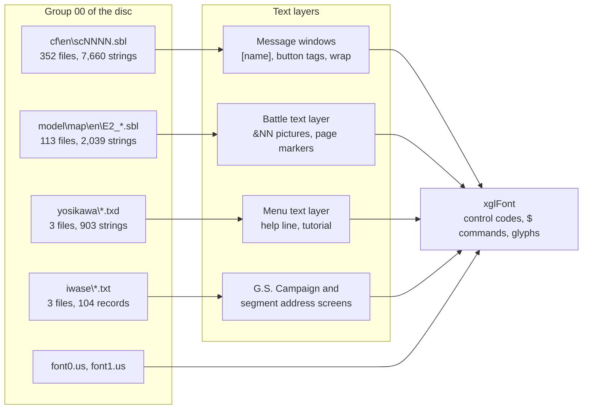
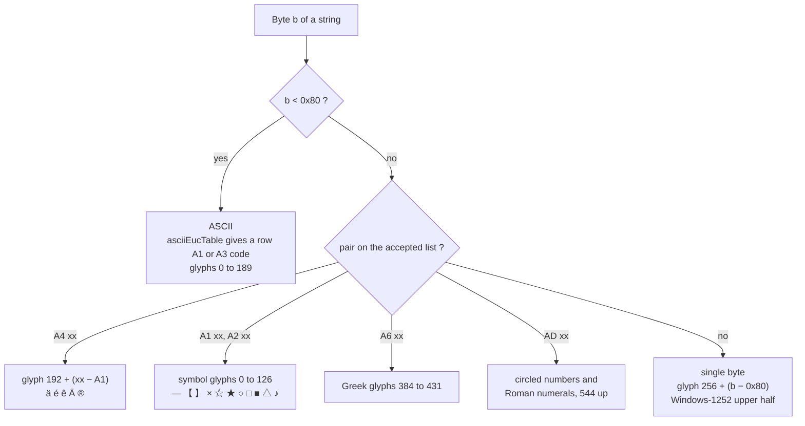
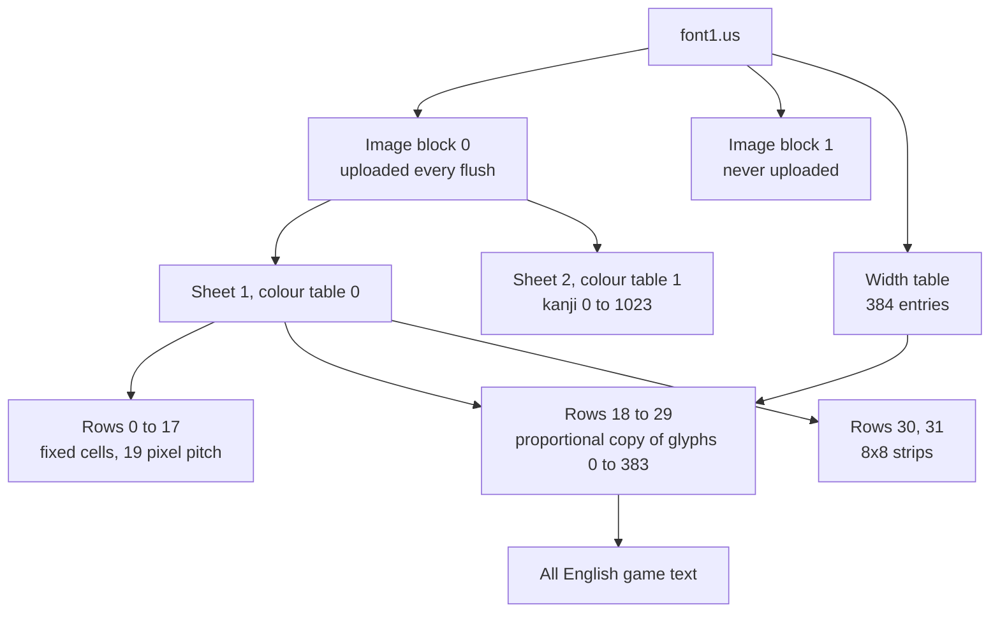
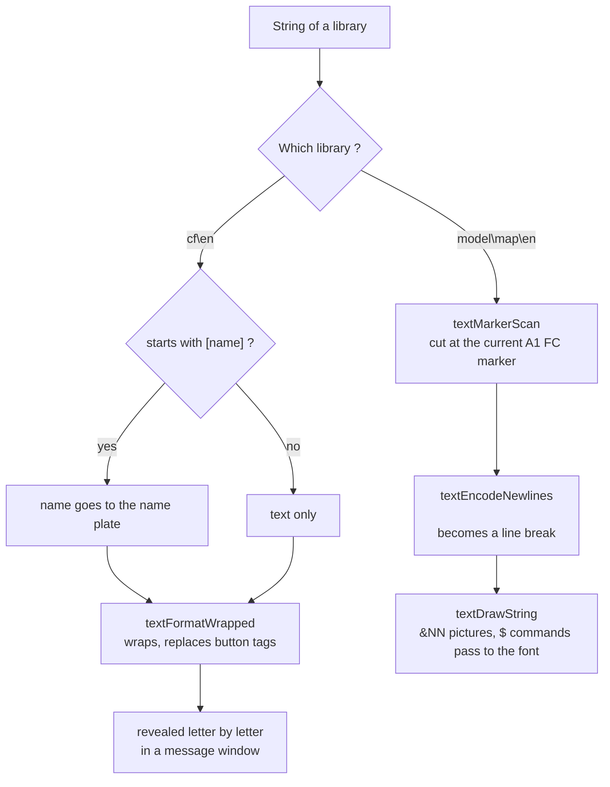
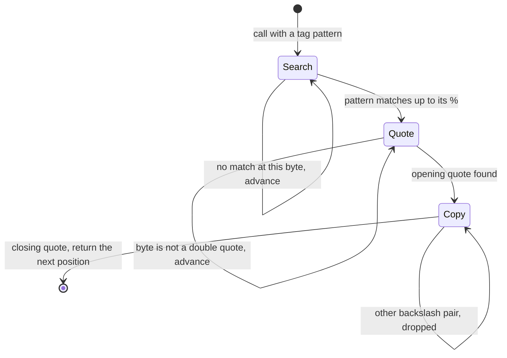
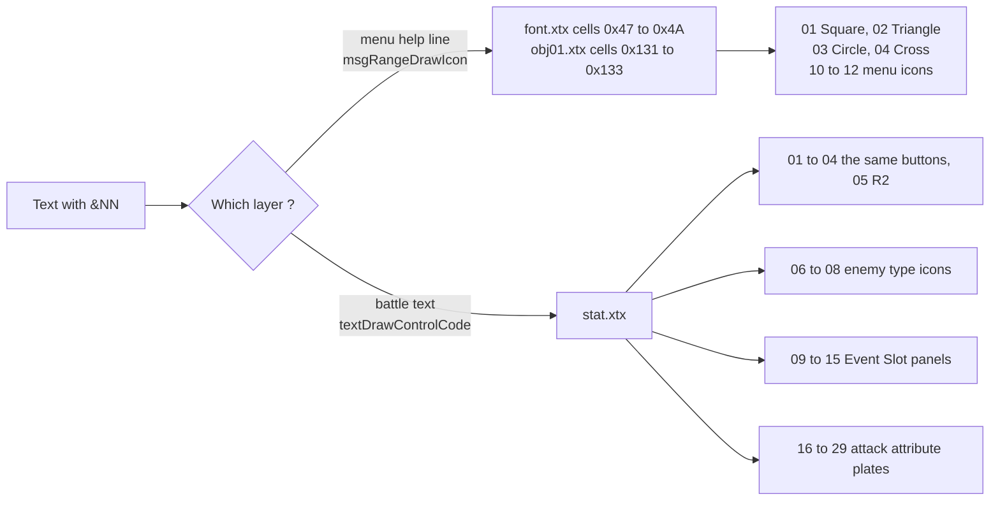
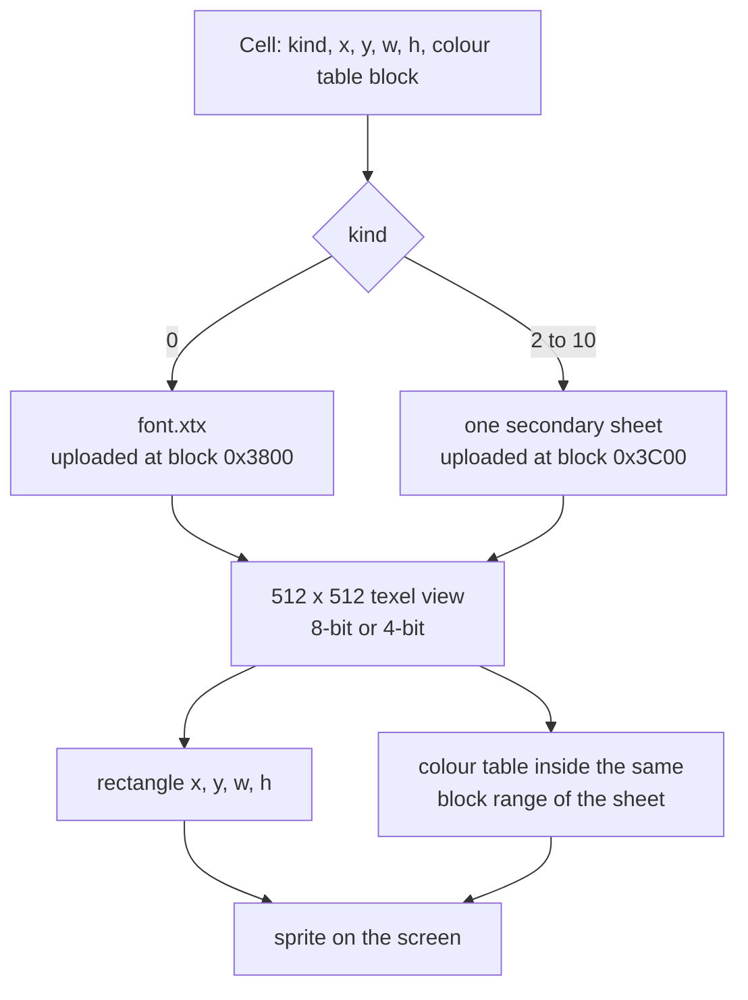
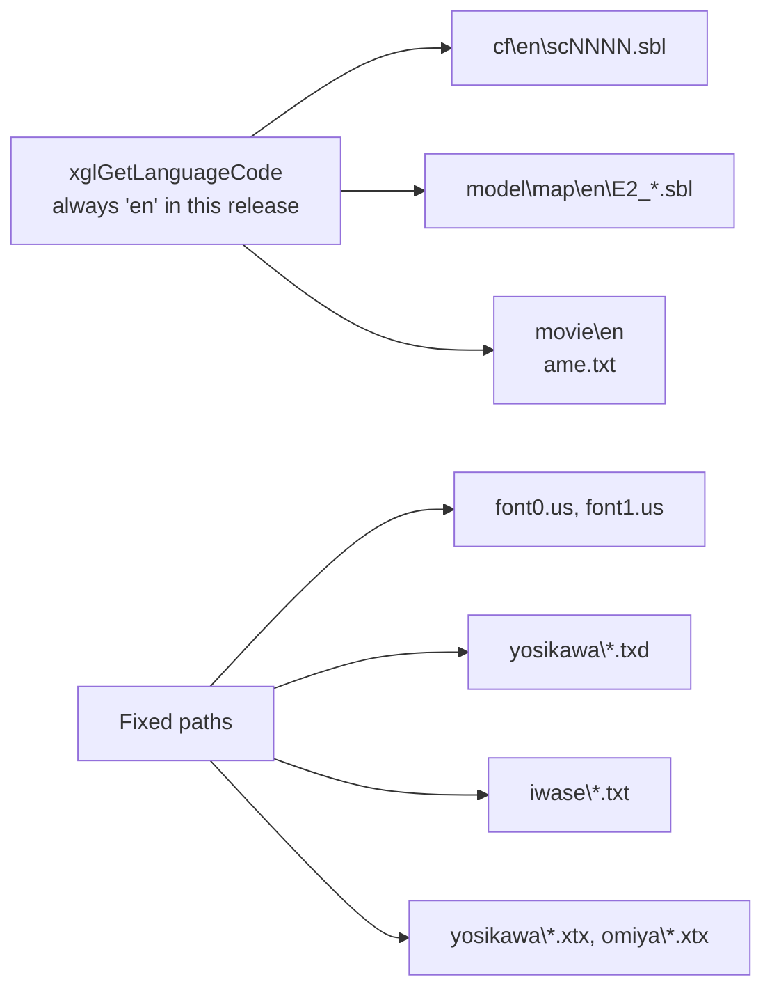

# Text and fonts

This page is the byte-level reference for the files that carry the letters
and the words of Xenosaga Episode II. It covers the two font files
`font0.us` and `font1.us`, the picture sheets that the menus and windows cut
their frames, icons and button pictures from, the character encoding as it is
really found in the game data, every control code and inline command that
occurs in the shipped text, and the plain text files of the G.S. Campaign and
segment address screens.

The dialogue of the game is not stored in files of its own. It lives in the
string libraries (`.sbl`) that accompany the scene scripts and the battle
scripts. Their container is described in
[Scripts and archives](scripts-and-archives.md). This page describes the text
inside them: which bytes occur, which markers they carry and how often.

Everything here was measured on the extracted files of both discs. The code
that draws the text (the print queue, the control code interpreter, the
windows) is described in
[Fonts and text drawing](../libraries/fonts-and-text.md) and
[Message windows](../libraries/ui-windows.md). Where the files and the code
disagree, or where the files settle a point that the code leaves open, the
text says so.

[← Back to the overview](../README.md) · [Files and resources](../architecture/files-and-resources.md)

## Contents

1. [Files at a glance](#files-at-a-glance)
2. [Where text lives](#where-text-lives)
3. [Character encoding](#character-encoding)
4. [Font files](#font-files)
5. [Markup found in the game text](#markup-found-in-the-game-text)
6. [Text in the string libraries](#text-in-the-string-libraries)
7. [Menu string tables](#menu-string-tables)
8. [Tagged text files](#tagged-text-files)
9. [Button pictures](#button-pictures)
10. [The talk window sheet](#the-talk-window-sheet)
11. [Font object sheets](#font-object-sheets)
12. [The language split](#the-language-split)
13. [Unused files and leftovers](#unused-files-and-leftovers)
14. [Source files](#source-files)

## Files at a glance

All files of this family sit in archive group 00, which is identical on both
discs, and none of them is packed. The sizes are therefore both the stored
and the loaded sizes.

| Files | Count | Size in bytes | Content | Loaded by |
| --- | --- | --- | --- | --- |
| `font0.us`, `font1.us` | 2 | 492,352 each | glyph sheets and the proportional width table | `xglFontLoad` (`src/main/xgl_font.c`) |
| `cf\en\scNNNN.sbl` | 352 | 64 to 29,200 | strings of the scene scripts: dialogue, choices, resource names | the map loader, see [sb-vm.md](../scripting/sb-vm.md) |
| `model\map\en\E2_*.sbl` | 113 | 116 to 5,228 | strings of the battle scripts: battle messages and tutorials | the battle data loader |
| `yosikawa\MainMenu.txd` | 1 | 11,224 | 569 menu strings | `menuLoadTxds` (`src/main/save_party_init.c`) |
| `yosikawa\Tutorial.txd` | 1 | 5,512 | 255 lines of the skill tutorial script | `menuLoadTxds` |
| `yosikawa\Location.txd` | 1 | 1,139 | 79 place names of the save screen | `src/main/save_screen.c` |
| `iwase\QuestMes.txt` | 1 | 39,563 | 36 G.S. Campaign records | `yg2PathLoadQuestMessages` (`src/main/yg2path.c`) |
| `iwase\Citizen.txt` | 1 | 10,005 | 50 citizen profiles | `yg2PathLoadCitizens` |
| `iwase\Treasure.txt` | 1 | 4,141 | 18 segment address records | `ysegfLoadTreasure` (`src/main/ysegf.c`) |
| `iwase\QuestMes2.txt`, `Citizen2.txt`, `Treasure2.txt` | 3 | 8,349, 8,989, 1,887 | Japanese versions of the three files, not read by the game | none |
| `omiya\botan.xtx` | 1 | 3,536 | the four face buttons and R3 as pictures | `msgWindowLoadBotanXtx` (`src/main/text_tag.c`) |
| `omiya\talk01.xtx` | 1 | 30,800 | frame tiles and page cursor of the talk windows | `talkStartTextureLoad` (`src/main/talk_script.c`) |
| `yosikawa\font.xtx` and nine more sheets | 10 | 46,160 to 262,224 | cells of the font object layer | `fontObjLoadTexture` (`src/main/font_obj.c`) |

Three more kinds of files hold text and belong to other pages. The movie
captions `movie\en\*.txt` (45 files on the two discs) are described in
[Movies, images and icons](movies-images-and-icons.md), and only their
encoding is summarised here. The battle data file `yamamoto\batdat.us` with
the names of skills, items and enemies belongs to
[Game data tables](game-tables.md). The scene resource scripts `cf\cfNNNN.txt`
contain commands and no display text, see
[Scripts and archives](scripts-and-archives.md).

## Where text lives

A string reaches the screen from one of five sources, and each source has
its own drawing layer with its own markers. This matters for the reader of
the data, because the same two characters can be a command in one file and
plain text in another. A `\n` written as backslash and `n` is a line break
for the menu and battle layers, the three letters `&03` are a button picture
in a menu help line and in a battle message but ordinary text in dialogue,
and `<○>` is a button picture only in dialogue.

The first source is the executable itself. Fixed labels, style strings and
debug texts are C strings in the program. They are outside the scope of this
page, but the style strings matter because they set the state that the data
strings rely on.

The second source is the string library of a scene script. Every script
`cf\scNNNN.sb` has a library `cf\en\scNNNN.sbl`. A script does not contain
its texts. It holds small tagged numbers, and a native function turns such a
number into the address of a string in the library. Dialogue is shown by the
message windows, which format, wrap and reveal it.

The third source is the string library of a battle script,
`model\map\en\E2_*.sbl`. Its strings are shown by the battle text layer of
`src/main/text_marker.c`, which knows page markers and picture codes that
the message windows do not know.

The fourth source is the menu. All of its strings come from the three `.txd`
tables of the directory `yosikawa\`. The fifth source is the group of tagged
text files of the directory `iwase\`, which are parsed into fixed records
when the G.S. Campaign screen or the segment address screen opens.



## Character encoding

### Bytes below 0x80

The text of the North American release is ASCII. Of the 9,699 strings in the
465 string libraries, 9,245 contain no byte above 0x7F, and no string
contains a byte below 0x20. A line break is never stored as a control
character in these files. It is written as the two characters `\` and `n`,
and the layer that shows the string turns the pair into a real line break.

An ASCII byte is not drawn from an ASCII glyph set. With the wide ASCII
style that all game text selects, `xglFontAscii2Euc` converts the byte to a
full-width EUC-JP code through `asciiEucTable`, and the glyph is taken from
the cell of that code. Digits and letters go to row 0xA3 and punctuation to
row 0xA1. The full table is given in
[Fonts and text drawing](../libraries/fonts-and-text.md#the-ascii-to-euc-table).
The effect on the font file is that the Latin letters sit at the glyph
indexes 128 to 189 and the punctuation in the first 94 indexes, as the
[glyph map](#glyph-indexes-0-to-383) below shows.

### Two-byte characters

Characters outside ASCII are written as two-byte **EUC-JP** codes. The font
module accepts a byte pair as one character only for a short list of codes
(`xglFontIsTextureGlyphCode`): the whole rows 0xA4, 0xA6 and 0xAD, the seven
codes BD, DA, DB, DF, F9, FA and FB of row 0xA1, and the four codes A2, A3,
A4 and F6 of row 0xA2. The data agrees with this list exactly. Every
two-byte code of the real game text is on it, with one exception that is
never drawn.

The table lists all two-byte codes that occur in the English text of the
string libraries, with the number of occurrences on one disc.

| Bytes | Character | Count | Use |
| --- | --- | --- | --- |
| `A2 F6` | ♪ | 126 | closes cheerful lines of dialogue, all in `cf\en` |
| `A1 FC` | ● | 95 | page marker of battle messages, never drawn, all in `model\map\en` |
| `A1 DA`, `A1 DB` | 【 】 | 32 each | brackets around the place name in map change prompts |
| `A1 BD` | ― | 29 | dash inside sentences |
| `A4 A1` | ä | 20 | the name Dämmerung |
| `A1 FB` | ○ | 11 | Circle button, in the tag `<○>` |
| `A4 A2` | é | 11 | the word Café |
| `A2 A2` | □ | 5 | Square button, in the tag `<□>` |
| `A2 A4` | △ | 5 | Triangle button, in the tag `<△>` |
| `A1 DF` | × | 4 | Cross button, in the tag `<×>` |
| `A1 F9` | ☆ | 3 | bullet of the Elsa floor guide (`sc2540.sbl`) |
| `A6 B8` | Ω | 2 | the name Proto Ω |
| `A4 A4` | Ä | 1 | DÄMMERUNG in a line written in capitals (`sc2560.sbl`) |
| `A1 FA` | ★ | 1 | bullet of a facility guide (`sc3080.sbl`) |

The codes of row 0xA4 need an explanation. In EUC-JP this is the hiragana
row, and `A4 A1` is the small hiragana ぁ. The font files of this release
have no hiragana in the large glyph cells. The first five cells of that row
hold the pictures ä, é, ê, Ä and ®, and the English text uses the hiragana
codes to reach them. The menu table writes `PlayStation` followed by
`A4 A5` and `2`, which the font draws as PlayStation®2. The movie captions
use `A4 A2` and `A4 A3` for é and ê in the same way.

| Code | EUC-JP meaning | Glyph index | Picture in `font0.us` and `font1.us` |
| --- | --- | --- | --- |
| `A4 A1` | ぁ | 192 | ä |
| `A4 A2` | あ | 193 | é |
| `A4 A3` | ぃ | 194 | ê |
| `A4 A4` | い | 195 | Ä |
| `A4 A5` | ぅ | 196 | ® |

### Single bytes from 0x80

A byte from 0x80 to 0xFF that does not start one of the accepted pairs is a
single-byte character. The font gives it the glyph index `256 + (byte −
0x80)`. The glyph cells 256 to 383 of both font files hold the upper half of
the **Windows-1252** character set in code order: the Euro sign at 0x80, the
typographic quotes, and from 0xA0 on the Latin-1 symbols and accented
letters up to ÿ. A text could therefore write é as the single byte 0xE9.

The shipped text never does. The only bytes that take this path in the
string libraries belong to leftover test strings in Japanese encodings, see
[Unused files and leftovers](#unused-files-and-leftovers). All accented
letters of the real text use the row 0xA4 codes of the previous section.



### Shift-JIS in the tagged files

The three tagged text files of `iwase\` are the exception to the EUC rule.
They are stored in **Shift-JIS**, and their reader `yg2PathReadTaggedText`
converts every byte pair with `sjisToEuc` while it copies a text. The
English files contain exactly three such pairs, one per file.

| File | Bytes in the file | After conversion | Character drawn |
| --- | --- | --- | --- |
| `QuestMes.txt` | `81 5C` | `A1 BD` | ― |
| `Citizen.txt` | `82 A0` | `A4 A2` | é (in Café) |
| `Treasure.txt` | `83 B6` | `A6 B8` | Ω |

The second line shows the trick of the accented letters from the other
side. The translator typed the hiragana あ in Shift-JIS, the reader turns it
into the EUC code of あ, and the font shows é.

The first line shows why the reader tests for a two-byte character before
it tests for an escape. The trail byte of `81 5C` is 0x5C, the backslash.
The reader takes the pair as one character and never sees the backslash.

## Font files

### Purpose and loading

The game has one font in two files. `xglFontLoad(font_index, notify)` reads
`font0.us` or `font1.us` into the static buffer `fontTextureBuffer` of
0x78800 bytes, and only one of the two is in memory at a time. Font 1 is the
normal font. Font 0 is loaded while a cutscene of the `cfe` player or a
movie runs, and font 1 is loaded again afterwards.

The two files differ only in their kanji. The first glyph sheet, which holds
every Latin letter, digit and symbol, is identical in both files cell for
cell, and so is the width table. All 3,052 kanji cells differ: the two files
carry the kanji in two different typefaces. Since the English text contains
no kanji, the switch between the fonts has no visible effect in this
release.

### File layout

Both files are 492,352 bytes (0x78340) long and have the same structure. The
layout was checked on both files of both discs.

| Offset | Size | Contents |
| --- | --- | --- |
| 0x00000 | 0x20 | header of image block 0 |
| 0x00020 | 0x3C000 | texel data of image block 0 |
| 0x3C020 | 0x20 | header of image block 1 |
| 0x3C040 | 0x3C000 | texel data of image block 1 |
| 0x78040 | 0x300 | proportional width table, 384 entries of 2 bytes |

An image block is a ready-made piece of a VIF1 packet. Its header is two
quadwords that are the same in all four blocks.

| Offset | Size | Value | Meaning |
| --- | --- | --- | --- |
| 0x00 | 12 | 0 | three VIF no-operation words |
| 0x0C | 4 | `0x51003C01` | VIF code DIRECTHL with a length of 0x3C01 quadwords |
| 0x10 | 8 | `0x080000000000BC00` | GIF tag: IMAGE mode, 0x3C00 quadwords, end of packet |
| 0x18 | 8 | 0 | upper half of the GIF tag |

The block is sent as it is. `xglFontReloadTexture` adds a reference to the
0x3C02 quadwords of block 0 to the frame's packet, behind a small packet
that sets the transfer registers. The texel data is declared there as a 320
by 192 image of 32-bit pixels: 320 × 192 × 4 is 0x3C000 bytes.

```
font0.us / font1.us (0x78340 bytes)

0x00000 +------------------------------------------+
        | VIF DIRECTHL + GIF IMAGE tag (0x20)      |
0x00020 +------------------------------------------+
        | image block 0: 320 x 192 x 32 bit        |   sheet 1 (bits 0-1): Latin, symbols,
        | = 640 x 768 texels of 4 bits             |                       small glyphs
        |                                          |   sheet 2 (bits 2-3): kanji 0 to 1023
0x3C020 +------------------------------------------+
        | VIF DIRECTHL + GIF IMAGE tag (0x20)      |
0x3C040 +------------------------------------------+
        | image block 1: same form                 |   sheet 3 (bits 0-1): kanji 1024 to 2047
        |                                          |   sheet 4 (bits 2-3): kanji 2048 to 3051
0x78040 +------------------------------------------+
        | width table: 384 x (low byte, high byte) |
0x78340 +------------------------------------------+
```

The file contains no colour table. The two 16-entry tables that the font
needs are part of the executable (the packet `KanjiClutEnv`).

### Pixel format

The game uploads the texel data as 32-bit pixels and reads it back as a
**4-bit indexed texture** at the same place in video memory. The GS stores
the two formats in different block and column orders, so the bytes of the
file are not a plain row-by-row picture in either format. The file is the
image that results when a 640 by 768 texture of 4-bit texels is written to
GS memory and the memory is read out again as 320 by 192 pixels of 32 bits.
This form is commonly called a swizzled texture.

To decode a file, the research tool writes the 0x3C000 bytes into a model of
GS memory with the 32-bit layout (buffer width 5 units of 64 pixels) and
reads 640 by 768 texels back with the 4-bit layout (buffer width 10). The
result is a clean picture, which confirms the two formats and both buffer
widths that the code states.

### Two-bit sheets inside a four-bit texture

A glyph needs four grey levels, and a texel has four bits. Each image block
therefore holds **two glyph sheets** on top of each other. One uses the low
two bits of every texel and the other the high two bits. The two colour
tables of the executable separate them: table 0 maps a texel to the level
`texel & 3`, table 1 to the level `texel >> 2`. The levels are transparent,
one third, two thirds and full coverage.

```
one 4-bit texel             colour table 0 shows      colour table 1 shows
+----+----+                 bits 0-1                  bits 2-3
| hi | lo |                 (sheet 1 or 3)            (sheet 2 or 4)
+----+----+
  |    |
  |    +--- 0 to 3: coverage of the glyph in the low sheet
  +-------- 0 to 3: coverage of the glyph in the high sheet
```

The two files together hold four sheets each, of 1,024 cells. A cell is 20
texels wide and 24 high, and a sheet has 32 columns and 32 rows.

| Sheet | Block | Bits | Occupied cells | Contents |
| --- | --- | --- | --- | --- |
| 1 | 0 | 0–1 | rows 0 to 29 as described below, rows 30 and 31 as small glyph strips | Latin letters, symbols, Greek, Cyrillic, the Windows-1252 half, and their proportional copies |
| 2 | 0 | 2–3 | 1,024 | kanji 0 to 1,023, starting with 亜 唖 娃 阿 |
| 3 | 1 | 0–1 | 1,024 | kanji 1,024 to 2,047 |
| 4 | 1 | 2–3 | 1,004 | kanji 2,048 to 3,051 |

The kanji sheets follow the order of JIS level 1, which has 2,965
characters. The last sheet continues for 87 more cells after the last level
1 kanji 腕, with additional kanji that the Japanese script needed.

The game code can only reach a part of this. It uploads block 0 and never
block 1, and it selects the colour table from one bit of the glyph index.
Sheets 3 and 4 are therefore dead data in this program, and only the first
1,024 kanji can be drawn. Sheet 1 is the only one that the English release
uses.

### Glyph indexes 0 to 383

`xglFontGetGlyphIndex` turns an EUC code into a glyph index, and glyph `n`
sits in column `n & 31` and row `n >> 5` of its sheet. The first twelve rows
of sheet 1 hold the indexes 0 to 383. The decoded sheet shows what they
really are.

| Indexes | Row | Reached by | Pictures |
| --- | --- | --- | --- |
| 0–93 | 0–2 | EUC row 0xA1 | the JIS punctuation and symbol row: space, 、 。 , . ・ and the other punctuation marks, then on through the brackets and arithmetic signs to ☆ ★ ○ ● ◎ ◇ |
| 94–126 | 2–3 | EUC row 0xA2 | ◆ □ ■ △ ▲ ▽ ▼ ※ 〒 → ← ↑ ↓ 〓, then ∇ ≡ ≒ ≪ ≫ √ ∽ ∝ ∵ ∫ ∬, then Å ‰ ♯ ♭ ♪ † ‡ ¶ |
| 127 | 3 | "no glyph" | blank |
| 128–137 | 4 | `A3 B0`–`A3 B9` | the digits 0 to 9 |
| 138–163 | 4–5 | `A3 C1`–`A3 DA` | the capitals A to Z |
| 164–189 | 5 | `A3 E1`–`A3 FA` | the small letters a to z |
| 190, 191 | 5 | | blank |
| 192–196 | 6 | `A4 A1`–`A4 A5` | ä é ê Ä ® |
| 197–255 | 6–7 | rest of row 0xA4 | blank |
| 256–383 | 8–11 | single bytes 0x80–0xFF, EUC row 0xA5 | the upper half of Windows-1252: € ‚ ƒ „ … † ‡ ˆ ‰ Š ‹ Œ and so on, then the Latin-1 symbols and letters from the no-break space to ÿ |

The Latin letters are drawn in a light geometric sans-serif face, in the
proportions of full-width characters but with their natural widths.

Two consequences follow from this map. The hiragana row of the index
formula is occupied by five Western pictures and is otherwise empty. The
katakana row 0xA5 maps to the indexes 288 and up, which hold Windows-1252
characters. A Japanese kana text would therefore come out as accented Latin
letters and symbols. The font files are a Western build of the font, as the
suffix `.us` says, and only the kanji sheets and the small strips still carry
Japanese glyphs.

### Glyph indexes 384 to 575

The rows 12 to 17 of sheet 1 hold further character sets of JIS X 0208.
The English text uses one glyph of them, the capital omega.

| Indexes | Row | Reached by | Pictures |
| --- | --- | --- | --- |
| 384–407 | 12 | `A6 A1`–`A6 B8` | Greek capitals Α to Ω |
| 408–431 | 12–13 | `A6 C1`–`A6 D8` | Greek small letters α to ω |
| 432–464 | 13–14 | `A7 A1`–`A7 C1` | Cyrillic capitals А to Я |
| 465–497 | 14–15 | `A7 D1`–`A7 F1` | Cyrillic small letters а to я |
| 512–543 | 16 | `A8 A1`–`A8 C0` | box-drawing lines |
| 544–573 | 17 | `AD A1` and up | circled numbers ① to ⑳, Roman numerals Ⅰ to Ⅹ |

### The proportional copy

The rows 18 to 29 of sheet 1 repeat the 384 glyphs of the rows 0 to 11. The
proportional drawing path of the font reads its glyphs from this second
area, 432 texels below the first.

The copy is not a different drawing. A cell-by-cell comparison finds 324 of
the 384 cells identical in both areas. The 60 cells that differ are cell 6
and the cells 197 to 255. The latter are blank in the fixed area and hold a
small centred dot in the proportional copy, a placeholder for characters
that have no picture.

### The width table

The last 0x300 bytes of the file are the table `proportional_widths`: two
bytes for each of the 384 glyphs of the proportional copy. The table is the
same in both files.

| Offset in the entry | Size | Meaning |
| --- | --- | --- |
| 0 | 1 | first texel column of the cell that contains ink, 0 for "no entry" |
| 1 | 1 | last texel column that contains ink |

The meaning was established by measuring the ink of every glyph in the
decoded sheet. For all 378 glyphs with an entry, the low byte equals the
first inked column and the high byte the last inked column, without a single
exception.

`xglFontGetProportionalSize` adds 0xFF to the 16-bit entry. This subtracts
one from the low byte, and the carry adds one to the high byte. The glyph is
therefore drawn from one column before its ink to one column after it, and
its advance is the ink width plus 2.

| Character | Glyph | Entry (low, high) | Drawn columns | Advance in pixels |
| --- | --- | --- | --- | --- |
| `0` | 128 | 5, 13 | 4 to 14 | 11 |
| `A` | 138 | 4, 15 | 3 to 16 | 14 |
| `W` | 160 | 2, 17 | 1 to 18 | 18 |
| `i` | 172 | 9, 11 | 8 to 12 | 5 |
| `m` | 176 | 5, 17 | 4 to 18 | 15 |
| `.` | 4 | 4, 5 | 3 to 6 | 4 |
| `!` | 9 | 9, 10 | 8 to 11 | 4 |

The advances of the table range from 4 to 20 pixels. Six glyphs have no
entry: 0 (the space), 17, 127, 190, 191 and 265. A glyph without an entry
gets the columns 0 to `default_width`, which is 4 unless a text changes it,
so the space is 5 pixels wide. Five of the six are blank cells. The sixth,
glyph 265, is the per mille sign of the Windows-1252 half. Its picture fills
the whole cell, but it has no entry and would be cut to 5 pixels. No text
uses it.

### Small glyphs

The rows 30 and 31 of sheet 1 are not cells of 20 by 24. The lower part
holds four strips of 8 by 8 pixel glyphs, 64 glyphs to a strip, at the
texel rows 736, 744, 752 and 760. The two strips above them, at 720 and
728, are empty.

| Texel row | Glyphs present | Contents |
| --- | --- | --- |
| 736 | 63 | katakana |
| 744 | 63 | hiragana, small punctuation and the two voicing marks |
| 752 | 63 | the hex digits, minus sign and decimal point, then the ASCII characters space to `?` |
| 760 | 64 | the ASCII characters `@` to `~` |

These are the debug font, the digits of the number codes and the glyphs of
ruby annotations. Their use is described in
[Fonts and text drawing](../libraries/fonts-and-text.md#small-glyphs).



## Markup found in the game text

The font module and the layers above it understand many markers. The game
data uses only a part of them. This section lists what really occurs in the
data files, with counts for one disc (the text files of group 00 are the
same on both discs).

### Control codes

The font module reads the bytes 1 to 31 as control codes. **No data file
contains one.** The 465 string libraries, the three `.txd` tables and the
three tagged text files were scanned byte by byte, and the only bytes below
0x20 are the terminating zeros and, in the tagged files, the tabs and line
ends of the file syntax.

Control codes exist only in strings that the program builds: the position
prefix that `xglFontPrint` writes in front of every record, the style
prefixes in the executable, and the filler code 7 that the layers write
over consumed markers. The full code table is in
[Fonts and text drawing](../libraries/fonts-and-text.md#control-codes).

### Inline commands

A `$` followed by a command name and arguments up to a `;` is an inline
command of the font module. The table `fontInlineCommands` has 18 names. The
data uses eight of them.

| Command | String libraries | `MainMenu.txd` | `Tutorial.txd` | Captions | Meaning |
| --- | --- | --- | --- | --- | --- |
| `$zoom` | 1,762 | 23 | | | glyph scale in sixteenths |
| `$col` | 1,127 | 1 | 15 | | text colour |
| `$rx` | | 18 | | | move the pen right |
| `$ry` | | 2 | | | move the pen down |
| `$init` | | 1 | | | reset the style |
| `$bg` | | 1 | | | glyph effect |
| `$shadow` | | 1 | | | shadow offset and colour |
| `$han` | | 1 | | | wide ASCII |
| `$xx` | | 1 | | 46 | font state, here the line height |
| `$ay` | | | | 46 | absolute Y position |

All 2,889 commands of the string libraries are in the battle scripts of
`model\map\en`. The dialogue of `cf\en` contains none: a `$` never occurs
there. The commands `$ax`, `$az`, `$save`, `$load`, `$alpha`, `$ruby`,
`$prop` and `$mark` do not occur in any data file.

The scale values show how the battle messages are set. `$zoom13;` (1,204
times) is the size of an ordinary battle message, 13/16 of the cell.
`$zoom15;` (537 times) is used for the announcements of bosses and events.
`$zoom21;` appears 17 times, among them the countdown `3`, `2`, `1`, `0` of
`E2_EVE73.sbl`, and `$zoom17;` 4 times for shouted lines. The menu table
also uses the two-value form, for example `$zoom10,13;Burst Veil$zoom13;`,
which narrows a label that would not fit its box.

### Colours and the capital digits

Seven colour values occur in the string libraries.

| Command | Count | Use |
| --- | --- | --- |
| `$colc0c0c0;` | 568 | light grey, the standard text colour. Almost every message ends with it |
| `$col7AF9FB;` | 411 | emphasis: the headings of the battle tutorial such as `<Boost>`, and status announcements |
| `$colFAB2AA;` | 64 | the speech of certain bosses (`E2_EXA04.sbl`), keywords of the skill tutorial |
| `$col808080;` | 64 | the body text of the battle tutorial. 0x80 is the neutral value of every channel |
| `$col0fd0e0;` | 14 | a second emphasis colour |
| `$cola05050;` | 4 | the word "blue" in the Orgulla battle |
| `$col00c050;` | 2 | the word "green" in the same battle |

The value is read as six hex digits in the order blue, green, red. Two of
the seven values are written with capital digits, and here the data meets a
flaw of the parser. `xglFontParseHex` handles the capitals `A` to `F` with a
subtraction that goes the wrong way, so a capital digit contributes a
negative amount to the number. Lower-case digits are read correctly.

| Written | Intended red, green, blue | Value the parser computes | Red, green, blue actually set |
| --- | --- | --- | --- |
| `7AF9FB` | FB, F9, 7A | `0x0036F5BB` | BB, F5, 36 |
| `FAB2AA` | AA, B2, FA | `0xFCB6AE6A` | 6A, AE, B6 |

The 475 capital-digit commands of the string libraries and the 7 of
`Tutorial.txd` therefore set colours that differ from the ones written. The
computed values in the table follow the code of `xglFontParseHex` step by
step. They were not observed on a running game.

### Line breaks

The pair `\n` is the line break of all layers. It occurs 1,264 times in 999
strings of `cf\en`, 326 times in 225 strings of `model\map\en`, 43 times in
`MainMenu.txd` and 47 times in `Tutorial.txd`. The dialogue uses it
sparingly, because the message windows wrap text by themselves. It appears
there in lists, signs and choice menus, where each `\n` separates one
choice.

No other backslash escape occurs in display text. The escapes `\k` and `\s`
that the text blocks of `src/main/font_obj.c` understand are not used by any
data file. The 68 backslashes of `cf\en` that are followed by another letter
are path separators in resource names such as
`movie\cfevent\s-02-02-00-00.ipu`.

### Speaker names

A dialogue string that starts with a name in square brackets names its
speaker: `[chaos]If you touch it and press <○>, you can record your current
progress and restore your health.` The message window code cuts the name off
and shows it in the name plate of the window.

3,865 of the 7,660 strings of `cf\en` start this way, in 94 of the 352
files, and 371 different names occur. The most frequent are
`Mass-Produced 100-Series Observational Unit` (152 lines), `Professor` (70),
`Shion` (54), `Matthews` (47) and `Patricia` (40). The name can itself hold
two-byte characters: the 32 map change prompts read `[【Second Miltia】]Go
to the space port?`, with the place name in the role of the speaker. The
battle scripts never use the form.

### Button tags

A button name in angle brackets inside dialogue is replaced by a picture
from `omiya\botan.xtx`. The table `textTagGlyphNames` knows five names.

| Tag | Bytes | Count in `cf\en` | Picture |
| --- | --- | --- | --- |
| `<○>` | `3C A1 FB 3E` | 11 | Circle |
| `<□>` | `3C A2 A2 3E` | 5 | Square |
| `<△>` | `3C A2 A4 3E` | 5 | Triangle |
| `<×>` | `3C A1 DF 3E` | 4 | Cross |
| `<R3>` | `3C 52 33 3E` | 0 | R3 |

The R3 tag is supported by the code and by the texture, but no text of the
release uses it. Angle brackets around anything else are plain text, as in
`Drama Series <Xenosaga Ep. I>` or the tutorial heading `<Zone>`.

### Picture codes

An `&` followed by two digits is a picture code. Two layers read it, each
with its own picture set: the help line of the menu (`msgRangeDrawIcon`,
codes 01 to 04 and 10 to 12) and the battle text layer
(`textDrawControlCode`, codes 01 to 29). The message windows do not know
the codes.

The codes occur in three battle scripts and in two menu tables.

| Where | Codes found |
| --- | --- |
| `model\map\en\E2_KML03.sbl`, `E2_KML04.sbl` and one more battle script | 53 codes in 18 strings: `&03` 9, `&01` 8, `&02` 5, `&09` 3, `&11` 3, `&10` 2, `&28` 2, `&29` 2, and one each of `&04`, `&06`, `&07`, `&08`, `&12`, `&13` and `&15` to `&27` |
| `MainMenu.txd` | `&01` 3, `&03` 2 |
| `Tutorial.txd` | `&03`, `&10`, `&11`, `&12`, one each |

The codes `&05` and `&14` occur nowhere. The meaning of each code is settled
under [Button pictures](#button-pictures).

### Page markers

The two bytes `A1 FC` (the filled circle ●) cut a battle message into
steps. The battle text layer shows the text up to the current marker and
waits. The marker itself is never drawn.

It occurs 95 times, once in each of 95 strings, all in `model\map\en`. In
most of them it is the last character of the text, sometimes followed by
the closing `$colc0c0c0;`. A typical tutorial line is this one:

```
$col7AF9FB;<Command Menu>\n$col808080;You can press &04 to open the Command menu.\nI'll bring it up now.●
```

### Percent signs

The message windows expand `%d` placeholders with numbers that a script
supplies. No string of the libraries contains `%d`, `%s` or any other
conversion. The mechanism is not used by the shipped scripts.

The percent sign itself occurs in two forms. Four dialogue strings write it
doubled, as in `tickets to Miltian space are 30%% OFF!`, which a formatted
print turns into one sign. A single sign occurs 28 times in 26 strings (2 times in `cf\en`,
26 times in `model\map\en`), as in `System 40% recovered.`

### The tutorial commands

`Tutorial.txd` is a script, and a line that starts with `%` is a command of
`menuTutorialStep`. The commands are described in
[The main menu](../game/main-menu.md#the-skill-tutorial). The file uses the
following ones.

| Command | Lines | Command | Lines |
| --- | --- | --- | --- |
| `%p` | 50 | `%m0` to `%m4` | 9 |
| `%t15` to `%t75` | 47 | `%g`, `%g0` | 5 |
| `%c+` | 14 | `%j` | 2 |
| `%c-` | 8 | `%P` | 2 |
| `%a0` to `%a6` | 17 | `%s` | 1 |
| `%l0`, `%l1`, `%l2` | 16 | `%e` | 1 |
| `%f0`, `%f1`, `%f2` | 13 | `%r` | 1 |

The counts are lines that start with the command. The file opens with the
title `Skill Tutorial`, a `%p`, and a chapter mark `*`, and it has five
chapter marks in all. Its last line is `%r`, the restart. The commands
`%k`, `%w` and `%b` of the interpreter and the row form `%cN` are not used,
and no line starts with `#`.

### All markers at a glance

| Marker | Occurs in | Read by |
| --- | --- | --- |
| `\n` | every text source | the caller layers |
| `$zoom`, `$col` | battle scripts, menu tables | `xglFontInlineCommand` |
| `$rx`, `$ry`, `$init`, `$bg`, `$shadow`, `$han`, `$xx` | `MainMenu.txd` | `xglFontInlineCommand` |
| `$ay`, `$xx` | movie captions | `xglFontInlineCommand` |
| `[name]` | scene scripts | the message windows |
| `<○>` `<□>` `<△>` `<×>` | scene scripts | `textFormatWrapped` |
| `&01` to `&29` | battle scripts, menu tables | `textDrawControlCode`, `msgRangeDrawIcon` |
| `A1 FC` | battle scripts | `textMarkerScan` |
| `%%` | scene scripts | the formatted print |
| `%x…` at the start of a line | `Tutorial.txd` | `menuTutorialStep` |
| `\"`, `\(`, `\)` | tagged text files | `yg2PathReadTaggedText` |

## Text in the string libraries

### The container

A string library is an SB image with the magic `SBL `. Its header and its
link to the script are described in
[The SB virtual machine](../scripting/sb-vm.md#the-library-image) and
[Scripts and archives](scripts-and-archives.md). The part that matters for
the text is small, and it was checked on all 465 libraries of each disc.

| Offset | Size | Meaning | Observed |
| --- | --- | --- | --- |
| 0x00 | 4 | magic `SBL ` | always |
| 0x04 | 4 | flags | always 1 |
| 0x08 | 4 | number of strings | 0 to 364 |
| 0x0C | 4 | name count | 1 in 464 files, 0 in one |
| 0x14 | 4 | offset of the index array | always 0x40 |
| 0x18 | 4 | offset of the string data | always 0x40 + 4 × count |
| 0x40 | 4 × count | offset of each string, counted from the string data | ascending, first one 0 |

The strings follow each other without gaps in index order, each ended by one
zero byte, and the file ends after zero to three padding bytes that round
its size to a multiple of four. A file without strings is 64 bytes long.
The smallest real example is `cf\en\sc1040.sbl`: three strings, the index
`0, 10, 14` and the data `ce000_057`, `100`, `802`.

### What the strings are

Not every string is text. A script keeps all of its string constants in the
library, so the names of models, motions, effects, sound streams and movie
files stand next to the dialogue.

| | `cf\en` | `model\map\en` |
| --- | --- | --- |
| Files | 352 | 113 |
| Strings | 7,660 | 2,039 |
| Bytes of string data | 527,932 | 83,466 |
| Empty strings | 93 | 0 |
| Longest string | 1,588 bytes | 237 bytes |
| Strings that are pure ASCII | 7,305 | 1,940 |
| Strings with a speaker name | 3,865 | 0 |
| Strings with `$` commands | 0 | 1,826 |
| Strings with picture codes | 0 | 18 |
| Strings with a page marker | 0 | 95 |

The two directories are two dialects. A scene script string is dialogue for
a message window: an optional speaker name, running text that the window
wraps, button tags, and `\n` only where the author wanted a hard break. A
battle script string is a finished layout for the battle text layer: it
starts with its own size and colour commands, breaks its own lines, and
restores the standard colour at its end. An example of each:

```
cf\en\sc1010.sbl, string 6
[chaos]If you touch it and press <○>, you can record your current progress and restore your health.

model\map\en\E2_EVE66.sbl, string 5
$zoom15;$colc0c0c0;System 40% recovered.\n$col7AF9FB;Cellular program activated.$colc0c0c0;
```



## Menu string tables

The three files `MainMenu.txd`, `Tutorial.txd` and `Location.txd` of the
directory `yosikawa\` are string tables of the simplest kind. A table is an
array of 32-bit offsets followed by the strings. `txdTableEntry(table,
index)` returns the address of one string.

| Offset | Size | Meaning |
| --- | --- | --- |
| 0 | 4 × n | offset of each string, counted from the start of the file |
| 4 × n | | the strings, each ended by a zero byte |

There is no count field. The first offset points directly behind the
offset array, so the number of strings is the first offset divided by 4.
The parser checked on all three files that the strings follow each other
without gaps in index order and that the last string ends at the last byte
of the file. The files are not padded: `Location.txd` is 1,139 bytes long.

| File | Size | Strings | Empty | Longest | First offset |
| --- | --- | --- | --- | --- | --- |
| `MainMenu.txd` | 11,224 | 569 | 148 | 162 | 2,276 |
| `Tutorial.txd` | 5,512 | 255 | 8 | 222 | 1,020 |
| `Location.txd` | 1,139 | 79 | 0 | 20 | 316 |

`MainMenu.txd` starts with the names of the party members (`chaos`,
`KOS-MOS`, `Shion`) and ends with `Data is corrupted.` String 34 is not a
text but a style: `$init;$bg2;$shadow+1,+3,000000;$zoom13;$han1;$xx0,21;$colc0c0c0;`,
the same style that the executable holds as `msgStyleInit`. Many labels
carry their own position, such as `$rx116;$ry30;No clear data found.`, where
the two commands centre the text in its window by hand.

The memory card messages of this table contain two details of encoding. The
registered mark is written `A4 A5`, as described under
[Two-byte characters](#two-byte-characters). And several messages (twelve occurrences in all) name the
slot as `MEMORY CARD slot` followed by the bytes `A3 B0`, the full-width
digit zero. The font module does not accept row 0xA3 as a two-byte
character, so these two bytes cannot be meant for display as they are. The
likely reading is that the save screen overwrites them with the slot number
before it prints the message. Other messages of the same group name the
slot with a plain `1` or `2`.

`Location.txd` holds the place names that the save screen shows for a save
file, from `Old Miltia` to `SC Domain (Winter)`. Two entries use `A6 B8` for
Ω and one uses `A4 A1` for ä.

A few strings of `MainMenu.txd` are Japanese leftovers in EUC-JP, for
example string 399. With the Western font files they would be drawn as
unrelated Latin characters, so they are certainly never shown.

## Tagged text files

### Purpose

The G.S. Campaign screen and the segment address screen take their long
texts from three plain text files in the directory `iwase\`. Each file is a
list of numbered blocks, and each block holds a fixed set of tagged, quoted
texts. The screens and the meaning of the texts are described in
[The G.S. Campaign](../game/gs-campaign.md). This section describes the
files.

| File | Blocks | Tags per block | Size | Reader |
| --- | --- | --- | --- | --- |
| `QuestMes.txt` | 36 | 8 | 39,563 | `yg2PathLoadQuestMessages` |
| `Citizen.txt` | 50 | 5 | 10,005 | `yg2PathLoadCitizens` |
| `Treasure.txt` | 18 | 3 | 4,141 | `ysegfLoadTreasure` |

### Line format

The files are text files with CR LF line ends (no bare line feed occurs).
A block is a header line `No.` and a number, a line with `{`, one tagged
text per tag, and a line with `}`. The blocks are numbered from 1 without
gaps and are separated by one empty line. Each tag line starts with one tab.

```
No.1
{
	Name:"Sikes"
	Sex:"Male"
	Age:"28 years old"
	Hobby:"Visiting hot springs"
	Profile:"
A nice man who works for Sincere Deliveries. He\n
strives day and night to hand deliver sincerity\n
throughout Miltia."
}
```

A text starts at the first `"` after its tag and ends at the next `"` that
is not escaped. It may run over several lines of the file. The line ends of
the file inside the quotes are not part of the text: the reader drops every
CR LF pair. A line break of the text is written `\n`. The long texts are
laid out with both, a `\n` followed by a real line end, so that the file
reads like the text on the screen.

| In the file | Result in the text | `QuestMes.txt` | `Citizen.txt` | `Treasure.txt` |
| --- | --- | --- | --- | --- |
| CR LF inside the quotes | nothing | 1,347 | 112 | 50 |
| `\n` | line feed (0x0A) | 1,167 | 62 | 50 |
| `\"` | a double quote | 6 | 4 | 0 |
| `\(`, `\)` | nothing | 8 each | 1 each | 0 |
| a byte pair with the top bit set | the pair converted from Shift-JIS to EUC | 1 | 1 | 1 |

The fourth line needs a comment. The reader knows two escapes, `\n` and
`\"`. Any other character after a backslash is dropped together with the
backslash. The English files contain the forms `\(` and `\)` around a few
terms, for example `founded the \(Area 40\)`. Both parentheses are removed
when the file is read, and the screen shows `founded the Area 40`.

### How the reader finds a text

`yg2PathReadTaggedText(text, pattern, out)` does not parse the block
structure. It searches forward, byte by byte, for the next place where the
tag pattern matches (`yg2TextCompareLine`, which compares up to the `%` of
a pattern such as `Subject:%s`), then for the next `"`, copies the text, and
returns the position behind the closing quote. The loader calls it once per
tag in a fixed order and passes the returned position on.

The header lines, the braces, the tabs and anything else between the texts
are therefore never read. Only the order of the tags matters. `Treasure.txt`
makes use of this: in front of every tag it carries a ruler line of digits,
`0102030405060708` and so on, which helped the writer to count the columns
of the narrow list. The reader steps over the rulers without noticing them.



### QuestMes.txt

One block describes one campaign. The reader stores the texts in a
`YgQuestRecord` of 0xB46 bytes. The table gives the size of each field and
the longest text that the file really holds (after conversion, without the
terminating zero).

| Tag | Field | Field size | Longest text | Content |
| --- | --- | --- | --- | --- |
| `Subject:` | `subject` | 31 | 30 | title of the campaign |
| `Locate:` | `location` | 17 | 16 | where it is given |
| `Client:` | `client` | 17 | 12 | who gives it |
| `MesIPG:` | `message` | 257 | 123 | the client's message while the campaign is in progress |
| `MesSCD:` | `messageSuccess` | 257 | 109 | the message after success |
| `MesFLD:` | `messageFailed` | 257 | 107 | the message after failure |
| `UkunSCD:` | `reportSuccess` | 1,025 | 351 | the long comment after success |
| `UkunFLD:` | `reportFailed` | 1,025 | 340 | the long comment after failure |

The first block is the campaign `Send Him My Love!` of the client
`Jacqueline` on `Second Miltia`, and the last is `Miss Miltia!`. The tag
names abbreviate "in progress", "succeeded" and "failed". `Ukun` is a
developer name for the guide character of the screen, whose model file is
`iwase\ukun00.pxy`.

Many campaigns cannot fail. Their failure texts are filled with a
placeholder that was meant never to be seen: `You cannot fail this quest. A
flag that cannot exist has come up. xxxxxxxxxx`.

### Citizen.txt

One block is the profile of one citizen, stored in a `YgCitizenRecord` of
0xD7 bytes.

| Tag | Field | Field size | Longest text | Content |
| --- | --- | --- | --- | --- |
| `Name:` | `name` | 17 | 15 | name |
| `Sex:` | `sex` | 7 | 6 | `Male` or `Female` |
| `Age:` | `age` | 17 | 12 | for example `28 years old` |
| `Hobby:` | `hobby` | 23 | 22 | one phrase |
| `Profile:` | `profile` | 151 | 132 | three lines of description |

The first citizen is `Sikes` and the last is `Mallory`.

### Treasure.txt

One block describes one entry of the segment address list, stored in a
`YsegfTreasure` of 169 bytes.

| Tag | Field | Field size | Longest text | Content |
| --- | --- | --- | --- | --- |
| `Item:` | `item` | 21 | 16 | name of the reward |
| `Locate:` | `location` | 27 | 18 | where the door is |
| `Expl:` | `explanation` | 121 | 100 | what the reward does |

The first block is `Secret Key 8` in the `Restricted Area`, with the
explanation `Unlocks the Level 2`, `Class H skill, Boost 1`, `(increase
Boost by 1).` on three lines.

No text of the three files reaches the size of its field. The reader does
not check the size, so the files had to be written to fit.

## Button pictures

### The sheet of the message windows

`omiya\botan.xtx` holds the pictures that replace the button tags of
dialogue. The name is the Japanese word for button. The file is an XTX
texture set with a single transfer: a 48 by 18 image of 32-bit pixels,
3,456 bytes of pixel data behind the 48-byte directory and the 32-byte
packet header. The XTX container is described in
[Models and textures](models-and-textures.md).

As with the font, the upload format is not the format of use. The message
window reads the uploaded memory as an 8-bit indexed texture, and its
256-entry colour table from a place inside the same image, 16 blocks behind
the start (`BOTAN_TEXTURE_CLUT_OFFSET`). In the 8-bit view the image is 64
texels wide and 36 high, and the colour table occupies the right third of
the upload.

Decoded this way, the sheet shows five pictures. Their rectangles agree
with the table `textTagGlyphRects` of `src/main/text_tag.c`.

```
 0        18/19       36/37                  64
 +----------+----------+---------------------+   0
 |  Circle  |  Square  |         R3          |
 |  (red)   |  (pink)  |   (grey plate)      |
 +----------+----------+---------------------+  17/18
 | Triangle |  Cross   |
 | (green)  |  (blue)  |      unused
 +----------+----------+                        35
```

| Kind | Tag | Rectangle (left, top, right, bottom) | Picture found there |
| --- | --- | --- | --- |
| 1 | `<○>` | 0, 0, 19, 18 | red circle on a round dark button |
| 2 | `<□>` | 18, 0, 37, 19 | pink square on a round dark button |
| 3 | `<△>` | 0, 17, 19, 35 | green triangle on a round dark button |
| 4 | `<×>` | 18, 17, 37, 35 | blue cross on a round dark button |
| 5 | `<R3>` | 36, 0, 65, 18 | the letters R3 on a rectangular plate |

### The picture codes of the menu

The help line of the menu draws the codes `&01` to `&04` from four cells of
the base sheet `yosikawa\font.xtx`. The four cells 0x47 to 0x4A are 18 by 21
texels each and lie next to each other at (58, 355) to (112, 355). They
share their texels with the round plate of cell 0x44 and differ in their
colour tables. Rendering each cell with its own colour table settles which
button each code shows.

| Code | Cell | Picture | Example from the data |
| --- | --- | --- | --- |
| `&01` | 0x49 | Square | `Press &03 to equip accessories.\nPress &01 to remove equipped accessories.` |
| `&02` | 0x48 | Triangle | not used in the menu tables |
| `&03` | 0x4A | Circle | `Press &03 to set Equipped Skills and press &01 to remove.` |
| `&04` | 0x47 | Cross | not used in the menu tables |
| `&10` | 0x131 of `obj01.xtx` | a ring (accessory icon) | `Tutorial.txd` |
| `&11` | 0x132 of `obj01.xtx` | a bottle (item icon) | `Tutorial.txd` |
| `&12` | 0x133 of `obj01.xtx` | a figure (character icon) | `Tutorial.txd` |

The three small icons of `&10` to `&12` are 18 texels wide. The words in
brackets are readings of the pictures.

### The picture codes of battle text

The battle text layer draws its pictures from the battle status sheet
`yamamoto\stat\stat.xtx`, which belongs to
[The battle engine](../game/battle-engine.md). The pictures were cut from
that sheet at the coordinates that `textDrawControlCode` uses, and the
battle tutorials `E2_KML03.sbl` and `E2_KML04.sbl` name most of them in
their own words.

The first four codes are the same buttons in the same order as in the menu:
the icon columns 1, 2, 0 and 3 of the sheet hold Square, Triangle, Circle
and Cross. The tutorial agrees: `Press &01 or &02 to attack immediately`,
and `The basic attacks are the consecutive attacks with &01 and &02, and
the single attack with &03`. Square, Triangle and Circle are the three
attack buttons of a battle, and `You can press &04 to open the Command
menu` names the Cross button.

| Code | Picture | Meaning | Source of the meaning |
| --- | --- | --- | --- |
| `&01` | Square button | | picture |
| `&02` | Triangle button | | picture |
| `&03` | Circle button | | picture |
| `&04` | Cross button | | picture |
| `&05` | a plate with the letters R2 | R2 button | picture. The code is used by no text |
| `&06` | turn order icon | biological enemy | `&06 Biological` |
| `&07` | turn order icon | mechanical enemy | `&07 Mechanical` |
| `&08` | turn order icon | Gnosis enemy | `&08 Gnosis` |
| `&09` | Event Slot panel `CTC` | critical hit chance up by 50% | tutorial text |
| `&10` | Event Slot panel `BST` | the Boost Gauge rises faster | tutorial text |
| `&11` | Event Slot panel `SKL` | more Skill Points from enemies | tutorial text |
| `&12` | Event Slot panel `ETR` | Ether damage and healing up by 50% | tutorial text |
| `&13` | Event Slot panel `T·C` | the target loses its turn if damaged | tutorial text |
| `&14` | Event Slot panel `NON` | the slot without an event | picture. The code is used by no text |
| `&15` | Event Slot panel `RV` | the target's Boost Gauge rises if attacked | tutorial text |
| `&16` | plate with a `P` | physical attack | `&16(Physical Attack)` |
| `&17` | plate with an `E` | Ether attack | `&17 (Ether Attack)` |
| `&18` | plate with a running shoe | target class Near | `&18 (Near)` |
| `&19` | plate with a wing | target class Far | `&19 (Far)` |
| `&20` | plate with a fist | Strike | tutorial text |
| `&21` | plate with a sword | Slash | tutorial text |
| `&22` | plate with a gun | Pierce | tutorial text |
| `&23` | plate with a flame | Fire | tutorial text |
| `&24` | plate with a crystal | Ice | tutorial text |
| `&25` | plate with a lightning bolt | Thunder | tutorial text |
| `&26` | plate with a ringed sphere | Aura | tutorial text |
| `&27` | plate with a bar | Beam | tutorial text |
| `&28` | plate with an upward mark | Air state | `&28 (Air)` |
| `&29` | plate with a downward mark | Down state | `&29 (Down)` |

The codes `&06` to `&08` are drawn by `menuKeyDraw` from the face icons of
the turn order display and were not rendered for this page. Their meaning
comes from the tutorial line `There are three enemy icons:\n&07
Mechanical\n&06 Biological\n&08 Gnosis`. The tutorial also gives the order
of the Event Slot wheel: `&09 > &10 > &11 > random > &09`.



## The talk window sheet

`omiya\talk01.xtx` holds the frame of the dialogue windows. It is an XTX
set with one transfer of 80 by 96 pixels of 32 bits (30,720 bytes of pixel
data, 30,800 bytes in all). `talkWindowDrawFrame` in
`src/main/talk_script.c` draws a window from it.

The sheet is not used as one picture. It is a collection of small 8-bit
textures of 32 by 32 texels, each addressed by its own block offset, plus
six colour tables. The table `talkWindowPieces` names for every piece of a
frame the block offset of its texture and of its colour table. In GS memory
a block of an 8-bit texture is 16 by 16 texels, and a 32 by 32 texture
occupies four consecutive blocks, so the block offsets of the tiles advance
in steps of four.

The 80 by 96 upload covers three bands of GS memory. Each band holds up to
eight tiles and, in the 16-pixel column at its right edge, two colour
tables.

```
upload, 80 x 96 pixels of 32 bits (buffer width 8)

 x: 0                               64        80
    +--------------------------------+---------+  y 0
    | tiles at blocks 0, 4, 8, 12,   | CLUT 32 |
    | 16, 20, 24, 28                 | CLUT 40 |
    +--------------------------------+---------+  y 32
    | tiles at blocks 256, 260, 264, | CLUT 288|
    | 272, 276, 284                  | CLUT 296|
    +--------------------------------+---------+  y 64
    | tiles at blocks 512, 516, 520, | CLUT 544|
    | 524, 528, 532, 536             | CLUT 552|
    +--------------------------------+---------+  y 96
```

| Tiles (block offset) | Colour table | Content |
| --- | --- | --- |
| 0, 4, 8, 12 | 32 | soft dark corner, edges and fill of the window shadow |
| 16, 20, 24, 28 | 40 | corner, edges and fill of the window body with its thin double border |
| 256, 260, 264, 272 | 288 | thin outline pieces: corner and straight lines |
| 276, 284 | 544 | further outline pieces |
| 512 | 288 | outline corner |
| 516, 528, 532 | 544 | outline pieces of the lower edge |
| 520, 524, 536 | 296 | the middle strips of the frame |
| 520 | 552 | the page cursor: a small light blue triangle that points down, with a short bar |

All 22 texture and colour table pairs that the code names decode to
sensible pictures, which confirms the block offsets. The descriptions in
the last column are readings of the decoded tiles. The exact role of each
piece in a frame (which rectangle it fills, which pieces are mirrored)
is given with the window code in
[Message windows](../libraries/ui-windows.md).

The page cursor uses the tile at block 520 a second time, with the colour
table at block 552 (`TALK_CURSOR_TEXTURE` 0x208 and `TALK_CURSOR_CLUT`
0x228). With the frame's colour table the same texels show a strip of the
frame. With the cursor's colour table they show the cursor. This is the
same idea as the two glyph sheets of the font: one set of texels, two
pictures, selected by the colour table.

## Font object sheets

### The files

The font object layer of `src/main/font_obj.c` draws rectangular **cells**
from eleven texture files. The cell table `fontObjCellTable` of the
executable has 758 entries, each with a texture number, a rectangle and the
block address of a colour table. The layer is described in
[Fonts and text drawing](../libraries/fonts-and-text.md#font-objects). This
section describes the ten files that exist on the disc.

| Texture | File | Size | Transfers (width × height) | Cells |
| --- | --- | --- | --- | --- |
| 0 | `yosikawa\font.xtx` | 262,224 | 256 × 256 | 201 |
| 1 | `yosikawa\bg00.xtx` | not on the disc | | 1 |
| 2 | `yosikawa\bg01.xtx` | 246,960 | 256 × 128, 128 × 114, 128 × 112 | 51 |
| 3 | `yosikawa\obj01.xtx` | 262,224 | 256 × 256 | 144 |
| 4 | `yosikawa\g2_00.xtx` | 262,224 | 256 × 256 | 4 |
| 5 | `yosikawa\g2_01.xtx` | 262,224 | 256 × 256 | 134 |
| 6 | `yosikawa\seg01.xtx` | 262,224 | 256 × 256 | 138 |
| 7 | `yosikawa\battle01.xtx` | 46,672 | 112 × 104 | 30 |
| 8 | `yosikawa\ctrl_pic.xtx` | 182,448 | 256 × 128, 128 × 64, 128 × 36 | 3 |
| 9 | `yosikawa\ctrl01.xtx` | 259,248 | 256 × 128, 128 × 128, 128 × 122 | 15 |
| 10 | `yosikawa\g2_02.xtx` | 46,160 | 120 × 96 | 37 |

The file `bg00.xtx` that the texture table names does not exist in the
archive. The code never loads it, because texture 1 has no slot.

The sizes fit the buffers of the loader. The slots 0 to 4 have buffers of
0x40800 bytes (264,192), enough for the largest file of 262,224 bytes. Slot
5 has 0xB800 bytes (47,104), and its two files `battle01.xtx` and
`g2_02.xtx` are 46,672 and 46,160 bytes long.

### Layout of a sheet

A full sheet is a 256 by 256 image of 32-bit pixels with a buffer width of
four 64-pixel units. `fontObjDraw` reads it as a texture of 512 by 512
texels with a buffer width of eight units, in the 8-bit format or, for cells
with the flag 0x40, in the 4-bit format. Both views cover exactly the same
1,024 blocks of GS memory.

The colour tables are inside the image. The cell table gives each cell the
absolute block address of its colour table, and all of these addresses lie
inside the block range of the sheet itself (from 0x3800 for the base sheet,
from 0x3C00 for the others). A sheet is therefore self-contained: pictures
in the upper and left parts, colour tables packed into the remaining
blocks, where a full-sheet rendering shows them as coloured noise.

The files with three transfers build the same 1,024-block area from pieces.
Their first transfer fills the upper half, and the two others are placed at
the word offsets 0x8000 and 0x9000 of the area, which are the blocks 512
and 576.



### What the sheets show

Each sheet was rendered by drawing every cell of the table at its own place
with its own colour table. The contents are as follows.

| Sheet | Contents |
| --- | --- |
| `font.xtx` | the base sheet, in memory at all times. Window frames and corners, cursors, the highlight bars, the four face buttons on round plates, three small portraits with their thumbnails, the labels `Lv`, `HP`, `EP`, `Exp`, `C.Pt`, `S.Pt`, `Next Lv` and `UNIT`, and in its 4-bit part the letter and digit strips |
| `bg01.xtx` | the two versions (dim and lit) of the main menu entries `Items`, `Ether`, `Skills`, `Tech`, `Status`, `Party`, `U.M.N.`, `GS Path`, `Segment F`, `Options`, and the title bars |
| `obj01.xtx` | the objects of the menu pages: character portraits and their small versions, E.S. portraits, the tabs `Items`, `Ether`, `Skills`, `Party`, `Equip`, `Attack Data`, `Learned`, `Accessories`, `Caster`, the plates `COMBATANT`, `RESERVE`, `LEVEL UP!`, `Main Pilot`, `Copilot`, `Standby`, the three icons of `&10` to `&12`, and the labels of the Japanese menu, which are still in the sheet |
| `g2_01.xtx` | the G.S. Campaign screens: hexagonal path markers, the `NEW!` mark, a digit strip, the labels `Entrance`, `Result`, `Citizen Profile`, `Exit`, `Message from Client`, `Message from Procurator`, `GS PATH`, `Back`, `Next`, `Achievement`, `Citizen Profiles` |
| `seg01.xtx` | the segment address screen: `NO DATA`, `IN PROGRESS`, `COMPLETE!!`, `SEGMENT FILE`, `Segment Address`, `Treasure Details`, a digit strip and an alphabet of boxed letters A to Z |
| `g2_02.xtx` | `SUCCEEDED!`, `FAILED!`, `IN PROGRESS`, `NO DATA` and a strip of the letters A to M |
| `battle01.xtx` | the dark panel and the bordered window frame of the battle text windows |
| `g2_00.xtx`, `ctrl_pic.xtx`, `ctrl01.xtx` | large pictures with few cells: backgrounds of the G.S. Campaign screens, and the controller picture with its labels for the configuration screen |

The Japanese menu labels of `obj01.xtx` (アイテム, エーテル, スキル and so
on, each in a sharp and a blurred version) are a leftover of the Japanese
release. Whether any of their cells is still drawn was not examined.

## The language split

The disc separates language-dependent data in two ways: by a directory
named after a language code, and by the file suffix `.us`.

| Path | Files | Content |
| --- | --- | --- |
| `cf\en\` | 352 `.sbl` | strings of the scene scripts |
| `model\map\en\` | 113 `.sbl` | strings of the battle scripts |
| `movie\en\` | 20 `.txt` on disc 1, 25 on disc 2 | captions of the movies |
| `font0.us`, `font1.us` | 2 | the Western build of the font |
| `yamamoto\batdat.us` | 1 | the battle data with its names |

The directory name is the language code that `xglGetLanguageCode` returns,
see [Fonts and text drawing](../libraries/fonts-and-text.md#language-handling).
The code builds a path such as `cf\xx\scNNNN.sbl` and replaces `xx`. The
function knows nine codes, but `en` is the only directory that exists on
either disc. There is no `jp` directory and no other language.

The split is strict for the scripts. A script image `cf\scNNNN.sb` contains
no display text at all, and each of the 352 scripts has exactly one library
in `cf\en`. A release in another language would only have had to add a
second directory. The strings of the two groups are identical on both
discs: all 465 libraries of disc 1 are byte for byte the libraries of disc
2.

The rest of the text is not split. The three `.txd` tables, the three
tagged text files and the pictures with lettering in the font object sheets
exist once, in English, at paths without a language code. The Japanese
originals of the tagged files survive next to them under other names, as
the next section shows.



### Movie captions

The caption files `movie\en\*.txt` are plain text with LF line ends. Their
format belongs to
[Movies, images and icons](movies-images-and-icons.md). Their encoding is
of interest here, because it shows the conventions of this page once more.

Every file starts with the same comment block in Japanese EUC-JP, lines
that begin with `;`. It is the instruction sheet of the format, left in by
the developers. The caption lines are a time code of the form
`MM:SS:FF`, a tab and the text. The 45 files hold 2,423 such lines, 877 of
them with an empty text that clears the caption, and each file ends with a
line `end`.

The texts are ASCII with `\n` as the line break (197 times). The first
line of every file is a style line, for example
`00:00:00	$ay390;$xx0,22;`, which places the captions at Y 390 with a line
height of 22. The only two-byte codes in caption texts are `A1 BD` (the
dash, 21 times), `A4 A2` (é, once) and `A4 A3` (ê, twice).

## Unused files and leftovers

### The Japanese tagged files

`iwase\QuestMes2.txt`, `Citizen2.txt` and `Treasure2.txt` have the same
block structure as the three files that the game reads, with the same
numbers of blocks (36, 50 and 18). Their texts are Japanese in Shift-JIS:
2,082, 2,725 and 501 two-byte characters. No path with these names exists
in the program, so the files are never opened.

`Citizen2.txt` and `Treasure2.txt` look like the texts of the Japanese
release. `QuestMes2.txt` is test data: all 36 blocks carry the same
subject 黄昏 and the same joke messages about winning a film award. The
second block of `Treasure2.txt` has an explanation of 129 bytes, more than
the 121 bytes of the field it would be read into.

### Test strings in the scene libraries

Two short Japanese test strings were never removed from the scene scripts.
`テストメッセージ\n表示中` ("test message, now showing") and `の人です`
appear behind the digits `11` and `12` in 73 libraries of `cf\en`. In 63
files they are stored in Shift-JIS and in 10 files in EUC-JP, which shows
that the script sources were converted between the two encodings at some
point. These strings are the source of all single high bytes that the scan
of the libraries found. With the Western font they could not be displayed
as written.

### yajima\check.txt

The debug program `KanjiCheckTest` in `src/main/yajima_test.c` reads a file
`yajima\check.txt`, collects every distinct two-byte character whose first
byte is 0xD0 or higher, which is the range of the JIS level 2 kanji, and
lists them 16 to a line. It was a tool to find characters in a script that
the font, which stops at level 1, cannot show.

The file is not on either disc. The directory `yajima\` holds the title
pictures and the synopsis data and no text file. From the code, the file
was a plain EUC-JP text of any length, ended by a zero byte, and its only
structure was the sequence of its characters.

### Unused parts of the font

The fonts carry much that this release cannot reach or does not use: the
second image block with 2,028 kanji that is never uploaded, the first 1,024
kanji that no English text calls, the Cyrillic and box-drawing rows, the
whole Windows-1252 half, and the kana strips of the small glyphs. Of the
symbols with special handling in the code, the black square `A2 A3` and the
NEC row 0xAD do not occur in any text.

### Open points

- The colours that the capital-digit commands `$col7AF9FB;` and
  `$colFAB2AA;` produce were computed from the parser code and not seen on
  a screen.
- The bytes `A3 B0` in the memory card messages of `MainMenu.txd` are read
  here as a placeholder for the slot number. The code that would replace
  them was not located.
- The pictures of the codes `&06` to `&08` were not rendered. Their meaning
  rests on the tutorial text alone.
- The contents of the 87 kanji cells behind the end of JIS level 1 in the
  fourth sheet were not identified one by one.
- Whether the Japanese label cells of `obj01.xtx` are still drawn anywhere
  was not examined.

## Source files

| File | Contents |
| --- | --- |
| `src/main/xgl_font.c` | `xglFontLoad` and the font file paths, `xglFontReloadTexture`, the glyph index and proportional width functions, the inline command table, `xglFontParseHex` |
| `src/main/font_obj.c` | the font object layer: texture names and slots, `fontObjCellTable`, the upload packets, `fontObjDraw` |
| `src/main/text_marker.c` | the battle text layer: `textDrawString`, `textDrawControlCode` with the `&NN` pictures, `textMarkerScan` for the `A1 FC` markers |
| `src/main/text_tag.c` | the button tags of dialogue: `textTagGlyphNames`, `textTagGlyphRects`, the loader and the drawing of `omiya\botan.xtx` |
| `src/main/talk_script.c` | the loader of `omiya\talk01.xtx`, `talkWindowDrawFrame` and the piece table `talkWindowPieces` |
| `src/main/yg2_text.c` | `yg2TextCompareLine`, the pattern test of the tagged text reader, and two unused line helpers |
| `src/main/yg2path.c` | `yg2PathReadTaggedText`, the loaders of `QuestMes.txt` and `Citizen.txt`, the record structs and the tag patterns |
| `src/main/ysegf.c` | `ysegfLoadTreasure`, the record struct and the tag patterns of `Treasure.txt`, `ysegfReadFile` |
| `src/main/test_129.c` | `sjisToEuc`, the conversion of one Shift-JIS character |
| `src/main/txd_table_entry.c` | `txdTableEntry`, the lookup in a `.txd` table |
| `src/main/save_party_init.c`, `src/main/save_screen.c` | the paths and loaders of the three `.txd` tables |
| `src/main/menu_draw.c` | `msgRangeDrawIcon`, the picture codes of the menu help line |
| `src/main/yajima_test.c` | `KanjiCheckTest`, the reader of the missing `yajima\check.txt` |
| `src/ov01/sb_natives.c` | `vmKeyedEntryGet`, which turns a script value into a string of the library |
