# Battle effects

Most of what a technique shows on screen in Xenosaga Episode II is data: the
particle lines, models and sounds of an effect script, played by the effect
system sef. Some shapes are hard to describe as data, for example a lightning
bolt that jumps along a curve, a group of missiles that spread out and then
swirl away, or a ribbon that winds around the line between two fighters. For
these the battle program OV01 contains a small set of effects that are written
as code. The source calls them `MEf` effects. Each one computes its own
geometry every frame and sends its own GS packets.

`MEf` effects are never started directly by the battle rules. An effect script
names them in its **effect sequence**, sef fires them at the right frame
through `MSeFire`, and they live as objects in a pool called `MSe` that the
effect draw passes run. The same data also tells the battle when the blow
lands, which is how damage numbers and hit reactions stay in time with the
picture.

The battle program has a few simpler screen effects of its own as well: a grey
screen fill, a short screen flash and the fades of battle units. They are
described at the end.

[← Back to the overview](../README.md)

## Files

| File | Contents |
| --- | --- |
| `src/main/m_se_obj.c` | The `MSe` object pool: `MSeObjInit`, `MSeObjAlloc`, `MSeObjRequestFree`, `MSeObjProc`, the two mode hooks, the camera snapshot `MEfCamParams`, and the math helper `MMathMatrixBetweenVectors` |
| `src/ov01/m_gs.c` | `MSeFire` and the fire entry table, the GS packet helpers `MGsGPInit` and `MGsGPTerm`, the effect pause value, the tick counter, start and shutdown of the effect systems of a battle scene |
| `src/ov01/m_ef.c` | The `MEf` core: actor coordinates, random vectors, camera-facing quads, the wait object, and the two stepped trail families (Hermite path and path step) |
| `src/ov01/m_ef_path.c` | The Hermite curve record shared by all path families, and three marker drawers (frame axes, point cross, path end marker) |
| `src/ov01/m_ef_spiral.c` | The spiral family |
| `src/ov01/m_ef_thunder25.c` | The 25-sample thunder family |
| `src/ov01/m_ef_thunder31.c` | The 31-sample thunder family |
| `src/ov01/m_ef_create_smp_01.c` | The Tepodon family: a flying model with a smoke trail |
| `src/ov01/m_ef_flag_window.c` | The flag window family: a pulsing tube of lines |
| `src/ov01/m_ef_wave.c` | The wave family: a spindle of arcs between two points |
| `src/ov01/m_ef_spray.c` | The spray family: streaks that fall from above |
| `src/ov01/m_ef_sway.c` | The sway family: five missiles that spread and swirl |
| `src/ov01/m_ef_missile_trail.c` | The missile trail family: five missiles that fly straight |
| `src/ov01/m_ef_actor_path.c` | The actor path family: a fast swirl head along a curve |
| `src/ov01/m_ef_actor_history.c` | The actor history family: a wide ribbon spiral along a curve |
| `src/ov01/screen_fill.c` | The grey screen fill task and the packet that draws it |
| `src/ov01/screen_flash.c` | The ten-frame screen flash task |
| `src/ov01/effect_pos.c` | The position table of a battle scene, used by `createEffectPos` and by unit placement. Also holds the model file ids of units |
| `src/ov01/unit_fade.c` | Fade tasks of battle units and their slot actors |
| `src/ov01/cmd_exec.c` | The battle side of effects: `attackEffectsStart`, `attackEffectsFinished`, `tecEffectGroupGet`, `attackHitsShow`, `hitPopNumCreate`, the unit effect helpers and the status auras |
| `src/ov01/think_dispatch.c` | `effectSendOwned` and `effectStartAtPosition`, the effect senders behind two script natives |
| `include/main/m_se_obj.h` | `MSeObj`, `MSeFireEntry`, `MEfCameraParams` |
| `include/ov01/m_gs.h` | `MGsPacket`, `MEfGsQword`, the constructor prototypes and the GS constants shared by the families |
| `include/ov01/m_ef.h` | `MEfPathCurveObject` and the helper prototypes of `m_ef.c` |
| `include/ov01/m_ef_path.h` | `MEfPathCurve` and the curve functions |

## How the parts fit together

Three systems take part in a battle effect. The battle code in OV01 decides
that an attack happens and asks for an effect by number. The effect system sef
in the main executable plays the effect script of that number. The driver sdv,
also in the main executable, runs the six key sequences of the script, and one
of them is the effect sequence that creates `MSe` objects. The effect system is
described in [sef](../libraries/sef.md) and the sequences in
[sdv](../libraries/sdv.md).

The names `MSe` and `MEf` describe two layers of the same objects. `MSe` is
the pool: 127 slots of 0x800 bytes with four callback pointers each. `MEf` is
what runs in a slot: a family of functions that keeps its state in the slot and
installs its callbacks there. The pool lives in the main executable
(`src/main/m_se_obj.c`) and the families live in OV01, so objects can only be
created while the battle program is loaded.

The math functions used on this page (`MMath*`, the VU0 sine and cosine, the
Hermite functions) belong to [Math](../libraries/math.md). The model calls
(`pxySubmitModel`, `nmlModelSet*`) belong to [pxy](../libraries/pxy.md).

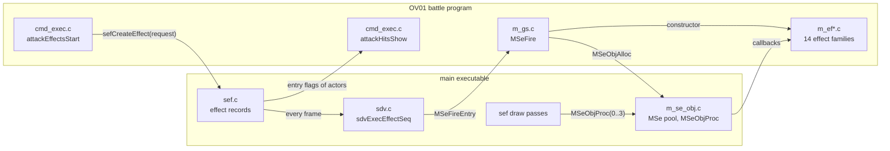

## From a command to a visible effect

A battle command becomes an **attack event** in the event queue of
`src/ov01/cmd_exec.c`. The event carries one or more action records (the
attacker and the technique) and one hit record for each target, already with
the computed damage and hit kind. The rules that build these records are
described in [Battle](battle.md). This page starts at the handler of the event,
`eventAttackRun`.

On its first call `eventAttackRun` calls `attackEffectsStart(event)`. The
function walks the action records. For each one it clears an `EffectRequest`
(0x38 bytes, declared in `include/ov01/think_dispatch.h`) and fills it:

1. `key` is the effect number: `(group << 12) | record`. The record part is
   the `extent` field of the technique record. The group comes from
   `tecEffectGroupGet` (see below).
2. `mode` is the state of the attacker (`stats->state`).
3. `head` is the actor of the attacker, and `parts[0..2]` are its first three
   child actors, such as weapons. For a pair technique (`gateFlag`
   `TEC_GATE_PAIR`) the request names both units: `head` and `partner`, with two
   child actors of each. The unit whose key is the first slot of the pair
   record becomes `head`.
4. For every hit record it sets `target` to the actor of the hit's target,
   `targetState` to the target's state and `hitMode` to the hit mode word. For
   a plain hit, `hitCode` carries the low byte of the technique's `actionBits`
   in its low twelve bits and the target's row bits (`flags & 3`) in the top
   four. For other hit kinds the top four bits are 3.
5. It calls `sefCreateEffect(&request)` once per hit.

So a technique with three targets starts the same effect three times, each
time with another target actor. A pair technique sends only the requests of its
first action record.

`tecEffectGroupGet(unit, tec)` chooses the effect group from the technique's
`gateFlag`.

| `gateFlag` | Group |
| --- | --- |
| 2, 3 | 0 |
| 9 | 200 |
| 4 | The unit's `sequenceIndex` + 10 |
| 1 (pair) | 50 |
| 5 | 14 |
| 6, 7, 8 and all others | The unit's `sequenceIndex`. When that index is in 700 to 733 and the technique's `extent` is below 8, 100 is added |

`sefCreateEffect` hands the request to `sefStartEffect`, which finds the effect
script of the key and creates an effect record. From then on the record is
stepped once per frame by `sefExecEffect`, which the battle scene loop calls.
Inside that step, after the particle slots of the record have run,
`sdvExecEffectSeq(sequence, effectId)` steps the effect sequence. When a row of
that sequence is reached, sdv fills an `MSeFireEntry` and calls `MSeFire`.
`MSeFire` takes one or more objects from the pool and runs the constructor of
the row's type. The object then draws itself in the following draw passes until
it asks to be freed.

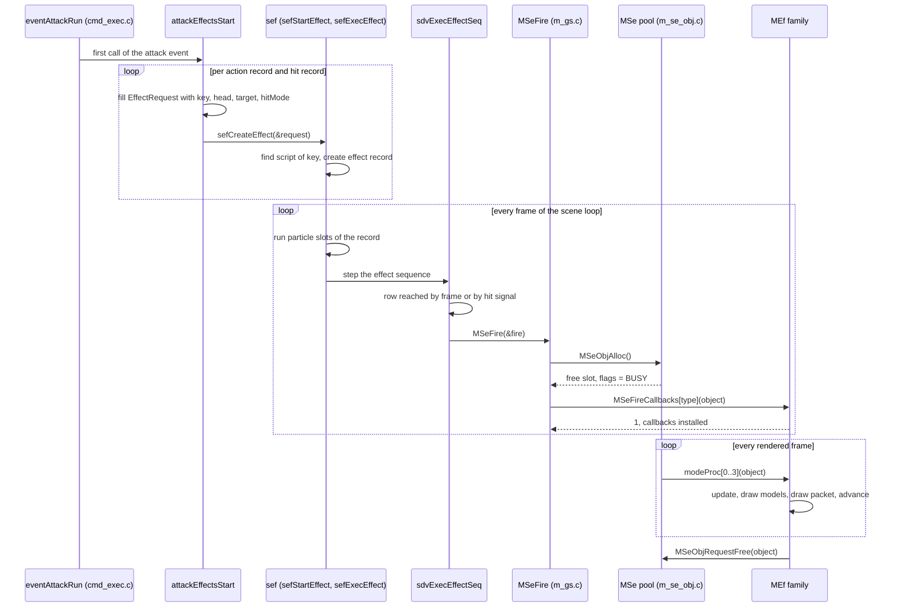

### Other senders

`attackEffectsStart` is not the only sender of effect requests. The other
senders start plain sef effects on a unit. Their scripts can contain effect
sequences too, so they can also fire `MSe` objects.

| Function | File | Use |
| --- | --- | --- |
| `unitEffectStart(unit, keyHigh, keyLow)` | `src/ov01/cmd_exec.c` | An effect on one unit. `head` and `target` are both the unit's actor |
| `unitEffectStartMode(unit, keyHigh, keyLow)` | `src/ov01/cmd_exec.c` | The same with `mode` 3 for the large units (unit keys from `UNIT_KEY_LARGE_FIRST`) and 2 for the others |
| `effectSendOwned(high, low, owner)` | `src/ov01/think_dispatch.c` | The script native `createEffect`. `head` is the owner's actor when an owner is given |
| `effectStartAtPosition(high, low, position)` | `src/ov01/think_dispatch.c` | The script native `createEffectPos`. No actors. The position is passed to `sefStartEffectAtPosition` |

`createEffectPos` reads its position from the **position table** of the battle
scene in `src/ov01/effect_pos.c`. The table is an array of 16-byte records: x,
y and z as integers in hundredths of a unit, and a fourth word. A fourth word
of -1 ends the table. `effectPosTableSet` stores the table base and counts the
records, `effectPosGet(index)` returns one record (0 past the end) and
`effectPosGetCount` returns the count. The scene loader sets the table from the
position data of the scene (`src/ov01/scene_load.c`). The same records also
place the battle units (`unitLoadSnapshot` in `src/ov01/unit_cmd.c`), and
`src/ov01/calc.c` reads the values 1 and 2 of the fourth word as flags of a position.
The natives are listed in [Natives](../scripting/natives.md).

`cmd_exec.c` uses `unitEffectStart` for a few fixed effects:

| Group | Record | Started by | Meaning |
| --- | --- | --- | --- |
| 0x136 | 0x12, 0x14, 0x13 | `attackHitsShow` | Hit effect on the target for step state 1, 2 and 3 of a plain hit |
| 0x136 | 0x11 | `attackHitsShow` | Hit effect for a hit with the flag `HIT_FLAG_CRITICAL` |
| 0x140 | 7 | `counterProc` | Shown when the target of a hit is granted a boost |
| 0x12C | 1, 2, 3 | `statEffProc` | Status auras of a unit |

The status auras are long-running effects. `statEffProc(unit)` picks one of
three by the unit's status rows: record 3 when status bit 1 of row 2 is set,
record 2 for any other status of row 2, record 1 for any status of row 1. It
starts the chosen aura when `sefOwnerPairInUse` reports that it is not running
yet, and switches the other two off with `sefApplyRecordMode(actor, key, 1)`.
`statEffOff` switches all three off and puts record 8 of the unit's own
sequence group into mode 2. `statEffOn` puts that record into mode 3 and runs
`statEffProc`. `eventAttackRun` calls `statEffOff` on every attacker before an
attack, so auras do not cover the technique.

## The fire entry

`MSeFireEntry` is the 0x40-byte request that `sdvExecEffectSeq` builds and
`MSeFire` copies into each new object. It is declared in
`include/main/m_se_obj.h`.

| Offset | Type | Name | Meaning |
| --- | --- | --- | --- |
| 0x00 | `int` | `type` | Index into `MSeFireCallbacks` and `MSeFireSpawnCount` |
| 0x04 | `XenoActor *` | `owner` | Always the source actor of the effect request |
| 0x08 | `int` | `ownerPart` | Attach point of the owner |
| 0x0C | `XenoActor *` | `link` | One of the three link actors of the request, when the row names one |
| 0x10 | `int` | `linkPart` | Attach point of the link actor |
| 0x20 | `Vector4` | `offset` | Offset from the attach point. The row stores it in thousandths of a unit |
| 0x30 | `XenoActor *` | `target` | The target actor of the request |
| 0x34 | `int` | `targetPart` | Attach point of the target |
| 0x38 | `int` | `param` | The effect id of the record. It selects the textures of the object |

An attach point is a node of the actor's motion package. The effect system
keeps the matrices of nodes 0 to 31 of each actor (see
[the actor entry table in sef](../libraries/sef.md)). How the row columns are
decoded into parts is described on the [sdv](../libraries/sdv.md) page. Two
results matter here. A row whose owner column names the source fills
`ownerPart` and leaves `link` empty. A row whose owner column names a link
actor fills `link` and `linkPart` and leaves `ownerPart` 0. Each family reads
either the owner pair or the link pair as its starting point, so a row must use
the column form that its family expects.

`MSeFireEntryClear(entry)` clears the 0x40 bytes before sdv fills them.

## MSeFire and the fire entry table

`MSeFire(entry)` in `src/ov01/m_gs.c` is the only way to create an object.

1. It reads `MSeFireSpawnCount[entry->type]`, the number of objects of this
   type per call.
2. For each one it calls `MSeObjAlloc`. When the pool has no free slot it
   prints "MSeFire: ObjBuffer full" and stops.
3. It stores `entry->param` in the object's `imageMapper` field and copies the
   whole entry to the object at +0x20.
4. It calls the constructor `MSeFireCallbacks[entry->type](object)`. A
   constructor that returns 0 gets its object marked for release with
   `MSeObjRequestFree`, and the message "MSeFire: Failed to create an effect
   (ID:%d)" is printed. All constructors in the game return 1.

`MSeFire` does not check the type against the table size. `MSeFireCallbacks`
has 14 entries and `MSeFireSpawnCount` has 16, the last two being 0.

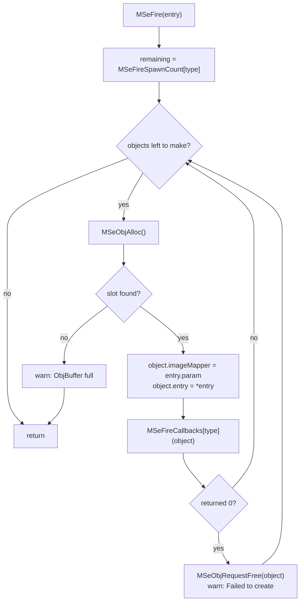

The table below lists every entry. The lifetime is the number of frames after
which the object asks to be freed, counted while the effect pause value is 0.

| Type | Constructor | Objects | Lifetime | What it is |
| --- | --- | --- | --- | --- |
| 0 | `MEfCreateWait` | 1 | 31 | An object that draws nothing and only counts frames |
| 1 | `MEfCreateHermitePath` | 8 | 55 | Thin blue trails that shoot out of an attach point along random curves |
| 2 | `MEfCreateSpiral` | 1 | 35 | A blue ribbon spiral that runs along a curve between two actors |
| 3 | `MEfCreateThunder25` | 1 | 28 | A lightning head that jumps from one actor to another |
| 4 | `MEfCreateThunder31` | 1 | 34 | A lightning head that passes the second actor and ends beyond it |
| 5 | `MEfCreateTepodon` | 1 | 38 | A model that flies in an arc and leaves smoke |
| 6 | `MEfCreateFlagWindow` | 1 | 55 | A pulsing tube of sixteen dark red lines along a curve |
| 7 | `MEfCreateWaveEffect` | 1 | 24 | A spindle of ten golden arcs between two points |
| 8 | `MEfCreateSpray` | 1 | 121 | Twenty glowing streaks that fall from above to the ground |
| 9 | `MEfCreatePathStep` | 8 | 49 | The large-scale form of type 1 |
| 10 | `MEfCreateSway` | 1 | 83 | Five missiles that spread out and then swirl away |
| 11 | `MEfCreateMissileTrail` | 1 | 68 | Five missiles that fly straight ahead with trails |
| 12 | `MEfCreateActorPath` | 1 | 17 | A fast purple swirl head along a curve between two actors |
| 13 | `MEfCreateActorHistory` | 1 | 39 | A wide orange ribbon spiral along a curve between two actors |

## The object pool

The pool is a block of 127 objects (`MSE_OBJ_SLOTS`) of 0x800 bytes each at the
fixed address 0x01FB0000 (`MSE_OBJ_POOL_ADDRESS`). That is 0x3F800 bytes, up to
0x01FEF800. The pool state is four small globals: `MSeObjPool` (the base),
`MSeObjCount` (the number of busy objects), `MSeObjReady` (bit 0 set while the
pool can be used) and the two hooks `MSeMode1Hook` and `MSeMode2Hook`.

Every object starts with the same 0x20-byte header.

```
MSeObj (0x800 bytes)
+0x000  u16   flags          0x001 BUSY, 0x100 FREE_REQUESTED
+0x004  u32   imageMapper    effect id, forced as image mapper before mode 2
+0x008  fn    modeProc[0]    update
+0x00C  fn    modeProc[1]    draw models
+0x010  fn    modeProc[2]    draw GS packet
+0x014  fn    modeProc[3]    advance, request free
+0x020  MSeFireEntry entry   the request (0x40 bytes)
+0x060  ...                  family state
```

Each family declares its own view of the object: the header, then a block that
starts at +0x20. The first 0x40 bytes of the block are the fire entry. All
families then place the same two things behind it, and their private state
after that.

| Block offset | Type | Meaning |
| --- | --- | --- |
| 0x00 to 0x3F | `MSeFireEntry` | The request as copied by `MSeFire` |
| 0x40 | `MGsPacket` | The GS packet of the object (0x14 bytes) |
| 0x54 | `u16` | The frame counter of the object |
| 0x60 and up | | Positions, matrices, sample tables of the family |

The pool functions are short.

- `MSeObjInit` sets the pool base, clears count and hooks, clears all 127
  objects with `memset` and sets the ready bit.
- `MSeObjShutdown` clears the ready bit, the count and the base pointer.
- `MSeObjAlloc` returns the first object without the BUSY bit, or 0 when the
  count has reached 127. It sets `imageMapper` to 0, the flags to BUSY, and the
  four callbacks to 0.
- `MSeObjRequestFree(object)` sets the FREE_REQUESTED bit. The object stays
  alive until the end of the current frame.
- `MSeSetMode1Hook(hook)` and `MSeSetMode2Hook(hook)` store a function that
  `MSeObjProc` calls without arguments after its mode 1 or mode 2 pass. No code
  in the game installs a hook, so both stay 0.

The battle scene owns the pool. `ov01SceneStateReset` in `src/ov01/m_gs.c` is
called when a battle scene is initialised. It starts sef in battle mode
(`sefInitEffect`, `sefInitEffectBattle`), clears the pause value and the tick
counter, seeds the `MMath` random generator with 0 and calls `MSeObjInit`.
`ov01SceneSystemsShutdown` runs when the scene is released. It calls
`MSeObjShutdown` and `sefDestroyEffect`. Objects that are still alive at that
point are simply dropped with the pool.

## Object lifecycle and frame timing

`MSeObjProc(mode)` runs one pass over the pool. It returns at once when the
ready bit is clear. Otherwise it walks the objects from the first slot and
calls `modeProc[mode]` of every busy object that has one. The walk stops early
once it has seen as many busy objects as `MSeObjCount` says exist. Each mode
adds something of its own.

| Mode | Before or during the walk | After the walk |
| --- | --- | --- |
| 0 | Takes the camera snapshot `MEfCamParams` | |
| 1 | | Calls `MSeMode1Hook` when set |
| 2 | Calls `svForceImageMapper(0)`, then forces each object's own mapper | Calls `MSeMode2Hook` when set |
| 3 | Frees every object with the FREE_REQUESTED bit: flags 0, count minus one | |

Any other mode prints a warning.

The four passes are not called from the battle loop. They run inside the draw
passes of sef, and only when sef is in battle mode (`_sefBattleMode` set by
`sefInitEffectBattle`):

- `sefDrawEffect` is called by the frame function of the renderer before the
  model lists are flushed. After the model points of the effect records it
  runs `MSeObjProc(0)` and `MSeObjProc(1)`.
- `sefDrawEffect2D` is the hook that draws the world sprites of effects after
  the scene. After them it runs `MSeObjProc(2)` and `MSeObjProc(3)`.

Mode 1 is therefore the place for model draws: models submitted there are
flushed with the rest of the scene. Mode 2 is the place for GS packets: they
are sent after the scene and after the effect sprites, so the additive trails
lie over everything. Both draw passes are skipped while bit
`SEF_DRAW_FLAG_PENDING` of `gameWork.control` is set, and then the objects do
not advance either. The order of the draw passes in a frame is described in
[Rendering](../architecture/rendering.md).

An object that `MSeFire` creates during `sefExecEffect` gets its first mode 0
call in the render of the same frame.

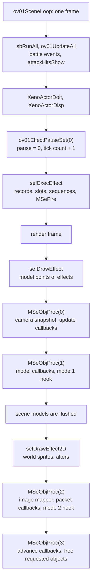

All families use the four slots the same way. Mode 0 updates the state that
the draw needs: it sets the flag of the newest sample, moves trail histories or
emits smoke. Mode 1 submits models and exists only in the families that have
one (both thunders, Tepodon, sway, missile trail). Mode 2 builds the GS packet
and sends it. Mode 3 increases the frame counter and calls `MSeObjRequestFree`
when the counter reaches the lifetime of the family. Because mode 3 of the pool
frees the object directly after the callback, the object disappears in the same
pass that asked for it.

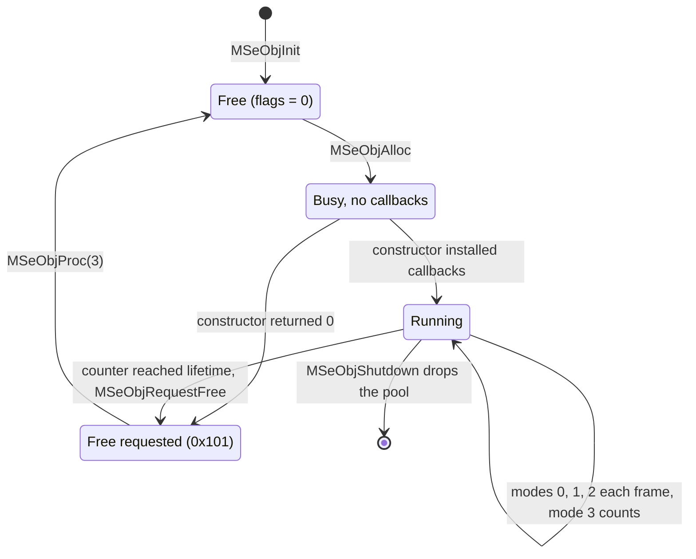

### The camera snapshot

`MEfCamParams` is a block of type `MEfCameraParams` that mode 0 refreshes
before any callback runs. It holds the camera of the current studio
(`xglStudioGetCamera2(0)`), a copy of its view matrix
(`camera->volume[0].viewMatrix`), its rotation angles
(`camera->travel.rotation`) and a rotation matrix built from them with
`MMathRotateMatrixYXZ`. The families project their points with
`MMathRotTransPersClip(out, camera, viewMatrix, point)`, which returns nonzero
for a point that is clipped. The rotation matrix is the basis for quads that
face the camera. Cameras and studios are explained in
[xgl](../libraries/xgl.md).

### Textures and the image mapper

An effect record owns an image mapper, a list of the textures and models of its
effect files. `MSeFire` stores the effect id of the record in
`object->imageMapper`. Mode 2 of the pool first forces mapper 0 and then, for
each object with a callback and a mapper id that differs from the one in force,
calls `svForceImageMapper(id)`. Ids of 0x100 and above are ignored.

The families look their resources up by name with
`svGetPrmFromName(name, type, &param)`. For a name that ends in `bmp` the
function finds the bitmap and its CLUT and returns a ready `TEX0` register
value. For a name that ends in `pxy` it returns the model data and its `txy`
texture block. The `type` argument is the mapper id. Families pass their own
`imageMapper` for resources that belong to the effect that fired them, and 0
for resources of the common battle set.

| Name | Type argument | Used by |
| --- | --- | --- |
| `de_thun01.pxy` | 0 | Thunder25 sparks |
| `tex_thun01.pxy` | object's mapper | Thunder25 and Thunder31 sparks |
| `sh_hikari.bmp` | object's mapper | Thunder25 and Thunder31 quads |
| `tepodon.pxy` | object's mapper | Tepodon model |
| `kemuri01_.bmp` | 0 | Tepodon smoke |
| `missile.pxy` | object's mapper | Sway and missile trail models |

The effect files on the discs confirm these names: every picture and model
that the coded objects look up is in the pack or file where the code expects
it. They also show how little the fire path is used. Only eight effect scripts
have an effect sequence at all, with 41 rows between them, and those rows fire
object types 1, 3, 5, 7, 8, 9, 10 and 11. Types 0, 2, 4, 6, 12 and 13 are never
fired from an effect file (see [Effect data](../formats/effects.md)).

## Pause and the tick counter

`src/ov01/m_gs.c` keeps two small values for the effects of a scene.

`ov01EffectPauseSet(value)` stores `value` as the pause value and adds one to
the tick counter. `ov01EffectPauseGet()` returns the pause value. Every family
tests it at the start of its update and advance callbacks and returns when it
is not 0. The draw callbacks do not test it. A nonzero pause value would
therefore freeze every `MSe` object in place while it is still drawn each
frame.

The only caller of `ov01EffectPauseSet` is the battle scene loop
`ov01SceneLoop` in `src/ov01/scene.c`, and it always passes 0, directly before
`sefExecEffect`. In the game as shipped the pause value is thus always 0 and
the function acts as the frame tick of the scene. The scene loop skips this
whole block while its wait hook `pauseProc` reports a wait, but `pauseProc`
always returns 0.

`ov01TickCountGet()` returns the tick counter: the number of scene loop frames
since `ov01SceneStateReset`. The path end marker uses it to turn once every 60
ticks.

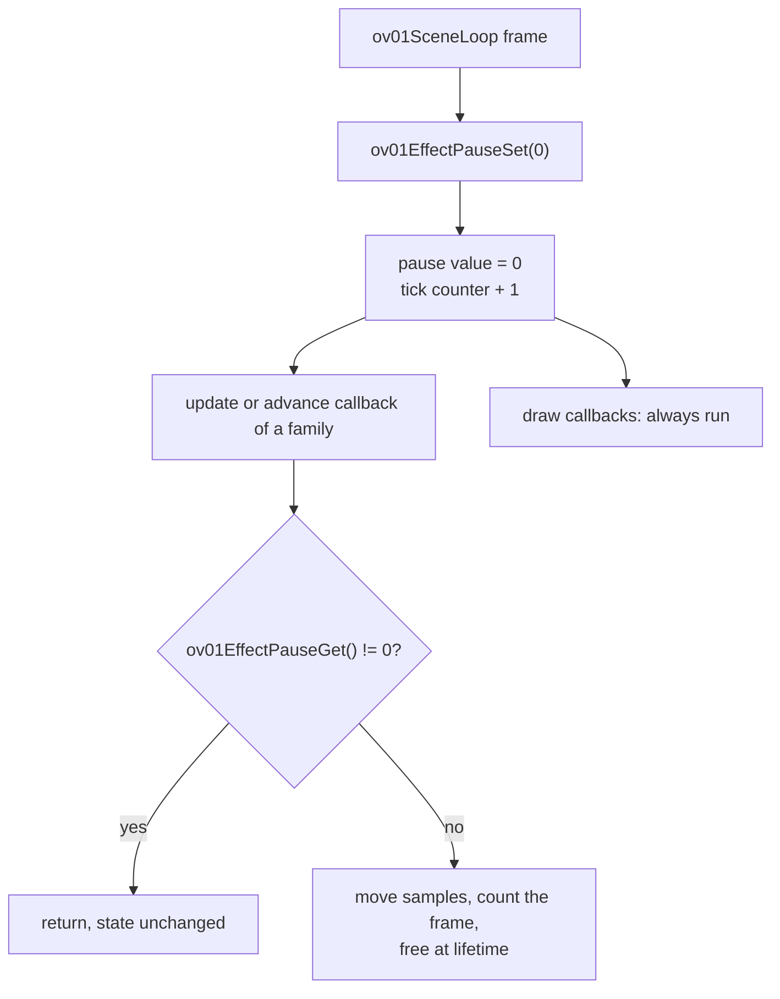

## GS packets

A family draws by writing GIF data into an `MGsPacket` and sending it through
VIF1 as direct data. The packet record is 0x14 bytes.

| Offset | Type | Name | Meaning |
| --- | --- | --- | --- |
| 0x00 | `void *` | `data` | Start of the buffer |
| 0x04 | `int` | `capacity` | Size of the buffer in bytes. Stored but never checked |
| 0x08 | `MEfGsQword *` | `current` | The open GIF tag |
| 0x0C | `int` | `count` | Quadwords written so far |
| 0x10 | `int` | `regCount` | Registers per loop of the open tag |

`MGsGPInit(packet, address, size)` prepares the record. With `address` 0 the
buffer is the scratchpad (`SCRATCHPAD_BASE`) and the capacity is 0x400. Every
family passes 0, so all objects build their packets in the same scratchpad
area, one after another. That works because each draw callback builds and
sends its packet before it returns.

`MGsGPTerm(packet)` sends the packet. When `count` is 0 it only resets the
cursor. Otherwise it takes the current VIF1 packet (`xglPacketGetCurrent`),
adds a `FLUSH` code (0x11000000), opens a direct transfer, appends `count`
quadwords from `data` with `sceVif1PkAddDirectDataN` and closes the transfer.
Then it resets cursor and counts. The spray and the wave call it several times
in one draw to keep each transfer small. The packet path from VIF1 to the GS is
described in [Rendering](../architecture/rendering.md).

Each family has the same three inline helpers. `OpenTag` writes a GIF tag with
EOP set, the primitive and the register count, and returns the first data
quadword. `SetRegister` writes one A+D register. `CloseTag(packet, nloop)`
stores the loop count into the tag and moves the cursor past `regCount × nloop
+ 1` quadwords. An empty tag is left open and overwritten by the next one.

Every packet starts with a setup tag (`MEF_GS_SETUP_TAG`, register list A+D)
that writes three registers:

| Register | Value | Meaning |
| --- | --- | --- |
| `TEST_1` | 0x5000C (`MEF_GS_TEST_1_ZGEQUAL`) | Depth test "greater or equal", no alpha test |
| `TEST_1` | 0x5000D (`..._ATE_ATST_GREATER_ZGEQUAL`) | The same plus an alpha test that drops pixels with alpha 0 |
| `ZBUF_1` | 0x131000000 (`MEF_GS_ZBUF_1_NO_DEPTH_WRITE`) | Depth writes off |
| `ALPHA_1` | 0x48 (`MEF_GS_ALPHA_1_ADDITIVE`) | Source colour times source alpha, added to the frame buffer |

The effects are thus tested against the scene depth but never write depth, and
they add light to the picture. The textured families write `TEX1_1` (0x60) and
`CLAMP_1` (5) as well, and one `TEX0_1` before each quad.

The primitives are:

| Primitive value | Registers per vertex | Used for |
| --- | --- | --- |
| 0x4C, triangle strip, Gouraud, blended | RGBAQ, XYZ2 twice per loop (`0x5151`) | Ribbons with a colour per edge |
| 0x4C with register list `0x551` | RGBAQ, XYZ2, XYZ2 | Missile trails with one colour per step |
| 0x4A, line strip, Gouraud, blended | RGBAQ, XYZ2 | Flag window, spray, wave outlines |
| 0x54, textured triangle strip, blended | ST, RGBAQ, XYZ2 | Thunder quads, smoke puffs |

All strips share one clipping rule. A vertex that `MMathRotTransPersClip`
rejects sets a countdown of 2 (1 for line strips). While the countdown runs,
the following vertices get the ADC bit (`MEF_GS_XYZ_ADC`, 0x8000 in the fourth
word), which tells the GS to take the vertex without drawing. The strip
restarts cleanly behind a clipped point.

The four ST quadwords of a textured quad come from the table `McEfSTQtbl` in
`m_gs.c`: (0,0), (1,0), (0,1), (1,1), each with Q = 1.

## Shared helpers of the MEf core

`src/ov01/m_ef.c` starts with the helpers that the families share.

`MSeGetActorMatrix(destination, actor, coordinate)` gives the world matrix of
an attach point. It starts from the unit matrix. A null actor prints
"MSeGetActorMatrix: actor is NULL" and returns the unit matrix. The coordinate
selects the point:

| Coordinate | Result |
| --- | --- |
| -1 (`MEF_POINT_ACTOR`) | A rotation about y by the actor's `rotation.y`, placed at the actor's position |
| -2 (`MEF_POINT_ACTOR_RAISED`) | The same with the y of the position replaced by 1.5 |
| other | The matrix of node `coordinate` from `sefActorMulLocalMatrix`. When the node does not exist the function falls back to the actor origin and prints "MSeGetActorMatrix: Invalid point (%d)" |

`MEfGetActorCoord(destination, actor, coordinate)` returns only the position
row of that matrix, with w = 1.

`MEfMakeRandomVector(destination)` fills x, y and z with `MMathMakeRandomPI()`
and w with 1. The thunders use it as three random rotation angles.

`MEfMake4Vertex(destination, source, halfSize)` makes a square that faces the
camera. It copies the rotation matrix of the camera snapshot, puts `source`
into its position row, transforms the four corners (±halfSize, ±halfSize, 0)
and projects them. The return value is the number of clipped corners.
`MEfMake4Vertex2(destination, source, halfSize, angleBase)` does the same with
a roll angle: the corners sit at the angles `angleBase` + 0, π/2, 3π/2 and π on
a circle of radius `halfSize × √2`. The thunder quads and the smoke puffs use
it, and they draw nothing when any corner is clipped.

`MEfScatterXY(destination, target, source, spread)` returns a random point on a
disc around `source`, in the plane across the direction to `target`.
`MEfMake4Vertex`, `MEfScatterXY` and `MEfMakeTranslationMatrix` (a unit matrix
with the translation 1, 2, 3) have no callers among the families.

### The path curve

Most families move along a Hermite curve between two points. They all build it
in one shared work area, `mefPathCurve` (0x2000 bytes in `m_ef.c`). The curve
is only needed inside a constructor: the constructor samples it into the
object's own tables, and the next constructor may overwrite the area.

`MEfPathCurve` (`include/ov01/m_ef_path.h`) is the head of that area.

| Offset | Type | Name | Meaning |
| --- | --- | --- | --- |
| 0x00 | `int` | `count` | Number of key points in use |
| 0x10 | `Vector4[8]` | `points` | The key points |
| 0x90 | `Vector4` | `tangentStart` | Tangent at the start of the current segment |
| 0xA0 | `Vector4` | `tangentEnd` | Tangent at its end |

`MEfHermitePathInit(curve, count)` clears the 0xB0 bytes and stores the count.
`MMathCalcHermiteKeyPrm(curve, index)` prepares segment `index`, the piece from
point `index` to point `index + 1`. It passes the previous point, the two ends
and the next point to `MMathCalcHermitePrm`, which computes the two tangents.
At the first segment the previous point is the start itself, and at the last
one the next point is the end itself. `MMathCalcHermiteKey(destination, curve,
index, t)` then returns the point at parameter `t` (0 to 1) of that segment.

Five families (spiral, thunder25, actor path, actor history and, with other
numbers, flag window and thunder31) lay out four key points with the same
recipe:

1. Point 0 is the start point A and point 3 is the end point B.
2. Point 1 lies in front of the start: the start matrix applied to (0, 0, d/3),
   where d is the distance from A to B. The curve therefore leaves the start
   actor along the z axis of its attach point.
3. The direction angles from point 0 to point 1 and from point 1 to point 3
   are averaged (`MMathCalcAngle`, `MMathVectorInterpolation` at 0.5).
4. Point 2 lies on that mean direction from point 1, at half the distance from
   point 1 to point 3.

The curve has three segments. Each family samples it with a fixed number of
steps per segment, and the last sample is the end of segment 2.

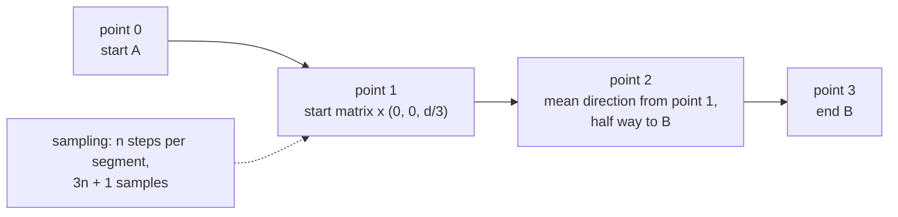

### The moving window

A second idea is shared by the families that draw a streak of light running
along a fixed curve (Hermite path, path step, spiral, flag window, wave, actor
history). The curve is sampled once, at creation. Next to the samples the
object keeps one 16-bit flag word per sample. Each frame:

- The update callback sets the flag word of sample 0 from the frame counter.
  While the counter is below the active length the word is 1 (active). At
  counter 0 it is 0x11 (active and START). At the last active count bit 0x20
  (END) is added. After that the word is 0.
- The advance callback shifts all flag words by one sample toward the end of
  the curve and increases the counter.

The draw callback draws only samples whose flag word is not 0. The result is a
window of lit samples that enters at the start of the curve, travels to the
end at one sample per frame and leaves there. The START and END samples are
drawn with zero width, which gives the streak pointed ends. The object is
freed when the window has left the curve.

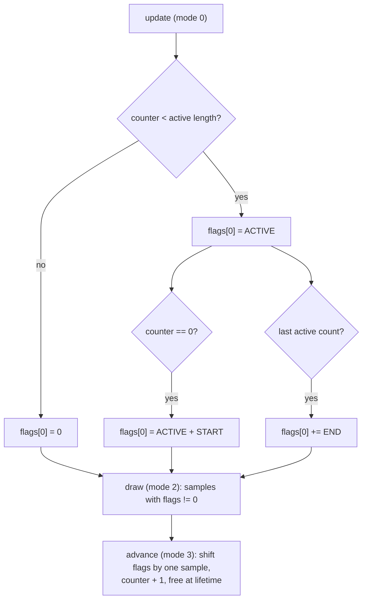

### Marker drawers

`src/ov01/m_ef_path.c` contains three small drawers that add primitives
to an open packet.

- `MEfDrawFrameAxes(packet, matrix)` draws the three axes of a frame as lines
  from -0.4 to 1.2 in the colours of `mefAxisColors`.
- `MEfDrawPointCross(packet, point)` draws a cross of three lines of half
  length 0.25 around a point.
- `MEfDrawPathEndMarker(packet, point, scale)` draws four triangles around a
  point in the camera plane. The shape is one triangle from `mefMarkerCorners`
  repeated at quarter turns, in an orange colour, and the whole marker turns by
  6 degrees per tick (`ov01TickCountGet() % 60`).

The first two have no callers and look like development aids. The third is
part of the Thunder31 effect, which draws it at the end of its path.

## The effect families

Each family below is one file. The offsets in the record tables are block
offsets, counted from +0x20 of the object, so the fire entry occupies 0x00 to
0x3F.

### Wait (type 0)

`MEfCreateWait` in `m_ef.c` installs three callbacks and clears a counter at
block +0x70. The update callback `MEfWaitPhaseFlagsDummy` is empty. The advance
callback `MEfWaitStep` counts frames and frees the object after 31
(`MEF_WAIT_FRAMES`).

The packet callback `MEfWaitDraw` draws nothing. It runs
`MMathQuatToMatrix_00272EC8` 0x14050 (82,000) times on a fixed quaternion
(-4, 3, -2, 1) and throws the result away. This is a pure processor load of 31
frames. It is likely a leftover test object for measuring the cost of the pool,
and nothing in the code shows which effect scripts, if any, use type 0.

### Hermite path (type 1)

Type 1 makes eight objects per row. Each one is a thin, bluish trail that
leaves the owner's attach point, bends outward on its own random curve and
splits into two branches near its end.

`MEfCreateHermitePath` reads the owner actor, `ownerPart` and the offset.

| Block offset | Type | Name | Meaning |
| --- | --- | --- | --- |
| 0x04 | `XenoActor *` | `actor` | The owner |
| 0x08 | `u32` | `coordinate` | Its attach point |
| 0x20 | `Vector4` | `vector` | The offset of the row |
| 0x40 | `MGsPacket` | `packet` | |
| 0x54 | `short` | `step` | Frame counter |
| 0x60 | `Vector4` | `origin` | Start point |
| 0x70 | `Matrix4` | `matrix` | Attach matrix, moved to the start point |
| 0xB0 | `float` | `angle` | Random roll of the trail |
| 0xB4 | `u16[25]` | `flags_history` | The moving window |
| 0xF0 | `Vector4[4][25]` | `path` | Rows 0 and 1: the two branches. Rows 2 and 3: their direction angles |

`MEfStartFromActor` builds the curve. The start point is the attach matrix
applied to the offset. A random angle is drawn until it lies outside the range
of 220 to 320 degrees. A direction of turn (±6 degrees per key) and a scale
(a random number plus 0.05) are drawn as well. The four key points are placed
in the frame of the attach point at (cos a × r × scale, sin a × r × scale,
depth), with the radii 0, 5, 7, 8 and the depths 0, 1.6, 8, 20, and the angle
turns a little from key to key. The trail thus runs 20 units along the z axis
of the attach point while it drifts up to 8 units sideways.

`MEfSampleHermitePath` samples 25 points, eight per segment. Each sample is
stored twice: in row 0 pushed to one side and in row 1 pushed to the other
side, along a random direction across the path. The push is 0 up to sample 10.
From sample 11 on it grows by a step that starts at 0.5 and shrinks by 15
percent per sample. Rows 2 and 3 get the direction angles between neighbouring
samples, with the roll `angle` in z.

The window is 30 frames long (`MEF_PHASE_STEPS`) and the object lives 55
frames. `MEfDrawStepTrail` draws four strands per trail part. A strand is a
narrow blade: an inner and an outer edge vector, turned by 90 degrees from
strand to strand, so the four blades form a small cross around the path.

- The head covers samples 0 to 11 of row 0. Its blades reach from 0.005 to
  0.06 units. The colours start at the blue tones (0x10, 0x30, 0xA0) and
  (0x00, 0x10, 0x80) and shift toward green for samples near the start.
- The tail covers samples 10 to 24 of both rows, with blades from 0.003 to
  0.03. Samples 22 and 23 are drawn with four interpolated steps each to keep
  the widening end smooth.

Samples with the START or END flag are drawn with zero width and alpha 0.

### Path step (type 9)

`MEfCreatePathStep` is the same effect at a larger scale, with its own record
and tables. It also makes eight objects per row.

| Difference | Hermite path | Path step |
| --- | --- | --- |
| Samples | 25, eight per segment | 19, six per segment |
| Key radii | 0, 5, 7, 8 | 0, 30, 42, 48 |
| Key depths | 0, 1.6, 8, 20 | 0, 30.4, 152, 380 |
| Start angle | Rejected between 220 and 320 degrees | Any |
| Branch push | From sample 11, first step 0.5 | From sample 9, first step 2.0 |
| Head samples and blade | 0 to 11, 0.005 to 0.06 | 0 to 9, 0.03 to 0.32 |
| Tail samples and blade | 10 to 24, 0.003 to 0.03 | 8 to 18, 0.015 to 0.17 |
| Lifetime | 55 frames | 49 frames |

The path is 19 times as long as that of type 1. The two types are otherwise
alike down to the colour tables, so type 9 is most likely the version for
scenes with a larger scale. `MEfSetPathPhaseFlags`, `MEfDrawPathStepTrail` and
`MEfAdvanceStepShort` are its callbacks.

### Spiral (type 2)

The spiral in `m_ef_spiral.c` is a set of eight blue ribbons that wind around
a curve from one actor to another. It reads the link actor as the start and
the target as the end.

| Block offset | Type | Name | Meaning |
| --- | --- | --- | --- |
| 0x0C | `XenoActor *` | `startActor` | The link actor |
| 0x10 | `u32` | `startCoordinate` | Its attach point |
| 0x30 | `XenoActor *` | `endActor` | The target |
| 0x34 | `u32` | `endCoordinate` | Its attach point |
| 0x40 | `MGsPacket` | `gs` | |
| 0x54 | `u16` | `step` | Frame counter |
| 0x60 | `Vector4` | `coord_a` | Start point |
| 0x70 | `Vector4` | `coord_b` | End point |
| 0x80 | `Matrix4` | `matrix` | Attach matrix of the start |
| 0xC0 | `short[25]` | `key_flags` | The moving window |
| 0x100 | `Vector4[25]` | `keys` | Samples of the curve |
| 0x290 | `Vector4[25]` | `angles` | Direction at each sample |

`MEfCreateSpiral` reads both points and the start matrix, builds the curve
with the common recipe (`MEfBuildSpiralCurve`) and samples 25 keys, eight per
segment (`MEfFillSpiralKeys`).

The window is 10 frames long and the object lives 35 frames. Each frame
`MEfDrawSpiralStrips` draws eight triangle strips. Strip number s starts at the
angle s × 45 degrees minus 3 degrees per frame of age, and the angle grows by
30 degrees from key to key. At each lit key the strip puts two vertices 0.4
units away from the path at that angle, 0.13 units before and behind the key
along the path. The outer vertex has the colour (0x00, 0x40, 0x80) with alpha
0xC0 and the inner one (0x00, 0x00, 0x80) with alpha 0x30. The width is 0 at
the START and END keys and at the first and last key of the curve. Eight
ribbons that each turn by 30 degrees per key give the look of a twisted rope of
light that travels from attacker to target in about 25 frames.

### Thunder25 (type 3)

`m_ef_thunder25.c` draws the head of a lightning bolt that jumps along a curve
from the link actor to the target. The bolt has no body of its own. It is a
bright point with sparks that moves one sample per frame, and the four last
positions glow behind it.

| Block offset | Type | Name | Meaning |
| --- | --- | --- | --- |
| 0x0C, 0x10 | | `firstActor`, `firstCoordinate` | The link actor and its attach point |
| 0x30, 0x34 | | `secondActor`, `secondCoordinate` | The target and its attach point |
| 0x40 | `MGsPacket` | `gsPacket` | |
| 0x54 | `u16` | `ticks` | Frame counter |
| 0x60 | `Vector4` | `firstPoint` | Start point |
| 0x70 | `Vector4` | `secondPoint` | End point |
| 0x80 | `Matrix4` | `matrix` | Attach matrix of the start |
| 0xC0 | `Vector4[25]` | `samples` | Samples of the curve |

`MEfCreateThunder25` reads the two points. The end point is then replaced by
the world point of the target's node from `sefActorMulLocalVector`. The curve
uses the common recipe (`MEfBuildThunder25Record`) and is sampled into 25 points
(`MEfFillThunderSamples25`).

The model callback `MEfDrawThunderSparks25` runs while the counter is below 25.
At the sample of the current frame it submits six copies of the model
`de_thun01.pxy` and four copies of `tex_thun01.pxy`. Every copy gets three new
random rotation angles and a random scale (0.5 to 0.8 for the first model, 0.4
to 0.7 for the second) each frame, which makes the sparks flicker. The models
are drawn with the stencil option on and the blend value 0x48
(`mefSparkStencilAlpha25`).

The packet callback `MEfDrawThunderQuads25` draws glow quads with the texture
`sh_hikari.bmp`. For each of four layers it takes the sample `ticks - layer`,
when that sample exists, and appends two quads there with
`MEfAppendThunderQuad25`. Each quad is moved by a random amount on all three
axes, faces the camera with a random roll and has the colour (0x80, 0x80, 0x80)
with alpha 0x40.

| Layer | Sample | Jitter | Quad half size |
| --- | --- | --- | --- |
| 0 | head | ±0.05 | 1.0 |
| 1 | one frame back | ±0.04 | 0.55 |
| 2 | two frames back | ±0.03 | 0.35 |
| 3 | three frames back | ±0.02 | 0.2 |

`MEfAdvanceThunder25` frees the object after 28 frames, three frames after the
head has reached the target, so the afterglow can run out.

### Thunder31 (type 4)

`m_ef_thunder31.c` is the second bolt. It differs in its path and adds an end
marker. The record is the same as that of Thunder25 with one more vector: the
path end at block +0x80, the matrix at +0x90 and 31 samples at +0xD0.

`MEfMakeRotatedPath` does not end the curve at the target. It takes the line
from the start to the target and extends it to 1.4 times its length. Around
that far point it picks a random spot on a disc of radius 0.4 to 1.9 across
the line. That spot is point 3. Point 1 is the start matrix applied to
(0, 0, d/3) and point 2 lies a further d/3 along the mean direction, where d is
the distance from the start to point 3. The bolt therefore passes close to the
target and strikes somewhere behind it, at a different place every time.

The curve is sampled into 31 points, ten per segment. `MEfDrawThunderSparks31`
submits six copies of `tex_thun01.pxy` at the head with scales of 0.4 to 0.8.
`MEfDrawThunderQuads31` draws the same four layers of quads as Thunder25 and
then calls `MEfDrawPathEndMarker` at the path end with scale 0.2: a small
turning orange star that marks the point of impact for the whole life of the
object. The lifetime is 34 frames.

### Tepodon (type 5)

`m_ef_create_smp_01.c` flies one model, `tepodon.pxy`, in a high arc from the
owner to the target and trails smoke behind it. The functions of the smoke keep
older names (`updateSmoke`, the tables `coltbl` and `sztbl`).

| Block offset | Type | Name | Meaning |
| --- | --- | --- | --- |
| 0x04, 0x08 | | `firstActor`, `firstCoordinate` | The owner and its attach point |
| 0x30, 0x34 | | `secondActor`, `secondCoordinate` | The target and its attach point |
| 0x40 | `MGsPacket` | `packet` | |
| 0x54 | `u16` | `ticks` | Frame counter |
| 0x60 | `Vector4` | `sample` | Current position |
| 0x70 | `Vector4` | `prevSample` | Position one frame ago |
| 0x80 | `Vector4[58]` | `ring` | 29 path samples, then 29 direction angles |
| 0x420 | `short[9]` | `smokeActive` | One flag per smoke trail |
| 0x440 | `Vector4[9][5]` | `smokePoints` | Puff positions, newest trail first |
| 0x710 | `float[9][5]` | `smokeAngles` | Roll of each puff |

`MEfCreateTepodon` reads the start and the end point. The end is moved by a
random distance of up to 2 units in a random direction in the x-y plane, so
repeated shots do not land on one spot. `MEfBuildTepodonArcKeys` lays out five
keys: the two ends and three keys at 3, 15 and 40 percent of the way, lifted by
1.6, 3.0 and 2.8 units. The arc rises steeply at the start and comes down in a
long slope. `MEfFillTepodonSamples` samples 29 points, seven per segment, and
the direction between each pair.

Each frame runs like this:

- `updateSmoke` (mode 0) moves the nine smoke trails one slot older. While the
  model is still flying (counter below 29) it makes a new trail of five puffs
  spread along the step from the previous position to the current one, each
  moved up to 0.03 units sideways and given a random roll.
- `MEfDrawTepodonModel` (mode 1) submits the model at the current sample,
  turned into the direction of flight and scaled by (0.25, 0.25, 0.5). It stops
  when the counter reaches 29.
- `MEfDrawRotatedQuads` (mode 2) draws every puff of every active trail as a
  camera-facing quad with the texture `kemuri01_.bmp`. The quad half size grows
  with the age of the trail from 0.1 to 0.26 and drops to 0.22 for the oldest
  one. The colour is grey (0x80) with an alpha of 0x78 for the newest trail,
  0x80 in the middle and 0x70 for the oldest.
- `MEfAdvanceTepodon` (mode 3) steps the counter and the two positions and
  frees the object after 38 frames, nine frames after the flight ends, which is
  exactly the time the last smoke trail needs to age out.

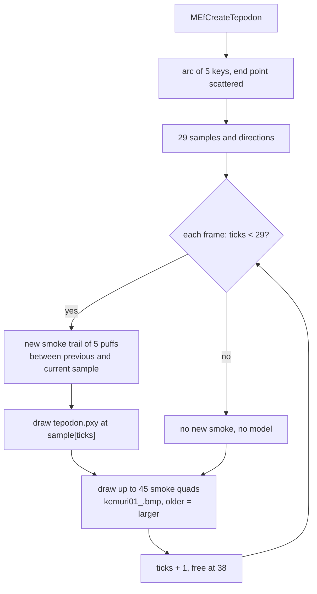

### Flag window (type 6)

`m_ef_flag_window.c` draws a tube of sixteen dark red lines that pulses along
a curve. The file name describes the mechanism, a window of status flags, and
not the look. It reads the link actor as the start and the target as a point on
the way.

The record has the layout of the spiral: both actors, the packet, a signed counter at
+0x54, the two points at +0x60 and +0x70, the start matrix at +0x80, 25 status
words at +0xC0, 25 positions at +0x100 and 25 direction angles at +0x290.

`MEfMakeFlagWindowPath` uses a different layout of the four keys. Point 0 is
the start and point 2 is the target point. Point 1 is the start matrix applied
to (0, 0, d/2), where d is the distance between the two. Point 3 lies d/2
beyond the target, in the direction in which the curve arrives there, turned
further by one to two times the bend between the first two legs. The curve
thus runs through the target and curls on behind it. It is sampled into 25
points, eight per segment.

The window is 30 frames long and the object lives 55 frames.
`MEfDrawFlagWindow` draws sixteen line strips. Strip s lies at the angle s ×
22.5 degrees minus 6 degrees per frame of age around the path. The distance of
a point from the path is `cos((sample - age) × 60°) × 0.2 + 0.25`, which is a
standing wave of bulges that moves along the tube as the object ages. START
and END samples collapse to the path itself. The colour is (0x40, 0, 0) at
full alpha, drawn additively.

### Wave (type 7)

`m_ef_wave.c` draws a spindle of ten arcs that spans the straight line from
the owner to the target.

| Block offset | Type | Name | Meaning |
| --- | --- | --- | --- |
| 0x04, 0x08 | | `actor`, `coordinate` | The owner and its attach point |
| 0x20 | `Vector4` | `startOffset` | Offset of the row, added to the start |
| 0x30, 0x34 | | `endActor`, `endCoordinate` | The target and its attach point |
| 0x40 | `MGsPacket` | `gsState` | |
| 0x54 | `u16` | `ticks` | Frame counter. It counts in steps of 2 |
| 0x60 | `Vector4` | `startVector` | Start point |
| 0x70 | `Vector4` | `endVector` | End point |
| 0x80 | `float` | `sampleScale` | 0.375 times the distance |
| 0x90 | `Matrix4` | `matrix` | Rotation that points from start to end |
| 0xD0 | `Vector4[26]` | `blendedSamples` | Points on the axis |
| 0x270 | `u16[26]` | `history` | The moving window |
| 0x2B0 | `Vector4[26]` | `sineSamples` | Radius of the arc at each sample |
| 0x450 | `Vector4[26]` | `trailPoints` | Work points of the current arc |
| 0x5F0 | `Vector4[26]` | `trailAngles` | Work directions of the current arc |

`MEfCreateWaveEffect` has no Hermite curve. `MEfBlendSineSamples` places 26
points on the line from start to end with an ease-in, ease-out spacing (the
blend factor is `(sin(i/25 × π + 3π/2) + 1) / 2`). `MEfBuildSineSamples` gives
each point a radius of `sin(i/25 × π) × sampleScale + 0.1`. The radius is small
at both ends and reaches three eighths of the distance in the middle.

`MEfDrawWaveEffect` draws ten arcs. Arc p is the row of points pushed out from
the axis by their radius, in a direction turned by `p × 26.67° - 30°` around
the axis. For each arc it draws four narrow ribbons (edge vectors from 0.005 to
0.3 units, turned by 90 degrees from ribbon to ribbon) in the colours (0x50,
0x42, 0x18) and (0x04, 0, 0), and then one line strip along the arc itself in
the brighter colour (0x80, 0x70, 0x28). START and END samples are drawn black
and without width. The packet is sent after every second arc.

The wave runs at double speed. `MEfSetWaveMode` sets two window entries per
frame, `MEfAdvanceHistoryTrail` shifts the window twice and adds 2 to the
counter. The window is active while the counter is below 21, that is for 11
frames, and the object is freed when the counter reaches 47, after 24 frames.

### Spray (type 8)

`m_ef_spray.c` is the only family that ignores the actors of its entry. It
works in fixed world coordinates around the origin of the battle scene.

| Block offset | Type | Name | Meaning |
| --- | --- | --- | --- |
| 0x40 | `MGsPacket` | `gs` | |
| 0x54 | `u16` | `ticks` | Frame counter |
| 0x60 | `Vector4[20]` | `origins` | The moving lower end of each streak |
| 0x1A0 | `Vector4[20]` | `anchors` | The upper end |
| 0x2E0 | `Vector4[20]` | `steps` | Movement per frame |
| 0x420 | `Vector4[20]` | `scaledSteps` | The movement scaled down |

`MEfCreateSpray` makes twenty streaks. Each one starts at height 30, at a
random angle and a random distance of 1 to 14.5 units from the vertical axis
through the origin. Its target is the point on the ground (y = 0) below it,
moved by up to 0.5 units in x and z. The step is one thirtieth of the way from
the start to the target, and the scaled step is the step multiplied by 0.333.

`MEfStepSprayPoints` moves the streaks in three phases:

| Frames | Lower end (`origins`) | Upper end (`anchors`) |
| --- | --- | --- |
| 0 to 29 | Falls by one step per frame and reaches the ground | Stays at height 30 |
| 30 to 90 | Continues at a third of the speed | Stays |
| 91 to 120 | Continues | Falls by one step per frame |

`MEfDrawSpray` draws each streak as a line of four points between its two
ends. To give the line a glow it draws it seven times: once in place and then
shifted by 1, 2 and 3 pixels to the left and to the right. The alpha falls
from the lower end to the upper end and from the centre line to the outer
lines (`mefSprayAlphas`: 0xFF, 0x58, 0x38, 0x28 at the lower end, 0 at the
upper end). Each streak picks one of two warm grey colours at random every
frame, (0x70, 0x60, 0x40) or (0x70, 0x68, 0x50), which makes it flicker. The
packet is sent after every tenth streak. The object lives 121 frames.

The picture is a ring of bright shafts that come down from the sky, stand for
about a second and then sink into the ground.

### Sway (type 10)

`m_ef_sway.c` launches five missiles from the owner's attach point. They burst
apart, hang for a moment and then fly away on widening spirals until they
reach the ground.

| Block offset | Type | Name | Meaning |
| --- | --- | --- | --- |
| 0x04, 0x08 | | `actor`, `coordinate` | The owner and its attach point |
| 0x20 | `Vector4` | `translation` | Offset of the row |
| 0x40 | `MGsPacket` | `packet` | |
| 0x54 | `u16` | `step` | Frame counter |
| 0x60 | `Matrix4` | `matrix` | Launch frame |
| 0xA0 | `Vector4` | `position` | Launch point |
| 0xB0 | `Matrix4[5]` | `missileMatrices` | The matrix of each missile |
| 0x1F0 | `Vector4[5]` | `points` | The position of each missile |
| 0x240 | `Vector4[5][7]` | `samples` | Trail history of each missile |
| 0x470 | `float` | `modelOpacity` | Opacity of the models |
| 0x480 | `float[10]` | `arms` | Phase 1: the push and five twist speeds. Phase 2: five lengths and five speeds |
| 0x4B0 | `Vector4[5]` | `vecs` | Direction angles of each missile from the launch point |
| 0x500 | `float[5]` | `yawRates` | Turn rate of each missile |

`MEfCreateSway` builds the launch frame from the attach matrix and the offset.
Each missile gets a copy turned by random angles of up to 40 degrees about y
and x. The push starts at 0.5 and each twist at plus or minus one degree.

The effect has three phases.

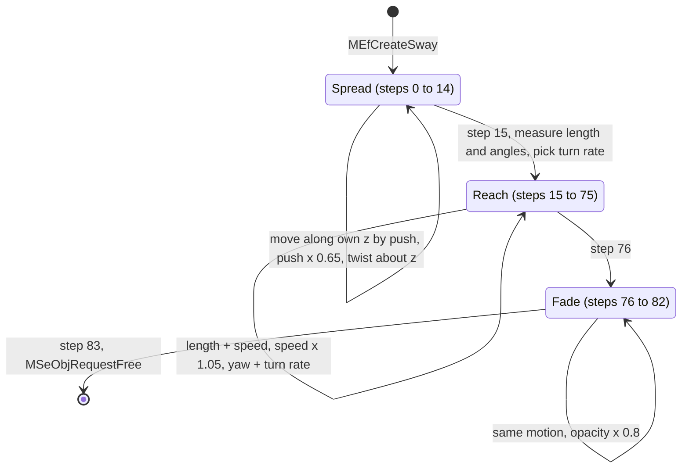

In the spread phase `MEfAdvanceSway` moves every missile along its own z axis
by the push and turns it about z by its twist. The push shrinks to 65 percent
each frame, so the missiles come nearly to rest after a few frames. During the
first six frames each twist grows by the factor 1.85 per frame, so the models
roll faster and faster while they slow down.

At step 15 `MEfUpdateSway` switches to the reach phase. For each missile it
measures the distance and the direction angles from the launch point, sets a
speed of 0.1 and draws a turn rate of 12 to 20 degrees per frame with a random
sign. From then on `MEfAdvanceSway` rebuilds each missile matrix from the
launch point: turn to the stored angles, move out by the length, then turn by
90 degrees about x and y (`mefSwayArmAngles`) so that the model points along
its flight. The length grows by the speed, the speed grows by 5 percent per
frame, and the yaw angle advances by the turn rate, which itself shrinks to
99.2 percent per frame. A missile whose height has fallen to 0.02 or below
stops.

From step 16 on `MEfUpdateSway` also records the trail: seven past positions
per missile. `MEfDrawSwayStrands` draws each trail as a strip 0.036 units wide
in the colour (0x30, 0x50, 0x60) with alpha 0xA0, and the alpha keeps 65
percent of its value from one trail step to the next. `MEfDrawSwayMissiles`
submits the model `missile.pxy` once per missile with the stencil option, the
blend value 0x44 (`mefStencilAlphaA`) and the opacity `modelOpacity`. From step 76
the opacity falls to 80 percent per frame, and the object is freed at step 83.

### Missile trail (type 11)

`m_ef_missile_trail.c` is the simpler relative of the sway: five missiles that
fly straight ahead in a tight cone.

| Block offset | Type | Name | Meaning |
| --- | --- | --- | --- |
| 0x04, 0x08 | | `actor`, `coordinate` | The owner and its attach point |
| 0x20 | `Vector4` | `translation` | Offset of the row |
| 0x40 | `MGsPacket` | `packet` | |
| 0x54 | `u16` | `ticks` | Frame counter |
| 0x60 | `Matrix4` | `baseMatrix` | Launch frame |
| 0xA0 | `Matrix4[5]` | `matrices` | The matrix of each missile |
| 0x1E0 | `float[5]` | `scales` | Roll per frame of each missile |
| 0x200 | `Vector4[35]` | `leftEdge` | Seven trail points per missile |
| 0x430 | `Vector4[35]` | `rightEdge` | The other edge of the trail |
| 0x660 | `float` | `transparency_b` | Opacity of the models |

`MEfCreateMissileTrail` turns each missile matrix away from the launch frame
by up to 5 degrees about y and up to 3 degrees about x, and gives it a roll
rate of up to 12 degrees per frame in either direction. All trail points start
at the launch point.

Each frame `MEfUpdateMissileTrail` shifts the seven trail points of each
missile and puts two new ones at ±0.018 units beside the missile
(`mefStencilEdgeOffsets`). `MEfAdvanceMissileTrail` then moves every missile
that is still above the height 0.02 by 0.8 units along its own z axis
(`mefStencilDrift`) and rolls it by its rate. A missile that reaches the ground
simply stops there. `MEfDrawTrailMissiles` submits `missile.pxy` five times
with the blend value 0x44 (`mefStencilAlphaB`), and `MEfDrawTrailStrips` draws
the five trails with the same colour and 65 percent fade as the sway. From
frame 61 the opacity of the models falls to 80 percent per frame, and the
object is freed after 68 frames.

### Actor path (type 12)

`m_ef_actor_path.c` sends a fast swirl of purple light from the link actor to
the target. It is the shortest effect, 17 frames, and has no moving window.
Instead it keeps a matrix for every position on the path.

| Block offset | Type | Name | Meaning |
| --- | --- | --- | --- |
| 0x0C, 0x10 | | `actor`, `coordinate` | The link actor and its attach point |
| 0x20 | `Vector4` | `translation` | Offset of the row |
| 0x30, 0x34 | | `endActor`, `endCoordinate` | The target and its attach point |
| 0x40 | `MGsPacket` | `gsPacket` | |
| 0x54 | `u16` | `stepCount` | Frame counter |
| 0x60 | `Matrix4` | `actorMatrix` | Start frame, moved by the offset |
| 0xA0 | `Vector4` | `actorTranslation` | Start point |
| 0xB0 | `Vector4` | `actorCoord` | End point |
| 0xC0 | `Matrix4[17]` | `trail` | Slots 0 to 12: one matrix per path key. Slots 13 to 16: the last four head positions |

`MEfBuildPathCurve` uses the common recipe. `MEfBuildPathKeyframes` samples 13
keys, four per segment, into the shared work area behind the curve head
(`MEfKeyedPathCurve.keyPosition`). For each pair of neighbouring keys it builds
a look-at matrix with `MMathCalcLookAtMatrix`, so matrix k sits at key k and
looks toward key k + 1. Matrix 12 is a copy of matrix 11 placed at the last
key.

Each frame `MEfUpdatePathTrail` shifts the head slots (16 takes 15, 15 takes
14, 14 takes 13) and, while the counter is below 13, copies the matrix of the
current key into slot 13. `MEfDrawPathTrail` draws two things:

- While the counter is below 13: twenty strips around the current key matrix.
  Strip i starts at the angle i × 18 degrees. It has four cross-sections along
  the flight axis, at 0.9, 0.7, 0.5 and -0.3 units, with radii of 0.02, 0.04,
  0.039 and 0.012 (`mefTrailSection`), and it swings by 30 degrees between
  sections, to the left for even strips and to the right for odd ones. The
  result is a woven, flame-shaped head about 1.2 units long. Its colours are
  (0x80, 0x20, 0x60) and (0x20, 0, 0x10) with alpha 0x80.
- Always: four strips, 90 degrees apart, that join the four head slots. They
  are 0.029 units wide, start with the colours (0x48, 0x10, 0x30) and (0x10, 0,
  0) and lose 30 percent of their alpha per slot. This is the short tail.

The head reaches the target at frame 12. The last four frames only let the
tail catch up.

### Actor history (type 13)

`m_ef_actor_history.c` is a second ribbon spiral, wider and slower than type 2
and orange. It starts at the link actor's attach point moved by the row offset,
and ends at the target.

The record holds the two actors, the offset at +0x20, the packet, the counter
at +0x54, the start point at +0x60, the end point at +0x70, the start matrix at
+0x80, 19 history words at +0xC0, 19 path samples at +0xF0 and 19 direction
angles at +0x220.

`MEfBuildHistoryCurve` uses the common recipe and `MEfBuildPathSamples` takes
19 samples, six per segment. The window is 20 frames long
(`MEfUpdatePathStatus`) and the object lives 39 frames
(`MEfAdvanceHistoryStep`).

`MEfDrawHistoryRings` draws eight triangle strips. Strip r starts at r × 45
degrees plus 3 degrees per frame of age, and the angle falls by 30 degrees from
sample to sample. Each lit sample gives two vertices 0.1 units from the path,
0.25 units before and behind the sample. The colours are (0x80, 0x58, 0x20)
with alpha 0x60 and (0x30, 0x10, 0) with alpha 0x20.

| Difference | Spiral (type 2) | Actor history (type 13) |
| --- | --- | --- |
| Samples | 25 | 19 |
| Window, lifetime | 10, 35 frames | 20, 39 frames |
| Distance from the path | 0.4 | 0.1 |
| Half length of a ribbon piece | 0.13 | 0.25 |
| Spin per frame | -3 degrees | +3 degrees |
| Twist per sample | +30 degrees | -30 degrees |
| Colour | Blue | Orange |
| Row offset | Not used | Added to the start |

## The hit signal and damage numbers

An effect is authored as a fixed timeline, but the battle needs to know two
moments on it: when the blow lands, and when the whole effect is over. Both
are reported through sef, and `MSe` objects take part in the first one.

### Waiting rows

A row of the effect sequence fires either at a frame or at the **hit signal**.
The signal is raised inside sef when a particle slot with flag bit 0 starts
(`_hitSignal`). A waiting row then fires only when the request carries a
nonzero hit kind in the low byte of `hitMode`. Only `attackEffectsStart` writes
that field. The details are in
[the hit signal on the sdv page](../libraries/sdv.md).

For `MSe` objects this means: an impact object, for example a spiral around
the target, can be bound to the moment of the hit, and it appears only when
the attack actually has a result. A missed attack (hit kind `HIT_KIND_NONE`)
plays the launch part of its effect but none of the waiting rows. Effects
started by `unitEffectStart` or by the script natives leave `hitMode` 0, so
their waiting rows never fire.

### Entry flags

The same slot flags are also copied to the **entry flags** of the actors of
the request (see [sef](../libraries/sef.md)). The battle reads them with
`sefGetEntryFlags(actor)`. sef clears all entry flags at the start of each of
its steps (`sefResetEntryFlags`) and sets them again while the slots run, and
the battle update of the next frame runs before the next sef step. A flag is
therefore visible to the battle for one frame. For an actor that has no entry
the function returns 8.

| Entry flag | Set on | Read by | Effect in the battle |
| --- | --- | --- | --- |
| 1 | The source actor | `attackSefFlag1Check` (`sefIsHitActor`) | The blow lands: targets react |
| 4 | The target actor | `attackHitsShow` (`SEF_ENTRY_SHOW_HIT`) | The damage number of this target pops up |

Many more bits of the entry flags drive scene actions of an attack
(`scenarioMtd`): showing and hiding weapons and parts, playing the action
sound, sending script events. They are described in [Battle](battle.md).

### What the attack event does each frame

After its first call, `eventAttackRun` runs every frame until the effect is
over. For an ordinary action it calls `attackHitsShow(entry, command)` and then
`attackEffectsFinished(command)`.

`attackHitsShow` walks the hit records.

1. When the target's actor has entry flag 4, it calls `hitPopNumCreate`, which
   passes the target, the damage and the hit mode to `objDmgNumCreate`. It also
   starts the combo panel of the target. On the first such frame of the attack
   it shows the status panels of the hit ("no hit", blocked, taken, back
   attack) and sets `UNIT_FLAG_HIT_PANELS` on the target so that they appear
   once.
2. When the attacker's actor has entry flag 1, and the command is a technique,
   a lookup technique or an item, it queues the target's reaction command with
   `scenarioBatExecDst` (the flinch or knock-down motion). For hits that change
   HP or EP it also opens the unit panel of the target when the target cursor
   is on it, and starts the hit effect of group 0x136. `UNIT_FLAG_HIT_REACTED`
   keeps the panel and the hit effect from repeating.

Flag 4 is not latched. Every frame in which an effect slot sets it produces
another number, each showing the full damage of the hit record. A multi-hit
effect can thus pop the number several times.

`attackEffectsFinished` asks `sefIsFinishEffect` whether any record of the
technique's effect key is still alive. When all actions report finished,
`eventAttackRun` clears the hit flags of the targets, sends their script
messages and calls `attackHitApply` for each hit. Only there are HP, EP and
statuses really changed (see [Battle](battle.md)). The numbers on screen are
shown at the moment of impact, and the values behind them are applied when the
effect has ended.

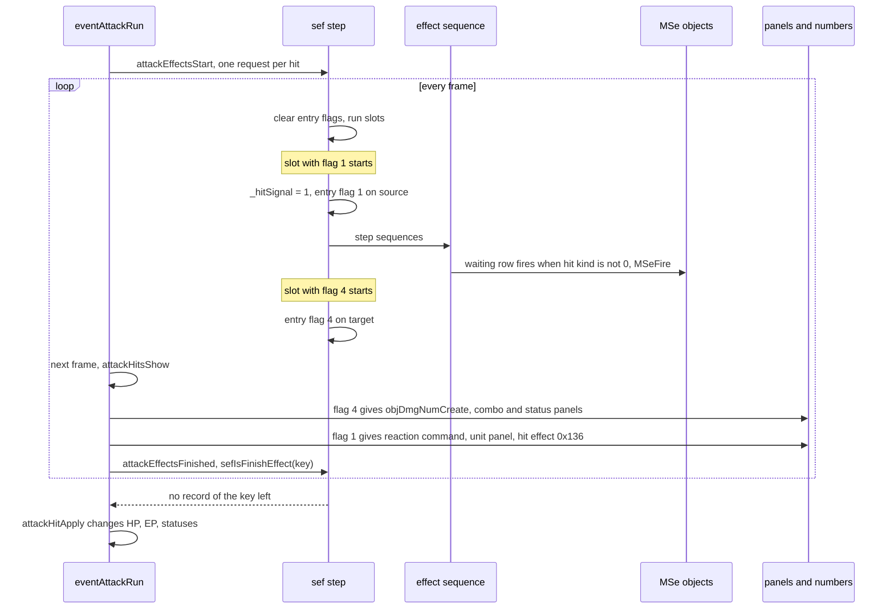

### The pop-up number

`objDmgNumCreate(owner, amount, kind, scale)` in `src/ov01/menu.c` makes the
number object. It takes an object slot of the battle engine (see
[Battle engine](battle-engine.md)) and places it at node 31 of the target's
actor, raised by `scale / 100` units (three times that for units in state 4 or
above). `hitPopNumCreate` passes a scale of 0.

The number has up to six digits. Each digit has a height cell that starts at 0
for the units digit and 8 lower for each following digit, and grows by 4 per
frame up to 27 pixels. The digits therefore unfold one after another, two
frames apart, starting with the units digit. The object removes itself after 25
frames (`MENU_POP_LIFETIME`). `objDmgNumDraw` projects the position to the
screen and `dmgNumPut` draws the digits centred on it.

The colour follows the hit kind through `menuPopNumColorIndex`:

| Hit kind | Colour (r, g, b) |
| --- | --- |
| 0 none, 1 plain damage, 5 status, 6 no inflict, 11 | Neutral (0x80, 0x80, 0x80) |
| 2 HP gain | Green (0x60, 0xFF, 0x60) |
| 3 EP loss, 9 and 10 EP drain | Magenta (0xFF, 0x60, 0xFF) |
| 4 EP gain | Cyan (0x60, 0xFF, 0xFF) |
| 7 and 8 HP drain | Pale yellow (0xF0, 0xFD, 0x95) |

## Screen fills and flashes

Two full-screen effects of the battle are plain tasks. A task is one of the 32
records of `ov01TaskTable` (`src/ov01/ov01_task.c`) with an update and a draw
callback. The draw callbacks run at the very end of the battle's own draw pass
`ov01DrawAll`, after the monster slots, the units, the data objects and the
object slots. The task table is described in
[Battle engine](battle-engine.md).

Both effects draw the same picture. `grPacketScreenFill(r, g, b)` in
`src/ov01/screen_fill.c` sends one sprite with the given colour and alpha 0x80.
Its corners are (0x7000, 0x7200) and (0x9000, 0x8E00) in GS coordinates, a
rectangle of 512 by 448 pixels, at depth 0xFFFFFD. `screenFillGray` calls it
with the grey level 0xC0 (`SCREEN_GREY`). The 2D packet helpers `grGpInit` and
`grPacketSend` belong to [Battle engine](battle-engine.md).

### The fill

`screenFillStart()` claims a task with no update callback and `screenFillGray`
as its draw callback, and stores it in `screenFillTask`. The screen then stays
grey until `screenFillEnd()` releases the task. Nothing counts frames inside
the task, so the caller decides how long the fill lasts.

The fill hides model swaps. The special actions 0x2D5 to 0x2D7 transform the
attacker into another unit. `flowSpecProcInit` starts the transform and the
fill together, and `flowSpecProc` steps through the swap:

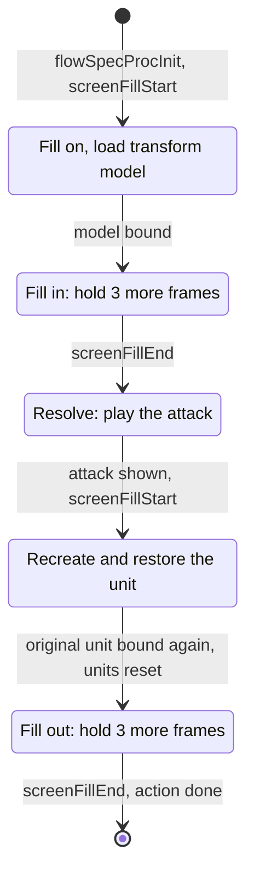

The counter `attackFillWait` holds each fill for `ATTACK_FILL_FRAMES` (3)
frames after the swap behind it is complete. The player sees a grey screen, the
transformed unit, its attack, a grey screen again and the original unit.

### The flash

`screenFlashStart()` in `src/ov01/screen_flash.c` claims a task with
`screenFlashTick` as its update, `screenFillGray` as its draw and a frame count
of 10 (`SCREEN_FLASH_FRAMES`). `screenFlashTick` counts down by one per frame
and releases the task on the update after the count has reached 0. The flash
needs no partner call.

`eventPairBegin` and `eventPairEnd` use it. A pair technique moves both
partners and the target to fixed stage positions and back afterwards. Each
handler starts the flash, waits three frames and then swaps the positions
under the grey screen.

### Unit fades

`src/ov01/unit_fade.c` contains the fade tasks of battle units. They also use
the task table but have no draw callback. Their update writes a transparency
to the unit's actor and its three slot actors each frame.

| Function | Effect |
| --- | --- |
| `unitFadeIn(unit)`, `unitFadeOut(unit)` | Fade the whole unit in or out in steps of 0.1, that is over ten frames |
| `unitSlotFadeIn(unit, index)`, `unitSlotFadeOut(unit, index)` | Fade one slot actor, such as a weapon. The fade-out hides the actor at the end |
| `unitFadeTo(unit, frames, targetPercent)` | Fade the unit to a given opacity over a given number of frames |

The entry flags of an attack can start slot fades through `scenarioMtd`
(`unitSlotFadeInStart`, `unitSlotFadeOutStart`). Units, slot actors and these
tasks are described in full in [Battle engine](battle-engine.md).

## Limits and failure cases

- The pool holds 127 objects. Types 1 and 9 take eight per row, so a script
  with several such rows in a short time can fill it. `MSeFire` then prints a
  warning and the remaining objects of the row are missing.
- `MSeFire` trusts the type of the row. A type of 14 or 15 reads a spawn count
  of 0 and does nothing.
- All objects build their packets in the scratchpad. The `capacity` of 0x400
  that `MGsGPInit` stores is not enforced by any function.
- The shared curve area `mefPathCurve` is valid only inside a constructor.
- A family that reads the link actor gets a null pointer when its row names
  the source instead. `MSeGetActorMatrix` then prints its warning and the
  effect starts at the world origin.
- Objects have no owner. When an effect record is deleted its `MSe` objects
  run on to the end of their lifetime. When the battle scene ends, the pool is
  shut down and all objects vanish.
- The random numbers of the families come from the `MMath` generator, which
  `ov01SceneStateReset` seeds with 0 at the start of every battle scene.
