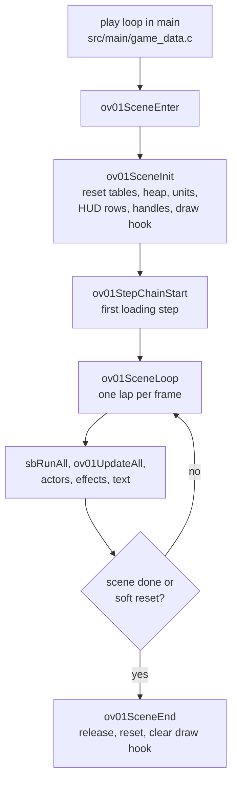
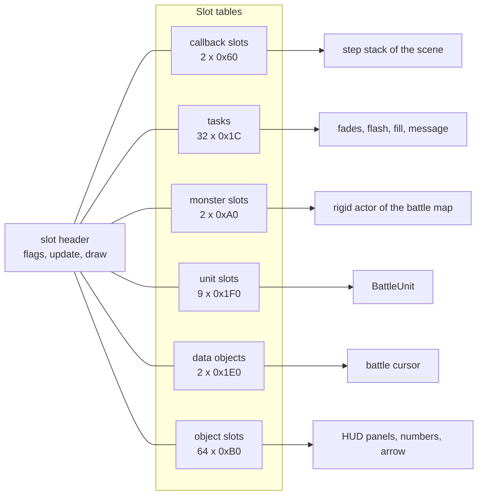
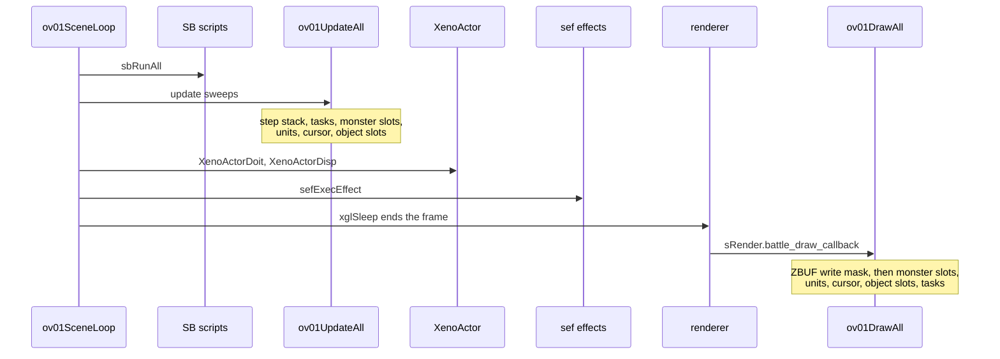
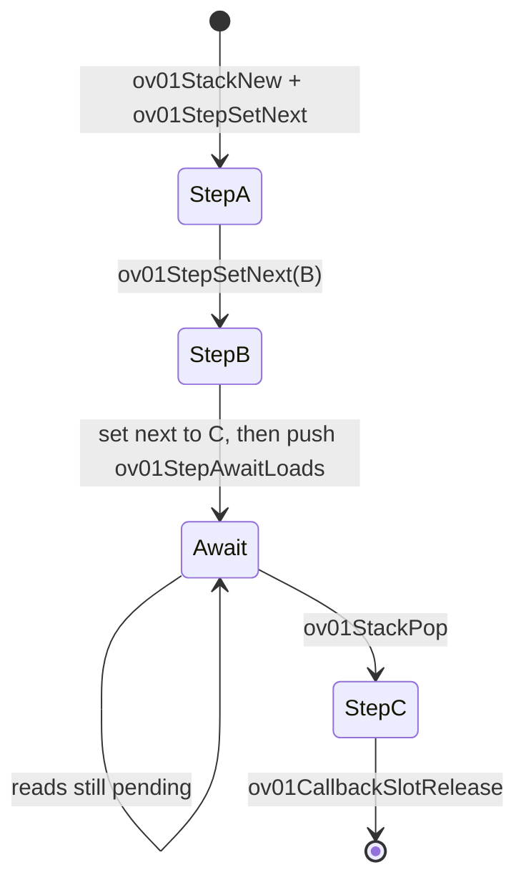
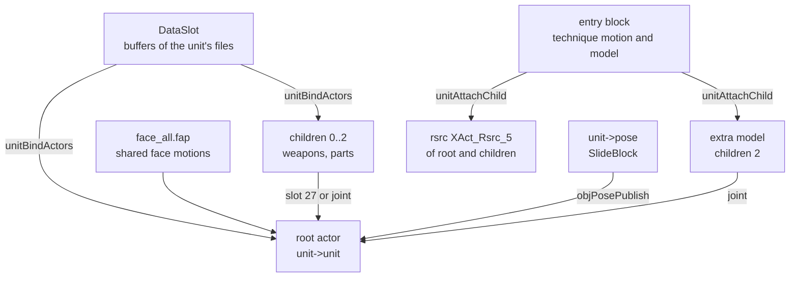
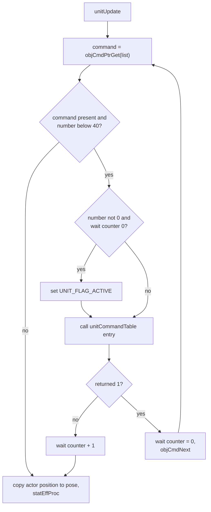
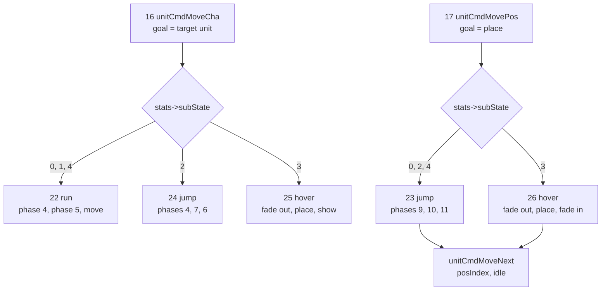
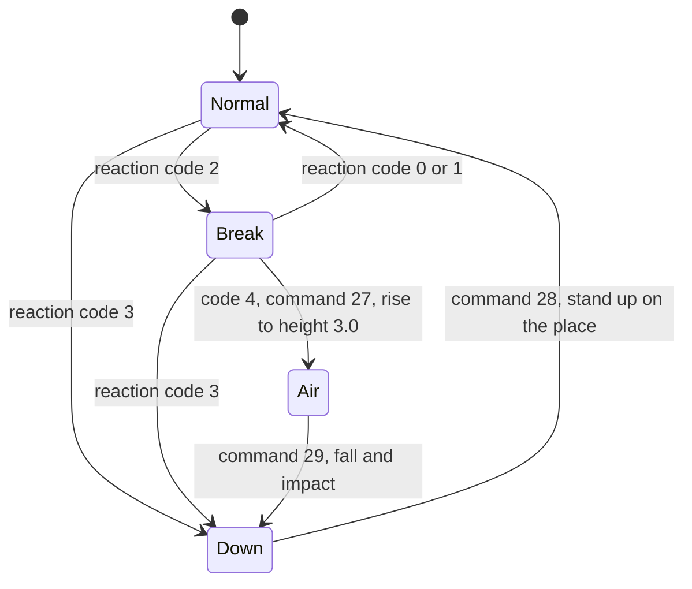
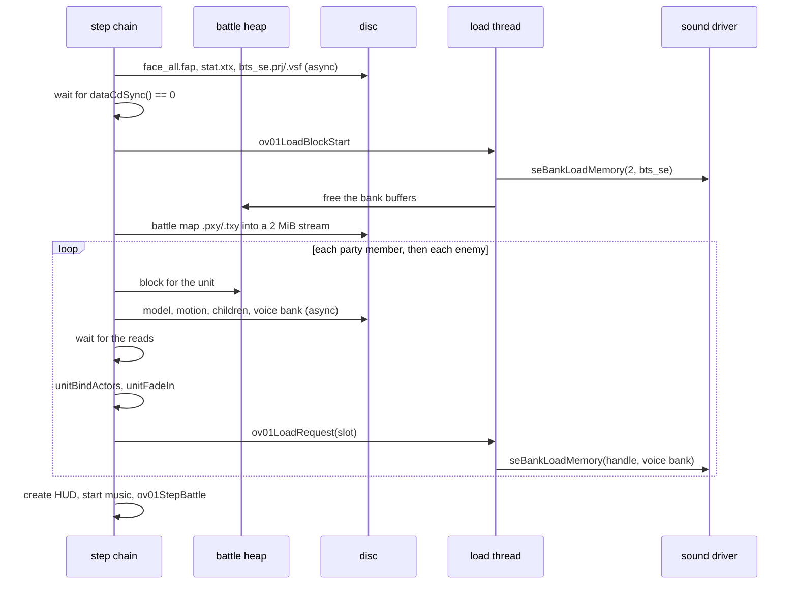
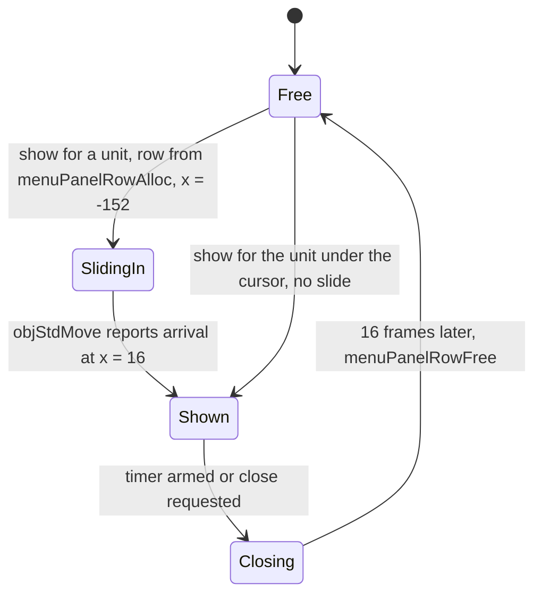

# The battle engine

A battle in Xenosaga Episode II runs inside the overlay `OV01.OVL`. The
[battle rules](battle.md) (turns, commands, zones, damage, boost) sit on top of
a small engine that the overlay brings along: tables of objects with an update
and a draw callback, a unit object that drives one fighter and its actors
through a list of commands, a loader that reads every file a battle needs into
a heap of its own, a HUD made of sliding panels, and a set of helpers that
build GS packets for 2D and 3D primitives.

This page describes that engine from the bottom up. It starts with the object
tables and the order in which they run each frame, goes on to the unit object
and its commands, then to loading and memory, and ends with the HUD pieces, the
graphics helpers and the sound helpers. The overlay is loaded at `0x00A80000`.
It also holds the [SB virtual machine](../scripting/sb-vm.md) that runs the
battle scripts, and the [battle effects](battle-effects.md).

Many names in the engine are abbreviations kept from the original code: `obj`
is an object, `cmd` a command, `mons` a monster, `tbl` a table, `gr` the
graphics helpers, `tec` a technique, `pl` and `en` the player and enemy sides.

[← Back to the overview](../README.md)

## Files

Every file has a header of the same name in `include/ov01/`.

| File | Contents |
| --- | --- |
| `src/ov01/obj.c` | The slide block movers: `objStdMove`, `objHatoVec`, `slideAngleStep` and the snap helpers |
| `src/ov01/obj_slot.c` | The 64-slot object table, `ov01ResetAll`, `ov01UpdateAll`, `ov01DrawAll`, the step stack (`ov01StackNew`, `ov01StepSetNext`, push and pop), the index ring `fifo*`, the command list block `objCmd*`, `rnd`, `objStdInit` |
| `src/ov01/ov01_slot.c` | The slot helpers `ov01SlotClaim`, `ov01SlotClear`, `ov01SlotRelease` and the two-entry callback slot table |
| `src/ov01/ov01_task.c` | The 32-entry task table for fades, flashes and messages |
| `src/ov01/data_obj_table.c` | The two-entry data object table (the battle cursor) and `unitSlotRelease` |
| `src/ov01/unit_side_table.c` | The nine unit slots that hold the `BattleUnit` objects |
| `src/ov01/unit_tbl.c` | The table of unit pointers per side and its counting helpers |
| `src/ov01/unit_cmd.c` | The unit object: creation, actor binding, phases, pose, the command list runner and its 40 commands |
| `src/ov01/unit_fade.c` | Fade tasks for a unit and for one of its child actors |
| `src/ov01/mons_slot.c`, `src/ov01/mons_slot_run.c`, `src/ov01/mons_slot_show.c`, `src/ov01/mons_slot_fade.c` | The monster slots: two records that each own one rigid actor, their table, show and hide, fades, and the battle map number |
| `src/ov01/data_file_load.c` | Every file a battle loads: paths, name tables, data slots, streams, the entry block, battle voice line selection |
| `src/ov01/data_unit_org_get.c` | The overlay heap, blocking and non-blocking CD reads, the pending read count |
| `src/ov01/data_record_get.c` | Getters for the tables and texts of the battle data file |
| `src/ov01/handle_table.c`, `src/ov01/handle_state.c` | The voice bank handles of the units |
| `src/ov01/entry_first_init.c` | The screen fade task `fadeIn` and `fadeOut` |
| `src/ov01/menu.c` | HUD: panel rows, status records, stock icons, boost cursor, key guide, boost gauges, arrow, damage numbers |
| `src/ov01/menu_panel.c` | HUD: the row panel, timed panels, stat panels, face and icon cells, number printer, sprite writers |
| `src/ov01/menu_combo_panel.c` | HUD: the combo panel |
| `src/ov01/menu_icon_list.c` | HUD: the icon list of a unit's entries |
| `src/ov01/menu_unit_panel.c`, `src/ov01/menu_unit_panel_open.c` | HUD: the unit state panel |
| `src/ov01/menu_wep_sp_panel.c` | HUD: the special weapon panel, the target list, the target status panel |
| `src/ov01/menu_tex_state.c` | HUD: texture upload and the texture state records |
| `src/ov01/act_step_icon.c` | HUD: the step icon |
| `src/ov01/deco_flags.c` | Hides and shows the HUD as a group |
| `src/ov01/gr_gp_init.c`, `src/ov01/gr_matrix.c` | The `gr` helpers: packets, primitives, GS registers, frame buffer copies, matrices and projection |
| `src/ov01/snd_play.c` | Battle sound helpers: unit voices, music tracks, voice line streams |
| `src/ov01/scene_script.c` | The two script images of the battle scene |
| `src/ov01/m_gs.c` | Scene state reset and shutdown, the tick counter, the `MGs` packet, the `MSeFire` dispatcher |

## Where the engine sits

The main executable enters a battle from its play loop in
`src/main/game_data.c`. It calls `ov01SceneEnter`, `ov01SceneLoop` and
`ov01SceneEnd` one after the other. All three are in `src/ov01/scene.c`, and
the [battle page](battle.md) follows the flow of the fight inside them. Long
before that, when a play session starts, `ov01InitAll` (`src/ov01/choice_menu.c`)
resets every engine table with `ov01ResetAll`, initialises the script machine
and reads the battle data file with `dataBatDatLoad`.

`ov01SceneEnter` calls `ov01SceneInit`, which is the reset chain of the whole
engine. In order, it clears the object tables (`ov01ResetAll`), sets up the
heap and the file tables (`dataFileInit`), clears the monster slot list
(`monsSlotReset`) and the unit table (`unitInit`), resets the HUD rows
(`menuPanelRowsReset`), the voice bank handles (`handleTableInit`) and the
scene state (`ov01SceneStateReset`), and finally stores `ov01DrawAll` in
`sRender.battle_draw_callback`. That last store makes the engine's draw pass the draw
hook of the renderer. `ov01SceneEnter` then calls `ov01StepChainStart`, which
starts the chain of loading steps described under
[The loading sequence](#the-loading-sequence).

`ov01SceneEnd` runs the reverse: `ov01SceneRelease` frees the script threads
and all actors and clears the tables, `ov01ResetAll` clears them once more, the
draw hook is set to 0 and the CD arena is closed.



## The object model

The engine has no general allocator for its objects. Every kind of object
lives in a fixed table, and every table entry starts with the same three
words. The entries are called slots.

| Offset | Type | Name | Meaning |
| --- | --- | --- | --- |
| `0x00` | `int` | `flags` | Bit `0x1` `OV01_SLOT_CLAIM`: the slot is in use. Bit `0x2` `OV01_SLOT_SKIP_UPDATE`: the update pass skips it. Bit `0x4` `OV01_SLOT_SKIP_DRAW`: the draw pass skips it |
| `0x04` | function pointer | `update` | Called once per frame by the update pass, with the slot as argument. 0 means no update |
| `0x08` | function pointer | `draw` | Called once per frame by the draw pass, with the slot as argument. 0 means no draw |

The rest of a slot belongs to the object that claimed it. A HUD panel, a fade
task and a unit all read the bytes after the header as their own struct.
Objects that move on the screen or in the world keep a
[slide block](#the-slide-block) at offset `0x10`.

Three helpers in `ov01_slot.c` work on any slot. `ov01SlotClaim(&flags)`
returns 1 and sets the flags to 1 when the claim bit was clear, otherwise it
returns 0. `ov01SlotClear` and `ov01SlotRelease` zero the flags and both
callbacks. A released slot can be claimed again in the same frame. Nothing
else is cleared, so every constructor fills its own fields after the claim.

There are six tables. Each has a clear function, an update sweep, a draw sweep
and a claim function that returns the first free slot or 0.

| Table | File | Slots | Slot size | Claimed by | Used for |
| --- | --- | --- | --- | --- | --- |
| `ov01CallbackSlotTable` | `ov01_slot.c` | 2 | `0x60` | `ov01CallbackSlotClaim` | The step stack that drives the scene (see below) |
| `ov01TaskTable` | `ov01_task.c` | 32 | `0x1C` | `ov01TaskClaim` | Short tasks: unit fades, monster slot fades, the screen fade, the screen flash and fill, the message object |
| `monsSlotTable` | `mons_slot_run.c` | 2 | `0xA0` | `monsSlotClaim` | The monster slots |
| `unitSideTable` | `unit_side_table.c` | 9 | `0x1F0` | `unitSideClaim` | The unit objects (`BattleUnit`) |
| `dataObjTable` | `data_obj_table.c` | 2 | `0x1E0` | `dataObjAlloc` | The data object, which is the battle cursor made by `objEnCurCreate` in `src/ov01/battle_init.c` |
| `objSlotTable` | `obj_slot.c` | 64 | `0xB0` | `objSlotAlloc` | Everything else: all HUD pieces, damage numbers, the arrow |

A slot is addressed by its pointer. There are no handles and no generation
counters. Code that keeps a pointer to an object also keeps the duty to clear
it when the object is released. The HUD does this with global pointers such as
`menuCursor`, `arrowObj` and `menuStatRecords[]`.

The release functions carry names that do not match their table in two
places. `unitSlotRelease` is defined in `data_obj_table.c` and
`monsSlotRecordRelease` in `unit_side_table.c`. Both only call
`ov01SlotRelease`, so the effect is the same for every table.



## One frame of the engine

`ov01SceneLoop` runs one lap per frame. Inside the lap the engine has two
entry points. `ov01UpdateAll` is called directly by the loop, after the
scripts (`sbRunAll`) and before the camera, the actors and the effects.
`ov01DrawAll` is called later by the renderer through
`sRender.battle_draw_callback`, when the 3D scene of the frame is already in the
packet. The HUD is therefore drawn over the scene. The
[rendering page](../architecture/rendering.md) explains where that hook sits in
the frame.

`ov01UpdateAll` runs the update sweeps in a fixed order:

1. `ov01CallbackSlotsRunUpdate`: the step stack of the scene.
2. `ov01TaskRunUpdate`: the tasks.
3. `monsSlotRunUpdate`: the monster slots.
4. `unitSideRunUpdate`: the units. This is where every unit runs its command
   list.
5. `dataObjUpdateAll`: the battle cursor.
6. `objSlotRunUpdate`: the HUD and the other objects.

The order matters in one way. A scene step that issues a command to a unit
does so before the unit sweep of the same frame, and a fade task started by a
unit command first steps in the next frame, because the task sweep has already
run.

`ov01DrawAll` first sends one GS register write. It sets `ZBUF_1` to
`0x9880 << 17`, which is `0x131000000`: the depth buffer stays where it is but
depth writes are masked. Everything the engine draws after that is tested
against the scene's depth and leaves it unchanged. Then come the draw sweeps:

1. `monsSlotRunDraw`
2. `unitSideRunDraw`
3. `dataObjDrawAll`
4. `objSlotRunDraw`
5. `ov01TaskRunDraw`

The tasks are drawn last, so the screen fade, the flash and the fill cover the
HUD. The callback slot table has a draw sweep too
(`ov01CallbackSlotsRunDraw`), but nothing calls it. Units have the empty draw
callback `unitDrawNone`, and a monster slot has no draw callback at all,
because both are drawn as [actors](../libraries/actors.md) by `XenoActorDisp`
in the scene loop.



## The step stack

The scene itself is an object. `ov01StackNew` claims one of the two callback
slots and uses it as a `SaveStack`. The trick is in the layout: the word at
offset `0x04` of a `SaveStack` is its current step function, and offset `0x04`
of a slot is the update callback. The update sweep of the callback slots thus
calls the current step once per frame, with the stack as argument.

| Offset | Type | Name | Meaning |
| --- | --- | --- | --- |
| `0x00` | `int` | (slot flags) | The claim bit of the callback slot |
| `0x04` | `SaveStackStep` | `step` / `top` | The step that runs each frame |
| `0x08` | `int` | | Cleared by `ov01StackNew`, the slot's draw callback word |
| `0x0C` | `int` | | Holds the saved step of level 0 |
| `0x10` | `int[19]` | `cells` | Five cells per level: four free cells and the saved step of the next level |
| `0x5C` | `int` | `count` | The depth, 0 to 3 |

A step is a function `void step(struct SaveStack *context)`. It does a piece
of work and names its successor with `ov01StepSetNext(context, next)`. A step
that has to wait simply does not set a successor and is called again in the
next frame.

`ov01StackPush(context, step)` saves the current step and makes `step` the
current one. `ov01StackPop` restores the saved step. The loader uses this pair
for its waits: a step sets its successor, then pushes `ov01StepAwaitLoads`,
which pops itself once no disc read is pending. The successor then runs. The
stack has `SAVE_STACK_LEVELS` (4) levels. A push at the deepest level is
refused and a pop at depth 0 does nothing. `ov01StackSetSlot` and
`ov01StackGetSlot` give each level `SAVE_STACK_LEVEL_CELLS` (5) cells of
private storage.

When the battle is over, `ov01StepFinish` (`src/ov01/scene_finish.c`) releases
the slot with `ov01CallbackSlotRelease`, and the scene has no step any more.



## Small containers in `obj_slot.c`

Three more helpers live next to the object table. They are used across the
overlay.

**The command list block.** A `DataLookup` holds up to
`DATA_LOOKUP_CAPACITY` (12) items of `0x18` bytes, a read cursor, the index of
the last item and a `flag` word. `dataLookupAppend` copies a record to the
next index and clears its second word. `objCmdPtrGet` returns the item at the
cursor or 0 when the cursor has passed the last item. `objCmdNext` advances
the cursor and resets the whole block when the list is exhausted. `objCmdClear`
empties it at once. A unit keeps its command list in such a block, and so does
the battle cursor.

**The index ring.** A `FifoRing` is a ring of indices `base` to `maxIndex`
with a read index, a write index and a count. `fifoPush` and `fifoPop` only
move the indices and return the new one, or -1 when the ring is full or
empty. The data lives in an array owned by the caller. The battle rules use
one ring for the list of commands waiting to be executed (`cmdList`).

**Random numbers.** `rnd(max)` returns `xglSRand() % (max + 1)`, a value from
0 to `max`. `ov01RollPercent(percent)` returns 1 with a chance of `percent`
in 100.

## The slide block

Anything in the engine that moves does so through a `SlideBlock` (`obj.h`), a
block of `0x80` bytes. The HUD panels keep one at offset `0x10`, and a unit and
the battle cursor keep one at offset `0x150`.

| Offset | Type | Name | Meaning |
| --- | --- | --- | --- |
| `0x00` | vector | `position` | The moving point. `w` is 1.0 |
| `0x24` | `f32` | `angle` | The current angle in radians |
| `0x30` | vector | `scale` | Four values, all 1.0 after `objStdInit` |
| `0x40` | vector | `velocity` | The step per frame |
| `0x50` | vector | `acceleration` | Added to the velocity each frame by `objStdMove` |
| `0x60` | vector | `goal` | The point to reach |
| `0x70` | `f32` | `goalAngle` | The angle to reach |
| `0x74` | `f32` | `angleRate` | Radians per call of `slideAngleStep` |

`objStdInit` zeroes the block and sets `position.w` and the four scale values
to 1.0. The movers are:

- `objStdMove` adds the acceleration to the velocity and the velocity to the
  position on each axis. An axis has arrived when it equals the goal, when it
  has overshot the goal in the direction of travel, or when it is within
  `1e-6` of it. An arrived axis is set exactly to the goal. The function
  returns 1 when all three axes have arrived in the same call.
- `objHatoVec(block, frames)` sets the velocity to the distance divided by
  `frames`, and snaps every axis that is closer than 0.5 to the goal. Called
  every frame with a small `frames`, it gives the easing that the HUD panels
  use: with `frames` 2 the panel covers half of the remaining distance each
  frame.
- `slideAngleStep` adds `angleRate` to the angle, wraps it at 2π, and
  returns 1 when the angle is within one step of `goalAngle`.
- `slideHorizontalDistance` returns the distance to the goal on the XZ plane.
  `slideLimitGoalXZ(block, distance)` moves the goal along the line from the
  position so that it lies `distance` away. `slideSnapPosToGoal` and
  `slideSnapAngleToGoal` jump to the goal.

## The unit object

Every fighter in a battle is a `BattleUnit`, declared in
`include/ov01/unit_cmd.h` and implemented in `src/ov01/unit_cmd.c`. The object
is `0x1F0` bytes and lives in one of the nine unit slots. It ties together
three things: the unit's numbers (`stats`), its place in the world (`pose`)
and its actors (`unit` and `children`).

| Offset | Type | Name | Meaning |
| --- | --- | --- | --- |
| `0x000` | `u32` | `slotFlags` | The slot flags. Bit 1 is set while the unit exists |
| `0x004` | function pointer | `update` | Always `unitUpdate` |
| `0x008` | function pointer | `draw` | Always `unitDrawNone`, which is empty |
| `0x00C` | `u32` | `flags` | The unit flags, see the table below |
| `0x010` | `struct DataLookup` | `commandQueue` | The command list. Its `flag` word at `0x138` counts the frames the current command has waited |
| `0x13C` | `int` | `commandTarget` | The target unit of the command being executed, stored as a word |
| `0x140` | `int` | `commandCode` | The code (technique number) of that command |
| `0x144` | `StatBlock *` | `stats` | The unit's battle block of `0x108` bytes: HP, EP, statuses, key, facing and more. The [battle page](battle.md) describes its contents |
| `0x150` | `SlideBlock` | `pose` | Position, facing angle, goal and velocity of the unit |
| `0x1D0` | `struct XenoActor *` | `unit` | The root actor |
| `0x1DC` | `struct XenoActor *[3]` | `children` | Up to three child actors: weapons and other attached models |
| `0x1E8` | `struct FadeTask *` | `fade` | The running fade task, 0 when none runs |

The unit flags in `flags`:

| Bit | Name | Meaning |
| --- | --- | --- |
| `0x1` | `UNIT_FLAG_ACTIVE` | Set by the command runner when a command other than 0 starts. The command that ends an action clears it. The rules wait for this bit to fall |
| `0x2` | `UNIT_FLAG_HIDDEN` | Set with the hidden flag of the actors (`unitBindSetup`) |
| `0x4` | `UNIT_FLAG_DOWN` | The unit is defeated. Draws and target pickers leave it out |
| `0x8` | `UNIT_FLAG_STOCKED` | The unit is in the action stock |
| `0x20` | `UNIT_FLAG_SCRIPT_EVENTS` | The unit reports its hits and poses to the script. `unitEnCreate` sets `0x60` on every enemy |
| `0x80`, `0x400` | `UNIT_FLAG_MOVED_OUT`, `UNIT_FLAG_POSED_OUT` | The unit left its place for an action and must return |
| `0x100`, `0x40000` | `UNIT_FLAG_HIT_REACTED`, `UNIT_FLAG_HIT_PANELS` | Per attack: the reaction is queued and the hit panels are shown. `unitHitFlagsClear` clears both |
| `0x800` | | Set by `unitSlotsClear` when the list of waiting commands is empty |
| `0x1000` | | Set by the unbind command and by a move to a position |
| `0x2000` | | Set by `unitCmdSetPhase` for a technique whose `hitFlags` has bit `0x100` |
| `0x4000` | | Set when the stat effect command has finished |
| `0x20000` | | Set for one frame when a jump lands. `unitUpdate` clears it at the start of each frame |

### Unit keys

A unit is identified by its **key**, the halfword `stats->key`. The key
selects the unit's record in the battle data, its model, its motions and its
voice bank. The ranges are fixed by constants in `unit_cmd.h`.

| Key | Meaning |
| --- | --- |
| 1 to 10 | Party members on foot. The name tables use 1 to 7: chaos, KOS-MOS, Shion, Jin, Ziggy, MOMO and Jr. |
| 11 to 15 | The large units, which are the E.S. The name tables use 11 to 13: `pcr02`, `pcr03`, `pcr05` |
| 16 to 140 | Enemies. Their file names start with `gno`, `cre`, `uma`, `uro`, `uso`, `vma`, `mon` and `bos` |
| 141 and up | Not a data id. Such a key is a "gattai" code and the unit takes the party record of the battle's current slot |

Many functions test "key from 1 to 10" to tell a character from an E.S. or an
enemy. A character shows level pips on the HUD where the others show a gauge,
takes a low-HP idle pose, and uses the selector of its motions.

### The unit table

`unitTbl` holds eight unit pointers: slots 0 to 2 for the player side and
slots 3 to 7 for the enemy side. A battle therefore has at most three party
units and five enemies at a time, although there are nine unit slots. The
counts are kept in `unitPlNum` and `unitEnNum`. `unit_tbl.c` gives access by
side, where side 0 is `UNIT_SIDE_PLAYER`, 1 is `UNIT_SIDE_ENEMY` and anything
else means both.

| Function | Result |
| --- | --- |
| `unitTblGet(side, &table)` | The table of a side and its length: 3, 5 or 8 |
| `unitTblSet(side, unit)` | Stores the unit in the first empty entry of the side |
| `unitTblRemove(unit)` | Clears the entry of the unit |
| `unitNumGet(side)` | The number of units |
| `unitLiveNumGet(side)` | Units without `UNIT_FLAG_DOWN` |
| `unitLiveNumGet2(side)` | Units without `UNIT_FLAG_DOWN` for which `calcStatGet(unit, 2, 1)` is 0 |
| `unitDownNumGet(side)` | Units with `UNIT_FLAG_DOWN` |
| `busyUnitChk(side)` | Units that are active and not down |
| `unitNumBusyGet(side)` | Units with a pending command or a running move effect |
| `unitNoGet(unit)`, `unitPtrGet(index)` | Index of a unit in the whole table, and back |

### Creation and removal

`unitPlCreate(key)` and `unitEnCreate(key)` both call
`unitCreateSide(key, side)` and then enter the unit in `unitTbl`. The core
does this:

1. It claims a unit slot, clears `flags`, empties the command list, resets the
   pose and stores the two callbacks.
2. It looks for the battle block of the key (`battleEntryFindByKey`), takes
   one (`battleEntryAcquire`) and stores it in `stats`. If the block did not
   exist before, `battleEntryActivate` fills it.
3. It takes the root actor with `XenoActorAlloc`. For every key except 141 to
   143 the draw flags become `0x10001`, the actor's alpha is 0, and for every
   key except 125 the shadow type is 2 with a parameter of 0.5. The unit thus
   starts invisible and is faded in later.
4. It copies the battle's light block (`lightBlockGet`) and the two fog
   vectors (`runtimeFogPtrGet`) into the actor.
5. For each of the three child entries of the stats (`pairFirst[i]` not 0) it
   takes one more actor with the same settings. A child whose `pairSecond[i]`
   has bit `0x4000` also gets the hidden flag.

`unitRemove` clears the four status masks, releases the unit's effect records
(`sefReleaseUnitRecords`), releases the root actor and every child, frees the
unit slot and the table entry, and releases the battle block when the key is
16 or more. The block of a party unit stays, because its numbers are written
back to the party after the battle.

## Units and their actors

A unit does not draw or animate anything by itself. It owns
[`XenoActor`](../libraries/actors.md) records and steers them. The root actor
carries the body. The children carry weapons and other parts that are separate
models.

### Binding the files

The actors are created empty. Their resources arrive when the loader has read
the unit's files into a [data slot](#data-slots). `unitBindActors(unit, slot)`
then copies the buffer addresses from the slot into the actors:

| Actor | Resource | Source in the data slot |
| --- | --- | --- |
| Root | `rsrc[0]`, `rsrc[1]`, `rsrc[2]`, `rsrc[XAct_Rsrc_EntryTableC]` | Model 0: the `.pxy`, `.txy`, `.xhr` and `.epf` files |
| Root | `rsrc[XAct_Rsrc_XAP]` | Motion file 0, the `.xap` |
| Root | `rsrc[XAct_Rsrc_SlotTableB]` | The shared face motion file, `dataFaceHandleGet()` |
| Child `i` | the same four model resources | Model `i + 1` |
| Child `i` | `rsrc[XAct_Rsrc_XAP]` | Motion file `i + 1` |

After the copy the root gets its matrices (`XenoActorAllocMatrices`), 20
solver passes, channel value 0 and mode 0, which is the first motion. A child
gets matrices too, and a motion when it has a motion file. Each child is then
attached to the root. When the child kind `pairFirst[i]` is 1 or 2 it is
attached at slot 27 (`XenoActorAttachAtSlot`). Otherwise it is attached to the
joint whose number is `pairSecond[i]` without the `0x4000` bit
(`XenoActorAttachChildToJoint`). Finally the function starts the unit's
standing effect (`unitEffectStart(unit, sequenceIndex, 8)`), switches the
status effect display off and copies the voice bank handle of the slot into
`stats->handle`.

Some techniques bring their own motion file, and some bring an extra model.
`unitAttachChild(unit, entry, index)` handles both from the
[entry block](#the-entry-block). It stores the technique's motion file in
`rsrc[XAct_Rsrc_5]` of the root and of every child. This is the second motion
table of the actor, which `unitSetTimedPhase` plays through mode slot 1. If the
entry block also has a model, a new actor is created in `children[2]` with
that model and attached to the joint `pairSecond[2]`. `unitSlotsClear` undoes
this after the attack: it clears `rsrc[XAct_Rsrc_5]` everywhere and releases
the extra child when the technique's `gateFlag` is 5.



### Phases are motions

The engine calls the motion a unit plays its **phase**.
`unitSetPhase(unit, phase)` selects motion `phase - 1` of the root actor with
`XenoActorSetMode`, and the same motion on every child that has a motion file.
`unitCurrentPhase` returns the actor's mode plus 1. Phase 0 means "leave it".

`unitSetPhase` has three refinements:

- If the actor already plays that motion in mode slot 0, the call returns,
  except for the phases 4, 25, 28 to 31, 36, 39 and 49 to 51, which restart.
- Actor flag `0x2` (`XENO_FLAG_UNWRAP_A`, play once) is cleared for the phases 1 and 2 and for
  phase 5 when the unit's `subState` is not 4. These are the looping motions:
  the two idles and the run. All other phases set the flag.
- The blend time is 8 frames when the unit goes into phase 2 (but not from
  phase 11) or out of phase 2, and 0 otherwise. A freshly created actor and
  a motion in another mode slot never blend.

`unitSetTimedPhase(unit, phase)` is the variant for technique motions. It
plays motion `phase - 1` from the second motion table in mode slot 1, and
motion `phase + i` on child `i` when that child's table has it.

`unitRefreshPhase` returns a unit to its idle. A party character whose HP is
low (`partyUnitHpLow`) gets phase 2 with selector 6. Every other unit gets
phase 1 with selector 0. `unitSetSelector` passes the selector to
`XenoActorSetSelector` for keys 1 to 10 only, with a blend of 7 frames. The
actors page explains [modes, slots and selectors](../libraries/actors.md#motion-channels-and-modes).
`unitIsDone` is `XenoActorIsDone` on the root actor, and nearly every command
waits on it.

The phase numbers are indices into the unit's motion file, so their meaning is
a convention of the data. The code fixes these uses:

| Phase | Used for |
| --- | --- |
| 1, 2 | Idle, and the low-HP idle of a party character |
| 4 | The turn before a run, and the start of a jump toward a unit |
| 5 | The run |
| 7, 6 | Flight and end of a jump toward a unit |
| 9, 10, 11 | Start, flight and landing of a jump back to a position |
| 14 | A pose in place (`unitCmdPhase0EWait`) |
| 15 | A hop to the goal (`unitCmdPoseArrive`) |
| 18, 19 | A hop back to a position and its landing (`unitCmdPoseArriveWait`) |
| 20 | The action motion of `unitCmdAction` |
| 23 | Using an item (`unitCmdPlayVoice`) |
| 24, 25 | The two reactions `unitCmdEva` and `unitCmdDef` |
| 26 | The stat effect command |
| 28 to 33, 36, 39 | Hit reactions chosen by `unitCmdCodeGet` |
| 34, 35 | Falling out of the air (`unitCmdMoveRamp`) |
| 36, 39 | Hitting the ground after the fall |
| 38, 41 | Standing up on the unit's place (`unitCmdMoveRatio`) |
| 42 | Defeat |
| 43, 44 | Getting back up, and the pose of `unitCmdBted` |

### Pose, angle and position

The pose is the master copy of where the unit is. `objPosePublish` copies
`pose.position` into the actor's position, `pose.angle` into the actor's Y
rotation, and the angle into `stats->facing`. Every function that changes the
pose calls it. The other direction exists too. `unitUpdate` copies the actor's
position back into the pose at the end of each frame, and `objPoseFetch` first
applies the root offset of the motion (`XenoActorApplyRootOffset`) and then
reads the position. That is how a motion that carries the unit forward, such
as a jump, moves the unit for good.

Units stand on numbered places. `effectPosGet(index)` returns a record of
three integers in hundredths of a unit, from a table that the scene sets with
`effectPosTableSet`. `unitLoadSnapshot(unit, index)` puts the unit on such a
place and stores the index in `stats->posIndex`. `unitClearSnapshot` puts it
on the origin.

The angle helpers are `unitSetAngleDegrees`, `unitSetAngleRadians` (wraps a
negative angle by 2π) and `unitGetAngleDegrees`.
`unitFaceTarget(unit, facesTarget, target)` turns the unit toward another
unit, or away from it when `facesTarget` is 0, and then computes a goal point
3 units below and 1, 2 or 3 units in front of it. The distance comes from
`unitStateScale`: 2.0 for `stats->state` 3 and 3.0 for state 4. The knock-down
commands use that point.

`unitDefArea(unit)` is the radius of a unit. It is `stats->slidePercent / 100`
when that value is set. Otherwise it is read from the model: half the summed
absolute extents of the bounding values at `0x90` to `0xA8` of the model
resource, the larger of the two axis pairs. `unitColiGet` adds the technique's
`scale / 100` to the target's radius. An attacker that runs to its target
stops that far away.

### Fades

Units appear and disappear by fading the alpha of their actors.
`unit_fade.c` has five starters, each of which claims a task from the task
table:

| Function | Effect |
| --- | --- |
| `unitFadeIn(unit)` | Alpha from 0 to 1 in steps of `FADE_DEFAULT_STEP` (0.1), so ten frames. Turns the status effect display on |
| `unitFadeOut(unit)` | Alpha from 1 to 0 in ten frames. Turns the status effect display off |
| `unitFadeTo(unit, frames, percent)` | Alpha from its current value to `percent / 100` in `frames` frames |
| `unitSlotFadeIn(unit, index)` | Fades in one child and clears its hidden flag |
| `unitSlotFadeOut(unit, index)` | Fades out one child and sets its hidden flag at the end |

While a fade runs, the actors carry the draw flag `ACTOR_STATE_FADING`
(`0x10000`), and the first three starters store the task in `unit->fade`.
Commands wait for `unit->fade == 0`. A child whose `pairSecond` has bit
`0x4000` is skipped by the fade steps, so a part that is hidden by design
stays hidden. The fade-out leaves the fading flag set, which keeps the actor
in the alpha pass at alpha 0.

`unitUnbind` and `unitBindSetup` are the instant versions. The first clears
the hidden and fading flags of all actors and turns the status effects on. The
second sets the hidden flag and turns them off.

## The unit command list

Everything a unit does on screen is a command in its list. The battle rules
decide what happens: who attacks, who is hit, who falls. They then append
commands to the units involved with `unitCmdSet(unit, &command)` and wait
until the units are idle again. A command is an `Ov01Command`, of which the
list copies the first `0x18` bytes.

| Offset | Type | Name | Meaning |
| --- | --- | --- | --- |
| `0x00` | `int` | `command` | Index into `unitCommandTable`, 0 to 39. A dispatcher command overwrites it with the command it chose |
| `0x04` | `int` | `state` | The step inside the command. It is 0 when the command starts |
| `0x08` | `int` | `code` | A technique number, a place index, a motion or a mode, depending on the command |
| `0x0C` | `int` or pointer | `arg` | A wait flag, or the unit that owns the action |
| `0x10` | `BattleUnit *` | `faceTarget` | The unit to face |
| `0x14` | `int` | `poseIndex` | A frame counter of the height ramp, or a goal flag |

`unitUpdate` runs once per frame for every unit. It clears flag `0x20000`,
calls `unitRunCommands`, copies the actor position into the pose and calls
`statEffProc` for the status effect display.

`unitRunCommands` takes the command at the cursor and calls its handler from
`unitCommandTable`. A handler returns 1 when the command is finished and 0
when it needs another frame. On 0 the runner adds one to the wait counter
`commandQueue.flag` and stops for this frame. On 1 it clears the counter,
moves to the next command and runs that one in the same frame. A chain of
instant commands therefore completes in a single frame. When a command with a
number other than 0 starts (wait counter 0), the runner sets
`UNIT_FLAG_ACTIVE`. The list is reset when its last command finishes.

`unitCmdClear` empties the list, and `unitQueueIsEmpty` tells whether a
command is pending.



### The commands

The table lists all 40 entries of `unitCommandTable`. "Done" means the
handler returns 1. "Idle" means `unitRefreshPhase`. Several handler names come
from short words of the original code: `Dmg` damage, `Eva` evade, `Def`
defend, `Mot` motion, `Cha` character, `Pos` position, `Bted` battle end,
`Rec` recover.

| No. | Handler | What it does |
| --- | --- | --- |
| 0 | `unitCmdNoop` | Nothing. Done at once. It does not set the active flag |
| 1 | `unitCmdSetPhase` | Plays the motion of technique `code` (`tecRecordGet(code)->phase`). A technique with a `timer` uses `unitSetTimedPhase`, the others `unitSetPhase`. Sets or clears unit flag `0x2000` from the technique's flags. Done when the motion ends |
| 2 | `unitCmdStatEffect` | Starts effect `(320, 9)` and a system voice. An enemy is done at once. A party unit plays phase 26, and when it ends the unit gains EP and HP as a percentage of its maximum (skill effects `0x8000` and `0x800`, shown as numbers), then a character gains a level step and an E.S. gains 100 or more of its gauge. Sets flag `0x4000` |
| 3 | `unitCmdAction` | Phase 20 with the unit's action effect (`unitActionKey`), selector 9 and a voice. When the motion ends: selector 0, idle, done |
| 4 | `unitCmdPlayVoice` | Phase 23, a unit voice, and a spoken line: mode 1 when `arg.owner` is the unit itself, mode 2 otherwise. Idle and done when the motion ends |
| 5 | `unitCmdRelease` | Fades the unit out with effect `(320, 8)`. When the fade has ended it removes the pin of the unit's data slot, releases the unit's effect files and its voice bank handle, and removes the unit |
| 6 | `unitCmdLoadSnapshot` | Fade out, move to place `code`, fade in. The unit changes its place without a visible move |
| 7 | `unitCmdSetBattleTransition` | Fade out, then set `manWorkGet()->transition` to 1 for a party unit or 2 for an enemy, and clear the active flag |
| 8 | `unitCmdRefreshPhase` | Idle. Done at once |
| 9 | `unitCmdUnbind` | Sets flag `0x1000`, clears the active flag, turns the status effects on unless the unit is down, then idle unless the unit is in the air or on the ground |
| 10 | `unitCmdDmg` | The hit reaction dispatcher, see [Hit reactions](#hit-reactions) |
| 11 | `unitCmdEva` | Phase 24 and unit voice 11. When the motion ends: idle, active flag cleared, done |
| 12 | `unitCmdDef` | Phase 25 and unit voice 12, otherwise like 11 |
| 13 | `unitCmdDead` | Defeat, see [Defeat](#defeat) |
| 14 | `unitCmdMot` | Plays phase `code`. With `arg.wait` set it waits for the motion to end |
| 15 | `unitCmdTgtSetDummy` | Nothing. Done at once |
| 16 | `unitCmdMoveCha` | Move to the target unit. A dispatcher, see [Moving](#moving) |
| 17 | `unitCmdMovePos` | Move back to a place. A dispatcher |
| 18 | `unitCmdPhase0EWait` | Phase 14, then waits for it to end |
| 19 | `unitCmdPhase12Wait` | Phase 18, then waits for it to end |
| 20 | `unitCmdPoseArrive` | Sets the goal to the target, turns at once, plays phase 15 and moves in an arc until arrival |
| 21 | `unitCmdPoseArriveWait` | Sets the goal to a place, plays phase 18 and moves in an arc. On arrival it plays phase 19 and waits for it |
| 22 | `unitCmdMoveChaRun` | Run to the target unit |
| 23 | `unitCmdMovePosJump` | Jump back to a place |
| 24 | `unitCmdMoveChaJump` | Jump to the target unit |
| 25 | `unitCmdMoveChaHover` | Vanish and reappear at the target unit |
| 26 | `unitCmdMovePosHover` | Vanish and reappear at a place |
| 27 | `unitCmdModeRamp` | Lift the unit into the air over eight frames |
| 28 | `unitCmdMoveRatio` | Put the unit back on its place and stand up |
| 29 | `unitCmdMoveRamp` | Fall out of the air to the ground |
| 30 | `unitCmdFinish` | Idle, clear the active flag. Done at once |
| 31 | `unitCmdBted` | Phase 44, wait for it, clear the active flag |
| 32 | `unitCmdRec` | Clear the active flag. Done at once |
| 33 | `unitCmdWake` | Clears `UNIT_FLAG_DOWN`. A unit on the ground turns into command 28. Any other plays phase 43, then idle and active flag cleared |
| 34 | `unitCmdStat` | Clear the active flag. Done at once |
| 35 | `unitCmdTurn` | Turn toward the target (or the goal of the command) with `slideAngleStep`. After five waiting frames the angle snaps. A unit with `stats->state` 4 or more turns at a quarter of the rate |
| 36 | `unitCmdStreamPlay` | A system voice and the voice line of mode 3. Done at once |
| 37 | `unitCmdRemove` | `unitRemove`. Done at once |
| 38 | `unitCmdFinishRefresh` | Idle unless the unit is in the air or on the ground, then clear the active flag |
| 39 | `unitCmdModeStart` | Start a hit reaction, see below |

### Moving

Commands 16 and 17 do not move anything themselves. They set the goal with
`unitCmdDstSet`, look at the unit's movement kind `stats->subState` and
replace their own command number with the matching mover. From the next frame
on the runner calls the mover directly.

| `subState` | To a unit (16) | Back to a place (17) |
| --- | --- | --- |
| 0, 4 | 22 run | 23 jump |
| 1 | 22 run | none, done at once |
| 2 | 24 jump | 23 jump |
| 3 | 25 hover | 26 hover |

`unitCmdDstSet(unit, cmdId, mode)` writes `pose.goal`. In mode 0 the goal is
the place of the target unit (`commandTarget`), pulled back toward the unit by
the target's radius plus the technique's reach (`unitColiGet`), so the unit
stops in front of the target. In mode 1 the goal is the place whose index is
stored in the command. In any other mode the goal is taken as two floats from
the command.

The three movers are small state machines in `unitCmdRun`, `unitCmdJump` and
`unitCmdHover`. They keep their step in the `state` word of the command.

- **Run** (`unitCmdRun`). Step 0 plays phase 4 and starts turning toward the
  goal at a tenth of the angle per frame. Step 1 waits for that motion, then
  plays phase 5, sets the velocity so that the goal is reached in 15 frames
  (`unitCmdVASet`), starts the run effect and unit voice 1. The run effect is
  the pair set by the script (`runEffGet`), or `(sequenceIndex, 9)` when the
  script set none. Step 2 moves with `unitCmdMoveCalc` until arrival and then
  puts the effect into mode 6.
- **Jump** (`unitCmdJump`). Step 0 turns the unit, stretches the actor along Z
  by the distance divided by 3 (by 10 for a unit with `stats->state` 4 or
  more) with `unitSetVectorZ`, and plays the take-off motion. The motion
  itself carries the unit forward, and the stretch makes a motion authored for
  a fixed distance cover the real one. Step 1 plays the flight motion with
  unit voice 2. Step 2 plays the landing. At the end the unit position is read
  back from the actor (`objPoseFetch`), snapped to the goal, the stretch is
  set back to 1.0 and flag `0x20000` marks the landing frame.
- **Hover** (`unitCmdHover`). The unit fades out with unit voice 1, is placed
  at the goal while invisible, and fades in again. On the way to a target unit
  the last step is `unitUnbind` instead of a fade, so it appears at once.

After a move back to a place, `unitCmdMoveNext(unit, 1)` stores the place
index in `stats->posIndex` and returns the unit to its idle.

`unitCmdVASet(unit, mode, flag)` computes the velocity for a move of 15
frames. For modes 3 and 4 the vertical part is a throw: an upward velocity of
`0.15328124` and an acceleration of `-0.0204375` per frame. Over 15 frames
that is a small hop that ends at the starting height. Commands 20 and 21 use
it.



### Hit reactions

The byte `stats->state70` records a posture that outlasts a single command.
It is the Break state of the unit, which the [battle page](battle.md)
explains from the side of the rules: a unit whose zones were hit in the right
order is in Break, and from there it can be knocked Down or launched into the
Air. The engine's part is to show these states.

| `state70` | State | Entered by | Posture |
| --- | --- | --- | --- |
| 0 | Normal | `unitCmdMoveRatio`, any reaction code other than 2, 3 or 4 | Standing |
| 1 | Break | Reaction code 2 | Staggered, standing |
| 2 | Down | Reaction code 3, or a fall out of the air | On the ground |
| 3 | Air | Reaction code 4 | In the air |

Command 10 `unitCmdDmg` takes a reaction code in `code` and decides:

- Code 4 on a unit in Break becomes command 27 `unitCmdModeRamp`. The unit
  plays its reaction motion and rises to a height of 3.0 over eight frames.
  The heights come from `unitPoseRamp`: 0, 1.064, 1.842, 2.378, 2.717, 2.904,
  2.983 and 3.0. At the end the active flag is cleared and effect `(310, 21)`
  starts.
- Code 4 on a unit that is already in the air, and code 3 on a unit that is
  already on the ground, only play a unit voice and finish.
- Everything else becomes command 39 `unitCmdModeStart`. It stores the new
  `state70`, plays the reaction motion and a unit voice, sets selector 6 and
  clears the active flag at once, so the rules do not wait for the motion.
  For code 3 the unit is turned with `unitFaceTarget` and moved to the point
  that function computes, which throws it back from the attacker.
- A code 4 on a unit that is not in Break also goes through command 39. The
  unit then takes state 3 and its reaction motion without the rise.

The reaction motion is chosen by `unitCmdCodeGet(code, wait)`. The second
value of each pair is used when the command's `arg.wait` is set.

| Code | Phase | New `state70` |
| --- | --- | --- |
| 0 | 28 or 29 | 0 |
| 1 | 30 or 31 | 0 |
| 2 | 30 or 31 | 1 |
| 3 | 36 or 39 | 2 |
| 4 | 32 or 33 | 3 |

Two commands bring a unit back. Command 29 `unitCmdMoveRamp` is the fall out
of the air. The unit faces its attacker `stats->source`, slides toward the
goal at an eighth of the distance per frame, runs the height table backward
from 3.0 to 0 and plays phase 34 or 35. On arrival it plays the impact motion,
starts effect `(310, 20)` and unit voice 14, tells the script when the unit
has script events. `state70` is 2 from the start of the command. Command 28 `unitCmdMoveRatio`
puts the unit back on its place at height 0, plays the stand-up motion (phase
41 when the unit was in phase 39, otherwise 38) and sets `state70` to 0.



### Defeat

`unitCmdDeadSet(unit)` is called by the rules when a unit's HP is 0. It
refuses a unit that is already marked. Otherwise it queues the commands that
bring the unit down first: command 29 for a unit in the air, command 28 for a
unit in Down whose key is in `unitDeadSpecChk` (110, 115, 119, 122,
124, 126, 139 and 140). Then it queues command 13 and sets `UNIT_FLAG_DOWN`.

Command 13 `unitCmdDead` runs in four steps:

1. It sets `UNIT_FLAG_DOWN` and plays phase 42, unless the unit lies on the
   ground and is not one of the special keys. It ends the unit's turn
   (`calcTurnEnd`), clears its statuses but keeps four of them (the bits
   `0x400`, `0x800`, `0x2000` and `0x4000` of row 3), clears its entry and
   combo counters, plays unit voice 5 and the spoken line of mode 4, and
   starts the unit's move effect (`unitMoveKey`) unless bit `0x2000` of
   `stats->flags` is set.
2. It waits until that effect has finished (`unitEffectKeyFree`). Key 125
   waits 241 frames instead. A party unit is then done: it stays on the field,
   lying down. An enemy starts a fade-out, or skips it when bit `0x80` of
   `stats->flags` is set.
3. It waits for the fade.
4. An enemy is removed with `unitRemove`.

### Effect keys of a unit

Units start [sef effects](../libraries/sef.md#effect-keys) by a pair of
numbers, a file key and a record number, packed as `(high << 12) | low`.
`unitActionKey` and `unitMoveKey` build the pair for the unit's action effect
and move effect. A party unit, and an enemy whose `sequenceIndex` is between
701 and 733, uses its own file `sequenceIndex` with record 10 (action) or 11
(move). Every other enemy uses the shared file 320 with record 4, 5 or 6 for
the action and file 330 with record 1, 2 or 3 for the move, chosen by the two
low bits of `stats->flags`. `unitEffectKeyFree(unit, high, low)` asks
`sefIsFinishEffect` whether such an effect has ended.

## Monster slots

Despite the name, a monster slot is not an enemy. A `MonsSlot` is a record
with one rigid actor, and the battle uses it for the model of the battle map:
the ground and the backdrop the units stand in. Enemies are `BattleUnit`
objects like everyone else.

| Offset | Type | Name | Meaning |
| --- | --- | --- | --- |
| `0x00` | `int` | `flags` | The slot flags |
| `0x04` | function pointer | `update` | `monsSlotEmptyUpdate`, which is empty |
| `0x08` | function pointer | `draw` | 0 |
| `0x90` | `struct XenoActor *` | `actor` | The actor of the slot |
| `0x94` | `FadeTask *` | | The running fade task of `monsSlotFadeInStart` and `monsSlotFadeOutStart` |

`monsSlotCreate` claims one of the two records, takes an actor with
`XenoActorAlloc`, puts it on the origin with the hidden flag set, and enters
the record in the list `monsActiveSlots`. `monsSlotCopyParams(slot, stream)`
gives the actor the `.pxy` model and `.txy` texture of a loaded
[stream](#streams-battle-maps). `monsSlotShow` and `monsSlotHide` clear and
set the hidden flag, and the two fade starters in `mons_slot_fade.c` fade the
actor's alpha in ten frames like the unit fades. `monsSlotRelease` frees the
record, the actor and the list entry. `monsActiveSlotsGet` hands the list to
the scripts and events that need to move, fog or hide the map.

`monsTblMapNoSet` and `monsTblMapNoGet` in `mons_slot_show.c` keep the number
of the battle map. The script native `monsTblSet` stores it when it selects
the enemy group of the battle, and the loader reads it to open the right map.
Its start value is 1.

## Loading a battle

### Reading files

`data_unit_org_get.c` has the two read functions of the overlay. Both go
through `xglCdReadFile`, which the
[files page](../architecture/files-and-resources.md) describes.

- `dataFileLoad(name, buffer)` reads a file and waits for it.
- `dataFileLoadNB(name, buffer)` starts an asynchronous read with the
  callback `dataNBreadCB` and adds one to `ov01CdPendingCount`. The callback
  takes one off when the read reports code 4, its end.

`dataCdSync()` returns the pending count. A loading step that started reads
pushes `ov01StepAwaitLoads` on the step stack, and that step pops itself when
`dataCdSync()` is 0 and the effect system has no load running
(`sefCheckLoad`).

Files are loaded in two passes by `dataFileSlotLoad(record, path,
&next_buffer, pass)`. Pass 0 only asks for the file size
(`xglCdGetFileSize`), rounds it up to a sector of 2048 bytes and stores it in
the record. Pass 1 starts the read at the cursor `next_buffer` and advances
the cursor by the size. The callers run pass 0 over a group of files to learn
the total, make room, and then run pass 1 over the same group. Each file ends
up in a `DataFileRecord` of 12 bytes: `loaded_index` (the id or name index
that was loaded, which doubles as an "already loaded" mark), `buffer` and
`size`.

### The battle heap

All buffers come from the battle heap, a first-fit allocator over 10 MiB
(`0xA00000` bytes) that `ov01HeapInit` borrows from the resource area of the
main executable with `GameResourceWorkAlloc`. Blocks have a header of 64
bytes with a flags word and a size, sizes are rounded up to 64 bytes, and
`ov01HeapFree` merges all free neighbours. The
[memory page](../architecture/memory.md#the-battle-heap) describes the
allocator in full.

Two details matter for the loader. `ov01HeapAlloc` writes 3 into the flags of
a new block: bit 0 is "in use" and bit 1 works as a pin. `dataSlotFlagSet`
and `dataSlotFlagClear` set and clear bit 1 on the block of a data slot.
Command 5 clears it when a unit leaves the battle. `dataSlotReclaim(min_size)`
frees the first data slot whose block is in use, not pinned and at least
`min_size` bytes large. That is how the files of a unit that has left make
room for a new one.

`ov01LookupNonHeap(key)` asks the resource table of the main executable for a
resource and returns its address, unless the address lies inside the battle
heap. The loader uses it to reuse files that the field already has in memory,
such as the models of the party characters.

### Data slots

A `DataSlot` holds the files of one unit. There are `DATA_SLOT_COUNT` (11)
slots in `dataSlotPool`: slots 0 to 7 for party units and gattai codes, slots
8 to 10 for enemies (keys 16 to 140). Several enemies of the same kind share
one slot, because the slot is found by key.

| Offset | Type | Name | Meaning |
| --- | --- | --- | --- |
| `0x00` | `char *` | `head.next_buffer` | The cursor for the next file |
| `0x04` | `char *` | `head.base.buffer` | The heap block of the slot |
| `0x08` | `int` | `id` | The unit key, 0 for a free slot |
| `0x0C` | `int` | `handle` | The voice bank handle |
| `0x10` | `struct DataModelFiles[4]` | `models` | Four models of four files each: `pxy`, `txy`, `xhr`, `epf`. Index 0 is the unit, 1 to 3 its children |
| `0xD0` | `struct DataMotionFile[4]` | `motions` | One motion file per model |
| `0x130` | `struct DataFileRecordPair` | `voice_files` | The `.prj` and `.vsf` of the voice bank |

`dataUnitFileLoad(key)` fills a slot:

1. `dataUnitFileGet` finds the slot of the key or takes a free one.
2. For a party unit or gattai code a block is taken from the heap:
   `0x12CC00` bytes for an E.S. (keys 11 to 15), `0xC8800` bytes otherwise.
   When the unit's model is already in memory outside the heap, the block is
   `0x57800` bytes smaller. If the heap is full, `dataSlotReclaim` frees an
   old slot and the allocation is tried once more. A party slot is then
   pinned.
3. `dataUnitFileIdLoad` loads the unit's model. The file id comes from
   `unitFileIdGet(key)`: a party member's current costume, an entry of a
   fixed table for an E.S. or an enemy, or the gattai code. When the resource
   table has the files, the slot only takes their addresses. Otherwise
   `xglCdBuildFileName` turns the id into a path and the four files are read.
   An enemy slot allocates a block of exactly the size found in pass 0.
4. `dataMotSetLoad` loads the unit's motion file by name.
5. For a party unit, the three child ids of its battle slot are looked up.
   For each one `dataModelLoad` loads the child model from `model\` and
   `dataModelMotLoad` its motion file.
6. `dataVoiceSetLoad` loads the voice bank. It measures the `.prj` and
   `.vsf`, takes a [handle](#voice-bank-handles) of that size, allocates one
   block for both files and reads them.
7. If the total is larger than the block the function stops in an endless
   loop. The sizes are budgets that the data must respect.

`dataSlotVoiceUpload(slot)` is the last step for a slot, and its name is
misleading: it sends the loaded voice bank to the sound driver with
`seBankLoadMemory`, marks the handle as present (`handleStateSet`) and frees
the `.prj` buffer. `dataSlotRelease(key)` clears a slot,
`dataSlotVoiceReset(key)` forgets its voice files, and `dataSlotFind(key)`
looks a slot up.

### Streams: battle maps

A `DataStreamEntry` holds the `.pxy` and `.txy` of a battle map. There are
two entries in `dataStreamPool`. `dataStreamOpen(map, small_buffer)` takes
the entry for the map number, allocates `0x200000` bytes (2 MiB), or
`0x2A800` bytes when `small_buffer` is set, and loads the two files from
`yamamoto\map\`. A map that does not fit stops the game in an endless loop.
`dataStreamFind(map)` returns the entry of a loaded map.

The battle opens the stream of `monsTblMapNoGet()` at its start. The command
code opens a second, small stream for map `0x43` (`BSP_B01`) with
`ov01StreamOpen` when an event needs it.

### The entry block

Techniques can need a model or motion that is not part of the unit. These go
through `dataEntryBlock`, a single `DataEntry` with one model (four files),
two motion files and a base buffer. `dataEntryBlockReset` rewinds its cursor
to the base. `dataModelEntryLoad(index)` loads a model from `model\` by its
index in `dataModelNameTbl`. `dataMotEntryLoad(table_index, index, suffix)`
loads a motion file into motion record `index`. For the motion names 199 to
214 (`db01` to `db16`) it appends `_a` or `_b`, so the two partners of a
double technique each get their own file. The result is handed to
`unitAttachChild`.

`dataFileBufAlloc` allocates a general file buffer of `0x2E800` bytes,
`dataFileBufBase`, when the scene starts. It is very likely the buffer of the
entry block, but the store that connects the two is not in these files.

### Voice bank handles

Every unit has a bank of voice and sound samples, and the sound chip's memory
is too small to hold more than a few. `handle_table.c` shares it out. A
*handle* is a bank slot number of the sound driver, 3 to 8
(`HANDLE_BASE` 3, `HANDLE_SLOT_COUNT` 6).

| Handles | Used by | Sound memory address |
| --- | --- | --- |
| 3, 4, 5 | Party units | Fixed: `0x100000`, `0x150000`, `0x1A0000` (`HANDLE_FIXED_BASE` plus `HANDLE_FIXED_STRIDE` of `0x50000`) |
| 6, 7, 8 | Enemies | From a bump cursor that starts at `0x37800` and may not pass `0x100000` |

`handleAlloc(fromBump, size)` takes a free handle of the right group and
returns its number, or -1. `handleAddressGet` returns the address,
`handleFree` clears the record and frees the driver's bank with
`korgEvagFreeBank`. `handleTableInit` frees bank 0 and all six handle banks
and rewinds the cursor. The cursor only moves forward during a battle, so the
enemy area is not reused until the next battle. `handleStateSet` and
`handleStateGet` in `handle_state.c` mark and test whether the bank of a
handle has reached the driver. The [audio page](../architecture/audio.md#17-battle-sound)
shows the resulting layout of sound memory.

### The loading sequence

The battle start is a chain of steps in `src/ov01/scene_load.c`, run by the
[step stack](#the-step-stack). Uploading a bank to the sound driver blocks, so
those uploads run in a small thread of their own with priority 8 and a stack
of `0x1000` bytes (`ov01LoadBlockStart`, `ov01LoadRequest`). The chain polls
`ov01LoadIsDone()`.

1. `ov01StepSceneScript` registers the battle natives (`runtimeInit`), links
   the scene's script library to its script image and starts the script.
   The two images are `gameWork.resBuffer` and `gameWork.imageEnd`, returned
   by `ov01ScriptKeyGet` and `ov01ScriptImageGet` in `scene_script.c`. The
   scene resource loader of the main executable puts them there before the
   battle. They are the pair `model\map\<map>.bin` and `model\map\en\<map>.sbl`
   of the battle's field map. `dataThinkScriptLoad(index)` can load a script
   by number from `yamamoto\think\`, a directory that is not on the discs,
   and its only caller is the debug entry of the overlay.
2. `ov01StepLoadBattleFiles` starts four reads: the face motions
   (`dataFaceFileLoad`, skipped when the field already has them), the HUD
   texture (`dataStatFileLoad`), a CD arena of `0x11800` bytes
   (`dataCdArenaOpen`) and the battle sound bank (`dataBattleSeLoad`).
3. `ov01StepStartBlockLoad` starts the thread that sends the battle sound
   bank to driver bank 2 (`dataBattleSeUpload`) and frees its two buffers.
4. `ov01StepOpenHandles` creates the object that uploads the HUD texture
   (`menuStatPreObjCreate`), creates a monster slot and opens the stream of
   the battle map.
5. `ov01StepBindAndShow` gives the map model to the monster slot and shows
   it.
6. `ov01StepLoadPartyIds` reads the three party member ids and sets the table
   of places.
7. For each party member: `unitPlCreate`, place and facing, then
   `dataUnitFileLoad` and `unitEffectFilesSetup` (which loads the unit's
   effect files with `sefSetupPlayer`). When the reads are done,
   `unitBindActors`, `unitFadeIn`, command 30 and `ov01LoadRequest` for the
   voice bank.
8. `menuStatRecordsCreate` builds the status records of the party.
9. For each enemy of the group, up to five: `unitEnCreate`, place, facing and
   the two spawn arguments, then the same load, bind, fade and voice upload.
   The enemy's effects come from `sefSetupEnemy`.
10. `ov01StepNextEnemy` creates the rest of the HUD and the battle cursor,
    applies the start bonus, starts the battle music with `bgmPlayTrack`, lets
    one party member say an opening line, and hands over to `ov01StepBattle`.



Units can also be loaded in the middle of a battle. The script natives and
the command code call `dataUnitFileLoad` and `unitEffectFilesSetup` for a
unit that joins, wait for `dataCdSync()`, and then bind it.

### Memory of a battle

The picture below shows what a battle allocates from its heap. The order in
the heap follows the order of the calls, and freed blocks are reused, so the
addresses are not fixed.

```
battle heap: 0xA00000 bytes from GameResourceWorkAlloc
+----------------------------------------------------------+
| general file buffer            0x2E800   dataFileBufAlloc |
| face motions (if not cached)   0x08000   dataFaceFileLoad |
| HUD texture stat.xtx           0x41000   dataStatFileLoad |
| CD arena                       0x11800   dataCdArenaOpen  |
| bts_se.prj + bts_se.vsf  0x800 + 0x1E800 (freed after     |
|                                           the upload)     |
| battle map stream             0x200000   dataStreamOpen   |
| party unit, three times       0x0C8800   (0x12CC00 for an |
|                                           E.S.), less     |
|                                           0x57800 if the  |
|                                           model is cached |
| voice bank of each unit       file size  (.prj part freed |
|                                           after upload)   |
| enemy model, motion           file size  one block each   |
| small stream                  0x02A800   on demand        |
+----------------------------------------------------------+
```

A think script loaded by `dataThinkScriptLoad` takes another `0x12000` bytes.
At the very end of the loading chain `ov01HeapProbeLargeAlloc` tries to
allocate `0x2A800` bytes and frees them again. The result is not used.

### File names

All paths are built in `dataPathBuf` or `dataEntryPathBuf` (256 bytes each)
from a directory, a name from a table and an extension.

| Path | Contents | Loaded by |
| --- | --- | --- |
| `yamamoto\batdat.us` | The battle data tables | `dataBatDatLoad`, into the fixed buffer `batDat` of the main executable |
| `yamamoto\stat\stat.xtx` | The HUD texture set | `dataStatFileLoad` |
| `motion\face_all.fap` | Face motions shared by all characters | `dataFaceFileLoad` |
| `yamamoto\think\thinkNNN.sb` | The battle script of group `NNN`. Debug path only, not on the discs. The shipped scripts are `model\map\<map>.bin` | `dataThinkScriptLoad` |
| `yamamoto\think\jp\thinkNNN.sbl` | Its library image, read behind the script. Debug path only. The shipped libraries are `model\map\en\<map>.sbl` | `dataThinkScriptLoad` |
| `sound\vsf\battle\bts_se.prj`, `.vsf` | The battle sound bank | `dataBattleSeLoad` |
| `sound\vsf\battle\<voice>.prj`, `.vsf` | The voice bank of a unit, from `dataVoiceNameTbl` (142 entries: `chaos`, `kosmos`, `shion`, `jin`, `ziggy`, `momo`, `jr`, `pcr02`, then the enemy names) | `dataVoiceSetLoad` |
| a path from `xglCdBuildFileName(id)` plus `.pxy`, `.txy`, `.xhr`, `.epf` | The model of a unit | `dataUnitFileIdLoad` |
| `model\<name>` plus the four extensions | Child models and technique models, from `dataModelNameTbl` (26 entries, for example `char\pc\kos_sw01`, `char\pc\jin_saya`, `robo\pc_robo\pcr05_mg01`) | `dataModelLoad`, `dataModelEntryLoad` |
| `yamamoto\mot\<name>.xap` | Motion files, from `dataMotNameTbl` (218 entries) | `dataMotSetLoad`, `dataModelMotLoad`, `dataMotEntryLoad` |
| `yamamoto\map\<name>.pxy`, `.txy` | Battle maps, from `dataMapNameTbl` (68 entries, for example `KML_B01`, `E2_OLM15`, `batle_bg`) | `dataStreamOpen` |
| `battle/<name>` | Voice line streams | `streamPlayByKey`, `unitPlayActionSound` |

The four model files are the [`.pxy` model](../libraries/pxy.md), the `.txy`
texture, the `.xhr` hierarchy and the `.epf` file that the actor keeps in
`rsrc[XAct_Rsrc_EntryTableC]`. The `.xap` files are motion packages for the
[animation library](../libraries/animation.md).

The motion name table is indexed like the unit keys and then continues:

| Index | Names | Used for |
| --- | --- | --- |
| 1 to 7 | `chao00`, `kosm00`, `shio00`, `jin00`, `zigg00`, `momo00`, `jr00` | Characters |
| 11 to 13 | `pcr02`, `pcr03`, `pcr05` | E.S. |
| 16 to 140 | `gno001`.., `cre001`.., `uma001`.., `uro001`.., `uso001`.., `vma001`.., `mon001`.., `bos001`.. | Enemies |
| 150 to 155 | `sh_box01`, `jin_sw01`, `jin_saya`, `mm_ym01`, `jr_gun01`, `jr_gun02` | Child models. The index is the model id plus 143 |
| 168 to 171 | `kosm_sp01` to `kosm_sp04` | Special attacks of KOS-MOS |
| 178 to 198 | `pcr02_sp01` to `pcr05_sp07` | Special attacks of the E.S. |
| 199 to 214 | `db01` to `db16`, with `_a` or `_b` appended | Double techniques |
| 215 to 217 | `gattai01` to `gattai03` | Combination attacks |

### The battle data getters

`data_record_get.c` reads the tables of `yamamoto\batdat.us`. The file starts
with a header of offsets: the word at `0x08` is the offset of the party unit
table (units 1 to 15), the word at `0x0C` that of the enemy unit table (units
16 to 140), and 17 more words from `0x10` point to the other tables. A unit
record is `0x5C` bytes and starts with the offset of the unit's name.
`batUnitRecordGet(key)` and `batUnitNameGet(key)` return them.

Each of the other getters returns record `index` of one table, numbered from
1, or 0 when the index is out of range.

| Getter | Record size | Contents |
| --- | --- | --- |
| `tecRecordGet` | `0x20` | A technique: target flags, costs, hit flags, the motion `phase`, the `timer` |
| `tableKeyRowGet` | 20 | Ten halfwords per unit key, read by the command menu and the enemy thinking |
| `effectIdListGet` | 6 | Effect id lists |
| `slotPairRowGet` | 12 | The child pairs of the 15 party units |
| `etherRecordGet` | 12 | 109 records with a name, an info text and a technique index |
| `accessoryRecordGet` | 16 | 40 item records |
| `skillRecordGet` | 12 | 104 status and effect records |
| `usableItemRecordGet` | 16 | 40 action rows |
| `dataBoxSecretKeyRecordGet`, `dataBoxKeyItemRecordGet` | 4 and 8 | Texts. The getters accept indices up to 99. The file has 31 records in the box 4 table and 107 in the box 3 table |
| `pairLinkGet` | 16 | 16 pair links: a technique, a required level and two slots |
| `attackLevelRecordGet` | 16 | 21 records with a technique and a required level |
| `attackTargetRecordGet` | 16 | 10 records with a technique, a model index and a joint |
| `enemyRewardRecordGet` | 16 | The reward of enemy keys 16 to 143: points, rates and two drops. The file has 125 records, for keys 16 to 140 |
| `dataExpTblGet` | 4 | The experience table |
| `growthRecordGet` | `0x20` | 15 growth records |

Records with texts start with two halfword offsets, counted from the start of
their table: the name (`RECORD_TEXT_NAME`) and the info text
(`RECORD_TEXT_INFO`). The `*TextGet` functions return these strings, and
`tableStringGet` reads the general string table. What the numbers in these
records mean for the fight is the subject of the [battle page](battle.md).

## Battle sound helpers

`snd_play.c` is a thin layer over the sound system that the
[audio page](../architecture/audio.md#17-battle-sound) describes. It adds the
unit to the call.

- `seObjectVoiceStart(unit, code, volume)` starts sound `code` of the unit's
  own bank. The voice number is the unit's handle in the top byte plus the
  code. A negative volume means the default sound effect volume, and the pan
  is centred (`0x40`). `seObjectVoiceStartDefault` passes -1. The command
  handlers use fixed codes: 1 for a run or a hover, 2 for a jump, 5 for
  defeat, 11 and 12 for the two reactions, 13 to 16 for hit reactions.
- `seVoiceStartTagged(bank, code)` in `handle_state.c` does the same for a
  bank number, such as 2 for the battle sound bank.
- `bgmPlayTrack(track)` plays one of six music tracks on stream slot 0:
  two battle themes, two boss themes, the last boss theme and the fanfare.
- `streamPlayByKey(unit, mode)` plays a spoken line of a party member on
  stream slot 1. The file is `battle/` plus an entry of
  `dataBattleActionNameTbl` for the unit key and the mode.
- `unitPlayActionSound(unit, code)` plays the sound of a technique. When the
  technique's `gateFlag` is 0, 6, 7, 8 or 10 it is a voice of the unit's bank.
  For the others it is a stream whose name `dataBattleCodePathGet` finds from
  the technique number, and for the codes 44 to 70 from the sub pilot of the
  E.S. as well (`stats->linkedSlots[1]`).

The modes of `streamPlayByKey`:

| Mode | File name ends with | Played by |
| --- | --- | --- |
| 0 | `_eth1` | The battle rules |
| 1, 2 | `_itm1`, `_itm2` | Command 4, for an action on the unit itself or on another |
| 3 | `_chg` | Command 36 |
| 4 | `_dead` | Command 13, the defeat |
| 5 | `_rec` | The battle rules |
| 6 | `_bst` plus a number | `ov01StepNextEnemy`, when the battle starts |
| 7 | `_bed` plus a number | The battle rules |

The file names start with a short form of the character's name: `cho`, `kos`,
`sio`, `jin`, `zig`, `mom` and `jr`. The endings suggest ether, item, charge,
death, recovery, battle start and battle end.

For modes 6 and 7 `dataBattleRandomPathGet` chooses among up to eleven
numbered lines per character. Each line has a condition code in
`dataBattleBstSets` or `dataBattleBedSets`, tested by `battleCodeMatches`.
Code 1 is always allowed. Other codes ask for a certain party member in the
battle (2 to 5), a certain kind of enemy (6 to 11), a party member with low HP
(12 to 14), a combination of both sides (15, 16) or a random chance of 20, 15
or 5 percent (17 to 19). A matching line with a code of 6 or more wins
outright. Otherwise one of the matching lines is picked at random. Shion, for
example, has eleven start lines, and three of them are tied to Jin's presence.

## The HUD

The HUD is made of objects in the 64-slot object table. Most of them are
created once, by `ov01StepNextEnemy`, and live until the tables are cleared at
the end of the battle. They keep their screen position in a slide block and
slide in from the left edge with `objHatoVec` and `objStdMove`.

All HUD art is in one texture set, `yamamoto\stat\stat.xtx`. The object made
by `menuStatPreObjCreate` has only a draw callback, `menuTexFlush`. Once per
frame it transfers the texture set with `xglPacketTextureTrans` and writes
`TEXFLUSH`. It is created before every other HUD object and so takes the
first slot of the table, which makes its draw run before the others. Objects that can be created later, such as damage numbers
and the row panel, call `menuTexFlush` themselves.

The screen is 512 by 448 pixels. The fixed pieces sit at these positions:

```
(0,0)
+--------------------------------------------------------------+
| status records: (16,12), (183,12), (350,12)                   |
|                                                              |
| unit state panel (16,80)   stat panel kind 0 (row 82)         |
| row panels: y = 100, 120, ... 280 (ten rows, x slides to 16)  |
|   combo panel, icon list, row panel, stat panels             |
|                                                              |
| (8,312) key guide / special weapon panel / target list        |
|                                   (348,314) target status     |
|                    (348,386) step icon                        |
|          (288,390) boost cursor   (376..460,390) stock icons  |
|                                   (376,404) boost gauges      |
+--------------------------------------------------------------+
                                                       (512,448)
```

### Panel rows

Panels that appear on the left side share ten rows. `menuPanelRows[10]` holds
the y of each taken row. `menuPanelRowAlloc` returns the y of the first free
row, `100 + 20 * index`, and `menuPanelRowFree(y)` gives it back. A panel that
closes frees its row, so the next panel takes the highest free place.

### Status records

`menuStatRecordsCreate` makes one record per party unit, 167 pixels apart
along the top. A record shows, from `menuPlStatPut`:

- The unit's face, a 60 by 52 cell (`menuKeyDraw`). The cell is chosen by
  `menuTexCellIndex(key)`: keys 1 to 10 use cells 0 to 9, the E.S. cells 7 to
  11, and enemies one of three cells by the low bits of their flags. KOS-MOS,
  Shion and MOMO switch to a second face sheet depending on story flag 401
  (`menuKeyFaceDefaultSheetChk`).
- The HP bar and EP bar, 88 pixels wide, and the HP and EP numbers. An E.S.
  shows five HP digits, a character four.
- For a character, three pips for `stats->level`. For an E.S., a third bar of
  74 pixels for `stats->current` against `stats->currentMax`, with its number.
- A pulsing frame while the unit is the one whose turn it is
  (`manWorkGet()->current`).

The displayed values are not the real ones. `menuStatObj` moves each shown
value an eighth of the remaining distance per frame (a quarter for the level
pips) and snaps when it is closer than 0.5. The bars and numbers therefore
count up and down smoothly after a hit.

### Stock icons and the step icon

`menuStockObjCreate` makes five small objects in `pStockObj`. They show the
units of the action stock (`actStockGet()`), which is the order in which the
next units will act, as 24 by 28 face icons. Four of them sit on the points
`stockPosTbl`, from (376, 390) to (460, 390). An icon opens sideways: its
width grows by 4 pixels per frame up to 24, and each position starts three
frames after the one before it. The icon of the unit under the cursor is
drawn 4 pixels higher.

- `menuStockStart` puts all icons back on their own points for a new round.
- `menuStockNext` moves every icon one point to the left and hides the one
  that was first.
- `menuStockBoost` sends the fifth icon from (288, 390) to the first point.
  It shows a unit that jumps the queue with a boost.
- `menuStockDead(slot)` closes the gap behind an entry that became empty.

`actStepIconCreate` makes the step icon at (348, 386), left of the stock
icons. It is a 24 by 42 sprite with eight pictures, selected by
`actStepCounterValue()`.

### Boost cursor and boost gauges

`menuBoostObjCreate` makes the object `menuCursor`. It rests below the
visible area at (288, 454). `menuBoostDispOn` slides it up to (288, 390) and
`menuBoostDispOff` parks it again. While visible it draws a small frame with
the three party slots in three colours, and the face icon of each party unit
that is able to boost (`calcBoostChk`). When a boost is already entered
(`actStockHasBoost`), it draws the boosting unit instead, on a red or yellow
plate depending on which of the two boost entries of the stock holds it.

`menuBoostGaugeCreate` makes the panel at (376, 404) with two bars of 116
pixels for the two boost gauges (`boostGaugeSelect(0)` and `(1)`). A
gauge value of 50 fills the bar. The stock count is printed next to each bar,
and a bar that is full while the stock is at its maximum flashes. The shown
values ease toward the real ones like the status records.

### Key guide

`menuKeyGuideObjCreate` makes the list at (8, 312) that shows the button
sequences the current unit can enter. `menuKeyGuideDisp` draws it only while
the battle waits for input (`manWorkGet()->active` is 1) and the unit is not
script-driven. The rows come from `menuIconRowTable` through one of two index
tables: `menuIconTablesKeyed` for characters and `menuIconTablesOther` for
the rest, indexed by the selection kind of the battle state. A row is a list
of 18 by 18 button icons and a kind. `keyCmdChk(unit, kind, target)` decides
whether the row is drawn normally (0), drawn from the second icon row (1) or
left out (2). Behind the icons the row shows the status icons of the technique
that the sequence would trigger.

### Hit panels

Several panels appear on the left while attacks land.

- **Unit state panel** (`menu_unit_panel.c`, `menu_unit_panel_open.c`).
  `menuUnitPanelOpen(unit, kind)` slides a label from (-64, 80) to (16, 80).
  The label is chosen by the unit's `state70` (1, 2 or 3), so it names the
  Break, Down or Air state of the unit that was hit. For kind 1 the first call also opens
  stat panel 0. `menuUnitPanelBind(unit)` shows the label without
  the slide for the unit under the cursor. Once the timer is armed
  (`menuUnitPanelArmTimer`), the panel closes after 16 frames.
- **Combo panel** (`menu_combo_panel.c`). `menuComboPanelStart(unit)` shows a
  title and the hit count for a unit whose `stats->comboHits` is 2 or more.
  The title is one of five in `menuTimedTitleTable`, chosen by the lowest set
  bit of `stats->comboMask`. If another unit already owns the panel, a second,
  timed panel is created for 20 frames (`menuComboPanelExtraNew`).
  `menuComboPanelShow(unit)` shows the count of the unit under the cursor, and
  `menuComboPanelArmTick` starts the 16 frames after which it closes.
- **Icon list** (`menu_icon_list.c`). The list shows up to eight entries of a
  unit, from `stats->hitZoneKind[]`, as icons of three kinds (1, 2 and 4), with
  a marked colour for entries in `stats->entryMark[]`.
  `menuIconListAppend(unit)` adds the newest entry during an attack, and each
  new icon shrinks into place over four frames. `menuIconListShow(unit)`
  shows the whole list of the unit under the cursor. The list closes 16
  frames after `menuIconListClose`.
- **Stat panels** (`menu_panel.c`). `menuStatPanelNew(kind)` opens a short
  label from `menuStatRects` (11 kinds) that slides in on a free row, waits 15
  frames and frees itself. The attack code opens them for an attack that
  did not hit (kind 1), a blocked hit (2), a hit that was taken (3, or 4
  after the bonus roll of `calcCrit`) and a back attack (6). Kind 7 also
  prints a two-digit number. `menuStatPanelOpen` maps the three step states
  of an attack to the kinds 8, 10 and 9.
- **Row panel** (`menu_panel.c`). `menuPanelCreate` makes one panel that
  `menuPanelShow` slides in on a free row from x = -152 and `menuPanelHide`
  removes. It is a 128 by 20 box on a bar.

The panels that take a row share one life cycle. The state word is 1 while
the panel slides in and 0 afterwards, and a timer or a close request ends it.



### Target and command panels

Three more panels are made by `menu_wep_sp_panel.c`. Each has a `state` word
that takes a show request (1) or a hide request (2), and a `flag` that is
nonzero while the panel is drawn.

- **Special weapon panel** (`menuWepSpPanelNew`, at (8, 312)). It lists the
  entries of the current command list, one row of 21 pixels each, with an
  icon from `wepSpTbl`, which is searched by technique number
  (`dataTid2WepSp`). For an E.S. it adds
  `menuRollPercentDraw`, a panel with the unit's `stats->rollPercent` as a
  three-digit number.
- **Target list** (`menuTargetListNew`, at (8, 312)). One row of 30 pixels per
  unit key in a list, with that unit's HP and EP.
- **Target status** (`menuTgtStatusNew`, at (348, 314)). While shown it draws
  the unit under the cursor (`tgtUnitGet()`): its HP in five digits, its
  status values, and up to four icons from `stats->liveRows[]`.

`objDmgNumCreate(unit, amount, kind, offset)` makes a damage number. It takes
the world position of point 31 of the unit's actor
(`sefActorMulLocalVector`), raises it by `offset / 100` (three times as much
for a unit with `stats->state` 4 or more), and each frame projects that point to the
screen with `grBBCalc`. The digits grow one after the other from height 0 to
27, and the object frees itself after 25 frames. The colour is chosen by
`kind` from six colours in `menuPopNumColors`.

`arrowCreate(x, y, direction)` makes a 24 by 20 arrow that bobs sideways over
17 frames. Only the script native that calls it uses it, and `arrowRemove`
releases it.

### Hiding the HUD

`deco_flags.c` hides the HUD without destroying it. `decoFlagsSetAll` sets
`OV01_SLOT_SKIP_DRAW` on the status records, the five stock icons, the boost
cursor, the key guide, the boost gauges, the step icon and the target status
panel. `decoFlagsClearAll` clears the bit again. The command code calls the
pair around special attacks and events, and a script native exposes it.
`decoFlagsSetFirst` and `decoFlagsClearFirst` do the same for the status
records alone. The update callbacks keep running while an object is hidden,
so gauges are up to date when the HUD comes back.

### Texture states, sprites and numbers

`menu_tex_state.c` holds one small record per part of the texture set. A
`TexStateRecord` is 16 bytes: the texture base and the palette base for
`TEX0`, and an `ALPHA_1` value. `grPacketTexState` writes five GS registers
from it: `TEX0_1`, `ALPHA_1`, `TEST_1`, `CLAMP_1` and `TEX1_1`. There are
named wrappers for each part: `menuGaugeTexState`, `menuNumTexState`,
`menuPanelTexState`, `menuStepIconTexState`, `menuUnitSlotTexState`,
`menuStatusIconsTexState` and others, plus `menuTexStateByKey` and
`menuTexStateAltByKey` for the two face sheets.

`menu_panel.c` has the sprite writers on top of `grPutSpr`:

| Function | Draws |
| --- | --- |
| `menuStatSprite(packet, x, y, w, h, srcX, srcY)` | A sprite with a source rectangle of the same size |
| `menuStatSprite2(packet, x, y, w, h, u0, v0, u1, v1)` | A sprite with its own source rectangle. Used for bars, where the width shrinks and the picture does not |
| `menuStatSpriteRGB`, `menuStatSprite2RGB` | The same with a colour |
| `menuKeyDraw`, `menuKeyCellDraw` | A unit face (60 by 52) or face icon (24 by 28) |
| `keyGideDisp` | One 18 by 18 button icon |
| `menuStatusIconsDraw`, `menuStatusIconPut` | Status icons of 36 by 17 for the set bits of a record's mask |
| `menuNumPut`, `menuNumDraw`, `menuNumDrawTarget` | A decimal number with a fixed digit count, a digit style and a colour set. The `Target` variant uses a warning colour for a unit with low HP |

## The `gr` helpers

The `gr` functions build GS packets by hand. They are used by the HUD, the
screen fades and the battle cursor. The model and effect systems do not use
them.

### Packets

A `GrPacket` is two words: `data`, a pointer to quadwords, and `count`, the
number of quadwords written. `grGpInit` points `data` at the scratchpad
(`0x70000000`) and sets the count to 0. The helpers append GIF tags and
register data. `grPacketSend` then adds the block to the current VIF1 packet
of the frame (`xglPacketGetCurrent`) as a FLUSH code and a DIRECT transfer of
`count` quadwords. A packet is thus built, sent and forgotten inside one draw
callback, and all of them reuse the same scratchpad memory. The
[rendering page](../architecture/rendering.md) explains the VIF1 path.

`grGsRegSet(packet, register, value)` appends one A+D register write with its
own GIF tag. `GS_REG_SET` appends a bare pair, for callers that wrote the tag
themselves. `grGsRegListSet` writes a list of register and value pairs that
ends with register -1.

### Primitives

Five kinds of primitive can be written. Each has an open call, a put call and
a close call. The open call appends a GIF tag in packed mode with a vertex
count of 0. The put calls append vertices and count them. The close call
writes the count into the tag.

| Calls | Primitive | Per vertex |
| --- | --- | --- |
| `grOpenF2`, `grPutF2`, `grCloseF2` | Line, flat colour | RGBAQ, XYZ2 |
| `grOpenF4`, `grPutF4`, `grCloseF4` | Quad as a triangle strip, flat colour | RGBAQ, XYZ2 |
| `grOpenFT4`, `grPutFT4`, `grCloseFT4` | Textured quad, texel coordinates | UV, RGBAQ, XYZ2 |
| `grOpenFT4STQ`, `grPutFT4STQ`, `grCloseFT4STQ` | Textured quad with perspective | ST and Q, RGBAQ, XYZ2 |
| `grOpenSpr`, `grPutSpr`, `grCloseSpr` | Sprite of two corners | UV, RGBAQ, XYZ2 |

All of them use alpha blending. The put calls for lines and quads take an
optional matrix. Without one, the vertices are screen pixels and are converted
to the GS's 12.4 fixed point with the window offset: `x * 16 + 0x7000` and
`y * 16 + 0x7200`. With a matrix, each vertex goes through `grRotTransPers`.
The HUD only uses sprites.

### Matrices and projection

`gr_matrix.c` has the 3D side. A `TransformState` is four vectors: position,
offset, angles and scale. It has the same layout as the start of a slide
block, which is why objects can pass their slide block to these functions.

- `grWorldMatGet` returns the view matrix of camera 0 of the current studio.
- `grCalcMatrix(state, out)` builds translate(position + offset) × rotate ×
  scale and multiplies it with that matrix.
- `grRotMatrix` applies the angles in the order Y, X, Z on the matrix stack
  of the [math library](../libraries/math.md).
- `grRotTransPers(out, matrix, point, &clipFlags)` transforms a point,
  divides by w and tests each of x, y and z against the range -1 to 1. A
  point inside is scaled to the screen with the camera's `screenScale` and
  `screenOffset`. A point outside sets flag `0x8000`. The function returns
  1/w, which `grPutFT4STQ` uses as Q.
- `grBBCalc(state, &x, &y)` projects the origin of an object and returns its
  pixel position, or 0 when it is off screen. The damage numbers and the
  battle cursor use it to pin 2D art to a point in the world.

### Frame buffers

A last group works on the frame buffers. `fb[]` lists the three frame buffer
base pages 112, 224 and 336. `grDBIdxGet` tells which entry is the draw
buffer and which the display buffer, and `grBBIdxGet` returns the third one.
`grVramCopy` sends a GS local-to-local transfer (`BITBLTBUF`, `TRXPOS`,
`TRXREG`, `TRXDIR`), and `grVramCopyFBtoFB(source, destination)` copies one
whole frame buffer to another with it.

## Screen fade

`entry_first_init.c` has the fade of the whole battle screen.
`fadeIn(alphaStep, frameDelay)` claims a task whose level rises from 0 to
`0x80`, and `fadeOut` one whose level falls from `0x80` to 0. The step waits
`frameDelay` frames and then changes the level by `alphaStep` per frame.

The draw callback `fadeObjDraw` builds a packet by hand: an `ALPHA_1` of
`0xA9` with the level as the fixed value, a `TEST_1`, and one sprite from
(0, 0) to (512, 448) at depth `0xFFFFFC`. That blend setting multiplies the
picture already in the frame buffer by level / `0x80`. At `0x80` the picture
is unchanged and at 0 the screen is black. `fadeIn` thus brings the picture
up from black and `fadeOut` takes it down to black.

When the fade has finished the task releases itself and clears
`screenFadeTask`. `fadeEndChk()` returns 1 when no fade is running. Because
tasks are drawn after the object slots, the fade covers the HUD too.

The flash and the fill of the screen work the same way and are described with
the [battle effects](battle-effects.md).

## Scene state and the `MGs` packet

`m_gs.c` holds the reset of the effect side of a scene.
`ov01SceneStateReset`, called from `ov01SceneInit`, initialises the effect
system (`sefInitEffect`, `sefInitEffectBattle`), clears the tick counter,
seeds the effect random numbers with 0 and initialises the pool of `MSe`
effect objects. `ov01SceneSystemsShutdown` frees the pool and destroys the
effects at the end.

`ov01EffectPauseSet(value)` stores a value and counts a tick. The scene loop
calls it with 0 once per frame just before `sefExecEffect`, so
`ov01TickCountGet()` is a frame counter for the effects, and
`ov01EffectPauseGet()` returns the last value.

`MGsGPInit` and `MGsGPTerm` are a second packet builder, used by the `MEf`
effects. An `MGsPacket` has a data pointer, a capacity, a pointer to the open
GIF tag, a quadword count and a register count. Like `grGpInit`, it defaults
to the scratchpad, with a capacity of `0x400` bytes, but a caller can supply
its own buffer. `MGsGPTerm` sends the packet the same way as `grPacketSend`
and resets it.

`MSeFire(entry)` creates effect objects of one of 14 types. It takes objects
from the `MSe` pool, copies the entry into each and calls the type's
constructor from `MSeFireCallbacks`. Types 1 and 9 create eight objects per
call and all others one. The effect types themselves belong to the
[battle effects page](battle-effects.md).

`scene_script.c` has two accessors for the script images of the scene, used
by the loading chain, and the empty `ov01SceneInitDummy`.

## Limits

| What | Limit | Where |
| --- | --- | --- |
| Object slots (HUD and others) | 64 | `OBJ_SLOT_COUNT` |
| Tasks | 32 | `OV01_TASK_COUNT` |
| Unit slots | 9 | `UNIT_SIDE_COUNT` |
| Units in the unit table | 3 party, 5 enemies | `UNIT_PL_SLOTS`, `UNIT_EN_SLOTS` |
| Child actors per unit | 3 | `UNIT_CHILD_COUNT` |
| Commands in a unit's list | 12 | `DATA_LOOKUP_CAPACITY` |
| Command handlers | 40 | `UNIT_COMMAND_COUNT` |
| Monster slots, data objects, callback slots | 2 each | `MONS_SLOT_COUNT`, `DATA_OBJ_SLOT_COUNT`, `OV01_CALLBACK_SLOT_COUNT` |
| Step stack depth | 4 levels | `SAVE_STACK_LEVELS` |
| Data slots | 11 (8 party, 3 enemy kinds) | `DATA_SLOT_COUNT` |
| Streams | 2 | `DATA_STREAM_COUNT` |
| Voice bank handles | 6 (3 party, 3 enemy) | `HANDLE_SLOT_COUNT` |
| Battle heap | `0xA00000` bytes | `OV01_HEAP_BYTES` |
| Panel rows | 10 | `MENU_PANEL_ROW_COUNT` |

When a table is full the claim function returns 0. The HUD constructors then
simply do not create their object. `dataLookupAppend` returns 0 for a
thirteenth command but still counts it, so a full command list loses the
command without an error. The loader is stricter: a unit or a map that is
larger than its budget stops the game in an endless loop.
