# Battle system

The battle system is the turn-based combat of Xenosaga Episode II. A battle is a separate scene that replaces the field for its whole length. Up to three party units face up to five enemies. Each unit waits for its turn, and on its turn the player enters button combinations that hit the height zones of the target. The right sequence of zones breaks the enemy, which can then be launched into the air or knocked down for double damage. Around this core the game adds Stock (saved attacks), the shared Boost gauge, ether, items, double techniques, E.S. battles and the Event Slot that changes the rules of every turn.

All of this lives in the overlay OV01 (`src/ov01/`). The code falls into two halves. The rule half decides what happens: whose turn it is, which commands are allowed, whether an attack hits, how much damage it does, which status effects it leaves and when the battle is over. The engine half shows it: unit objects, models, motions, cameras, panels and effects. This page describes the rule half. The engine half is described in [Battle engine](battle-engine.md) and the visual effects in [Battle effects](battle-effects.md).

The rules are driven from three sides at once. The player drives the party through the pad. The enemies are driven by a battle script, an SB image that runs in the [SB virtual machine](../scripting/sb-vm.md) and calls the natives of the `bat` module (see [Natives](../scripting/natives.md#the-bat-module)). The numbers come from the tables of `yamamoto\batdat.us`, which the game calls `bat.dat`: unit records, technique records, items, ethers, skills and rewards.

[← Back to the overview](../README.md)

## Source files

| File | Contents |
| --- | --- |
| `src/ov01/scene.c` | The battle scene: `ov01SceneInit`, `ov01SceneEnter`, the frame loop `ov01SceneLoop`, the soft reset test, `ov01SceneEnd` and `ov01SceneRelease`, the speaker choice `selectPL` and the battle start bonuses |
| `src/ov01/scene_load.c` | The first sixteen steps of the step chain: script link, file loads, the load thread, the party and enemy spawn loops, creation of the HUD |
| `src/ov01/scene_finish.c` | The last five steps of the step chain: the battle itself (`ov01StepBattle`), the fade-out and the scene end flag |
| `src/ov01/tgt_select.c` | The turn machine `tgtSelectStep` with its four stages, the end check `battleEndChk`, the victory sequence `battleAfter`, the Boost input `battleCtrlBoostPl`, manual and automatic control (`battleCtrlMan`, `battleCtrlThink`), the end of a turn |
| `src/ov01/battle_init.c` | The virtual pad, the key buffer and the button combination tables (`keyBuff*`, `keyCmd*`), the command panel cursor, the target cursor object and its selection lists (`cur*`) |
| `src/ov01/choice_menu.c` | The battle menu `manInput`, the list menus for items, ethers, E.S. specials, double techniques, combined ethers and special attacks, the status line of the command panel, `convKey2unit`, the encounter word accessors and `ov01InitAll` |
| `src/ov01/calc.c` | All arithmetic: hit and evade, damage, critical hits, status effects and their turns, zones and Break, combos, Stock, the Boost gauge, the action stock and turn order, the Event Slot counter, target tables, rewards, level up, and the copy of party data into battle blocks |
| `src/ov01/cmd_exec.c` | The command system: the command list, `cmdExecute`, the event queue and its handlers, attack playback, hit application, counter Boost, special actions (steal, analyze, transform), double technique staging, defeat handling and end-of-step statuses |
| `src/ov01/event_stock.c` | Three small event handlers of the queue: the stock begin, the Boost slot clear and the countdown wait |
| `src/ov01/think_dispatch.c` | The bridge to the battle script: script messages, `thinkDispatch` and `thinkSendEnd`, the attack table of an enemy, unit and technique parameters for scripts, battle messages |
| `src/ov01/unit_tbl.c` | The table of the eight battle units and its counts: all, live, down, busy |
| `src/ov01/data_box.c` | The four item quantity tables (the inventory as the battle sees it) |
| `src/main/battle_result.c` | The result screen after a won battle. It is owned by [Party and growth](party-and-growth.md) and only summarised here |
| `src/main/m_math_geom.c` | `MMathActorsInRangeByKind`, the range shapes of techniques. It is documented in [Math](../libraries/math.md#range-tests-between-actors) |

## The battle at a glance

A battle has three layers that run inside each other. The outer layer is the scene: it is entered from the field, loads everything, runs frame by frame and is left again. The middle layer is the turn machine: it picks the next unit, lets the player or the script choose, executes the choice and checks whether a side has lost. The inner layer is the event queue: one chosen command becomes a list of small events (move there, load this, play the attack, apply the hits, remove the dead) that are worked off one per frame or slower.

The scene layer is a chain of step functions named `ov01Step*`. The turn machine is `tgtSelectStep` in `src/ov01/tgt_select.c`, called once per frame by the step `ov01StepBattle`. The event queue is `eventQueueRun` in `src/ov01/cmd_exec.c`, called by the turn machine while a command executes.

The diagram shows the three layers and the code that owns each one.

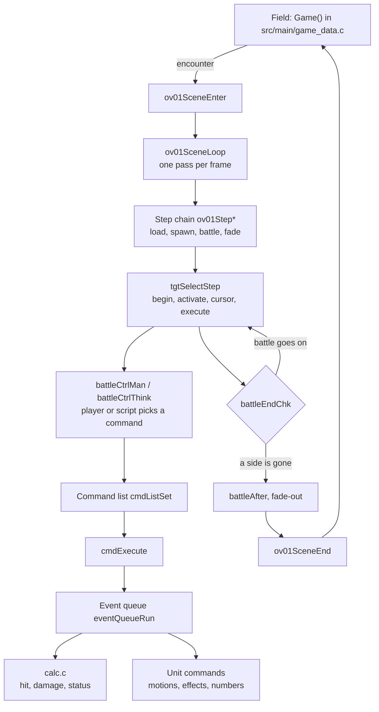

## Units, sides and keys

Every fighter is a `BattleUnit` (defined in `include/ov01/unit_cmd.h`). The unit object carries the actor, the pose and the command queue, which belong to the [Battle engine](battle-engine.md). For the rules the important member is `stats`, a pointer to a `StatBlock` with all numbers of the unit. The rule code never looks at models. It reads and writes stat blocks.

A unit is identified by its **key**, `StatBlock.key`. The key is the index of the unit's record in `bat.dat` and its range tells what kind of unit it is. The limits are the constants `UNIT_KEY_*` of `include/ov01/unit_cmd.h` and `BATTLE_SLOT_KEY_LIMIT` of `src/ov01/calc.c`.

| Key | Kind | Notes |
| --- | --- | --- |
| 1 to 10 | Party characters | The voice name table of `src/ov01/data_file_load.c` gives the order chaos (1), KOS-MOS (2), Shion (3), Jin (4), Ziggy (5), MOMO (6), Jr. (7). Keys 8 to 10 exist as slots without a name |
| 11 to 15 | E.S. | Three are used (11, 12, 13). `dataPlUnitInit` links them to the pilots 2, 6 and 7 through `StatBlock.linkedSlots[0]` |
| 16 to 140 | Enemies | Records of the enemy unit table of `bat.dat` |
| 141 to 143 | Transformed units | `actionTransformSlotGet` maps the actions 0x2D5 to 0x2D7 to these keys. Such a unit takes its numbers from the party slot that transformed |

The test `key < 16` is the side test of the whole rule code. A unit with a key below 16 belongs to the party side, every other unit to the enemy side. `unitSidesDiffer`, `boostGaugeGet`, `calcTrg2PE` and the reward code all use this one comparison.

The units of a battle stand in the table `unitTbl` of `src/ov01/unit_tbl.c`. It has eight entries. Entries 0 to 2 are the party (`UNIT_PL_SLOTS` is 3) and entries 3 to 7 are the enemies (`UNIT_EN_SLOTS` is 5). `unitTblGet(side, &table)` returns a view of it: side 0 the party part, side 1 the enemy part, side 2 the whole table. The index of a unit in the whole table is its **unit index**, which is the number that battle scripts use for a unit (`unitNoGet`, `unitPtrGet`).

| Function | Counts |
| --- | --- |
| `unitNumGet(side)` | Occupied entries of the side (`unitPlNum`, `unitEnNum`) |
| `unitLiveNumGet(side)` | Units without `UNIT_FLAG_DOWN` |
| `unitLiveNumGet2(side)` | Units without `UNIT_FLAG_DOWN` and without the row 2 status bit 0x1. This is the count that decides the end of the battle |
| `unitDownNumGet(side)` | Units with `UNIT_FLAG_DOWN` |
| `busyUnitChk(side)` | Units that are up and still have flag 0x1 set, which means their turn or reaction is still running |
| `unitNumBusyGet(side)` | Units whose command queue is not empty or whose effect is still playing |

`UNIT_FLAG_DOWN` (0x4) marks a defeated unit. The name is unlucky, because the game also has a state called Down for a unit that was knocked to the ground and is still alive. This page writes "defeated" for the flag and "Down" for the state.

### The stat block

`StatBlock` holds the numbers of one unit for one battle. For a party unit it starts as a copy of the party slot (`battleSlotTable`), made by `calcCopyParaMake`, with the bonuses of equipment and skills added by `calcSkillInit`. For an enemy it is loaded from the `bat.dat` record by `battleEntryLoad`. At the end of the battle only HP and EP are copied back to the party slot (`calcPara2OrgSub`). The party side of this data, the slots and the growth, is described in [Party and growth](party-and-growth.md).

The table lists the fields that the battle rules use. Several field names of the source are neutral words. The column "Role in the rules" gives the meaning that follows from the code.

| Offset | Type | Field | Role in the rules |
| --- | --- | --- | --- |
| 0x02 | int (unaligned) | `maxHp` | HP cap |
| 0x06 | short | `maxEp` | EP cap |
| 0x08 | short | `physAttack` | Physical attack |
| 0x0A | short | `physDefence` | Physical defence |
| 0x0C | short | `magAttack` | Ether attack |
| 0x0E | short | `magDefence` | Ether defence |
| 0x10 | s8 | `hitRate` | Base of the hit roll |
| 0x11 | s8 | `evadeRate` | Base of the evade roll |
| 0x12 | s8 | `valueBias` | Speed. Each point shortens the wait before a turn. It is capped at 15 |
| 0x13 | s8 | `expLevel` | Character level (1 to 99) |
| 0x16 | s8 | `counterBoostChance` | Percent chance of a counter Boost when the unit is hit |
| 0x17 | s8 | `inflictBase` | Base chance of the unit's status cures |
| 0x18 | s8 | `defaultHeightZone` | The height zone of the unit while it stands normally (bit mask 1, 2, 4) |
| 0x1C | u16 | `flags` | Unit traits, see [Unit traits](#unit-traits) |
| 0x20 | s8[4] | `breakZones` | The break zone sequence of the unit, up to four zones |
| 0x24 | s8[8] | `attributeReaction` | Reaction to each of the eight attack attributes, in twentieths |
| 0x2C | s8[8] | `attributeReactionRoll` | Percent chance that the reaction applies |
| 0x34 | s8[4] | `effectCode` | Four equipped skill codes |
| 0x52 | u16[5] | `altMask` | Only `altMask[3]` and `altMask[4]` (0x58, 0x5A) are the permanent status bits of rows 3 and 4 (from skills). The bytes from 0x38 to 0x57, which the first three words overlap, are the status resistances of rows 1 and 2, sixteen per row, read by `calcStatResist` |
| 0x5C | int | `hp` | Current HP |
| 0x60 | short | `ep` | Current EP |
| 0x62 | short | `key` | The unit key |
| 0x64 | short | `waitWeight` | Wait weight collected by the techniques of this turn |
| 0x66 | short | `waitCounter` | The wait counter. The unit enters the turn order when it reaches 0 |
| 0x6A | short | `posIndex` | The battlefield position of the unit (a row of the position table) |
| 0x6C | float | `facing` | Facing angle in radians |
| 0x70 | s8 | `breakState` | Break state: 0 normal, 1 Break, 2 Down, 3 Air |
| 0x71 | s8 | `stockCount` | Stock, 0 to 3 |
| 0x73 | s8 | `keysSpent` | Attacks entered this turn |
| 0x80 | short | `counterGauge` | Counter gauge, 0 to 100 |
| 0x82 | short | `esEnergy` | E.S. energy |
| 0x84 | short | `esEnergyMax` | E.S. energy cap, 200 or 300 |
| 0x86 | short[4] | `equipId` | Four equipment ids |
| 0x8E | short[2] | `linkedSlots` | E.S. only: main pilot and sub pilot |
| 0x92 | u16[4] | `activeMask` | Active status bits, one word per status row |
| 0x9A | u8[4][16] | `turnCount` | Turns left of each status |
| 0xDA | s8[8] | `hitZoneKind` | The zones hit so far in this turn |
| 0xE2 | s8[8] | `hitZoneMark` | Which zones of the sequence are matched |
| 0xEC | int | `hitZoneCount` | Number of zones hit so far |
| 0xF0 | int | `comboMask` | Attribute mask of the running combo |
| 0xF4 | int | `comboHits` | Hits of the running combo, at most 99 |
| 0x100 | pointer | `source` | The unit that hit this unit last |

### Unit traits

The halfword `StatBlock.flags` comes from the unit record and describes fixed traits of a unit. The rule code tests these bits.

| Bit | Meaning in the code |
| --- | --- |
| 0x0003 | A type number 0 to 2: 0 biological, 1 Gnosis, 2 machine (the three enemy types of the game, named from the ether descriptions in the data). It selects one of the three `modeGuard` bytes of a technique, so a technique can be strong, weak or without status effect against each type |
| 0x0004 | The unit cannot be launched into the Air state (`calcHitStateStep`) |
| 0x0008 | The unit cannot be knocked into the Down state |
| 0x0010 | A zone hit from the front does not count toward the Break. Only back attacks do (`calcHitRowGate`) |
| 0x0020 | The unit never guards (second hit roll of `calcHitRate`) |
| 0x0040 | The unit never evades (first hit roll) |
| 0x0200, 0x0400 | The attack type shown by the analyze panel (`specAnalyzeProc`): 1 or 2, else 0 |
| 0x0800 | The unit has a counter gauge (`unitPercentAdd`, `calcStatusHitRoll`) |
| 0x4000 | The unit cannot be targeted (`battleEffectApplies`, `calcTgtUnitTbl`, the cursor lists) |

## How a battle starts

A battle starts in the field loop `Game` of `src/main/game_data.c`. The loop watches the halfword `gameWork.encounterReaction`. It is -1 during normal play. When it has another value at the end of a frame, the loop leaves the field, runs the battle scene to its end and comes back. Three words of `gameWork` describe the encounter: `encounterTarget` is the enemy group number, `encounterFlags` the event flag word that the battle calls `cfEvent`, and `encounterRecord` the map unit record of the enemy that was touched.

These words are written by `Check_Encount` in `src/main/set_motion.c`. It has two callers and so there are two ways into a battle.

The first way is contact with an enemy on the field. The field enemy code in `src/main/enemy_1.c` calls `Check_Encount(index, 0, 0)`. The function compares the facing of the player and of the enemy in three sectors each and stores the result, a number from 0 to 4, as the reaction. It then picks the enemy group at random from the up to eight groups of the enemy record. How enemies see and chase the player is described in [Field enemies](field-enemies.md).

The second way is a script. The native `enepc.Encount` (`enepcEncount` in `src/main/runtime_enepc.c`) calls `Check_Encount(index, 1, value)` for a named map unit, and the value becomes the reaction directly. With an index of -1 the function takes a short path that stores the value as the event flag word and group 0. Event scripts use this for story battles (see [Events](../scripting/events.md)).

`Check_Encount` also builds the event flag word. The battle reads it with `cfEventGet` and scripts can add bits with the native `bat.cfFlagSet`.

| Bit | Name | Set by | Effect in the battle |
| --- | --- | --- | --- |
| 0x001 | `CF_EVENT_BOOST_BONUS` | An enemy record with reaction flag 1, when the trigger type flag is 1 | The party gets one to three Boost stocks at the start |
| 0x002 | `CF_EVENT_PARTY_BONUS` | The same enemy flag, when the trigger type flag is not 1 | Characters get one to three Stock, E.S. get 100 or 200 energy |
| 0x020 | `CF_EVENT_TIME_LIMIT` | A running time panel on the field (`gameWork.panelMode` is 0) | The battle counts the field timer down and ends when it reaches zero |
| 0x200 | `CF_EVENT_SKIP_VICTORY` | The enemy record (`state->battle`) or a script | The battle ends without the victory poses |
| 0x400 | none | The enemy record or a script | The Escape command is not offered (`calcCfEventKeyTest`) |
| 0x800 | none | A player form other than 1.0 | Passed to the battle. The rule files on this page do not test it |

The two bonus bits depend on bit 0 of the enemy record's `reactionFlags` and on the global `uwamonoTriggerTypeFlag` of the map unit code (see [Map and units](map-and-units.md)). The names "Boost bonus" and "party bonus" are the names of the source.

Once the reaction is set, `Game` runs the following sequence. The battle itself is the three calls in the middle.

1. `resResetScriptState`, `soundRestart` and `korgEvagSetFxVolume(1, 0)` stop the field scripts and sound.
2. `Game_Data_Push` saves the field state (see [Field](field.md)).
3. The screen is cleared, the actor pool is reset with `XenoActorPoolInitDefault`, fades and fonts are flushed.
4. `ov01SceneEnter`, `ov01SceneLoop` and `ov01SceneEnd` run the battle.
5. `battleRetCodeGet` returns the result code and the field reacts to it, as described in [How a battle ends](#how-a-battle-ends).

The sequence diagram shows a field encounter from contact to the return.

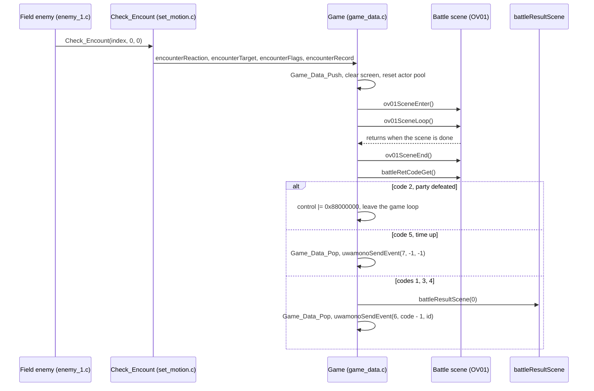

A third entry exists for development. `YamamotoTest` in `src/ov01/yamamoto_test.c` runs the same three scene calls in a loop behind a configuration menu (see [Debug tools](debug-tools.md)).

### One-time initialisation

The battle data is not loaded per battle. `ov01InitAll` in `src/ov01/choice_menu.c` runs once when the play session starts (`Game` calls it before its loop). It resets all OV01 tables with `ov01ResetAll`, starts the script VM with `sbInit`, resets the debug configuration, loads `bat.dat` with `dataBatDatLoad`, builds the party slots with `dataPlUnitInit`, clears the item tables with `dataBoxClearAll` and clears the "seen broken" bits with `sdvInitSpecialWork`. The last call sets the default gattai code 0x16001, a value that the model loading of the engine uses.

This is why the party's numbers survive from battle to battle and are also available to the main menu: the party slots live in OV01 data, and OV01 stays loaded for the whole session.

## Setting up the scene

`ov01SceneEnter` does three things. It turns frustum culling off for the scene with `xglCullingIgnore`, it calls `ov01SceneInit` and it starts the step chain with `ov01StepChainStart`.

`ov01SceneInit` resets every subsystem of the battle in a fixed order. The order matters little for the rules, but the list shows what a battle consists of.

| Call | Resets |
| --- | --- |
| `ov01ResetAll` | Object slots and tasks of the engine |
| `dataFileInit` | The file and data slot tables |
| `battleWorkTablesReset` | Stat block pools, the action stock, both Boost gauges, the target list, the Event Slot counter, the reward block, the "used this battle" flags of double techniques and ethers |
| `monsSlotReset`, `unitInit` | Stage model slots and the unit table |
| `dataVPadReset` | The virtual pad, the key buffer and the command panel cursor |
| `msgReset` | The battle message state |
| `cmdSystemInit` | The command list and the event queue |
| `tgtSelectInit` | The turn machine. It numbers the three party positions 0 to 2, turns them to 180 degrees and arms the begin stage |
| `dataStateReset` | The cursor selection lists |
| `menuPanelRowsReset`, `handleTableInit`, `ov01SceneStateReset`, `cameraInit` | HUD rows, handles, scene state, the battle camera |
| `xglLightSetDefault`, `sefLightSetsApply` | The 0x180-byte light block of the battle becomes the default light set |
| `choiceMenuResetAll`, `textEntryPoolReset`, `analyzePanelClear`, `textWindowReset`, `tiWindClearTables` | Menus, text, the analyze panel, wind |

At the end it clears the frame counter `ov01SceneFrames` and sets `sRender.battle_draw_callback` to `ov01DrawAll`. From then on the renderer calls the battle's draw function every frame.

`battleWorkTablesReset` also decides how the Boost gauge and the Event Slot start. The party gauge starts with the stock count kept in `startStockCount`, capped at 3. The enemy gauge starts empty. The Event Slot starts at a random step 0 to 2 (`actStepCounterSet(rnd(2))`).

### The step chain

The scene does not load in one blocking function. It is a chain of small step functions, each of the form `void step(struct SaveStack *context)`. One step runs per frame. A step that is finished names its successor with `ov01StepSetNext`. A step that has started a disc read also pushes the wait step `ov01StepAwaitLoads` with `ov01StackPush`. The wait step then runs each frame until `dataCdSync` and `sefCheckLoad` both report nothing pending, and pops itself. The save stack and its dispatcher belong to the [Battle engine](battle-engine.md).

The chain has 21 steps, 16 in `src/ov01/scene_load.c` and 5 in `src/ov01/scene_finish.c`.

| Step | Work |
| --- | --- |
| `ov01StepSceneScript` | Registers the battle natives (`runtimeInit`), links the scene's script image against its library with `sbLibraryLink` and starts it with `sbStartImage`. A failed link hangs in an endless loop |
| `ov01StepLoadBattleFiles` | Enables the full-screen effect, loads the face and stat textures, opens the disc arena, loads the battle sound effects |
| `ov01StepStartBlockLoad` | Starts a load thread that runs `ov01LoadComplete` |
| `ov01StepAwaitBlockLoad` | Waits for the thread |
| `ov01StepOpenHandles` | Creates the stat pre-object, creates the stage slot, opens the stage data stream of the map number that the script chose (`monsTblMapNoGet`), sends script event 6 |
| `ov01StepBindAndShow` | Gives the stream to the stage slot and shows the stage |
| `ov01StepLoadPartyIds` | Copies the three active party member ids from `ptGetStatusBlock()->memberIds` into the party spawn table and installs the script's position table |
| `ov01StepSpawnPartyMember` | Creates party unit `ov01PartyIndex` with `unitPlCreate`, places it, starts its data file load. An id of 0 skips the member |
| `ov01StepLoadPartyMember` | Binds the actors, fades the unit in, queues `UNIT_CMD_FINISH`, starts the model load thread |
| `ov01StepAwaitPartyLoad` | Waits for the thread |
| `ov01StepNextPartyMember` | Next member, three in all. Then creates the stat records of the HUD |
| `ov01StepStartEnemies` | Takes the enemy list from `monsTblGet` |
| `ov01StepSpawnEnemy` | Creates enemy `ov01EnemyIndex` with `unitEnCreate`, places it, stores its two script entry numbers, starts its data file load |
| `ov01StepLoadEnemy` | Binds, fades in, starts the model load thread |
| `ov01StepAwaitEnemyLoad` | Waits for the thread |
| `ov01StepNextEnemy` | Next enemy, at most five (`OV01_ENEMY_MAX`), ended early by an id of 0. After the last one it creates the HUD objects, applies the start bonuses, starts the battle music and lets a party member speak |
| `ov01StepBattle` | Runs the turn machine every frame until the battle is decided |
| `ov01StepStartFadeOut` | Runs `battleAfter` until the victory sequence is over, then starts the fade-out with `fadeOut(4, 2)` |
| `ov01StepAwaitObjectsIdle` | Waits for the fade, then calls `ov01SceneRelease` |
| `ov01StepBeginFinish` | An empty step |
| `ov01StepFinish` | Releases the chain's slot and sets `ov01SceneDone` |

The state diagram shows the chain with its two spawn loops.

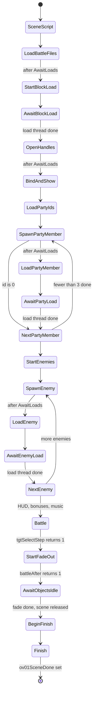

The enemy list and the party positions are not chosen by C code. The battle script runs first (it is started by the first step) and calls `bat.monsTblSet` with the group number from `bat.monsSetNoGet`, `bat.posDataSet` for the position table, `bat.plPosInit` and `bat.plDirInit` for the party, `bat.bgmPlay` for the music and `bat.cameraSet` for the camera script. The spawn steps then read what the script selected. Both spawn lists use the same 0x14-byte record, `TgtSlot`.

| Offset | Type | Field | Meaning |
| --- | --- | --- | --- |
| 0x00 | int | `charaId` | Unit key to spawn. 0 ends the enemy list or skips a party slot |
| 0x04 | int | `position` | Row of the position table |
| 0x08 | int | `direction` | Facing in degrees |
| 0x0C | int | `spawnArgC` | Script entry that receives the unit's think and hit messages (enemies only) |
| 0x10 | int | `spawnArgD` | Script entry that receives the unit's camera and motion events (enemies only) |

The default party table `ov01PartyTable` holds the keys 1, 4 and 5. It is overwritten by the real party before the first spawn.

### The load thread

Model data is unpacked by a separate thread so that the frame loop keeps running. `ov01LoadBlockStart` and `ov01LoadRequest` fill a `ThreadParam` on the stack and call `CreateThread` and `StartThread`. The thread has a 0x1000-byte stack (`loadThreadStack`), priority 8 and the `gp` value of the main program. Its entry function does the work, sets `ov01LoadDone` to 1 and ends with `ExitDeleteThread`. The await steps poll `ov01LoadIsDone`.

There are two entry functions. `ov01LoadComplete` handles the sound effect block of the battle (`dataBattleSeUpload`). `ov01LoadCompleteForOwner` handles one unit's data slot (`dataSlotVoiceUpload`). `ov01LoadRequest` skips the thread when `handleStateGet` reports that the unit's data is already present. Only one load thread exists at a time, which is why the spawn loops are strictly sequential. Thread basics are described in [xgl](../libraries/xgl.md).

### Start bonuses and the opening line

`battleStartBonusApply` in `src/ov01/scene.c` runs once, in `ov01StepNextEnemy`. It does nothing unless one of the two bonus bits of the event flag word is set.

With `CF_EVENT_BOOST_BONUS` the party's Boost gauge gains `rnd(2) + 1` stocks. `rnd(max)` returns a value from 0 to `max` inclusive, so the gain is 1 to 3. With `CF_EVENT_PARTY_BONUS` every party unit gains something of its own kind: an E.S. (key 11 to 15) gains `rnd(1) * 100 + 100` energy, which is 100 or 200, and a character gains `rnd(2) + 1` Stock. With any bonus the wait counter `unitValue` of every party unit is set to 0, so the whole party acts before the enemies. Finally the bonus effect of group 0x154 is started with record 1 (Boost), 2 (party) or 3 (both).

After the bonuses the step starts the music track that the script chose (`bgmPlayTrack(bgmIndexGet())`). `selectPL(0)` picks a random party character that is able to act, and `streamPlayByKey(speaker, 6)` plays that character's battle start line. `selectPL` only accepts units with a key below 8, so an E.S. never speaks.

## The scene loop

`ov01SceneLoop` is the frame loop of the battle. It replaces the field's loop for the length of the battle and has the same shape: update everything, let the renderer draw, sleep until the next frame.

Each pass first tests the soft reset. `ov01SoftResetPressed` returns 1 when START is pressed on pad 0 while L1, L2, R1, R2 and SELECT are held (`PAD_SOFT_RESET_HELD`). The loop then sets `CONTROL_SOFT_RESET` in `gameWork.control`, disables the full-screen effect and leaves. The field loop sees the control bit after `ov01SceneEnd` and leaves the game.

Without a reset the pass calls the update functions in a fixed order.

| Order | Call | Work |
| --- | --- | --- |
| 1 | `pxySetMode4Flag`, `pxyRequestOverlayPass` | Model library settings for the frame |
| 2 | `pauseProc` | A wait hook. It always returns 0, so a battle cannot be paused through it |
| 3 | `sbRunAll` | Runs every thread of the battle script for one slice |
| 4 | `ov01UpdateAll` | Runs every object and task of the engine. This includes the step chain and through it the turn machine |
| 5 | `cameraApplyView` | Applies the battle camera |
| 6 | `tiWindAdvanceAll` | Wind for hair and cloth |
| 7 | `XenoActorDoit`, `XenoActorDisp` | Updates and draws all actors |
| 8 | `ov01EffectPauseSet(0)`, `sefExecEffect` | Runs the effect system |
| 9 | `textUpdate`, `msgUpdateTimed`, `msgQueueClose` | Text and message windows |
| 10 | `ov01SceneIsDone` | Leaves the loop when the last step has set `ov01SceneDone` |
| 11 | `ov01SceneFrames++` | Counts the frame. Scripts read the count with `bat.frameCntGet` |
| 12 | `GameSnapShotCheck`, `xglSleep` | Screenshot check and the wait for the next frame |

The loop is bracketed by `xglRenderClearSkipOn` and `xglRenderClearSkipOff`. The flowchart shows one pass.

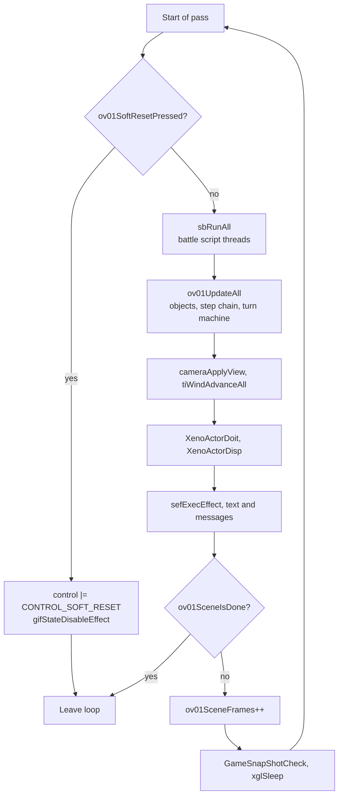

`ov01SceneEnd` is the tear-down. It calls `ov01SceneRelease`, resets the engine tables with `ov01ResetAll`, clears the draw hook and closes the disc arena. `ov01SceneRelease` is also called by the step chain before the scene end, so it runs twice in a normal battle. It turns culling back on, clears the key buffer, releases the script threads of the scene (`sbThreadsRelease`), releases all actors, shuts the scene systems down, builds the party snapshots with `partySnapshotBuild` and clears the tables.

`partySnapshotBuild` is the hand-over of the battle to the result screen. It writes HP and EP of every party unit back to its party slot (`calcPara2Org`), stores the party's Boost stock for the next battle and copies each party unit object (0x1F0 bytes) into `partySnapshots`. The result screen later reads these copies, because the real units are gone by then.

## The turn machine

`tgtSelectStep` in `src/ov01/tgt_select.c` is the heart of the battle. It is called once per frame and returns 1 when the battle is decided. Its state is the global `tgtSelectState`, a `BattleState` of 0x64 bytes that other files reach through `manWorkGet`. The source calls the file "target select", but the function drives the whole turn: who acts, how the command is chosen and how it is executed.

The machine has four stages. Each stage is a bit of `BattleState.flags`, and `tgtSelectStep` calls the handler of every bit that is set, in this order.

| Bit | Stage | Handler | Work |
| --- | --- | --- | --- |
| 1 | Begin | `tgtSelectBegin` | Takes the next unit from the action stock (`actStockPick`), marks it, moves the turn order display and calls `calcTurnStart` |
| 2 | Activate | `tgtSelectActivate` | Waits until the unit's command queue is empty, highlights it (flag 0x10) and sends script event 4 |
| 4 | Cursor | `tgtSelectCursor` | Lets the script (`battleCtrlThink`) or the player (`battleCtrlMan`) choose commands and confirms them with `tgtSelectConfirm` |
| 8 | Execute | `tgtSelectExecute` | Runs the queued commands and their events, then ends the turn |

Between the activate and the cursor stage the function always calls `battleCtrlBoostPl`, the Boost input of the player. At the end it returns `battleEndChk()`.

The cursor and execute stages overlap. `tgtSelectConfirm` arms the execute bit but keeps the cursor bit as long as the unit is still highlighted. A character can therefore enter the second button of a combination while the first attack is already playing. The cursor stage ends when the unit loses its highlight, which happens when its last command, the think end, is queued.

The execute stage has three phases in `BattleState.phase`.

| Phase | Name | Work |
| --- | --- | --- |
| 0 | `TGT_PHASE_RUN` | `battleExecNorm` takes the head command from the command list and turns it into events |
| 1 | `TGT_PHASE_EVENTS` | `eventQueueRun` works the events off. When the queue is empty and the unit has flag 0x1000 (its think end has run) the phase becomes 2, otherwise 0 again |
| 2 | `TGT_PHASE_TURN_END` | Waits until no unit is busy, then ends the turn |

The end of a turn is a fixed list of calls: `tgtSelectTurnEnd`, `menuPanelHide`, `calcTurnEnd`, script event 5, `actStepCounterAdvance` (the Event Slot moves on) and `dataEntryBlockReset`. If the unit was a party unit it is remembered in `lastPartyUnit` for the victory camera. Then the execute bit is cleared and the begin bit set again.

The state diagram shows the stages and the phases of the execute stage.

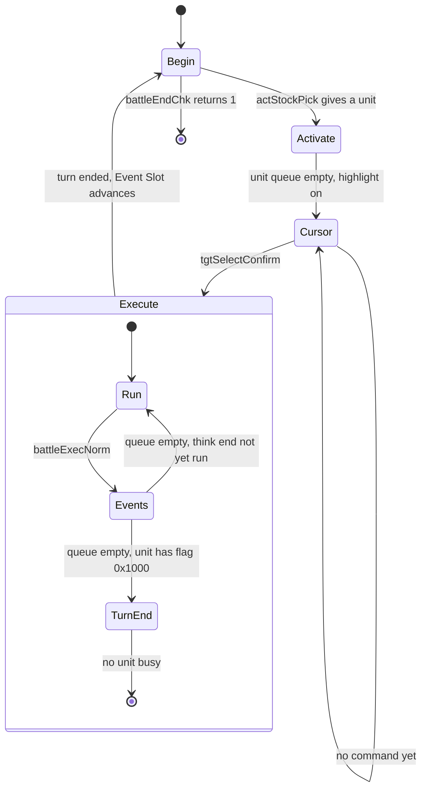

The fields of `BattleState` are listed below.

| Offset | Type | Field | Meaning |
| --- | --- | --- | --- |
| 0x00 | int | `flags` | The stage bits 1, 2, 4, 8 |
| 0x04 | pointer | `current` | The unit whose turn it is |
| 0x08 | pointer | `lastObject` | The unit whose command is executing |
| 0x0C | pointer[2] | `targets` | The remembered target cursor for the enemy side and for the party side |
| 0x14 | pointer | `lastPartyUnit` | The last party unit that finished a turn |
| 0x18 | int | `menuMode` | The mode of the battle menu (`BATTLE_MENU_*`) |
| 0x1C | int | `phase` | The phase of the execute stage |
| 0x20 | int | `selection` | The choice of this frame, 0 for none |
| 0x24 | int | `selectionKind` | The last non-empty choice |
| 0x28 | int | `active` | 1 during button input, 2 while the command panel is open |
| 0x2C | int | `selectionIndex` | The record picked in a list menu, or the position or member picked |
| 0x30 | int | `status` | The end status of the battle (`TGT_STATUS_*`) |
| 0x34 | int | `victoryStarted` | Set once the victory sequence has started |
| 0x38 | pointer | `object` | The unit of the last attack command, used by the status step |
| 0x3C | int | `commandKind` | The kind of that command |
| 0x40 | int | `hitDamage` | The damage of the last computed hit |
| 0x44 | int | `hitMode` | The hit mode word of that hit |
| 0x48 | int | `transition` | 1 when the party left the battle, 2 when the enemies left |
| 0x4C | int | `sideToggle` | Flipped by L1 and L2 during the cursor stage |
| 0x50 | int | `moveCmd` | Nonzero disables the Move command (native `bat.setMoveCmd`) |
| 0x54 | int | `mode` | The state of automatic control: 0 start, 1 thinking, 2 done |
| 0x58 | int | `slotIndex` | The party slot of a transformed unit |
| 0x5C | float | `scale` | The facing angle saved across a transformation |
| 0x60 | pointer | `targetFlags` | The target flag byte of the technique whose target is being chosen |

## Turn order

Turn order is not a fixed rotation. Every unit has a wait counter, and units enter a short queue when their counter runs out. The queue is the **action stock** (`struct ActStock` in `include/ov01/calc.h`). It is what the turn window of the HUD shows. It must not be confused with Stock, the saved attacks of a character, which the source calls `level`.

### The wait counter

`calcWct` computes the wait value of a unit:

```
base  = (valueLevel - valueBias) * 9 + 180
wait  = base
        + base / 2     if row 1 status 0x01 is active   (slow)
        - base / 4     if row 3 status 0x40 is active   (quick)
        - base / 2     if row 3 status 0x80 is active   (quicker)
```

`valueBias` is the speed of the unit. `valueLevel` starts every turn at 0 and grows during the turn: each technique adds its `TecRecord.waitWeight` (`unitRecordStateGet`), so heavy techniques delay the next turn. A unit with skill code 0x13 ignores these weights.

`unitValueReset` stores the result in `unitValue` at the end of each turn of the unit, and `battleEntryActivate` stores it when the unit enters the battle.

### Filling the action stock

The action stock has four turn slots, two Boost slots and a cursor.

| Offset | Type | Field | Meaning |
| --- | --- | --- | --- |
| 0x00 | pointer[4] | `stock` | The units of the current round, in turn order |
| 0x10 | pointer[2] | `boost` | Slot 0 holds a unit that got a counter Boost, slot 1 a unit that was boosted by command |
| 0x18 | int | `max` | Number of turns in the current round |
| 0x1C | int | `pickCursor` | Next slot to hand out |
| 0x20 | pointer | `lastPicked` | The unit that was handed out last |
| 0x24 | int | `pickSource` | Where the last unit came from: 0 a new round, 1 the next slot, 2 a Boost slot |

A round is over when the cursor has passed `max` and both Boost slots are empty (`actStockNeedsRefill`). `actStockMake` then builds a new round. The size of the round is half the number of units that can act, rounded up, and at most 4 (`actStockMaxGet`). With three party units and three enemies a round has three turns.

The round is filled by sweeping over the unit table again and again. In each sweep every unit that can act lowers its wait counter by 1 through `calcWctDec`, and by 1 more with a chance of 30 percent. A unit whose counter reaches 0 and that is not already in the round takes the next slot and gets `UNIT_FLAG_STOCKED`. The sweeps repeat until the round is full. The 30 percent roll is what makes the order slightly unpredictable among units of similar speed.

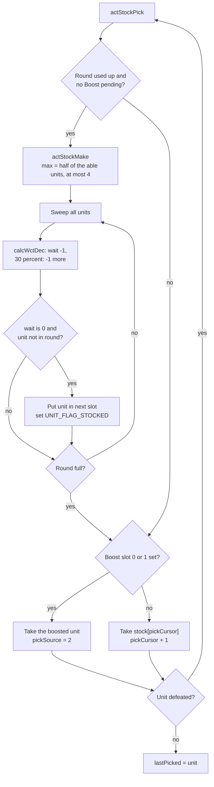

`actStockPick` hands the units out. A Boost slot always comes first, slot 0 before slot 1. A defeated unit is skipped. `tgtSelectBegin` passes `pickSource` on to the HUD: `menuStockStart` for a new round, `menuStockNext` for the next slot and `menuStockBoost` for a Boost.

### The start and the end of a turn

`calcTurnStart` clears flag 0x4000 of the unit, the mark of the stock stance that it took in its last turn. A unit that lies in the Down state gets command 28 queued, which makes it stand up.

`calcTurnEnd` clears the attack counter `keysSpent`, clears the flags `UNIT_FLAG_STOCKED` and 0x200 (boosted), computes the new wait value and counts the status turns down with `calcStatTurn`.

`tgtSelectTurnEnd` handles the Break states of all units. It first looks at Boost slot 1. If a unit waits there and it is on the same side as the unit that just acted, nothing is reset: the boosted ally will act next and can continue the same Break, Air or Down and the same combo. Otherwise every unit that is not defeated loses its collected zone hits (`unitEntryTableClear`) and its combo (`calcComboReset`), a unit in Down gets `UNIT_CMD_MOVE_RATIO`, a unit in Air gets `UNIT_CMD_MOVE_RAMP`, and `unitStateAdvance` moves the state one step toward normal: Break and Down become normal, Air becomes Down.

This is the code behind a well-known tactic of the game. A broken enemy recovers at the end of the turn, unless the next turn is a boosted ally.

## The Event Slot

The Event Slot is a four-step wheel that advances by one at the end of every turn, whoever acted. Its state is `actStepCounter` (`struct EventSlot`), and the rule code asks for the current value with `actStepCounterValue`. The HUD icon (`src/ov01/act_step_icon.c`) and the script native `bat.ETGet` read the same value.

The steps 0, 1 and 2 are fixed. Step 3 is a wild card: when the wheel arrives there, `actStepCounterSet` draws a hold value `rnd(3) + 4`, which is 4, 5, 6 or 7, and `actStepCounterValue` returns that hold value instead of 3. Each time the wheel moves, a point multiplier is drawn as well: `rnd(100)` of 96 or more gives 10, 61 or more gives 4, anything else gives 2.

| Value | Effect | Code |
| --- | --- | --- |
| 0 | Critical hits. The base critical chance is 50 percent instead of 10. A critical hit has a further 10 percent chance to multiply by 2 instead of 1.5 | `calcCrit` |
| 1 | Boost. A technique fills the attacker's Boost gauge by 30 points instead of 10, and with 10 percent chance by 50, a full stock | `cmdAttackQueueAndSpend` |
| 2 | Points. The skill points of every enemy defeated in this turn are multiplied by the drawn multiplier 2, 4 or 10 | `monsGainSet` |
| 4 | Ether. Ether attacks and ether healing gain 50 percent | `calcDmg` |
| 5 | Turn loss. A plain technique hit removes the target from the current round of the action stock | `attackHitApply` |
| 6 | Nothing in the rule code |  |
| 7 | Enemy Boost. A technique hit fills the Boost gauge of the target's side by 10 | `attackHitApply` |

The values 0, 1 and 2 match the three slots that players know as Critical, Boost and Point bonus. The fourth slot is drawn fresh each time the wheel comes round.

The wheel also stores three flags that are cleared at every advance: `levelGranted` (the Break bonus was given this turn), `bonusFlag` (the doubled critical happened) and `stepState` (the last Break result, for the HUD panel).

## Player input

All pad input of the battle goes through one function, `dataPadRead(port)` in `src/ov01/battle_init.c`. The argument selects which view of pad 0 is returned: 0 the held buttons (`PadData[0].directionHeld`), 1 the buttons pressed this frame (`directionPressed`) and 2 the pressed buttons with auto-repeat (`directionRepeated`). The pad record itself is described in [xgl](../libraries/xgl.md).

### The virtual pad

Because every reader uses `dataPadRead`, the input can be replaced. When `padMode` is not 0, `dataPadRead` ignores the real pad and returns the halfword `padData` for every port. A battle script switches the mode with `bat.VPadEnable` and `bat.VPadDisable` (`dataVPadModeSet`) and presses buttons with `bat.VPadSet` (`dataVPadSet`). This is how the battle tutorials play the party's turns by themselves.

`dataVPadSet` takes a 14-bit value in an order of its own and converts it to pad bits through the table `padConvTbl`. Bit `n` of the script value becomes entry `n` of the table.

| Script bit | Pad bits | Script bit | Pad bits |
| --- | --- | --- | --- |
| 0 | 0x1000 (Up) | 7 | 0x0020 (Circle) |
| 1 | 0x4000 (Down) | 8 | 0x0004 (L1) |
| 2 | 0x8000 (Left) | 9 | 0x0001 (L2) |
| 3 | 0x2000 (Right) | 10 | 0x0008 (R1) |
| 4 | 0x0010 (Triangle) | 11 | 0x0002 (R2) |
| 5 | 0x0040 (Cross) | 12 | 0x0800 (START) |
| 6 | 0x0080 (Square) | 13 | 0x0100 (SELECT) |

The button names are those of `include/main/pad_buttons.h`.

### Button combinations

On a party unit's turn the battle menu starts in the mode `BATTLE_MENU_KEYS`. In this mode the face buttons are attacks. The player does not pick "Attack" from a menu. The first press already belongs to a combination.

The pressed buttons are collected in the key buffer `keyBuff` (eight entries, count in `keyBuffIdx`). `keyBuffSet` accepts only the buttons of the unit's class: Square, Triangle and Circle for a character (`keyItemTblCha`), Square and Triangle for an E.S. (`keyItemTblAgws`). After each press `keyBuffChk` compares the whole buffer with the combination table of the class and returns the **key number** of the matching entry. The key number is an index into the unit's **key row**, a row of ten technique numbers in `bat.dat` (`tableKeyRowGet`, `tableKeyEntryGet`). So the same buttons give different techniques for different characters.

The character table `keyCmdTblCha` has 22 combinations.

| Buttons | Key number | Stock cost | Notes |
| --- | --- | --- | --- |
| Square | 1 | 0 | First half of a combination. No technique is run |
| Triangle | 2 | 0 | First half of a combination. No technique is run |
| Square, Square | 3 | 0 | |
| Square, Triangle | 4 | 0 | |
| Triangle, Triangle | 5 | 0 | |
| Triangle, Square | 6 | 0 | |
| Circle | 7 | 0 | |
| Circle, Circle | 8 | 1 | |
| Circle, Circle, Circle | 9 | 1 | |
| Circle, Circle, Circle, Circle | 10 | 1 | |
| any two-button combination, then Circle | 8 | 1 | Four entries, one per combination |
| any two-button combination, then Circle, Circle | 9 | 1 | Four entries |
| any two-button combination, then Circle, Circle, Circle | 10 | 1 | Four entries |

The E.S. table `keyCmdTblAgws` has only two entries: Square is key 1 and Triangle is key 2, both without cost.

In the words of the game: Square and Triangle are the two basic attacks, a turn is a pair of them, and Circle attacks are the extra attacks that cost one Stock each. With three Stock a character can add three Circle attacks to the pair, five attacks in one turn. According to players' guides Square attacks hit zone B and Triangle attacks zone C. The code does not fix this. The zones of an attack are data of the technique record that the key row names (see [Break zones](#break-zones-break-air-and-down)).

`keyCmdGet` is the function that runs each frame in this mode. Its checks, in order:

1. If the unit already entered an attack this turn (`keysSpent` above 0) and cannot continue, the input ends: the buffer is cleared and `DATA_KEY_CANCEL` (20) is returned. A character cannot continue when its Stock is 0 or when the unit object has flag 0x800. An E.S. can never continue, so an E.S. has one attack per turn.
2. No button pressed returns 0. Cross alone clears the buffer and returns `DATA_KEY_CANCEL`.
3. `keyBuffSet` appends the button. A button that the class does not use returns `DATA_KEY_NONE` (21).
4. `keyBuffChk` finds the combination. No match removes the button again and returns `DATA_KEY_NONE`.
5. `keyCmdChk` tests whether the technique may be used on the current target. A refusal removes the button again.
6. `keysSpent` is counted up, except for the single first button of a character.
7. The Stock cost of the key (`keyCmdApGet`) is taken with `unitLevelAdd`.

`keyCmdChk` returns 0 when the key is allowed. For a single first button of a character it only asks whether one of the two combinations that start with this button could hit the target. For every other key it refuses when the key row has no technique for the key (result 2), when a character has less Stock than the cost, when `battleEffectApplies` says the technique cannot reach the target, or when the unit has the row 2 status 0x200, which seals all button attacks.

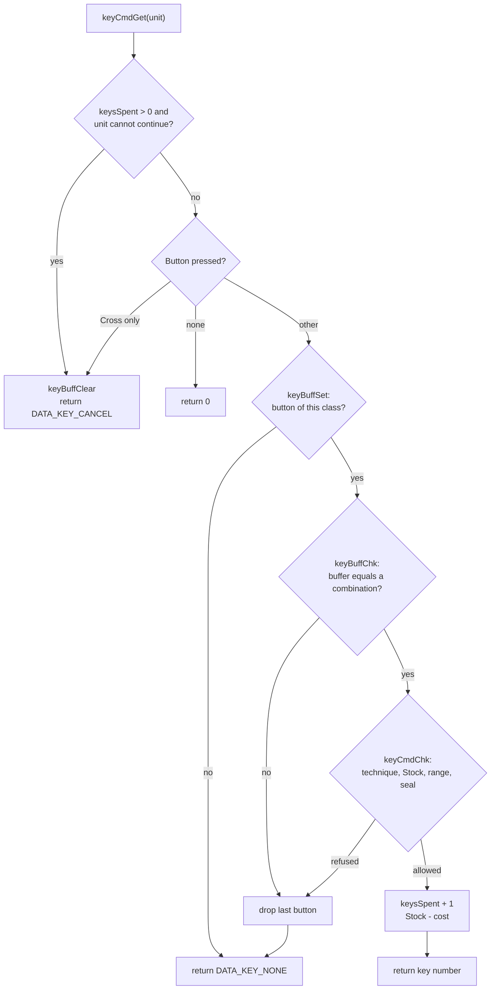

Each returned key number is turned into a command at once (see [From a choice to a command](#from-a-choice-to-a-command)), and the menu changes to `BATTLE_MENU_KEY_HELD`, where the same function keeps collecting the rest of the combination. When `keyCmdGet` finally returns `DATA_KEY_CANCEL`, the turn's think end is queued.

### The command panel

Pressing Cross before any attack opens the command panel (`BATTLE_MENU_PANEL_OPEN`, then `BATTLE_MENU_PANEL`). The panel has two columns. `menuWepSpPanelUpdate` moves between the columns with Left and Right and inside a column with Up and Down, and Circle confirms. The entries of each column come from `dataSlotRowsA` for characters and `dataSlotRowsB` for E.S. An entry is a selection number from 11 to 19. Opening and closing the panel sends the script events 9 and 10.

| Number | Source name | Command | Available when (`dataSlotKeyTest`) |
| --- | --- | --- | --- |
| 11 | `SELECT_WAIT` | Stock for a character, Charge for an E.S. | Always |
| 12 | `SELECT_LOOKUP` | Ether | The unit knows at least one of the ethers 1 to 59 (`slotCodeTest`) |
| 13 | `SELECT_HIT_ACTION` | Item | The inventory holds at least one of the items 1 to 40 with the battle-use flag 0x4000 |
| 14 | `SELECT_PAIR` | Double technique | A double technique exists with the unit that waits in Boost slot 1 (`calcKeyPairRecords`) |
| 15 | `SELECT_SNAPSHOT` | Move | A battlefield position is free (`effectPosCountFree`) and the script has not disabled moving (`moveCmd` is 0) |
| 16 | `SELECT_SWAP` | Change | A party member that is not in the battle is available (`battleMaskWordsUnmatched`) |
| 17 | `SELECT_LEVEL` | E.S. special attack | The E.S. has a special for its sub pilot (`calcKeyBandRecords`) |
| 18 | `SELECT_LEAVE` | Escape | The unit has key 3, 6 or 12 and event flag 0x400 is clear (`calcCfEventKeyTest`) |
| 19 | `SELECT_TGT_ID` | Special attack of a character | The unit has one of the ten special attack marks (`slotFlagCollect`) |

The columns hold these entries.

| Class | Column 1 | Column 2 |
| --- | --- | --- |
| Character | 11, 12, 13, 14, 15 | 16, 18, 19 |
| E.S. | 11, 12, 17, 15 | 16, 18 |

The English command names in the table are the names players use for them. The source only has the neutral names of the second column. The mapping follows from what each command does, which the section [Command types](#command-types) describes.

While the panel is open, `statusLineOpen` and `statusLineStep` show a small text line with the status effects of the acting unit. Every 30 frames the line moves on to the next active status bit and shows its name. The names come from `tableStringGet` with the text numbers of `statBitValues`, a table of four rows of sixteen numbers (4 to 54).

### List menus

Six of the commands open a list. All six are built the same way in `src/ov01/choice_menu.c`: an opener fills the arrays `choiceMenuItems` (texts), `choiceMenuValues` (the number shown next to each text), `choiceMenuEntryIds` and `choiceMenuEntryFlags`, opens choice slot 0 at (0x14, 0x6C) with size 0x1AC by 0x70 and adds a help text box below it. A picker reads the cursor every frame, shows the help text of the entry and returns the entry's id, or 0 when the entry is greyed out (`CHOICE_ENTRY_DISABLED`). The choice menu widget itself is described in [UI windows](../libraries/ui-windows.md).

| Opener | Lists | Number shown | Greyed out when |
| --- | --- | --- | --- |
| `choiceMenuOpenItems` | Items 1 to 40 in the inventory with the battle-use flag | Quantity | No valid target exists (`calcItmEnableChk`) |
| `choiceMenuOpenTecs` | Ethers 1 to 59 that the unit knows | EP cost (`calcTakeEpGet`) | `calcEthEnableChk` fails: ether sealed, no valid target, not enough EP, or a once-per-battle ether already used |
| `choiceMenuOpenPaired` | Combined ethers (lookup records 60 to 89) that pair the chosen ether with one the boosted partner knows | EP cost | One of the two units fails `calcEthEnableChk` |
| `choiceMenuOpenPairs` | Double techniques of the unit and the boosted partner | Required Stock | One of the two has less Stock (`calcLevelsMeetRecord`) |
| `choiceMenuOpenLevels` | E.S. specials of the unit's band (records 1 to 7 for key 11, 8 to 14 for key 12, 15 to 21 for key 13) that fit the sub pilot | Required energy | The E.S. has less energy (`calcCurrentMeetsRecord`) |
| `choiceMenuOpenTgtIds` | Special attacks whose mark the character has | Required Stock | No unit of the target side can be reached (`tgtSideAccepts`) |

The combined ether list is reached from the ether list with Triangle instead of Circle.

After a list entry is confirmed the menu enters a target mode (`BATTLE_MENU_*_TARGET`), described in the next section. Cross always goes one level back. The state diagram shows the modes of `manInput`.

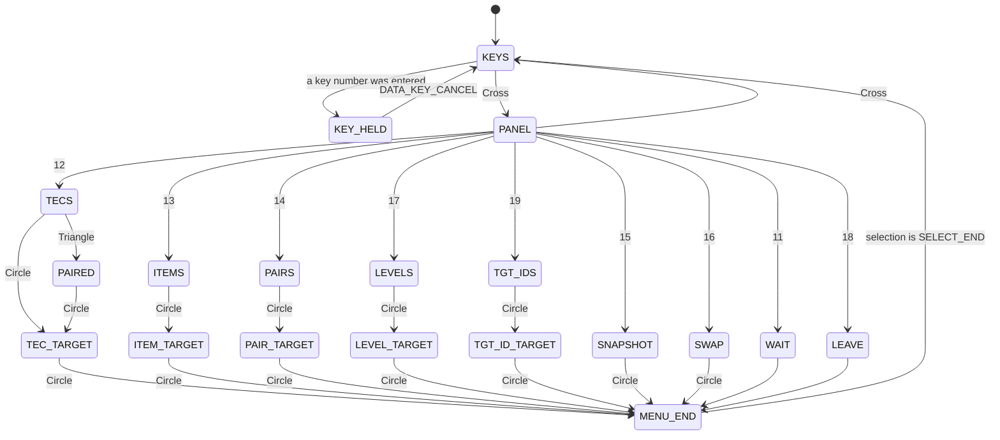

Three details of the menu change game state at the moment of the confirmation, before the command runs. Confirming an item target takes the item out of the inventory (`dataBoxDecCategory1`). Confirming a special attack target takes its Stock cost (`unitLevelAdd` with the negative `minLevel`). Confirming an E.S. special is refused with the refuse sound when `battleEffectApplies` says the chosen target cannot be reached.

## Target selection and ranges

Who can be targeted is decided in two steps. The **target flags** of the technique say which side and which kind of unit it is meant for. The **reach test** `battleEffectApplies` then says whether the technique can touch one specific unit from where the attacker stands.

### Target flags

The first byte of a technique record, `TecRecord.flags`, is a bit mask.

| Bit | Meaning |
| --- | --- |
| 0x01 | The own side of the user |
| 0x02 | The other side |
| 0x03 | Both bits: either side. The cursor can switch sides with Up and Down |
| 0x04 | The user itself only |
| 0x08 | All valid units at once (`TEC_TARGET_ALL`) |
| 0x10 | Defeated units instead of standing ones (revival) |
| 0x20 | A ranged technique. The user does not walk to the target, and the technique may be used on a position marked as out of reach |

`calcTrg2PE(unit, flags)` turns the side bits into a side number for `unitTblGet`. For a party unit "own side" is side 0 and "other side" is side 1. For an enemy it is the reverse. `calcTgtUnitTbl(unit, flags, found)` collects the candidates of that side: occupied entries, without the untargetable trait 0x4000, standing units normally and defeated ones with bit 0x10. With bit 0x04 the only candidate is the user.

### The cursor

The target cursor is an object of its own, created at the end of the loading steps by `objEnCurCreateAtOrigin`. Its update function `objCur` moves it toward the selected unit or position, and its draw function `objCurDraw` draws a 46 by 38 pixel sprite above the target. The sprite has three looks, selected by `DataObject.kind`: the normal look, a look for "this would be a back attack" (kind 1, set when `unitIsInFacingArc` is true for the acting unit and the target) and a look for group selections (kind 2).

The cursor works on the selection list `curMove` (`struct DataState`, 0xBC bytes): up to eight units, their position numbers, a count and an index. Three pairs of functions fill and step this list.

| Functions | Used for | List contents |
| --- | --- | --- |
| `curEnProcInit`, `curEnProc` | The default target during button input | The standing, targetable units of the side opposite to the acting unit |
| `curTgtProcInit`, `curTgtProc` | The target of an ether, item, special or double technique | The candidates of `calcTgtUnitTbl` for the technique's flags, split into party and enemies when both sides are allowed |
| `curPosProcInit`, `curPosProc` | The Move command | The free battlefield positions (`effectPosIsFree`) |

`curSel` steps the index with Right and Left, wraps at the ends and plays the cursor sound. When the technique targets all units (bit 0x08), `curTgtProc` does not let the player choose. It makes the cursor hop from unit to unit by itself, advancing whenever the frame counter is a multiple of 4 as the cursor arrives.

`battleCtrlMan` calls `curEnProcInit` and `curEnProc` every frame while the menu is in the button input mode, so the player can change the target between two attacks. `dataTargetShow` shows the target's HP panel, combo panel and zone icons, and `dataTargetHide` hides them again. The chosen unit is stored through `tgtUnitSet` in `BattleState.targets`. There are two slots, so the game remembers the last enemy target and the last ally target separately. `tgtUnitAdrGet` picks slot 1 while a target mode is open for a technique with target bit 0x01.

### The reach test

`battleEffectApplies(user, technique, target)` in `src/ov01/calc.c` is used everywhere a technique meets a unit: by the button input, the menus, the attack table of the enemies and the final target search. It returns 1 only if all of these hold.

1. The target's battlefield position is not flagged 2 in the position table, or the technique is ranged (bit 0x20).
2. The target does not have the untargetable trait 0x4000.
3. If the technique has a range code (`TecRecord.code` is not 0), `MMathActorsInRangeByKind(code, userActor, targetActor, scale / 100.0)` succeeds. The code selects a shape (a distance, a rectangle in front, a fan) and `TecRecord.scale` its size in percent. The shapes are described in [Math](../libraries/math.md#range-tests-between-actors).
4. Each of the up to four zone bytes `TecRecord.strikeZones` has at least one bit in common with the target's current height (`unitStateFlagGet`). A technique that only reaches low cannot be used on a unit in the air.

A technique number can also be negative. It then names a list of up to three alternative techniques (`effectIdListGet`), and `battleEffectResolve` picks the first one that fits the target's current height. Two bits of the first zone byte restrict an alternative further: 0x08 requires the target to be in the Down state and 0x10 requires the user to have flag 0x2000. This is how one button gives a different attack against a downed enemy.

### The final target search

When a command executes, the targets are searched once more by `tgtFindFirst` and `tgtFindNext`. They fill the table `tgtTbl` (eight entries). For a single-target technique the chosen unit is used if it still passes the reach test and still has the right standing or defeated state. If it does not, for example because an earlier attack of the same turn defeated it, the first unit of the side that passes takes its place. For an all-target technique every passing unit of the side is a target. If nobody passes, the command is dropped.

### Back attacks

`unitIsInFacingArc(origin, target)` is the back attack test. It computes the bearing from the origin to the target with `atan2f` and compares it with the target's `facing`. The result is 1 when the difference is less than a quarter turn (pi / 2), which means the origin stands behind the target and looks the same way as the target does. A difference of exactly a quarter turn, within 0.000001, counts as 0.

`calcBackAttack` applies the test to plain attacks (technique kind 1). A back attack has three effects: it cannot be evaded or guarded, it adds 50 to the critical chance, and it counts toward the Break even on units that only break from behind. Because positions matter, the Move command and the party positions chosen by the script are part of the tactics.

## From a choice to a command

The player's choice and the enemy's choice end in the same data structure, a `CmdListBody` of six words.

| Offset | Type | Field | Meaning |
| --- | --- | --- | --- |
| 0x00 | int | `command` | The command kind (`CMD_KIND_*`) |
| 0x08 | int | `code` | The technique number, or the position or member of Move and Change |
| 0x0C | int | `arg.target` | The target unit |
| 0x10 | int | `pairIndex` | The record that named the technique: ether, item, double technique, special |
| 0x14 | int | `attackKind` | Copied into the attack record |

`convKey2unit` builds it from the menu selection. `thinkDispatch` builds it for scripts. `cmdListSet` appends it, together with the unit, to the command list `cmdList`, a ring of 32 entries of 0x20 bytes managed by `cmdFifo`.

| Selection | Command kind | `code` | `pairIndex` |
| --- | --- | --- | --- |
| Key 1 or 2 of a character | `CMD_KIND_NONE` (0) | | |
| Keys 3 to 10, E.S. keys 1 and 2 | `CMD_KIND_TECHNIQUE` (1) | Key row entry | |
| 11 Stock or Charge | `CMD_KIND_WAIT` (2) | | |
| 12 Ether | `CMD_KIND_LOOKUP` (3) | `EtherRecord.tecIndex` | Ether number |
| 13 Item | `CMD_KIND_ITEM` (4) | `UsableItemRecord.entry` | Item number |
| 14 Double technique | `CMD_KIND_TECHNIQUE` (1) | `DoubleTechRecord.tecIndex` | Pair record |
| 15 Move | `CMD_KIND_SNAPSHOT` (6) | Position number | |
| 16 Change | `CMD_KIND_SWAP` (5) | Key of the new member | |
| 17 E.S. special | `CMD_KIND_TECHNIQUE` (1) | `EsSpecialRecord.tecIndex` | Level record |
| 18 Escape | `CMD_KIND_LEAVE` (7) | | |
| 19 Special attack | `CMD_KIND_TECHNIQUE` (1) | `SpecialAttackRecord.actionIndex` | Special record |
| 20 End of input | `CMD_KIND_THINK_END` (9), or `CMD_KIND_REFRESH` (8) | | |

The last row needs a note. When a character pressed only one button and then cancelled, nothing was done, so `convKey2unit` queues `CMD_KIND_REFRESH`, which only resets the unit's pose, and the turn continues. In every other case the end of input queues the think end. `battleCtrlMan` then removes the highlight from the unit, which closes the cursor stage.

### Executing a command

`battleExecNorm` clears the event queue, takes the head of the command list and passes it to `cmdExecute`, unless the unit was defeated in the meantime. `cmdExecute` does not perform the command. It translates it into events and appends them to `eventQueueTable`, a table of 64 records of 0x30 bytes. `eventQueueRun` then calls the handler of the record at the cursor every frame. A handler returns 0 for "not finished, call me again" and 1 for "done", and only then the cursor moves on. `eventRetryCount` counts the repeated calls and `eventStepStarted` is a step number that handlers with several phases use.

The handler table `eventQueueHandlers` has 21 kinds.

| Kind | Handler | Work |
| --- | --- | --- |
| 0 | `eventNoneRun` | Nothing |
| 1 | `eventUnitCommand` | Appends a command to the unit's own command queue, so the unit plays a motion or moves. Reports techniques and moves to the script |
| 2 | `eventWaitUnitQueue` | Waits until the unit's command queue is empty |
| 3 | `eventAttackRun` | Plays one attack: effects, hit reactions, numbers, then applies the hits |
| 4 | `eventAttackActionSkip` | A data record: the attack (`struct AttackCommand`). The attack event reads it |
| 5 | `eventAttackHitSkip` | A data record: one computed hit (`struct HitRecord`). The attack event reads it |
| 6 | `actionResourcesLoad` | Starts loading the effect of the technique and, for some techniques, an extra model |
| 7 | `ov01LoadsIdle` | Waits until no disc read and no effect load is pending |
| 8 | `unitAttachRequest` | Attaches the extra model to the unit (and to the partner of a double technique) |
| 9 | `unitSpawnFromRequest` | Creates the replacement unit of a Change |
| 10 | `unitBindRequest` | Binds its data, fades it in, waits for its model |
| 11 | `battleExecDead` | Removes defeated units and collects their rewards |
| 12 | `battleResolveStatus` | Applies end-of-step statuses and last-chance statuses |
| 13 | `battleStatusQueueWait` | Applies auto-revive |
| 14 | `ov01StreamOpen` | Opens the special stage of a double technique (data stream 0x43) |
| 15 | `ov01StreamBind` | Binds that stage when it is loaded |
| 16 | `eventPairBegin` | Moves the two partners and the target to the double technique stage |
| 17 | `eventPairEnd` | Moves them back |
| 18 | `eventCombinedEtherBegin` | Start of a combined ether. It returns 1 at once |
| 19 | `eventActStockBoostClear` | Clears Boost slot 1 and ends the partner's turn |
| 20 | `eventWaitCountdown` | Waits a number of calls |

For a technique, an ether or an item (`CMD_KIND_TECHNIQUE`, `CMD_KIND_LOOKUP`, `CMD_KIND_ITEM`) `cmdExecute` works in this order.

1. It waits for the unit's queue (event 2).
2. For a technique it resolves a negative technique number with `battleEffectResolve`.
3. `cmdFindFirstTarget` finds the first target. Without a target the function returns 0 and nothing happens.
4. For a technique it rolls the target's counter gauge with `calcStatusHitRoll`. On success attacker and target change places, as described in [The counter gauge](#the-counter-gauge).
5. It stores target and technique in the unit (`commandTarget`, `commandCode`).
6. Unless the command is an item, it brings the unit to the target. A ranged technique turns the unit toward the target or toward the middle of all its targets (`UNIT_CMD_TURN_AIM`). A melee technique makes the unit run to the target once per turn (`UNIT_CMD_MOVE_CHA`, flag `UNIT_FLAG_MOVED_OUT`). Against a target in the Air state the unit only takes a pose instead (`UNIT_CMD_POSE_ARRIVE`, flag `UNIT_FLAG_POSED_OUT`).
7. It queues the resource events 6, 7 and 8.
8. It runs the action on one of three paths, selected by `TecRecord.techClass`: the double technique path `cmdPairRun` (value 1), the combined ether path `cmdCombinedEtherRun` (value 3), or the plain path. The plain path queues the command for the unit, then calls `cmdAttackQueueAndSpend`.

`cmdAttackQueueAndSpend` is the point where the rules are applied. It calls `unitJobTypeAtk`, which computes the hit of every target with `calcHitDmg` and queues one hit record per target, the attack record and the attack event. Then it pays the costs: Boost gauge progress for a technique, the EP cost (`calcTakeEpGet`), the energy cost of an E.S. special, and the 25 energy that an E.S. gains for a technique whose `gateFlag` is 6, 7 or 8.

The outcome of an attack is therefore fixed before its animation starts. The attack event only shows it and then writes it into the stat blocks.

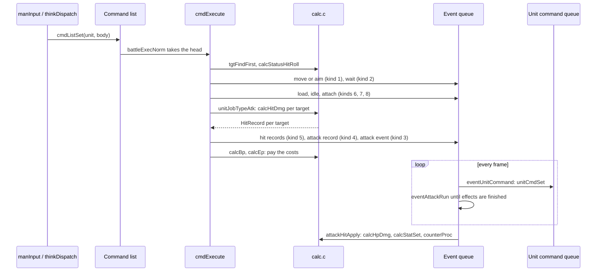

### The attack event

`eventAttackRun` handles kind 3. It finds its attack and hit records by searching backward from the cursor (`eventQueueFindAttackAction`, `eventQueueFindAttackHit`).

On its first call it starts the technique's effect for every hit (`attackEffectsStart`), switches the attacker's status aura off, plays the action sound and dims every unit that takes no part (`unitsMarkUninvolved` sets the actor draw flag 0x4000000 on them). The effect request carries the hit mode, the technique's attribute bits and the target's type, so the effect system can show a guard, a miss or an elemental hit. Effects are described in [Battle effects](battle-effects.md) and [sef](../libraries/sef.md).

On the following calls `scenarioMtd` reads the flags of the running effect entry (`sefGetEntryFlags`) and performs the stage directions that the effect asks for: showing and hiding weapon parts, fading child models, hiding the stage, sending a script event, playing a sound. `attackHitsShow` watches for the effect's hit moment. When the effect reports it (`sefIsHitActor`), each target gets its reaction command (`scenarioBatExecDst`), its damage number (`hitPopNumCreate`), the hit panels and the Break, Air or Down effect.

| Hit result | Reaction command | Panel (`menuStatPanelNew`) |
| --- | --- | --- |
| Miss (hit kind 0) | `UNIT_CMD_JUMP_EFFECT`, the evade motion | `MENU_STAT_PANEL_NO_HIT` (1) |
| Guarded damage | `UNIT_CMD_HOVER_EFFECT`, the guard motion | `MENU_STAT_PANEL_BLOCKED` (2) |
| Damage | `UNIT_CMD_MODE_DISPATCH`, the damage motion chosen by the Break result | |
| Critical hit | as damage | `MENU_STAT_PANEL_CRITICAL` (3), or `MENU_STAT_PANEL_CRITICAL_BONUS` (4) for the doubled critical |
| Back attack | as damage | `MENU_STAT_PANEL_BACK_ATTACK` (6) |
| Healing | `UNIT_CMD_CLEAR_ACTIVE`, or `UNIT_CMD_PHASE_2B_WAIT` for a revival | |
| Status only | `UNIT_CMD_DEACTIVATE` | |

When all effects have finished (`attackEffectsFinished` asks `unitEffectKeyFree`), the event sends a message to the script of every hit enemy, applies each hit with `attackHitApply` and removes the dimming.

The hit flag of a critical hit is `HIT_FLAG_CRITICAL`, set by `calcCrit`.

## Command types

Every command kind of `CmdListBody.command` is also the index of the unit command handler that the acting unit runs (`unitCommandTable` in `src/ov01/unit_cmd.c`, see [Battle engine](battle-engine.md)). The rule side of each command is described here.

### Technique

`CMD_KIND_TECHNIQUE` covers everything that is defined by a technique record and paid in something other than EP alone: the button attacks, the double techniques, the E.S. specials and the special attacks of characters. The record is the 0x20-byte `TecRecord` that `tecRecordGet` returns. It is the central data structure of the battle rules, so its fields are listed in full.

| Offset | Type | Field | Meaning |
| --- | --- | --- | --- |
| 0x00 | u8 | `flags` | Target flags, see [Target flags](#target-flags) |
| 0x01 | s8 | `code` | Range shape, 0 for none |
| 0x02 | short | `scale` | Range size in percent |
| 0x04 | s8 | `evadeThreshold` | The first hit roll evades at this value or above |
| 0x05 | s8 | `guardThreshold` | The second hit roll guards at this value or above |
| 0x06 | s8 | `type` | 0 physical, 1 ether, 2 item |
| 0x07 | s8 | `kindBits` | The effect kind (1 to 7) of a technique, or the effect bits of an item |
| 0x08 | u16 | `hitFlags` | 0x001 special action, 0x004 no counter, 0x008 cannot be evaded, 0x010 always a plain hit, 0x020 works on EP instead of HP, 0x100 and 0x200 staging, 0x400 healing by a share of the HP cap |
| 0x0A | s8 | `epCost` | EP cost |
| 0x0B | s8 | `waitWeight` | Wait weight added to the user's next turn |
| 0x0C | u16 | `attributeBits` | Low byte: the attack attributes. 0x100 knocks a broken target Down, 0x200 launches it into the Air |
| 0x0E | u8 | `power` | Power |
| 0x0F | s8[3] | `modeGuard` | One byte per unit type: bit 0 no status effect, bit 1 half damage, bit 2 critical chance plus 50 |
| 0x12 | s8[4] | `strikeZones` | The zones the technique hits, one byte per hit of its sequence |
| 0x16 | s8 | `inflictRate` | Base chance of its status effects |
| 0x17 | s8 | `row` | The status row it inflicts or cures |
| 0x18 | u16 | `bits` | The status bits of that row |
| 0x1A | short | `effectRecord` | The effect record of the technique |
| 0x1C | s8 | `techClass` | The technique class, see below |
| 0x1D | s8 | `phase` | The motion phase of the user |
| 0x1E | short | `motionIndex` | Nonzero selects a timed motion phase. In the data the nonzero values are 168 to 217, indices of the motion name table `dataMotNameTbl`: the motion file of a special, Double Tech or summon technique |

`gateFlag` separates the classes of techniques. Only class 0 takes part in the zone system.

| Value | Source name | Class |
| --- | --- | --- |
| 0 | `TEC_GATE_NONE` | Normal attack. Counts for zones, Boost gauge and counter gauge |
| 1 | `TEC_GATE_PAIR` | Double technique |
| 2 | `TEC_GATE_SLOT_MARK` | An ether that can be used once per battle (`calcEtherDisableSet`, ethers 0x37 to 0x39) |
| 3 | `TEC_GATE_COMBINED_ETHER` | Combined ether with the boosted partner |
| 4 | `TEC_GATE_SHOW_CHILD` | E.S. special. Shows a child model of the E.S. and costs energy |
| 5 | `TEC_GATE_TARGET_MODEL` | Special attack that loads an extra model |
| 6, 7, 8 | none | Attacks that count for the Boost gauge and counter gauge like class 0 but not for zones. An E.S. gains 25 energy for them, so these are probably the E.S. attacks |
| 9 | none | Uses effect group 200 |
| 10 | `TEC_GATE_CURRENT_DRAIN` | Takes 100 energy from the target |

### Ether

`CMD_KIND_LOOKUP` runs the technique of an ether record (`EtherRecord`, `etherRecordGet`). The source calls the ether table the "battle lookup". A unit knows an ether when the matching code bit of its slot record is set (`slotCodeTest`, bits 1 to 59). E.S. 12 inherits the ethers of its pilot that are flagged 0x4000 (`calcCopyParaMake`).

`calcTakeEpGet` computes the EP cost: the `epCost` of the technique, halved with skill code 41, doubled with skill code 49 and doubled again under the row 2 status 0x100. `calcEthEnableChk` decides whether the ether can be chosen: the unit must not have the row 2 status 0x400, a valid target must exist, the EP must suffice and a once-per-battle ether must be unused.

An ether does not make the unit walk. The unit plays its casting motion in place (`unitCmdAction`).

### Combined ether

In the ether list Triangle opens the list of combined ethers. `calcPairedRecords` searches the lookup records 60 to 89. Each of them names two ether codes (`firstCode`, `secondCode`). A record is offered when one code is the ether under the cursor and the unit in Boost slot 1 knows the other. Both units must pass `calcEthEnableChk` for the combined record.

The technique of such a record has `gateFlag` 3, and `cmdExecute` runs it through `cmdCombinedEtherRun`. The partner plays a casting motion (unit command 3), pays the EP cost as well, the acting unit casts, and at the end event 19 clears Boost slot 1 and ends the partner's turn with `calcTurnEnd`. The partner therefore spends its boosted turn on the combination.

### Item

`CMD_KIND_ITEM` uses an item record (`UsableItemRecord`, `usableItemRecordGet`). The item was already taken from the inventory when its target was confirmed. The effect is applied by `calcUseItem`, which reads the effect bits of the item's technique record and the item's `amount`.

| Bit | Effect |
| --- | --- |
| 0x01 | Restores HP: `maxHp * amount / 4` |
| 0x02 | Restores EP: `maxEp * amount / 4` |
| 0x04 | Cures statuses: row 1 when `amount` is 0, row 2 otherwise. Each active bit is rolled with `calcStatInflictRate`, whose base is 200 for an item, so the cure practically always works |
| 0x08 | Restores HP with the same formula. Used by revival items together with the target flag for defeated units |
| 0x10 | Adds `amount` to the skill points of the target (cap 99999) |
| 0x20 | Adds `amount` to the class points of the target (cap 99999) |
| 0x40 | A special effect selected by `amount`: 0 raises the maximum of the side's Boost gauge by one, up to 5. 1 restores HP and EP of all party slots (`battleSlotsRestoreAll`). 2 calls the damage path with a mode that `calcDmgItem` does not handle, so it changes nothing |

`calcDmgItem` computes the restored amount. On the HP path the row 3 status 0x100 doubles the amount once and is used up, and the skill sum of mask (0x800, 0x8000) adds that many percent of the HP cap. The result is capped at the HP or EP cap.

### Double technique

A double technique (the source says "pair") is a technique that two fixed characters perform together. The pair records (`DoubleTechRecord`, `pairLinkGet`) name the two party keys, the technique and the Stock that both need. A pair is available when its bit is set in the slot records (`slotPairTest`) and it was not used in this battle (`actEntryFlagGet`).

The conditions follow from `calcKeyPairRecords` and `calcLevelsMeetRecord`. The partner must stand in Boost slot 1 of the action stock. This means the player first boosts the partner, and then, still in the turn of the first character, chooses the double technique. Both characters need at least `requiredLevel` Stock.

`cmdPairRun` stages it:

1. Event 14 opens the stage data stream 0x43 and events 7 and 15 wait for it and bind it.
2. Event 16, `eventPairBegin`, takes the required Stock from both units, hides the battle stage, flashes the screen (`screenFlashStart`) and moves the two partners and the target to the fixed spots `pairEventPos`. It saves their positions and angles.
3. Both units run the technique command, the partner also unit command 9.
4. `cmdAttackQueueAndSpend` computes and queues the attack. `unitJobTypeAtk` queues a second attack record for the partner, so the attack event plays both.
5. Event 17, `eventPairEnd`, restores positions, shows the battle stage again, ends the partner's turn (`calcTurnEnd`), clears Boost slot 1 and sends script event 12.

After the command `actEntryFlagSet` marks the pair as used for the rest of the battle.

### E.S. special

An E.S. has an energy value (`current`, cap `currentMax`) instead of Stock. It starts at 0 with a cap of 200. Skill code 0x63 starts it at 100 and skill code 0x64 raises the cap to 300. Players' guides call it the EC gauge.

The specials of an E.S. are the level records (`EsSpecialRecord`, `attackLevelRecordGet`), seven per E.S. A special is offered when the bit mask `entryMask` of the record contains the bit of the current sub pilot (`linkedSlots[1]`, looked up in `calcTables.entryMasks`) and its `requiredLevel` does not exceed the energy cap. It can be chosen when the energy reaches `requiredLevel`. `cmdAttackQueueAndSpend` subtracts that amount.

### Special attack of a character

The ten mark bits 1 to 10 of a slot record (`slotMarkTest`) give a character special attacks, defined by the records `SpecialAttackRecord` (`attackTargetRecordGet`). Each names a technique, an optional extra model with its joint, and a Stock cost `minLevel`. `dataPlUnitInit` gives character 2, KOS-MOS, the first three marks from the start. The cost is paid when the target is confirmed.

### Stock and Charge

`CMD_KIND_WAIT` is the command of panel entry 11. Its handler `unitCmdStatEffect` starts effect record 9 of group 0x140 and a voice. What the unit gains depends on its class.

| Class | Gain |
| --- | --- |
| Character (key 1 to 10) | 1 Stock. With a skill of mask (0x200, 0x2000) there is a 50 percent chance to gain the skill's value instead |
| E.S. (key 11 to 15) | 100 energy plus the skill sum of mask (0x200, 0x1000). With skill code 0x51 all status effects are also cleared |
| Enemy | Nothing |

Two skill sums add healing: mask (0x200, 0x8000) restores that percent of the EP cap and mask (0x200, 0x800) that percent of the HP cap. In all three classes the unit gets flag 0x4000, the stock stance, which lasts until its next turn starts. The stance matters for three rules: skill code 28 doubles the evade rate in it, skill code 0x33 gives a counter Boost chance in it, and a unit with a counter gauge can only counter while it is in the stance.

### Move

`CMD_KIND_SNAPSHOT` moves the unit to another row of the battlefield position table. The position table is chosen by the battle script (`bat.posDataSet`). `effectPosIsFree` accepts a position when its flag word has bit 0 clear and no unit stands on it. The unit fades over to the new position (`unitCmdLoadSnapshot`).

### Change

`CMD_KIND_SWAP` replaces the acting unit by a party member that is not in the battle. `battleMaskWordsUnmatched` lists the candidates: the members whose bit is set in `presentMask` of the party status block and whose key is not in the unit table. The key numbers come from `battleMaskWordTable`, which holds 1 to 7 and 11 to 13. A unit with any row 2 status cannot change.

`cmdExecute` lets the unit leave (`unitCmdRelease`), then queues event 9 to create the new unit at the same position and facing, event 7 to wait for its data, event 10 to bind and fade it in, and the unit command `UNIT_CMD_STREAM_PLAY` for its entrance line. The new unit is created with the flag `UNIT_FLAG_STOCKED` already set.

### Escape

`CMD_KIND_LEAVE` is sent to every unit of the acting unit's side. Each one fades out (`unitCmdSetBattleTransition`) and then writes `BattleState.transition`: 1 when a party unit left, 2 when an enemy left. The end check turns this into the end statuses 3 and 4. Enemies can flee the same way, because their script may queue the same command. Only the units with key 3, 6 and 12 are offered the command, and not when event flag 0x400 is set.

### Think end

`CMD_KIND_THINK_END` closes a turn. `cmdExecute` brings the unit back to its position (`UNIT_CMD_MOVE_POS`, or `UNIT_CMD_POSE_ARRIVE_WAIT` after a pose), clears the action flags, queues the command for the unit (its handler sets flag 0x1000, the "turn done" mark) and then three bookkeeping events: 12 (statuses), 11 (defeated units) and 13 (auto-revive). They are described in [After every command](#after-every-command).

### Special actions

A technique with `hitFlags` bit 0 is a special action. The attack event does not show normal hits for it. It calls `flowSpecProcInit` once and then `flowSpecProc` every frame until that returns 1. The action is selected by the technique number.

| Technique | Source name | Effect |
| --- | --- | --- |
| 0x038, 0x2C3 | `SPECIAL_ACTION_CURE_ALL` | Clears every status row of the target (`calcStatResetCha`) |
| 0x2A4 | `SPECIAL_ACTION_HALVE_HP` | Clears rows 1 and 2 of the user and takes half of its HP |
| 0x2C4 | `SPECIAL_ACTION_ITEM_PICK` | `specInoriProc` adds a random item to the inventory and shows its name |
| 0x2C5 | `SPECIAL_ACTION_LEVEL_UP` | The target gains 1 Stock |
| 0x2C6 | `SPECIAL_ACTION_BOOST` | The user's side gains 1 Boost stock |
| 0x2C8 | `SPECIAL_ACTION_STATUS_TEXT` | `specAnalyzeProc` opens the analyze panel of the target |
| 0x2C9 | `SPECIAL_ACTION_STEAL` | `specNusumuProc` steals with a 50 percent chance for the first drop |
| 0x2D5 to 0x2D7 | `SPECIAL_ACTION_TRANSFORM_*` | The user transforms into unit 0x8D, 0x8E or 0x8F for one attack |
| 0x2F6 | `SPECIAL_ACTION_STATUS_STEAL` | Analyze, then a steal that always tries the first drop |

The item pick rolls `rnd(99)` against four groups in `itemPickGroups`: below 3 one of the four rare items (8, 15, 25, 26), below 12 one of three uncommon items (21, 2, 6), below 50 one of two common items (12, 13) and otherwise one of three fallback items (1, 5, 11).

A steal reads the reward record of the target (`enemyRewardRecordGet`). On a successful roll it gives the first drop pair, otherwise the second. Each pair can be taken only once per enemy. The unit flags 0x10000 and 0x8000 remember this, and the reward code later skips a pair that was stolen.

The analyze panel shows HP and EP with their caps, the experience, skill points and class points of the reward record, the two drops, the attack type and one bit for each attack attribute whose `slotValue` is 21 or more, which marks a weakness.

A transformation runs through seven steps of `attackStep`: swap the model to the transform unit while the screen is filled, show the attack, fill the screen again, recreate the original unit, bind its data and reset the stage.

## Hit and evade

The outcome of one technique against one target is computed by `calcHitDmg` and stored in a `HitRecord`.

| Offset | Type | Field | Meaning |
| --- | --- | --- | --- |
| 0x00 | pointer | `target` | The target unit |
| 0x04 | int | `reaction` | The unit command the target answers with |
| 0x08 | int | `damage` | The amount |
| 0x0C | int | `followResult` | The damage motion: 0 none, 1 critical, 2 Break, 3 Down, 4 Air |
| 0x10 | int | `backAttack` | 1 for a back attack |
| 0x14 | int | `stepState` | The Break state the hit causes: 1 Break, 2 Down, 3 Air |
| 0x18 | int | `hitMode` | Hit kind in the low byte, flags in the next byte |
| 0x1C | int | `inflictRow` | Status row to inflict |
| 0x20 | int | `inflictMask` | Status bits to inflict |
| 0x24 | int | `cureRow` | Status row to cure |
| 0x28 | int | `cureMask` | Status bits to cure |

The **hit kind** says what the amount does. `calcHpDmg` applies it.

| Kind | Source name | Effect of `damage` |
| --- | --- | --- |
| 0 | `HIT_KIND_NONE` | A miss. Nothing |
| 1 | `HIT_KIND_PLAIN` | Target loses HP |
| 2 | `HIT_KIND_HP_GAIN` | Target gains HP |
| 3 | `HIT_KIND_EP_LOSS` | Target loses EP |
| 4 | `HIT_KIND_EP_GAIN` | Target gains EP |
| 5 | `HIT_KIND_STATUS` | No amount. Status effects only |
| 6 | `HIT_KIND_NO_INFLICT` | No amount. Status cure only |
| 7, 8 | `HIT_KIND_HP_DRAIN_*` | Target loses HP and the attacker gains it |
| 9, 10 | `HIT_KIND_EP_DRAIN_*` | Target loses EP and the attacker gains it |
| 11 | `HIT_KIND_TEC_NONE` | A technique without effect kind |

The flags byte above the kind uses these bits (as bits of the whole word): 0x100 critical hit, 0x200 guarded, 0x800 revival, 0x1000 absorbed, 0x2000 nullified.

`calcHit` maps the effect kind of the technique (`TecRecord.kindBits`) to the hit kind.

| Technique kind | Meaning | Hit kind | Hit roll |
| --- | --- | --- | --- |
| 1 | Attack | 1, or 3 with `hitFlags` 0x20 | Yes. Can miss and can be guarded |
| 2 | Healing | 2, or 4 with `hitFlags` 0x20 | No |
| 3 | Revival | 2 with flag 0x800 | No |
| 4 | Status attack | 5 | No |
| 5 | Status cure | 6 | No |
| 6 | Drain of a share | 7, or 9 with `hitFlags` 0x20 | Yes, but only the guard result is used |
| 7 | Drain of everything but 1 | 8, or 10 with `hitFlags` 0x20 | Yes, but only the guard result is used |

### The hit roll

`calcHitRate` returns 0 for a plain hit, 1 for a guarded hit and 2 for a miss. It first lists the cases that are always a plain hit:

- the target is in Break, Down or Air (`state70` is not 0),
- the target cannot act (`calcBattleChk` fails),
- the attack is a back attack,
- the technique has `hitFlags` bit 0x10.

Otherwise two rolls decide. Both use the same margin.

```
hit    = attacker.hitRate   - 40 if row 2 status 0x04, else - 80 if row 1 status 0x04   (not below 0)
evade  = target.evadeRate   - 40 if row 2 status 0x04, else - 80 if row 1 status 0x04
evade  = evade * 2          if the target has skill code 28 and is in the stock stance   (not below 0)
hit    = hit - 80           if the target has row 4 status 0x2000 and the technique is ranged (flag 0x20)
margin = evade - hit

roll1  = rnd(99) + 1 + margin        (not below 0)
miss   if roll1 >= evadeThreshold, the target lacks trait 0x40 and the technique lacks hitFlags 0x08

roll2  = rnd(99) + 1 + margin        (not below 0)
plain  if roll2 < guardThreshold or the target has trait 0x20
guard  otherwise
```

`rnd(99) + 1` is a number from 1 to 100. The two thresholds are data of each technique, so a technique can be made hard to evade but easy to guard, or the reverse. A high evade rate of the target raises both rolls and so raises both the chance of a miss and the chance of a guard.

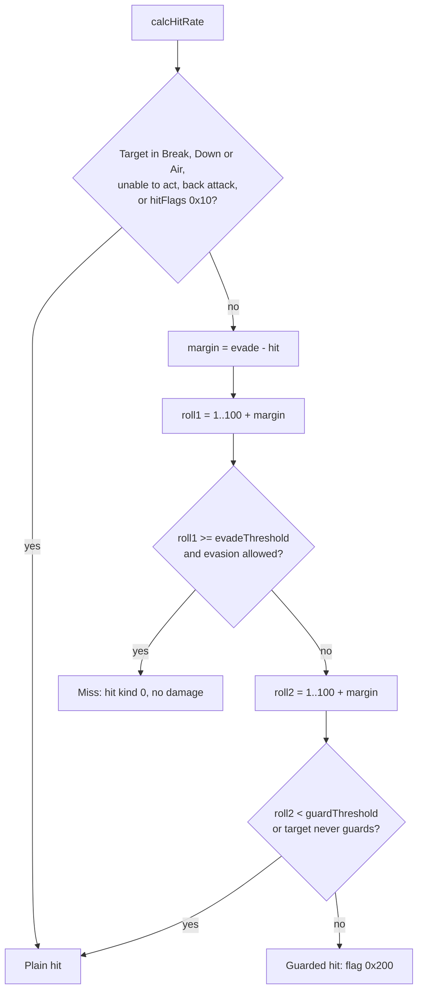

## Damage

`calcDmg` computes the amount for the technique kinds 1, 2, 3, 6 and 7. All divisions are integer divisions.

### Attack and defence values

Four functions give the fighting values. Each multiplies a stat by a fixed factor and then applies statuses.

| Function | Base | Lowered by | Raised or lowered by row 4 |
| --- | --- | --- | --- |
| `calcAtkPhy` | `physAttack * 4` | Half under row 2 status 0x08, else a quarter under row 1 status 0x08 | Plus a quarter with 0x1000, minus a quarter with 0x800 |
| `calcDefPhy` | `physDefence * 3` | Half under row 2 status 0x10, else a quarter under row 1 status 0x10 | Minus a quarter with 0x1000, plus a quarter with 0x800 |
| `calcAtkMag` | `magAttack * 5` | Half under row 2 status 0x40, else a quarter under row 1 status 0x40 | Plus a quarter with 0x400, minus a quarter with 0x200 |
| `calcDefMag` | `magDefence * 4` | Half under row 2 status 0x80, else a quarter under row 1 status 0x80 | Minus a quarter with 0x400, plus a quarter with 0x200 |

The row 4 statuses are trade-offs: 0x1000 gives attack and takes defence, 0x800 does the opposite, and 0x400 and 0x200 do the same for ether. When both bits of a pair are set, the later test wins.

### An attack

For a technique of kind 1 the steps are the following. `A` is the base amount, `D` the running damage.

```
1.  attack, defence = calcAtkPhy / calcDefPhy          for type 0 (physical)
                      calcAtkMag / calcDefMag          for type 1 (ether)
2.  A = attack * power / 20 - defence
    A = 0                      if negative
    A = A + rnd(A / 10 + 2)    otherwise                (0 to A/10 + 2 extra)
3.  D = A + A / 2              if the target is in Break
    D = A * 2                  if the target is in Down or Air
    D = A                      otherwise
4.  D = D + A * n / 4          attacker has skill code 46, n = defeated units of the attacker's side
    D = D - A * n / 4          target has skill code 47, n = defeated units of the target's side
5.  B = D
    attributes = attack attributes of the technique (see below)
    if attributes overlap the target's row 4 status bits 0x00FF:
        D = D - D / 2          with row 4 status 0x100
        D = D - D / 4          without it
6.  D = D + B                  attacker has skill code 49
    D = D + B * (rnd(5) + 10) / 100     target has skill code 63
    D = D + B / 2              ether technique while the Event Slot shows value 4
7.  C = D
    D = critical(C)            C * 3 / 2 or C * 2 on a critical hit
8.  D = D + C * (comboHits * 10 - 10) / 100     from the second hit of a combo on
9.  attribute reactions of the target (see below)
10. D = D / 2                  if modeGuard of the target's type has bit 1
11. the Break step (calcHitStateStep)
12. guarded hit: D = D - D * (50 + s) / 100 for a physical technique,
                 D = D - D * (25 + s) / 100 for an ether technique,
                 s = target's skill sum of mask (0x800, 0x1000)
13. D = D * 90 / 100           target has skill code 40
14. D = 0                      if negative
```

Step 3 reads the state the target had before this hit. The hit that causes the Break does not get the Break bonus itself. The numbers agree with what players measured: 1.5 times damage on a broken enemy and double damage on an enemy in the air or on the ground.

The **attack attributes** are the low byte of `TecRecord.attributeBits`, eight bits. `calcAttackStatusMask` adds the attacker's weapon enchantments: when the technique has none of the low five attribute bits, every one of the row 3 statuses 0x01 to 0x10 that the attacker has is added.

The **attribute reactions** of step 9 use two arrays of the target, `slotValue` and `slotRoll`, with one entry per attribute bit. For each attribute of the attack, `slotRoll` percent is rolled. Each success contributes its `slotValue`, a number in twentieths where 20 means normal damage.

```
factor = 20
for each attribute bit of the attack whose roll succeeds:
    value >= 0:  factor = factor + value - 20
    value <  0:  factor = value, stop
if any roll succeeded:
    factor == 0:  D = 0, flag "nullified"
    factor <  0:  the hit becomes an HP gain, D = D * (-factor) / 20, flag "absorbed"
    factor >  0:  D = D * factor / 20
```

A value of 30 is a weakness of 150 percent, 10 a resistance of 50 percent, 0 immunity and -20 full absorption.

### Critical hits

`calcCrit` applies only to plain HP hits that were not guarded.

```
chance = 10                               50 while the Event Slot shows value 0
       + 50                               if modeGuard of the target's type has bit 2
       + attacker's skill sum of mask (0x800, 0x400)
       + 50                               on a back attack
chance = 100 at most

on success:  damage = damage * 3 / 2
             while the Event Slot shows value 0, a further 10 percent roll makes it damage * 4 / 2
```

A critical hit also halves the counter gauge of the target and gives the attacker 20 points of counter gauge instead of 10.

### Combos

Every unit carries a combo counter for the hits it takes. `calcComboUpdate` runs for each attack hit. If the unit already has hits and the attack shares one of the low five attribute bits with `comboMask`, the counter goes up by one, to at most 99. Otherwise the counter restarts at 1 with the new attributes. From the second hit on, each further hit of the combo adds 10 percent of the pre-critical damage.

The counter is reset by `calcComboReset` at the end of a turn, with the same exception as the Break states: not when a boosted ally of the acting unit comes next. Long combos are therefore built by chaining Boosts.

### Healing

Techniques of kind 2 (healing) and 3 (revival) compute:

```
A = target.maxHp * power / 20            if hitFlags has 0x400
A = calcAtkMag(user) / 5 * power         otherwise
D = A
  + A / 4                    target has row 4 status 0x100
  + A                        target has row 3 status 0x100 (the status is used up)
  + A * s / 100              s = target's skill sum of mask (0x800, 0x8000)
  + A / 2                    ether technique while the Event Slot shows value 4
```

### Drains

Kind 6 takes a share: `D = cap * power / 20`, where the cap is the target's HP cap or, with `hitFlags` 0x20, its EP cap. `D` is limited to what the target currently has. Kind 7 takes `cap - 1`. Both are halved by a guard. `calcHpDmg` gives the same amount to the attacker.

## Break zones, Break, Air and Down

The zone system is the signature rule of the game. Every enemy has a hidden sequence of height zones. Hitting the zones in the right order within one turn breaks the enemy. A broken enemy takes more damage and can be launched or knocked down by the right follow-up attack.

### Zones in the data

A zone is one bit of a small mask: 1, 2 or 4. The code never names them. From the way the states use the bits, 1 is the high zone and 4 the low zone, so the bits 1, 2 and 4 very likely correspond to the zones that the game displays as A, B and C.

Three places hold zone masks.

| Field | Holds |
| --- | --- |
| `StatBlock.defaultHeightZone` | The zones in which the unit can be hit while it stands normally |
| `StatBlock.breakZones[4]` | The break sequence of the unit: one mask per step, ended by 0. A unit whose first entry is 0 cannot be broken |
| `TecRecord.strikeZones[4]` | The zones that the technique strikes: one mask per hit of the technique, ended by 0 |

The current height of a unit is given by `unitStateFlagGet`: 1 for a unit in the Air state, 4 for a unit in the Down state and `defaultHeightZone` otherwise. This single function is why a launched enemy can only be reached by techniques that strike high and a downed enemy only by techniques that strike low.

### Collecting the sequence

`calcHitRowGate` runs for every attack hit. It works on the target's zone record of the current turn: `hitZoneKind` (up to eight zones hit so far), `entryCount` and `entryMark`.

1. A target that is already in Break, Down or Air has its zone record cleared and the function returns 0.
2. A target without a sequence returns 0.
3. A target with trait 0x10 that is attacked from the front by a class 0 technique returns 0. The function notes result 1 in the Event Slot record so the HUD can show it.
4. For each zone byte of the technique, the byte is combined with the target's current height. The lowest common bit is appended to `hitZoneKind`. When there is no common bit, a 0 is appended.
5. Each step `i` of the sequence is compared with entry `i`: `entryMark[i]` becomes 1 when `liveRows[i]` and `hitZoneKind[i]` share a bit.
6. The result is 1 when every step of the sequence is marked.

Because entry `i` is compared with step `i`, the order matters and a wrong first hit spoils the whole turn. The zone record is cleared at the end of the turn. The zone icons of the HUD (`menuIconListAppend`) show the collected zones.

### State changes

`calcHitStateStep` decides the new state. It acts only for class 0 techniques and plain HP hits. The state is the byte `StatBlock.breakState`.

| State before | Condition | Result |
| --- | --- | --- |
| 0 normal | The sequence is complete | 1 Break. The guard flag of the hit is removed, and the bit of the enemy's key is set in `brokenEnemyBuf` |
| 0 normal | `actionBits` has both 0x200 and 0x400 | 3 Air |
| 0 normal | `actionBits` has both 0x100 and 0x400 | 2 Down |
| 1 Break | `actionBits` has 0x100 and the target lacks trait 0x08 | 2 Down |
| 1 Break | `actionBits` has 0x200 and the target lacks trait 0x04 | 3 Air |
| 2 Down | any | stays 2 |
| 3 Air | any | stays 3 |

The result is stored in `HitRecord.stepState`, and `calcFollowKind` turns it into the damage motion of the target (2 Break, 3 Down, 4 Air, or 1 for a critical hit without state change). The state byte itself is written by that motion command when it starts (`unitCmdModeRamp` and its relatives in `src/ov01/unit_cmd.c`). The hit effects of group 0x136 with the records 0x12 (Break), 0x14 (Down) and 0x13 (Air) are started by `attackHitsShow`.

When a broken target is immune to the follow-up, the function records the attempted state in the Event Slot record instead, and the HUD shows the matching panel.

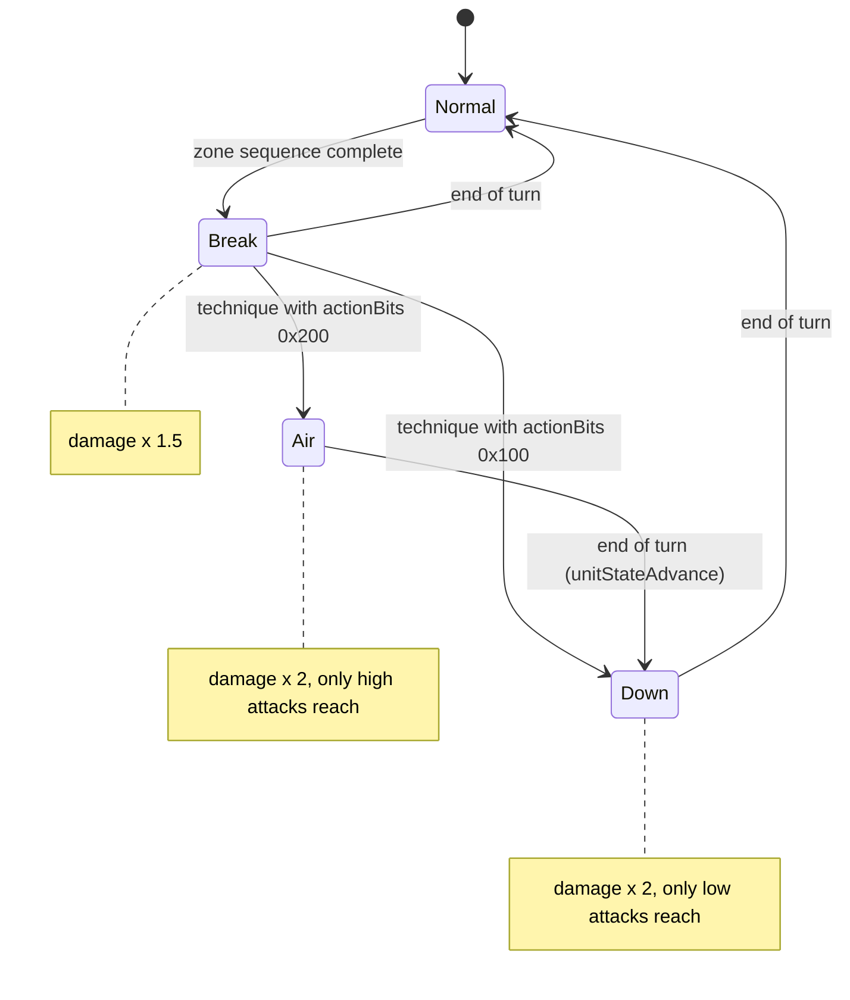

The transitions at the end of a turn are skipped while a boosted ally of the acting unit is waiting (see [The start and the end of a turn](#the-start-and-the-end-of-a-turn)).

### The Break bonus

At the end of `calcDmg`, when the hit causes a Break of a target that was normal, the attacker may gain 1 Stock. The chance is 50 percent plus the attacker's skill sum of mask (0x800, 0x2000). It is granted at most once per turn (`EventSlot.levelGranted`).

### What Break changes besides damage

A unit in Break, Down or Air cannot evade or guard (`calcHitRate`). A unit in Air cannot be boosted, and a unit in Down cannot be boosted by command (`calcBoostChk`). A melee attacker does not run to a target in the Air. It takes a pose in place. A unit that starts its turn in Down first stands up.

## Stock

Stock is the byte `StatBlock.stockCount`, a number from 0 to 3 (`UNIT_LEVEL_MAX`). `unitLevelAdd` is the only function that changes it and clamps it to this range. Stock belongs to one character and is kept only for the battle: `battleEntryActivate` sets it to 0 when the unit enters. Skill code 0x32 starts the unit with 1 Stock.

| Gain | Amount | Code |
| --- | --- | --- |
| The Stock command | 1, or a skill value | `unitCmdStatEffect` |
| The Break bonus | 1 | `calcDmg` |
| The party bonus at the start | 1 to 3 | `battleStartBonusApply` |
| The special action 0x2C5 | 1 | `flowSpecProcInit` |
| The row 3 status 0x4000, when the unit would be defeated | 3 | `battleResolveStatus` |

| Cost | Amount | Code |
| --- | --- | --- |
| A Circle attack (key 8, 9 or 10) | 1 each | `keyCmdGet` |
| A special attack | `SpecialAttackRecord.minLevel` | `manInput` |
| A double technique | `DoubleTechRecord.requiredLevel`, from both partners | `eventPairBegin` |

The HUD shows the Stock of each character as a gauge (`menuStockObjCreate`, see [Battle engine](battle-engine.md)).

## Boost

Boost lets a unit act out of turn. Each side has one gauge, shared by all its units (`struct BoostGauge`, the array `boostGaugeParty` with index 0 for the party and 1 for the enemies, chosen by `boostGaugeGet`).

| Offset | Type | Field | Meaning |
| --- | --- | --- | --- |
| 0x00 | s8 | `maxStock` | Maximum number of banked Boosts. 3 at the start, up to 5 through an item |
| 0x01 | s8 | `stock` | Banked Boosts |
| 0x02 | s8 | `progress` | Points toward the next Boost, 0 to 50 |

`boostGaugeAddProgress` adds points. At 50 (`BOOST_PROGRESS_PER_STOCK`) one Boost is banked and 50 points are taken off. When the gauge is full the progress is held at 50, and it is cleared again as soon as a Boost is spent.

| Source of points | Points | Code |
| --- | --- | --- |
| Using a technique of class 0, 6, 7 or 8 | 10 | `cmdAttackQueueAndSpend` |
| The same while the Event Slot shows value 1 | 30, or 50 with a 10 percent chance | `cmdAttackQueueAndSpend` |
| Being hit by such a technique while the Event Slot shows value 7 | 10 | `attackHitApply` |
| The Boost bonus at the start | 1 to 3 whole Boosts | `battleStartBonusApply` |
| The special action 0x2C6 | 1 whole Boost | `flowSpecProcInit` |

The party's banked Boosts are carried over to the next battle. `partySnapshotBuild` stores the count at the end of a battle, and `battleWorkTablesReset` reads `startStockCount` at the start of the next one. `dataPlUnitInit` clears the stored count when a session starts.

### Boosting by command

`battleCtrlBoostPl` runs every frame of the battle, whatever the menu shows. While R1 or R2 is held, the Boost display of the HUD is on (`menuBoostDispOn`), the normal input is blocked, and Square, Triangle and Circle stand for the party units 0, 1 and 2. If `calcBoostChk(unit, 1)` agrees, `calcBoost(unit, 1)` spends one Boost, marks the unit with flag 0x200 and puts it into Boost slot 1 of the action stock. Effect record 7 of group 0x140 and a voice confirm it. The unit acts as soon as the current turn has ended.

`calcBoostChk` refuses a Boost by command when any of these holds:

- the unit is a transformed unit (key 141 or more), cannot act or has no HP,
- the unit was already boosted in this round (flag 0x200),
- Boost slot 1 is occupied,
- the unit is in the Air or Down state,
- the unit has the row 2 status 0x800,
- the gauge has no banked Boost,
- the unit already has a turn in the current round (`UNIT_FLAG_STOCKED`) and lacks skill code 44.

Enemies boost through their script with the native `bat.boost`, which runs the same check and the same call.

### Counter Boost

Boost slot 0 is filled without spending anything. `counterProc` runs after every technique hit that the target survives, unless the technique targets all units. The target rolls `StatBlock.counterBoostChance` percent (`actLevelChanceRoll`). A technique with `hitFlags` bit 0x04 cannot be countered. Party units have two more chances from skills: with skill code 0x2B a critical hit taken gives a 25 percent roll, and with skill code 0x33 a guarded or missed attack against a unit in the stock stance gives a 50 percent roll.

When a roll succeeds and `calcBoostChk(unit, 0)` agrees, the unit is put into Boost slot 0 and acts next. The check for slot 0 is lighter than the one for slot 1: it needs no banked Boost and allows the Down state. The script native `bat.counterBoost` and the row 3 status 0x4000 use the same path.

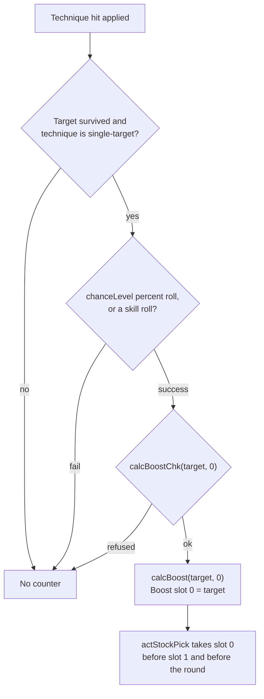

## The counter gauge

Units with trait 0x800 have a second way to strike back. `StatBlock.counterGauge` is a gauge from 0 to 100. `unitPercentAdd` changes it and does nothing for units without the trait.

The gauge fills when the unit itself attacks: each hit of a class 0, 6, 7 or 8 technique adds 10, a critical hit 20. A critical hit taken removes half of the current value.

The gauge is used in `cmdExecute`. Before a technique runs, `calcStatusHitRoll(attacker, target, technique)` rolls the target's gauge as a percent chance. The roll is only made when the technique is single-target, has no range shape and can be countered, and when the target is in the stock stance (unit flag 0x4000). On success the roles are swapped: the target becomes the acting unit, the attacker becomes its target, and the technique is replaced by entry 2 of the target's key row, its third technique. The gauge is set to 0, the HUD panel is shown and a think end for the countering unit is queued after its attack. The original attack never happens.

## Status effects

A status effect is one bit in one of four **rows** of a unit. `StatBlock.activeMask[row - 1]` holds the active bits and `turnCount[row - 1][bit]` the turns left. The rows are numbered 1 to 4 in all calls (`calcStatGet`, `calcStatSet`, `calcStatReset`). Rows 1 and 2 are harmful effects, where row 2 is the more severe form. Rows 3 and 4 are helpful effects and modifiers. For rows 3 and 4 a second mask, `altMask`, holds bits that are permanent for the battle. They come from skills (`calcStatProtectSet`), and `calcStatGet` reports them together with the timed bits.

The code has no names for the single effects. The table lists what each bit does. The official names can be seen in the battle through the text numbers of `statBitValues`.

| Row | Bit | Effect | Code |
| --- | --- | --- | --- |
| 1 | 0x0001 | Wait value plus 50 percent: fewer turns | `calcWct` |
| 1 | 0x0002 | Loses a tenth of the HP cap after each of its actions | `stat1Proc` |
| 1 | 0x0004 | Hit rate and evade rate minus 80 | `calcHitParaGet`, `calcEvadeRate` |
| 1 | 0x0008 | Physical attack minus a quarter | `calcAtkPhy` |
| 1 | 0x0010 | Physical defence minus a quarter | `calcDefPhy` |
| 1 | 0x0020 | Cannot act. A plain hit removes it with 50 percent chance | `calcBattleChk`, `attackHitApply` |
| 1 | 0x0040 | Ether attack minus a quarter | `calcAtkMag` |
| 1 | 0x0080 | Ether defence minus a quarter | `calcDefMag` |
| 1 | 0x0100 | Loses 5 EP after each of its actions | `stat1Proc` |
| 1 | 0x0200 | Status resistance minus 20 | `calcStatResist` |
| 1 | 0x0400 | A script-controlled unit gives up its turn with 20 percent chance | `battleCtrlThink` |
| 1 | 0x4000 | Loses a quarter of the E.S. energy cap after each of its actions | `stat1Proc` |
| 2 | 0x0001 | Cannot act and counts as out of the battle for the end check | `calcBattleChk`, `unitLiveNumGet2` |
| 2 | 0x0002 | Loses a quarter of the HP cap after each of its actions | `stat1Proc` |
| 2 | 0x0004 | Hit rate and evade rate minus 40 | `calcHitParaGet`, `calcEvadeRate` |
| 2 | 0x0008, 0x0010, 0x0040, 0x0080 | As in row 1, but minus a half | `calcAtkPhy` and relatives |
| 2 | 0x0020 | Cannot act. A plain hit removes it with 10 percent chance | `calcBattleChk`, `attackHitApply` |
| 2 | 0x0100 | EP costs doubled | `calcTakeEpGet` |
| 2 | 0x0200 | Button attacks sealed | `keyCmdChk` |
| 2 | 0x0400 | Ether sealed | `calcEthEnableChk` |
| 2 | 0x0800 | Cannot be boosted by command | `calcBoostChk` |
| 2 | 0x1000 | Takes the damage of its own plain attack hit as well | `stat1Proc` |
| 2 | 0x4000 | Loses half of the E.S. energy cap after each of its actions | `stat1Proc` |
| 2 | any | Cannot use Change | `battleMaskWordsUnmatched` |
| 3 | 0x0001 to 0x0010 | Adds one of five attack attributes to attacks without one | `calcAttackStatusMask` |
| 3 | 0x0020 | Status resistance plus 10 | `calcStatResist` |
| 3 | 0x0040 | Wait value minus a quarter | `calcWct` |
| 3 | 0x0080 | Wait value minus a half | `calcWct` |
| 3 | 0x0100 | The next healing is doubled, then the status ends | `calcDmg`, `calcDmgItem` |
| 3 | 0x0400 | Survives a defeating hit with 1 HP, then the status ends | `attackHitApply`, `battleResolveStatus` |
| 3 | 0x0800 | Revives with full HP when defeated | `stat2Proc` |
| 3 | 0x1000 | Gains 2 EP after each of its actions | `stat1Proc` |
| 3 | 0x2000 | Revives with half HP when defeated | `stat2Proc` |
| 3 | 0x4000 | When HP reaches 0: 1 HP, 3 Stock and a counter Boost | `battleResolveStatus` |
| 4 | 0x00FF | Guard against the matching attack attributes: damage minus a quarter | `calcDmg` |
| 4 | 0x0100 | Raises that guard to a half and adds a quarter to healing received | `calcDmg` |
| 4 | 0x0200 | Ether attack minus a quarter, ether defence plus a quarter | `calcAtkMag`, `calcDefMag` |
| 4 | 0x0400 | Ether attack plus a quarter, ether defence minus a quarter | `calcAtkMag`, `calcDefMag` |
| 4 | 0x0800 | Physical attack minus a quarter, physical defence plus a quarter | `calcAtkPhy`, `calcDefPhy` |
| 4 | 0x1000 | Physical attack plus a quarter, physical defence minus a quarter | `calcAtkPhy`, `calcDefPhy` |
| 4 | 0x2000 | Ranged techniques against the unit lose 80 hit rate | `calcHitRate` |

The HUD shows one of three auras on a unit, chosen by `statEffProc`: record 3 of effect group 0x12C for the row 2 status 0x0001, record 2 for any other row 2 status and record 1 for any row 1 status.

### Inflicting

A technique names one row and a set of bits (`TecRecord.row`, `TecRecord.bits`). `calcStatAtk` rolls each bit separately when the hit is computed.

```
no status at all if the hit is a miss or a cure, or if modeGuard of the target's type has bit 0
chance = technique.inflictRate - resistance(target, row, bit)
```

The resistance (`calcStatResist`) exists for rows 1 and 2 only. It is a byte of the target's stat block, one per row and bit, lowered by 20 under the row 1 status 0x0200 and raised by 10 under the row 3 status 0x0020. Skills raise single resistance bytes in steps of 5 (`calcSkillInitSub`), up to 100.

The bits that passed are stored in the hit record and set by `attackHitApply` through `calcStatSet` when the attack lands. `calcStatSet` has rules of its own:

- A row 1 status that is inflicted again while it is active has a 20 percent chance to become its row 2 form. This does not apply to the bits 0x0200 and 0x0400.
- A row 1 status is not set while its row 2 form is active.
- Setting a row 2 status removes its row 1 form, except for the bits 0x0200 to 0x1000.
- Opposites cancel: row 1 bit 0x0001 against row 3 bits 0x0040 and 0x0080, the two speed-ups against each other, row 1 bit 0x0200 against row 3 bit 0x0020, and the two bits of each row 4 trade-off pair against each other.

### Duration

The duration is taken from `calcStatDefTurnTable` when the status is set and multiplied by the target's skill sum of mask (0x800, 0x800) when that is positive.

| Row | Turns |
| --- | --- |
| 1 | 5 for the bits 0x0001 to 0x0400 and 0x4000 |
| 2 | Unlimited (stored as -1) for the bits 0x0001 to 0x0800 and 0x4000. 3 for bit 0x1000 |
| 3 | 5 for the bits 0x0001 to 0x0100, 3 for bit 0x0200, unlimited for the bits 0x0400 to 0x4000 |
| 4 | 5 for the bits 0x0001 to 0x2000. The lookup for row 4 reads the sixteen bytes that follow the table in memory |

`calcStatTurn` runs at the end of each turn of the unit. Every active status with a count of 0 or more is counted down and removed when it reaches 0. Statuses stored as -1 stay until something cures them or the battle ends.

### Curing

A technique of kind 5 cures. `calcStatClr` rolls each active bit of the technique's row with `calcStatInflictRate`:

```
chance = user.inflictBase                 200 for an item
       + target's skill sum of mask (0x800, 0x4000)
       - penalty(row, bit)                only if the target's resistance to this status is 0
chance limited to 0..100
```

The penalties come from `calcTables.inflictPenalty`. For row 1 they are 15, 10, 5, 5, 5, 10, 5, 5, 15, 10, 10 for the bits 0x0001 to 0x0400 and 10 for bit 0x4000. For row 2 they are 25, 20, 15, 15, 15, 20, 15, 15, 25, 20, 20, 20 for the bits 0x0001 to 0x0800.

`calcStatResetCha` clears all four rows at once. The cure-all special actions use it, and so does a Charge with skill code 0x51.

## Skills and equipment in the rules

A unit has four equipment ids (`equipId`), four equipped skill codes (`effectCode`) and, for party units, the learned skill flags of its slot record. All three name records of the same table (`SkillRecord`, `skillRecordGet`). The party side of skills is described in [Party and growth](party-and-growth.md). The battle rules use the records in two ways.

`calcSkillEquChk(unit, code)` asks whether the unit has one specific code. These codes appear in the rule code.

| Code | Effect |
| --- | --- |
| 0x0F (15) | Sets `effectFlag72` to 4 at the start |
| 0x13 (19) | Techniques add no wait weight |
| 0x14 (20) | A member outside the battle recovers half instead of a quarter of HP and EP after it |
| 0x1C (28) | Evade rate doubled in the stock stance |
| 0x28 (40) | Attack damage taken times 0.9 |
| 0x29 (41) | EP costs halved |
| 0x2B (43) | 25 percent counter Boost roll after a critical hit taken |
| 0x2C (44) | Can be boosted although it has a turn in the current round |
| 0x2E (46) | Damage dealt plus a quarter per defeated unit of the own side |
| 0x2F (47) | Damage taken minus a quarter per defeated unit of the own side |
| 0x31 (49) | Damage dealt doubled, EP costs doubled |
| 0x32 (50) | Starts the battle with 1 Stock |
| 0x33 (51) | 50 percent counter Boost roll after a guard or miss in the stock stance |
| 0x3F (63) | Speed plus 1, damage taken plus 10 to 15 percent, skill point gain plus 10 percent |
| 0x51 (81) | Charge also clears all statuses |
| 0x63 (99) | E.S. energy starts at 100 |
| 0x64 (100) | E.S. energy cap 300 |

`calcSkill(unit, flagMask, codeMask)` sums a number over everything the unit has. A record counts when its `flags` word meets the flag mask and its `code` word meets the code mask, and it contributes the low seven bits of `code`. The sums used by the rules are these.

| Flag mask | Code mask | Used for |
| --- | --- | --- |
| 0x800 | 0x0400 | Critical chance |
| 0x800 | 0x0800 | Multiplier of status durations received |
| 0x800 | 0x1000 | Guard reduction in percent |
| 0x800 | 0x2000 | Chance of the Break bonus |
| 0x800 | 0x4000 | Chance of being cured |
| 0x800 | 0x8000 | Healing received in percent |
| 0x400 | 0x2000 | Rare drop chance of the unit that struck last |
| 0x400 | 0x4000 | Skill point gain in percent |
| 0x400 | 0x8000 | Experience gain in percent |
| 0x200 | 0x0800, 0x8000 | HP and EP restored by the Stock command, in percent of the caps |
| 0x200 | 0x1000 | Extra energy of a Charge |
| 0x200 | 0x2000 | Stock gained by the Stock command (50 percent chance) |
| 0x8000 | 0x0080 | Multiplier of the stat bonuses below |

`calcSkillInit` applies permanent bonuses when a unit enters the battle. A record with flag 0x8000 adds its value to the stats that its code bits select: 0x8000 physical attack, 0x4000 physical defence, 0x2000 hit rate, 0x1000 evade rate, 0x0800 ether attack, 0x0400 ether defence, 0x0200 speed, and 0x0100 the HP and EP caps in percent. The caps are 999 for attack and defence, 100 for the rates, 15 for speed, 9999 HP for a character, 99999 HP for an E.S. and 99 EP. A record with flag 0x4000 sets permanent status bits in row 3 or 4, and one with flag 0x2000 raises status resistances.

## Enemy thinking

Enemies have no decision code in C. Each battle has a script, and each enemy unit names two entry points of that script in its spawn record. The engine sends messages to these entries and the script answers through natives. The think script of a battle is the pair `model\map\<map>.bin` and `model\map\en\<map>.sbl` of the field map, loaded with the map by the resource system (see [Game data tables](../formats/game-tables.md)). The paths `yamamoto\think\think` and `yamamoto\think\jp\think` named in `src/ov01/data_file_load.c` belong to a debug loader, and that directory is not on the discs. How they are loaded is described in [Battle engine](battle-engine.md), and how script threads receive messages in [SB virtual machine](../scripting/sb-vm.md#messages).

`unitEnCreate` gives an enemy unit the flag bits 0x60. Bit 0x20 marks it as script-controlled. In the cursor stage `tgtSelectCursor` sees the bit and calls `battleCtrlThink` instead of the player's menu.

`battleCtrlThink` has three modes in `BattleState.mode`.

| Mode | Work |
| --- | --- |
| 0 | A unit with the row 1 status 0x0400 gives up its turn with 20 percent chance (`thinkSendEnd`). Otherwise `unitScriptPairEventSend(1, ...)` sends message kind 1, "think", to the unit's script entry `spawnArgC`. The mode becomes 1 |
| 1 | Waits. The script is running |
| 2 | Set by `tgtSelectModeEnd` when the script has ended its thinking. Once no party unit is busy, the highlight is removed and the turn's commands are confirmed |

The script answers with the natives of the [bat module](../scripting/natives.md#enemy-thinking-and-commands). `bat.thinkSet(unit, command, value, target)` queues one command through `thinkDispatch` and ends the thinking through `thinkSendEnd`. `bat.thinkSet2` queues a command without ending, so an enemy can act several times in one turn, and `bat.thinkSetEnd` ends without a command.

`thinkDispatch` accepts these command kinds.

| Kind | `value` | Result |
| --- | --- | --- |
| `CMD_KIND_TECHNIQUE` (1) | Index 0 to 9 into the unit's key row | The technique of that entry. An empty entry falls back to entry 0 |
| `CMD_KIND_LOOKUP` (3) | Ether number | The ether, if `calcEthEnableChk` allows it. Otherwise an empty command |
| `CMD_KIND_WAIT` (2) | | The stock stance |
| `CMD_KIND_SNAPSHOT` (6) | Position number | A move |
| `CMD_KIND_LEAVE` (7) | | The whole enemy side leaves the battle |
| `CMD_KIND_CODE_WAIT` (14) | Motion phase | Plays a motion and waits for it |
| `CMD_KIND_REMOVE` (37) | | Removes the unit |
| `CMD_KIND_NONE` (0) | | Nothing |

To choose well the script needs to see the battle. `atkTblBuild` (native `bat.atkTbl`) fills a table in the script's globals with every legal pair of technique slot and target: for each of the first `rows` entries of the unit's key row and each standing unit of the side the technique aims at, one row is written if `battleEffectApplies` passes. `atkTblFieldGet` reads it back. `unitParaFieldGet` and `unitParaFieldSet` (natives `bat.unitParaGet` and `bat.unitParaSet`) expose the stat block by field number.

| Number | Constant | Field |
| --- | --- | --- |
| 0, 1 | `UNIT_PARA_MAX_HP`, `UNIT_PARA_MAX_EP` | `maxHp`, `maxEp` |
| 2 to 5 | `UNIT_PARA_PHYS_ATTACK` to `UNIT_PARA_MAG_DEFENCE` | The four fighting stats |
| 6, 7 | `UNIT_PARA_HIT_RATE`, `UNIT_PARA_EVADE_RATE` | `hitRate`, `evadeRate` |
| 8 | `UNIT_PARA_VALUE_BIAS` | Speed |
| 9, 10 | `UNIT_PARA_HP`, `UNIT_PARA_EP` | `hp`, `ep` |
| 11 | `UNIT_PARA_KEY` | `key` |
| 12 | `UNIT_PARA_STATE70` | The Break state. Read only |
| 13 | `UNIT_PARA_LEVEL` | Stock |
| 14 | `UNIT_PARA_EXP_LEVEL` | Level |
| 15 | `UNIT_PARA_FLAGS` | Unit traits |
| 16 | `UNIT_PARA_POS_INDEX` | Battlefield position |
| 17 to 20 | `UNIT_PARA_LIVE_ROW` | The break sequence |
| 21 to 28 | `UNIT_PARA_SLOT_VALUE` | Attribute reactions |
| 29 to 36 | `UNIT_PARA_SLOT_ROLL` | Their chances |
| 37 | `UNIT_PARA_CURRENT` | E.S. energy |

Because scripts can write these fields, a boss script can change its own weaknesses, its break sequence or its traits in the middle of a fight. `tecParaFieldGet` (native `bat.tecParaGet`) reads the target flags, type, kind and `actionBits` of a technique, and `boostGaugeGetSlot` and `boostGaugeSetSlot` read and write the Boost gauges.

The engine also reports what happens. `unitScriptPairEventSend` sends message kind 2 to the script of a hit enemy after every attack, with the attacker's unit index, the technique number and the hit flags (critical, guarded, and 0x40 for a miss). A script can react at once, for example with `bat.counterBoost`. `unitScriptEventSend` sends the staging events to the entry `spawnArgD` of the unit, or to the camera script of the battle when the unit has none.

| Kind | Sent when |
| --- | --- |
| 1, 2 | A technique starts (2 for a ranged one), with target index and technique number |
| 3 | A unit runs to its target |
| 4 | A unit's turn begins |
| 5 | A unit's turn has ended |
| 6 | The stage is opened, during loading |
| 7 | Victory |
| 8 | A unit was defeated, with the index of the unit that struck it |
| 9, 10 | The command panel opens and closes |
| 11, 13 | A unit takes its pose against an airborne target, and returns from it |
| 12 | A double technique has ended, or an effect asks for the event |

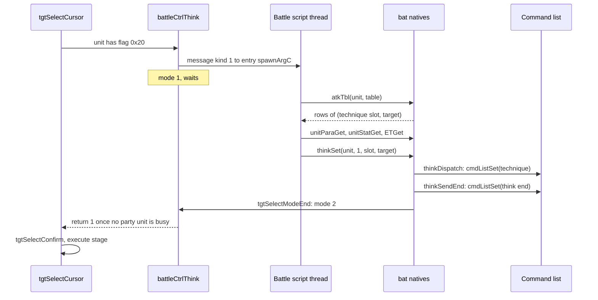

### Battle messages and script effects

`src/ov01/think_dispatch.c` also holds the small services that scripts and special actions use to talk to the player. `msgPutObject(x, y, text, frames, width, height)` shows a line of text in a box. It claims a task record with `ov01TaskClaim`, creates the text entry with `textEntryAlloc` and sets the busy flag `msgBusy`. With a frame count the message stays that many frames. With a count of 0 it stays until the voice of the text has finished (`textEntryConfirmPoll`). The task's update function `msgObjRelease` removes the text and clears the busy flag, and `battleMsgEndChk` reports whether a message is still shown. The native `bat.msgPut` uses it for enemy speech and tutorial text, and the item pick and the steal use it for their result line at (0x14, 0x120) for 0x2D frames.

`effectSendOwned` and `effectStartAtPosition` start an effect by group and record, attached to a unit or placed at a row of the position table. They are the bodies of the natives `bat.createEffect` and `bat.createEffectPos`. The effect key always has the group above bit 12 and the record below it (`EFFECT_KEY_GROUP_SHIFT`).

## After every command

The think end of every turn queues three bookkeeping events. They are where units are defeated and where lingering statuses act.

### End-of-step statuses

`battleResolveStatus` (event 12) first handles the unit of the turn's last attack command, if it has any status in rows 1 to 3. It waits until that unit's queue is empty and then calls `stat1Proc`, which adds up three changes.

| Change | Sources |
| --- | --- |
| HP loss | The damage of the unit's own plain hit under the row 2 status 0x1000, a tenth of the HP cap under row 1 status 0x0002, a quarter under row 2 status 0x0002 |
| EP change | Minus 5 under row 1 status 0x0100, plus 2 under row 3 status 0x1000 |
| Energy loss | A quarter of the cap under row 1 status 0x4000, half under row 2 status 0x4000 |

Each nonzero change is applied, shown as a number (`objDmgNumCreate`, the numbers of one step 50 frames apart) and answered by a damage or recovery motion of the unit.

Then the function looks at every unit with 0 HP. A unit with the row 3 status 0x4000 is set to 1 HP, gains 3 Stock and gets a counter Boost if `calcBoostChk` allows. A unit with the row 3 status 0x0400 is set to 1 HP. Both statuses are used up.

### Defeated units

`battleExecDead` (event 11) walks the whole unit table.

A unit that cannot act or has no HP is taken out of the action stock (`actStockRemove`), unless it is the unit whose turn is running. The turn order display drops its entry (`menuStockDead`).

`unitCmdDeadSet` then tests for 0 HP. A unit that just reached it gets its defeat motions queued and the flag `UNIT_FLAG_DOWN`. For an enemy `monsGainSet` adds its rewards to the battle result, the target panels are closed and its effects are released. While the Event Slot shows value 2 and the enemy gives skill points, the HUD shows the bonus panel 7. For a party unit only the aura is switched off. In both cases script event 8 is sent.

### Auto-revive

`battleStatusQueueWait` (event 13) waits until every unit with a revive status has finished its motions and then calls `stat2Proc`. A defeated unit with the row 3 status 0x0800 gets its full HP cap back, one with 0x2000 half of it. The status is used up, `UNIT_FLAG_DOWN` is cleared and the unit plays its recovery motion (`UNIT_CMD_PHASE_2B_WAIT`).

## How a battle ends

`battleEndChk` runs at the end of every `tgtSelectStep`. It does nothing while the execute stage is active, so a battle never ends in the middle of a command. Otherwise it tests five conditions in this order and stores the first that holds in `BattleState.status`.

| Status | Source name | Condition | Meaning |
| --- | --- | --- | --- |
| 5 | `TGT_STATUS_TIME_UP` | Event flag 0x20 and `gameWork.panelValue` at 0 or below | The time limit ran out |
| 2 | `TGT_STATUS_PARTY_GONE` | `unitLiveNumGet2(0)` is 0 | The party is defeated |
| 1 | `TGT_STATUS_ENEMY_GONE` | `unitLiveNumGet2(1)` is 0 | Victory |
| 3 | `TGT_STATUS_PARTY_LEFT` | `transition` is 1 | The party escaped |
| 4 | `TGT_STATUS_ENEMY_LEFT` | `transition` is 2 | The enemies fled |

The order means that a party that defeats the last enemy with its own last breath loses. `unitLiveNumGet2` does not count units with the row 2 status 0x0001, so a side whose remaining units all have that status has lost as well.

The time limit is the field's time panel carried into the battle. `ov01StepBattle` shows the remaining time with `msgPanelSetTimecode(0, 0, value / 30, value % 30)`, which is seconds and frames at 30 frames per second, and lowers `gameWork.panelValue` by one each frame.

When `tgtSelectStep` returns 1, the step chain moves from `ov01StepBattle` to `ov01StepStartFadeOut`, which calls `battleAfter` every frame. `battleAfter` first waits until no unit is busy. For the statuses 2 to 5 it then returns 1 at once. For a victory it plays the victory sequence, unless event flag `CF_EVENT_SKIP_VICTORY` is set:

1. `bgmPlayTrack(6)` starts the victory music.
2. `selectPL(lastPartyUnit)` picks the speaker: the party unit that acted last if it can still act and is a character, otherwise a random able character. `streamPlayByKey(speaker, 7)` plays the victory line.
3. Script event 7 points the camera at the last party unit, or at the speaker when that unit is defeated.
4. Every standing party unit gets `UNIT_CMD_PHASE_2C_WAIT`, the victory pose.
5. `decoFlagsSetAll` hides the HUD.

On the following frames the sequence ends when Circle is pressed or when no party unit is busy any more.

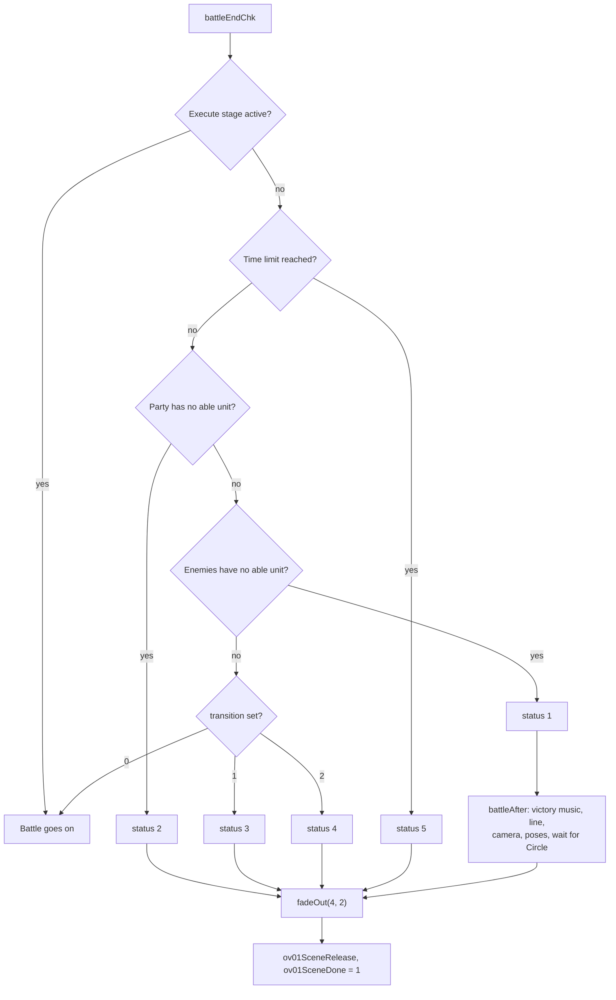

### Back on the field

After `ov01SceneEnd` the field loop `Game` reads the status with `battleRetCodeGet` and reacts.

| Status | Field reaction |
| --- | --- |
| 2, party defeated | Restarts the sound slots, sets `gameWork.control` bits 0x88000000 and leaves the game loop. No result screen is shown. What follows is the game over sequence described in [Title and boot](title-and-boot.md) |
| 5, time up | No result screen. The field state is restored and the map units receive event 7 with the arguments -1 and -1 |
| 1, victory | Result screen, field restored, event 6 with argument 0 and the id of the enemy record, and the children of the enemy record are released (`uwamonoReleaseChildren`) |
| 3, party escaped | Result screen, field restored, event 6 with argument 2 |
| 4, enemies fled | Result screen, field restored, event 6 with argument 3, children released |

A soft reset during the battle (`CONTROL_SOFT_RESET`) leaves the loop before any of this. In all surviving cases the field then restores its state with `Game_Data_Pop`, resets the encounter words, sets a 90-frame fade timer and calls `Enemy_After_Battle(-1)`, which lets the field enemies react (see [Field enemies](field-enemies.md)). The map unit events 6 and 7 are how the map's script learns the outcome (see [Map and units](map-and-units.md)).

## Rewards

Rewards are collected during the battle and paid after it. The collecting block is `battleResult` (`struct BattleResult`, 0x50 bytes), cleared by `monsGainInit` at the start.

| Offset | Type | Field | Meaning |
| --- | --- | --- | --- |
| 0x00 | int | `exp` | Experience |
| 0x04 | int | `skillPointsTotal` | Skill points |
| 0x08 | int | `classPointsTotal` | Class points |
| 0x0C | int[8] | `categories` | Inventory category of each dropped item |
| 0x2C | int[8] | `ids` | Item id of each dropped item |
| 0x4C | int | `count` | Number of drops, at most 8 |

The three names of the first column are neutral in the source. Their meaning follows from `specAnalyzeProc`, which shows the same three record fields as experience, skill points and class points.

`monsGainSet` adds one defeated enemy. Its reward record (`struct EnemyRewardRecord`, `enemyRewardRecordGet`) gives the three point values and two drops. The skill points are multiplied by the Event Slot multiplier (2, 4 or 10) when the enemy is defeated while the Event Slot shows value 2. The first drop is the rare one: its chance `firstChance` is raised by the skill sum of mask (0x400, 0x2000) of the unit that struck the enemy last. If the rare roll fails, or the rare drop was stolen before, the second drop is rolled with `secondChance`, unless it was stolen.

The payment is made by `calcResult`, called from the result screen `battleResultScene` in `src/main/battle_result.c`. It works on the party snapshots.

1. It counts the party units that are not defeated.
2. It adds every dropped item to the inventory (`dataBoxInc`).
3. Every standing party unit gets each of the three totals divided by the number of standing units (`calcResultSub`). Experience is raised by the skill sum of mask (0x400, 0x8000) in percent, skill points by the sum of mask (0x400, 0x4000) plus 10 with skill code 63. The totals of a slot record are capped at 99999999 experience and 99999 skill and class points.
4. `calcLvUp` subtracts the experience from the slot's counter to the next level. Each time the counter reaches 0 or less the level goes up by one, the next table value is added and `unitGrowthStep` raises the stats. The maximum level is 99.
5. A defeated party unit gets nothing.
6. `battleAbsentUnitsApply` pays the members that were not in the battle: characters after a character battle, E.S. after an E.S. battle. Such a member gets experience only. A member with a stat block in the battle's pool gets the full share, the others three quarters. It also recovers a quarter of its HP and EP caps, or half with skill code 20.

`calcResult` fills one `BattleResultRow` per party unit with the three gains, the levels gained and the growth of the HP and EP caps. The result screen counts these up in its states (count-up, tally, summary, item list) and the player leaves it with Circle. At its end the screen calls `calcDeadReset`, which gives every party member that ended the battle defeated 1 HP. The screen and the growth formulas are described in [Party and growth](party-and-growth.md).

## The inventory in battle

`src/ov01/data_box.c` holds the item quantities that the battle uses. There are four tables of 255 halfwords, one per category (`dataBoxQuantityTable1` to `dataBoxQuantityTable4`). `dataBoxPtrGet(category)` returns the table for the categories 1 to 4 and a null pointer for anything else. An id is 1-based, so the quantity of id `n` is entry `n - 1`.

| Function | Work |
| --- | --- |
| `dataBoxChk(category, id)` | Returns the quantity |
| `dataBoxInc(category, id)` | Adds one, up to 99 (`DATA_BOX_QUANTITY_MAX`). Returns 0 at the cap |
| `dataBoxDec(category, id)` | Takes one. Returns 0 when there is none |
| `dataBoxChkCategory1` to `dataBoxDecCategory4` | Twelve wrappers with the category fixed |
| `dataBoxClearAll` | Zeroes all four tables. Called once by `ov01InitAll` |

Category 1 holds the consumable items that the battle's item menu lists, with the ids 1 to 40. Category 2 is the category whose names come from the equipment table (`itemTextGet` in `specNusumuProc`). Drops name their category in the reward record. The main menu reads and writes the same tables, which is one more reason why OV01 stays loaded (see [Main menu](main-menu.md)).
