# Debug tools and test programs

The release executable of *Xenosaga Episode II* still carries most of the code
that the programmers used while they built the game. There are test programs
named after their authors, a small debug menu system, a battle test bench with
a configuration menu, a checked heap with a window viewer, a profiler, line
drawers for collision shapes and skeletons, a network file client and a
snapshot tool. The code is complete and compiled. What is missing is the way
in: the launcher table is never read, the debug text is switched off, two test
overlays are not on the disc, and several helpers were replaced by stubs.

The leftovers are still worth reading. They show which systems each programmer
owned, which files came from a development PC, how sound, movies, memory cards
and fonts were checked in isolation, and what the original source files were
called. One debug feature does work in the shipped game: the soft reset chord
that returns to the title screen.

[← Back to the overview](../README.md)

## Files

| File | Contents |
| --- | --- |
| `src/main/yajima_test.c` | `YajimaTest` with its menu rows and action table, `tyaRunDisplaySetting`, four sound slot level setters |
| `src/main/yajima_test.c` | The ten test pages of `YajimaTest`: font, pad, HDD, memory card, resource slots, IPU movie, sound, movie list, kanji check, edge test, plus the scrolling text view they share |
| `src/main/xgl_menu.c` | `xglMenu`, the debug menu system: 16 menu slots, nested list menus, open and close animation |
| `src/main/debug_test.c` | `YosikawaTest`, `TexturTest`, `choiceMenuTest`, `ItaiTest`, the texture upload helper `xglTexUploadList` |
| `src/main/ytachi_test.c` | The empty `YtachiTest`. The rest of the file is live map code (`mapSceneScriptLoad`, `uwamonoResetRecords`) |
| `src/main/test_129.c` | `testMenuRun`, `testLoadFile`, the bump allocator of the tests, `sjisToEuc`, the tunable values of the water test |
| `src/main/glow.c` | `glowRunScene`, a test scene that loads its models from `host0:` |
| `src/main/test_128.c` | The `RgHeap` allocator with its dumps and the heap windows |
| `src/ov01/yamamoto_test.c` | `YamamotoTest`, the battle test bench, and the studio camera setup it uses |
| `src/ov01/debug_entry.c` | The BATTLE CONFIG menu: main page, equipment page, script page, value editors |
| `src/main/pxy_debug_draw.c` | A stroke font drawn with GS lines: `pxyDebugDrawChar`, `pxyDebugDrawString`, `pxyDebugPrintf` |
| `src/main/pxy_profile.c` | The frame profiler (`pxyProfileBegin`, `pxyProfileEnd`, `pxyProfileDrawEntries`) and two unrelated math routines |
| `src/main/pause_menu_page_uwamono.c` | Debug outlines of map units, enemy routes, ladders and sight fans |
| `src/main/TiDrawJoint.c` | Skeleton drawer: bones and joint axes as lines |
| `src/main/TiDrawCollision.c` | Collision ring drawer |
| `src/ov01/m_ef_path.c` | Axis, cross and marker drawers of the battle effect paths, next to the live Hermite path helpers |
| `src/main/xgl_debug_file.c` | `xglDebFileSize`, `xglDebFileRead`, `xglDebFileWrite`: host file access replaced by stubs |
| `src/main/lan_usb.c` | The network file client: `UsbInit`, `LanOpen`, `UsbReadFile`, `UsbWrite` and the others |
| `src/main/game_snap_shot.c` | The snapshot tool: JPEG of the displayed frame, thumbnail, metadata, numbered files on `host0:` |
| `src/main/assert_fail.c` | `assertFailed`, `assertExit`, `errorFatal` |
| `src/main/sef_print.c` | `tracePrint`, the empty `LOG`, `resetWaitForPad` |
| `src/main/game_data.c` | The play session `Game()`: the soft reset chord and the profiler brackets live here |
| `src/main/xgl_font.c` | `xglFontDebugPrintf`, `xglFontDebugHex` and the flag that silences them |
| `src/ov02/logo.c` | The developer launcher table, stored behind a logo packet |

## 1. Why the debug output is invisible

Almost every debug screen writes its text with `xglFontDebugPrintf` or
`xglFontDebugHex` in `src/main/xgl_font.c`. The source holds 213 calls of
`xglFontDebugPrintf` in 20 files. Both functions queue text only when two bits
of the font state are set together: `FONT_STATE_ENABLED` (1) and
`FONT_STATE_DEBUG_PRINT` (2). The font start-up code stores
`FONT_STATE_ENABLED | FONT_STATE_CLIP`, without the debug bit. The only other
writer of the flags is `xglFontSetFlags`, and it removes the debug bit from
whatever it is given:

```c
void xglFontSetFlags(int flags)
{
    FONT_STATE_FLAGS = flags & (0xFFFF & ~FONT_STATE_DEBUG_PRINT);
}
```

So the debug bit can never become 1, and every debug print returns at its first
test. This mask is probably the switch that turned a development build into
the release build, because nothing else about the debug screens was removed.
The fonts themselves are described in
[fonts-and-text.md](../libraries/fonts-and-text.md).

When the bit is set, `xglFontDebugPrintf` copies up to 31 variable arguments,
doubles the coordinates unless the font is in its debug coordinate mode, and
queues the text. Debug text therefore uses a grid of half the screen
resolution: a line at `y = 8` appears 16 pixels down. Episode II adds one
feature here. `xglFontDebugPrefixSet(text)` stores the address of a text that
is then included in front of every debug line, in place of the usual font
reset. Only `testMenuRun` uses it (section 6).

The flowchart below shows the gate.

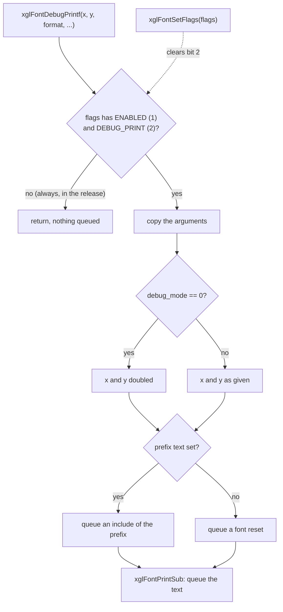

Other debug output goes to places a player never sees:

- `printf` writes to the console of a development kit. The source holds close
  to 100 such calls. The test programs print load results, the heap prints its
  dumps, and the assertion handler prints its banner.
- `MOutputDebugString` and `MOutputDebugStringWarn` in `src/main/m_math.c`
  wrap a message in ANSI colour codes (`ESC[1;36mMDMSG:` in cyan, magenta for
  the warning form) and print it with `vprintf`. The colours need a terminal
  on the host PC.
- `LOG` in `src/main/sef_print.c` is an empty function. The light set dump in
  `src/main/sv_scene_flags.c` and three places in `src/main/sef.c` still call
  it with a vector and a format, and nothing happens.
- `tracePrint` in the same file formats a line into a 256-byte buffer and
  prints it. Nothing calls it.
- `GameSnapShotCheck` in `src/main/game_snap_shot.c` is empty (section 10).

## 2. What can be reached

The table lists each tool, the way the developers reached it, and whether the
shipped game can reach it. "No caller" means that no function in the main
executable, OV01 or OV02 calls or stores the entry.

| Tool | Entry | Reachable in the release |
| --- | --- | --- |
| Soft reset to the title screen | L2 + R2 + L1 + R1 + SELECT held, START pressed | **yes**, in the field and in battle |
| `YajimaTest` and its ten pages | launcher table, overlay 99 | no, the table is never read and OV99 is not on the disc |
| `YamamotoTest` and BATTLE CONFIG | launcher table, overlay 1 | no, the table is never read |
| `YosikawaTest` | launcher table, overlay 1 | no |
| `YtachiTest`, `ItaiTest`, `resetWaitForPad` | launcher table, overlay 1 | no |
| `testMenuRun` (event tool, glow test, water test) | launcher table, overlay 1, then loads overlay 98 | no, and OV98 is not on the disc |
| Heap windows | window system of overlay 98 | no |
| Script page of BATTLE CONFIG | `configScriptPage` | no caller |
| Debug text | `xglFontDebugPrintf` | no, see section 1 |
| Profiler display | `pxyProfileDrawFlag` | no, the flag is only ever set to 0 |
| Map unit and enemy outlines | `uwamonoDrawDisabled` | no, it starts as 1 and is never written, and the line function is empty |
| Skeleton and collision drawing | bits 2 and 4 of `XenoActor.attr` | no, the pool sets `attr` to 1 and nothing adds the bits |
| Battle path axes and crosses | `MEfDrawFrameAxes`, `MEfDrawPointCross` | no caller |
| Host files | `xglDebFileSize`, `xglDebFileRead`, `xglDebFileWrite` | callers exist, but the functions are stubs that trap |
| Network file client | `UsbInit` and the other `Usb` functions | no caller |
| Snapshots | `GameSnapShotExecute`, `GameSnapShotSave`, `GameSnapShotSaveFile` | no caller |
| Assertions | `assertFailed` | yes, 227 checks stay active (section 11) |

The control flow of the program is simple. `main()` in
`src/main/control_entry.c` loads OV02 and calls `Title()`. The value that
`Title()` returns names an overlay in its top byte and a function address in
its low 24 bits. `main()` loads that overlay and calls the function, and when
the function returns the title screen runs again (see
[title-and-boot.md](title-and-boot.md)). The title code in `src/ov02/title.c`
returns only two kinds of value: 0, or overlay 1 with the address of `Game`.
Every test program has the same form as `Game`, a function without arguments
that returns when it is done, so each of them could be started by returning a
different value from `Title()`.

The diagram shows the live path as solid lines and the unconnected paths as
dotted lines.

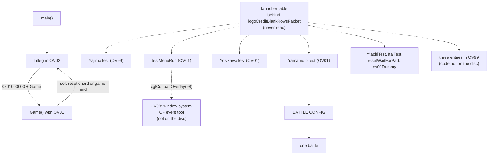

## 3. The developer launcher

The launcher table sits in `src/ov02/logo.c`, at the end of the array
`logoCreditBlankRowsPacket`. The logo code sends only the first `0x1C` (28)
words of that array to the graphics chip as a packet that blanks the unused
rows of a credit band. The array has 42 words. The 14 words after the packet
are a list of title return values in the format that `main()` understands.
Nothing reads them. They are most likely the item list of a developer title
menu that stood next to the logo data in the original source file.

Decoded with the function addresses, the words are:

| Word | Value | Overlay | Entry | Source file |
| --- | --- | --- | --- | --- |
| 28 | `0x00000000` | none | none | |
| 29 | `0x631EDA80` | 99 | `YajimaTest` | `src/main/yajima_test.c` |
| 30 | `0x01AAAB80` | 1 | `YamamotoTest` | `src/ov01/yamamoto_test.c` |
| 31 | `0x011EECD8` | 1 | `YtachiTest` | `src/main/ytachi_test.c` |
| 32 | `0x0123C600` | 1 | `YosikawaTest` | `src/main/debug_test.c` |
| 33 | `0x0123CF78` | 1 | `ItaiTest` | `src/main/debug_test.c` |
| 34 | `0x01251E30` | 1 | `resetWaitForPad` | `src/main/sef_print.c` |
| 35 | `0x01AAAD50` | 1 | `ov01Dummy` | `src/ov01/yamamoto_test.c` |
| 36 | `0x0123E978` | 1 | `testMenuRun` | `src/main/test_129.c` |
| 37 | `0x00000000` | none | none | |
| 38 | `0x63A81EF0` | 99 | address `0x00A81EF0` | not on the disc |
| 39 | `0x63A82600` | 99 | address `0x00A82600` | not on the disc |
| 40 | `0x63A828E4` | 99 | address `0x00A828E4` | not on the disc |
| 41 | `0x00000000` | none | none | |

Most entries are functions of the main executable that ask for overlay 1,
because they use battle or menu code that lives in OV01. `YajimaTest` asks for
overlay 99, and three more entries point into the overlay area itself
(overlays load at `0x00A80000`). The disc holds only `OV01.OVL` and `OV02.OVL`.
`xglCdLoadOverlay` in `src/main/xgl_cd.c` builds the name `OVnn.OVL` from the
number and repeats `sceSifLoadElf` until it succeeds, so asking for overlay 98
or 99 on a retail disc would never return. Overlays 98 and 99 were development
overlays that were left out of the release.

The zero words look like separators. Words 29 to 36 would be one group of
eight programmer tests and words 38 to 40 a second group of three tools whose
code is gone.

## 4. `xglMenu`: the debug menu system

`src/main/xgl_menu.c` is a small menu library for debug screens. It keeps 16
menu slots in `menutbl` (`0x80` bytes each). `xglMenuInitial` clears them and
is called once from `InitializeSystem`. `xglMenuOpen(slot, params)` fills a
slot, or the first free one when the slot is `XGL_MENU_SLOT_ANY` (-1), and
returns the slot number or -1. `xglMenuDraw` runs every active slot once per
frame: it reads the pad, moves the cursor and prints the rows. Only
`YajimaTest` opens a menu, so the library is as unreachable as its one client.

A menu is described by three structures from `include/main/xgl_menu.h`.

| Structure | Field | Meaning |
| --- | --- | --- |
| `XglMenuParams` | `type` | 0 for a sprite menu, 1 for a list menu |
| | `select_flags` | bit 0: write each chosen result at once and keep the menu open |
| | `x`, `y`, `z` | position of the first row |
| | `default_result` | result when the root level is cancelled |
| | `root` | the first `XglMenuNode` |
| | `result_out` | where the result is written |
| `XglMenuNode` | `item_count` | number of rows |
| | `initial.initial_selected_item` | row selected when the level opens, or -1 to keep the last one |
| | `initial.flags` | bit 0: the cursor wraps around |
| | `initial.row_spacing` | distance between rows when fully open |
| | `selected_item` | current row |
| | `enter_result`, `cancel_result` | values written to `result_out` when the level is entered or cancelled |
| | `rows` | array of `XglMenuRow` |
| `XglMenuRow` | `text` | label |
| | `next` | a result value below `0x100000`, or a pointer to a child node, or -1 for a disabled row |

A list menu can be nested eight levels deep. Each level has its own row
spacing in `row_offsets`. Opening a level grows its spacing by one unit per
frame from 0 to `row_spacing`, which makes the rows slide apart. Closing
shrinks it again. Child levels are printed between the rows of their parent,
indented by 8 units. The selected row is printed in red (`\x0c\x80\x00\x00`),
a disabled row in dark grey and the others in the default colour.

While a level runs, Up and Down (with repeat) move the cursor and skip
disabled rows, Circle chooses and Cross cancels. Choosing a row with a result
value either writes it at once or starts the close animation and delivers it
at the end. Choosing a row with a child node opens the next level. The sprite
menu type exists only as a stub: its draw function just marks the slot
inactive.

The state diagram shows the life of a list menu slot (`XglMenuEntry.active`).

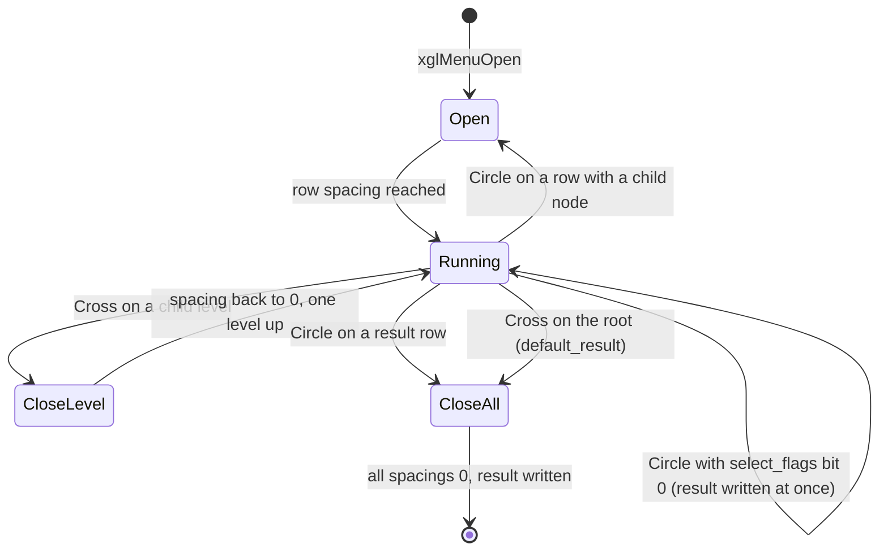

## 5. `YajimaTest` and its pages

`YajimaTest` in `src/main/yajima_test.c` is the largest test program.
It sets the stick dead zones of pad 1 to `0x40`, sets a dark green clear
colour (`0x80004000`), and then loops. Each pass counts the rows of
`yajimaTestRows`, opens the list menu at (8, 16) and waits. While it waits it
prints the title `SELECT`, the date and time of the real-time clock in the
form `%4d.%2d.%2d` and `%2d.%2d.%2d`, and draws one random number per frame
that it throws away. A chosen row calls its function from `yajimaTestActions`
with the row number. Cancelling the menu writes -1 and ends the program.

| Row | Label | Function | Subject |
| --- | --- | --- | --- |
| 1 | `FONT` | `FontTest` | proportional fonts and special glyphs |
| 2 | `PAD` | `PadTest` | raw pad data and vibration |
| 3 | `HDD` | `HddTest` | empty function |
| 4 | `MEMCARD` | `MemcardTest` | memory card and HDD save operations |
| 5 | `RESOURCE` | `CdSlotTest` | the resource block table |
| 6 | `IPU` | `IpuMovieTest` | an IPU movie stream |
| 7 | `SOUND` | `SoundTest` | sound effects, music, ADX streams, volumes |
| 8 | `CAPTION` | `MovieListTest` | movies with their subtitles |
| 9 | `NISUI` | `KanjiCheckTest` | rare kanji of a text file |
| 10 | `EDGE` | `EdgeTest` | intersection of two line segments |

Every page runs its own loop with `xglSleep()` at the end and leaves on the
same chord: SELECT held while START is pressed. The pages read pad 1 through
`PadData`. In the tables below, "pressed" means the frame a button goes down,
"held" means every frame it is down, and "repeat" means pressed with auto
repeat. Several pages use fixed memory from `0x01000000` upwards as scratch
space, which is the area that the game otherwise gives to the resource system
(see [memory.md](../architecture/memory.md)).

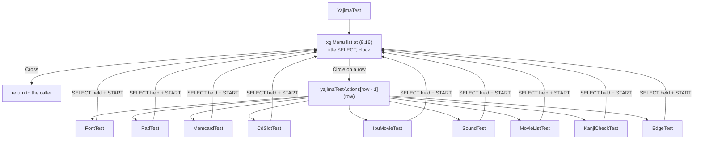

### The scrolling text view

Three pages show a text file as a list and let the tester pick a line. They
share `DebugTextView`, a 16-byte record with the text start, the first line
shown (`top`), the selected line (`cursor`), a flag that allows page jumps, the
screen row of the first line and the height. `DebugTextViewInit` sets the view
to the start of a text with row 16 and height 200. Lines end with CR or LF.

`DebugTextViewUpdate` does everything else. Up and Down (repeat) move the
selection by one line. With page jumps allowed, Right and Left move it by 20
lines. The function prints `^` when text exists above the window, `>` in front
of the selected line and `v` when text continues below, and it scrolls the
window when the selection leaves it. Each line is copied into a 64-byte buffer
and printed 8 units below the previous one. The return value is 1 in the frame
Circle is pressed, which the pages use as "this line was chosen".

### `FontTest`

The page prints test lines with the two proportional modes of the text
renderer: the hexadecimal digits with `$prop0;$han1;`, a block of all
single-byte codes from `0x80` to `0xFF` (`fontTestGlyphText`) with `$prop1;`,
and a line of small and large kana, punctuation, two kanji and symbols, once
with fixed and once with proportional spacing. Circle reloads font 0 and Cross
reloads font 1 with `xglFontLoad`. Left and Right were meant to turn pages, but
only page 0 exists, so both keys leave the page number at 0. The page also
calls the empty `GameSnapShotCheck` every frame.

### `PadTest`

The page dumps both pad records in hexadecimal, port 1 on the left and port 2
`0x80` units to its right: status and id, the button word, the held, pressed,
repeat and released masks for buttons and for directions, the four stick
values raw and centred, the pressure values of the buttons, and the 32 raw
bytes of the pad buffer in two columns.

It also drives the vibration motors. Right and Left (repeat) change a small
motor value, Down and Up a big motor value. While Circle is held the two
values are copied into `actuators[0]` and `actuators[1]` of port 1. Cross
toggles `actuatorMode`. The top line shows the two values and the mode.

### `MemcardTest`

`MemcardTest` is a complete front end for the memory card and HDD save layer
(`xglMc` and `xglHdd`, see [save-data.md](../architecture/save-data.md)). Its
title is メモカテスト ("memory card test"), and all its messages are Japanese.

None of the `yajima\` test files that this page of the tool reads
(`thumb.jpg`, the `mc\*.bin` icon images) is on the discs, and the same holds
for `yajima\ipu_101.ipu` and `yajima\check.txt` of the pages below. Before the
loop it reads `yajima\thumb.jpg` and copies it into the thumbnail
field of the save image. It then loads eleven card icon images to
`0x01002000`, `0x50000` bytes apart: `yajima\mc\clear.bin`, `chaos.bin`,
`jin.bin`, `jr.bin`, `kosmos.bin`, `momo.bin`, `r02.bin`, `r03.bin`,
`r05.bin`, `shion.bin` and `ziggy.bin`. For each file `McFileSectionsReport`
finds the three icons inside it (the normal icon, labelled `sys`, the copy icon
and the delete icon, each at an offset rounded to 64 bytes) and
`McIconBoundsReport` prints the bounding box of the icon model. Vertex
positions are 16-bit values in units of 1/1024. The function also computes the
zoom that would keep the icon within 20 units of height. Finally the test
prints three sizes: 964 for the icon system file, `0x5160` (20,832) for the
save data and the size of the first card data block.

Each frame the page calls `xglMcMain()`, prints the status words of both
ports and the current state number, and runs one state. If the selected card
stops being ready (status neither 1 nor `0xFF`, which means busy), the page
falls back to the port selection.

| Screen | Controls | What it does |
| --- | --- | --- |
| Port selection (ポート選択) | Up, Down, Circle | Chooses ポート１, ポート２ or ＨＤＤ. A port that is not ready is printed dark and skipped |
| Card menu | Up, Down, Circle, Cross | Seven rows, see below. Cross returns to the port selection |
| Load (ロード) | Left, Right, Circle, Cross | Asks which of the files 0 to 99 exist, lets the tester pick one and loads it into `SaveData` |
| Save (セーブ) | Left, Right, Circle, Cross | Shows the free space, picks a file number, asks to create it, creates it with a 20-step progress bar, then writes the data |
| Format (フォーマット), Unformat (アンフォーマット) | Circle, Cross | Ask for confirmation, run the request, report the end |
| List (列挙) | Circle | Runs the list request with a callback that prints `callback:%d`, and shows a 10 by 10 grid of the "found" bytes |
| Old data check (旧データチェック) | Circle | Looks for save data of earlier games. The callback prints lines tagged `ep1`, `ep1re` and `freak` with the bytes of each entry, probably for Episode I, its Reloaded edition and Xenosaga Freaks |
| Dummy data (ダミーデータ作成) | Left, Right, Square, Circle, Cross | Fills the card with a dummy file so that a chosen amount of space (0 to 999 KB, Square for steps of 100) stays free |
| HDD menu | Up, Down, Circle, Cross | Load and save through `xglHddMcExist`, `xglHddMcLoad`, `xglHddMcCreate` and `xglHddMcSave`, with the results printed to the console |

Saving writes file 0 as the first `0x50` bytes of the save image (its header)
and any other file as the rest of the image. When a new file is created with a
number below 11, the icon image with that index is used, so every icon could
be checked on a real card. The place name stored in the entry is the fixed
text エンセフェロン・シミュレーター内 ("inside the Encephalon simulator").

Three extras exist outside the menu rows. Holding R1 while pressing Circle in
the card menu writes a dummy save named `/BISLPS-99999Dummy` of `0x77D800`
bytes (about 7.5 MB), which nearly fills a card. Triangle, in any state, fills
the 128 event flag bytes of the save image with random values, and the bottom
line always shows the first eight of them. That gave the tester save files
with different content. The directory name uses `SLPS`, the product code
prefix of Japanese releases, with the placeholder number 99999.

The state numbers group the screens by their high digit. Two states, the
overwrite confirmations `0x36` and `0x83`, have code but no state leads to
them: the save path always goes from the file check to the "create new"
question.

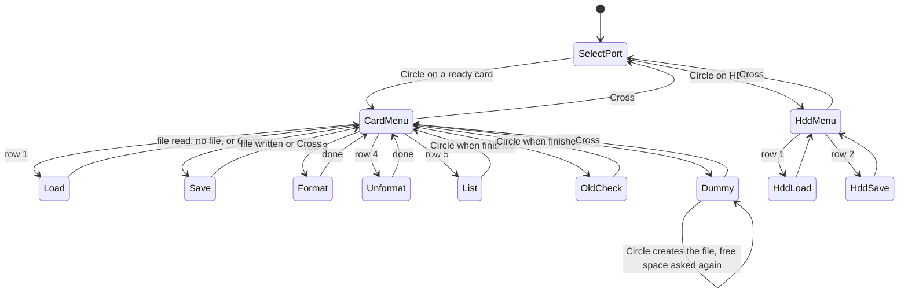

### `CdSlotTest` (RESOURCE)

The page titled リソーステスト ("resource test") shows the table of resource
blocks, `gameResBlockTable`, which is the heart of the resource system described
in [files-and-resources.md](../architecture/files-and-resources.md). It starts
the resource system on the `0x01000000` area, initialises the player slots and
selects slot 1. A star moves along the top line as a sign that the loop is
alive. SELECT switches between two views.

View 0 lists every block from index 1 until the end marker: buffer address and
size in hexadecimal, then a name in a smaller font. The name is `(free)` for a
free block, the text in the buffer for owners of the form `0xF0xxxx`, and
otherwise the file name that `xglCdFindFileName` returns for the owner id. A
line `----` marks the block whose index is stored in entry 0. The controls
call the resource functions directly:

| Button | Call |
| --- | --- |
| Up, Down (repeat) | move the cursor over the used blocks |
| Circle | `resPlayerSlotsLoadModels(0x1000A, 0x1001C, 0x10016)` |
| Triangle | `resPlayerSlotsLoadModels(0x10016, 0x10026, 0x10002)` |
| Square | `resPlayerSlotUpdate(0)` |
| R1 | `resPlayerSlotUpdate(-1)` |
| R2 | `resPlayerSlotsReset()` |
| Cross | `GameResBlockFreeByOwner` for the owner of the block under the cursor |

View 1 works with scene resource files. Up and Down change a one-byte file
number, Left or Right switch the last column between names and raw owner ids,
Square calls `GameResourceReset`, Triangle `resLoadCfFile(number)`, Circle
`resApplyCfFile(number)` and Cross `resResetScriptState`. Below the block list
the view prints the two entry tables from `resGetEntryTables` in two columns,
with their counts on top. START calls `cdSlotTestOnStart`, which is empty.

### `IpuMovieTest`

The page plays the IPU movie `yajima\ipu_101.ipu` through the `xglMovie`
decoder. The stream buffer is 64 KB at `0x02000000`. The two decoded image
buffers are at `0x01000000` and `0x01200000`, and the work buffer at
`0x01400000`. The size of the movie is printed to the console as `%dx%d`.

Each frame the page calls `xglMoviePlay`, prints the frame number of the
stream, the result and its own frame counter, and builds a packet by hand: it
uploads the finished image to video memory in two halves of `0x7000`
quadwords and draws it as one textured sprite with the size of the movie.
Circle rewinds the stream. The title is ＩＰＵ.

### `SoundTest`

The sound page is a browser for the three kinds of sound data (see
[audio.md](../architecture/audio.md)). It loads the default sound effect banks
0 and 2 to 23, then shows the help line "○:SELECT △:STOP ×:BACK". Its top
menu has four lines, `SE`, `BGM`, `ADX` and `VOL`, and the page picks the mode
from the first letter of the selected line. Square toggles between `STEREO`
and `MONAURAL` with `soundStereoSet`.

The lists come from the development PC. Each mode opens a text file of
`host0:/home/xeno/vcd-f/x2/sound/`, reads up to 64 KB of it to `0x01000000`
and shows it in the scrolling view:

| Mode | List file | Circle on a line | Other controls |
| --- | --- | --- | --- |
| SE | `vsf/_list.txt` | Loads the bank with that name into bank 0 (`seBankLoad`), reads `vsf/<name>.prj` and shows the names of its entries as a second list | Cross: back |
| SE, entry list | from the `.prj` file | Starts the voice with the index of the line | Triangle: stop the voice. R3 held: the right stick sets pan and volume. Cross: reset the sound driver, back to the bank list |
| BGM | `smf/_list.txt` | Stops the music, loads the sequence (`seBgmLoad`) and starts it, then reads `smf/<name>.prj` and prints its entry names to the console | Triangle: stop. Square held: mute. Left, Right: volume 0 to 127. R1: pause the sequence. R2: resume. Cross: back |
| ADX | `adx/_list.txt` | Stops slot 0 and plays the file with that name (`adxSetSlotFile`) | Triangle: stop. Square: set the volume of slot 0 to level 0. Cross: stop and back |
| VOL | built-in list `MASTER`, `BGM`, `SE`, `ADX` | none | Left, Right (repeat) change the selected value of `soundCtrl`: `master_volume`, `master_level`, `voice_level` or `slot_level` |

A `.prj` file is a project description of the sound tool. The page reads it to
`0x01010000` and uses only three things: the entry count at offset 8, the
project name at `0x10` and the 16-character name at offset `0x20` of each
`0x30`-byte entry. The file names in the lists are cut at the first dot.

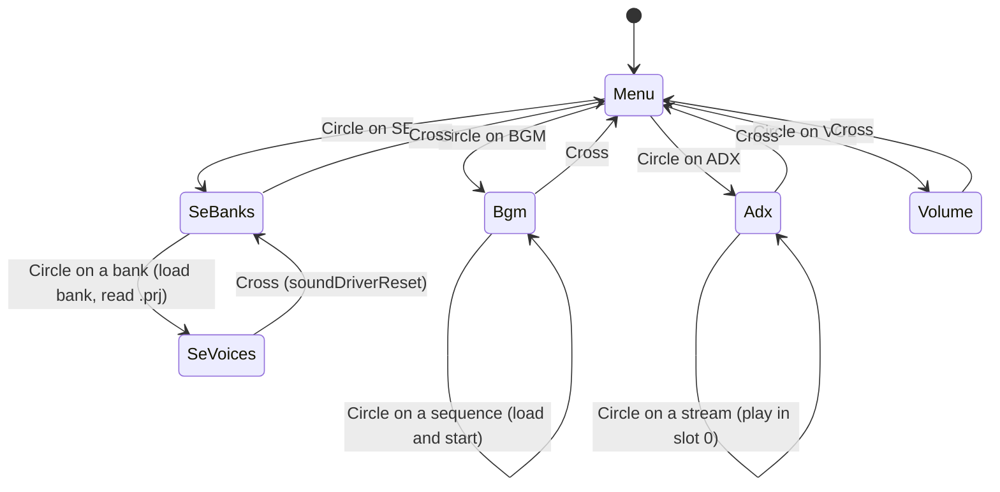

### `MovieListTest` (CAPTION)

The page titled 字幕確認 ("subtitle check") plays any movie with its
subtitles. It reads the list `host0:/home/xeno/vcd-f/x2u/movie/sfd.lst` (up to
16 KB) into a buffer from the resource system and shows it in the scrolling
view. The folder name `x2u` is probably the tree of the North American
version, next to the `x2` tree used by the sound lists. On entry the page sets
`SaveData.caption_all` to 2, which shows every caption line, clears
`gameWork.control` and switches the sound to mono.

Circle plays the selected movie through `GameMpeg2Play` with the name up to
the dot, then clears the frame. Square toggles `SaveData.dolby_digital`, shown
as `ON` or `OFF`. L1 and R1 change a volume number between 0 and 127 that is
only displayed. The movie player and the captions are described in
[cutscenes.md](../scripting/cutscenes.md).

### `KanjiCheckTest` (NISUI)

The page reads the text `yajima\check.txt` to `0x01000800` and collects every
distinct two-byte character whose first byte is `0xD0` or higher. In the
EUC-JP encoding these are the kanji of JIS level 2 (*dai-ni suijun*, hence
the menu label). ASCII bytes are skipped one at a time and other two-byte
characters two at a time. The result is written to `0x01000000` with a line
break after every 16 characters. The page shows the list under the title
第二水準チェック ("level 2 check"), and Circle prints it to the console. The
tool most likely produced the list of rare kanji that the game font had to
contain.

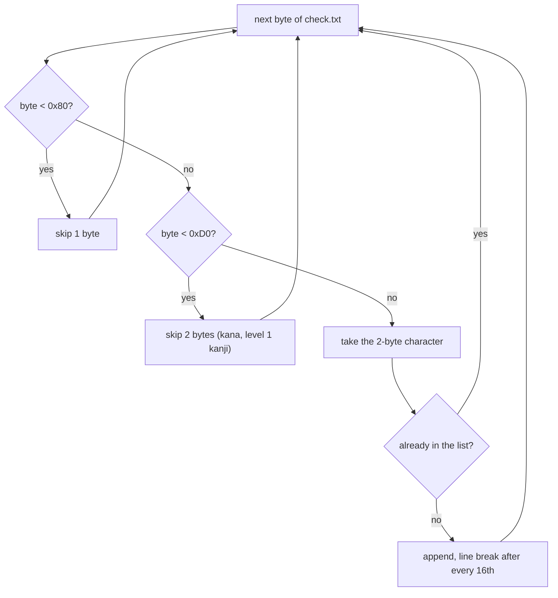

### `EdgeTest`

The last page is a geometry experiment, not a hardware test. It draws two line
segments in a top-down view and tests whether they cross. The two sticks of
pad 2 move the ends of the first segment (grey) and the two sticks of pad 1
move the ends of the second (red). Circle makes the first segment horizontal
and the second vertical.

`EdgeTestOrientationSign` computes, with VU0 instructions, on which side of a
segment two points lie and returns whether they are on the same side. When
both segments separate the ends of the other one, the page computes the
crossing point and marks it with a small dark blue cross. The state value is 1
for a normal crossing and 2 when the projected parameter falls outside the
first segment. The page prints both segments, the crossing point, the state
and the dot product of the two directions. `EdgeTestLineDraw` sends each line
as a ready-made packet (`edgeTestLinePacket`) with the colour and the two end
points filled in. The same kind of test is used by the collision code of the
field (see [map-and-units.md](map-and-units.md)).

### `tyaRunDisplaySetting`

The same file holds `tyaRunDisplaySetting`, which calls `tyaDrawGauge` with a
null pointer, resets the elevator records and runs the display adjustment
screen `tyaDisplaySetting` on a buffer at `0x01000000`. Nothing calls it. The
display adjustment screen itself is live: `src/main/menu_scene.c` opens it from
the menu and `src/main/save_party_init.c` uses it to reset the setting.

## 6. The smaller test programs

### `YosikawaTest`

`YosikawaTest` in `src/main/debug_test.c` is a test bench for the menu and
window code. It initialises the resource system, the battle overlay tables
(`ov01InitAll`), the actor pool and a camera, sets a dark blue clear colour
(16, 16, 48), opens a 256 KB file arena and resets the text windows. It then
shows seven rows with the real menu font (`textDrawSegment`) under the debug
title 芳川テスト ("Yoshikawa test"). Up and Down move the cursor, Circle runs a
row, and Cross leaves the program.

| Row | Label (English) | Action |
| --- | --- | --- |
| 0 | メインメニュー (Main menu) | `menuSceneRunLoop()`, the main menu |
| 1 | ロボメニュー (Robot menu) | `menuSceneRunSplit()`, the E.S. variant of the menu |
| 2 | セーブ（Ｒ２でロード (Save, R2 for load) | `MenuFileMain(0)`, or `MenuFileMain(1)` while R2 is held |
| 3 | てくすちゃ (Texture) | `TexturTest` |
| 4 | バトルウィン (Battle window) | opens a text entry at (200, 300) with three test names that read "the battle window is being tested" |
| 5 | バトル選択 (Battle choice) | `choiceMenuTest` |
| 6 | アナライズ (Analyze) | `analyzePanelStart(100, 150, ...)` with sample values: HP 123456, EP 12, experience 123456, 1234 skill and class points, random attack type and attributes |

SELECT shows the kana あいうえお in a text window for 60 frames. Every frame
the loop updates the text system and the actors, so the windows animate as in
the game. The main menu and the save screen are described in
[main-menu.md](main-menu.md), the windows in
[ui-windows.md](../libraries/ui-windows.md).

`TexturTest` reads `yosikawa\battle01.xtx` to the end of the work area and,
until Cross is pressed, uploads all its textures each frame with
`xglTexUploadList` and draws a counter-controlled sprite. Right and Left
(repeat) step a 15-bit counter that starts at `0x80` and is printed as `%8d`.
The counter is added to `0x3C00` inside the texture register of the sprite
packet, so the sprite probably shows the video memory page with that number,
which lets the tester browse the uploaded textures.

`choiceMenuTest` opens choice menu 0 at (30, 200) with 19 rows that all read
選択肢 ("choice"), random numbers from 0 to 127 beside them and random row
flags. Triangle opens a second menu with four rows on top. Choosing row 0 of
the second menu returns to the first one, and any other row closes both. Cross
closes the active menu.

### `ItaiTest`, `YtachiTest`, `resetWaitForPad`, `ov01Dummy`

`ItaiTest` clears the frame and sleeps forever. `YtachiTest` and `ov01Dummy`
are empty functions. `resetWaitForPad` in `src/main/sef_print.c` prints `RESET`
at (8, 8) and clears the frame until SELECT and START are held together. It is
entry 34 of the launcher table, so it was probably a menu item that gave the
tester a clean way back to the title.

### `testMenuRun` and overlay 98

`testMenuRun` in `src/main/test_129.c` is a second launcher with four rows. It
first loads overlay 98. Each frame it sets the debug text prefix, moves the
cursor with Up and Down, and runs the row with Circle. The selected row slides
10 units to the left over five frames. SELECT held with START leaves.

| Row | Label | Function |
| --- | --- | --- |
| 0 | `CFEventTool` | `testCfEventToolRun`, at address `0x00A89428` inside the overlay area |
| 1 | `GlowTest` | `glowRunScene` |
| 2 | `WaterTest` | `tiWaterSceneLoop` |
| 3 | てすと ("test") | `tiWaterSceneLoop` again |

The event tool is not in the executable. Its address belongs to overlay 98,
together with the window system that the heap viewer needs (section 8). CF is
the name the code uses for field scenes and their scripts (see
[cutscenes.md](../scripting/cutscenes.md)), so the tool was probably an editor
or player for field events.

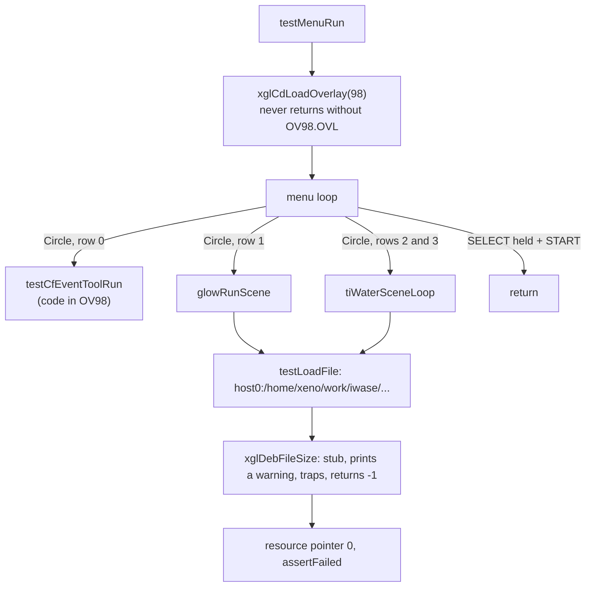

### The test file loader

`testLoadFile(cursor, name)` is the loader of these test scenes. It asks
`xglDebFileSize` for the size of a host file, takes the current value of the
cursor as the buffer, advances the cursor by the size rounded up to 16 bytes
and reads the file with `xglDebFileRead`. A null buffer raises the assertion
`pData` at line 95 of `../test.euc.c`. `testHeapSetCursor` and `testHeapAlloc`
are a second bump allocator with a private cursor, and nothing calls them.

In the release both host file functions are stubs (section 9). The size comes
back as -1, `testLoadFile` returns 0, and the scene that asked for the file
stops at its next assertion.

### `glowRunScene`

`glowRunScene` in `src/main/glow.c` is a test scene for the glow effect of
`gifState` (see [screen-effects.md](../libraries/screen-effects.md)). It sets
up a studio, allocates two actors and loads their files from
`host0:/home/xeno/work/iwase/`, starting at address `0x01000000`:

| Actor | Files | Assertions when missing |
| --- | --- | --- |
| `pLandscape` | `glow3.pxy`, `glow3.txy` | lines 72, 75, 76 of `../glow.euc.c` |
| `pChaos` | `ziggy00.pxy`, `ziggy00.txy`, `ziggy00.xhr`, `ziggy00.xap` | lines 79, 84, 85 |

The second actor is named after chaos but loads the model of Ziggy. It is
placed 2 units along X, gets its matrices and starts motion 0. The scene also
reads the texture `iwase\citizen.xtx` from the game data, and L2 reads it
again while the scene runs, which exercises file loading during drawing.

`glowUpdateFromPad` moves the character: the left stick changes X and Z by
0.001 per stick unit and turns the actor to face the stick direction, and Up
and Down held raise and lower it by 0.1 per frame. The loop requests the
overlay pass of the model renderer, updates and draws the actors, and ends on
SELECT held with START. On exit it releases all actors and clears
`gifStateModeHook`.

### `tiWaterSceneLoop`

The water test belongs to the water simulation of the animation library (see
[animation.md](../libraries/animation.md)), but it is started only from this
menu. It loads a landscape (`E2_MOM17.pxy`, `E2_MOM17.txy`) and a character
(`jr00.pxy`, `jr00.txy`, `jr00.xhr`, `jr00.xap` and the extra motion
`x2/ziggy00.xap`) from the same `iwase` folder on the host, with one assertion
per file.

L2 toggles a parameter editor. Its twelve values are defined in
`src/main/test_129.c` with their labels and step sizes: `EffectNum`, `cx`
(256), `cy` (224), `AlphaType`, `Alpha` (63), `FBP`, `Blur` (10), `Decrease`
(0.01334, step 0.01) and `IntVal1` to `IntVal4`. Up and Down choose a value.
The editor passes the values to the `gifState` screen effect each frame, and
Circle selects the effect mode with the number in `EffectNum`.

## 7. The battle test bench

### `YamamotoTest`

`YamamotoTest` at `src/ov01/yamamoto_test.c` runs battles without the rest of
the game. It sets a dark green clear colour, starts the resource system on the
`0x01000000` area, initialises all battle tables with `ov01InitAll`, and
creates four studios with eight cameras each (`ov01StudioCameraSetup`). Camera
0 of each studio is the main camera and listens to pad port 1 of the camera
code. The others are initialised and bound to port 0.

Then it loops: enter the battle scene, run the configuration menu, run the
battle, end the scene and release the file arena. When the battle result code
is 1 or 3 it also runs the battle result screen. The loop ends when the
configuration menu returns 0, which happens on the soft reset chord. The
battle itself is described in [battle.md](battle.md) and
[battle-engine.md](battle-engine.md).

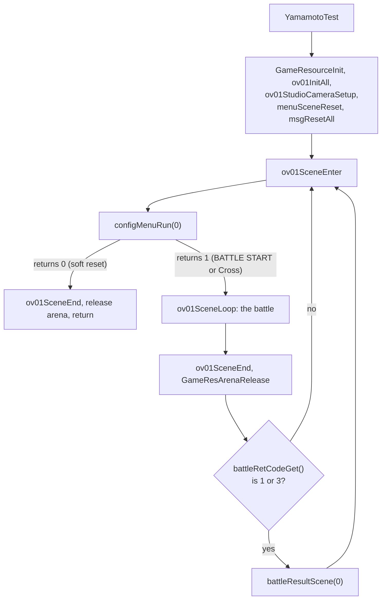

### BATTLE CONFIG

The menu in `src/ov01/debug_entry.c` has a main page and an equipment page.
`configMenuRun` draws on the same green background, and with mode 1 it first
copies the three current party members into the battle party list. Each frame
`configMenuFrame` runs the row handlers of the current page through
`configMenuUpdate` and prints the page.

The controls are the same everywhere. Up and Down (repeat) move the row
cursor and wrap around (`valUD`). Left and Right change the value of the row
by 1, L1 and R1 by 10, and values wrap between their limits (`valLR`). Circle
is the action button of rows that have one. Cross leaves the equipment page,
and on the main page it ends the menu just like BATTLE START. A `>` marks the
row, 10 units per row below the page title.

| Row | Text | Range | Effect |
| --- | --- | --- | --- |
| 0 | `BATTLE START` | Circle | ends the menu and starts the battle |
| 1 | `THINK= %3d` | 0 to 999 | number of the enemy AI script, stored with `thinkNoSet` and loaded with `dataThinkScriptLoad` when the menu ends |
| 2 | `MONSTER SET= %3d` | 0 to 999 | the enemy group, `cfMonsSetNoSet` |
| 3 to 5 | `PLAYER1=` to `PLAYER3= %s` | 0 to 15 | character of each party slot, shown by name |
| 6 to 8 | `PLAYER1 POS=` to `PLAYER3 POS= %2d` | 0 to 31 | start position of each slot |
| 9 | `PL MUTEKI= %1d` | 0 or 1 | "party invincible" |
| 10 | `EN MUTEKI= %1d` | 0 or 1 | "enemies invincible" |
| 11 | `PL ICHIGEKI= %1d` | 0 or 1 | "party kills in one hit" |
| 12 | `STOCK MUGEN= %1d` | 0 or 1 | "infinite stock" |
| 13 | `LEARN ALL= %1d` | 0 or 1 | learn everything when the menu ends |
| 14 | `TENT` | Circle | `battleSlotsRestoreAll()`, which refreshes HP and EP of the slots 1 to 15, like a rest in a tent |
| 15 | `CF FLAG= %4x` | 0 to `0xFFFF` | event value passed to `cfEventSet` |
| 16 | `CPU DISP= %1d` | 0 or 1 | calls `xglRenderCpUDispOn` or `xglRenderCpUDispOff` when the menu ends, which set a display flag of the renderer |
| 17 | `GATTAI= %2d` | 1 to `0x51` | number of the double attack, stored as `0x16000` plus the number |
| 18 | `MEMBER= %4x` | 0 to `0x3FF` | bit mask of the party members that are present |
| 19 | `EQUIP= %s` | 1 to 15 | chooses a unit, Circle opens its equipment page |

*Muteki* means "invincible", *ichigeki* "one blow", *mugen* "infinite" and
*gattai* "combination". The four cheat rows still edit their flags
(`configPlMutekiFlag` and the others), but the functions that report them,
`configPlMutekiGet`, `configEnMutekiGet`, `configPlIchigekiGet` and
`configStockMugenGet`, return the constant 0. The page prints those constants,
and no battle code reads the flags, so the three damage cheats do nothing in
this build. `configStockMugenApply`, which would copy the maximum stock count
into the stock of gauge 0, is guarded by the same constant and never runs.

LEARN ALL is the one cheat that is still complete. When the menu ends with the
flag set, `configLearnAllApply` marks skills 1 to 59 as learned for the
characters 1 to 10, sets the pair bits 1 to 16, raises the entries 1 to 40 of the
data box categories 1 and 2 by 99 each, and marks battle slot 2.

At the end the menu also copies the three chosen characters into the party
status block, so the battle starts with them.

The equipment page edits one unit. Circle moves a column marker across the
four fields of the first three rows.

| Row | Text | Range | Field |
| --- | --- | --- | --- |
| 0 | `EQUIP SKILL= %2d %2d %2d %2d` | 0 to 64 each | the four equipped skill codes of the unit |
| 1 | `LEARN SKILL= %2x %2x %2x %2x` | 0 to 255 each | the four bytes of a 32-bit mask of learned ether skills, read and written flag by flag |
| 2 | `ACC= %2d %2d %2d %2d` | 0 to 40 each | the four accessory ids |
| 3 | `CLOTH= %s` | `0x10001` to `0x10028` | the costume resource id, shown as a file name or `NULL` |
| 4 | `SUB PILOT= %s` | 0 to 10 | the second pilot linked to the unit |
| 5 | `LV UP = %2d` | base level to 99 | sets the level: `unitSetLevel` resets the unit to its base record and replays one growth step per level |
| 6 | `EQUIP= %s` | 1 to 15 | switches to another unit |

A third page, `configScriptPage` (`--SCRIPT CONFIG--`), has a single row
`SCRIPT= %4d` from 0 to 9999. On Circle or Cross it builds the path
`cf\scNNNN.sb`, reads the file into a 48 KB buffer, links it and starts it as
an SB script image (see [sb-vm.md](../scripting/sb-vm.md)). A link failure
hangs in an endless loop. Nothing calls this page.

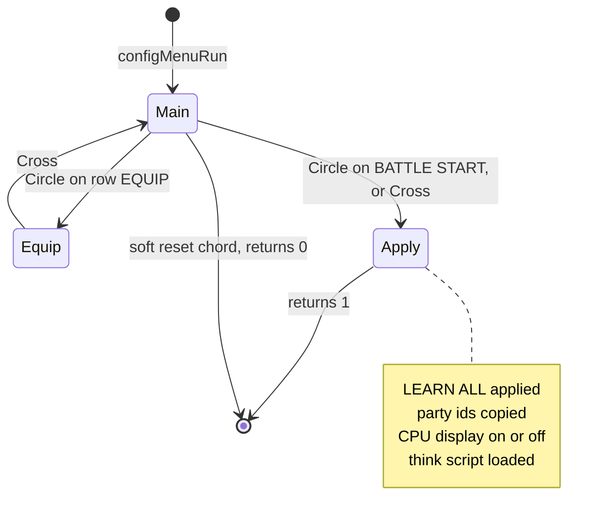

One function of the file is live in the release. `configInit` is part of
`ov01InitAll`: it resets the menu cursors, reads the current think number,
monster set and CF event value into the menu variables and calls `ptReset()`.

## 8. The heap viewer

`RgHeap` in `src/main/test_128.c` is a checked best-fit allocator with six
heaps. The game uses it for the matrices of every actor (heap 5) and for the
object library (heap 4), so the allocator itself is live. Its structure, the
64-byte block header with the allocating file name and line, and its error
checks are described in [memory.md](../architecture/memory.md#rgheap).

The debug side of the allocator has two parts. The first part is text. Every
block remembers who allocated it, and `RgHeapDump_sub` prints both lists of a
heap to the console:

```
---------------------------------
HEAD DUMP <heap> from <file> <line>
***** FREE MAP top <block> (comment <text>)
<block> : size = <hex>(<dec>) next:<block>
***** ALLOC MAP top <block> (comment <text>)
<block> : size = <hex>(<dec>) next:<block> allocated at <file>,<line>
```

The dump runs automatically when an allocation does not fit ("too big size
(%d) of allocation") and when a block is freed twice ("%p is already free at
%s,%d (MAYBE allocated at %s,%d !?)"). `RgHeapDumpById` and `RgHeapDumpBlock`
print one heap or one block header on request, and nothing calls them. A heap
assertion (`_Error`) prints `-------- Heap Assert`, the failed expression with
file and line, the heap dump, and then loops forever.

Each header is stamped with the first 15 characters of the text
`gAMe sHoW 2001.10.15`, which `RgHeapFree` checks to detect overwritten
headers. The date is from before the development of Episode II, so the
allocator was probably carried over from earlier work of the team.

The second part is a set of windows that draw the heaps on screen. They are
built on a window system (`testWindowCreate`, `testWindowAddRow`,
`testWindowDrawLine` and ten more functions) whose code is in overlay 98. The
main executable only holds the callers, so the windows cannot run.

| Window | Title | Position and size | Content |
| --- | --- | --- | --- |
| Overview (`heapOverviewWindowOpen`) | メモリ ("Memory") | (100, 100), 200 by 140 | one row per heap: メモリ０配置状況 to メモリ３配置状況 ("memory 0 to 3 layout"), システム配置状況 ("system layout", heap 4) and マトリクス配置状況 ("matrix layout", heap 5) |
| Heap map (`heapWindowCreate`) | the row title | (100, 80), 256 by 300 | a map of one heap |
| Allocation list (`heapWindowOpen`) | メモリ確保位置 ("memory allocation position") | (10, 120), 480 by 200 | one row per allocated block of heap 0 with the source file name and the line of its allocation |

The row templates of the overview carry the address of `heapWindowCreate`, and
a second table carries the allocation list title with `heapWindowOpen`, so
choosing a row of the overview most likely opened the matching window.
`heapOverviewMenuAttach` hands a third table to a parent window, with the
title メモリ and `heapOverviewWindowOpen`. That is how the heap viewer was
hooked into a menu of the tool overlay.

The heap map is painted by `heapWindowPaintMap`. A map cell stands for
`mapStride` bytes and a map row for `mapStride` cells, with 256 pixels per
row. The function first paints the whole arena in dark red (`0x80000080`), row
by row, with a shorter last row. It then walks the list of allocated blocks
and paints each one in dark yellow (`0x80008080`) from its first cell, row
after row, until its size is used up. Free memory therefore stays red.
`heapWindowMapStrideAdjust` zooms the map: Triangle doubles `mapStride` and
Square halves it, between 1 and `0x10000`. The initial value is `0x100`, so
one row shows 64 KB.

The allocation list has a refresh callback, `heapWindowRefresh`, that clears
the rows and builds them again from the live list.

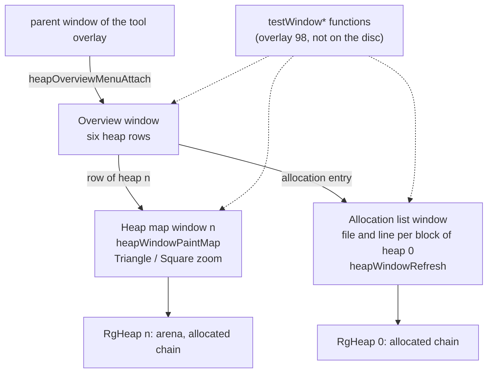

## 9. Debug drawers

### Stroke text of the model library

`src/main/pxy_debug_draw.c` holds a tiny vector font that needs no texture. It
belongs to the model library (see [pxy.md](../libraries/pxy.md)) and draws
through its GS register queue. Each glyph is a byte list: the advance width,
then pairs of x and y on a grid of about 5 by 8, with `0xFE` to lift the pen
and `0xFF` to end. Glyphs exist for the digits, upper and lower case letters,
and the characters `.`, `/`, `_`, `(` and `)`. A space advances 7 units and
any other character is skipped.

`pxyDebugDrawChar` writes a line strip into the direct queue: depth test
setup, the colour, and one `XYZF2` vertex per point at
`(point * scale + position + offset) * 16`. Its last argument chooses between
sending the queue at once and deferring it. `pxyDebugDrawString` draws a
string and returns its width, and `pxyDebugDrawStringShadow` draws it twice,
first in black one unit down and right. `pxyDebugPrintf(x, y, format, ...)`
formats into a 512-byte buffer and draws with the style set by
`pxyDebugSetTextStyle` (white, scale 1.0 and the far depth by default). The
profiler is the only user of this font, and `pxyDebugPrintf` has no caller.

### The profiler

`src/main/pxy_profile.c` measures named sections of a frame with EE timer 1.
It keeps 32 entries of 272 bytes: start count, accumulated ticks, an in-use
flag, a name of up to 127 characters and a formatted text line.

| Function | Behaviour |
| --- | --- |
| `pxyProfileBegin(name)` | Finds the in-use entry with that name or takes the first free one, then stores the current count of timer 1 (`0x10000800`) |
| `pxyProfileEnd(name)` | Adds the ticks since the start to the total, converts it to milliseconds and formats `"%s  %3.2f"` into the text line. Returns the milliseconds |
| `pxyProfileEndMs`, `pxyProfileGetMs`, `pxyProfileGetMsUnchecked` | Variants that return milliseconds without formatting. No caller |
| `pxyProfileDrawEntries()` | Draws the text line of every used entry with the shadowed stroke font at x 10, from y 100 in steps of 17, at scale 1.3 |
| `pxyProfileClearEntries()` | Frees all entries |

One tick is 0.00521738 ms, and the factor is doubled while
`pxyTickScaleDouble` is 1. The brackets are still in the live code. `Game()`
in `src/main/game_data.c` measures `DispMapObject`, `sefExecEffect`,
`XenoActorDoit` and `XenoActorDisp`, and `pxyFlush` in
`src/main/nml_model_set.c` measures itself under the name `pxyFlush`. At the
end of `pxyFlush` the entries are drawn when `pxyProfileDrawFlag` is not 0 and
then cleared. The flag starts as 0 and the only assignment in the source
stores 0, so the game measures five sections every frame and never shows them.

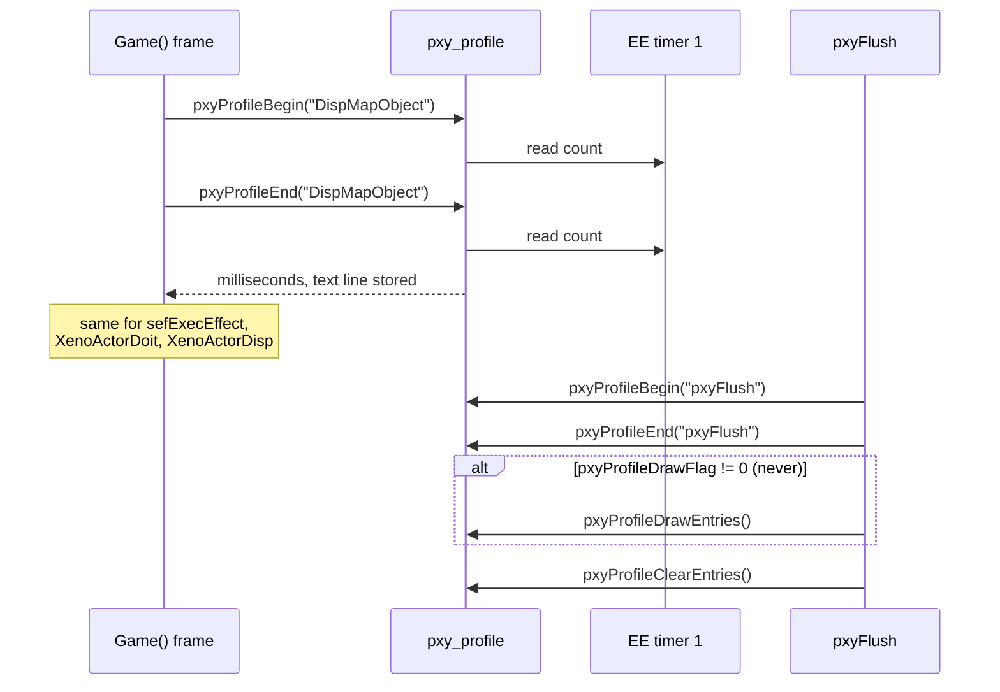

The file also contains `pxyKeyInterpolate` and `_CurMatrixMul33normXYZW`, two
VU0 math routines that have nothing to do with profiling.

### Map unit and enemy outlines

`src/main/pause_menu_page_uwamono.c` holds the debug outlines of the field.
*Uwamono* ("things on top") is the code name of the map units: doors, boxes,
enemies and other objects placed on a map (see
[map-and-units.md](map-and-units.md) and
[field-enemies.md](field-enemies.md)). The live field code still calls most of
these functions every frame. They do nothing for two reasons. The global
`uwamonoDrawDisabled` in `src/main/control_entry.c` starts as 1 and no code
changes it. And where a function would finally draw, the drawing is gone:
`uwamonoDrawLine` is an empty function, and the other functions compute their
points and colours and then drop them.

| Function | Shape it computed | Called from |
| --- | --- | --- |
| `DispCollUwamono` | For every active record with a search mode: the eight corners of its collision box in blue and red, or a pillar for a round one | `src/main/game_map_object.c` |
| `DispPillar` | A circle around a point, walked in 17 segments of 22.5 degrees, with a raised copy when a height is given | map objects, enemy home areas, event checks |
| `uwamonoDrawPointPath` | The polyline through the route points of an enemy, lifted 0.2 above the ground, red | `src/main/enemy_1.c` |
| `uwamonoDrawStateLinks` | The links between the route nodes of an enemy, magenta | `src/main/enemy_1.c` |
| `uwamonoDrawFanEdge` | One edge of the sight fan of an enemy: a point at an angle and a distance | `src/main/enemy_1.c`, called for both edges |
| `uwamonoDrawPursuitDebug` | Only a colour and an empty loop remain | `src/main/enemy_1.c` |
| `uwamonoDrawLadder` | A ladder: its top, its facing and the exit points of each rung to the left and right (angle 2.18 rad, radius 0.87) | no caller |
| `uwamonoDrawSegmentBox` | The eight corners of a box between two points | `src/main/uwamono_event_check.c` |
| `uwamonoDrawPointAxes` | Three short axes (0.5 long) at a point in red, green and blue | `src/main/game_map_object.c` |
| `uwamonoDrawLine` | A line between two points with a colour id (empty) | 15 call sites, most in `src/main/uwamono_record.c` |
| `uwamonoProjectToScreen` | Projects a world point through the active camera to debug text coordinates, for labels | no caller |

### Skeleton and collision drawing

`src/main/TiDrawJoint.c` and `src/main/TiDrawCollision.c` belong to the `Ti`
animation library (see [animation.md](../libraries/animation.md)). They draw
the skeleton of an actor and the collision spheres of its hair and cloth
simulation as coloured lines.

All lines go through three steps. `tiDrawJointTransformPoints` moves local
points by a matrix. `tiDrawJointScreenPoints` projects them with the view
matrix and screen of the active camera. `tiDrawJointPackPoints` builds one GIF
packet in the scratchpad at `0x70000000` with the registers RGBAQ, ST and XYZ2
per vertex and a line primitive, and adds it to the current VIF1 packet. If
any point is off screen or behind the camera, the whole batch is dropped.

`tiDrawJointDrawLists(actor, globalMatrices, currentMatrix)` walks the
hierarchy data of the actor: the main joints, two further joint lists, the
skip list, the dynamics joints and the static transforms. For every joint with
a parent it turns a 16-point bone shape so that it points along the default
translation of the joint, stretches it to the bone length and draws it at the
parent. Normal bones are blue-grey (`0x60, 0x60, 0xAA`) and the selected joint
is lighter. Dynamics joints are red-brown and the selected one orange. When
the axis length value is not 0, `tiDrawJointDrawAxes` also draws the X, Y and
Z axes of every joint in red, green and blue. The bone width and the axis
length come from two values at an address inside the overlay area, so they
were set by a tool that is not in the release. After drawing, the two
selection indices of the actor are reset to -1.

`tiDrawCollisionDrawObjectRing(position, colour, radius)` draws a ring of 24
segments that faces the camera: `tiDrawCollisionBuildRing` rotates a circle by
the camera angles, and the ring is then moved to the position.

The actor code in `src/main/xenoActor.c` (see
[actors.md](../libraries/actors.md)) calls the skeleton drawer when bit 2 of
`XenoActor.attr` is set, and with bit 4 it also draws one ring per collision
item, light green for the active item and darker green for the others. The
actor pool sets `attr` to 1 and nothing sets the other bits. A third hook,
`XenoActorSetFocusTarget`, draws axes of length 1.5 at the look-at target when
actor flag `0x100` is set. No code that sets this flag was found.

### Battle effect path markers

`src/ov01/m_ef_path.c` mixes live and dead code of the `MEf` battle
effects (see [battle-effects.md](battle-effects.md)). The Hermite path helpers
`MEfHermitePathInit`, `MMathCalcHermiteKeyPrm` and `MMathCalcHermiteKey` are
used by nine effect files. The three drawers add primitives to an effect
packet with additive blending:

| Function | Draws | Caller |
| --- | --- | --- |
| `MEfDrawFrameAxes(packet, matrix)` | The three axes of a frame as lines from -0.4 to 1.2, in yellow, magenta and cyan | none |
| `MEfDrawPointCross(packet, point)` | A green cross of three lines, 0.25 long in each direction | none |
| `MEfDrawPathEndMarker(packet, point, scale)` | Four blue triangles around a point that face the camera and turn once every 60 ticks | `src/ov01/m_ef_thunder31.c` |

The axes and the cross were most likely used to check the control points of
effect paths. The marker is part of a shipped effect.

## 10. Host tools

### Files on the development PC

During development the console read files from a PC through the `host0:`
device. The paths that remain all start in the home folder of a user named
`xeno`:

| Path | Used by |
| --- | --- |
| `host0:/home/xeno/vcd-f/x2/` | base path of the file system when it runs from the host (`src/main/xgl_cd.c`) |
| `host0:/home/xeno/vcd-f/x2/sound/vsf/`, `smf/`, `adx/` | `SoundTest`: `_list.txt` and `<name>.prj` |
| `host0:/home/xeno/vcd-f/x2u/movie/sfd.lst` | `MovieListTest` |
| `host0:/home/xeno/vcd/x2/cf/` | script loading (`src/main/script_load.c`) |
| `host0:/home/xeno/work/` | effect resources in host mode (`src/main/srs.c`) |
| `host0:/home/xeno/work/iwase/` | models of the glow and water tests |
| `host0:/home/xeno/work/snap/game0000.jpg` | snapshots |
| `host1:/home/xeno/vcd-f/conf/iconjp/` | icon files passed to the network configuration module |

The folder names suggest that `vcd` and `vcd-f` were images of the disc
content, and `work` the private working area of each programmer. How the file
system chooses between disc, HDD and host is described in
[files-and-resources.md](../architecture/files-and-resources.md).

`src/main/xgl_debug_file.c` was the simple interface to such files:
`xglDebFileSize(name)`, `xglDebFileRead(name, buffer)` and
`xglDebFileWrite(name, buffer, size)`. In the release each one prints a
warning such as `Don't use xglDebFileSize()`, executes a debugger trap and
returns -1. Their callers remain: `testLoadFile`, the debug and USB load modes
of the effect resource loader in `src/main/srs.c`, and the temporary file
functions of the cutscene tool code in `src/main/cfeFileControl.c`.

### The network file client

`src/main/lan_usb.c` is a client for a file server on the development PC,
reached over the network instead of the debug cable. None of its functions is
called in the release.

`UsbInit(statusHandler, device)` starts the network once. It reserves `0x8010`
bytes at the end of the work area and loads the IOP modules `inet`, `netcnf`,
`inetctl`, then `usbd` and `an986` for device 0 (a USB Ethernet adapter) or
`smap` for device 1 (the network adapter of the console), then `msifrpc` and
`libnet`. The connection settings come from a memory card file:
`mc0:/BISLPS-00000DebugSta/net000.cnf` for USB and `net001.cnf` for the
adapter. It waits for an address, prints `My address: %s` and stores the
device number plus 1 as the init state. `UsbSetHost(name, port)` stores the
server name (up to 15 characters) and port. `UsbGetHost`, `UsbGetInitState`
and `UsbGetLocalAddress` report the settings.

Every request opens its own TCP connection with `LanOpen`: resolve the host
name, create the connection, open it with a timeout of 5 seconds. Then the
client sends a verb, the path with its terminating zero and the data, and
closes with the verb `CLOSE`. Data moves in chunks of at most `0x4000` bytes.

| Function | Verb | Exchange after the path |
| --- | --- | --- |
| `UsbGetFileSize(path)` | `SIZE ` | receives a 4-byte size |
| `UsbReadFile(path, buffer)` | `GET ` | receives the size, then the whole file |
| `UsbWrite(path, buffer, size)` | `PUT ` | sends the size, then the data |
| `UsbSend(path, buffer, size)` | `SEND ` | same exchange as `PUT ` |
| `UsbRecv(path, buffer, max)` | `RECV ` | receives the size, then at most `max` bytes, and reads and drops the rest |

While a status handler is set, `LanReportStatus` prints the current step
(`LanOpen:search`, `LanOpen:connect`, `UsbRead:request`, a byte counter during
transfers) with the debug font and calls the handler, which probably drew a
frame so that the tester saw progress.

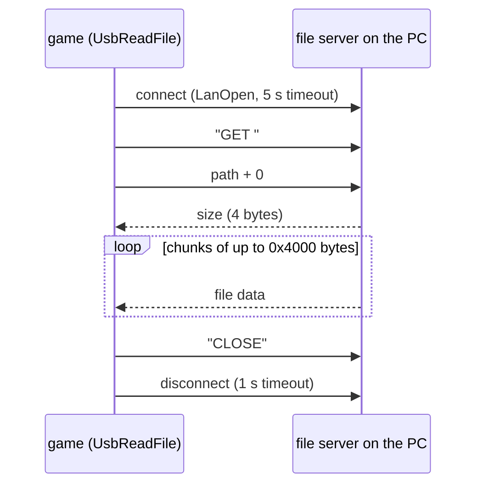

### Snapshots

`src/main/game_snap_shot.c` turns the displayed frame into a JPEG with the
encoder of `xglJpeg`. The file name is the string `snapname`,
`host0:/home/xeno/work/snap/game0000.jpg`, and two pointers into it address
the four digits and the extension.

`GameSnapShotWriteJpeg(path, quality)` encodes the 512 by 448 frame that the
draw environment points to into a buffer at the end of the work area and
writes it to the path. A quality from 0 to 100 is used for brightness and
colour alike. A negative quality selects a row of `quality_table`: -1 to -5
give 100, 90, 75, 50 and 30. It logs `*** SnapShot:<path>,<buffer> ***` and
the three encoder settings.

`GameSnapShotExecute(quality, flags)` writes the picture and, with bit 0 of
the flags, a second file with the extension `bin` that holds 160 bytes of
metadata: the clock time, the play time and the current map resource id. It
then counts the file number up. `GameSnapShotNumber(n)` sets the first digit,
so that several testers or sessions could use separate ranges.

`GameSnapShotSave(quality, output)` builds a richer file in memory. It first
shrinks the frame to 128 by 112 by drawing it as a sprite into a spare page of
video memory (`GameSnapShotSaveThumbnail`), and stores the metadata and the
small picture in an application segment in front of the full picture:

```
FF D8            start of image
FF EE len        APP14 segment, length = 4 + 160 + thumbnail size
  [160 bytes]    metadata: clock, play time, map resource id
  [thumbnail]    128 x 112 JPEG, quality 50
[full picture]   512 x 448 JPEG as its own stream
```

`GameSnapShotSaveFile(number, data, size)` writes such a buffer to the
numbered host file. None of these functions has a caller. The hook that
triggered them, `GameSnapShotCheck`, is empty. It is still called once per
frame by the pause code (`pauseStart`), by the battle loop (`ov01SceneLoop`),
by `FontTest` and by `choiceMenuTest`, which shows where a tester could take
pictures: in the paused field, in battle and in the UI tests.

## 11. Assertions, traps and the soft reset

### Assertions

The release keeps its assertions. `assertFailed(message, file, line)` in
`src/main/assert_fail.c` prints

```
_-_-_-_-_-_-_-_-_-_-_-_-_-_-_-_-_-_-_-_-_-_-_-_-_-_-_-_-_

ASSERTION <file, line> :: message

_-_-_-_-_-_-_-_-_-_-_-_-_-_-_-_-_-_-_-_-_-_-_-_-_-_-_-_-_
```

and calls `assertExit`, which prints `> Exit Program` and executes a `break`
instruction. On a development kit the debugger stops there. Execution then
continues behind the trap, so an assertion does not end the program by itself.
The source holds 227 calls of `assertFailed` in 27 files, almost all in the
animation library, the actor code and the cutscene player. The message is the
text of the failed C expression, for example `pLandscape->rsrc[XAct_Rsrc_MDL]`.

`errorFatal(format, ...)` prints `> Error!!` and a formatted message before
the same exit path. Nothing calls it. Eight further places use a bare trap
without a message, for example when `Game()` finds no player record after a
map load and prints `player lost`. The heap has its own handler, `_Error`,
which never returns (section 8).

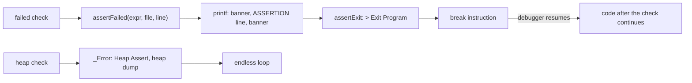

### The soft reset chord

The one debug feature that a player can use is the reset chord. The main loop
of `Game()` in `src/main/game_data.c` tests it first thing every frame:

```c
if ((PadData[0].heldAndPressed & 0x0800010F) == 0x0800010F) {
    gameWork.control |= 0x10000000;
    break;
}
```

The low half of `heldAndPressed` holds the held buttons and the high half the
pressed ones. `0x010F` is L2, R2, L1, R1 and SELECT, and `0x0800` is START.
The control bit `0x10000000` makes `Game()` leave all its loops, clean up and
return, and `main()` shows the title screen again. In battle
`ov01SoftResetPressed` in `src/ov01/scene.c` tests the same buttons, and the
battle loop and the configuration menu both honour it. The play session is
described in [field.md](field.md).

The test programs use a shorter chord of their own, SELECT held with START
pressed, as the way out of every page.

## 12. What the leftovers reveal

### Programmers and their folders

The test programs and the data folders carry surnames in Kunrei-style
romanization (`si`, `tu` where Hepburn writes `shi`, `tsu`). The game still
loads its data from these folders, so the working layout of the team went onto
the disc unchanged. The counts are path strings in the source.

| Name in the code | Probably | Evidence | What the folder holds |
| --- | --- | --- | --- |
| `yajima` | Yajima | `YajimaTest`, 28 paths | title and game over pictures, memory card icons, synopsis, test movie, kanji check text |
| `yosikawa` | Yoshikawa | `YosikawaTest`, title 芳川テスト, 14 paths | menu textures and models, `battle01.xtx`, texture lists |
| `yamamoto` | Yamamoto | `YamamotoTest`, 6 paths | battle data: `batdat`, think scripts, maps, motions |
| `matumoto` | Matsumoto | 54 paths | field objects: item, treasure, trap and save point models, `spline.dat`, `enemyorder.dat`, `treasurebox.dat`, `kowaremono.dat` |
| `iwase` | Iwase | 11 paths, host folder of the glow and water tests | quest texts and pictures, test models |
| `omiya` | Omiya | 2 paths | talk window textures |
| `ytachi`, `itai` | unknown | `YtachiTest`, `ItaiTest` | no folder in the code |

The files tell who owned what. Yajima's tests cover system services: fonts,
pads, memory cards, resources, movies and sound. Yoshikawa's test covers menus
and windows, Yamamoto's the battle system. The `Ti` file prefix of the
animation library and the `iwase` test scenes point to one more author.

### Original source file names

Assertions pass the name of their source file. Every such name ends in
`.euc.c`, so the sources were C files with Japanese comments in the EUC-JP
encoding, and most were compiled from a build folder one level below them
(`../`). The table lists all names found in strings.

| Original name | Now in | Subject |
| --- | --- | --- |
| `../cfeEvaluate.euc.c` | `src/main/cfeEvaluate.c` | cutscene expression evaluation |
| `../cfeFileControl.euc.c` | `src/main/cfeFileControl.c` | cutscene file handling |
| `../cfePlugIn.euc.c` | `src/main/cfePlugIn.c` | cutscene commands (26 references) |
| `../elevator.euc.c` | `src/main/elevator.c` | elevators |
| `../gifState.euc.c` | `src/main/gifState.c` | screen effects |
| `../glow.euc.c` | `src/main/glow.c` | glow test scene |
| `../oLib.euc.c` | `src/main/oLib.c` | object library |
| `../test.euc.c` | `src/main/test_128.c`, `src/main/test_129.c` | heap, heap windows, test menu, test loader |
| `../TiCameraSolver.euc.c` | `src/main/TiCameraSolver.c` | camera solver |
| `../TiDrawCollision.euc.c` | `src/main/TiDrawCollision.c` | collision rings |
| `../TiDrawJoint.euc.c` | `src/main/TiDrawJoint.c` | skeleton drawing |
| `../TiDynamicsColl.euc.c` | `src/main/TiDynamicsColl.c` | dynamics collision |
| `../TiGlobalColl.euc.c` | `src/main/TiGlobalColl.c` | global collision |
| `../TiMotionSolver.euc.c` | `src/main/TiMotionSolver.c` | motion solver |
| `../TiMRPackage.euc.c` | `src/main/TiMRPackage.c` | motion resource package |
| `../TiMtnBlend.euc.c` | `src/main/TiMtnBlend.c` | motion blending |
| `../TiPartsAnim.euc.c` | `src/main/TiPartsAnim.c` | parts animation |
| `../TiVu0.euc.c` | `src/main/TiVu0.c` | VU0 helpers |
| `../TiWater.euc.c` | `src/main/TiWater.c` | water and the water test |
| `../TiWatSim.euc.c` | `src/main/TiWatSim.c` | water simulation |
| `../TiWindAnim.euc.c` | `src/main/TiWindAnim.c` | wind animation |
| `../TiWindBase.euc.c` | `src/main/TiWindBase.c` | wind base |
| `../TiXacAnimCurve.euc.c` | `src/main/TiXacAnimCurve.c` | animation curves |
| `xenoActor.euc.c` | `src/main/xenoActor.c` | actors (no folder prefix) |
| `../yg2path.euc.c` | `src/main/yg2path.c` | G.S. Campaign paths |
| `../ysegf.euc.c` | `src/main/ysegf.c` | segment address flags |

The name `test.euc.c` covers both the heap with its windows and the test
menu, with line numbers from 95 (`testLoadFile`) to 800 (`heapWindowCreate`).
One original file was therefore the common support file of the test overlay:
the loader, the heap and the hooks into the window system.

### Other traces

Japanese releases use product codes that start with `SLPS`. The test saves
use the placeholder codes `BISLPS-99999` (dummy data) and `BISLPS-00000`
(network settings of a debug station), which shows that these tools were
written for the Japanese version and kept through localisation. The movie
list in `x2u` is the one visible adjustment for the North American version.

All menu labels of the tests that the programmers wrote for themselves are
Japanese or short English keywords, and the kanji check and the half-width
glyph table of the font test deal only with Japanese text. The shipped game
uses a language code for its script files (`cf\xx\`), so the tools predate the
language handling as well.

The test programs follow one method. Each programmer had an entry that started
straight from the title screen, set up only the systems needed and tested one
feature in a loop: a font, a pad, a card, a movie, a window, a battle. The
battle test bench with its think number, monster set and cheats let designers
tune enemies without playing the story, and the heap windows and the profiler
watched memory and time while they did so.
