# Field enemies and NPCs

In Xenosaga Episode II the enemies are visible on the map. They stand still,
wander inside a circle, walk a route, notice the player by sight or by the
sound of running, give chase and start a battle when they touch the player.
A trap that explodes next to them stuns them, and a battle that starts during
the stun gives the party a bonus. No random encounter code exists in the
field: every battle starts from contact with a visible enemy or from a
script.

The same code drives the people the player talks to. The scripts call the
two groups together "enepc", which joins "enemy" and "NPC". An enemy and a
person are the same kind of record with the same behaviour block, and only
the resource id of the model and the parameters the script writes decide
what the character does.

The battle itself runs in the OV01 overlay and is described in
[Battle](battle.md). The map, the collision mesh, the traps and the other
objects that enemies meet are described in
[Map and units](map-and-units.md). The field loop that leaves for the battle
and comes back is described in [The field game](field.md). Actors, motions
and modes are described in [Actors](../libraries/actors.md) and
[Animation](../libraries/animation.md).

[← Back to the overview](../README.md)

## Source files

| File | Contents |
| --- | --- |
| `src/main/enemy_1.c` | `Enemy_Init`, the behaviour functions of every action (`Enemy_Pause`, `Enemy_Threat`, `Enemy_Route`, `Enemy_Found`, `Enemy_Chase`, `Enemy_Stiff`, `Enemy_Unique`, `Enemy_Damage_Explosion`, `Enemy_Escape`, `Enemy_Route_Chase`), the per-frame update `ACT_updateEnemy`, the step function `uwamonoMoveAlongHeading`, `TM_Check_Before_Eyes`, `uwamonoSetMotion` and `Enemy_ActionReady` |
| `src/main/enemy_system_init.c` | `uwamonoClampToStopRange` (keeps an enemy inside its area), `TM_Script_Spline_Add` (appends a point to the walking trail) and `uwamonoReleaseChildren` (removes a beaten enemy and its companions) |
| `src/main/set_motion.c` | `Enemy_After_Battle`, `Check_Actor`, `Check_EnemyFound`, hearing (`Enemy_FindByEar`), `Check_Discovery`, the encounter request `Check_Encount`, `Set_Spline_By_Route`, the way home (`Homing_Search`, `Homing_Add`), `Get_MostNear_Actor` and the look-at functions `Actor_LookAt*` |
| `src/main/get.c` | Geometry helpers that the enemy code shares with the player and the map units: angles and distances, the sight fan `Check_InsideFan`, the map sweep `Check_Undu`, `Check_MoveSquare`, `Check_Straight_ID`, the B-spline `GetBSplineLoop`, random numbers |
| `src/main/runtime_enepc.c` | The natives `enepc.setParams`, `enepc.setParamsAll` and `enepc.motion`, the shared setter `enepcStoreParams`, and the table of the `runtime` script module |
| `src/main/runtime_enepc.c` | The other `enepc` natives: face motion, extra motion, look-at, encounter, giving up a chase, groups, battle bits, sounds, default motions, companions, the behaviour kind, the preset table and draw flags |
| `src/main/runtime_uwamono_door.c` | `enepcRegisterNatives` and the table `enepcNativeTable` of the `enepc` module (the rest of the file belongs to [Map and units](map-and-units.md)) |
| `include/main/ytachi_test.h` | `UwamonoRecord`, `UwamonoState`, `UwamonoBody`, the record kinds, the action numbers, `UwamonoKeyRow` |
| `include/main/enemy_1.h`, `set_motion.h`, `enemy_system_init.h`, `get.h`, `runtime_enepc.h`, `runtime_enepc.h`, `runtime_uwamono_door.h` | Prototypes of the files above |

Code in other files takes part too. `uwamonoCreateRecord` in
`src/main/uwamono_objx.c` creates the record, `DispMapObject` in
`src/main/game_map_object.c` calls the update, `uwamonoPlayerUpdate` in
`src/main/game_camera.c` produces the sound and the talk, `Game()` in
`src/main/game_data.c` runs the battle, and `uwamonoUpdatePoints` in
`src/main/uwamono_record.c` stuns enemies near an explosion. The sections
below say where each one comes in.

## Enemies, NPCs and the player

Every object of a map is a map unit record, one of the 256 entries of
`uwamonoRecords[]` (`UwamonoRecord`, `0x870` bytes). The name "uwamono" means
"thing on top" in Japanese, the things that stand on the map. The record and
its many kinds are the subject of [Map and units](map-and-units.md). Three
kinds own an actor, a model that is animated and drawn through the actor
pool (see [Actors](../libraries/actors.md)).

| Kind | Name | Meaning |
| --- | --- | --- |
| 1 | `MAP_KIND_ACTOR` | A character that acts on its own: an enemy or an NPC. Only this kind is updated by `ACT_updateEnemy` |
| 4 | `MAP_KIND_ACTOR_STATIC` | The player character. It has an actor and a behaviour block, and its own update `uwamonoPlayerUpdate` |
| 5 | `MAP_KIND_PART` | A part attached to the player. It has an actor and no behaviour block |

A character of kind 1 or 4 is made of three pieces of data.

- The **record** `uwamonoRecords[n]` holds the position, the rotation, the
  size (`extent`), the flags and the script key (`id`).
- The **actor** `record->body.actor` (`XenoActor`) holds the model, the
  motion, the facing the character wants (`direction.y`) and the enemy bits
  `enemyFlags`.
- The **behaviour block** `record->body.motions` (`UwamonoState`, `0x40C0`
  bytes, one of the 32 entries of `uwamonoStates[]`) holds the parameters,
  the current action, the timers, the routes and the group data.

The pair of pointers sits at offset `+0x330` of the record as `UwamonoBody`.
The enemy code addresses a character by its record index and reads both
pointers from there.

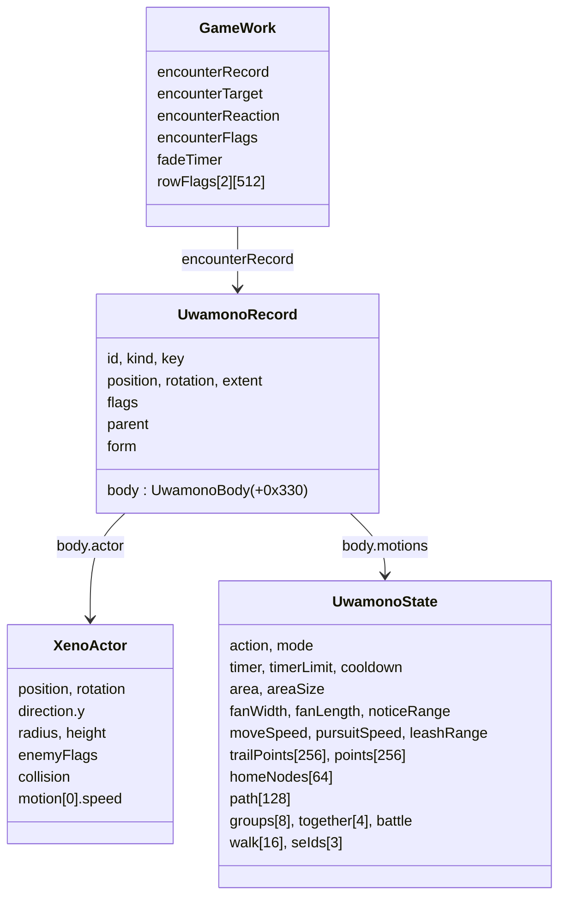

The resource id of the model tells the groups apart. `uwamonoCreateRecord`
stores it in `record->key` and in `actor->kind`.

| Id range | Meaning in the code |
| --- | --- |
| `0x10000` to `0x13FFF` | Characters of human size. `record->form` becomes 1.0 |
| `0x10000` to `0x17FFF` | Characters the player can talk to with CIRCLE (`uwamonoPlayerUpdate`) |
| `0x18000` to `0x1901E` | Enemies. `Enemy_Init` sets bit 1 of `state->flags` for them, and only they start a battle on contact |
| up to `0x6FFFF` | The body gets radius 0.6 and height 1.8 at creation. Higher ids get radius 0 |

`record->form` is 1.0 or 5.0 and is used as the scale of a character. The
player's value decides the height tolerance of a contact, the size of the
stun effect and one bit of the battle request. The comment in the header
names 1.0 the form of an E.S. The numbers in the code read the other way:
the form 1.0 has a body radius of 0.64 and a talk reach of 1.5, the form 5.0
has a body radius of 4.0 and a talk reach of 7.5, and the contact height is
`form * 1.7`. This page therefore treats 1.0 as the party on foot and 5.0 as
the party in an E.S. That is a likely reading, not a certainty.

The current player record is `uwamonoRecords[uwamonoCurrentIndex]`. Enemies
aim at it by index, so every "player position" below is the position of that
record or of its actor.

## The behaviour block

`UwamonoState` in `include/main/ytachi_test.h` holds everything a character
needs while it acts. `uwamonoResetRecords` in `src/main/ytachi_test.c` clears
all 32 blocks when a map starts. The fields that the enemy code uses are:

| Offset | Type | Field | Meaning |
| --- | --- | --- | --- |
| `+0x0000` | `int` | `owner` | Record index that uses the block, -1 when free |
| `+0x0008` | `int` | `row` | Row of the enemy in `enemyorder.dat`, -1 when the enemy was created without one |
| `+0x000C` | `s8` | `action` | Current action, see [The actions](#the-actions) |
| `+0x000E` | `s16` | `focusIndex` | Record the enemy chases, set on discovery to the player |
| `+0x0010` | `Vector4` | `target` | Point the current step walks to |
| `+0x0020` | `Vector4` | `area` | Centre of the circle the character keeps to |
| `+0x0030` | `float` | `areaSize` | Radius of that circle |
| `+0x0034` | `float` | `wanderStep` | Longest step of the random walk |
| `+0x0038` | `float` | `leashRange` | Distance to the player at which a chase is given up |
| `+0x003C` | `float` | `moveSpeed` | Step per frame while walking |
| `+0x0040` | `float` | `pursuitSpeed` | Base step per frame while chasing |
| `+0x0044` | `float` | `fanWidth` | Opening angle of the sight fan, in radians |
| `+0x0048` | `float` | `fanLength` | Length of the sight fan, 0 for a blind character |
| `+0x004C` | `float` | `noticeRange` | Hearing distance, 0 for a deaf character |
| `+0x0050` | `u16` | `pauseTime` | Frames of a pause |
| `+0x0052` | `s16` | `pauseCycle` | Pause cycle: one pause in this many walking steps |
| `+0x0054` | `u16` | `threatTime` | Frames of a threat pose |
| `+0x0056` | `s16` | `threatCycle` | Threat cycle: one threat in this many walking steps |
| `+0x0058` | `s16` | `trailStep` | Cursor on the trail, in spline steps |
| `+0x005A` | `u16` | `timer` | Frames since the action started |
| `+0x005C` | `s16` | `timerLimit` | Length of the action in frames |
| `+0x005E` | `s8` | `alert` | Set to 99 at the start of every update |
| `+0x005F` | `u8` | `mode` | Behaviour kind, see [Behaviour kinds](#behaviour-kinds) |
| `+0x0060` | `u16` | `stunTime` | Frames left of a stun |
| `+0x0062` | `s8[2][8]` | `pickRow` | The marked step of the pause cycle and of the threat cycle |
| `+0x0072` | `s16[2]` | `pickIndex` | Position in each cycle |
| `+0x0076` | `u8` | `reactionKind` | Contact class of the last encounter, 0 to 4 |
| `+0x0077` | `u8` | `reactionFlags` | Bit 1 is set while the enemy is stunned by an explosion |
| `+0x007C` | `int` | `id` | Map collision block the character is tested against |
| `+0x0080` | `s16` | `groundId` | Entry of map block `0x100` for the ground, set by `objx.changeId` |
| `+0x0082` | `s16` | `footId` | Entry of map block `0x700` for the footstep sound, set by `objx.footId` |
| `+0x0090` | `Vector4[256]` | `trailPoints` | The trail the character walks at the moment |
| `+0x1090` | `s16` | `trailCount` | Number of trail points |
| `+0x10A0` | `Vector4[256]` | `points` | The route given by the script |
| `+0x20A0` | `s16[256][4]` | `actionMotions` | Per route point, up to four motions of a unique action, -1 for none |
| `+0x28A0` | `s16[256][4]` | `actionLengths` | Length in frames of each of those motions |
| `+0x30A0` | `s16` | `routeIndex` | Trail point the character walks to |
| `+0x30A2` | `s16` | `routePrev` | Previous value, used by the fleeing action |
| `+0x30A4` | `s16` | `motionCol` | Column of the unique action table |
| `+0x30A6` | `s16` | `pointCount` | Number of route points |
| `+0x30B0` | `Vector4[64]` | `homeNodes` | Nodes of the way-home graph |
| `+0x34B0` | `s16[64][4]` | `routeLinks` | Up to four linked nodes per node |
| `+0x36B0` | `s16[64]` | `routeLinkCounts` | Number of links per node |
| `+0x3730` | `s16[64]` | `routeParents` | Parent node given by the script |
| `+0x37B0` | `s16` | `routeNodeCount` | Number of nodes |
| `+0x37C0` | `Vector4[128]` | `path` | Ring of breadcrumbs for a character that follows another |
| `+0x3FC0` | `s16` | `pathStep`, `pathTail` | Head and tail of the ring |
| `+0x3FE0` | `Vector4` | `probe` | Point the spline action stays close to |
| `+0x3FF0` | `int` | `flags` | Bit 1 enemy, bit 4 set by `setParamsAll`, bit `0x10` read by the threat action |
| `+0x4000` | `Vector4` | `chaseTarget` | Point a chase steers to |
| `+0x4010` | `int[3]` | `seIds` | Three voice numbers for the moment of discovery, -1 for none |
| `+0x401E` | `s16` | `noticeCooldown` | Frames during which the character cannot notice the player |
| `+0x4020` | `int` | `scanState` | Result of `TM_Check_Before_Eyes`: 0 a character ahead, 64 no ground ahead, 99 free |
| `+0x4024` | `int` | `targetRecord` | Record that `TM_Check_Before_Eyes` found ahead |
| `+0x4028` | `s16` | `targetPriority` | Priority of the held look-at target |
| `+0x402A` | `s16` | `targetSlot` | Record looked at, -1 when a point is looked at |
| `+0x4030` | `Vector4` | `targetVector` | Point looked at |
| `+0x4042` | `s16[8]` | `setNumbers` | Monster set numbers of the enemy |
| `+0x4054` | `int[4]` | `together` | Record indices of the companions |
| `+0x4064` | `s16` | `cfEventBits` | Extra battle event bits |
| `+0x4068` | `void *` | `effect` | Stun effect |
| `+0x4074` | `int` | `resourceId` | Resource id of the extra motion set |
| `+0x4078` | `int[16]` | `walk` | The standard motions |

The actor carries four bits for the enemy code in `enemyFlags`
(`include/main/xenoActor.h`).

| Bit | Meaning |
| --- | --- |
| `0x80000000` | The character walks home along a trail built by `Homing_Search` |
| `0x01000000` | Cleared when a stun starts and when it ends |
| `0x00800000` | Cleared when the explosion reaction ends |
| `0x00400000` | The character has noticed the player. A standing character with this bit turns to the player |
| `0x00200000` | Set when a chase starts |

Some bits of `record->flags` change how the update treats a character.

| Bit | Meaning for the enemy code |
| --- | --- |
| `0x2` | The record is shown |
| `0x400` | The character turns to `direction.y` while it is frozen |
| `0x8000` | A chase is given up as soon as a step is blocked |
| `0x400000` | Frozen for a talk. Set together with `0x400` by `mapObjectFaceActive` |
| `0x800000` | Frozen with the motion stopped. Such a character is also deaf |
| `0x1000000` | The record can be looked at by the player (`Get_MostNear_Actor`) |
| `0x2000000` | The record is switched off: no update, no sight, no collision with other characters |

## Data files

The enemy code reads two files of the map unit resources. Both are loaded by
`mapObjectResourcesLoad` in `src/main/game_camera.c` together with the
models of the map units, and the names are in `src/main/game_data.c`. The
byte layouts are described in
[Maps and field data](../formats/maps-and-field-data.md).

| File | Pointer | Use |
| --- | --- | --- |
| `matumoto\spline.dat` | `DataSpline` | Weight table of the B-spline that `GetBSplineLoop` evaluates |
| `matumoto\enemyorder.dat` | `uwamonoKeyRowTable` | One row per placed enemy: which model it uses, which monster sets it can start and whether it comes back after it was beaten |

A row of `enemyorder.dat` is a `UwamonoKeyRow` of 16 bytes. The table is
searched over 512 rows. The shipped file uses 233 of them, with keys from 101
to 1301 in thirteen groups by hundreds (see
[Maps and field data](../formats/maps-and-field-data.md)).

| Offset | Type | Field | Meaning |
| --- | --- | --- | --- |
| `+0x0` | `s16` | `key` | Number the script passes when it creates the enemy |
| `+0x2` | `u8` | `gateIfClear` | Not 0: the enemy appears again after it was beaten, while control bit `0x800` is clear |
| `+0x3` | `u8` | `gateIfSet` | The same while control bit `0x800` is set |
| `+0x4` | `int` | `value` | Resource id of the enemy model |
| `+0x8` | `u8[8]` | `bytes` | Eight monster set numbers, copied to `state->groups` |

A third table comes from the script. `enepc.readyEnepcData(resource id)`
loads a resource with `GameResLoadID`, repeating the call until it is
loaded, and stores the address in `enepcParamSets`. It is a table of presets
(`EnepcParamSet`, `0x30` bytes each), so that many characters of one type
share one set of values. `enepc.setParams` picks a preset by number. The
pointer is cleared when the map units are reset. The resource is a `.ene`
file in `cf\`. The discs hold four of them with 65 records each, and the
scripts load only two: `enemy_001.ene` in 79 scripts and `npc_001.ene` in 2.

| Offset | Type | Field | Stored in |
| --- | --- | --- | --- |
| `+0x00` | `float` | `height` | `record->extent.y` |
| `+0x04` | `float` | `extent` | `record->extent.x` and `actor->radius` |
| `+0x08` | `float` | `movementFloats[0]` | `state->wanderStep` |
| `+0x0C` | `float` | `movementFloats[1]` | `state->leashRange` |
| `+0x10` | `float` | `movementFloats[2]` | `state->moveSpeed` |
| `+0x14` | `float` | `movementFloats[3]` | `state->pursuitSpeed` |
| `+0x18` | `float` | `angleDegrees` | `state->fanWidth`, converted to radians |
| `+0x1C` | `float` | `rangeFloats[0]` | `state->fanLength` |
| `+0x20` | `float` | `rangeFloats[1]` | `state->noticeRange` |
| `+0x28` | `s16` | `stateShorts[0]` | `state->pauseTime` |
| `+0x2A` | `s16` | `stateShorts[1]` | `state->pauseCycle` |
| `+0x2C` | `s16` | `stateShorts[2]` | `state->threatTime` |
| `+0x2E` | `s16` | `stateShorts[3]` | `state->threatCycle` |

## Creating a character

Scripts create every map unit with the native `runtime.setNumber(key, kind,
entry, fourth, fifth)`, which ends in `uwamonoCreateRecord`. The key is the
number under which the script addresses the record from then on. All `enepc`
natives take this key first and find the record with
`uwamonoFindIndexByShortKey`.

For kind 1 the fourth argument selects a row of `enemyorder.dat`. When it is
given, the creation runs these steps before anything is allocated.

1. The 512 rows are searched for a row whose `key` equals the argument. When
   none is found, nothing is created and the function returns -1.
2. The byte `gameWork.rowFlags[set][row]` is read, where `set` is 1 while
   control bit `0x800` is set. The byte is 1 when the enemy of this row was
   beaten before.
3. A beaten enemy is only created again when the gate byte of the row for
   the current set is not 0. Otherwise the function returns -1 and the enemy
   stays gone.
4. The resource id of the model is taken from `value` of the row and
   replaces the third argument.

Then the record is filled. The resource block of the id is loaded, an actor
is taken from the pool and given the model, the textures, the skeleton and
the motions, and a free behaviour block is attached. For kind 1 the block
gets these defaults:

| Field | Default |
| --- | --- |
| `moveSpeed` | 0.02 |
| `pursuitSpeed` | 0.04 |
| `fanWidth` | 1.0471976 (60 degrees) |
| `fanLength` | 5.0 |
| `noticeRange` | 0 (deaf) |
| `pauseTime`, `threatTime` | 20 frames each |
| `pauseCycle`, `threatCycle` | 4 each |
| `area`, `areaSize` | (-2.5, 0, 10.0), 3.0 |
| `mode` | 0 (no behaviour) |
| `flags` | 0 |
| `groups` | the eight bytes of the row, when a row was given |
| `walk[i]` | `i` for all 16 slots |
| body | radius 0.6, height 1.8 for ids up to `0x6FFFF` |

A new character has mode 0 and therefore does nothing. The script has to
give it its values and a behaviour kind. The flow from the script to a
character that acts is shown below.

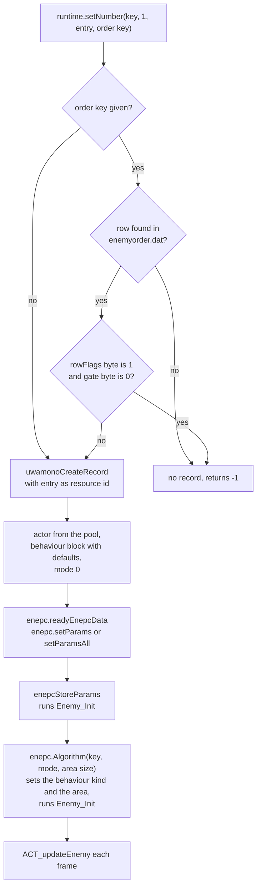

### Setting the parameters

Two natives write the parameters, and both end in `enepcStoreParams`. That
function accepts records of kind 1 and 4 only. Every argument has a "leave
unchanged" value (-1, or -1000.0 for three actor values), so a script can
change one value without knowing the others.

`enepc.setParams(key, unused, preset, points, point count, nodes, node
count)` is the compact form. It does four things.

1. It copies the route. The fourth argument names a script array of points,
   three integers each in hundredths of a unit, and the fifth their count.
   The points go to `state->points` and the count to `state->pointCount`.
   When the behaviour kind is 9 at that moment, the route is mirrored: the
   inner points are appended in reverse order (x and z only), the count
   becomes `2 * count - 2` and the kind becomes 8. The character then walks
   the route forward and back as one loop. The unique action table of every
   point is cleared to "none".
2. It builds the way-home graph. The sixth argument names an array of nodes,
   three integers and a parent number each. Every node is added with
   `Homing_Add`, see [The way home](#the-way-home).
3. It calls `Set_Spline_By_Route`, which copies the route into the trail for
   the kinds 8 and 12.
4. With a preset number and a loaded preset table, it clears bit 4 of
   `state->flags` and passes the preset to `enepcStoreParams`, which also
   runs `Enemy_Init`.

`enepc.setParamsAll` takes up to 20 arguments and sets the values one by
one. Arguments 2 to 10 are the height, the radius, the wander step, the
leash range, the move speed, the pursuit speed, the sight angle in degrees,
the sight length and the hearing range, all in hundredths. The two speeds
are divided by 1000 once more. Arguments 11 to 14 are the pause length, the
pause cycle, the threat length and the threat cycle. Argument 15 sets bit 4
of `state->flags`. Arguments 16, 18 and 19 write `modeValue3`, `shadowHeightA` and
`shadowHeightB` of the actor, and argument 17 writes `record->motion`. `Enemy_Init`
runs only when argument 20 is omitted. The full argument lists of all
natives are in [Natives](../scripting/natives.md).

### `Enemy_Init`

`Enemy_Init(slotIndex)` prepares a character for its first action. It runs
from `enepcStoreParams`, from `enepc.Algorithm` and from the update when the
action is 0.

1. The wanted facing `direction.y` is set to the current rotation.
2. Bit 1 of `state->flags` is set when `record->key` lies in `0x18000` to
   `0x1901E`, and cleared otherwise. This is the only place that decides
   whether the character is an enemy.
3. The pause cycle and the threat cycle are cleared. A cycle length of 1
   becomes 2 and a length of 8 or more becomes 7. In each cycle with a
   length that is not 0, one random step is marked.
4. `Enemy_ActionReady(slotIndex, 12)` starts the first pause, see below.
5. `timer` and `timerLimit` are set to 0, so the first pause ends on the
   next update.
6. The actor's collision probe is reset, given the radius `extent.x`, and
   tested once at the actor's position with `UnduCheck`. The map collision
   is described in [Map and units](map-and-units.md).
7. `routeIndex` and `cooldown` are set to 0.

## Behaviour kinds

`state->mode` is the behaviour kind, the "algorithm" in the words of the
script. `enepc.Algorithm(key, mode, area size)` sets it. The native also
takes the present position of the record as the centre of the area, sets
`areaSize` to the third argument in hundredths (1000.0 when omitted), sets
the action to 1 and runs `Enemy_Init`.

The kind is read in three places: at the end of every pause, where it
selects the next action, in `Check_Discovery`, where two kinds refuse to
chase, and in `Homing_Search`, which changes it. The table lists what the
code does with each value.

| Mode | After a pause | Behaviour |
| --- | --- | --- |
| 0 | never reached | No behaviour. `ACT_updateEnemy` returns before it runs an action, checks sight or checks contact |
| 1 | action 3 | Wanders: walks to random points inside its area |
| 5 | action 1 | Stands and pauses again and again. Chases when it notices the player |
| 6 | action 1 | Stands. Never chases. Turns to the player once it has noticed the player |
| 8 | action 3 | Patrols the route of the script |
| 9 | (becomes 8) | Patrols the route forward and back. `enepc.setParams` mirrors the route and changes the kind to 8 |
| 12 | action 10 | Runs away from the player along its route |
| 13 | action 11 | Slides along the spline through its trail. Never chases |
| other | action 3 or 2 | A random bit chooses between a walking step and a threat pose |

`Homing_Search` runs whenever a chase or a stun ends. When the character has
no way-home graph and its kind is not 6, the function sets the kind to 1. A
guard of kind 5 without a graph therefore becomes a wanderer after its first
chase.

## The actions

`state->action` is what the character does right now. `Enemy_ActionReady`
starts an action and `ACT_updateEnemy` calls the function of the current
action once per frame. The source uses one enum, `UwamonoMode`, for the
action numbers and for the behaviour kinds. Its names fit the kinds better
than the actions, so the table gives the number, the enum name and the
function.

| Action | Enum name | Function | What the character does |
| --- | --- | --- | --- |
| 0 | `UWAMONO_MODE_INIT` | `Enemy_Init`, then `Enemy_Pause` | Set-up. The switch falls through into the pause in the same frame |
| 1 | `UWAMONO_MODE_PAUSE` | `Enemy_Pause` | Stands with the idle motion for `pauseTime` frames |
| 2 | `UWAMONO_MODE_THREAT` | `Enemy_Threat` | Plays the threat motion for `threatTime` frames |
| 3 | `UWAMONO_MODE_ROUTE` | `Enemy_Route` | Walks one step of its wandering or of its trail |
| 4 | `UWAMONO_MODE_AIM` | `Enemy_Found` | Has noticed the player: turns to the player for 14 frames |
| 5 | `UWAMONO_MODE_PURSUE` | `Enemy_Chase` | Chases the player, or follows its parent record |
| 6 | `UWAMONO_MODE_STIFF` | `Enemy_Stiff` | Stunned: stands frozen until `cooldown` runs out |
| 8 | `UWAMONO_MODE_SCRIPT` | `Enemy_Unique` | Plays the motions of the unique action table of a route point |
| 9 | `UWAMONO_MODE_EXPLOSION` | `Enemy_Damage_Explosion` | Hit by an explosion: 30 frames of reaction before the stun |
| 10 | `UWAMONO_MODE_ROUTE` | `Enemy_Escape` | Moves along the route away from the player |
| 11 | `UWAMONO_MODE_SPLINE` | `Enemy_Route_Chase` | Slides along the spline of the trail |
| 12 | `UWAMONO_MODE_START` | none | Start request, turned into action 1 by `Enemy_ActionReady` |
| 13 | `UWAMONO_MODE_SPLINE_START` | none | Used as a behaviour kind only |

### Starting an action

`Enemy_ActionReady(slot_index, action)` does nothing for records that are
not of kind 1. Otherwise it stores the action, sets `timer` to 0, sets the
blend length of the actor to 4 frames and enables the motion channel. Then
it prepares the action:

| Action | Preparation |
| --- | --- |
| 1 | `timerLimit = pauseTime`, motion `walk[0]` |
| 2 | Only when `threatTime` is above 0: `timerLimit = threatTime`, motion `walk[4]` |
| 3 | Motion `walk[1]` |
| 4 | `timerLimit = 14`, motion `walk[3]`. An enemy creates the alert effect `0x10000021` when none exists and keeps its handle in `gameWork.releaseHandle`. When `seIds[0]` is not -1, one of the three voices is chosen at random and played as `0x03000000 + seIds[n]` |
| 5 | `timerLimit = 30`, actor bit `0x200000` set and bit `0x80000000` cleared, motion `walk[2]` |
| 6 | Motion speed 0 |
| 8 | `timerLimit` and the motion come from the unique action table at `[routeIndex][motionCol]` |
| 9 | Stun set-up, see [Explosions and the stun](#explosions-and-the-stun) |
| 12 | Only when `pauseTime` is above 0: `timerLimit = pauseTime`, motion `walk[0]`, and the action becomes 1 |

When `pauseTime` is 0, action 12 stays. It has no function in the update,
so such a character stands until it notices the player or a script gives it
a new kind.

### The standard motions

`uwamonoSetMotion(slotIndex, motion, speed)` starts a motion. A number below
16 is an index into `state->walk[]`, the standard motions of the character.
The resulting value is `slot * 100 + mode` of the actor's motion table (see
[Actors](../libraries/actors.md)). The function sets the motion speed and
changes the motion only when the actor does not play it already.

| Slot | Used for |
| --- | --- |
| `walk[0]` | Standing: pause, blocked step, start |
| `walk[1]` | Walking: steps of at most 0.135 per frame |
| `walk[2]` | Running: longer steps, and the chase |
| `walk[3]` | The moment of discovery, and the pose of an NPC that is spoken to |
| `walk[4]` | The threat pose |

The defaults are the motions 0 to 15 of slot 0. `enepc.defaultMotion(key,
slot, motion)` replaces one entry, so a character with unusual motion
numbers still works with the common code. `enepc.ExMotion(key, resource id)`
loads an extra motion resource and gives it to the actor.
`enepc.motion(key, motion, speed, first, last, loop)` plays any motion
directly, with a play range and a loop switch, and `enepc.motionFace` sets
the face animation selector. These two are what scripts use for people who
act in a scene.

### The state diagram

The diagram shows how the actions follow each other. The conditions are
explained in the sections after it.

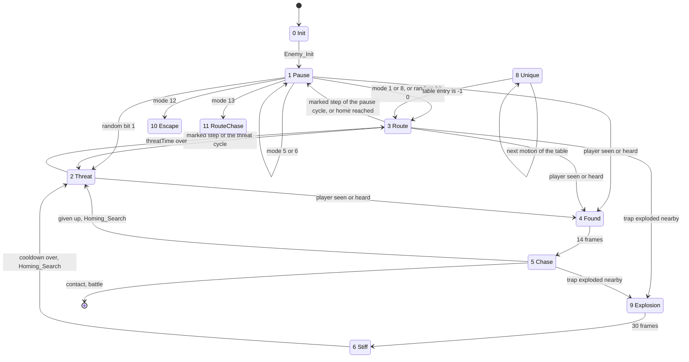

## The per-frame update

`DispMapObject` in `src/main/game_map_object.c` walks the 256 records once
per frame. For a record of kind 1 or 4 it plays the footsteps
(`Sound_FootStep`), shows or hides the actor, advances the scripted moves,
copies position, rotation, scale and transparency from the record to the
actor, and then calls `ACT_updateEnemy(i)` for kind 1. The player is skipped
here and updated by `uwamonoPlayerUpdate` afterwards.

`ACT_updateEnemy(index)` does the following.

1. It returns at once while the game is paused (`CONTROL_PAUSED`).
2. It sets `alert` to 99, calls the two debug drawers and counts
   `noticeCooldown` down.
3. It returns for the player's own record and for records with flag
   `0x2000000`.
4. When the held look-at target has priority 3, it calls `Actor_LookAt`, so
   a look-at ordered by a script is refreshed every frame.
5. A record with flag `0x400000` or `0x800000` is frozen. Its ground block
   is set to the default of map block `0x100`. The motion speed is 0 with
   `0x800000` and 1 otherwise. A character of mode 0 stops here. Others are
   still tested for contact with the player, with a margin of 0.3, and with
   flag `0x400` they turn to `direction.y`. Then the function returns.
6. A character of mode 0 stops here.
7. Outside the actions 6 and 9 the stun bit of `reactionFlags` is cleared
   and a leftover stun effect is deleted.
8. The function of the current action runs.
9. The sight test runs, see [Sight](#sight).
10. The contact test runs, see [Contact](#contact-and-the-battle-request).
11. The rotation of the actor and of the record moves a sixth of the way
    toward `direction.y` (`Get_Cursol_by_Reduce_Speed_Angle_Loop` with the
    divisor 6.0), by the shorter way round. Characters therefore never snap
    to a new heading.

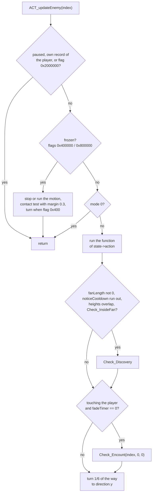

### Moving one step

Every walking action moves through `uwamonoMoveAlongHeading(index, target,
speed)`. It takes the heading from the record to the target with
`Get_Angle`, advances the record position by `speed` along it, and then
tests the step in three stages.

1. `Check_Undu` sweeps the collision probe of the character through the map
   from the actor's old position to the new one, with the probe flags
   `0x303`. When the sweep does not arrive, the character is put where the
   sweep ended, set on the ground height there, and the function returns 0.
2. `HitCheckMapUnitPosSize` tests the new position against the solid map
   units (doors, boxes and so on). On a hit the old position is restored
   and the function returns 0.
3. `uwamonoFindOverlapRecord` tests against the other characters: every
   record of kind 1 or 4 with a radius, without flag `0x2000000`, whose
   height span overlaps and whose distance is at most the sum of the two
   radii. An enemy ignores the player in this test, which is what lets it
   run into the player. On a hit the old position is restored, except in
   action 10, and the function returns 0.

A free step is kept. The character is set on the ground height found by
`unduGetSlotHeight` (a height of -1000 means no ground and leaves the height
alone), the wanted facing becomes the heading, and the motion becomes
`walk[1]` for a step of at most 0.135 and `walk[2]` for a longer one. The
function returns 1. In every case the wanted facing is updated, so a blocked
character still turns toward its goal.

`uwamonoCopyPointIfNear(index, point, copyFlag)` is the arrival test. It
returns 1 when the record is closer than 0.1 to the point, and with
`copyFlag` 1 it also snaps the record onto the point.

All distances of `Get_Distance` are measured in the horizontal plane (x and
z). `Get_Distance3D` adds the height. Angles are radians in the range -pi to
pi, measured with `atan2f(dx, dz)`, and `Get_Decimal_Surplus_for_Radius`
brings any angle back into that range.

### Pause, threat and walking

`Enemy_Pause` (action 1) counts `timer` up to `timerLimit - 1` and then
chooses the next action from the behaviour kind, as listed under
[Behaviour kinds](#behaviour-kinds). While a character of kind 5 or 6
stands, it faces the record in `focusIndex` as soon as the actor has the
"noticed" bit `0x400000`.

`Enemy_Threat` (action 2) waits in the same way and then starts action 3.
With bit `0x10` of `state->flags` it also advances `trailStep` by 2. It sets
`routeIndex` to 0 for every kind except 8.

`Enemy_Route` (action 3) walks one leg. On the first frame of the leg it
decides where to go.

1. A character that is not walking home advances its two cycles. Each cycle
   has a length (`pauseCycle` for pauses, `threatCycle` for threats) and one
   marked step. When the cycle position returns to 0, a new random step is
   marked. When the current step is the marked one, the character starts a
   pause (action 1) or a threat (action 2) instead of walking. With the
   default length 4, a character pauses once in every four legs, at a
   random leg.
2. When `routeIndex` is 0, `Set_Spline_By_Route` refreshes the trail from
   the script route (kinds 8 and 12).
3. A wanderer (kind 1) that is not walking home picks a random direction in
   the half circle behind it: its facing plus 90 to 269 degrees. It takes
   the point on the rim of its area in that direction (`areaSize` minus its
   radius from the centre), and walks toward that point, at most
   `wanderStep` far.
4. Every other character advances `routeIndex` to the next trail point,
   wrapping at `trailCount`. A character that walks home and wraps to point
   0 has arrived: the home bit is cleared and a pause starts.

On every frame of the leg the character takes one step of `moveSpeed`
toward the target. A blocked step ends the leg for a wanderer, which then
picks a new direction on the next frame. A patroller of kind 8 switches to
the standing motion and tries again. The leg also ends when the target is
closer than 0.1.

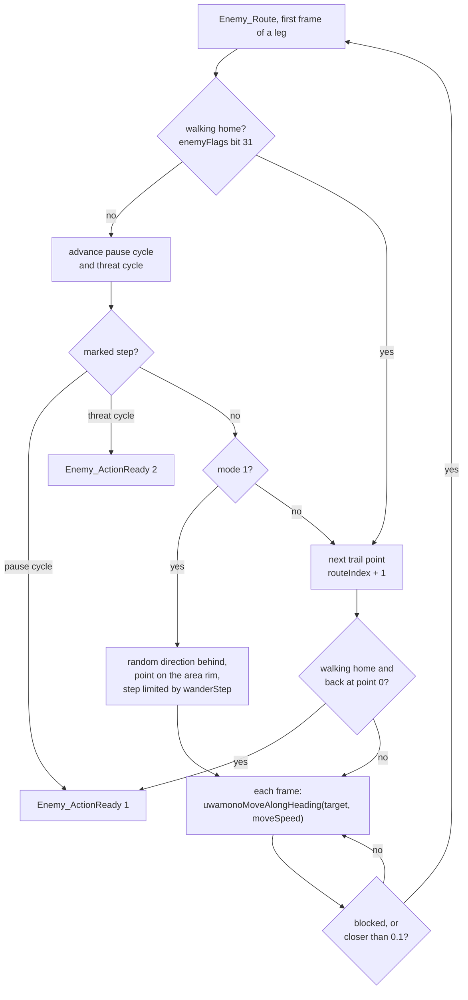

### Unique actions

Every route point has a small table of up to four motions with their
lengths (`actionMotions` and `actionLengths`). `Enemy_Unique` (action 8)
plays them one after the other: when the timer of one motion runs out, the
column advances, and a table entry of -1 ends the chain and starts action 3.
The idea is a guard that does something special at one point of its patrol.

In the code of this game the table is only ever cleared. `enepc.setParams`
writes -1 into every entry, no native fills it, and no function starts
action 8 from outside `Enemy_Unique` itself. The action is therefore never
reached.

### Fleeing along a route

`Enemy_Escape` (action 10) serves the behaviour kind 12. On the first frame
of a leg it looks at three trail points: the one before `routeIndex`, the
current one and the next one. It measures the distance from the player to
each and chooses the point that is farthest from the player. When that is
the current point, the character stays and decides again on the next frame.
Otherwise it walks there with `moveSpeed`. A blocked step sends it back to
the point it came from, and an arrival snaps it onto the point. The
character thus moves around its loop so that it keeps as far from the
player as the loop allows. A character in this action never notices the
player, because `Check_Discovery` refuses action 10.

### Sliding along a spline

`Enemy_Route_Chase` (action 11) serves the behaviour kind 13. It treats the
trail as the control points of a closed B-spline with 32 steps per point
(`UWAMONO_SPLINE_STEPS`). Each frame it evaluates the spline at the cursor
`trailStep` and at one step before and after, moves the cursor to the one
of the three that is closest to `state->probe`, and places the character on
the spline there (x and z). When the cursor does not move, the character
faces the probe point and a delay counter runs down. Otherwise the counter
is set to 16 and the character faces along the spline. The motion is
`walk[1]` when the character is on its point and the counter has run out,
and `walk[2]` otherwise.

Nothing in the source writes `state->probe` after the reset, which sets it
to the origin. How a script would steer such a character could not be
determined. The delay counter `enemyRouteChaseDelayCount` is one global
variable shared by all characters of this kind.

## Routes and splines

A character has three separate stores of positions. They are easy to mix
up.

| Store | Size | Filled by | Used by |
| --- | --- | --- | --- |
| `points` | 256 | `enepc.setParams` from the script array | The patrol route. `Set_Spline_By_Route` copies it to the trail |
| `trailPoints` | 256 | `Set_Spline_By_Route`, `Homing_Search`, `TM_Script_Spline_Add` | What actions 3, 10 and 11 really walk |
| `homeNodes` | 64 | `Homing_Add` from the script array | The way-home graph |

`Set_Spline_By_Route(index, step)` works for the kinds 8 and 12 only. It
copies x, y and z of every route point into the trail, sets `trailCount` to
`pointCount` and sets the cursor `trailStep` to `(trailCount + step) * 128 +
2`. The name comes from the spline that the trail can be read as.

`GetBSplineLoop(frame, count, period, points, destination)` in
`src/main/get.c` evaluates that spline. The trail is a closed loop of
`count` control points and each point owns `period` frames. The control
point index is `frame / period` and the phase inside the segment is `frame
% period`. The file `spline.dat` holds rows of four 16-bit weights of a cubic B-spline,
256 rows of 8 bytes per segment, in five segment blocks. The function uses
the block that starts at byte 4304, the uniform middle segment. It scales the
phase to a byte offset in that block (`2048 / period` bytes per frame, and
with the period 32 that the game passes this is every eighth row), reads four consecutive weights, and blends the four control points
`index` to `index + 3` (wrapping around). The sum is divided by 24576, which
is 6 times 4096, so the weights are fixed-point values of the usual B-spline
basis. A B-spline does not pass through its control points. It rounds the
corners of the route.

`GetBSplineLoopDummy` in the same file is a straight-line variant. It
divides each segment into `distance / moveSpeed` frames, interpolates
linearly, and advances the character's own cursor. No function of the game
calls it. `BSpline_Add`, `Check_Straight`, `Get_EnemyIDPos`,
`Get_Multi_Max_Under`, `Get_HeightAttr`, `Get_Attr`, `Get_Attr_NU` and
`Get_RndFloatRange` are in the same position: they exist in `get.c` and are
not called. The table `eneTerritoryID`, which only `Check_Straight` reads,
maps 20 territory numbers to collision attribute values.

Random numbers come from `Get_Rnd(min, max)`, which returns `min +
xglSRand() % (max - min + 1)`. The generator is described in
[Math](../libraries/math.md).

## Sight

Sight is tested from the enemy's side, once per frame, after the action
function. Four conditions come first: `fanLength` is not 0, the record is
not switched off, `noticeCooldown` has run out, and the height spans of the
enemy and the player overlap (`uwamonoRecordsOverlap` compares `position.y`
to `position.y + extent.y` of both). Then `Check_InsideFan` decides.

`Check_InsideFan(slotIndex, origin, centerAngle, range, target, fanWidth,
radius, mask)` tests whether the target is inside a fan in front of the
origin and visible from there.

1. The distance in space from the enemy to the player is at most
   `fanLength`.
2. The direction to the player lies within half of `fanWidth` on either
   side of the enemy's rotation (`Check_Angle`).
3. No solid map unit stands on the line. `CrossPointUwamono` tests the
   shown records of kind 2 near the line, widened by the enemy's radius.
4. The map does not block the line. `Check_Undu` sweeps a probe through the
   collision block `state->id` from the enemy to the player. The sweep has
   to end within 0.01 of the player horizontally and within 0.1 in height.
5. The height difference between the two is at most 3.2.

With the defaults an enemy sees 5.0 units far inside a cone of 60 degrees.
A wall, a crate or a difference in floor level hides the player.

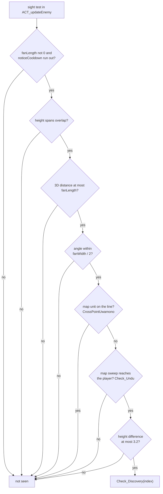

`TM_Check_Before_Eyes(slotIndex, length)` is a second, shorter look. It
takes the point `length` ahead of the actor along `direction.y`. When a
character of kind 1 or 4 other than itself overlaps in height and stands
within the two radii of that point, the function stores it in
`targetRecord`, sets `scanState` to 0 and returns 0. Otherwise it tests the
map at that point: without ground `scanState` becomes 64 and the result is
0, with ground it becomes 99 and the result is 1. Only the follower branch
of `Enemy_Chase` calls it, to stop before it walks into somebody or off an
edge.

## Hearing

Hearing is tested from the player's side. `uwamonoPlayerUpdate` turns the
stick into one of three walk states: 0 standing, 1 walking for a stick value
below 192, and 2 running. Holding R2 limits the stick value to 191, so the
player walks. Only in state 2 the function calls
`Enemy_FindByEar(uwamonoCurrentIndex, player position)`.

`Enemy_FindByEar` walks all records of kind 1 except the caller. A character
is skipped when its `noticeRange` is 0, when it is frozen with flag
`0x800000`, or while its `noticeCooldown` runs. For the others `Check_Undu`
sweeps through the map from the enemy to the player. When the sweep arrives
and the distance in space is below `noticeRange`, `Check_Discovery` is
called.

A running player is therefore heard through no wall, but from any
direction, also from behind. Walking is silent. The default `noticeRange` of
0 makes a character deaf until the script gives it a range.

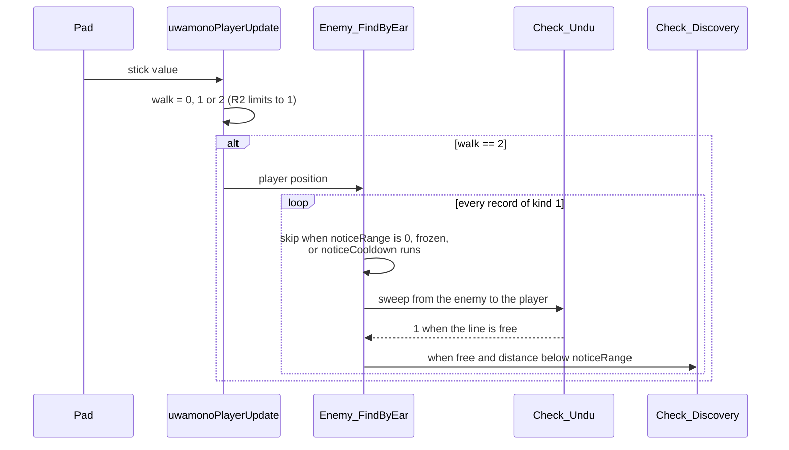

## Discovery

`Check_Discovery(index)` is the common end of sight and hearing. It turns
"the player was perceived" into the start of a chase, unless something
forbids it. It returns without effect in each of these cases:

- the actor has no resource id,
- `state->flags` and the word at `+0x0078` of the block are both negative,
- the record is switched off (flag `0x2000000`),
- `gameWork.fadeTimer` is not 0, which is the time after a battle,
- the player is on a ladder (`uwamonoLadderState.state` is not 0),
- the field is still loading (`gameWork.loadStage` is not 0),
- control bit `0x20` is set and an entry key is pending,
- the character is already in action 4 or 5,
- the character is in action 9, 6, 0 or 10.

Past these tests the actor gets the "noticed" bit `0x400000`. Two behaviour
kinds stop here: 6 and 13 notice the player and never chase. For kind 6 the
bit makes the standing character turn to the player. All others start
action 4 with `Enemy_ActionReady(index, 4)`, take the player as
`focusIndex`, and store the player's position in `chaseTarget`.

Sight is not limited to enemies. A person of the town with the default fan
would be "discovered" and walk up to the player as well. Whether the
character counts as an enemy only matters for the alert effect and for the
contact. Scripts keep people calm by leaving them in mode 0, by kind 6, or
by a fan length of 0.

`Enemy_Found` (action 4) lasts 14 frames. The character plays `walk[3]` and
keeps its wanted facing on the player. Then action 5 starts.

The alert effect belongs to the player's side of the screen. An enemy that
enters action 4 creates effect `0x10000021` once and stores the handle in
`gameWork.releaseHandle`. `Check_EnemyFound`, called at the end of every
`uwamonoPlayerUpdate`, looks for any enemy in action 4 or 5. When none is
left it deletes the effect. The effect is thus on screen for as long as at
least one enemy is after the player. What it looks like is defined by the
effect data (see [sef](../libraries/sef.md)).

## The chase

`Enemy_Chase` (action 5) has two users. An enemy chases the player in
`focusIndex`. A record with a parent follows that parent, see
[Following another character](#following-another-character). The function
first gives up at once when `gameWork.fadeTimer` is above 0, by calling
`Enemy_After_Battle`.

For an enemy one frame of the chase goes like this.

1. The destination is the player's current position.
2. The speed is `pursuitSpeed * 3` while the enemy is 1.0 or more away from
   `chaseTarget`, and `pursuitSpeed` when it is closer. With the defaults that
   is 0.12 and 0.04 per frame against a walking step of 0.02.
3. `Check_Undu` sweeps from the enemy to the destination and
   `CrossPointUwamono` looks for map units on the line. When the sweep
   arrives and no unit is crossed, `chaseTarget` becomes the destination: the
   enemy runs straight at the player.
4. Otherwise `Check_MoveSquare` looks for a way around the obstacle. It
   forms the rectangle whose opposite corners are the enemy and the
   destination, sweeps from each of the two toward the other two corners,
   and when a pair of these lines cross, it returns a corner point that the
   enemy can reach. That point becomes `chaseTarget`. When no point is found,
   `chaseTarget` keeps its old value, which is the place where the player was
   last seen.
5. The enemy takes one step toward `chaseTarget` with
   `uwamonoMoveAlongHeading`. With record flag `0x8000` a blocked step ends
   the chase.
6. The give-up tests run, see below.
7. When the enemy is within 0.05 of `chaseTarget`, it tries one more
   `Check_MoveSquare` and turns to face the player.

The chase is given up when one of these is true:

- the player is `leashRange` or more away,
- the enemy is at the rim of its area: its distance from `area` is
  `areaSize` minus its radius or more,
- the player is on a ladder,
- the enemy has reached `chaseTarget` (closer than 0.01), which means it
  arrived where the player was last seen and found no new line.

Giving up means: `uwamonoClampToStopRange` pulls the enemy back inside its
area when it overshot (to `areaSize - radius - 0.1` from the centre, facing
away from the centre), the trail is reset to the enemy's own position, the
threat pose starts (action 2) and `Homing_Search` plans the way home. The
function also tests `state->alert` against the values 64, 88 and 96. The
update sets it to 99 every frame and nothing else in the source writes it,
so these branches do not run.

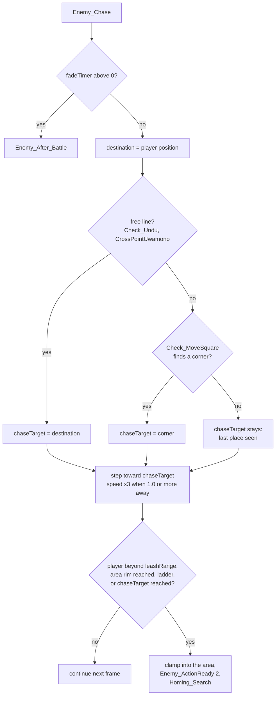

The script can end a chase as well. `enepc.Resigne(key)` makes a character
in action 5 reset its trail to its own position, start action 2 and call
`Homing_Search`, exactly as if it had given up by itself.

### The way home

A chase can end anywhere, also behind a corner from which the enemy's post
is not visible. The script therefore gives an enemy a small graph of
positions that lead home. `Homing_Add(index, parent, x, y, z)` adds node
number `routeNodeCount`. A parent other than -1 links the node and its
parent in both directions. A node has room for 4 links and a character for
64 nodes. Node 0 is home, and every other node names a parent that is one
step closer to home, so the nodes form a tree that is rooted at home.

`Homing_Search(index)` plans the way. It is called after a chase, after a
stun and by `Enemy_After_Battle`.

1. `noticeCooldown` is set to 60. For the next 60 frames the character
   neither sees nor hears the player. Without this an enemy that just gave
   up would discover the player again in the same frame.
2. Without nodes the function only changes the behaviour kind to 1, unless
   it is 6, and clears the home bit. The character goes on from where it
   stands.
3. With nodes it sorts them by distance and takes the nearest node that can
   be reached in a straight line. `Check_Straight_ID` tests the line in 32
   samples against map block 2048 and the map units.
4. From that node it walks down the tree: from each node to a linked node
   with a lower number, until node 0.
5. The trail becomes the enemy's own position followed by the nodes of that
   walk, added with `TM_Script_Spline_Add`.
6. The actor gets the home bit `0x80000000` and the character ends in action
   2, the threat pose.

After the threat pose `Enemy_Route` walks the trail point by point. With the
home bit set it skips the pause and threat cycles, and when the index wraps
to 0 it clears the bit and starts a pause. The character is back in its
normal life.

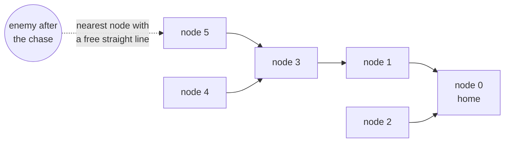

### Following another character

The native `objx.setParent(key, other)` ends in `uwamonoSetTarget` in
`src/main/uwamono_objx.c`. When one of the two records is a character, the
record gets `parent = other`, its ring `path` is filled with 128 points on
the straight line between the two, its behaviour kind becomes 1 and action 5
starts. The character now follows its parent.

In `Enemy_Chase` a record with a parent takes the ring instead of the
player's position. `chaseTarget` is the ring entry at `pathStep`. Before it
moves, `TM_Check_Before_Eyes` looks `pursuitSpeed + 0.1` ahead, and when
somebody stands there or the ground ends, the follower stands still in its
idle motion. The speed is 24 times `pursuitSpeed` at 1.0 or more from the
ring point and 16 times `pursuitSpeed` closer by. While the follower is
farther from its ring point than a sixteenth of the parent's radius, the
parent's current position is appended at `pathTail`. Each ring point that is
within one step is consumed and `pathStep` advances. The follower thus
walks along the breadcrumbs of its parent and takes the same way around
obstacles. The ring has 128 entries (`UWAMONO_RING_SIZE`). A follower never
gives up on its own, because the give-up tests belong to the other branch.

## Contact and the battle request

At the end of every update `ACT_updateEnemy` tests whether the enemy
touches the player:

- the horizontal distance is at most the two radii plus 0.1,
- the height difference is below `form * 1.7` of the player,
- `gameWork.fadeTimer` is 0.

Then it calls `Check_Encount(index, 0, 0)`. The same function is behind the
native `enepc.Encount(key, value)`, which calls `Check_Encount(index, 1,
value)` so that a script can start the battle of an enemy without contact,
for example for a boss that waits in a scene.

`Check_Encount(index, takeValue, reactionValue)` does not start the battle.
It fills the request in `gameWork` that the field loop reads at the end of
the frame. With `takeValue` 0, the contact case, it first returns without a
request when the player is on a ladder, when the record is not an enemy
(bit 1 of `state->flags`), when a script holds the player
(`CONTROL_SCRIPTED`), when the field is loading, or when control bit `0x20`
is set with a pending entry key.

### Who caught whom

For a contact the function works out from which side the two met. It
classifies two angles into three sectors each: front is within 70 degrees
on either side of the facing, back is the rear 60 degrees (beyond 150
degrees on either side), and side is what lies between.

- Sector A is where the enemy stands as seen from the player, relative to
  the player's rotation.
- Sector B is where the player stands as seen from the enemy, relative to
  the enemy's rotation.

A small table turns the pair into the contact class.

| Player seen from the enemy | Enemy in front of the player | Enemy at the player's side | Enemy behind the player |
| --- | --- | --- | --- |
| in front of the enemy | 0 | 1 | 2 |
| at the enemy's side | 3 | 3 | 3 |
| behind the enemy | 4 | 4 | 4 |

Class 0 is a head-on meeting. Class 2 means the enemy came from behind
while it looked at the player. Class 4 means the player reached the enemy's
back. The class is stored in `state->reactionKind` and in
`gameWork.encounterReaction`. With `takeValue` 1 the script's value is
stored instead.

In the source that was read for this page, the field loop only tests
`encounterReaction` against -1 to know that a battle is requested, and the
battle code reads the monster set and the event bits and not the class. A
use of the class for a back attack or an advantage was not found. It may be
read by battle scripts through a path that the C source does not show.

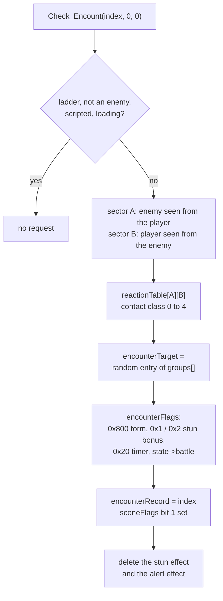

### The request

After the class the function fills the rest of the request.

| Field of `gameWork` | Value |
| --- | --- |
| `encounterReaction` | Contact class 0 to 4, or the script value. -1 means "no battle requested" |
| `encounterTarget` | The monster set. The entries of `state->groups[]` that are not -1 are counted, and one of the first that many entries is chosen at random. Without entries it is 0 |
| `encounterRecord` | Record index of the enemy |
| `sceneFlags` | Bit 1 is set |
| `encounterFlags` | The battle event bits, see the next table |

The monster set numbers come from the row of `enemyorder.dat` at creation,
or from `enepc.setGroup(key, ...)`, which rewrites the eight entries. One
enemy on the field can thus stand for several different enemy parties, and
the game picks one at the moment of contact. The battle code reads the
number with `cfMonsSetNoGet` and builds the enemy party from it (see
[Battle](battle.md)).

`encounterFlags` is read by the battle with `cfEventGet`. `Check_Encount`
builds it from these parts:

| Bit | Name in the battle code | Set when |
| --- | --- | --- |
| `0x800` | (no name) | The player's `form` is not 1.0 |
| `0x1` | `CF_EVENT_BOOST_BONUS` | The enemy is stunned and the trap that exploded last had an odd type (1 or 3) |
| `0x2` | `CF_EVENT_PARTY_BONUS` | The enemy is stunned and that trap had an even type (0 or 2) |
| `0x20` | `CF_EVENT_TIME_LIMIT` | The timer panel runs (`gameWork.panelMode` is 0) |
| any | | The bits of `state->battle`, set by `enepc.setBattle(key, bits)`, are added |

`setBattle` lets the script mark a single enemy, for example with
`CF_EVENT_SKIP_VICTORY` (`0x200`) for a battle that ends without the
victory sequence. Last, the function deletes the enemy's stun effect and
the alert effect, because the field is about to disappear.

When the key of `enepc.Encount` names no record, `Check_Encount` receives
the index -1. It then requests a battle with monster set 0, class 0 and the
script's value as the event bits, with -1 as the record.

### From the request to the battle

`Game()` in `src/main/game_data.c` checks `encounterReaction` at several
places of the frame. From the moment it is not -1, the menu button and the
pause are refused and the actors are neither updated nor drawn in that
frame. At the end of the frame the loop leaves the field for the battle.
The steps are owned by [The field game](field.md) and [Battle](battle.md).
In short: the script state is reset, `Game_Data_Push` saves the state of
every field actor into its record, the actor pool is cleared, the screen is
copied, and `ov01SceneEnter`, `ov01SceneLoop` and `ov01SceneEnd` run the
battle. When the party was wiped out (return code 2) the loop ends with the
game over bits. Otherwise the result screen is shown unless the code is 5,
and the field comes back.

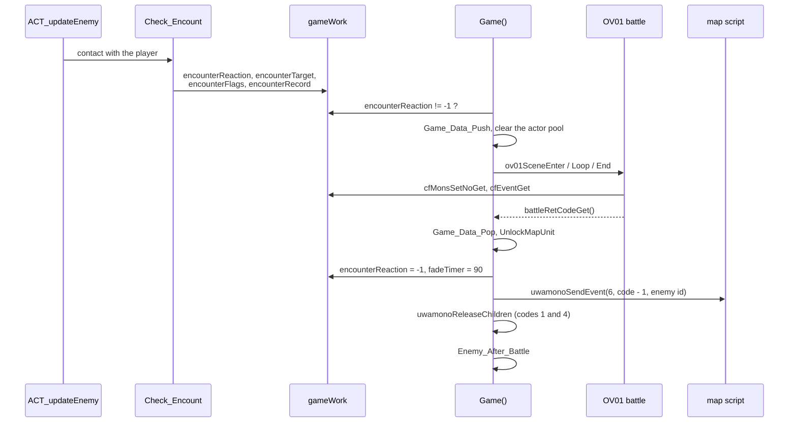

## After the battle

Back on the field, `Game_Data_Pop` rebuilds the actors from the records and
`Game()` clears the request: `encounterReaction` becomes -1,
`encounterFlags` 0 and `fadeTimer` 90. Then it acts on the return code of
the battle (`battleRetCodeGet`, the `TGT_STATUS_*` values of
`src/ov01/tgt_select.c`).

| Code | Meaning | Event to the script | Enemy removed |
| --- | --- | --- | --- |
| 1 | All enemies are gone | slot 6, argument 0, enemy id | yes |
| 2 | The party is gone | slot 6, argument 1, enemy id (the loop has left before) | no |
| 3 | The party left the battle | slot 6, argument 2, enemy id | no |
| 4 | The enemies left the battle | slot 6, argument 3, enemy id | yes |
| 5 | The time limit ran out | slot 7, arguments -1, -1 | no |

The events are queued with `uwamonoSendEvent` on the script thread that
registered for the slot, see
[Events sent to scripts](../scripting/events.md#events-sent-to-scripts).
The map script can react to a win over one particular enemy this way, for
example by opening a door.

### Removing the enemy and its companions

`uwamonoReleaseChildren(index)` in `src/main/enemy_system_init.c` removes a
beaten enemy. It reads the four entries of `state->together`.

- When all four are -1, the enemy is alone. Its byte in
  `gameWork.rowFlags[set][state->row]` is set to 1 and its record is
  released with `uwamonoReleaseRecord`.
- Otherwise every record named in the four entries has its row flag set
  and is released.

The companions are set by `enepc.setTogether(key1, key2, key3, key4)`. The
native resolves up to four keys to record indices and writes the same four
indices into the `together` array of each of the records. The list includes
the record itself, so the second case removes the fighter as well. This is
how a group of several visible enemies that stands for one enemy party
disappears together when one of them was fought and beaten.

The row flag is what keeps a beaten enemy away. `gameWork` is part of the
save data, and `uwamonoCreateRecord` reads the flag the next time the script
of the map asks for the enemy, see
[Creating a character](#creating-a-character) and the
[pickup and enemy flags](../scripting/events.md#pickup-and-enemy-flags). An
enemy whose gate byte in `enemyorder.dat` is not 0 comes back anyway when
the map is entered again.

### Calming the others

`Enemy_After_Battle(unusedKey)` in `src/main/set_motion.c` walks all records
of kind 1. Its argument is not read.

- A stunned enemy (action 6) gets `cooldown = 1`, so its stun ends on the
  next frame.
- An enemy that chases (action 5) or reacts to an explosion (action 9)
  resets its trail to its own position, starts the threat pose and plans
  its way home with `Homing_Search`.

The function has four callers. `Game()` calls it after every battle.
`Enemy_Chase` calls it when it runs while `fadeTimer` is above 0. The ladder
code in `src/main/get_ladder.c` calls it when the player takes hold of a
ladder, so climbing shakes off every pursuer. The fourth is the debug
switch described under [Debug features](#debug-features).

### The grace period

`gameWork.fadeTimer` gives the player 90 frames of safety after a battle.
`uwamonoPlayerUpdate` counts it down by one per frame. While it runs:

- `ACT_updateEnemy` does not test for contact,
- `Check_Discovery` returns at once, so no enemy starts a new chase,
- every enemy that is still chasing gives up,
- the player and the attached parts are drawn translucent with the alpha
  `(100 - transparency) / 100` of the player record. While the counter is 23 or more this is
  constant. Below 23 it alternates with the opaque state every frame, so
  the character flickers before the protection ends.

Together with the 60 frames of `noticeCooldown` that `Homing_Search` gives
every enemy that was calmed, this lets the player walk away from an enemy
that survived, for example after an escape.

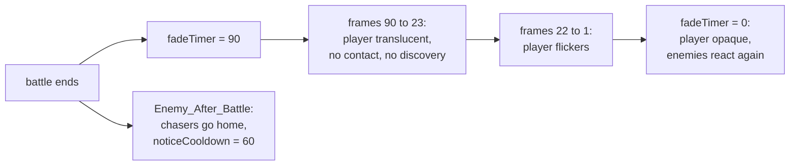

## Explosions and the stun

Some breakable map units are traps (the extra object types 0 to 3, "ExTrp"
in the header). The data of breakable objects comes from
`matumoto\kowaremono.dat`. "Kowaremono" means "breakable thing". How the
player sets one off is described in [Map and units](map-and-units.md). This
section covers what the blast does to enemies.

When a trap goes off, `uwamonoTriggerRecord` in `src/main/uwamono_record.c`
starts the explosion effect and the rumble, stores the low bit of the trap
type in `uwamonoTriggerTypeFlag`, and adds a blast point with
`uwamonoAddPoint(position, 300, radius)`. The radius is 3.0 for the types 0
and 1 and 15.0 for the types 2 and 3. There are 16 blast points
(`uwamonoPoints`).

`uwamonoUpdatePoints` processes the live points every frame and counts each
one down from 300. For every point it looks at all records of kind 1. A
character whose `cooldown` is 0 and whose distance in space to the point is
within the radius is sent into action 9, unless it is in action 9 or 6
already. The test does not ask whether the character is an enemy.

`Enemy_ActionReady(index, 9)` sets up the stun:

- bit 1 of `reactionFlags` is set,
- 300 is added to `cooldown`,
- `timerLimit` becomes 30,
- an old stun effect is deleted and effect `0x10000037` is created, owned by
  the actor so that it moves with it, and scaled on all axes by the
  player's `form`,
- the motion speed becomes 0, so the character freezes in its pose.

`Enemy_Damage_Explosion` (action 9) counts 30 frames and then starts action
6, because the stun bit is set. `Enemy_Stiff` (action 6) counts `cooldown`
down by one per frame. When it reaches 0, the stun bit and actor bit
`0x01000000` are cleared, the effect is deleted, `Homing_Search` plans the
way home and the threat pose starts. A stunned enemy stands frozen for about
300 frames in total and cannot notice the player during that time, because
`Check_Discovery` refuses the actions 6 and 9.

The reward comes with contact. Touching a stunned enemy starts the battle
as usual, and `Check_Encount` adds a bonus bit to the request: `0x1` for a
trap of odd type and `0x2` for a trap of even type. The battle code turns
bit `0x1` into one or two extra boost stocks for the party and bit `0x2`
into a bonus for the party members (see [Battle](battle.md)). The type flag
is one global byte, so the bonus follows the trap that exploded last.

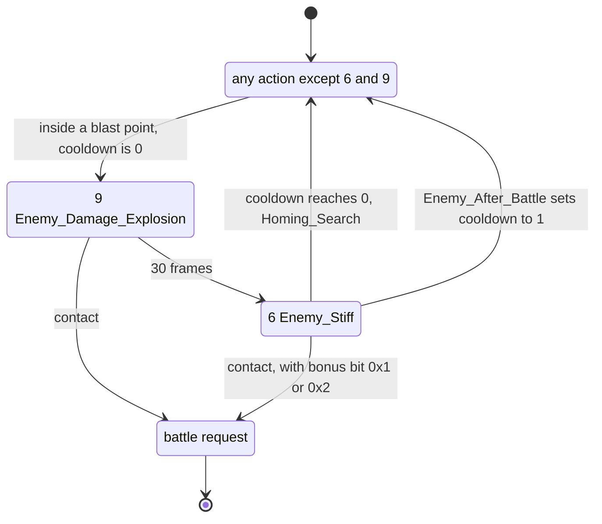

## Looking at things

Characters can turn their head and eyes to a target without turning the
body. The actor does the work in `XenoActorSetFocusTarget` (see
[Actors](../libraries/actors.md)). The field code only decides what the
target is, with a small priority scheme in `src/main/set_motion.c`.

Each behaviour block holds one target: a record (`targetSlot`) or a fixed
point (`targetVector` with `targetSlot` -1), and the priority it was set
with.

- `Actor_LookAt_Set(index, priority, target, point)` takes the offer when
  its priority is not below the held one, and returns 1. A lower offer is
  refused with 0.
- `Actor_LookAt_Release(index, threshold)` clears the target when the
  threshold is not below the held priority.
- `Actor_LookAt(index)` computes the point and passes it to the actor. For
  a character it is the record position raised by `extent.y`, the top of
  the body. For another map unit it is the position plus `focusOffset` plus
  half of `extent.y`.
- `Actor_LookAt_Init(index)` drops the target.

| Priority | Source | Set by |
| --- | --- | --- |
| 3 | The script | `enepc.lookat(key, target key)` or `enepc.lookat(key, x, y, z)`. With the three arguments omitted the look-at is released |
| 2 | A look-at point of the map | `uwamonoPickTarget`, for the player |
| 1 | A nearby character | `uwamonoPickTarget` with `Get_MostNear_Actor`, for the player |
| 0 | The selected map unit | `uwamonoPickTarget` with `uwamonoFindSelected`, for the player |

For enemies and NPCs only priority 3 exists: `ACT_updateEnemy` calls
`Actor_LookAt` when the held priority is 3. The lower priorities belong to
the player character, whose head follows what is around it.
`uwamonoPickTarget` in `src/main/game_camera.c` runs at the end of every
`uwamonoPlayerUpdate`.

The look-at points are a table of 10 positions with a reach each
(`enepcLookAtPointTable`, `enepcLookAtReachTable`). A script defines one
with the long form `enepc.lookat(key, x, y, z, point number, reach)`. When
the player is within the reach of a point, the nearest such point becomes
the target. The reach table is cleared when the map units are reset.

`Get_MostNear_Actor(index)` finds a character worth a glance: a record of
kind 1 or 4 with flag `0x1000000`, inside a fan of 180 degrees and length
5.0 in front of the player, and closer than 5.0 in space. The nearest one
wins, and it is only looked at when it is shown.

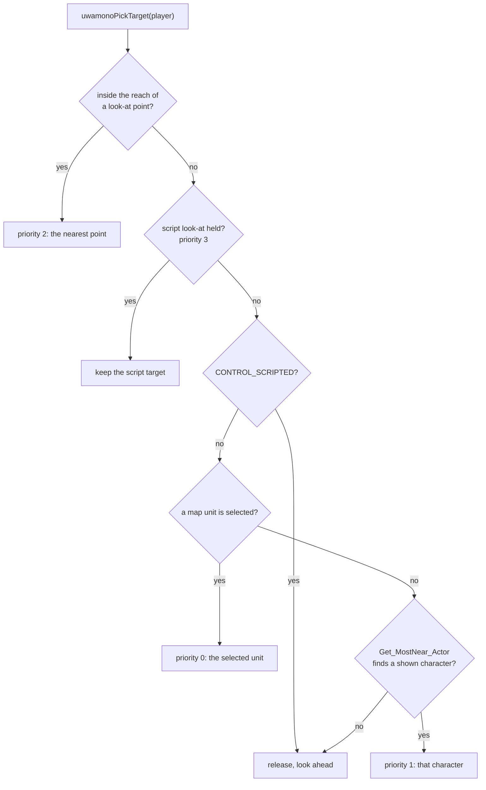

## NPCs and talking

A person of a town is a record of kind 1 like an enemy. What makes it an
NPC is its resource id outside the enemy range, so that `Enemy_Init` leaves
bit 1 of `state->flags` clear and contact never starts a battle, and the
values the script gives it. Three set-ups appear from the code:

- Mode 0 is a person who only stands, plays the motions the script orders
  with `enepc.motion`, and is not updated by the behaviour code at all.
- Kind 6 with a sight fan is a person who stands and turns to the player
  when the player comes into view.
- The kinds 1 and 8 are people who stroll inside an area or walk a route,
  with the same pause and threat cycles as enemies. For them the "threat"
  slot `walk[4]` can hold any idle gesture.

The talk itself is owned by
[Events](../scripting/events.md#talking-to-people-and-objects). The part
that touches the behaviour code is short.

1. `uwamonoPlayerUpdate` calls `uwamonoFindTalkTarget(actor, 50.0)` every
   frame. A character qualifies when the height difference is at most 2.0,
   when it is within its radius plus the player's radius plus 0.6, and when
   it stands inside a fan of 90 degrees in front of the player. A character
   with record flag `0x800` qualifies from any side within radius plus
   radius plus 0.1.
2. With CIRCLE on a character whose id lies in `0x10000` to `0x17FFF`,
   `talkSetResult` publishes the key of the character for the script, and
   the character is remembered in `mapActiveObject`. A character with flag
   `0x800` is published without a button, so it speaks when touched.
3. When the script shows the message, `mapObjectFaceActive` sets the flags
   `0x400400` on the character, points its wanted facing at the player and
   starts the motion `walk[3]`.
4. From then on `ACT_updateEnemy` treats the character as frozen. Its
   action does not run, so a stroller stops where it is, and with flag
   `0x400` it turns smoothly to the player.
5. When the script lets go of the player (`CONTROL_SCRIPTED` cleared),
   `DispMapObject` calls `mapObjectClearTalkFlags`, which clears both
   flags. On the next frame the behaviour continues with the action it was
   in.

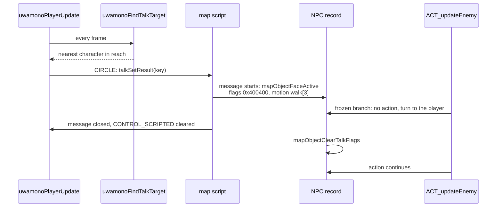

Two more natives serve people in scenes. `enepc.enableDrawFlags` and
`enepc.disableDrawFlags` set and clear bits of the actor's draw flags, for
one record or for all characters of one kind, which is how a script hides
or shows people. `enepc.Extra(key, value)` passes a value to
`XenoActorSetSolverPasses` of the actor.

`Check_Actor(from, index)` in `src/main/set_motion.c` is a helper for
movement tests. It returns the first shown character with a body within the
two radii plus 0.1 of a point and within 1.0 in height, and it skips the
pair "enemy and player" in both directions. Its only caller is the unused
`Check_Straight`.

## The script interface

The module `enepc` is registered by `enepcRegisterNatives` in
`src/main/runtime_uwamono_door.c`, which passes the name `"enepc"` and the
table `enepcNativeTable` to `sbNativeOwnerAdd`. The table has 18 natives and
a closing empty entry. How natives are registered and how they read their
arguments is described in [Natives](../scripting/natives.md), which also
lists every argument. Coordinates and lengths are passed as integers in
hundredths of a unit. The table below groups the natives by the feature
they serve.

| Feature | Natives | Section |
| --- | --- | --- |
| Parameters | `readyEnepcData`, `setParams`, `setParamsAll` | [Setting the parameters](#setting-the-parameters) |
| Behaviour kind | `Algorithm` | [Behaviour kinds](#behaviour-kinds) |
| Motions | `motion`, `ExMotion`, `motionFace`, `defaultMotion`, `Extra` | [The standard motions](#the-standard-motions) |
| Head and eyes | `lookat` | [Looking at things](#looking-at-things) |
| Battle | `Encount`, `setGroup`, `setBattle`, `setTogether` | [Contact and the battle request](#contact-and-the-battle-request) |
| Chase | `Resigne`, `setSE` | [The chase](#the-chase), [Discovery](#discovery) |
| Drawing | `enableDrawFlags`, `disableDrawFlags` | [NPCs and talking](#npcs-and-talking) |

`runtime_enepc.c` also holds the table of the `runtime` module
(`runtimeNativeTable`, 34 natives) with its registration
`runtimeRegisterNatives`, and the native `runtime.Vibration`, which starts
or stops the rumble of the pad. Those belong to the map and to
[Natives](../scripting/natives.md).

`enepc.setGroup` has a quirk. For each of the eight group entries it tests
whether argument `i + 2` is present, and then reads argument `i + 1`. Entry
0 therefore receives the key itself, and each following entry receives the
argument before the one that was tested.

## Debug features

The enemy code still carries its development aids. In the retail game they
draw nothing, because the line drawer `uwamonoDrawLine` in
`src/main/pause_menu_page_uwamono.c` is an empty function, and the text
calls go to the debug font (see [Debug tools](debug-tools.md)).

- `uwamonoDrawPointPath` walks the script route and `uwamonoDrawStateLinks`
  the way-home graph. Both build the line segments, lifted a little above
  the ground, and stop there.
- `DispPillar` builds a ring of 17 segments. The update calls it for the
  area of every character, and `DispMapObject` for the body circle.
- `uwamonoDrawFanEdge` computes the two edges of the sight fan.
- `xglFontDebugPrintf` prints short Japanese labels during the chase and
  the walk: "Sighted" with the steering point, "New" with the focus index,
  "Distance", "Count", "Random", "Field object", "Go straight", "Add" and
  "Falling?" when a step finds no ground. The update prints the motion
  speed of the actor.
- While the switch `pxyTickScaleDouble` is not 0, holding L3 keeps
  `Check_Discovery` from starting a chase, and pressing L1 makes a chasing
  enemy call `Enemy_After_Battle`. The profiler reads the same switch for
  another purpose, so this use is likely a leftover of a development
  build.
- `padRightStickRotate` in `src/main/get.c` prints the sector of the
  right stick and counts full turns of it. `Game()` calls it every frame
  with 12 sectors.

## Summary of the constants

| Value | Meaning | Where |
| --- | --- | --- |
| 256 | Map unit records | `MAP_RECORD_COUNT` |
| 32 | Behaviour blocks | `UWAMONO_STATE_COUNT` |
| `0x40C0` | Size of a behaviour block | `UwamonoState` |
| 512 | Rows of `enemyorder.dat` that are searched, and bytes per row of `rowFlags` | `uwamonoCreateRecord` |
| 14 | Frames of the discovery pose | `Enemy_ActionReady` |
| 30 | Frames of the explosion reaction | `Enemy_ActionReady` |
| 300 | Frames added to the stun, and life of a blast point | `Enemy_ActionReady`, `uwamonoTriggerRecord` |
| 3.0, 15.0 | Blast radius of the trap types 0 and 1, 2 and 3 | `uwamonoTriggerRecord` |
| 60 | Frames without perception after going home | `Homing_Search` |
| 90 | Frames of safety after a battle | `Game()` |
| 0.1 | Contact margin, and arrival distance of a step | `ACT_updateEnemy`, `uwamonoCopyPointIfNear` |
| 1.7 | Contact height per unit of `form` | `ACT_updateEnemy` |
| 0.135 | Step length above which the run motion is used | `uwamonoMoveAlongHeading` |
| 70 and 150 degrees | Limits of the front and back sectors | `Check_Encount` |
| 3.2 | Largest height difference of sight | `Check_InsideFan` |
| 128 | Breadcrumbs of a follower | `UWAMONO_RING_SIZE` |
| 64, 4 | Nodes of the way-home graph, links per node | `UwamonoState` |
| 32 | Spline steps per trail point | `UWAMONO_SPLINE_STEPS` |
| 192 | Stick value from which the player runs and is heard | `uwamonoPlayerUpdate` |
