# The field game

The field is the part of Xenosaga Episode II where the player walks through
maps, talks to people, breaks objects, opens the menu, saves at save points and
runs into enemies. All of it runs inside one function, `Game()` in
`src/main/game_data.c`. The title screen starts it for a new game or a loaded
game, and it returns only when the session is over: after a game over, after
the soft reset button combination, or when a script ends the session.

`Game()` is two loops, one inside the other. The outer loop runs once per
place: it loads the place script, resets the cameras and the actors and fades
in. The inner loop runs once per frame: it runs the scripts, updates the map
objects, moves the player, moves the camera, draws the map and the actors and
waits for the next frame. Battles are started from inside the inner loop. The
battle code lives in the OV01 overlay, and the field calls it like a normal
function after it has put its own state away.

Almost everything the field needs to remember is in one global structure,
`gameWork`. It is also the block that a save file stores. The objects placed
on a map (the "uwamono" records) are described in
[Maps and units](map-and-units.md), the enemies that walk the maps in
[Field enemies](field-enemies.md), and the scripts that drive a place in
[Events](../scripting/events.md).

[← Back to the overview](../README.md)

## Source files

| File | Contents |
| --- | --- |
| `src/main/game_data.c` | `Game()` with both loops, `Game_Data_Push` and `Game_Data_Pop` around battles, `uwamonoLoadCurrent` and `uwamonoStoreCurrent`, the `gameWork` object, the file names of the common map object resources |
| `include/main/game_data.h` | The `GameWork` structure, its camera sub-structures, the `CONTROL_*` bits |
| `src/main/game_camera.c` | The field camera, `mapObjectResourcesLoad`, the player model change `uwamonoChangePlayerModel`, the player update `uwamonoPlayerUpdate`, the tables of player models, parts and slopes |
| `include/main/game_camera.h` | Camera functions other files call, `CameraKeyEntry` |
| `src/main/runtime_camera.c` | The `camera` script module (51 table entries) and the small `ladder` module registration |
| `src/main/game_map_object.c` | `mapResourceSwitch` and its load callback, the per-frame map object pass `DispMapObject`, the tweens of a map object, the backdrop image, `mapObjectsDraw` |
| `src/main/game_pause_disp.c` | The pause title and the button hints, the list of common map object resource names |
| `src/main/game_snap_shot.c` | JPEG snapshots of the frame buffer and the save thumbnail |
| `src/main/game_movie.c` | Full-screen movies with captions (`GameMpeg2Play`), owned by [Cutscenes](../scripting/cutscenes.md) |
| `src/main/vibration.c` | Controller vibration |
| `src/main/save_party_init.c` | The party reset `ptReset`, and `uwamonoAttachCurrent` / `uwamonoDetachCurrent`, which send the player to another place and bring it back |
| `src/main/xgl_studio.c` | The four studios with eight cameras each |
| `src/main/xgl_camera.c` | One studio camera: its states, the manual and chase modes, the view matrices |

Two files hold data that their name does not suggest.
`src/main/game_pause_disp.c` defines `mapObjectResourceNames`, the list of
files that `mapObjectResourcesLoad` reads. `src/main/save_party_init.c`
holds, next to the party reset, several tables of the main menu and the
battle system. Those tables are described in
[Party and growth](party-and-growth.md) and [The main menu](main-menu.md).

## gameWork

`gameWork` is a single object of type `GameWork`, `0x1B30` bytes long. It
holds the state of the place, the camera, the parameters of the player, the
light sets, the encounter that is about to start and several flag tables.
`saveReadGameWork` (`src/main/pt_member.c`) copies the whole block out of the
save image when a game is loaded, so everything in it survives a save. The
save image is described in [Save data](../architecture/save-data.md).

The layout below shows the main regions of the block.

```
gameWork (0x1B30 bytes)
+0x0000  +---------------------------------------------+
         | session: workEnd, loadStage, control,       |
         | inputDelay, sceneFlags, nextMap, mapId,     |
         | entryKey, resourceId, active, resBuffer     |
+0x0030  | slopes[8]       elevator slope table        |
+0x00B0  | mapLoaded, keepOffMask, imageEnd, mapColor  |
+0x00D0  +---------------------------------------------+
         | camera (GameWorkCamera, 0x1B0 bytes)        |
         |   flags, type, record index, shake waves,   |
         |   slot[4], range, from, to, anchor values   |
+0x0280  +---------------------------------------------+
         | sceneFlag, frameScale, playerParams,        |
         | climbFrames, formScale, formSize, replay    |
+0x031C  | encounter: target, reaction, flags, record  |
+0x0330  | fadeTimer, vibration fade                   |
+0x0348  | fog, shadowCasterMode, gravity, bounce      |
+0x0384  +---------------------------------------------+
         | lights (16 light sets)                      |
+0x0C84  | savedLights (copy made before a battle)     |
+0x14E0  | savedMapBits[2]                             |
+0x1520  | eventFlags[512]                             |
+0x1720  | rowFlags[2][512]                            |
+0x1B20  | panelMode, panelValue                       |
+0x1B30  +---------------------------------------------+
```

The fields are listed in the table below. Fields that belong to another
subject are named with the page that explains them.

| Offset | Type | Name | Meaning |
| --- | --- | --- | --- |
| `0x0000` | `unsigned char *` | `workEnd` | The value of `WorkEnd` when the session started. `Game_Data_Pop` puts it back after a battle |
| `0x0006` | `unsigned short` | `loadStage` | 0 for a new game. The title screen sets 1 for a loaded game. See [Starting a session](#starting-a-session) |
| `0x0008` | `int` | `control` | The control bits, see [The control bits](#the-control-bits) |
| `0x000C` | `unsigned char` | `inputDelay` | Frames until START is accepted again. 16 after the pause was toggled, 32 after a movie was paused |
| `0x0010` | `int` | `sceneFlags` | Bit 0 is set when an encounter starts (`Check_Encount`) |
| `0x0014` | `int` | `nextMap` | The place to change to, -1 when none is requested |
| `0x0018` | `int` | `mapId` | The current place number |
| `0x001C` | `int` | `entryKey` | Where the player appears in the next place: -1 no position, -2 the position kept in the party progress, otherwise the key of an entry point |
| `0x0020` | `int` | `resourceId` | The file id of the loaded map model |
| `0x0025` | `unsigned char` | `elevatorMask` | Copy of `elvActiveMask`, made by `Game_Data_Push` |
| `0x0028` | `MainActive *` | `active` | The resource record of the loaded map (model, collision block, backdrop image) |
| `0x002C` | `unsigned char *` | `resBuffer` | A buffer of `0x12000` bytes from `GameResBufferAlloc` that receives the script image of a map resource |
| `0x0030` | `GameWorkSlope[8]` | `slopes` | Direction, push and speed factor of the eight scripted slope kinds, see [Slopes and moving floors](#slopes-and-moving-floors) |
| `0x00B0` | `int` | `mapLoaded` | Cleared at the start of the session |
| `0x00B4` | `int` | `keepOffMask` | One bit per entry of `elvKeepOffFlags`, made by `Game_Data_Push` |
| `0x00B8` | `SbImageHeader *` | `imageEnd` | The library image behind the loaded script image |
| `0x00C0` | `Vector4` | `mapColor` | Colour scale of the map model, set back to 1.0 at the start of each place |
| `0x00D0` | `GameWorkCamera` | `camera` | The field camera, see [The field camera](#the-field-camera) |
| `0x0290` | `unsigned char` | `sceneFlag` | Cleared at the start of each place |
| `0x02D0` | `float` | `frameScale` | Distance the player moves per frame for one unit of stick deflection |
| `0x02D4` | `float` | `frameScaleSaved` | Copy made by `uwamonoLoadCurrent` |
| `0x02D8` | `float[5][2]` | `playerParams` | Five player parameters with their saved copies. `[0]` is the horizontal reach and `[1]` the height reach used to find objects around the player |
| `0x0300` | `int` | `climbFrames` | Frames one ladder step takes (15 by default) |
| `0x0308` | `float` | `formScale` | Model scale of the player record, kept across a battle |
| `0x030C` | `float` | `formSize` | Radius of the player record, kept across a battle |
| `0x0310` | `int` | `replayStatus` | Ground status recorded with the last stick input |
| `0x0314` | `int` | `replayStickX` | Last stick input, x |
| `0x0318` | `int` | `replayStickY` | Last stick input, y |
| `0x031C` | `short` | `encounterTarget` | The enemy group chosen for the battle |
| `0x0320` | `short` | `encounterReaction` | -1 while no battle is pending. Any other value makes `Game()` start a battle |
| `0x0324` | `int` | `encounterFlags` | `0x800` when the player is in an E.S. |
| `0x032C` | `int` | `encounterRecord` | Index of the map object record that caused the encounter |
| `0x0330` | `short` | `fadeTimer` | Frames the player blinks after a battle (90) |
| `0x0332` | `unsigned char` | `vibrationStart` | End value of the vibration fade |
| `0x0333` | `unsigned char` | `vibrationEnd` | Start value of the vibration fade |
| `0x0334` | `int` | `vibrationHold` | Frames the small motor stays on |
| `0x0338` | `int` | `vibrationFramesLeft` | Frames left of the fade |
| `0x033C` | `int` | `vibrationFramesTotal` | Length of the fade |
| `0x0344` | `void *` | `releaseHandle` | An effect to delete after the battle |
| `0x0348` | `Vector4` | `fogDist` | Fog distances: near, far, minimum, maximum |
| `0x0360` | `Vector4` | `fogColor` | Fog colour |
| `0x0370` | `int` | `shadowCasterMode` | Passed to `pxySetShadowCasterMode` every frame, 1 by default |
| `0x0374` | `float` | `gravity` | 0.02 after a map load, changed by `objx.setPlayer` |
| `0x037C` | `float` | `bounceDivisor` | 1.5 after a map load |
| `0x0384` | `GameWorkLights` | `lights` | 16 light sets: three directions and colours, an ambient colour and a fourth light each |
| `0x0C84` | `GameWorkLights` | `savedLights` | Copy made by `Game_Data_Push` |
| `0x14E0` | `MapBits[2]` | `savedMapBits` | Copies of the two hide masks of the map model |
| `0x1520` | `signed char[512]` | `eventFlags` | One flag per event index, cleared by `gameEventFlagsClear` |
| `0x1720` | `signed char[2][512]` | `rowFlags` | Flags of the enemy rows of a place, cleared by `gameRowFlagsClear`. Row 1 is used while control bit `0x800` is set |
| `0x1B20` | `signed char` | `panelMode` | 0 while the time panel counts, 1 otherwise |
| `0x1B24` | `int` | `panelValue` | Frames left on the time panel |

### The control bits

`gameWork.control` is a word of single-bit switches. The frame loop tests it
many times per frame, and scripts, the menus and the cutscene player set and
clear bits in it. Only some bits have a name in `include/main/game_data.h`.
The table gives every bit the field code uses and what it does.

| Bit | Name | Set by | Effect |
| --- | --- | --- | --- |
| `0x1` | `CONTROL_PAUSED` | START in `Game()` | The pause is on. Scripts, effects, the player, actor updates and tweens stop |
| `0x10` | | `mapResourceLoadCallback` | A map model was just loaded. Cleared by `DispMapObject` on the first frame after it |
| `0x20` | `CONTROL_MAP_LOADED` | `mapResourceLoadCallback` | A map model was just loaded. While it is set `Game()` puts the player on the entry point, the camera is parked and snaps, and the pause is refused. `DispMapObject` clears it one frame after bit `0x10` |
| `0x200` | `CONTROL_CFE_SCENE` | the cutscene player | A cfe cutscene runs. `Game()` skips the whole field update and drawing |
| `0x400` | | `uwamonoPlayerUpdate` | The player stands on ground of the ladder class. The camera update is skipped and the menu is locked |
| `0x800` | | `uwamonoAttachCurrent` | The player was sent to another place through the menu and has not returned yet |
| `0x8000` | `CONTROL_SCRIPTED` | scripts, place changes | A script controls the player. Stick input, talking and searching are off |
| `0x10000` | `CONTROL_REPLAYED` | `uwamonoSetTransition` | The last stick input keeps being applied, so the player walks on while the screen fades out |
| `0x20000` | `CONTROL_MAP_ATTACK` | `uwamonoPlayerUpdate` | The player is in the middle of an attack on a map object |
| `0x80000` | | `runtime.System(1)` | `pxySetTexMapDropAll` is called every frame |
| `0x100000` | `CONTROL_CFE_NO_FADE` | cutscenes, `runtime.System(10)` | Place changes start no fade-out and the new place starts without fade-in |
| `0x200000` | | a script native | `xglRenderClearSkipOn` every frame: the frame buffer is not cleared |
| `0x800000` | | `runtime.System(4)` | `pxySetShadowUploadFlag` is no longer called |
| `0x4000000` | | the menu and the save screen | Set while the main menu or the save screen runs |
| `0x8000000` | | `runtime.System(0)`, a lost battle | The session ends and `GameOver()` runs |
| `0x10000000` | `CONTROL_SOFT_RESET` | the soft reset combination | The session ends and the title screen appears |
| `0x20000000` | | `uwamonoSetTransition`, `runtime.System(5)` | A place change is pending. The menus and the message buttons are off |
| `0x40000000` | | `runtime.System(7)` | The main menu and the save point menu cannot be opened |
| `0x80000000` | | a lost battle | Set together with `0x8000000` |

`Game()` clears the bits `0x80000`, `0x800000`, `0x10000`, `0x20000000` and
`0x200000` at the start of every place, so they last for one place at most.
The bits a script can reach through `runtime.System` are listed with their
arguments in [Events](../scripting/events.md).

The name `CONTROL_MAP_LOADED` comes from the ladder code, which also tests bit
`0x20`. The code that sets the bit is the map load callback, and the code
that clears it is the frame counter in `DispMapObject`, so its real meaning
is "the map was loaded less than two frames ago".

## Starting a session

The title screen does not call `Game()` itself. `src/ov02/title.c` returns
the address of `Game` as the next program to run, and the control loop that
started the title screen calls it (see
[Title and boot](title-and-boot.md)). Before it returns, the title screen
stores how the session starts. For a new game it sets `gameWork.nextMap` to
7001 and `gameWork.loadStage` to 0. For Load Game it runs the save screen
`MenuFileMain(1)` and sets `loadStage` to 1.

`Game()` then prepares the session in this order.

1. `padApplySaveSettings` applies the pad settings of the save data, and
   `GameSynopsis` shows the synopsis screen that belongs to the story
   progress (see [Events](../scripting/events.md)).
2. The actor pool is rebuilt with `XenoActorPoolInitDefault` and all 256 map
   object records are cleared with `uwamonoResetRecords(-1, 0)`.
3. `encounterReaction` and `entryKey` are set to -1, `panelMode` to 1 and
   `fadeTimer` to 0. `gameRowFlagsClear` and `gameEventFlagsClear` clear the
   flag tables. The restart position `restartPositionVector` is set to the
   origin.
4. `GameResourceInit((void *) 0x1000000, 0x1000000)` gives the resource
   system the 16 MB from address `0x1000000` up.
5. `seBankLoad(2, "CFS_SE", 0x7D000)` loads the common field sound bank.
6. `sefInitEffect` and `sefInitEffectCf` reset the effect system, and six
   common effects are started with `sefStartEffectKeyDefault`: the keys
   `0x10000033`, `0x10000035`, `0x10000037`, `0x10000021`, `0x1000003F` and
   `0x10000040`.
7. The loop waits until `xglCdServiceIfPending` reports that the disc is
   idle. Then the render state is reset: `xglRenderClearSkipOff`,
   `xglCullingMapInit`, `yg2PathResetAll`, `gifStateDisableEffect`.
8. `ov01InitAll` resets every table of the battle overlay.
9. For a loaded game (`loadStage != 0`), `saveReadImage` and
   `saveReadGameWork` read the save. This replaces all of `gameWork` and sets
   `nextMap` to the saved `mapId`. `loadStage` becomes 1.
10. `resourceId` is set to -1, `workEnd` takes the current `WorkEnd`, the
    player index `uwamonoCurrentIndex` is set to -1 and `mapLoaded` to 0.
11. `mapObjectResourcesLoad` loads the common map object files (see
    [Common map object resources](#common-map-object-resources)).
12. `msgResetAll` clears the message windows. `GameResBufferAlloc(0x12000)`
    reserves `resBuffer`. `resPlayerSlotsInit` and
    `resResetDescriptorTables` reset the resource slots of the party models.
13. For a new game, `ptSwapSlots(7, ptFindSlot(13))` and `ptEnterSplit` put
    the party into split mode, which is the mode in which the three E.S. are
    the members on screen. A new game therefore starts in an E.S.
14. `ptLoadPartyModels` loads the models of the three members on screen, and
    `ptApplyCurrentModel` creates the player from the current member (see
    [The player](#the-player)). `resSelectSlot(1)` selects the resource slot
    of the field.
15. `GameSynopsisCrossfadeWait` fades the synopsis out and waits for a
    button. When it reports the soft reset combination, `Game()` returns at
    once. Otherwise `fadeReset` clears the fade and the outer loop starts.

The diagram shows the two ways into a session and where they join.

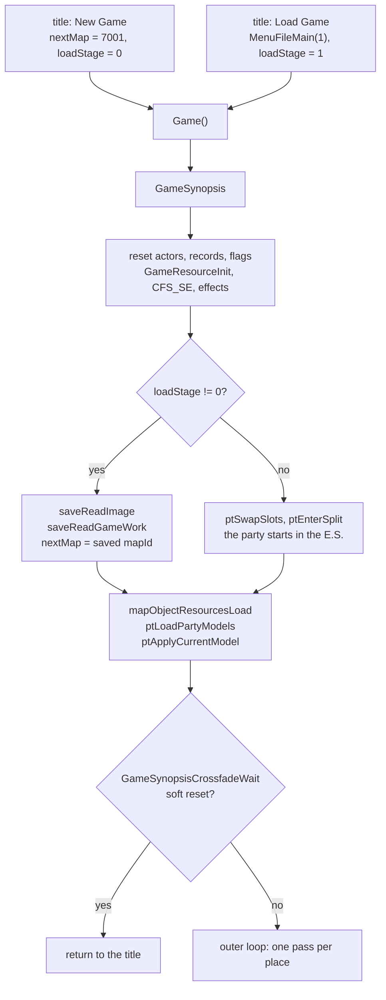

### Common map object resources

Some models appear in every place: the save point, the item boxes, the
treasure chests, the trap plates. `mapObjectResourcesLoad` in
`src/main/game_camera.c` loads them once per session with `GameResLoadName`
and waits for the disc after each file. The names come from
`mapObjectResourceNames` and the loaded addresses go to
`mapObjectResources`, an array of `MAP_RESOURCE_COUNT` (54) pointers. All
files are in the directory `matumoto\`.

The first four entries are data files. The other 50 are 25 pairs of a model
(`.pxy`) and its texture (`.txy`). A map object of the model kind names its
pair by a type number, and `MAP_MODEL_SLOT(type)` in
`src/main/game_map_object.c` turns the type into the array index
`(type + 2) * 2`.

| Index | File | Use |
| --- | --- | --- |
| 0 | `kowaremono.dat` | Rows of the breakable objects |
| 1 | `treasurebox.dat` | The event table, kept in `uwamonoEventTable` |
| 2 | `enemyorder.dat` | The enemy rows, kept in `uwamonoKeyRowTable` |
| 3 | `spline.dat` | The table of B-spline weights used to smooth the routes of enemies (the routes themselves come from the place scripts) |
| 4 to 11 | `Tra001` to `Tra004` | Types 0 to 3 |
| 12 to 17 | `Tre001`, `Tre002`, `Tre101` | Types 4 to 6 |
| 18 to 21 | `Save_P`, `Save_P2` | Types 7 and 8, the save points |
| 22, 23 | `Evs_P` | Type 9 |
| 24 to 27 | `Ret_P`, `Ret_P2` | Types 10 and 11 |
| 28 to 53 | `Item001`, `Item002`, `Item101` to `Item103`, `Item003` to `Item010` | Types 12 to 24 |

The contents of the four data files and the behaviour of each type are
described in [Maps and units](map-and-units.md).

## The outer loop: one pass per place

Each pass of the outer loop sets up one place. A place is a number that
names a script. The script loads a map, creates the map objects and may play
cutscenes. The numbering is explained in [Events](../scripting/events.md).

The pass starts with the screen and the cameras. The depth buffer is cleared,
the clear colour is set to black, the display is switched on, and
`xglStudioInit` resets all four studios. A studio is a set of eight cameras
and a light block (`src/main/xgl_studio.c`). For each studio the loop then
puts all eight cameras into state 2, which is the manual debug camera of
`xglCameraTravelProc`, with pad port 0. The field camera takes camera 0 of
studio 0 over a few lines later.

Then the place itself is loaded.

1. `gameWork.control` loses the bits `0x1` and `0x400`, so a place never
   starts paused. `sceneFlag` and `fadeTimer` are cleared.
2. `mapSceneScriptLoad(gameWork.nextMap, 1)` reads the place script
   `cf\scNNNN.sb` and its language file, registers the script modules, makes
   the number the current `mapId` and sets `nextMap` back to -1.
3. The actor pool and the map object records are reset again. The player
   record survives this, and `uwamonoCurrentIndex` must still name it. When
   it is -1 the code prints `player lost` and stops in a debug trap.
   Otherwise `ptLoadPartyModels` and `ptApplyCurrentModel` rebuild the
   player actor.
4. `GameCameraReset` resets the field camera, `UnlockMapUnit` releases the
   target markers of all records, `Vibration_Stop` stops the motors and
   `seSetMuted(1, 0)` switches the sound effects on.
5. The player actor is moved to `restartPositionVector` and hidden (draw
   flag `0x4`). It stays hidden until the frame loop puts it on its entry
   point.
6. `shadowCasterMode` becomes 1, `mapColor` becomes (1, 1, 1), and the
   per-place control bits are cleared.
7. For a loaded game the party models are loaded once more and `loadStage`
   becomes 2.
8. `fadeStartIn(30)` starts a fade-in of 30 frames. When
   `CONTROL_CFE_NO_FADE` is set, `fadeClear` removes it again at once.

After the inner loop has ended, the pass finishes: `loadStage` is set to 0,
`soundSlotsRestart` and `resResetScriptState` stop the sound slots and the
background loader, and the loop is left when one of the bits `0x18000000` is
set. Otherwise the place effects are destroyed (`sefDestroyEffectCf`), the
message state is reset (`msgStateReset`), two frames pass, the fade is
cleared, and the next pass starts if `nextMap` holds a number.

## The frame loop

The inner loop runs once per displayed frame. The order of its steps is
fixed, and several steps are guarded by control bits. The list follows the
code from top to bottom.

1. **Soft reset.** When L1, L2, R1, R2 and SELECT are held and START is
   pressed (`PadData[0].heldAndPressed` masked with `0x0800010F`), bit
   `CONTROL_SOFT_RESET` is set and the loop ends.
2. **Render switches.** `pxySetMode3Flag(1)` is called. The shadow upload,
   the texture map drop and the frame buffer clear are switched by the
   control bits `0x800000`, `0x80000` and `0x200000`. `pxyRequestOverlayPass`
   and `pxySetShadowCasterMode(gameWork.shadowCasterMode)` follow. While the
   game is paused, `pxySetFreezeAnimation` stops model animation.
3. **Entry placement.** While bit `0x20` is set and `entryKey` is not -1, the
   player is put on its entry point. For -2 the position comes from
   `ptState.progress->position` and the facing angle is 0. For any other key
   `uwamonoFindEntry` finds the row in the entry table of the map,
   `uwamonoGetEntryPose` gives the angle, and the player becomes visible. A
   key that is not found puts the player on the origin. In all cases bit
   `0x400` is cleared, the collision probe of the player is told to look for
   its floor again (flag `0x1000`) and the camera gets the snap flag `0x80`.
4. **Save point placement.** While `loadStage` is not 0, the records are
   searched for a model object of type 7 or 8, which are the two save point
   models. The player is put on the first one found, made visible, and
   `loadStage` is counted down. A loaded game therefore starts on the save
   point of the place.
5. **Scripts.** Unless paused, `sbRunAll` runs every script thread (see
   [The SB virtual machine](../scripting/sb-vm.md)). The loop ends here when
   a script has set bit `0x10000000` or `0x08000000`.
6. **Field update.** Unless `CONTROL_CFE_SCENE` is set, four calls run:
   `DispMapObject` updates the map objects, `uwamonoPlayerUpdate` moves the
   player, `cameraUpdateFrame` moves the camera and `mapObjectsDraw` submits
   the map model.
7. **Effects and vibration.** Unless paused, `sefExecEffect` runs the
   effects (not during a cfe cutscene) and `VibrationEngine` drives the
   motors.
8. **Menus.** Unless paused, in a cutscene, in the wait after an attack or
   with bit `0x20000000` set, the menu buttons are read (see
   [Opening the menus](#opening-the-menus)) and `msgUpdateTimed` handles the
   buttons of an open message window.
9. **Time panel.** Unless paused, the time panel counts down (see
   [The time panel](#the-time-panel)) and `padRightStickRotate(12)` runs.
   When paused, the pause screen is prepared instead (see
   [Pause](#pause)).
10. **Windows and preloading.** The time panel is drawn or cleared,
    `msgQueueClose` queues the message windows for drawing and
    `resJumpPointsUpdate` preloads the files of a neighbour place when the
    player is near its jump area.
11. **START.** The pause is toggled if it is allowed this frame.
12. **Place change.** When `nextMap` is no longer -1, the loop ends.
13. **Actors.** Unless a cfe cutscene runs or a battle is pending,
    `XenoActorDoit` updates all actors (skipped while paused) and
    `XenoActorDisp` draws them (see [Actors](../libraries/actors.md)).
14. **Frame end.** With no battle pending, `xglSleep` runs the render step of
    the frame and waits for the next one. Then the loop starts again.
15. **Battle.** With `encounterReaction` not -1 the code falls through into
    the battle sequence (see
    [Battles started from the field](#battles-started-from-the-field)).

The sequence diagram shows one frame of free movement.

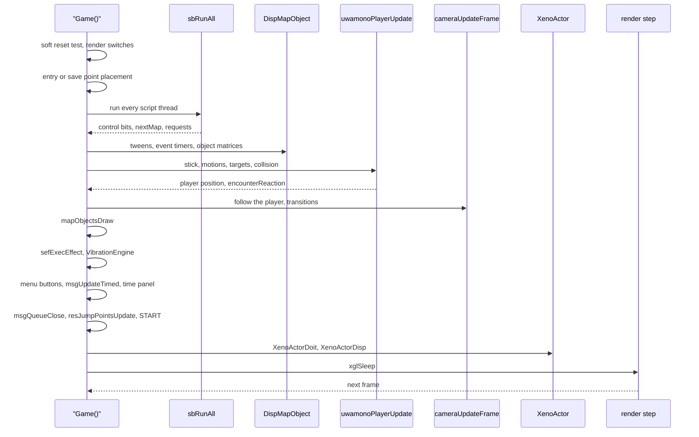

During a cfe cutscene only the steps that do not belong to the field remain:
the scripts run (the cutscene is driven by a script), the vibration runs,
the windows are queued, and the frame ends. Map objects, the player, the
field camera, the map model, the effects and the actor pass are all skipped,
because the cutscene player updates and draws its own actors, maps and
camera (see [Cutscenes](../scripting/cutscenes.md)).

### Opening the menus

The field has no separate "menu mode". When a menu button is pressed, the
frame loop calls the menu as a function, and the menu runs its own frame
loop until it is closed.

The buttons are read only when all of the following hold: none of the
control bits `0x40008400` is set (no script control, no ladder ground, no
menu lock), the ladder state `uwamonoLadderState.state` is 0 and no battle
is pending.

| Button | Condition | Action |
| --- | --- | --- |
| TRIANGLE | always | `menuSceneRunLoop`, the main menu (see [The main menu](main-menu.md)) |
| CIRCLE | `uwamonoGetNearbyUnitType` returns 7 or 8 | `MenuFileMain(0)`, the save screen (see [Save data](../architecture/save-data.md)) |
| CIRCLE | it returns 9 | `menuSceneRunKeyCheck`, the main menu opened from an `Evs_P` plate |

`uwamonoGetNearbyUnitType` looks for a model object of type 7 to 11 that is
closer to the player than half of the player's form value, and returns its
type. Types 7 and 8 are the save point models `Save_P` and `Save_P2`.

Around the main menu and the save screen the loop calls
`resResetScriptState`, saves the camera records with `GameCameraStateSave`,
mutes the sound with `soundSetMuted(1)`, and undoes both afterwards with
`soundSetMuted(0)` and `GameCameraStateRestore`, so the camera comes back
exactly as it was.

### The time panel

Scripts can start a countdown that is shown on screen. `panelMode` 0 means
the countdown runs and `panelValue` holds the frames left. Each frame that is
not paused takes one frame off. When the value drops below 0 it is set to 0,
`panelMode` becomes 1 and `uwamonoSendEvent(7, 0, 0)` tells the place script
that the time is over.

While the panel runs, `msgPanelSetTimecode(0, 0, panelValue / 30,
panelValue % 30)` shows the value as seconds and frames, which gives 30
frames to the second. In every other mode `msgPanelClear` removes it. The
countdown is not stopped by a battle: the battle overlay reads `panelValue`
too and ends a time-limited battle at 0. The panel itself is described in
[Message windows](../libraries/ui-windows.md).

### Leaving the session

When the outer loop ends, `Game()` cleans up: `fadeReset` and
`xglRenderGlobalFadeInit` clear the fades, `tiGlobalCollClearHandle` drops
the global collision handle, `soundReset`, `soundSlotSetPause(0, 0)` and
`soundSetDefaults` reset the sound, `resSelectSlot(0)` goes back to the
resource slot of the title, `xglRenderCpUDispOff` switches the debug text
off, the actor pool and the map object records are cleared, the place
effects and the culling map are reset, and two frames pass. If bit
`0x08000000` is set, `GameOver()` shows the game over screen. Then `Game()`
returns and the title screen runs again.

## The player

The player on the field is a map object record like any other. It has kind 4
(`MAP_KIND_ACTOR_STATIC`, named `MAP_KIND_ACTOR_STATIC` in
`src/main/game_camera.c`), and its index is kept in `uwamonoCurrentIndex`.
The record owns a `XenoActor`, which is the animated model. Up to two more
records of kind 5 (`MAP_KIND_PART`) hold extra models that hang on the
player's skeleton. Their indices are in `uwamonoPartIndices`. The record
structure is described in [Maps and units](map-and-units.md) and the actor
in [Actors](../libraries/actors.md).

### Model keys

A player model is named by a key. The key is also the resource id of the
model's resource block. Keys from `0x10000` to `0x13FFF` are the characters
on foot, and keys from `0x14000` up are the E.S. `ptGetClothId` in
`src/main/pt_member.c` gives the key of a party member: one of the keys
`0x10002` to `0x10026` for the members 1 to 7, chosen by the story progress,
and `0x14002`, `0x14003` and `0x14005` for the members 11 to 13, which are
the three E.S.

The record field `form` is 1.0 for a key in the first range and 5.0
otherwise. The source names the two values `UWAMONO_FORM_FOOT` and
`UWAMONO_FORM_ES`, and the macro `UWAMONO_IS_FOOT` tests the first key range.
The numbers agree with the names: the member keys of the characters are in
the range the macro tests, the walk speed and the radius of form 1.0 fit a
person, and the encounter code sets the E.S. battle flag when `form` is not
1.0. This page calls form 1.0 "on foot" and form 5.0 "in an E.S.".

`uwamonoKeyRangeTable` holds ten rows of 17 words. Seven rows cover the key
ranges of the seven characters and three rows cover the three E.S. keys.
`uwamonoChangePlayerModel` reads the row of the new key.

| Words | Field | Use |
| --- | --- | --- |
| 0, 1 | `KEY_LO`, `KEY_HI` | The key range of the row |
| 2 to 4 | `KEY_COLOR_A` | Three bytes copied to `uwamonoKeyColorA` |
| 5 to 7 | `KEY_COLOR_B` | Three bytes copied to `uwamonoKeyColorB` |
| 8 | `KEY_MAPPED` | The key to change to on a form change: `0x14005` in the character rows, `0x10023` in the E.S. rows |
| 9 | `KEY_VALUE` | Passed to `XenoActorSetInitCode` |
| 10 to 12 | `KEY_LEVEL_B` | Frames from the start of an attack to its hit, for the three attack levels. Copied to `uwamonoSearchEventTable` |
| 13 to 15 | `KEY_LEVEL_A` | Frames the attack locks the player, for the three levels. Copied to `uwamonoSquareWaitTable` |
| 16 | `KEY_EFFECT` | Number of the effect file of the model: 301 to 307 for the characters, 401 to 403 for the E.S. |

A second table, `uwamonoAttachIdTable`, gives the part models. It has eight
rows of four words: the first and last key of a range and up to two part
keys, with -1 for "none". For example the keys `0x10025` to `0x10029` have
the parts `0x1002A` and `0x1002B`, and the E.S. key `0x14005` has the parts
`0x14006` and `0x14007`.

### Creating and changing the player

`uwamonoChangePlayerModel(request)` creates the player the first time it is
called and swaps the model afterwards. `ptApplyCurrentModel` calls it with
the key of the current party member. The request -1000
(`UWAMONO_KEY_FROM_CURRENT`) means "change form": the key is taken from the
`KEY_MAPPED` word of the current key's row. This is how a timed map object
event turns the player from a character into an E.S. and back
(`DispMapObject`, event 1, followed by a fade-in of 30 frames).

The function works in these steps.

1. It waits until the disc is idle, and scans the records for the player
   (kind 4) and its parts (kind 5).
2. It finds the resource slot that already holds the key with
   `resPlayerSlotFindByOwner`, or takes slot 0.
3. With no player record yet, it loads the model with `resPlayerSlotLoadID`
   and creates the record with `uwamonoCreateRecord(0, 4, key, -1, -1)`.
   With a player record whose actor already has the requested key it
   returns. Otherwise it loads the new model, stores the five resource
   addresses in the actor (model, texture, hierarchy, motion and one entry
   table), calls `XenoActorAllocMatrices`, sets the motion blend time to 4
   and starts mode 0.
4. It resets the ladder state, marks the record as shown (flag `0x2`), sets
   the radius to 0.64 and sets `form` from the key range.
5. It clears `CONTROL_SCRIPTED` and writes the default player parameters:
   reach 6.0, height reach 0.2, the other three 1.0, `climbFrames` 15.
6. It releases the old part records, finds the row of the key in
   `uwamonoAttachIdTable`, loads each part model and creates a kind 5
   record for it.
7. `uwamonoAttachPlayerParts` hangs the parts on the skeleton.
8. It copies the colour and timing values of the key's row, starts the
   effect file of the model with `sefStartEffectKeyDefault` and waits for
   the disc with `sceCdSync(0)`.
9. It sets the values that depend on the form (table below).
10. `UnlockMapUnit` releases the target markers and `seFootBanksLoad` loads
    the footstep sounds that fit the model.

| Value | On foot (`form` 1.0) | In an E.S. (`form` 5.0) |
| --- | --- | --- |
| `gameWork.frameScale` | 0.00051 | 0.001445 |
| Radius | 0.64 | 4.0 |
| Record scale | 1.0 | 0.9 |
| Reach `playerParams[0][0]` | 6.0 | 20.0 |
| Height reach `playerParams[1][0]` | 0.2 | 1.0 |
| Part joints | 80 and 81 | 10 and 7 |

`uwamonoAttachPlayerParts` attaches the two part actors with
`XenoActorAttachChildToJoint`. On foot the first part is shown and the
second hidden, and both get draw mode 1. In an E.S. both are shown, released
first and attached again. At the end the function gives the actor the init
code of its key row. Which parts are visible while walking is decided again
every frame by the player update (see
[Attacking map objects](#attacking-map-objects)).

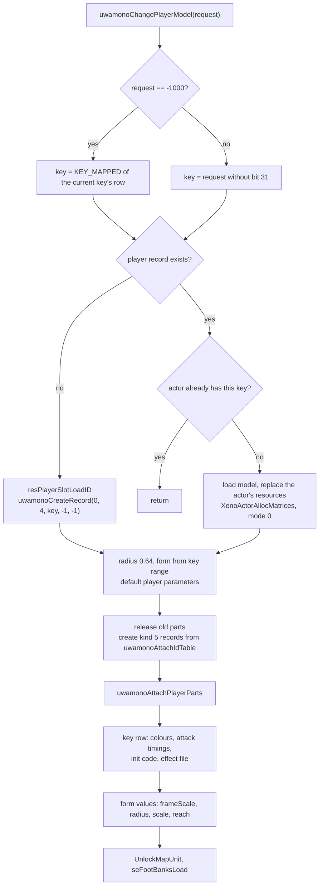

### The player update

`uwamonoPlayerUpdate` in `src/main/game_camera.c` runs once per frame. It
first stores the actor's position as its previous position, for the actor
and for both parts. It then returns early while the game is paused or while
camera 0 of the studio is not in the game state 4, so the player cannot move
while a debug camera is active.

The rest of the function is a fixed sequence.

1. **Blink.** While `gameWork.fadeTimer` counts down, the player and its
   parts blink: on even counts and on counts of 23 and more they are drawn
   translucent with an alpha of `(100 - transparency) / 100`, on the other
   counts opaque. At 0 they become opaque for good. `Game()` sets the timer
   to 90 after every battle.
2. **Ladder.** `Ladder_Main` runs the ladder state machine. When it reports
   that the player is on a ladder, the steps 3 to 8 are skipped. Ladders are
   described in [Maps and units](map-and-units.md).
3. **Attack timers.** The two counters of a running attack are counted (see
   [Attacking map objects](#attacking-map-objects)). While the lock counter
   runs, no input is read.
4. **Input and motion.** The stick is read and turned into a direction and a
   speed, and the walk or run motion is chosen (see
   [Moving](#moving)).
5. **Talk target.** `uwamonoFindTalkTarget(actor, 50.0f)` finds a record to
   talk to or to operate (see
   [Talking and operating](#talking-and-operating)).
6. **Selection.** While the player moves, `uwamonoMoveSelection(0)` selects
   the nearest object in reach. L1 and R1 step the selection forward and
   backward, and SQUARE attacks the selected object.
7. **Ground.** Slopes and elevators add to the velocity.
8. **Collision.** `UnduCheck` moves the actor against the collision mesh,
   gravity is applied, `HitCheckMapUnitWithNyuru` pushes the player out of
   solid map objects and `uwamonoPushOutOfActor` out of other characters.
   Then the ladder ground test sets or clears control bit `0x400`.
9. **Copy back.** A second `UnduCheck` with a fresh probe
   (`uwamonoProbeTemplate`) re-reads the floor under the final position. The
   position and rotation are copied to the record. On foot, both parts also
   receive the position, rotation, direction, scale, velocity and radius of
   the player.
10. **Reactions.** `uwamonoPickTarget` chooses what the player's head looks
    at, `Check_EnemyFound` lets the enemies notice the player and
    `Check_Locater` tests the locators of the place script (see
    [Field enemies](field-enemies.md) and
    [Events](../scripting/events.md)).

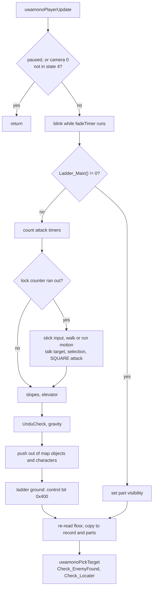

### Moving

Input is read when `CONTROL_SCRIPTED` is clear, or when `CONTROL_REPLAYED`
is set. In the second case the values `replayStickX`, `replayStickY` and
`replayStatus` of the last free frame are used again. A place change sets
this bit, so the player keeps walking in the same direction through the
fade-out.

For each axis two sources are combined: the pressure of the direction
buttons (`PadData[0].horizontalPressure` and `verticalPressure`) and the
left stick (`leftX` and `leftY`, doubled to reach the same range). If both
are non-zero and point in opposite directions the axis is 0. Otherwise the
value with the larger size is taken.

The speed is the length of the two-axis vector, limited to 256. Holding R2
limits it to 191. The direction is snapped to 16 sectors of 22.5 degrees and
then turned by the camera's north angle, so "up" on the stick always means
"away from the camera". The north angle is sampled into `cameraNorthAngle`
only while the stick is at rest. This keeps the walking direction stable
when the camera cuts to another view while the stick is held.

The actor's `direction.y` takes the angle, and the velocity grows by
`speed * gameWork.frameScale` along it. The visible rotation `rotation.y`
follows `direction.y` through
`Get_Cursol_by_Reduce_Speed_Angle_Loop(..., 4.0f)`, which turns the model
smoothly.

The motion is chosen from the speed. The record's motion table
`body.motions->walk[]` maps the three states to actor modes.

| Speed | State | Motion speed |
| --- | --- | --- |
| 0 | 0, standing | 1.0 |
| below 192 | 1, walking | `speed * 2.6 / 192` |
| 192 and more | 2, running | `speed / 256` |

Because R2 limits the speed to 191, holding it always gives the walk. The
motion changes only when the actor's mode differs from the wanted state, and
a standing player is not pulled out of the modes 3 to 5, which are the
attack motions. On foot the parts get the same mode. While running,
`Enemy_FindByEar` lets enemies hear the player.

### Slopes and moving floors

Every triangle of the collision mesh carries a ground status, which
`UnduCheck` leaves in `actor->collision.kind`. The player update reads three
classes of it.

| Status | Class | Effect |
| --- | --- | --- |
| `0x1xxxx` | slope | Adds a push to the velocity |
| `0x100` to `0x11F` | ladder | Sets control bit `0x400` and sends event 3 with the ladder number plus 1 |
| `0x200` to `0x20F` | elevator | Adds the movement of elevator `status & 0xF` from `elvGetPosition` |

A slope status has three forms. With bits `0xF00` set, the push has a fixed
compass direction: `uwamonoSlopeDirectionTable` turns the bit pattern into a
multiple of 45 degrees, and the strength is one of the four values of
`uwamonoSlopeFactorTable` (0.5, 1, 2, 3) times 256 times `frameScale`. With
bit `0x8` set, entry `status & 7` of `gameWork.slopes` gives a direction, a
push and a speed factor that a script has set. Otherwise the slope only
speeds the player up or slows it down along its own direction, by one of the
four table factors.

Gravity is simple. When the floor is higher than the actor, or the actor
rests within the height tolerance of its probe, it is put on the floor and
its vertical speed becomes 0. Otherwise it falls, and the vertical speed
changes by -0.011 per frame. When `UnduCheck` finds no floor at all (-1000),
the move is cancelled.

### Talking and operating

`uwamonoFindTalkTarget` returns the nearest record the player could act on.
When CIRCLE is pressed, the kind of the record decides what happens.

A model object (kind 2) is one half of a pair, for example a door or a
switch. `uwamonoSetPairMode` and `uwamonoStartPairMove(target, 5, 30)` start
its movement. Whether the pair mode is reset first depends on the form: on
foot when the object's search state is 0, in an E.S. when it is 2.

An actor object (kind 1) is a person. If its model key is in the range
`0x10000` to `0x17FFF` and no message window is open, `talkSetResult` stores
its id for the place script, `mapObjectSetActive` links the two records, and
the player goes to mode 0. The conversation itself is run by the script (see
[Events](../scripting/events.md)).

Without a button press, a target with record flag `0x800` starts its talk
by itself as soon as no window is open. Any other target, or none, clears
the link with `mapObjectSetActive(record, NULL)`.

### Attacking map objects

The field of Episode II lets the player hit objects, for example to break a
crate. The target is the selected object. `uwamonoMoveSelection` keeps a
selection among the objects in reach and shows a marker above it. L1 and R1
step through them.

SQUARE starts an attack when no script controls the player, no attack is
running and the selected record has flag `0x20000`. The steps are:

1. `CONTROL_MAP_ATTACK` is set and `uwamonoSendEvent(0, id, 0)` tells the
   script that the attack began.
2. The player turns to the object at once.
3. The actor gets mode `level + 3`, where `level` is the attack level 0 to 2
   stored in the target record.
4. `uwamonoSquareWaitCount` and `uwamonoSquareEventCount` are loaded from
   the two timing tables of the model's key row.
5. On foot the parts get the same mode and become visible, a voice sample
   and a swing sound are played, and the attack effect of the model's effect
   file is created. In an E.S. only the sound and the effect are used.
6. `Vibration_Set_Weak(4)` gives a short pulse.

When `uwamonoSquareEventCount` runs out, `uwamonoSendEvent(1, id, 0)`
reports the hit. If the target has flag `0x40000`, `uwamonoTriggerRecord`
runs its reaction and the markers are released. When
`uwamonoSquareWaitCount` runs out, `CONTROL_MAP_ATTACK` is cleared and the
player can move again. While the wait counter is above 0, the menus cannot
be opened.

After an attack, and every frame on a ladder, the visibility of the parts on
foot is set by key range. For the keys `0x10025` to `0x10029` the first part
is shown and the second hidden. For `0x10015` to `0x1001A` both are shown.
For every other character both are hidden, so the weapon is only seen
during the attack. One model has special handling: with key `0x10026`, the
part named `jin_saya_tuka` of the first part model is hidden from frame 18
of attack mode 5 and shown again from frame 50.

## Battles started from the field

A battle starts when something sets `gameWork.encounterReaction` to a value
other than -1. The usual source is `Check_Encount` in
`src/main/set_motion.c`, called when an enemy touches the player. It stores
the index of the enemy record in `encounterRecord`, picks one of the enemy's
groups at random into `encounterTarget`, sets bit 0 of `sceneFlags` and
puts `0x800` into `encounterFlags` when the player is in an E.S. The
reaction value 0 to 4 comes from a 3 by 3 table indexed by where the enemy
stands relative to the player's facing and where the player stands relative
to the enemy's facing. A script can start a battle the same way with index
-1. The details are in [Field enemies](field-enemies.md).

The frame loop sees the value at the end of the frame. It skips the actor
pass, and instead of waiting for the next frame it runs the sequence below.

1. `xglRenderClearDepth` and one `xglSleep` finish the current frame.
2. `resResetScriptState` stops the background loader, `soundRestart` and
   `korgEvagSetFxVolume(1, 0)` prepare the sound.
3. `Game_Data_Push` puts the field state away.
4. `Vibration_Stop`, `gifStateClearScreenAndMessages`,
   `XenoActorPoolInitDefault`, `fadeClear`, `xglFontFlush`.
5. `sceGsSyncPath(0, 0)` waits for the graphics path, and
   `xglRenderCopyDisp2Draw` copies the displayed image into the draw buffer,
   so the battle intro can start from the last field picture.
6. `ov01SceneEnter`, `ov01SceneLoop` and `ov01SceneEnd` run the battle (see
   [Battle](battle.md)).
7. `gifStateDisableEffect` switches the screen effect off.

After the battle the result code from `battleRetCodeGet` decides how the
field goes on.

| Code | Meaning in the battle | Field action |
| --- | --- | --- |
| 1 | The party won | `uwamonoSendEvent(6, 0, id)` and `uwamonoReleaseChildren`: the enemy record and its children are removed |
| 2 | The party was defeated | Bits `0x88000000` are set and the session ends in `GameOver()` |
| 3 | The party escaped | `uwamonoSendEvent(6, 2, id)` |
| 4 | The enemies fled | `uwamonoSendEvent(6, 3, id)` and `uwamonoReleaseChildren` |
| 5 | The time ran out | The result screen is skipped. `uwamonoSendEvent(7, -1, -1)` |

The meanings of the codes come from the battle's own end check (see
[Battle system](battle.md)). Here `id` is the id of the record in `encounterRecord`. For every code
except 5, `battleResultScene(0)` shows the result screen first (see
[Party and growth](party-and-growth.md)). Then the field comes back:
`msgPanelShowDefault`, `soundSlotsRestart`, the field sound state
(`seStateRestoreField` for places below 6300, `seStateClear` from 6300 on),
`uwamonoResetPoints`, `Game_Data_Pop`, `UnlockMapUnit` and `msgResetAll`.
`encounterReaction` goes back to -1, `fadeTimer` is set to 90 and
`encounterFlags` to 0. After the event is sent, `entryKey` becomes -1,
`Enemy_After_Battle(-1)` resets the enemies, the time panel is reopened if
it still counts, and the frame loop continues.

A soft reset during the battle or the result screen leaves the session at
once, without restoring the field.

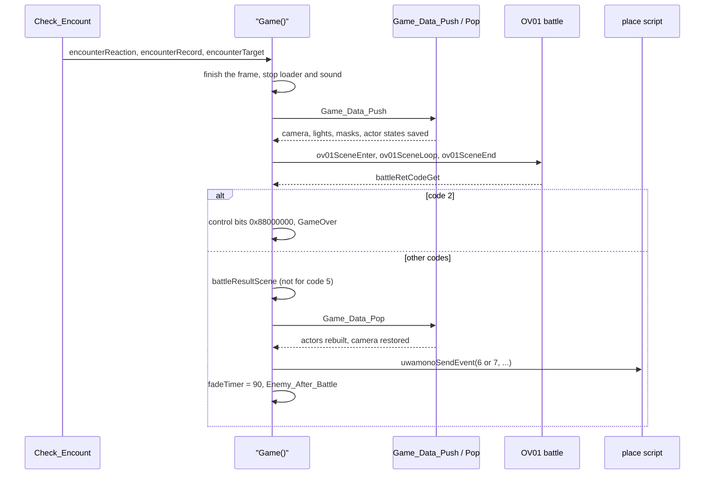

### Game_Data_Push

The battle needs the actor pool, the effect system and the work memory for
itself. `Game_Data_Push` therefore copies everything the field cannot
rebuild into places that survive, and then gives the pool up.

1. `GameCameraStateSave` copies the 32 camera records, the transition table
   and the track index into their save blocks.
2. The two hide masks of the map model, `mapMainHideMask` and
   `mapSecondHideMask`, go to `savedMapBits`.
3. All 16 light sets go to `savedLights`.
4. `elvActiveMask` goes to `elevatorMask`, and the 32 `elvKeepOffFlags` are
   packed into the bits of `keepOffMask`.
5. For each of the 256 records that has an actor, the actor's state is
   copied into the record: the collision probe, the light block, the two
   colour blocks, four fog values, draw mode, draw flags, draw parameter,
   flags, frame, mode, slot, requested mode, and the speed and range of
   motion channel 0.
6. `XenoActorPoolInitDefault` rebuilds the actor pool. The records keep
   their actor pointers as a mark that they had an actor.
7. `uwamonoLoadCurrent` saves the player parameters: gravity, bounce
   divisor, `frameScale`, the five `playerParams`, `climbFrames`, and the
   scale and radius of the player record as `formScale` and `formSize`.
8. `sbThreadsSuspend` suspends the threads of the place script.
9. `sefPushEffect` saves the running effects, `sefDestroyEffectCf` removes
   the place effects, and `fontObjClearSlots` clears the font objects.

### Game_Data_Pop

`Game_Data_Pop` is the reverse, but it has more work, because the models
were unloaded and the actors no longer exist.

1. `WorkEnd` is set back to `gameWork.workEnd`.
2. `mapObjectResourcesLoad` loads the common map object files again, and
   `mapResourceSwitch(gameWork.resourceId, 0)` loads the map model again.
3. The hide masks, the light sets, the elevator mask and the keep-off flags
   are restored, and so are gravity and the bounce divisor.
4. `sefInitEffectCf` and `sefPopEffect` bring the effects back.
5. The actor pool is rebuilt, and each record that had an actor gets a new
   one. `GameResLoadID(record->key, ...)` loads its resource block, which
   names the model pack, the texture, the hierarchy, the look link and the
   slot table. A shared motion table comes from resource `0x30041`, and the
   record's own motion resource is added when it has one. Then the actor is
   placed on the record's position and rotation, its radius and height come
   from the record, the probe is restored and bound to its collision block
   again, and all the saved draw and motion state is written back. Flag
   `0x200` is set on the actor.
6. A model object (kind 2) gets its transform pointer back: into the entry
   matrices of the map's second pack when it names an entry of it,
   otherwise to its own saved matrix. Effects that belong to a record are
   given their owner again.
7. `uwamonoAttachPlayerParts` hangs the parts on the player again, the
   player's probe is told to find its floor, and `uwamonoStoreCurrent`
   writes the saved player parameters back.
8. `GameCameraStateRestore` restores the camera records and runs one camera
   update. Camera flag `0x20` makes the camera re-seat on the player.
9. `sbThreadsResume` wakes the script threads, `sbResetNativeCounts` and
   `scriptRegisterModules` register the field's script modules again,
   because the battle registered its own.

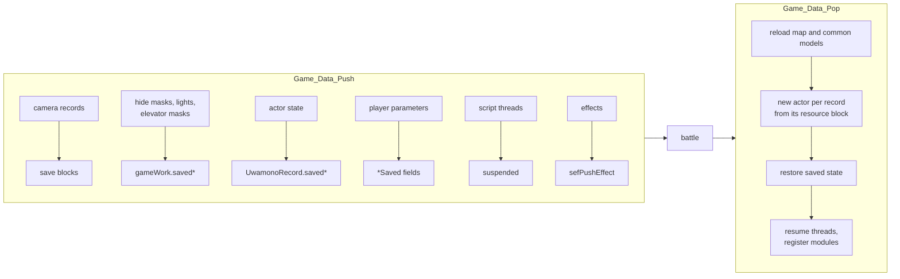

## Changing place

A place change is always a request: something writes a number into
`gameWork.nextMap`, the frame loop ends, and the outer loop loads the new
place. The usual way is the script native `runtime.jumpCF`, which calls
`uwamonoSetTransition(mode, state, stateArg, timer)` in
`src/main/runtime.c`.

`uwamonoSetTransition` does not write `nextMap` at once. It stores the
place and the entry key in the player record (`eventState`,
`eventStateArg`), sets the record's `eventTimer` and its `event` to 0, and
sets the control bits `0x20000000` and `CONTROL_SCRIPTED`. With mode 1 it
also sets `CONTROL_REPLAYED`, so the player walks on. Otherwise the player
goes to its standing motion. Unless `CONTROL_CFE_NO_FADE` is set, a fade-out
of `timer` frames starts.

`DispMapObject` counts the event timer of every record each frame. When the
timer of an event 0 runs out, it copies the two values to `nextMap` and
`entryKey`. A timer of 0 skips the wait: `uwamonoSetTransition` writes both
values itself.

In the new place the map model is loaded by the script. The load callback
sets bit `0x20`, and on the next frames `Game()` places the player by the
entry key, as described in [The frame loop](#the-frame-loop).

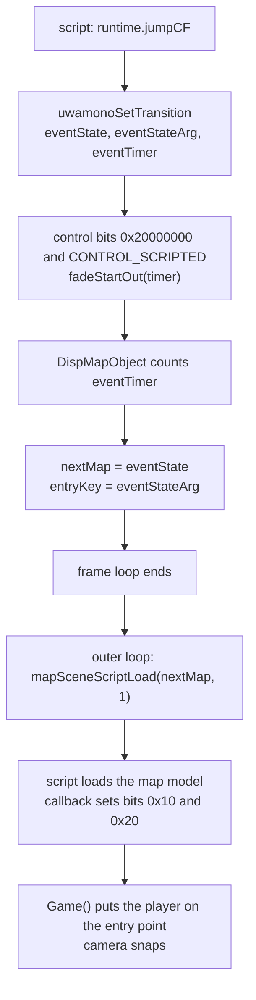

### Leaving and returning through the menu

`uwamonoAttachCurrent` and `uwamonoDetachCurrent` in
`src/main/save_party_init.c` are a pair of place changes that remember
where the player was. The main menu calls them when it closes with a
destination chosen, and the script native `umnReturn` calls the second one.

`uwamonoAttachCurrent(kind, runSplit)` works only when no return point is
stored (`ptState.progress->mapId` is -1), a player exists and `kind` is
below 8. It stores the current place in `progress->mapId`, the player's
position in `progress->position` and the party's split mode in
`progress->savedSplitMode`. Then it enters or leaves split mode as
`runSplit` asks, which decides whether the player continues on foot or in an
E.S. It sets control bit `0x800` and starts a transition to
`partyAttachMapIdTable[kind]`, one of the eight places 1010, 2110, 2210,
3120, 3410, 4310, 4610 and 5010. The entry key is 201, or 4 for kind 6.

`uwamonoDetachCurrent` restores the saved split mode, clears game flag
`0x2F0` and control bit `0x800`, and starts a transition back to the stored
place with entry key -2. That key makes `Game()` put the player on the
stored position. Finally the stored place is set to -1 again.

Both functions call `msgResetAll`, so no message window survives the jump.

## The map model and the map objects

The map of a place is one model with its collision data. The script loads it
with `runtime.mapChange`, which ends in `mapResourceSwitch(id, mode)` in
`src/main/game_map_object.c`. The function stores the id in
`gameWork.resourceId` and calls `GameResLoadID` until it succeeds, with
`mapResourceLoadCallback` as the callback. A different previous map is
released afterwards. With mode 1 the function first resets the map object
records and the effect handles, and releases the map if it is being loaded
again.

`mapResourceLoadCallback` sets up everything that depends on the map:

- `mainObject` and `mapTextureData` take the model and its texture. All
  entries of the model and of its second pack (`mapObjectTable`) are made
  visible in the two hide masks.
- If the texture block is a JPEG stream (it starts with the bytes
  `FF D8 FF E0`), it is a painted backdrop. It is decoded into a buffer of
  `0x400000` bytes, and the alpha byte of each pixel is filled from a
  second plane that follows the stream.
- `mapLoadBlock` registers the collision block, and the entry point table
  `uwamonoEntries` is found through `UnduDataGetHeader(0x300, -1)`.
- The control bits `0x10` and `0x20` are set.
- Unless a battle is pending, the fog distances are cleared and the ladder
  table is reset. Gravity becomes 0.02 and the bounce divisor 1.5.
- `sefKillEffect(-1)` stops all effects.
- The script image inside the resource is copied to `gameWork.resBuffer`.
- All 16 light sets get default values: a light from straight above, grey
  colours of 0.5, and 0.15 for the fourth light. The light area of every
  record is set to -1.

The map, the collision mesh and the record kinds are the subject of
[Maps and units](map-and-units.md). The two functions the frame loop calls
are summarised here.

`DispMapObject` is the per-frame pass over all 256 records. It first counts
the two "just loaded" control bits down. Then, for each used record, it
counts the event timer (event 0 is a place change, event 1 a form change of
the player). Actor records get their footstep sound, their visibility, their
tweens, their scale and transparency, their enemy update `ACT_updateEnemy`
(not for the player) and their light blend. After that, model records get
their matrix and the common models are submitted for drawing. Models of
type 7 and up turn by 0.1 radians per frame. A model of type 7 to 9 that is
closer to the player than half of the player's form value creates an effect
at its position, plays sound `0x02000010` and calls `battleSlotsRestoreAll`,
which refreshes the HP and EP of the party slots. Flag records switch
entries of the map model on and off, and effect records move their effect. At the
end the markers of objects in reach are placed and `uwamonoUpdatePoints`,
`uwamonoUpdateItemPickups` and `DispCollUwamono` run.

A tween is a timed change of one value of a record. `mapObjectAdvanceTweens`
advances four of them per record: position, rotation, scale and
transparency. Position and rotation go through `Get_MiddlePoint`, or through
`Get_MiddlePoint_Curve` when a curve is set. A finished move can start an
actor mode. Tweens stand still while the game is paused.

`mapObjectsDraw` submits the map model. It does nothing when there is no
model, when the map has a backdrop image, or when a place change is pending.
Otherwise it sets the fog (when both fog distances are set), the hide mask,
the texture and the colour scale `gameWork.mapColor`, and calls
`pxySubmitModel(mainObject)`. A second pack is submitted with its own hide
mask and part mask. A map with a backdrop is drawn by `mapBackdropDraw`
instead, which projects the origin with the camera, picks the visible
window of the image and sends it in four strips. The model library is
described in [The pxy model library](../libraries/pxy.md).

## Studios and studio cameras

The field camera does not build view matrices itself. It writes a position,
a look-at point, a roll and a field of view into a studio camera, and the
studio camera turns them into matrices. Studios belong to the xgl library
and are described in full in [xgl](../libraries/xgl.md). The field needs the
following from them.

`src/main/xgl_studio.c` keeps four studios of `0x3180` bytes each. A studio
holds a light block and eight `XglCamera` objects. `xglStudioChange(n)`
selects the current studio, and `xglStudioGetCamera2(i)` returns camera `i`
of it. `xglStudioInit` resets all 32 cameras and selects studio 0, and
`xglStudioMove` runs every active camera once per frame.

An `XglCamera` has a state that selects how it is driven
(`xglCameraTravelProc` in `src/main/xgl_camera.c`).

| State | Meaning |
| --- | --- |
| 0 | Off |
| 1 | Idle, set by `xglStudioMainCameraInit` |
| 2 | Manual camera moved with the pad (`xglCameraTravelManual`). SELECT with TRIANGLE resets it |
| 3 | Chase camera (`xglCameraTravelChase`) |
| 4 | Game camera. The pad does nothing, the owner writes the values |

The values the owner writes are in the camera's `travel` block
(`CameraTravel`): `position`, `rotation`, `fov`, and `chase_position` with
`chase_reference`, which hold the look-at point. `xglCameraMove(camera)`
then calls `xglCameraViewScreen`, `xglCameraViewTravel` and
`xglCameraViewVolume`, which build the screen values, the camera transform
with its inverse, and the view volume used for clipping.

`Game()` puts every camera into state 2 at the start of a place.
`GameCameraReset` then calls `cameraStudioReset`, which puts camera 0 of the
current studio into state 4 and parks it at (1000, 1000, 1000). Both
`uwamonoPlayerUpdate` and the camera update test for state 4, so if a debug
tool switches camera 0 back to the manual state, the player and the field
camera stand still and the view can be moved freely.

## The field camera

The field camera is the code in `src/main/game_camera.c` that decides, each
frame, where the camera stands and what it looks at. Its state is the
`GameWorkCamera` structure at `gameWork.camera`. Scripts control it through
the `camera` module of `src/main/runtime_camera.c`.

The design has four parts.

- **The current camera** is a `CameraRange` block, `gameWork.camera.range`.
  It holds the look-at point, the camera position, the orbit angles and the
  settings that produce them.
- **Camera records** are 32 stored copies of such a block, in
  `cameraCfSlots`. A place script fills them, one per camera area of the
  map.
- **The area probe** follows the player over a special collision group of
  the map and reports which camera area the player is in. That number
  selects the record.
- **Slots** are four timed transitions. When the record changes, the slots
  blend the look-at point, the position, the field of view and the roll
  from the old values to the new ones.

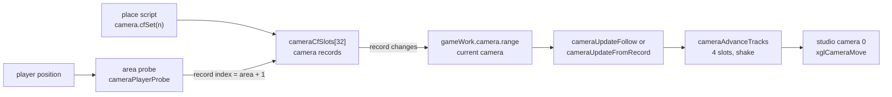

### GameWorkCamera

| Offset in `gameWork` | Type | Name | Meaning |
| --- | --- | --- | --- |
| `0xD0` | `unsigned short` | `flags` | Camera flags, see below |
| `0xD2` | `unsigned char` | `cameraType` | 0 follow, 1 fixed record |
| `0xD3` | `unsigned char` | `cameraSubType` | Second argument of `camera.mode`, cleared when the type changes |
| `0xD4` | `signed char` | `recordIndex` | The camera record in use, -1 after a re-seat |
| `0xD5` | `signed char` | `surfaceGroup` | Number of the camera collision group in use, -1 for the default |
| `0xD6` | `unsigned char` | `allSlotsFlagA` | Set by `cameraApplyAllSlots`. For one frame, a record change starts no transition of its own |
| `0xD7` | `unsigned char` | `allSlotsFlagB` | The look-at offset must be re-based on the anchor |
| `0xD8` | `unsigned char` | `previousRecordIndex` | The record before the last change |
| `0xD9` | `unsigned char` | `anchorLocked` | Copied from the work block each frame |
| `0xDA` | `unsigned char` | `previousCameraType` | The type before the last change |
| `0xDC` | `signed char` | `trackIndex` | Number of the camera area group in use |
| `0xE0` | `unsigned long long[2]` | `typeState` | Cleared when the type changes |
| `0xF0` | `unsigned char` | `shakeFlags` | Bits 0 to 2 are the three shake waves, bit 3 the hand shake |
| `0x100` | `CameraWave[3]` | `waves` | The shake waves |
| `0x130` | `float[4]` | `sway` | Hand shake: two offsets and two velocities |
| `0x140` | `CameraSlot[4]` | `slot` | The four transitions |
| `0x180` | `CameraRange` | `range` | The current camera |
| `0x1F0` | `CameraPose` | `from` | Start values of the transitions |
| `0x220` | `CameraPose` | `to` | End values of the transitions |
| `0x250` | `Vector4` | `fromOffset` | Start value of the look-at offset |
| `0x260` | `Vector4` | `anchorOffset` | Position of the anchor this frame |
| `0x270` | `float[3]` | `anchorBase` | Look-at point minus anchor position |

A `CameraPose` is three vectors: `position` with the field of view in `w`,
`lookAt` with the roll in `w`, and `angles` with the pitch in `x`, the yaw
in `y` and the distance in `w`.

The camera flags are these.

| Bit | Name | Meaning |
| --- | --- | --- |
| `0x8` | `CAMERA_FLAG_DISABLED` | The camera is not updated |
| `0x10` | `CAMERA_FLAG_SLOTS_APPLIED` | A transition was started and its end values must still be taken |
| `0x20` | `CAMERA_FLAG_TRACK_PLAYER` | Re-seat: fetch the area group again and start the area probe at the player |
| `0x40` | `CAMERA_FLAG_MODE_CHANGED` | A new camera collision group was selected |
| `0x80` | `CAMERA_FLAG_SNAP` | Reset the probes and jump to the new view without a transition |
| `0x200` | `CAMERA_FLAG_VIEW_ONLY` | Direct mode: only `cameraApplyView` runs |

### CameraRange and the camera records

`CameraRange` is `0x70` bytes.

| Offset | Type | Name | Meaning |
| --- | --- | --- | --- |
| `0x00` | `int` | `anchorIndex` | What the look-at point follows: -1 nothing, a record index below 4096, or an actor pointer |
| `0x04` | `short` | `anchorSubIndex` | A joint of the anchor's skeleton, -1 for its root |
| `0x08` | `unsigned char` | `lockX` | The camera's x is fixed to `cameraPosition.x` |
| `0x09` | `unsigned char` | `lockY` | The same for y |
| `0x0A` | `unsigned char` | `lockZ` | The same for z |
| `0x0B` | `unsigned char` | `probeMode` | How the camera avoids the scenery: 0, 33 or 17 |
| `0x0C` | `unsigned char` | `rangeMode` | Non-zero keeps the angle limits active after a transition started |
| `0x0F` | `unsigned char` | `rangeFlag` | Non-zero: the north angle follows the camera's yaw |
| `0x10` | `float` | `northAngle` | The yaw that stick directions are measured from |
| `0x20` | `Vector4` | `offset` | The look-at offset from the anchor. `w` 1.0 means "turn it with the anchor" |
| `0x30` | `Vector4` | `angleLimits` | Pitch minimum and maximum, yaw minimum and maximum |
| `0x40` | `Vector4` | `cameraPosition` | The camera position. `w` is the field of view |
| `0x50` | `Vector4` | `lookAt` | The look-at point. `w` is the roll |
| `0x60` | `Vector4` | `angles` | Pitch, yaw, and in `w` the distance to the look-at point |

`cameraRangeSetDefaults` gives the defaults: no anchor, an offset of 1.2
above the anchor, pitch limits of plus and minus 90 degrees, yaw limits of
plus and minus 360 degrees, a pitch of -22.5 degrees, a distance of 5.0 and
a field of view of 40 degrees.

A camera record (`struct CameraRecord`, 208 bytes) wraps a range: byte 0 is
the camera type, byte 2 the number of the camera collision group, `0x10`
holds one `CameraSlot` with the transition settings to use when this record
becomes active, and `0x20` holds the range. `cameraCfSlots` holds 32 of
them.

The transition table `cameraSlotTable` holds 32 entries of 20 bytes
(`struct CameraKeyEntry`): a key, a sub-key, a range mode and a
`CameraSlot`. An entry describes the transition for one particular change,
from record `key` to record `sub`. `cameraSlotFind(key, subKey)` searches
it. The script native that fills it is called `cfHokan`. "Hokan" is
Japanese for interpolation.

`GameCameraReset` clears all of this at the start of a place. It calls
`cameraInit`, which resets the studio camera, zeroes 432 bytes of the camera
state, sets the snap flag and gives the current range its defaults with the
camera at (0, 3, 10) looking at the origin. Then it clears the 32 records
and the 32 transition entries, and selects the default groups with
`GameCameraChangeID(-1, 0, 0)`.

`GameCameraStateSave` and `GameCameraStateRestore` copy the 32 records, the
transition table and the track index to a second set of blocks and back.
The restore also calls `cameraSetIndex` and runs one camera update with
control bit `0x400` masked out, so the view is correct on the first frame
after a menu or a battle.

### Camera areas and probes

The camera uses three probes. A probe is a `MapCollisionObject`, the same
structure a character uses to stand on the collision mesh. Here it is used
to walk over groups of the collision data that exist only for the camera.
`UnduDataGetHeader(group, index)` returns such a group. The collision
system is described in [Maps and units](map-and-units.md).

| Probe | Group | Selected by | Use |
| --- | --- | --- | --- |
| `cameraPlayerProbe` | 1536 (`0x600`) | `cameraSetIndex`, native `cfSelectCHG` | The camera areas. Its ground status is the area number |
| `cameraPositionProbe` | 512 (`0x200`) | `GameCameraChangeID`, native `cfCamID` | The surface the camera may stand on |
| `CamLookAt` | 512 (`0x200`) | `GameCameraChangeID` | Set up with the same group |

`cameraSetIndex(index)` fetches area group `index`. A negative index means
"the current one again". When the group does not exist, it falls back to
group -1. It also sets the re-seat flag. `GameCameraChangeID(mode, 0, 0)`
does the same for the camera surface, with a fallback to -1, and does
nothing when the mode is unchanged and both probes are bound.

Each frame, `cameraUpdateFrame` moves `cameraPlayerProbe` from the player's
last position to its new one with `UnduCheck`. The low byte of the ground
status it lands on, plus 1, is the record index. Without an area group the
index is 0. If the probe height is more than 4.0 away from the player's
height, the probe is told to find its floor again, which handles jumps
between floors.

### The camera update

`cameraUpdateFrame` is called once per frame by `Game()`. It uses a block of
the scratchpad at `0x70000000` as its work area: the record pointer, the
slot settings, the studio camera, the anchor actor and several vectors are
kept there for the functions it calls.

The function returns early in four cases. With `CAMERA_FLAG_DISABLED` it
does nothing. With `CAMERA_FLAG_VIEW_ONLY` it calls `cameraApplyView` and
returns. When camera 0 is not in state 4 it returns. And when control bit
`0x400` is set, nothing after the set-up runs. While control bit `0x20` is
set, it parks the studio camera with `cameraStudioReset` and sets the snap
flag, so the camera jumps as soon as the player has been placed.

The frame step is read from the studio camera (1.0 after `xglCameraInit`)
and forced to 0 while the game is paused, which freezes all transitions.
The shake flags are cleared, so shakes never run in this path.

The normal path is this.

1. **Snap.** With the snap flag, the record index becomes 0, the area probe
   is initialised, the default groups are selected and the re-seat and
   mode-changed flags are set too.
2. **Re-seat.** With the re-seat flag, the area group is fetched again, the
   probe's start position becomes the player's position, the record index
   becomes -1 and all three probes forget their triangle.
3. **Area.** The area probe moves with the player and gives the record
   index.
4. **Record change.** When the index differs from `recordIndex`, the new
   record becomes current. `cameraSlotFind(previous, new)` looks for a
   special transition. If there is one, its slot settings and range mode
   are used, otherwise those of the record. `GameCameraChangeID` selects
   the record's camera surface. Unless `allSlotsFlagA` is set,
   `cameraApplySlots(0xF, blend, ease, frames)` starts all four transitions.
   When the camera type changes, the type state is cleared. Then the
   record's range is copied over the current one.
5. **Snap again.** With the snap flag the four durations are zeroed, so the
   transitions that were just started end at once.
6. **Type.** `cameraUpdateFollow` or `cameraUpdateFromRecord` computes the
   target view. `cameraClampAngles(0)` applies the angle limits. If
   `cameraCommitSlots` reports that a transition was just started, it has
   taken the result as the end values, and the type function and
   `cameraClampAngles(1)` run a second time.
7. **Advance.** `cameraAdvanceTracks` advances the transitions and writes
   the studio camera.
8. **Bookkeeping.** The anchor position and `anchorBase` are stored. If
   `rangeFlag` is set, `northAngle` takes the yaw of the studio camera. The
   snap and mode-changed flags are cleared.

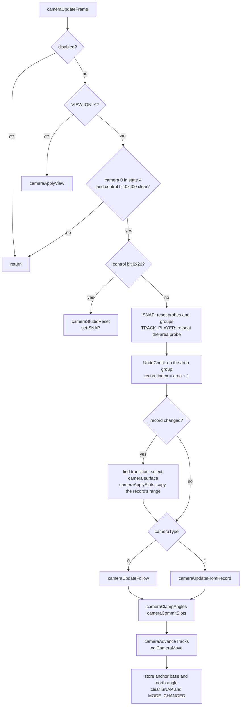

### The follow camera

Camera type 0 (`CAMERA_TYPE_FOLLOW`) keeps the player in view. It is an
orbit camera: the look-at point is tied to the player, and the camera
stands at a fixed pitch, yaw and distance from it. The camera does not turn
with the player and the player cannot turn it. Each camera area of the map
has its own angles.

`cameraUpdateFollow` works as follows.

1. The look-at point is the player's position plus `range.offset`
   (`cameraApplyAnchorOffset`). If `offset.w` is 1.0 the offset is first
   turned by the anchor's yaw and pitch, otherwise it is added as it is.
2. `GetCameraPos` computes the camera position from the look-at point and
   the record's angles. It builds a matrix: translate to the look-at point,
   rotate by the yaw around y, rotate by the pitch around x, translate by
   the distance along z. The translation part of the result is the
   position.
3. If the camera surface group exists, the position is corrected so that
   the camera does not end up inside the scenery (see the next section).
4. Each of `lockX`, `lockY` and `lockZ` that is set replaces one coordinate
   of the position with the one stored in the record. This gives cameras
   that slide along a line or stand on a fixed spot while they look at the
   player.
5. `cameraAnglesBetween` computes the real pitch, yaw and distance from the
   final position to the look-at point, and these and the position are
   stored in the current range. The field of view and the roll are copied
   from the record.

### Keeping the camera out of the scenery

The camera surface is a collision group that the map designers built for
the camera. `cameraPositionProbe` stands on it like a character on a floor.
The two correction functions try to bring the wanted camera position onto
that surface. The record's `probeMode` chooses the method.

With `probeMode` 0, `cameraPullInAlongSight` is used. It moves the probe
from the last camera position towards the wanted one with
`cameraProbeSlide`. If the surface height at the end is within 0.05 of the
wanted height, the position is accepted. Otherwise the wanted position is
moved along the line of sight to the point where the line has the height of
the surface, and the probe is tried again. This is repeated up to 16 times.
The effect is that the camera slides towards the player when a wall or a
slope of the surface is in the way.

With any other `probeMode`, `cameraSearchOrbitPitch` is used. It keeps the
yaw and the distance and searches for a pitch at which the orbit position
lies on the surface. It starts at the record's pitch and steps by 3
degrees, up or down depending on whether the surface is above or below the
camera. When the surface height crosses the camera height, the step is
halved and reversed. The search ends when the two heights differ by less
than 0.01, or after 60 steps. If the first probe finds no surface at all,
the search starts from straight below (-90 degrees) or from level (0
degrees) with steps of 45 degrees. `probeMode` 33 makes the first probe
slide along the surface, and `probeMode` 17 slides once more to the height
that was found. The native `cfLock` can produce the values 0, 1, 32 and 33,
so the value 17 is not reachable from a script through that native.

`cameraProbeSlide` is the helper both use. It moves a point by a delta with
`UnduCheck`. If the point was stopped short in x or z, it tries again with
half the remaining step, and keeps halving until the step is below 0.01.

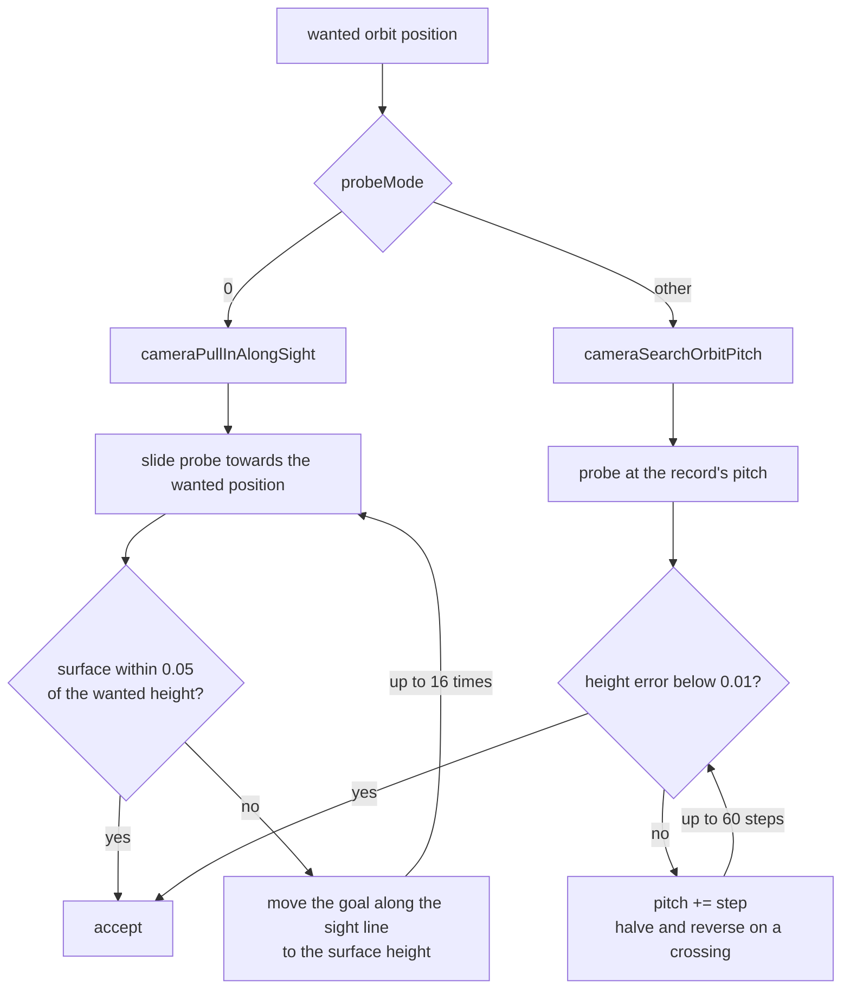

### The fixed camera

Camera type 1 (`CAMERA_TYPE_RECORD`) takes the camera position from the
record. `cameraUpdateFromRecord` copies the record's position, look-at
point, field of view and roll into the current range when an area group is
in use. If the record has an anchor, the look-at point is replaced with the
anchor position plus the offset, so the camera stands still and turns to
follow the anchor. Without an anchor it shows a fixed view. The angles are
computed from the two points.

### Angle limits

`cameraClampAngles` keeps the view inside the record's `angleLimits`.
`cameraAngleLimitIndex` classifies an angle against an arc: -1 inside it,
otherwise the index of the nearer end. When the yaw is outside its arc, it
is set to the nearer limit and the look-at point is moved sideways to
match. When that changes the yaw by more than 90 degrees, the pitch is
mirrored. The pitch is clamped the same way. Then the look-at point is
computed again from the position, the clamped angles and the distance. The
function notes whether the look-at point moved by more than 0.1 on any
axis, which `cameraCommitSlots` uses to decide whether a look-at transition
is needed at all.

The effect is a camera that follows its target only up to a point. A fixed
camera with yaw limits turns with the player until the limit and then lets
the player walk out of the centre of the picture.

### Slots and transitions

A slot (`CameraSlot`, 16 bytes) is one running transition.

| Offset | Type | Name | Meaning |
| --- | --- | --- | --- |
| `0x02` | `unsigned char` | `blendMode` | For slot 1: 0 blends the position, anything else blends the angles |
| `0x03` | `unsigned char` | `easeMode` | The curve, see below |
| `0x04` | `float` | `progress` | Frames done |
| `0x08` | `float` | `duration` | Length in frames. 0 means the slot is idle |
| `0x0C` | `float` | `fraction` | The eased progress from 0 to 1 |

| Slot | Blends | Stop native |
| --- | --- | --- |
| 0 | The look-at point | `MoveRefStop` |
| 1 | The camera position or angles, and the look-at offset | `MoveCamStop` |
| 2 | The field of view | `MovePersStop` |
| 3 | The roll | `MoveBankStop` |

`cameraApplySlots(mask, blend, ease, frames)` starts the slots named by the
mask. For each one it calls `cameraSlotSetup` and copies the current value
into `from`. With a non-zero frame count it sets
`CAMERA_FLAG_SLOTS_APPLIED`. On the same frame, after the type function has
computed the new view, `cameraCommitSlots` copies that view into `to`.
While `allSlotsFlagB` is set it also re-bases the look-at offset: the new
offset is `anchorBase` plus the anchor's root position minus its joint
position, so the look-at point does not jump when the anchor changes. If
the limits are active, the target was already matched and the look-at
point did not move, the look-at transition is cancelled.

`cameraAdvanceTracks` then runs every frame. Each active slot adds the
frame step to its progress, computes the fraction with `cameraEase` and
blends its values. Slot 1 has two ways to blend. With `blendMode` 0 it
blends the position along a straight line and derives the angles. Otherwise
it blends pitch, yaw and distance and derives the position, which moves the
camera along an arc around the look-at point. Angles are blended with
`cameraLerpAngle`, which takes the shorter way round the circle. A finished
slot copies the reached values into `from` and clears its duration.

`cameraEase(mode, time, duration)` has four curves.

| Mode | Curve |
| --- | --- |
| 0 | Linear |
| 1 | Slow start and slow end: `t^4 / 2` over the first half, mirrored over the second |
| 2 | Slow start: `t^2` |
| 3 | Slow end: `1 - (1 - t)^2` |

After the slots, the function writes the studio camera: position, field of
view, look-at point, roll plus the roll shake, and the yaw and pitch from
`cameraAnglesBetween` plus the shake offsets. `xglCameraMove` builds the
matrices.

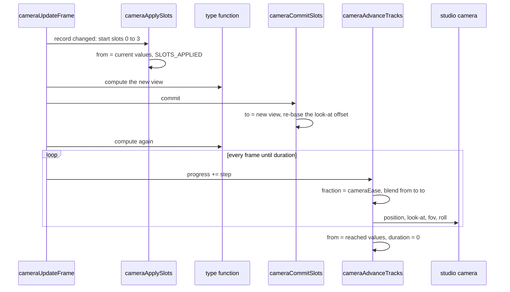

`cameraApplyAllSlots` is a ready-made transition used by the ladder code:
all four slots, position blend, ease mode 3, 15 frames. It also sets
`allSlotsFlagA`, so the record change that follows on the same frame does
not start a second transition, and the re-seat flag.

### Direct mode and scripted cameras

The native `cfBattleCam(1)` sets `CAMERA_FLAG_VIEW_ONLY`. In this mode the
areas, records and probes are not used. `cameraApplyView` only takes the
current range as the script left it: `cameraStageLookAt` follows the anchor
if one is set, and `cameraAdvanceTracks` runs the transitions and the
shakes. This is the mode for scripted camera work inside a field scene.
`cfBattleCam` also zeroes all four durations and sets the snap flag, so the
switch itself is a cut.

The `camera` module has 51 table entries. They are listed with their
arguments in [Natives](../scripting/natives.md#the-camera-module). The
features they drive are these.

**Units.** Positions and distances are passed as integers in hundredths
(`cameraCentiToFloat`), angles in hundredths of a degree
(`cameraCentiDegToRad`). Every native checks its argument count with
`cameraCheckArgCount` and raises a script error on a mismatch.

**Records.** `cfSet(n)` stores the current camera as record `n`, with the
camera type, the camera surface number, the settings of slot 0 and the
whole range. `cfChange(n)` does the same without the slot settings. A place
script builds a camera with the other natives and then stores it, once per
camera area. `cfRotRange` sets the angle limits, `cfRangeMode` the range
mode, `cfLock` the three axis locks and the probe mode from one bit mask
(bits `0x2`, `0x4`, `0x8` for the axes, `0x21` for the probe mode),
`cfCamID` the camera surface, `cfSelectCHG` the area group, `cfHokan(a, b)`
a transition entry for the change from record `a` to record `b`, and
`cfNorth` a fixed north angle for the stick. An angle outside plus or minus
360 degrees switches the north angle back to following the camera.

**The reference point.** The script calls the look-at point the reference
("Ref"). `SetRefPos` sets it to a position and removes the anchor.
`SetRefAct` ties it to a record and a joint with an offset in world
directions, `SetRefActR` with an offset that turns with the anchor.
`SetRefAng` places it 10 units in front of the camera at a pitch and yaw.
`RefLock` stops following. `SetRefCamActR` and `SetRefCamAct3R` set the
reference and the camera together. The second one places the reference on
the line between two anchors.

**The camera position.** `SetCamPos` sets a position. `SetCamAng` sets
pitch, yaw and distance around the reference. `SetCamAct` and `SetCamActR`
place the camera relative to an anchor. `SetCamAct2` and `SetCamAct2R`
orbit an anchor, the second relative to the anchor's own rotation.
`SetCamAct3` places it between two anchors. `OffsCamPos` and `OffsCamAng`
add to the current values. `CamLock` stops a running position transition.

**Moves.** The setters normally write the current range, which is a cut. To
get a move, the script first calls `MoveRefMode` or `MoveCamMode`. The next
reference or camera setter then writes into `to` instead. `Move(blend,
ease, frames)` starts the slots that were armed this way, or slots 0 and 1
when none was armed. `WaitMoveRef` and `WaitMoveCam` make the script wait
until the fraction of slot 0 or slot 1 has reached 1.

**Field of view and roll.** `SetPers` and `SetBank` set them at once.
`MovePers(angle, ease, frames)` and `MoveBank(angle, ease, frames)` start
slot 2 or slot 3.

**Shake.** `Shake(channels, amplitude, period, hold, frames)` starts up to
three waves. Channel bit 1 shakes the yaw, bit 2 the pitch and bit 4 the
roll. Each `CameraWave` is a triangle wave of the given period in frames.
After `hold` frames the amplitude shrinks by `amplitude / frames` per frame
until the frames are used up. `HandShake` toggles bit 3 of `shakeFlags`,
which adds a slow random drift to yaw and pitch: two spring-like values in
`sway` are pushed by `xglFRand` each frame. Because `cameraUpdateFrame`
clears `shakeFlags`, both only work in direct mode.

**Reading back.** `GetRefPos`, `GetRefAng`, `GetCamPos` and `GetCamAng`
write the current values into a script array, in the same units.

`cameraRegisterNatives` registers the module under the name `camera` and
clears the three move flags. The same file registers the `ladder` module
with its natives `setLadder` and `setEntrance`, which belong to
[Maps and units](map-and-units.md).

## Pause

START toggles the pause. The frame loop accepts the button only when
nothing else is going on. All of these must be false:

- a fade is running (`fadeUpdateHook[0]` is set, or the global fade is
  below 0),
- a battle is pending,
- one of the control bits `0x230` is set (a cfe cutscene, or a map loaded
  in the last two frames),
- a place change is requested,
- the ladder state is 2, 3 or 7 (getting on or off a ladder),
- `inputDelay` is still counting.

When START is accepted, `inputDelay` is set to 16, so the next toggle is
possible 16 frames later at the earliest.

Switching the pause on calls `xglClockSampleDayTime`, sets
`CONTROL_PAUSED`, plays sound `0x2000011`, mutes the sound effects with
`seSetMuted(1, 1)` and pauses sound slot 0 with
`soundSlotSetPauseIfNotHeld(0, 1)`. Switching it off clears the bit, undoes
both sound calls and plays the same sound.

While the bit is set, the frame loop keeps running but most of it is
switched off: no scripts, no effects, no vibration, no menu buttons, no
time panel, no actor updates. `pxySetFreezeAnimation` holds the model
animation, the player update returns early, the tweens of the map objects
stand still and the camera's frame step is 0. The picture is still drawn
every frame, so the scene stays on screen as a still.

Instead of the skipped steps, three calls run each paused frame:
`sefSetRenderHooks`, `pauseStart` and `xglClockAccumulate`. The last one
keeps the pause out of the play time. `pauseStart` in
`src/main/game_pause_disp.c` stores `pauseDrawTitleHook` in
`pauseDrawHook[0]`. The renderer calls this hook once while it builds the
frame. The hook adds `pauseBackdropPacket` to the packet, a prepared block
of eight quadwords of GS data that forms the backdrop of the pause text,
prints the word "Pause" centred on x 256 at y 200 and clears the hook
pointer again.

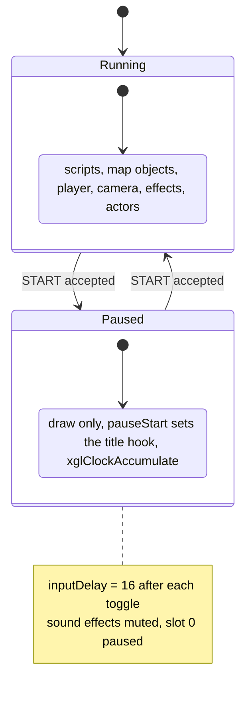

The same file draws the pause screens of the two other players.
`pauseDrawScreen` is used by the cfe cutscene player: the title, the dark
backdrop (`GamePauseDispBG`) and two hint lines at y 256 and y 288, "button:
Skip and proceed" with the triangle symbol and "START button: Cancel
Pause". `GamePauseDispEvent(skip_hidden)` is used by the movie player. It
draws the title and the hints without the backdrop and leaves the skip
hint out when the movie cannot be skipped. Skipping is handled by those
players (see [Cutscenes](../scripting/cutscenes.md)). The field pause has
no skip.

## Vibration

`src/main/vibration.c` drives the two motors of the controller in port 0.
The pad record has an `actuator` array: byte 0 switches the small motor on
or off, and byte 1 is the strength of the large motor from 0 to 255. The
pad code sends these bytes to the controller and clears them when vibration
is switched off in the settings (see [xgl](../libraries/xgl.md)).

The two motors are used differently. The small motor gives short pulses.
The large motor plays a ramp from one strength to another.

| Function | Effect |
| --- | --- |
| `Vibration_Set_Weak(frames)` | The small motor runs for this many frames |
| `Vibration_Set_Strong(target, start, frames)` | The large motor ramps over this many frames |
| `Vibration_Stop()` | Both counters and both actuator bytes are cleared |
| `VibrationEngine()` | Called once per frame by `Game()` unless paused |

`VibrationEngine` does two things. While `vibrationHold` is not 0, it
writes 1 to actuator byte 0 and counts the hold down. While
`vibrationFramesLeft` is not 0, it writes
`vibrationEnd + (vibrationStart - vibrationEnd) * framesLeft /
framesTotal` to actuator byte 1 and counts the frames down. On the first
frame the factor is 1, so the ramp starts at `vibrationStart` and moves
towards `vibrationEnd`. The order of the arguments in the calls shows the
intent: `Vibration_Set_Strong(255, 32, 30)` is a hit that starts at full
strength and dies away over one second.

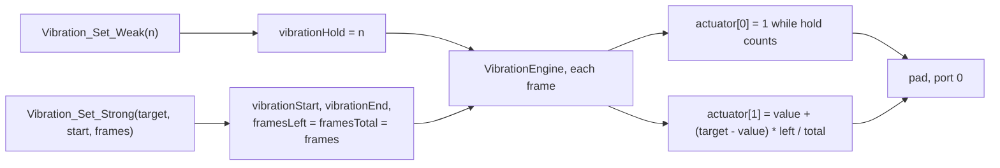

The callers are few.

| Caller | Call | When |
| --- | --- | --- |
| `uwamonoPlayerUpdate` | `Vibration_Set_Weak(4)` | The player starts an attack on a map object |
| `uwamonoTriggerRecord` | `Vibration_Set_Strong(255, 32, 30)` | A map object reacts to a hit, except in place 3560 |
| `runtimeVibration` | both | The script native `Vibration` with four arguments. With the first argument left out it stops the vibration |
| the settings page of the menu | `Vibration_Set_Weak(15)`, `Vibration_Set_Strong(200, 60, 30)` | Vibration was just switched on, as a sample |
| `Game()` | `Vibration_Stop()` | At the start of each place and before each battle |

## Snapshots

`src/main/game_snap_shot.c` turns the picture in the frame buffer into a
JPEG file with `xglJpegEncode`. It has two uses: screenshots written to the
development host, and a picture with a small preview packed into one
buffer.

`GameSnapShotWriteJpeg(path, quality)` encodes the 512 by 448 picture of
the current draw frame buffer. The buffer address and width are read from
the `FRAME_1` value of `DrawEnv`. The output goes to the free memory above
`WorkEnd`, rounded up to 64 bytes, and is then written to `path` with
`sceOpen`, `sceWrite` and `sceClose`. A quality of 0 or more is used for
both luminance and chrominance. A negative quality selects a row of
`quality_table`, which has five presets: 100, 90, 75, 50 and 30.

`GameSnapShotExecute(quality, flags)` writes a numbered screenshot. The file
name is `host0:/home/xeno/work/snap/game0000.jpg`, and the four digits are
counted up after each picture. With bit 0 of `flags` a second file with the
extension `.bin` is written first. It holds 160 bytes of metadata: the
clock time, the play time and `gameWork.resourceId`. `GameSnapShotNumber`
sets or reads one digit of the counter, and `GameSnapShotSaveFile` writes a
ready buffer under a given number.

`GameSnapShotSave(quality, output)` builds the combined picture in memory.
The layout is below.

```
+0x00  FF D8            JPEG start marker
+0x02  FF EE            APP14 marker
+0x04  length           160 + thumbnail size + 4, big endian
+0x06  metadata         160 bytes: clock time, play time, resourceId
+0xA6  thumbnail        JPEG, 128 x 112, quality 50
       ...
       picture          JPEG, 512 x 448
```

The thumbnail comes from `GameSnapShotSaveThumbnail`. It patches the
address of the draw buffer into a prepared GS packet
(`TestPrim_0_002BC220`), sends it with `xglDmaDirectNormal`, waits for the
graphics path with `sceGsSyncPath`, and then encodes a 128 by 112 area at a
fixed address of video memory. The packet most likely draws the picture at
a quarter of its size into that area.

`GameSnapShotCheck` is the function the game loops call to take a
screenshot on a button press. In this build it is empty. `pauseStart`, the
battle loop and two debug programs still call it every frame. No caller of
the other snapshot functions is left in the game, so the snapshot code is a
development feature that was switched off for release. The pictures of the
save files are made by the save code (see
[Save data](../architecture/save-data.md)).

## Movies in the field

A place script can play a full-screen movie with the native
`runtime.mpeg2`, and a scene resource script with its command `;mpeg2`.
Both end in `GameMpeg2Play(name)` in `src/main/game_movie.c`. The function plays the file `name.sfd` with the
CRI Sofdec player and shows the caption script that belongs to it. It runs
its own loop and returns when the movie is over, so for the field a movie
started from a place script is one long script step: `sbRunAll` does not
return until it ends, and no field frame is drawn in between.

The movie loop has its own pause. START pauses the player, sets
`gameWork.inputDelay` to 32, copies the last movie frame to the other frame
buffer page and draws `GamePauseDispEvent`. TRIANGLE then skips the movie
when skipping is allowed, and START continues it. The soft reset
combination sets `CONTROL_SOFT_RESET` and ends the movie. A read error
offers "Replay" and "Skip".

The player, the caption file format and the frame copy functions
`GameMovieFrameCopy1To0` and `GameMovieFrameCopy0To1` are described in
[Cutscenes](../scripting/cutscenes.md).

## The party reset

`ptReset` in `src/main/save_party_init.c` builds the party for a new
session. It is listed here because the file also holds the two place change
functions above. The party itself is the subject of
[Party and growth](party-and-growth.md).

When `menuLoadPending` is set, which is the case at power-on and after
`menuRequestLoad`, the function first resets the settings:
`saveDataSetDefaults` writes the defaults (sound mode 1, captions 2,
vibration on, cursor memory off), the pads and the sound driver take them
over, and `menuLoadTxds` reads the text tables `yosikawa\MainMenu.txd` and
`yosikawa\Tutorial.txd`.

Then it clears the stored return place (`ptProgressRecord.mapId = -1`),
builds the ten member records, stamps the play time with the current clock
and adds the ten members with `ptAddMember`: the ids 1 to 7 are the
characters and 11 to 13 the E.S. `ptSetCurrentSlot(0)` makes slot 0 the
current slot. The current member is the one whose model
`ptApplyCurrentModel` gives to the player record, so the party leader is
the character seen on the field. In split mode the call passes the key with
bit 31 set, and the model is the E.S. of the current back member.
