# G.S. Campaign, segment addresses and the debt

*Xenosaga Episode II* has three optional systems that run beside the main
story. The **G.S. Campaign** (Global Samaritan Campaign) is a set of 36 small
quests that citizens give to the party. The **segment addresses** are 18
numbered locked doors, each opened with its own decoder, with a treasure
behind them. The **debt** is an amount of 10,000,000 G that the player pays
off by handing over items in a sell window.

All three are driven by the field scripts. The engine only keeps their state
and shows it. It stores one byte per quest, one byte per citizen, one byte per
segment address and one integer for the remaining debt. Two full-screen pages
of the main menu display the quests and the segment addresses, and a special
form of the message window is the sell screen of the debt. This page describes
those screens, the text files they read, the flags and their values, and the
script natives that change them.

[← Back to the overview](../README.md)

## Official names and the names in the code

The released game and the code do not use the same words. The table below
sets them side by side. The official names were checked on the Xeno Series
Wiki. The names in the right column are the ones found in the source, in file
names, in script native names and in the text tags of the data files.

| In the released game | In the code | Notes |
| --- | --- | --- |
| Global Samaritan Campaign, G.S. Campaign, "GS 01" to "GS 36" | `g2path`, `yg2Path*`, "quest", "Path No. 01" | The Japanese name is "GET GLOBAL Campaign", shortened to "G2 Campaign". The device that records the campaigns is called the GS Path in English. `g2path` is therefore the G2 Path, the Japanese name of that device |
| A campaign | a "path" in the help text, a "quest" in `questFlags`, `setQuestFlag` and `QuestMes.txt` | Both words name the same 36 entries |
| The people who give campaigns | "citizen" in `citizenFlags`, `Citizen.txt`, `setCitizenFlag` | 50 citizens have a profile, more than the 36 clients |
| Segment Address | `seg`, `segAddrOn*`, `ysegf*` | The messages in the code say "Segment Address No. %d" |
| Decoder | "Decoder" as a column title in `src/main/ysegf.c` | The decoder itself is an inventory entry of data box category 3 |
| The debt | `msgBalance`, `SaveData.balance`, `menuDeptQuest`, "Remaining Debt: " | `Dept` is the spelling of the script native name |

The words on screen are official where the code holds them as text:
"Segment Address No.", "Remaining Debt:", "Path No.", "In Progress",
"Success", "Failed", "Subject", "Location", "Client", "Message", "Profile",
"Address", "Decoder", "Treasure" and "Explanation". The title graphics of the
two menu pages are sprites, so their wording is not in the code. The texts of
the campaigns themselves are in data files on the disc.

Outside sources describe the debt as the debt of the Elsa's captain, tied to
one of the campaigns, and name the people who collect it. Nothing of that is
in the engine. The engine knows only the amount, the item tables that a script
passes in, and the window.

## Files

| File | Contents |
| --- | --- |
| `src/main/yg2path.c` | The G.S. Campaign screen: main menu, path grid, message page, detail page and citizen profiles. The loaders of `QuestMes.txt` and `Citizen.txt`, the tagged text reader, the portrait loader, the guide model and its camera. The definitions of `questFlags` and `citizenFlags` |
| `include/main/yg2path.h` | The functions of the screen that other files call |
| `src/main/ysegf.c` | The segment address screen: list page and detail page, the loader of `Treasure.txt`, the door and item pictures. The segment flags `segAddrOnFlags` with `segSetAddrOn`, `segGetAddrOn` and `segAddrOnClearAll`. The file helpers `ysegfAllocFileBuffer` and `ysegfReadFile`, and `yg2PathResetAll` |
| `include/main/ysegf.h` | The functions of `ysegf.c` that other files call |
| `src/main/talk_natives.c` | Script natives: the four of `g2path`, the two of `seg`, and the menu, sell and number window natives of `talk` |
| `include/main/talk_natives.h` | Prototypes of those natives |
| `src/main/quest_flag_set.c` | `questFlagSet`, `questFlagGet` and `citizenFlagSet`, the functions behind the natives |
| `include/main/quest_flag_set.h` | Their prototypes |
| `src/main/msg_balance.c` | The debt variable: `msgBalanceSet`, `msgBalanceGet`, `msgBalanceReset`. Two helpers that set and clear the script control bit |
| `include/main/msg_balance.h` | Their prototypes |
| `src/main/msg_window_bind.c` | The item tables of the sell window and the sale logic `msgSaleUpdate` |
| `include/main/msg_window_bind.h` | Its prototypes |
| `src/main/msg_text_draw.c` | The drawing of the sell window (labels, remaining debt, item rows, empty notice), the line list of script menus, text measuring helpers, the digits of the number and time windows, and the "Acquired" notice text |
| `include/main/msg_text_draw.h` | Its prototypes |

The registration of the script modules is in
`src/main/talk_natives.c` and is described in
[Script natives](../scripting/natives.md). The mechanics of the message
windows belong to [User interface and windows](../libraries/ui-windows.md).

## Overview

The three systems share one design. A field script decides everything that
has to do with the story: who gives a campaign, when it succeeds or fails,
where a door is and what is behind it, how much an item is worth. The script
tells the engine the result through a native, and the engine stores a small
value. The menu pages later read those values and pick the texts and pictures
to show.

The state lives in four globals of the main executable. `questFlags` has 36
bytes, `citizenFlags` 50 bytes, `segAddrOnFlags` 18 bytes, and `msgBalance` is
one `int`. The segment address screen reads two more sources that it does not
own: the decoders in the inventory (data box category 3) and 18 script flags
that say which treasures were taken.

The diagram shows who writes and who reads each piece of state.

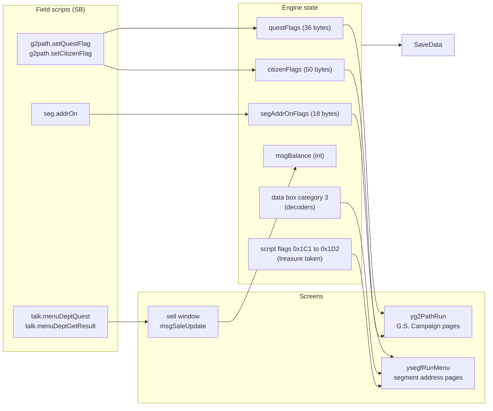

## Reaching the screens from the main menu

Both pages are opened from the main menu, which is described in
[Main menu](main-menu.md). The second row of the top level of the menu holds
up to four cards. When the menu is set up in `src/main/menu_scene.c`, the
byte `menuCardAvailabilityBits` collects which cards exist. It starts at 24,
which is one card (kind 3) that is always present. Three tests can add more:

| Card kind | Condition | What CIRCLE does |
| --- | --- | --- |
| 0 | the party stands at a search point of type 9, or a map condition holds | opens a map choice or menu state 10 |
| 1 | script flag 232 is set | step result 2, which runs `yg2PathRun()` |
| 2 | script flag 231 is set | step result 3, which runs `ysegfRunMenu()` |
| 3 | always | menu state 9 |

The G.S. Campaign card therefore appears only after a script has set flag
232, and the segment address card only after flag 231. Both are script flags
of `xglFlagsGet1` (see [Events](../scripting/events.md)). A script sets them
at the point of the story where the party receives the two devices. The label
of a card is text number 416 plus the card kind in the menu text table.

When a menu slot step returns 2 or 3, the menu loop plays the confirm sound
and prepares the page. It rewinds the CD buffer with `xglCdBufferRewind()`,
which also drops the font textures and the menu models that lived there. It
then loads the sprite sheets of the page with `fontObjLoadTexture`: sheets 4
and 5 for the campaign page, sheet 6 for the segment address page. After the
page returns, the menu reloads its own models with `menuSkillModelTailLoad()`,
clears the ring opacity, restarts the slide of two menu slots and sets its
camera up again.

Both pages are plain functions with their own frame loop. They do not return
until the player leaves, so the main menu is frozen below them. The sequence
below shows the hand-over for the campaign page. The segment address page
follows the same steps with `ysegfRunMenu`.

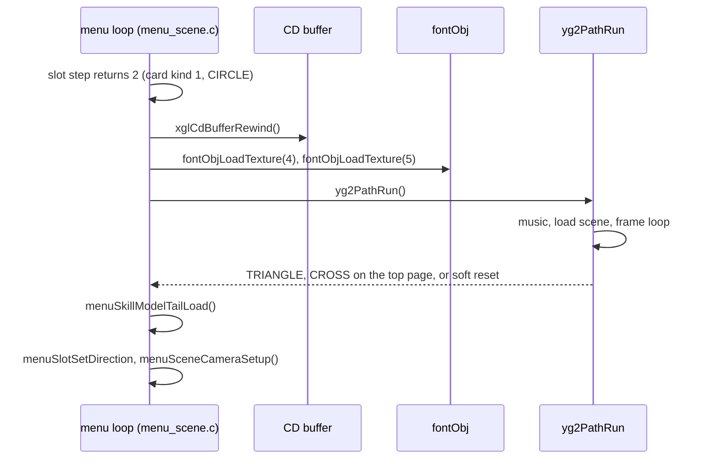

## Memory and files of the two pages

Neither page has memory of its own. They take everything from the CD buffer,
a linear arena that `xglCdBufferReserve(size)` hands out in steps rounded up
to a sector of 0x800 bytes. The arena is described in
[Files and resources](../architecture/files-and-resources.md). When a page
ends it calls `xglCdBufferRewind()` and the whole arena is free again.

`src/main/ysegf.c` holds the two file helpers that both pages use.
`ysegfAllocFileBuffer(name)` asks the directory for the size of the file with
`xglCdGetFileSize`, stops on the assertion `size` when the size is zero, and
reserves that many bytes. `ysegfReadFile(&buffer, name, allocate, mode)`
optionally allocates the buffer in the same way and then queues the read with
`xglCdReadFile`. The reads are asynchronous. The pages wait for them with
loops on `xglCdServiceIfPending()`.

The campaign page keeps the picture alive while it waits. Its
`yg2PathWaitForLoad()` runs the actor update and draw (`XenoActorDoit`,
`XenoActorDisp`) and yields with `xglSleep()` on every pass. The segment page
simply spins on `xglCdServiceIfPending()`.

Both pages also give a scratch block to the file layer with
`cfeFileTempInit`: 0x30000 bytes for the campaign page and 0x60000 bytes for
the segment address page.

## The tagged text files

The texts of the campaigns, the citizens and the treasures are in three plain
text files in the directory `iwase\`. They share one format and one reader,
`yg2PathReadTaggedText(text, pattern, out)` in `src/main/yg2path.c`.

A record is a sequence of lines. Each line starts with a tag, a colon and a
quoted string, for example `Subject:"..."`. The loader knows the order of the
tags and reads the fields one after the other. It never looks for the end of
a record. It simply reads the next expected tag from where the previous field
ended. A file must therefore list every record in order and every field of a
record in the order the loader asks for.

The reader works in four steps:

1. It moves forward one character at a time until the text matches the
   pattern. The patterns are strings such as `"Subject:%s\n"`. The comparison
   is done by `yg2TextCompareLine`, which stops with a match at the first `%`
   of the pattern. In practice only the tag and the colon are compared.
2. It moves forward to the first double quote and steps over it.
3. It copies characters to the output until the closing double quote.
4. It returns the position after the closing quote, which is where the search
   for the next tag starts.

While it copies, it translates the text:

| Input | Output |
| --- | --- |
| CR followed by LF | nothing, so a string may run over several lines of the file |
| a byte with the top bit set, and the byte after it | the pair converted from Shift-JIS to EUC with `sjisToEuc` |
| `\n` (backslash, `n`) | a line feed character |
| `\"` | a double quote |
| backslash and any other character | nothing |
| any other character | copied |

The files are therefore written in Shift-JIS, and the screens draw EUC text.
The reader does not check the size of the output field. The field sizes in
the records below are the limits that the files must respect.

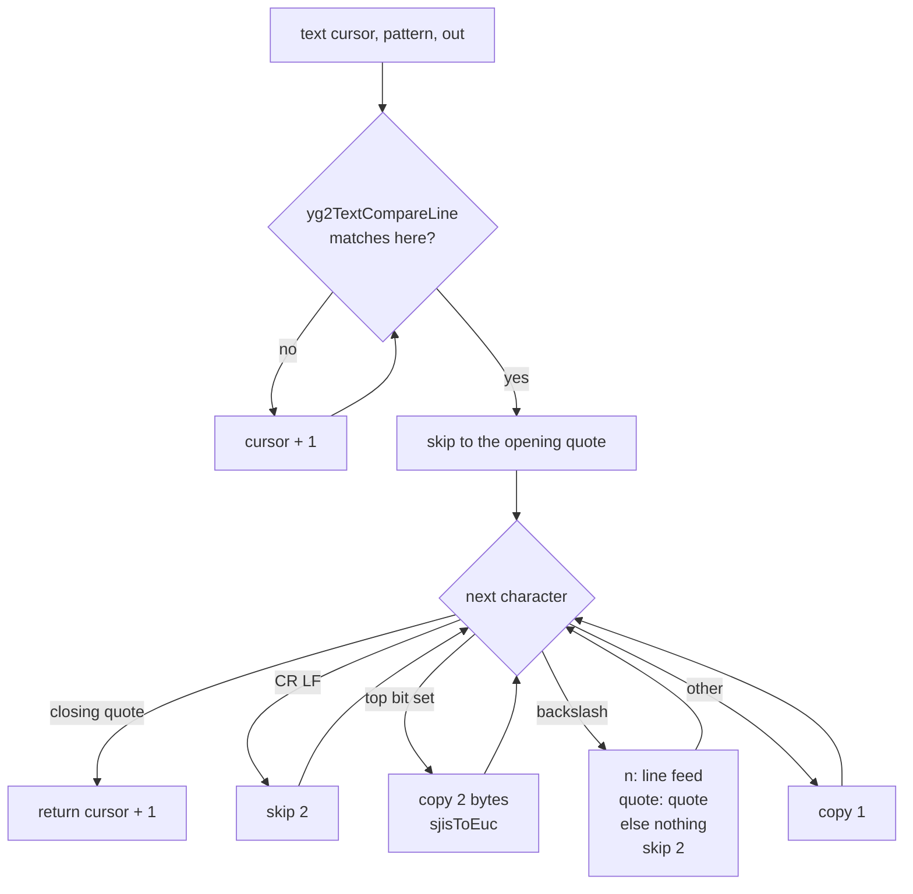

The files on the discs are Shift-JIS text with CR LF line ends and tabs. The
reader drops escapes it does not know, and the English files rely on that:
they write `\(` and `\)` in a few places, and those parentheses are simply not
shown. Next to the three files the discs also hold Japanese twins,
`QuestMes2.txt`, `Citizen2.txt` and `Treasure2.txt`, which nothing reads. The
line syntax and the counts are given in
[Text and fonts](../formats/text-and-fonts.md).

### `iwase\QuestMes.txt`

`yg2PathLoadQuestMessages()` reserves 0x195D8 bytes, clears them and reads 36
records of 0xB46 bytes (`YgQuestRecord`). The file is read with
`ysegfReadFile` into a buffer of its own, and an empty buffer stops on the
assertion `pBuf`.

| Order | Tag | Field | Size | Meaning |
| --- | --- | --- | --- | --- |
| 1 | `Subject:` | `subject` | 0x1F | Title of the campaign |
| 2 | `Locate:` | `location` | 0x11 | Where the client is |
| 3 | `Client:` | `client` | 0x11 | Name of the client |
| 4 | `MesIPG:` | `message` | 0x101 | Message shown while the campaign is in progress |
| 5 | `MesSCD:` | `messageSuccess` | 0x101 | Message shown after success |
| 6 | `MesFLD:` | `messageFailed` | 0x101 | Message shown after failure |
| 7 | `UkunSCD:` | `reportSuccess` | 0x401 | Long text of the detail page after success |
| 8 | `UkunFLD:` | `reportFailed` | 0x401 | Long text of the detail page after failure |

The tag suffixes match the three states named in the help text of the grid:
`IPG` for in progress, `SCD` for success and `FLD` for failed. `Ukun` is the
name of the model that the page shows (`ukun00`), so the two long texts are
most likely the comment of that guide character on the result.

### `iwase\Citizen.txt`

`yg2PathLoadCitizens()` reserves 0x29FE bytes and reads 50 records of 0xD7
bytes (`YgCitizenRecord`).

| Order | Tag | Field | Size | Meaning |
| --- | --- | --- | --- | --- |
| 1 | `Name:` | `name` | 0x11 | Name of the citizen |
| 2 | `Sex:` | `sex` | 0x07 | Sex |
| 3 | `Age:` | `age` | 0x11 | Age, as text |
| 4 | `Hobby:` | `hobby` | 0x17 | Hobby |
| 5 | `Profile:` | `profile` | 0x97 | Profile text of a few lines |

### `iwase\Treasure.txt`

`ysegfLoadTreasure()` in `src/main/ysegf.c` reserves 3,042 bytes and reads 18
records of 169 bytes (`YsegfTreasure`), one per segment address.

| Order | Tag | Field | Size | Meaning |
| --- | --- | --- | --- | --- |
| 1 | `Item:` | `item` | 21 | Name of the treasure |
| 2 | `Locate:` | `location` | 27 | Where the door is |
| 3 | `Expl:` | `explanation` | 121 | Explanation of the treasure |

## The flags

### Quest flags

`questFlags` is an array of 36 bytes, one per campaign. Scripts number the
campaigns from 1, the engine from 0. The low four bits are the status, and bit
4 is a "new result" mark.

| Bits | Mask | Meaning |
| --- | --- | --- |
| 0 to 3 | `YG2PATH_STATUS_MASK` (0x0F) | Status of the campaign |
| 4 | `YG2PATH_FLAG_NEW` (0x10) | The result has not been read on the detail page yet |

| Status | Name in the help text | Text shown | Cell in the grid |
| --- | --- | --- | --- |
| 0 | (not received) | none, the campaign cannot be opened | empty cell, no number |
| 1 | In Progress | `message` (`MesIPG`) | plain cell with the number |
| 2 | Success | `messageSuccess` (`MesSCD`), detail `reportSuccess` | cell with the mark of sprites 0x1FB and 0x1FC |
| 3 | Failed | `messageFailed` (`MesFLD`), detail `reportFailed` | cell with the mark of sprites 0x200 and 0x201 |

The assignment of 2 to success and 3 to failure follows from the order of the
tags in the loader and from the fields that each status reads. The source
names the values only `YG2PATH_STATUS_IN_PROGRESS`, `_MESSAGE2` and `_MESSAGE3`.
The help text of the grid gives the colours: gray for in progress, blue for
success and red for failed.

`questFlagSet(index, value)` in `src/main/quest_flag_set.c` writes a flag. It
ignores an index of 36 or more. It stores the value as a byte, and when the
value is 2 or 3 it stores the value with bit 0x10 added. A campaign that has
just ended is therefore always marked as new. `questFlagGet(index)` returns
the byte without bit 0x10, or 0 for an index outside the table. A script never
sees the new mark.

The mark is cleared in one place only. When the player opens the detail page
of a finished campaign, `yg2PathHandlePathInput` writes the flag back without
bit 0x10.

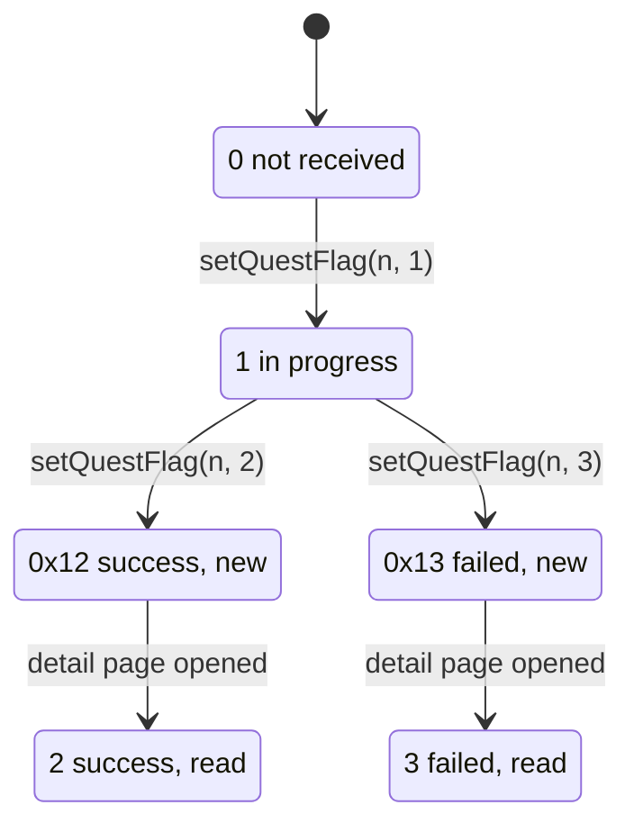

The engine does not enforce this order. `setQuestFlag` accepts any value, and
a script can also write a status directly from 0 to 2. The diagram shows the
use that the texts and the screen are built for.

### Citizen flags

`citizenFlags` is an array of 50 bytes, one per citizen. `citizenFlagSet`
stores any byte value for an index below 50, and `yg2PathGetCitizenFlag`
reads it back, with 0 for an index outside the table. The screen only tests
the byte against zero: a citizen with a non-zero flag has a visible profile,
and one with a zero flag shows "NO  DATA".

### Segment address flags

`segAddrOnFlags` is an array of 18 signed bytes in `src/main/ysegf.c`, one
per segment address. `segSetAddrOn(index, value)` and `segGetAddrOn(index)`
write and read it, and both ignore an index of 18 or more. The value stored
is the message kind that the script passed to `seg.addrOn`:

| Value | `SegAddrMessage` | Meaning |
| --- | --- | --- |
| 0 | | The address is unknown |
| 1 | `SEG_ADDR_MSG_FOUND` | The party found the address |
| 2 | `SEG_ADDR_MSG_ON_DOOR` | The party read the number on the door |
| 3 | `SEG_ADDR_MSG_DECODED` | The door was decoded |

The segment address screen only tests the byte against zero. The three values
matter to scripts, which can read them back with `seg.getAddrOn` and act on
the door accordingly.

### Flags that the segment screen borrows

Two more facts about a segment address are not kept in `segAddrOnFlags`.

The **decoder** of address *n* is entry *n* of data box category 3. The
screen reads its quantity with `dataBoxChkCategory3(n)`. The data box is the
inventory of the party and is described in
[Party and growth](party-and-growth.md). Scripts add entries of this category
with kind 4 of the item native in `src/main/runtime.c`.

The **treasure taken** state of address *n* is script flag
`YSEGF_FLAG_BASE + n - 1`, which is 0x1C1 for the first address and 0x1D2 for
the last. The screen reads it with `xglFlagsGet(flag, 1)`. The script of the
room behind the door sets the flag when the party takes the treasure.

### Reset, save and load

`yg2PathClearProgress()` clears all 36 quest flags and all 50 citizen flags.
`segAddrOnClearAll()` clears the 18 segment flags. `yg2PathResetAll()`, which
is placed in `src/main/ysegf.c`, calls both.

A new game calls `yg2PathResetAll()` and then `msgBalanceReset()` from
`TitleGameInit` in `src/ov02/title_game_init.c`. The start of a play session
in `src/main/game_data.c` calls `yg2PathResetAll()` again before it reads a
save image, so a loaded game never inherits flags from a session before it.

`saveWriteImage` in `src/main/pt_member.c` copies the three flag arrays into
`SaveData.questFlags` (offset 0x4E80, 0x24 bytes), `SaveData.citizenFlags`
(0x4EA4, 0x32 bytes) and `SaveData.segFlags` (0x4ED6, 0x12 bytes), and stores
`msgBalanceGet()` in `SaveData.balance` (0x5150). `saveReadGameWork` copies
them back and calls `msgBalanceSet`. The save image is described in
[Save data](../architecture/save-data.md).

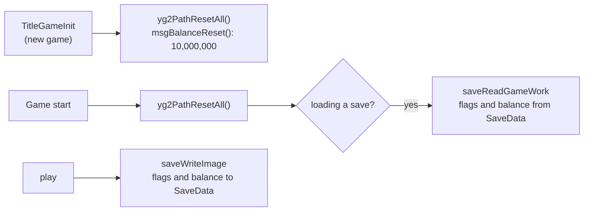

## The G.S. Campaign screen

`yg2PathRun()` in `src/main/yg2path.c` is the whole screen. It has four pages
and one overlay page:

| `yg2PathMode` | Constant | Page |
| --- | --- | --- |
| 0 | `YG2PATH_PAGE_MENU` | Main menu with two choices and the guide model |
| 1 | `YG2PATH_PAGE_GRID` | Grid of the 36 paths |
| 2 | `YG2PATH_PAGE_MESSAGE` | Message page of one path |
| 3 | `YG2PATH_PAGE_PROFILE` | Profile page of one citizen |
| | `yg2PathDetailOpen` set | Detail page of a finished path, drawn in place of the others |

`yg2PathInit()` resets this state: page 0, choice 0, path 0, citizen 0, no
detail page, an empty help line and the cursor on the first cell.
`menuSceneInit` calls it each time the main menu is opened, so the cursors
survive between two visits to the page only while the main menu stays open.

The other state variables are small. `yg2PathMenuChoice` is the choice on the
main menu (0 or 1). `yg2PathCurrentPath` (0 to 35) and `yg2PathCurrentCitizen`
(0 to 49) are the cursors. `yg2PathDetailIndex` is the path whose detail page
is open. `yg2PathScroll` is the opening animation of the current page, and
`yg2PathImageFade` the fade of the portrait. `yg2PathCursorBox` holds the
current and the target position of the grid cursor.

### Loading the scene

`yg2PathRun()` first restarts the sound with `soundRestart()` and starts the
music `201_menu` with `seBgmPlay(1, "201_menu", 0x19000)`. It removes the
render callback, calls `yg2PathLoadScene()` and then installs
`yg2PathDrawFrame` as the render callback in `sRender.callback`.

`yg2PathLoadScene()` does the following, in this order:

1. Clears `yg2PathDetailOpen` and `yg2PathScroll` and waits for pending reads.
2. Empties the help line with `menuResetState(&yg2PathMessageRange)`.
3. Gives 0x30000 bytes to the file layer with `cfeFileTempInit`.
4. Loads `QuestMes.txt` and `Citizen.txt` into their record tables.
5. Reads the four files of the guide model: `model\char\citizen\ukun00.pxy`
   (model), `ukun00.txy` (textures), `ukun00.xhr` (skeleton) and
   `motion\ukun00.xap` (motions). A missing file stops on the assertions
   `pPxy`, `pTxy`, `pXhr` or `pXap`.
6. Allocates an actor with `XenoActorAlloc()`, stores the four files in its
   resource slots `XAct_Rsrc_MDL`, `XAct_Rsrc_TEX`, `XAct_Rsrc_XHR` and
   `XAct_Rsrc_XAP`, and allocates its matrices.
7. Starts motion mode 0 on the first motion channel, places the actor at
   (0, 29.4, 10) with no rotation and sets bit 4 in the first word of its
   visibility block.
8. Stores a random delay of 100 to 299 in `yg2PathModelHandles.randomDelay`.
   No function of this file reads it afterwards.
9. Sets the window of camera 0 to the full screen (512 by 448). Takes camera
   1 of the active studio as the model camera, places it at (0, 30, 14) with
   no rotation and sets its field of view to 0.69813174 radians (40 degrees).
10. Selects the main menu page with choice 0 and shows the first help text.
11. Reserves the portrait buffer with the size of `iwase\img\citizen\c01.xtx`
    and reads `iwase\img\citizen\ctz_alpha.xtx`, the alpha mask of the
    portraits. Missing files stop on `imgCitizen` or `imgCtzAlpha`.

The portrait buffer is sized from the first portrait file and reused for all
of them. The portrait files must therefore all have the size of `c01.xtx` or
less. Actors are described in [Actors](../libraries/actors.md), and models in
[The model library](../libraries/pxy.md).

### The frame loop

Each pass of the loop in `yg2PathRun()` is one frame:

1. START together with the soft reset buttons (`PAD_SOFT_RESET_HELD`) sets
   `CONTROL_SOFT_RESET` in `gameWork.control` and leaves.
2. TRIANGLE plays the cancel sound and leaves, from any page.
3. `yg2PathScroll` grows by 15 (`YG2PATH_SCROLL_STEP`) up to 0x80
   (`YG2PATH_SCROLL_FULL`).
4. All actors get flag 2 with `XenoActorSetFlagAll(2)`, and bit 2 is cleared
   again in the draw flags of the guide model. Only the guide is drawn.
5. `yg2PathEaseCursor()` moves the grid cursor.
6. Camera 1 is switched off with `pxySetCameraEnable(1, 0)`.
7. The input handler of the current page runs. The pages that show the guide
   then call `yg2PathUpdateCamera` with the rectangle of the model window,
   which switches camera 1 back on.
8. `pxyRequestOverlayPass()`, `bgLayerClearAllFlags()`, `XenoActorDoit()`,
   `XenoActorDisp()` and `xglSleep()` finish the frame.

The 2D part of the page is not drawn by the loop. It is drawn by the render
callback `yg2PathDrawFrame`, which calls `yg2PathDraw()` and then
`gifStateSuppressDrawHook()`.

On exit, `yg2PathUnload()` releases the actor, forgets the two picture
buffers, rewinds the CD buffer, switches camera 1 off and restores the
standard render callback `xglCallbackQueueRun`. Unless a soft reset was
asked for, the loop then runs ten more frames without input so that the
screen settles, and `seStateRestoreDefault()` restores the sound state.

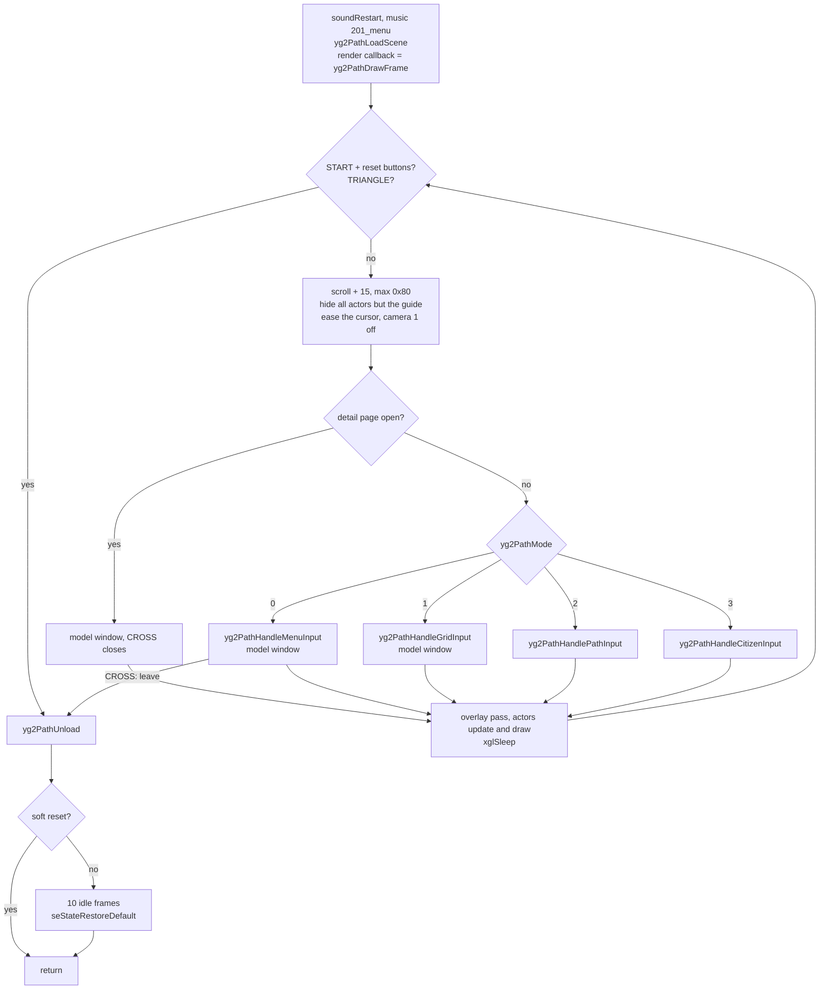

### Page changes

The pages form a small tree. CIRCLE goes down and CROSS goes up. Every page
change clears `yg2PathScroll`, so the new page opens with its animation, and
plays a sound with `seVoiceStartDefault`: 0x1000001 for a cursor move,
0x1000002 for confirm and 0x1000008 for cancel.

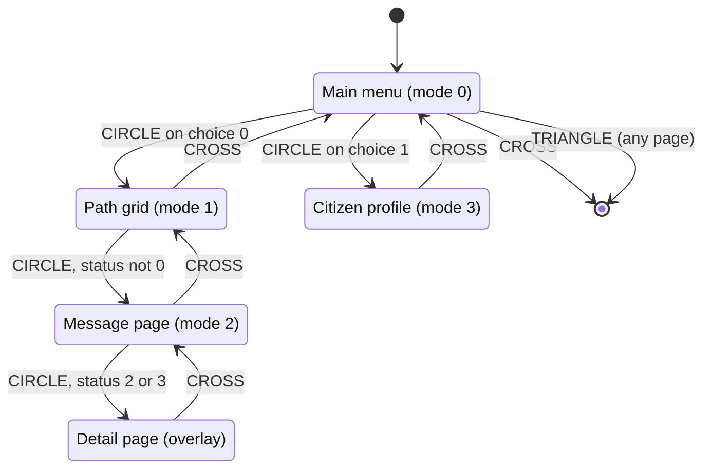

### The help line

The bottom of the screen shows a help text that appears a few characters at a
time. It is a `MsgRange` object, `yg2PathMessageRange`. `msgRangeSetText`
stores a new text and `msgRangeDrawRevealed(&yg2PathMessageRange, 0x18,
0x175)` draws it and reveals up to three more tokens per frame. In these
texts `\n` is written as two characters and turned into a line break by
`msgRangeSetText`, and `&03` and `&04` are inline button icons. From the way
the pages react, `&03` is the confirm button (CIRCLE) and `&04` the cancel
button (CROSS). The object is described in
[User interface and windows](../libraries/ui-windows.md).

The code holds five help texts for this screen:

| Text | Shown |
| --- | --- |
| `Look at your achievements. ♪` / `Press &03 to view achievements.` / `Press &04 to go back.` | Main menu, choice 0 |
| `Find out who you've met. ♪` / `Press &03 to view profiles.` / `Press &04 to go back.` | Main menu, choice 1 |
| `Path No. 01 achievement level. ♪` / `Gray = In Progress   Blue = Success   Red = Failed` / `Press &03 for details. Press &04 to go back.` | Grid, on a path whose flag byte is not 0 |
| (empty text) | Grid, on a path that was not received |
| `Use the L1 and R1 buttons to switch pages.` / `Press &04 to go back.` | Message page and profile page |

The path number in the third text is patched in place.
`yg2PathShowPathMessage()` writes the tens and units digit of the current
path number into characters 9 and 10 of the buffer `yg2PathNumberText` before
it hands the text to the help line. The detail page hides the help line.

### Common drawing

`yg2PathDraw()` starts a sprite batch with `fontObjResetAndBuild()`, draws
the page frame with `yg2PathDrawPageChrome()`, then the detail page or the
page selected by `yg2PathMode`, then the help line, and flushes the font with
`xglFontFlush()`.

All 2D parts are sprite cells of the menu sprite sheets, drawn with
`menuDrawCell(cell, x, y, flags)` and `menuDrawCellSized`. Frames are drawn
with `panelDrawNineSlice`, which takes a list of nine cell numbers. The cell
numbers used on these pages are in the range 0x18D to 0x2DA. The drawing
helpers are described in [Main menu](main-menu.md).

`yg2PathDrawPageChrome()` draws the header cells (0x190, 0x18D and the title
0x208) on the main menu and the grid, a large backdrop behind the main menu,
and the footer bar (0x207, 0x18F) on every page except the detail page.

The value of `yg2PathScroll` is passed to the page drawer and used as the
opacity of the page with `fontObjSetOpacity`. A page therefore fades in over
nine frames (15 per frame up to 0x80, which is full opacity).

The **model window** is the rectangle in which the guide model is seen. It is
drawn by `yg2PathDrawFramedImage(x, y, width, height)`: a filled cell 0x1EB
at depth 0x1FFFF, a frame and a wider border. The same rectangle is given to
`yg2PathUpdateCamera`, which makes it the window of camera 1 with
`xglCameraSetWindow`, so the 3D model is drawn exactly inside the 2D frame.
While the page opens, the window grows from a horizontal line to its full
height: the height is the full height times `yg2PathScroll / 128`, and the
top edge moves up by half of that.

| Page | Model window when open (x, y, width, height) |
| --- | --- |
| Main menu | 40, 80, 216, 254 |
| Grid | 317, 97, 178, 221 |
| Detail | 277, 87, 216, 254 |

`yg2PathUpdateCamera` also turns the model. On the detail page of a failed
campaign it sets the facing angle of the actor to pi, which turns the guide
around. In all other cases the angle is 0. It then enables cameras 0 and 1
and disables cameras 2 and 3 with `pxySetCameraEnable`.

### The guide model

The model `ukun00` is the only 3D object of the screen. Its motion changes
with what the player looks at. `yg2PathSetModelMode(mode)` sets the value 7.0
on the first motion channel (most likely the blend time in frames), enables
the channel and selects the motion with `XenoActorSetMode`.

| Motion mode | When |
| --- | --- |
| 0 | Main menu on choice 0, and the detail page of a failed campaign |
| 1 | Main menu on choice 1, and after returning from the profile page |
| 2 | Path grid, and after returning from the message page |
| 3 | Detail page of a successful campaign |

The guide thus reacts to the result: it plays motion 3 for a success, and for
a failure it plays the idle motion with its back to the player.

### The main menu page

`yg2PathDrawMainMenu` draws two buttons, each built from six cells, and the
model window on the left. The button of the current choice is drawn in full
colour with a shadowed label and a marker (cells 492 and 493) next to it. The
other button is drawn at half brightness. The labels are the cells 496 and
497 for the first button and 498 and 499 for the second, one cell for the
selected and one for the idle form.

`yg2PathHandleMenuInput` reads the pad:

| Button | Action |
| --- | --- |
| UP or DOWN | Toggles `yg2PathMenuChoice`, sets the guide motion to the choice, changes the help text |
| CIRCLE on choice 0 | Opens the grid: help text of the current path, cursor snapped to its cell, guide motion 2 |
| CIRCLE on choice 1 | Opens the profile page with the page switch help text |
| CROSS | Leaves the screen |

### The path grid

The grid shows all 36 paths in six rows of six cells. The cells are 44 pixels
apart in both directions, and every second row is shifted right by 22 pixels,
which gives a honeycomb pattern. For path *i* (from 0), the row is `i / 6`
and the column `i % 6`.

| Element | x | y |
| --- | --- | --- |
| Cell frame | `18 + column * 44 + (row & 1) * 22` | `74 + row * 44` |
| Path number | `28 + column * 44 + (row & 1) * 22` | `86 + row * 44` |
| Cursor target | `column * 44 + (row & 1) * 22 - 2` | `54 + row * 44` |

```
        x=18   62   106  150  194  238
 y= 74  [01] [02] [03] [04] [05] [06]
 y=118    [07] [08] [09] [10] [11] [12]
 y=162  [13] [14] [15] [16] [17] [18]
 y=206    [19] [20] [21] [22] [23] [24]
 y=250  [25] [26] [27] [28] [29] [30]
 y=294    [31] [32] [33] [34] [35] [36]          model window at x=317
```

`yg2PathDrawCellFrame` picks the look of a cell from the two low bits of the
quest flag. Status 0 draws the empty cell 0x1FE. Any other status draws the
cell 0x1FD and 0x1FF. Status 2 adds the mark of cells 0x1FB and 0x1FC, and
status 3 the mark of cells 0x200 and 0x201. The two-digit path number is
drawn with `textDrawDigitsZero` only when the status is not 0. A path that
was never received is an empty, unnumbered cell.

The cursor (cells 0x1EE and 0x1EF) does not jump. `yg2PathCursorBox` holds
its current position in elements 0 and 1 and its target in elements 2 and 3.
Every frame `yg2PathEaseCursor()` moves the current position half of the way
to the target, and snaps it when the distance is below 1.1 pixels.

`yg2PathHandleGridInput` reads the pad:

| Button | Action |
| --- | --- |
| UP / DOWN | Path minus or plus 6, wrapping by 36 |
| LEFT / RIGHT | Path minus or plus 1, wrapping by 36 |
| CIRCLE | Opens the message page, only when the status of the path is not 0 |
| CROSS | Back to the main menu, guide motion 0 |

The directions repeat while held (`PadData[0].directionRepeated`). Every move
plays the cursor sound and refreshes the help text with the new path number.
The cursor can rest on any cell, also on one that was not received. Such a
cell shows an empty help text and ignores CIRCLE.

### The message page

`yg2PathDrawMessagePage` shows one campaign as a message from its client. The
page has a header panel and a body panel:

| Part | Content | Position |
| --- | --- | --- |
| Header | Path number, two wide digits | 74, 15 |
| Header | "Subject" frame with `subject` | text at 38, 59 |
| Header | "Location" frame with `location` | text at 276, 59 |
| Body | Portrait of the client, 112 by 127 | 63, 159 |
| Body | "Client" frame with `client` | text at 59, 311 |
| Body | "Message" frame with five ruled lines and the message | text at 221, 169 |
| Body | Status box with the status label | 258, 294 |
| Body | Counter "current / 36" | 416, 333 |
| Sides | Arrow cells for the previous and next path | 1, 220 and 488, 220 |

The texts are drawn with `textDrawSegment`. Before them the page sends the
style string `$init;$bg2;$shadow+1,+3,000000;$colc0c0c0;$zoom14;$han1;$prop1;$xx0,20;`,
which resets the text state and selects a light gray proportional font of
size 14 with a drop shadow. The control tags are described in
[Fonts and text](../libraries/fonts-and-text.md).

The status decides three things on this page:

| Status | Message text | Status label cell | Extra |
| --- | --- | --- | --- |
| 1 in progress | `message` | 723 | none |
| 2 success | `messageSuccess` | 725, with the stamp cells 507 and 508 | details prompt |
| 3 failed | `messageFailed` | 722, with the stamp cells 512 and 513 | details prompt |

The details prompt is drawn by `yg2PathDrawDetailPrompt(340, 114, newFlag)`. It
is a small label with a button icon (`menuDrawKindIcon` with icon 3). When
bit 0x10 of the quest flag is set, two more cells (0x2D8 and 0x2D9) are
drawn, which mark the result as new. They disappear once the detail page has
been opened.

`yg2PathHandlePathInput` reads the pad:

| Button | Action |
| --- | --- |
| CIRCLE | With status 2 or 3: clears bit 0x10 of the flag, opens the detail page, sets guide motion 3 (success) or 0 (failed). With status 1: nothing |
| CROSS | Back to the grid: help text of the path, cursor snapped, portrait fade cleared, guide motion 2 |
| LEFT or L1 | Previous received path (`yg2PathFindPrevPath`) |
| RIGHT or R1 | Next received path (`yg2PathFindNextPath`) |

The two search functions walk the flags from the current path in one
direction, wrap around at the end of the table and stop at the first path
whose status is not 0. If no other path was received they come back to the
current one. When the path changes, the page clears the portrait fade and
restarts its opening animation.

### Portraits

The portrait of a client or citizen is one texture file per person,
`iwase\img\citizen\cNN.xtx` with a two-digit number from 01 to 50. The file
name is built on the stack: the code copies the prefix `iwase\img\citizen\c`
for numbers of 10 and more, or `iwase\img\citizen\c0` for numbers below 10,
and appends the number and `.xtx` with `sprintf`.

On the message page the number comes from `yg2PathPortraitIndexTable`, which
gives the citizen of each path. The table holds citizen indices from 0, and
the file number is the index plus 1.

| Paths | Citizen index of the client |
| --- | --- |
| 1 to 8 | 1, 0, 2, 26, 10, 43, 4, 5 |
| 9 to 16 | 7, 42, 8, 45, 30, 46, 49, 25 |
| 17 to 24 | 12, 28, 9, 14, 32, 19, 47, 36 |
| 25 to 32 | 11, 20, 17, 34, 44, 18, 27, 37 |
| 33 to 36 | 48, 40, 23, 39 |

The table links the 36 campaigns to 36 of the 50 citizens. The other 14
citizens have a profile but give no campaign.

Loading is driven by the drawing code and by `yg2PathImageFade`:

1. When the fade value is 0 and no read is pending, the page builds the file
   name, queues the read into `yg2PathPortraitBuffer` with `ysegfReadFile`
   and sets the fade to 0x10.
2. While the read is pending, nothing is drawn in the portrait frame.
3. When the read is done, the page uploads the alpha mask with
   `xglPacketTextureTrans` and draws it with `renderSpriteClutAlpha` at the
   fade value, then uploads the portrait and draws it with
   `renderSpriteClut`. The fade grows by 0x10 per frame and stops at 0x80.
4. A change of path or citizen clears the fade, which starts the cycle again
   with the new file.

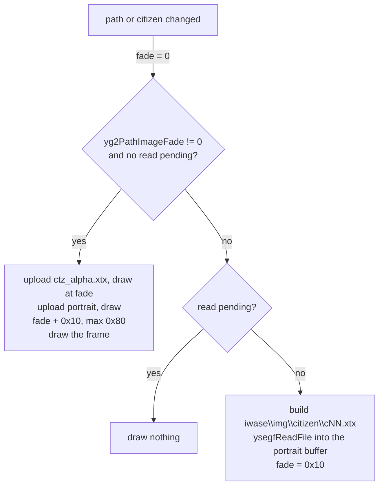

### The detail page

The detail page is the result report of a finished campaign. It replaces the
whole screen, including the header and the footer. `yg2PathDrawPathDetail`
draws a tall panel on the left (13, 20, 247 by 404) with a title cell and an
outline frame, and the long text at (30, 60): `reportSuccess` when the flag is
2 and `reportFailed` when it is 3. The text uses the same style string as the
message page with font size 16. The model window on the right shows the guide
reacting to the result. A button prompt (cells 0x20A and 0x209 and icon 0) is
drawn in the bottom right corner.

The page compares the whole flag byte with 2 and 3, not only the low bits.
This works because opening the page has just cleared bit 0x10.

The frame loop handles the input of this page itself: CROSS closes it and
returns to the message page of the same path.

### The citizen profile page

`yg2PathDrawCitizenProfile` shows one citizen. All 50 citizens can be paged
through, whether the party has met them or not.

| Part | Content | Position |
| --- | --- | --- |
| Header | Title cell and citizen number, two wide digits | number at 250, 32 |
| "Data" frame | Labels `Name:`, `Sex:`, `Age:`, `Hobby:` | 217, at y 90, 114, 138, 162 |
| "Data" frame | Values of the four fields | 274, same rows |
| Portrait | 112 by 127 | 75, 80 |
| "Profile" frame | Profile text over three ruled lines | 82, 261 |
| Counter | "current / 50" | 380, 217 |
| Sides | Arrow cells for the previous and next citizen | 14, 178 and 474, 178 |

When `citizenFlags[citizen]` is not 0, the four values, the profile text and
the portrait `c(citizen + 1).xtx` are shown. The portrait uses the same load
and fade cycle as on the message page. When the flag is 0, the four values
read `NO  DATA`, the profile text is left out, and the portrait frame is
filled with the blank cell 0x1EB.

`yg2PathHandleCitizenInput` reads the pad:

| Button | Action |
| --- | --- |
| LEFT or L1 | Previous citizen, wrapping from 1 to 50 |
| RIGHT or R1 | Next citizen, wrapping from 50 to 1 |
| CROSS | Back to the main menu on choice 1, guide motion 1 |

## How scripts run a campaign

The engine has no table of campaign rules. A campaign exists only as a status
byte and as the script code of the people involved. The scripts use the four
natives of the module `g2path`, which `scriptRegisterNatives` registers from
`g2pathNativeTable` (see [Script natives](../scripting/natives.md)).

| Native | Arguments | Result | C function |
| --- | --- | --- | --- |
| `g2path.setQuestFlag` | quest number (from 1), value | 1 | `setQuestFlag` → `questFlagSet(number - 1, value)` |
| `g2path.getQuestFlag` | quest number | the status without the new mark | `getQuestFlag` → `questFlagGet(number - 1)` |
| `g2path.setCitizenFlag` | citizen number (from 1), value | 1 | `setCitizenFlag` → `citizenFlagSet(number - 1, value)` |
| `g2path.getCitizenFlag` | citizen number | the flag | `getCitizenFlag` → `yg2PathGetCitizenFlag(number - 1)` |

Each native checks its argument count. With a wrong count it requests the
argument error jump with `sbSlotJumpRequest(ctx, 2)` and returns 0.

A campaign then runs as follows. The steps are what the natives and the
screen make possible. The conditions themselves are in the scripts.

1. The player talks to a citizen. The talk event wakes the script of that
   map object (see [Events](../scripting/events.md)).
2. The script calls `g2path.setCitizenFlag(c, 1)`. From now on the profile of
   the citizen is visible.
3. The script reads `g2path.getQuestFlag(n)`. With 0 it offers the campaign,
   and on acceptance it calls `g2path.setQuestFlag(n, 1)`. The path now has a
   number in the grid and its in-progress message can be read.
4. Other scripts, in other places, test `getQuestFlag(n) == 1` to enable the
   objects and conversations of the campaign. Progress inside a campaign is
   kept in ordinary script flags.
5. At the end the script calls `g2path.setQuestFlag(n, 2)` for a success or
   `g2path.setQuestFlag(n, 3)` for a failure, and hands out the reward with
   the item natives. The engine adds the new mark.
6. The player opens the G.S. Campaign page, sees the stamp and the new mark
   on the message page, and reads the result report. The mark is cleared.

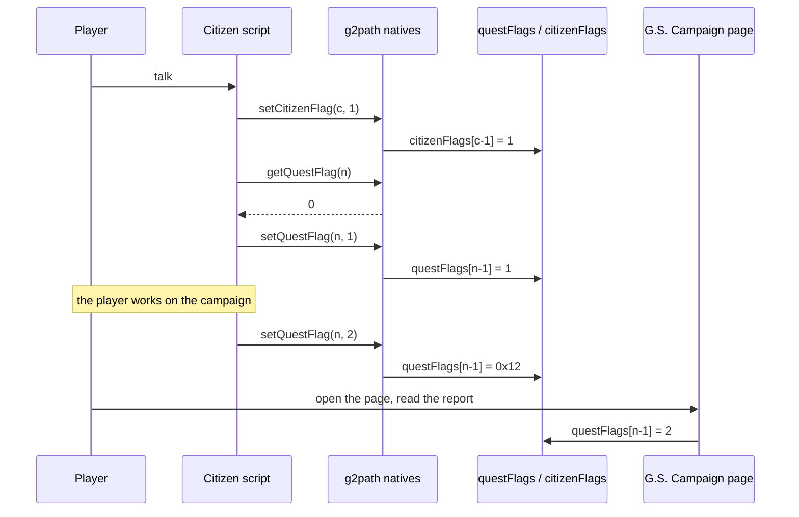

## The segment address screen

`ysegfRunMenu()` in `src/main/ysegf.c` is the second menu page. It lists the
18 segment addresses with what the party knows about each, and shows the
treasure of the ones that were opened.

### Scene states

The screen is a state machine with two states. Each state is a row of
`ysegfStateTable`, a `YsegfSceneState` record:

| Offset | Field | Meaning |
| --- | --- | --- |
| 0x00 | `initialized` | 0 until `start` has run |
| 0x04 | `start` | Called once when the state becomes current |
| 0x08 | `draw` | Queued every frame with `xglCallbackQueueAdd`, so it runs at render time |
| 0x0C | `finish` | Called every frame after the draw was queued: the update with the pad input |
| 0x10 | `hook_end` | Called when the state is left |

`ysegfRunState(state)` runs one frame of a state, and
`ysegfSwitchState(&ysegfState, next)` calls `hook_end` of the old state and
makes the new one current with `initialized` cleared.

| State | `start` | `draw` | `finish` | `hook_end` |
| --- | --- | --- | --- | --- |
| `YSEGF_SCENE_LIST` (0) | `ysegfResetEntryPos` | `ysegfDrawList` | `ysegfUpdatePage` | `ysegfListLeaveNoop` |
| `YSEGF_SCENE_DETAIL` (1) | `ysegfStartFadeIn` | `ysegfDrawDetail` | `ysegfUpdateDetail` | `ysegfDetailLeaveNoop` |

Both `hook_end` functions are empty. `ysegfDetailLeaveNoop` is defined in
`src/main/txd_table_entry.c`.

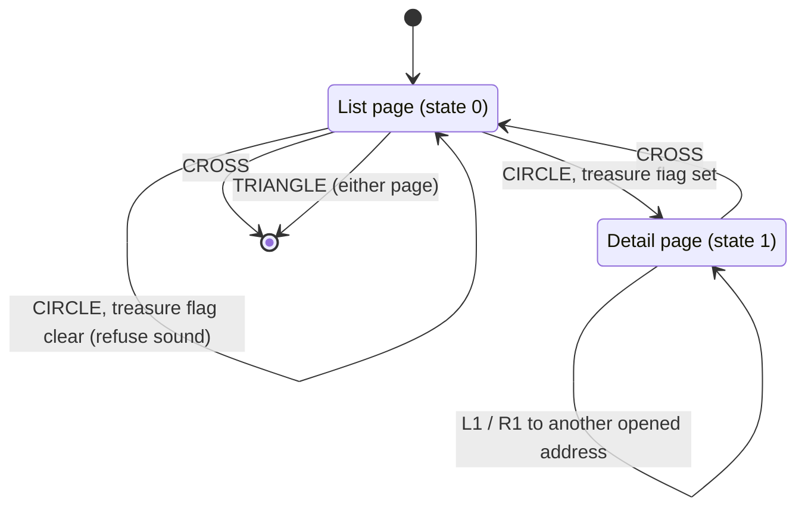

### Loading and the loop

`ysegfRunMenu()` restarts the sound, starts the music `201_menu`, calls
`ysegfInit()` and enters its loop. `ysegfInit()` does this:

1. Resets the help line `ysegfMenu` and gives it the list help text.
2. Sets the slide position of all 18 rows to 0xC8 (`YSEGF_ENTRY_START_POS`).
3. Sets the list track `ysegfListTrack` to x 0x200 and the y of the current
   scroll position, with a target x of 0. The list slides in from the right.
4. Gives 0x60000 bytes to the file layer and loads `Treasure.txt`.
5. Fills the two rows of the state table and selects the list state.
6. Reserves the item picture buffer with the size of
   `iwase\img\item\item00.xtx`, and reads `iwase\img\item\item_alpha.xtx`,
   `iwase\img\door\doorimg.dat` and `iwase\img\door\door_alpha.xtx`. Missing
   buffers stop on the assertions `imgItem`, `imgItemAlpha`, `imgDoor` and
   `imgDoorAlpha`.

The selection `ysegfSelectedIndex` and the scroll position `ysegfScrollTop`
are not reset here. They are cleared by `ysegfResetSelection()`, which
`menuSceneInit` calls each time the main menu is opened. Inside one visit to
the main menu the list therefore reopens where the player left it, and after
the menu was closed it starts at the first address again.

The loop tests the soft reset buttons and TRIANGLE like the campaign page,
runs the current state with `ysegfRunState`, and finishes the frame with the
overlay pass, the actor update and `xglSleep()`. All actors are hidden with
`XenoActorSetFlagAll(2)`. On exit `ysegfReleaseBuffers()` rewinds the CD
buffer and clears the four picture pointers, and the loop runs ten idle
frames before `seStateRestoreDefault()`.

### The row card

`ysegfDrawTreasureCard(x, y, index, selected, alpha)` draws one segment
address as a card of 464 by 100 pixels. Despite its name it is used for every
row of the list and again as the header of the detail page. The selected row
uses the frame `ysegfTreasureSelectedPanelImage`, the others
`ysegfTreasureRowPanelImage`.

A card reads three facts about its address and shows them as three check
icons under the column titles "Address", "Decoder" and "Treasure":

| Icon | Source | Set when |
| --- | --- | --- |
| Address | `segAddrOnFlags[index]` | a script called `seg.addrOn` for this address |
| Decoder | `dataBoxChkCategory3(index + 1)` | the party holds the decoder of this address |
| Treasure | `xglFlagsGet(0x1C1 + index, 1)` | the treasure was taken |

`ysegfDrawFlagIcon` draws an empty box (cells 0x253 and 0x256) and adds the
check mark (cells 0x266 and 0x267) when the fact is true.

The rest of the card depends on the same three facts:

| Part | Address known | Address unknown |
| --- | --- | --- |
| Number | always shown, two wide digits | always shown |
| "Location" line | `location` of the record | `NO  DATA` |
| Door picture, 76 by 65 | picture of the door from `doorimg.dat` | empty frame with the text `NO DATA` |

| "Treasure" line | Condition |
| --- | --- |
| `item` of the record, with status cell 0x24F | treasure taken |
| `NO  DATA`, with status cell 0x24E | treasure not taken, but the address is known or the decoder is held |
| `NO  DATA`, with status cell 0x24D | nothing is known |

The name of a treasure is therefore hidden until the party has taken it. The
three status cells are sprites, so their wording is not in the code. They
stand for the three stages opened, in progress and unknown.

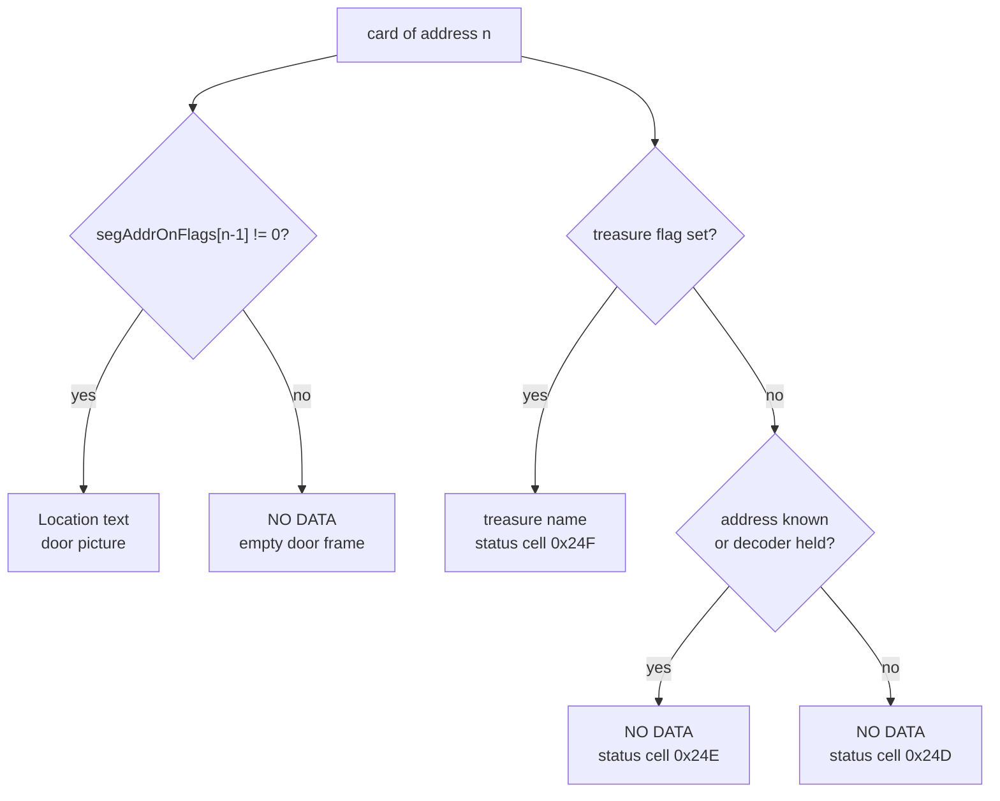

### The door pictures

`iwase\img\door\doorimg.dat` is one file that holds the pictures of all
doors. The code reads it as a table of 32-bit words. For address index *i*
(from 0), the word at position *i + 1* is the offset of that picture from the
start of the file. The picture at that offset is a texture block that
`xglPacketTextureTrans` uploads. Word 0 is not used by the
code. It is the number of pictures, 18 in the shipped file, and each picture
is a complete `.xtx` texture of 10,640 bytes.

A door picture is drawn in two passes like a portrait: first the alpha mask
`door_alpha.xtx` with `renderSpriteClutAlpha` at the opacity of the row, then
the picture with `renderSpriteClut`.

### The list page

`ysegfDrawList` draws a header of eleven cells (0x241 to 0x24B), the list,
the footer bar (cells 0x271 and 0x270) and the help line.

`ysegfDrawTreasureList` places the 18 cards 101 pixels apart
(`YSEGF_ROW_HEIGHT`), starting 0x34 below the list origin. Three cards are in
view at a time. The list origin is the current position of `ysegfListTrack`,
whose y target is `-ysegfScrollTop * 101`. `fontTrackEase` moves it there
smoothly, so the list scrolls instead of jumping.

Each row also has a **slide position** in `ysegfEntryPos`, a horizontal
offset that `ysegfUpdatePage` eases every frame by 0.3 of the remaining
distance towards one of three targets:

| Row | Target | Effect |
| --- | --- | --- |
| Selected row | 16 | Stands out to the left |
| Other rows in view (`ysegfScrollTop` to `ysegfScrollTop + 2`) | 30 | Normal position |
| Rows out of view | 512 | Slide out to the right and fade |

The x of a card is the list origin plus the slide position, limited to 30. A
card is drawn only while its x is below 0x200 and its slide position below
0x1F0. Its opacity is `0x7F - ((slide >> 2) & 0x7F)`, applied when the slide
position is above 30. Rows that scroll out of view thus fade away while they
move, and rows that scroll into view fade in. All rows start at 0xC8 when the
page opens, which gives the opening animation.

Two arrow cells show that the list continues: cell 0x26C at the top when
`ysegfScrollTop` is above 0, and cell 0x26B at the bottom when it is below
15.

`ysegfUpdatePage` reads the pad:

| Button | Action |
| --- | --- |
| UP / DOWN | Selection minus or plus 1, stopping at the first and last address. The sound plays only when the selection moved |
| CIRCLE | With the treasure flag of the address set: opens the detail page (sound 0x1000002). Otherwise only the refuse sound 0x1000003 |
| CROSS | Leaves the screen |

After a move the scroll position follows the selection so that the selected
row is always one of the three in view.

The help text of this page is `Scroll with the directional buttons or the
left analog stick.` / `Press &03 for details. Press &04 to go back.`

### The detail page

The detail page is only reachable for an address whose treasure was taken.
Entering it starts a fade-in of ten frames with `fadeStartIn(0xA)`.
`ysegfDrawDetail` draws the card of the address at (12, 15) as a header, and
below it the item panel of `ysegfDrawItemPage`:

| Part | Content | Position |
| --- | --- | --- |
| Panel | Frame `ysegfItemFramePanelImage`, 417 by 243 | 47, 120 |
| "Explanation" frame | Six ruled lines with the `explanation` text | text at 80, 190 |
| Item picture | 128 by 143, with its own frame | 304, 164 |
| Counter | "current / 18" | 390, 330 |
| Sides | Arrow cells for the previous and next address | 14, 195 and 474, 195 |

The item picture is one file per treasure, `iwase\img\item\itemNN.xtx`. The
number is the address index from 0, written with two digits, so the files run
from `item00.xtx` to `item17.xtx`. The picture is loaded on demand into the
buffer that was sized from `item00.xtx`, and fades in by 16 per frame up to
0x80 with the mask `item_alpha.xtx`. The cycle is the same as for the
portraits of the campaign page, with `ysegfItemFadeAlpha` as its state.

`ysegfUpdateDetail` reads the pad:

| Button | Action |
| --- | --- |
| LEFT or L1 | Previous address whose treasure was taken (`ysegfFindPrevEntry`) |
| RIGHT or R1 | Next address whose treasure was taken (`ysegfFindNextEntry`) |
| CROSS | Back to the list, with the list help text |

The two search functions wrap around the table and return the starting
address when no other one qualifies. A change of address clears the picture
fade, so the new picture is loaded. The help text of this page is `Use the L1
and R1 buttons to switch pages.` / `Press &04 to go back.`

## How scripts drive a segment address

The module `seg` has two natives, registered from `segNativeTable`.

| Native | Arguments | Result | C function |
| --- | --- | --- | --- |
| `seg.addrOn` | address number (from 1), message kind | 1 | `segAddrOnMessage` |
| `seg.getAddrOn` | address number | the stored kind, 0 when unknown | `segAddrOnGetFlag` → `segGetAddrOn(number - 1)` |

`segAddrOnMessage` does two things at once. It stores the kind as the flag of
the address with `segSetAddrOn(number - 1, kind)`. Then it opens a message
window: it ties the message to the map object that the script belongs to with
`mapObjectBeginMessage(uwamonoCurrentRecord())`, starts a message with
`msgBegin()`, sets one of three texts with `msgWindowSetScriptText`, stores
the address number in number slot 1 of the window with `msgWindowSetSlot(1,
number)`, which fills the `%d` of the text, and clears the flags of the open
message slot.

| Kind | Text | Sound |
| --- | --- | --- |
| 1 | `You found Segment Address No. %d!` | 0x100000A |
| 2 | `"Segment Address No. %d" is written on the door.` | none |
| 3 | `Segment Address No. %d decoded!` | 0x200000C |

A kind outside 1 to 3 still stores the flag and opens the window, but sets no
text.

The life of one segment address, as these pieces allow it, is shown below.
The door itself is a map unit with a script (see
[Map and units](map-and-units.md)). The test for the decoder and the opening
of the door are script code, which uses the inventory natives of `runtime`.

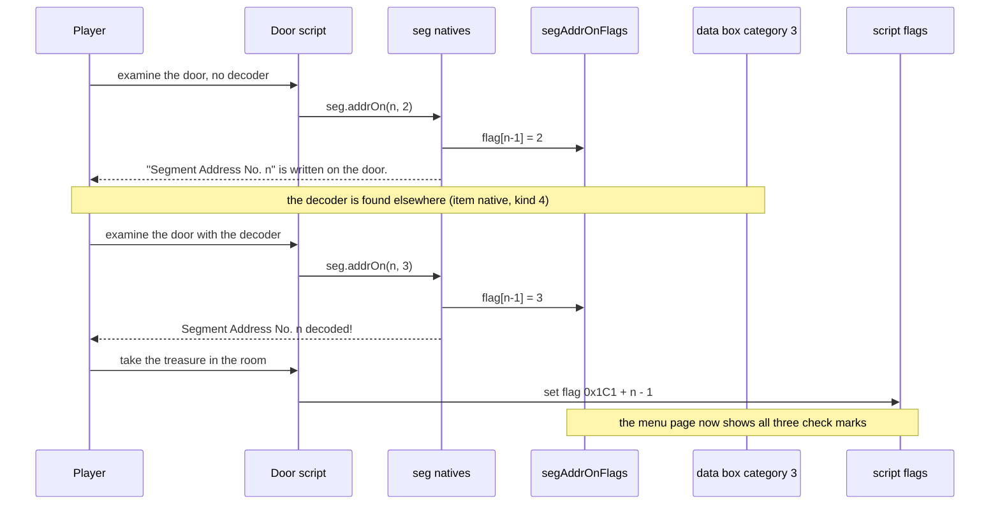

## The debt

The debt is a single number, `msgBalance` in `src/main/msg_window_bind.c`. It
is the amount that is still owed. `src/main/msg_balance.c` gives it three
access functions: `msgBalanceSet(value)`, `msgBalanceGet()` and
`msgBalanceReset()`, which stores 10,000,000 (0x989680). A new game starts
with the full debt, and the value is saved and loaded as `SaveData.balance`.

The same file holds `msgGameFlagSet()` and `msgGameFlagClear()`, which set
and clear `CONTROL_SCRIPTED` (0x8000) in `gameWork.control`. While that bit
is set, the player character is under script control and does not react to
the pad. The sell window sets it when it opens.

The debt is not paid with money. The player hands over items, and each item
takes its price off the debt. The party's money is not touched by any of the
code on this page.

### Opening the sell window

A script opens the window with `talk.menuDeptQuest(names, costs, value,
mode)`. The native (`menuDeptQuest` in `src/main/talk_natives.c`) takes exactly
four arguments:

| Argument | Meaning |
| --- | --- |
| 1 | Index of a script array of 40 strings: the item names |
| 2 | Index of a script array of 40 integers: the amount each item takes off the debt |
| 3 | Evaluated and passed on, but not used by the engine |
| 4 | Mode: 0 for data box category 1, any other value for category 2 |

The native waits while the message window is busy or has more text to show.
It does this by setting its wait flag, which makes the script call it again
on the next frame (see [Script natives](../scripting/natives.md)). When the
window is free it runs these steps:

1. `msgResetBalances()` copies `msgBalance` into both `msgShownBalance` and
   `msgTargetBalance`.
2. For each of the 40 entries, `msgSetItemName` stores the name string and
   `msgSetItemCost` the price.
3. `msgSetMode(mode)` remembers the category. For each entry *i*,
   `msgSetItemCount(i, dataBoxChkCategory1(i + 1))` or
   `dataBoxChkCategory2(i + 1)` stores how many the party holds.
4. `msgWindowBindTables()` opens the next window slot, binds the three tables
   and the shown balance to it with `msgWindowBindCurrentItems`, and sets
   `CONTROL_SCRIPTED`.
5. The native sets `CONTROL_SCRIPTED` once more and returns 1.

Entry *i* of the window is always entry *i + 1* of the chosen inventory
category. Only the first 40 entries of a category can be offered, and the
script decides their prices. Category 1 is the list of items that can be used
in battle, and category 2 is the second item list of the menu. Both are
described in [Party and growth](party-and-growth.md). A script that wants to
offer both calls the native once per category.

### What the window shows

The window is a list window of the message system in its sell form. Its
layout, cursor and scrolling are described in
[User interface and windows](../libraries/ui-windows.md#the-sell-window-items-costs-and-counts).
Its contents are drawn by `src/main/msg_text_draw.c`.

`drawSellPanel(widget)` is called by `msgWindowDraw` for a window with bound
item tables. It draws three things:

- **The button labels.** `drawSellCloseButtons` prints `:Sell` at x 0xB9 and
  `:Close` at x 0x11D, both at y 0x15B, in font size 14. `:Sell` is printed
  in the colour 0x828282 while at least one item is left and in the darker
  0x4B4B4B when the list is empty. `:Close` always has the bright colour. The
  button icons in front of the labels are drawn by the window code.
- **The remaining debt.** `drawRemainingDebt` prints the caption `Remaining
  Debt: ` and then the amount, formatted as `%dG`, one character at a time
  with a fixed pitch of 15 pixels. The fixed pitch keeps the digits steady
  while the number runs down. `debtBoxCenterX` centres the line in the window
  from the caption width of 0xA5 pixels and the number of digits. The line is
  at y + 0x25 when items are listed and at y + 0x57 when the list is empty.
- **The item rows, or the empty notice.** `drawSellItemList` walks the 40
  entries and prints a row for each one that has a name and a count above
  zero. `sellFormatRow` builds the row: the name at x + 10, the price with
  the suffix `G` at x + 0xBE, and the count at x + 0x122, placed with `$ax`
  position tags. The row under the cursor has the colour 0x50509C, the others
  0xC0C0C0. Rows are 30 pixels apart and clipped to the body of the window by
  `sellBoxScissorCallback`. When nothing is left, `sellDrawEmptyNotice`
  prints `No items to sell.` instead.

The row under the cursor is found with `sellCursorFilledRank`. The cursor of
the window is a pixel position. Divided by the row height it gives the rank
of the row among the visible ones, and the function converts that rank into
the index of the matching table entry by skipping the entries with a count of
zero.

The global `sellLabelTextOff`, defined in `src/main/effect_request.c`,
switches off the label texts when it is not 0: the caption, `:Sell`,
`:Close` and the empty notice are then left out. No code on this page sets
it.

### Selling

After opening the window the script calls `talk.menuDeptGetResult()` in a
loop. The native calls `msgSaleUpdate()` once per frame. A negative
result means that the window is still in use, and the native then sets its
wait flag. Any other result is returned to the script.

`msgSaleUpdate()` works with two amounts. `msgTargetBalance` is the real
debt after all sales so far. `msgShownBalance` is the number on screen, which
runs down towards the target. One frame goes through these tests in order:

1. **Count down.** When the target is below the shown amount, the shown
   amount drops by 100. If CIRCLE is pressed in that frame, or the amount
   would pass the target, it is set to the target at once. Nothing else
   happens in this frame.
2. **Window not ready.** While the window is locked or still typing, wait.
3. **Window closed.** When the window has finished closing, the script
   control bit is cleared (unless another window keeps it), the shown amount
   is stored in `msgBalance`, and the amount is returned. This ends the loop
   of the script.
4. **Debt paid.** When the shown amount is 0, the window is closed with
   `msgWindowCloseAll`.
5. **CROSS** closes the window in the same way.
6. **CIRCLE** sells one unit of the entry under the cursor, if its count is
   above zero. The count drops by one, the price is taken off the target,
   and one unit is removed from the inventory with `dataBoxDecCategory1(item
   + 1)` or `dataBoxDecCategory2(item + 1)`.
7. **UP / DOWN** move the cursor with `msgWindowMoveSelection`.

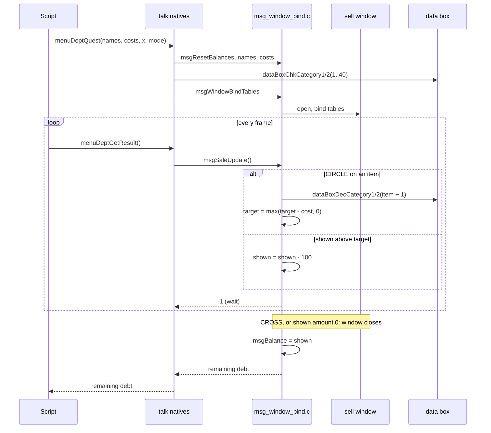

Some rules follow from this order:

- One press sells exactly one unit. There is no quantity choice and no
  confirmation.
- A sale is final. The item leaves the inventory in the same frame, before
  the number on screen has moved.
- While the number runs down, the pad does nothing except that CIRCLE
  completes the run. At 100 per frame, an item worth 500,000 would take
  5,000 frames to count down, so the skip matters.
- The debt cannot go below zero. A price larger than the remaining debt sets
  the target to 0, and the surplus is lost.
- `msgBalance` is written only when the window has closed. The saved debt is
  therefore always the amount after a complete visit.

### When the debt reaches zero

The engine does very little at zero. When the shown amount arrives at 0,
step 4 closes the window by itself on the next frame, and once it has closed,
`msgSaleUpdate()` stores 0 in `msgBalance` and returns 0. The native
passes the 0 to the script.

Everything that follows is script code. The script sees that the result of
`talk.menuDeptGetResult()` is 0 and plays the scene of the paid debt, hands
out the rewards and sets its own flags. There is no "debt paid" flag in the
engine. The only record is `msgBalance == 0` in the save data. If a script
opened the sell window again with a debt of 0, the window would close at once
through the same step 4.

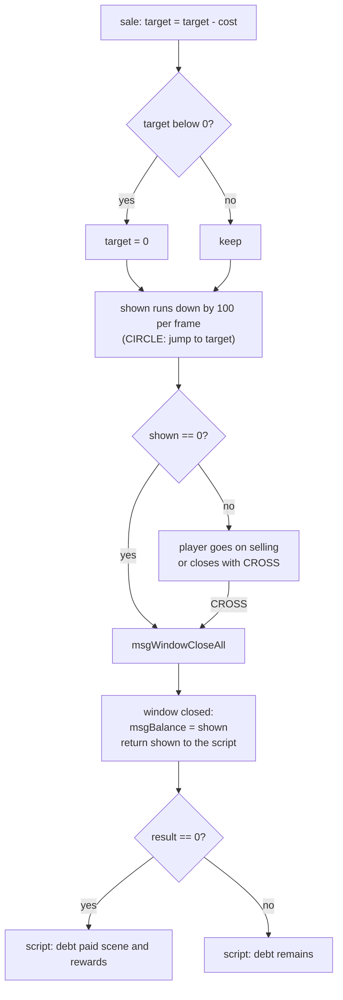

## The other talk natives of `talk_natives.c`

`src/main/talk_natives.c` holds three more natives of the `talk` module. They
are used by the same citizen scripts that run campaigns, to ask the player a
question or a number. Their windows are described in
[User interface and windows](../libraries/ui-windows.md).

| Native | Arguments | What it does |
| --- | --- | --- |
| `talk.menuAddItem` | 2: unused, text (string) | Waits until the current message is fully shown and CIRCLE is pressed, then opens the text as a choice list with `msgWindowOpenText` and sets `CONTROL_SCRIPTED`. A second argument that is not a string is an argument error |
| `talk.menuGetResult` | 1 | Polls the choice with `msgPollSelect()`. Waits while the result is negative, then returns the chosen row plus 1 |
| `talk.slotWinOpen` | 2: two values | Waits like `menuAddItem`, then opens the number window with `msgChoiceOpen(first, second)` and sets `CONTROL_SCRIPTED` |

The companion `talk.slotWinGetResult` is in
`src/main/talk_natives.c`. The file also holds the name strings of
these natives and of the six `g2path` and `seg` natives, which the
registration tables point to.

## The drawing helpers of `msg_text_draw.c`

`src/main/msg_text_draw.c` is the text drawing file of the message system. Only a
part of it belongs to the debt. The table lists all of its groups, with the
page that explains how each is used.

| Group | Functions | Use |
| --- | --- | --- |
| Sell window | `drawSellPanel`, `drawSellCloseButtons`, `drawRemainingDebt`, `debtBoxCenterX`, `drawSellItemList`, `sellFormatRow`, `sellDrawEmptyNotice`, `sellCursorFilledRank`, `sellItemFirstRowY`, `sellBoxScissorCallback` | The debt window described above |
| Filled entry counts | `sellCountFilledSlots`, `sellCountFilled` | Count the entries with a count above zero, for the window layout and the cursor rank |
| Script menus | `msgWindowDrawLineList`, `appendColoredRun`, `listSlotFirstRowY`, `pixelsToRows`, `talkBoxScissorCallback` | The rows of a plain choice list, the selected one in the colour 0x50509C |
| Text measuring | `textLineCount`, `textSkipLines`, `textCountLinesBefore`, `textCountLinesOf`, `textBoxMeasure`, `textMaxLineWidth`, `textRunLength`, `textFindRunEnd`, `textSkipBracketTag`, `textTagBody`, `textSlotFirstRowY` | Line counting and the size of a window for a given text. A line is 30 pixels high |
| Tag builders | `fontColorTag`, `fontZoomTag`, `appendXAdvanceTag`, `appendNumberText`, `appendStyledRun`, `drawShadowedText`, `fontPrintIntRow`, `fontPrintFront`, `textCopyChars`, `flushFontBatch` | Build `$col`, `$zoom` and `$ax` control tags and print styled text |
| Number and time windows | `timecodeDrawContents`, `timecodeDrawDigitRow`, `talkBoxDrawDigit`, `talkBoxDrawRollingDigit`, `talkBoxPrintDigitPlain`, `talkBoxPrintDigitAccent`, `drawEntryDigits`, `drawEntryCells`, `formatEntryValue`, `formatEntryDigits`, `formatEntryHms`, `formatEntryMsf`, `entryFadeColor`, `talkBoxContentX`, `talkBoxContentY`, `decimalDigitAt` | The digits of the number entry box and of the time counter |
| Item notice | `drawAcquiredText`, `formatAcquiredText`, `acquiredTextWidth` | The text `Acquired <name> × <count>.` of the item notice. The count is printed only from 2 upwards |

All of these print through `xglFontPrint` with a common style prefix,
`fontStylePrefix`, which sets a line pitch of 30 and the ruby text size, and
the tag `$prop1;` for proportional spacing. Texts are built in the scratchpad
at 0x70000000 before they are printed. The font system is described in
[Fonts and text](../libraries/fonts-and-text.md).

## Data files

| File | Read by | Contents |
| --- | --- | --- |
| `iwase\QuestMes.txt` | `yg2PathLoadQuestMessages` | 36 campaign records, 8 tagged strings each |
| `iwase\Citizen.txt` | `yg2PathLoadCitizens` | 50 citizen records, 5 tagged strings each |
| `iwase\Treasure.txt` | `ysegfLoadTreasure` | 18 treasure records, 3 tagged strings each |
| `iwase\img\citizen\c01.xtx` to `c50.xtx` | message and profile pages | One portrait per citizen, 112 by 127 on screen |
| `iwase\img\citizen\ctz_alpha.xtx` | `yg2PathLoadScene` | Alpha mask of the portraits |
| `iwase\img\item\item00.xtx` to `item17.xtx` | `ysegfDrawItemPage` | One picture per treasure, 128 by 143 on screen |
| `iwase\img\item\item_alpha.xtx` | `ysegfInit` | Alpha mask of the item pictures |
| `iwase\img\door\doorimg.dat` | `ysegfInit` | Offset table and the 18 door pictures, 76 by 65 on screen |
| `iwase\img\door\door_alpha.xtx` | `ysegfInit` | Alpha mask of the door pictures |
| `model\char\citizen\ukun00.pxy`, `.txy`, `.xhr` | `yg2PathLoadScene` | Model, textures and skeleton of the guide |
| `motion\ukun00.xap` | `yg2PathLoadScene` | Motions of the guide, modes 0 to 3 |

One more file of the same directory, `iwase\citizen.xtx`, is not used by
these screens. Its name is held by `src/main/glow.c`, where the glow test
scene reads it as a texture (see [Debug tools](debug-tools.md)). The picture
files of the campaign page are the numbered ones above.

The source file names kept in the assertion texts are `../yg2path.euc.c` and
`../ysegf.euc.c`. The directory name `iwase` is most likely the name of the
programmer who wrote both screens.

## Summary of numbers

| Quantity | Value | Where |
| --- | --- | --- |
| Campaigns (paths, quests) | 36 | `YG2PATH_PATH_COUNT`, `QUEST_FLAG_COUNT` |
| Citizens | 50 | `YG2PATH_CITIZEN_COUNT`, `CITIZEN_FLAG_COUNT` |
| Segment addresses | 18 | `YSEGF_ENTRY_COUNT` |
| Grid columns, cell pitch | 6, 44 pixels | `YG2PATH_COLUMNS`, `YG2PATH_CELL_PITCH` |
| Campaign record | 0xB46 bytes | `YgQuestRecord` |
| Citizen record | 0xD7 bytes | `YgCitizenRecord` |
| Treasure record | 169 bytes | `YsegfTreasure` |
| First treasure flag | 0x1C1 | `YSEGF_FLAG_BASE` |
| Card flags in the main menu | 232 (campaigns), 231 (segment addresses) | `src/main/menu_scene.c` |
| Starting debt | 10,000,000 | `msgBalanceReset` |
| Entries of the sell window | 40 | `MENU_DEPT_ENTRIES`, `SELL_LIST_SLOTS` |
| Count-down step of the shown debt | 100 per frame | `msgSaleUpdate` |
