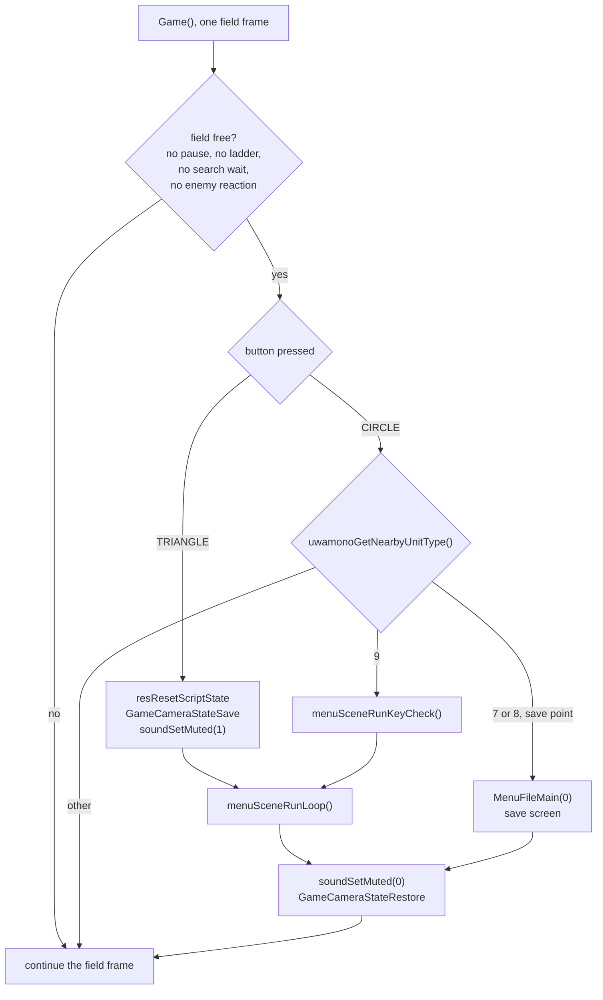
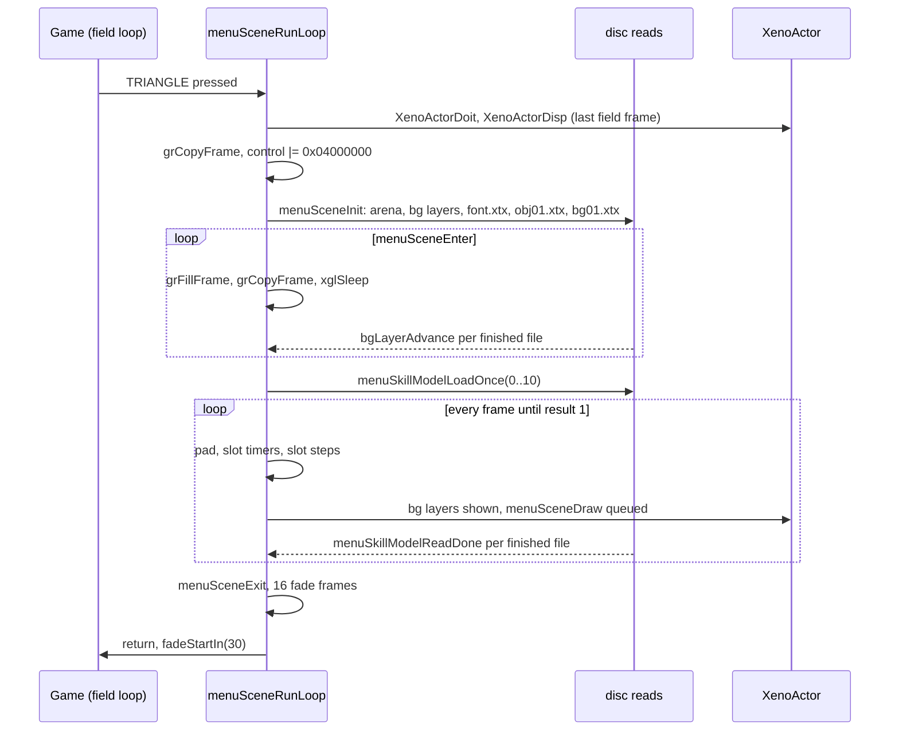
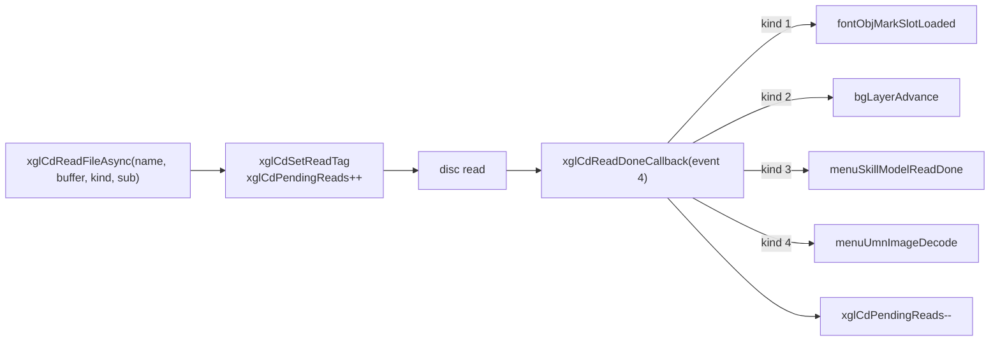
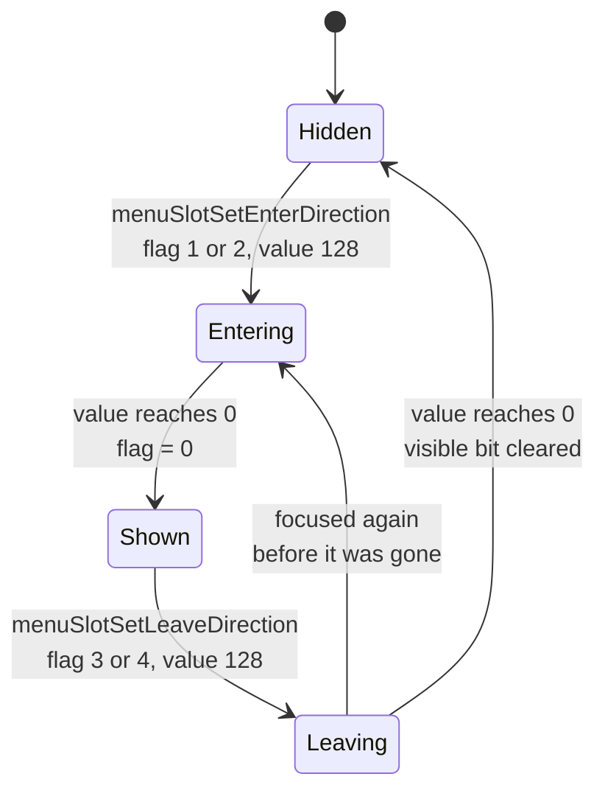
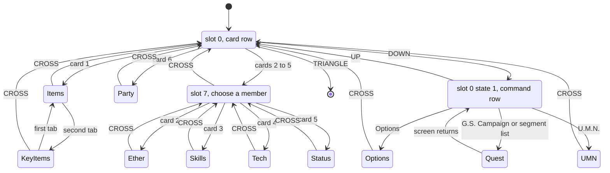
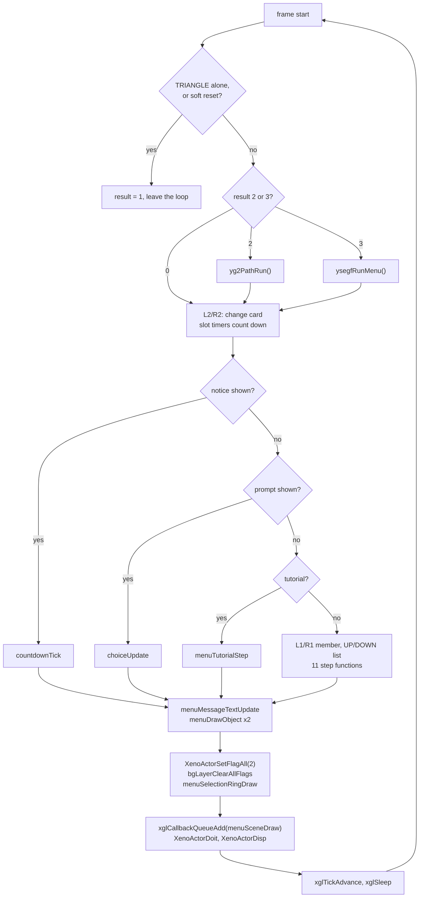
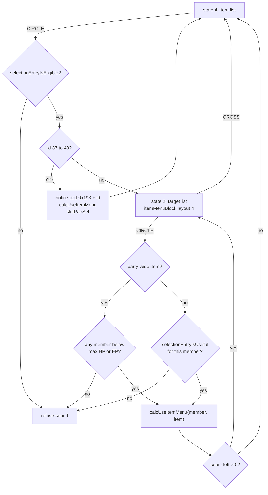
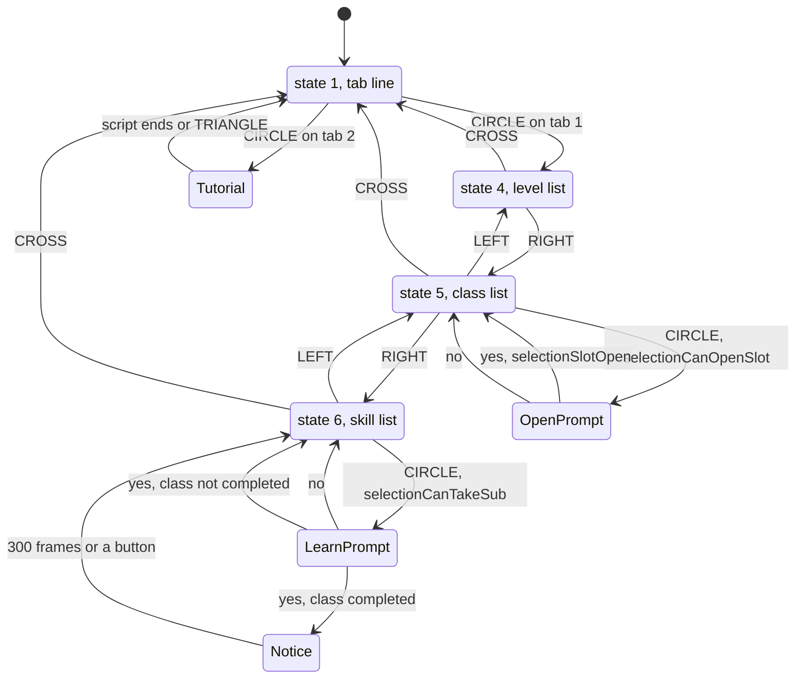
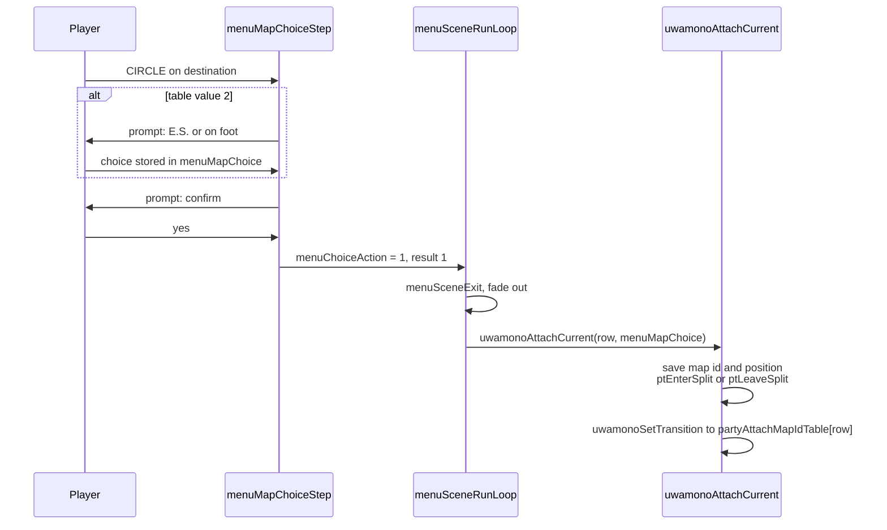
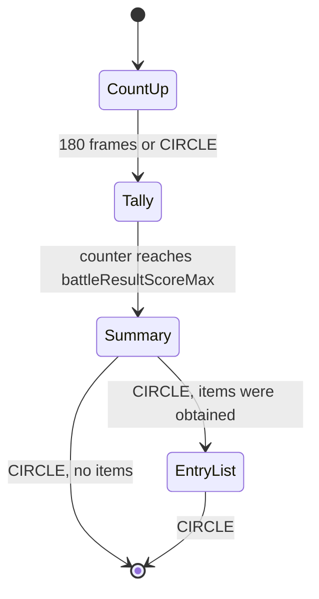

# Main menu

The main menu is the screen the player opens with TRIANGLE on the field. It
shows the party on a moving 3D background, a row of six cards for the main
pages and a second row of up to four commands. From it the player uses items
and ethers, learns and equips skills, reads the attack lists, changes the
party order, changes the settings, opens the two quest screens and travels
through the U.M.N. plates.

The whole menu runs inside one function call, `menuSceneRunLoop()` in
`src/main/menu_scene.c`. That function has its own frame loop. The field loop
of `Game()` does not run while the menu is open, and it continues from the
same frame when the menu returns. The menu does not load an overlay. Its code
is in the main executable, and the party rules it calls (item effects, ether
costs, parameters) are the `calc*` functions of the battle code in OV01, which
is in memory during a play session.

The party itself (members, E.S., pilots, points and growth) is described in
[Party and growth](party-and-growth.md). The two quest screens the menu
starts are described in [G.S. Campaign](gs-campaign.md). The save screen is a
separate screen that reuses the menu's drawing layer, see
[Save data](../architecture/save-data.md).

[← Back to the overview](../README.md)

## Files

| File | Contents |
| --- | --- |
| `src/main/menu_scene.c` | The menu session: `menuSceneRunLoop`, set-up and tear-down, the eleven control slots with their step and draw functions, the cursor lists, the skill tutorial, the U.M.N. image loader `menuUmnImage*`, the menu models, the help text selection |
| `src/main/menu_draw.c` | The drawing layer: text segments `textDraw*`, sprite cells `menuDrawCell`, panels and frames, digits, HP and EP rows, the party panels and the `MenuBlock` cursor menu, every page drawer, the typed-out message `MsgRange`, the yes/no prompt and the notice box |
| `src/main/menu_selection.c` | The rules behind the lists: the item list and item flags, the accessory list, the key item bitmap, the skill board (`selection*`), the attack record lookups, `ptStateInit` |
| `src/main/save_party_init.c` | `menuRequestLoad`, `menuLoadTxds` (the two text tables), `ptReset`, the default settings, the U.M.N. travel functions `uwamonoAttachCurrent` and `uwamonoDetachCurrent`, the attack record table and the skill tables |
| `src/main/runtime_menu.c` | The natives of the script owner `menu` (`ptInit` to `ptTent`) and `menuRegisterNatives`. The empty hook `menuSceneSetupHook` is in `src/main/uwamono_record_init.c` |
| `src/main/txd_table_entry.c` | `txdTableEntry`, the lookup of one string in a `.txd` text table, and two empty functions |
| `src/main/cursor_buffer.c` | `ListCursor`, the cursor of every list in the menu |
| `src/main/text_box.c` | `menuListPageCount`, the page count of a list. The rest of the file is the text box stack of the message system, see [UI windows](../libraries/ui-windows.md) |
| `src/main/bg_layer.c` | The three background layers behind the menu and behind the battle result screen |
| `src/main/battle_result.c` | The battle result screen, drawn with the menu layer |
| `src/main/xgl_cd_arena.c` | The memory arena of the menu, the asynchronous read with its completion callback, the two button tests `padCirclePressedAlone` and `padCrossPressedAlone`, the tick counter and the callback queue |
| `include/main/menu_scene.h`, `menu_draw.h`, `menu_selection.h`, `cursor_buffer.h` | The structures `MenuBlock`, `MenuItem`, `MsgRange`, `ListCursor`, `LookupRecord`, `SelectionRecord` and the prototypes |

## Opening the menu

The field loop of `Game()` in `src/main/game_data.c` reads the pad once per
frame (see [the field page](field.md)). The menu buttons are only looked at
when the field is free. All of these must hold:

- bit `0x1` of `gameWork.control` is clear (with it set the frame runs
  `pauseStart()` in place of the scripts and the effects),
- the field is drawn (bit `0x200` is clear),
- no search wait is running (`uwamonoSquareWaitCount` is not above zero) and
  bit `0x20000000` is clear,
- none of the bits `0x40008400` is set,
- the player is not on a ladder (`uwamonoLadderState.state == 0`),
- no enemy reaction is pending (`gameWork.encounterReaction == -1`).

Then two buttons are tested. TRIANGLE (`pressed & 0x10`) opens the main menu.
CIRCLE (`pressed & 0x20`) asks `uwamonoGetNearbyUnitType()` what kind of map
object the player stands next to. Types 7 and 8 are the save points, and they
open the save screen `MenuFileMain(0)`. Type 9 opens the main menu through
`menuSceneRunKeyCheck()`, which sends it straight to the U.M.N. page (see
[The U.M.N. page](#the-umn-page)). The map objects are described in
[Map and units](map-and-units.md).

Around both calls the field does the same four things. `resResetScriptState()`
resets the scene resource script state, `GameCameraStateSave()` stores the
field camera, and `soundSetMuted(1)` mutes the field sound. After the call
`soundSetMuted(0)` and `GameCameraStateRestore()` undo this.

The diagram shows the path from one field frame to the three screens.



There are two more callers. The developer test menu in
`src/main/debug_test.c` starts `menuSceneRunLoop`, `menuSceneRunSplit` and
`MenuFileMain` from a list (see [Debug tools](debug-tools.md)).
`menuSceneRunSplit()` runs the menu in E.S. mode: when the party is not
already split it calls `ptEnterSplit()`, runs the loop and calls
`ptLeaveSplit()`.

### Foot mode and E.S. mode

The menu has two forms. `menuSceneRunLoop` chooses one from `ptState.splitMode`
before anything else and stores the choice in `menuCopilotModeFlag`.

| `ptState.splitMode` | `menuCopilotModeFlag` | Party shown | Needs |
| --- | --- | --- | --- |
| 0 | 0 | The characters on foot, front slots 0 to 6 | `ptState.counts[1] != 0` |
| 1 | 1 | The three E.S. in back slots 7 to 9, with their pilots and co-pilots in the second roster | `ptState.counts[2] != 0` |

When `ptState.counts[0]` is zero, or the count of the chosen form is zero, the
function returns at once and no menu appears. In E.S. mode most pages change:
the list of the party becomes a grid of thirteen panels, the Tech page shows
the E.S. attacks, and the Status page equips accessories in place of skills.
The split party is explained in [Party and growth](party-and-growth.md).

## One menu session step by step

`menuSceneRunLoop()` does everything in a fixed order. It freezes the picture
of the field, loads its own files, runs its loop and gives the picture back.

1. **Last field frame.** `XenoActorDoit()`, `XenoActorDisp()` and `xglSleep()`
   run one more frame of the actors. `grCopyFrame(work_buffer_base, draw_buffer_base)`
   copies the finished picture into the flip buffer, so the field stays
   visible under the opening fade.
2. **Mark the session.** `pxySkipOverlayDraw()` is called and bit `0x04000000`
   of `gameWork.control` is set for the whole session. Sound effect
   `0x02000001` plays.
3. **Initialise.** `menuSceneInit()` refreshes the party (`ptRefresh`), reads
   the nearby map object type into `ptState.nearbySearchType`, loads the files
   (`menuSceneLoadAssets`), builds the lists and fills the eleven control
   slots. See [Set-up in menuSceneInit](#set-up-in-menusceneinit).
4. **Wait for the background.** `menuSceneEnter()` repeats a frame of
   `grFillFrame` and `grCopyFrame` until the three background layers report
   ready (`bgLayerReady(0..2)`). Then it sets the camera, clears the screen
   colour to black and keeps drawing the background until no disc read is
   pending. Last it starts the reads of the eleven menu models
   (`menuSkillModelLoadOnce(0..10)`).
5. **Run the loop** until the result is 1. See
   [The menu frame](#the-menu-frame).
6. **Leave.** `menuSceneExit()` restores the pad repeat
   (`xglPadSetRepeat(0, UP|RIGHT|DOWN|LEFT|L1|R1, 8, 1)`), refreshes the party,
   unloads the files (`menuSceneUnloadAssets`), releases the background actors
   (`bgLayerRelease`), stops vibration and stores the state of slot 0 in
   `menuSavedSlotState` for the cursor memory.
7. **Fade out.** Unless a soft reset was asked for, sound `0x01000008` plays
   (only when no U.M.N. travel was chosen), the last menu picture is copied and
   sixteen frames of `grFillFrame` and `grCopyFrame` blend it away.
   `ptRefreshCurrent()` then updates the field model of the leader.
8. **Apply the U.M.N. choice.** `menuChoiceAction` 1 calls
   `uwamonoAttachCurrent(mapChoiceCursor[0].cursor, menuMapChoice)`, 2 calls
   `uwamonoDetachCurrent()`. Otherwise `fadeReset()` and `fadeStartIn(30)`
   fade the field back in over 30 frames.
9. Bit `0x04000000` is cleared and the function returns 0.

The sequence diagram shows a session in which the player opens the menu,
looks at a page and closes it again.



### What happens to the field

The field is not saved to a buffer and not unloaded. Its actors stay in the
actor pool and its map stays in memory. The menu hides them with a flag.
Every menu frame calls `XenoActorSetFlagAll(2)`, which sets flag `0x2` on
every actor of the pool, and then `bgLayerClearAllFlags()`, which clears the
bits `0x402` again on the three background actors only. The result is that
`XenoActorDisp()` draws nothing but the menu background. `bgLayerCameraSetup`
also sets flag `0x400` on every pool record when the menu starts, and
`bgLayerRelease` clears it on every record when the menu ends. The actor
system is described in [Actors](../libraries/actors.md).

The camera is the active camera of studio 0. `menuSceneCameraSetup()` puts it
at z 14 with no rotation, a field of view of 40 degrees (0.698 rad) and a
window of 512 by 448. The field camera was stored by the caller and comes
back after the menu.

The scripts do not run, because the menu loop does not call `sbRunAll()`. The
sound effects of the field are muted by the caller. The play time keeps
counting, because it is the difference between the clock and
`ptState.progress->playTime`.

## Memory and files

The menu takes one block of memory for everything it loads.
`menuSceneLoadAssets()` first waits until no disc read is pending and then
calls `xglCdArenaOpen(0, 0)` in `src/main/xgl_cd_arena.c`. With no buffer and
no size the arena is taken from the game resource area with
`GameResourceWorkAlloc(0x288000)`, about 2.5 MiB (see
[Memory](../architecture/memory.md)). `xglCdArenaClose()` gives it back with
`GameResArenaRelease()` when the menu ends.

The arena has two allocators. Both hand out whole 2048-byte disc sectors.

| Allocator | Function | Lifetime |
| --- | --- | --- |
| Sector allocator | `xglCdSectorAlloc(size)` advances `xglCdArenaUsed` | Until the arena closes |
| Page buffer | `xglCdBufferAlloc(0x140000)` reserves 1.25 MiB once, `xglCdBufferReserve(size)` advances `xglCdBufferCursor` inside it | Until `xglCdBufferRewind()` moves the cursor back to the base |

The first allocator holds what every page needs. The page buffer holds what
only one page needs, and it is emptied when the player enters or leaves such
a page. `xglCdBufferRewind()` waits until the disc is idle, forgets the font
texture slots that live in the buffer (`fontObjResetBufferSlots`) and clears
the menu model tables from index 4 on (`menuSkillModelTailReset`).

The layout below shows what the arena holds while the menu is open. The sizes
are the ones passed to the allocators.

```text
arena, 0x288000 bytes from GameResourceWorkAlloc
+--------------------------------------------------------------+
| page buffer                     0x140000  xglCdBufferAlloc   |
|   skill models 4..10 (pxy+txy)  0x4E000                      |
|   font slots 3 and 4            0x40800 each, on demand      |
|   U.M.N. images                 0xE000 each, 1 + up to 8     |
|   display position work buffer  0x100000, Options only       |
+--------------------------------------------------------------+
| menu models 0..3 (pxy+txy)      0x32800   xglCdSectorAlloc   |
| back.pxy / back.txy             0x5800 / 0x16800             |
| midle.pxy / midle.txy           0x15000 / 0x6800             |
| front.pxy / front.txy           0xC800 / 0x2800              |
| bg01.xtx   (font slot 2)        0x40800                      |
| obj01.xtx  (font slot 1)        0x40800                      |
| font.xtx   (font slot 0)        0x40800                      |
+--------------------------------------------------------------+
```

### Files the menu reads

All menu files are in the directory `yosikawa`. The two text tables are read
once, when a game is started or loaded. Everything else is read each time the
menu opens.

| File | Read by | Use |
| --- | --- | --- |
| `yosikawa\MainMenu.txd` | `menuLoadTxds` | Every text of the menu, the save screen and the result screen, into the 16 KiB buffer `menuMainTxdBuffer` |
| `yosikawa\Tutorial.txd` | `menuLoadTxds` | The script of the skill tutorial, into the 8 KiB buffer `menuTutorialTxdBuffer` |
| `yosikawa\font.xtx` | `fontObjLoadTexture(0)` | The glyph strips and base cells of the sprite layer |
| `yosikawa\obj01.xtx` | `fontObjLoadTexture(3)` | The menu cells: frames, cards, icons, marks |
| `yosikawa\bg01.xtx` | `fontObjLoadTexture(2)` | Background cells of the menu |
| `yosikawa\ctrl_pic.xtx`, `yosikawa\ctrl01.xtx` | `fontObjLoadTexture(8)`, `(9)` | The controller picture of the Options page |
| `yosikawa\g2_00.xtx`, `yosikawa\g2_01.xtx` | `fontObjLoadTexture(4)`, `(5)` | The G.S. Campaign screen |
| `yosikawa\seg01.xtx` | `fontObjLoadTexture(6)` | The segment screen |
| `yosikawa\model\back.pxy`, `.txy` | `bgLayerLoad(BG_BACK)` | Back background layer |
| `yosikawa\model\midle.pxy`, `.txy`, `.xhr` | `bgLayerLoad` | Middle background layer and its hierarchy |
| `yosikawa\model\front.pxy`, `.txy`, `.xhr` | `bgLayerLoad` | Front background layer and its hierarchy |
| `yosikawa\model\menubg.xap` | `bgLayerLoad(BG_MENUBG)` | Animation of the background layers |
| `yosikawa\model\atk.pxy`, `rsv.pxy` and `.txy` | `menuSkillModelLoadOnce(0)`, `(1)` | The two models beside the party |
| `yosikawa\skillmdl\skilplate01..05`, `skilball01..04` (`.pxy`, `.txy`) | `menuSkillModelLoadOnce(2..10)` | The skill board model |
| `yosikawa\umn1.jpg` to `umn8.jpg` | `menuUmnImageLoad` | The pictures of the U.M.N. destinations |

The table `fontObjTexturePathTable` in `src/main/font_obj.c` has eleven
texture names. Besides the ones above it holds `bg00.xtx` (its slot is -1, so
it is never loaded), `battle01.xtx` and `g2_02.xtx`. The font object layer
that draws cells from these textures is described in
[Fonts and text](../libraries/fonts-and-text.md). The `.txd` format is a table
of 32-bit offsets followed by the strings: `txdTableEntry(table, index)`
returns `table + table[index]`. `menuMainTxdEntry(index)` and
`menuTutorialTxdEntry(index)` in `src/main/pt_member.c` apply it to the two
buffers.

### Asynchronous reads

The menu never waits for a file while it draws. `xglCdReadFileAsync(name,
buffer, kind, sub)` stores a tag `(kind << 8) + sub`, starts the read with the
callback `xglCdReadDoneCallback` and counts it in `xglCdPendingReads`. When
the read ends, the callback looks at the kind byte and tells the owner.

| Kind | Owner call | Meaning of `sub` |
| --- | --- | --- |
| 1 | `fontObjMarkSlotLoaded(sub)` | Font texture slot |
| 2 | `bgLayerAdvance(sub)` | File 0 to 5 of the background layers |
| 3 | `menuSkillModelReadDone(sub)` | File 0 to 21 of the menu models |
| 4 | `menuUmnImageDecode(sub)` | Index of the U.M.N. image |

`xglCdWaitIdle()` loops until the disc is idle and the pending count is zero.
The file system below these calls is described in
[Files and resources](../architecture/files-and-resources.md).



## Set-up in menuSceneInit

`menuSceneInit()` builds the state of one session. It reads the settings and
the story flags, decides which commands exist, fills the lists and binds a
step function and a draw function to each control slot.

1. `ptRefresh()` and `ptState.nearbySearchType = uwamonoGetNearbyUnitType()`.
2. `menuSceneLoadAssets()` opens the arena and starts the reads.
3. The two cursor settings are copied from the save data: `menuCursorMemory =
   SaveData.cursor_memory` and `menuCursorMemoryAlt = SaveData.cursor_memory_alt`.
4. The second row is decided (see [The command row](#the-command-row)).
5. The skill mask `menuItemCategoryMask` is built. Bit 0 is always set. For
   each `i` from 1 to 31, `dataBoxChkCategory4(i)` sets bit `i`, and the
   matching key item `i + 76` is added once with `dataBoxIncCategory3`. A
   skill whose record has a bit outside this mask is shown as text 400 and
   cannot be learned.
6. The double attack mask `menuPartnerMask` is built on foot: bit 0, plus bit
   `i` for each `slotPairTest(i + 1)` that is true, for `i` 0 to 15. In E.S.
   mode it starts as 1.
7. `selectionRebuildWindowList()` and `selectionRebuildList()` fill the item
   list and the accessory list.
8. `menuFocusRootSlot()` puts the focus on the card row. The two `MenuBlock`
   objects are reset with `menuResetItems(block, menuCopilotModeFlag)`.
9. The story position `xglFlagsGet8(401)` selects the label under the play
   time (`menuExtraPageIndex`) and the number of U.M.N. destinations.
10. The cursor lists are initialised, the eleven slots are filled, the pad
    repeat is set to `xglPadSetRepeat(0, 0xF00C, 6, 2)` (the four directions
    and L1/R1), and `yg2PathInit()` and `ysegfResetSelection()` reset the two
    quest screens.

`menuSceneReset()` is a different function. It runs once when a new game or a
loaded game starts (from `src/ov02/title_game_init.c`, and from two test
programs). It clears the pending read count, calls `ptReset()`, binds the
attack record texts (`commandRecordTextsBind`), resets the tick counter, the
font globals, the model tables and the background state, and installs
`xglCallbackQueueRun` in `menuCallbackHook`. `ptReset()` in turn reads the two
text tables when `menuLoadPending` is set. The title screen sets that flag
with `menuRequestLoad()` after Load Game, and it is also 1 at start-up.

## Control slots

The menu is built from eleven control slots, `menuSlots[11]`. A slot is one
page or one layer of the screen. Each has a step function that reads the pad
and a draw function. Only one slot has the focus, its index is
`menuCurrentSlot`.

| Offset | Type | Field | Meaning |
| --- | --- | --- | --- |
| 0x00 | function | `callback` | Draw function, called by `menuSlotDraw` |
| 0x04 | function | `step` | Step function, called every frame by the loop |
| 0x08 | `ListCursor *` | `link` | The list cursor (or table of cursors) of the slot |
| 0x0C | `unsigned short` | `value` | Transition counter, 128 down to 0 |
| 0x0E | `u8` | `state` | State of the slot's own state machine |
| 0x0F | `u8` | `flag` | Transition direction 0 to 4 |
| 0x10 | `u8` | `flags` | Bit `0x01` focus mark, bit `0x02` visible, bit `0x04` tutorial pass, bit `0x10` never leaves |

The eleven slots and their functions:

| Slot | Step | Draw | List cursor | Page |
| --- | --- | --- | --- | --- |
| 0 | `menuMainCommandStep` | `menuDrawMainCards` | `mainCommandCursors[2]` | Card row, command row, help line |
| 1 | `menuItemListStep` | `menuDrawSlotItems` | `windowListCursor` | Items |
| 2 | `menuEtherPlaceStep` | `menuDrawEtherPage` | `learnedEtherCursor` | Ether |
| 3 | `menuSkillChargeStep` | `menuDrawSkillPage` | `skillBoardCursorTable[3]` | Skills |
| 4 | `menuTechPageStep` | `menuDrawCommandPage` | `commandPageCursor` | Tech (attack lists) |
| 5 | `menuEquipAssignStep` | `menuDrawEquipPage` | `equipItemCursor` | Status and equipment |
| 6 | `menuPartyFormationStep` | `menuPartyFormationDrawNone` | none | Party |
| 7 | `menuPartyChoiceStep` | `menuDrawPartyPage` | none | Party panels and member choice |
| 8 | `menuKeyItemStep` | `menuDrawKeyItemDetail` | `recordItemCursor` | Key items |
| 9 | `menuConfigSlotStep` | `menuDrawConfigPage` | `menuConfigCursor` | Options |
| 10 | `menuMapChoiceStep` | `menuMapDraw` | `mapChoiceCursor` | U.M.N. |

The step and draw function names in the source were given before the pages
were understood (`License`, `Layout`, `Record`). The table gives what each
slot does on the screen.

### Slot states

`ControlSlot.state` is private to each step function, but the values follow
one pattern.

| Value | Name | Meaning |
| --- | --- | --- |
| 0 | `CONTROL_STATE_IDLE` | Just focused. The first step moves on to 1 or 4 |
| 1 | `CONTROL_STATE_BROWSE` | The tab line under the cards has the cursor |
| 2 | (target) | A party member is being chosen as target |
| 4 | `CONTROL_STATE_RUNNING` | The list of the page has the cursor |
| 5 | `CONTROL_STATE_CHOICE` | Second list or first prompt of the page |
| 6 | `CONTROL_STATE_CHOICE_APPLY` | Third list or second prompt of the page |
| 7 | `CONTROL_STATE_WAIT` | Waiting (controller picture, return from the tutorial) |

### Transitions

A slot appears and disappears with a short transition. `menuSlotSetDirection
(slot, flag, value)` stores the direction and the counter and sets the
visible bit. The loop counts `value` down each frame. Flags 1 and 2 are
entering, 3 and 4 are leaving. `menuSlotSetEnterDirection(to, from)` chooses
1 when the new slot has the lower index and 2 when it has the higher one.
`menuSlotSetLeaveDirection(from, to)` chooses 3 or 4 the same way and does
nothing for a slot with bit `0x10` (slot 0, which never leaves).

The counter falls by 32 per frame while the menu opens, by 12 for an entering
slot, by 8 for a leaving slot, and by 128 (one frame) when the setting
`cursor_memory_alt` is on. When it reaches zero a leaving slot loses its
visible bit and the flag returns to 0.

`menuSlotDraw(index)` uses the counter to draw the slot. While a slot is in
the second half of its transition (`value < 129` with a flag set) it is drawn
into the work frame (`grSetFrameBase`, `grResetRenderState`) and then blended
over the screen with `grDrawScreenFade(fade)`. The amount is `value` for flag
1, `-value` for flag 2, `128 - value*value/128` for flag 3 and
`value*value/128 - 128` for flag 4. The sign carries the direction, so pages
with a higher index come from one side and pages with a lower index from the
other. The frame helpers are part of
[Screen effects](../libraries/screen-effects.md).



### Focus functions

Four functions move the focus. They are the only places that change
`menuCurrentSlot`.

| Function | Effect |
| --- | --- |
| `menuFocusRootSlot()` | Back to the card row. The current slot leaves, slot 7 enters, `mainMenuBlock` returns to layout 0 without a selection, the tab cursor is cleared, `menuPendingSelection = -1` |
| `menuFocusMainSlot()` | Focus on slot 7 so the player can choose a member. `mainMenuBlock` goes to layout 1 with its cursor glow. Sets bit 1 of `menuSceneFlags` |
| `menuFocusSlot(index, flag)` | Focus on a page. Its state becomes 0, its cursor becomes the current link, the old slot leaves and the new one enters. With `flag` 0 slot 7 leaves too, with `flag` 1 it stays |
| `menuCancelToMainSlot()` | From a page back to the member choice: clears `menuPendingSelection` and calls `menuFocusMainSlot` |

`menuSceneSetState(n)` is the entry to page `n`. It is called with the card
index plus one, with 8 for the key items, 9 for the options and 10 for the
U.M.N. page. For the pages that work on one character (2 to 5) it runs in two
steps. When no member is chosen yet (`menuPendingSelection == -1`) it focuses
slot 7 and the player chooses a member. Slot 7 then stores the member in
`menuPendingSelection` and calls `menuSceneSetState` a second time, which now
focuses the page itself. With `cursor_memory_alt` on, the member choice is
skipped and the page opens on the remembered member.



## The menu frame

The loop of `menuSceneRunLoop` runs once per displayed frame. One pass does
the following.

1. **Close test.** TRIANGLE pressed with no direction and no shoulder button
   held (`directionState & 0x10F00F == 0x100000`) sets the result to 1, except
   during the tutorial. In E.S. mode on the Party page the menu only closes
   when every E.S. in use has a co-pilot (`ptAllCopilotsAssigned()`),
   otherwise `menuCountdownStart()` shows a notice.
2. **Soft reset.** START pressed while L1, L2, R1, R2 and SELECT are held, or
   bit `0x10000000` of `gameWork.control` already set, sets the result to 1
   and sets that bit.
3. **Result.** Result 1 leaves the loop. Results 2 and 3 run a quest screen
   (see [The command row](#the-command-row)) and continue.
4. **Card change.** On a page (slots 1 to 7), L2 or R2 moves the card cursor
   `mainCommandCursors[0]` by one and sets bit 2 of `menuSceneFlags`. On the
   next frame `menuSceneSetState(cursor + 1)` opens the new page directly.
5. **Slot timers.** The transition counters fall as described above.
6. **Notice, prompt or steps.** While a notice is shown only `countdownTick`
   runs. While a prompt is shown only `choiceUpdate` runs. Otherwise the
   common pad handling and the eleven step functions run. In the tutorial
   `menuTutorialStep` runs in their place.
7. **Common pad handling.** When bit 1 of `menuSceneFlags` is set and the
   focused slot is not in transition, L1 and R1 move the member cursor of
   `mainMenuBlock` and `menuRebuildCursorBuffers` refills the lists for the
   new member. When a list is current (`menuCurrentLink`), UP and DOWN move it
   by one.
8. **Draw.** `menuMessageTextUpdate` chooses the help text, `menuDrawObject`
   animates the two `MenuBlock` objects, the background is shown, the 3D
   models are submitted (`menuSelectionRingDraw`), `menuSceneDraw` is added to
   the callback queue and the actors are updated and drawn.
9. `xglTickAdvance()` advances the 16-bit animation counter and runs the
   vibration engine, and `xglSleep()` ends the frame.

`menuSceneDraw` is not called directly. `xglCallbackQueueAdd(menuSceneDraw)`
puts it in a queue of up to four functions, and `xglCallbackQueueRun`, which
`menuSceneReset` installed in `menuCallbackHook`, calls them later in the
frame, after the 3D scene. That is how the 2D menu ends up on top of the
background and the models. The order of drawing in a frame is described in
[Rendering](../architecture/rendering.md).



### Buttons

The step functions use two helpers for the confirm and cancel buttons.
`padCirclePressedAlone()` is true when CIRCLE was pressed and none of the
directions or L1, L2, R1, R2 is held. `padCrossPressedAlone()` is the same for
CROSS. Many steps read `PadData[0].directionState`, the four 16-bit pad words
(held, pressed, repeated, released) as one 64-bit value, so one compare can
ask for "RIGHT repeated while UP and DOWN are not held".

| Button | Where | Action |
| --- | --- | --- |
| TRIANGLE | Everywhere outside the tutorial | Close the menu |
| CIRCLE | Everywhere | Confirm |
| CROSS | Everywhere | Back one step |
| SQUARE | Status, Party (E.S. mode) | Remove equipment, reset the pilots |
| UP, DOWN | Lists | Move the current list by one row |
| LEFT, RIGHT | Card row, tab line, lists | Move the card or tab, or move a list by one page |
| L1, R1 | Pages with a member | Previous or next member. On the key item page: one page back or forward |
| L2, R2 | Pages | Previous or next card. On the card row they move the card like LEFT and RIGHT |
| START | Card row, member choice, Party | `menuAdvanceSlotCursor()`: make the next member the leader |
| Right stick, R3 | Skills | Tilt the skill board model, R3 returns it |

Six sound effects are used all over the menu through `seVoiceStartDefault`:
`0x01000001` cursor move, `0x01000002` confirm, `0x01000003` refused,
`0x01000006` page opened, `0x01000007` back from a page and `0x01000008`
cancel. The sound side is described in [Audio](../architecture/audio.md).

## Lists, cursors and selections

### ListCursor

Every list in the menu is driven by one small structure from
`src/main/cursor_buffer.c`. It does not hold the list, only the position in
it. The owner draws the rows.

| Offset | Type | Field | Meaning |
| --- | --- | --- | --- |
| 0x00 | `int` | `cursor` | Index of the selected row |
| 0x04 | `int` | `previous_cursor` | Index before the last move |
| 0x08 | `unsigned int` | `capacity` | Number of rows |
| 0x0C | `int` | `unit_size` | Rows per page, 0 for a list without pages |
| 0x10 | `int` | `mode_flags` | `0x100` wrap around (`CURSOR_MODE_WRAP`), bit 0 marks the current list |

| Function | Effect |
| --- | --- |
| `cursorBufferInit(c, capacity, unit, flags)` | Sets the fields, cursor 0, and always sets the wrap bit |
| `cursorBufferMoveBy(c, delta)` | Moves by rows, then wraps or clamps, plays the cursor sound when the cursor moved |
| `cursorBufferMoveUnits(c, units)` | Moves by whole pages (`units * unit_size` rows) |
| `cursorBufferSetOffset(c, index)` | Sets the row |
| `cursorBufferSetCapacity(c, n)` | Sets the row count and pulls the cursor back inside |
| `cursorBufferGetIndex(c)` | Page number, `cursor / unit_size` |
| `cursorBufferGetAlignedOffset(c)` | First row of the page |
| `menuListPageCount(c)` | Number of pages, `(capacity - 1) / unit_size + 1` (in `src/main/text_box.c`) |

`cursorBufferWrapOrClamp` decides what happens at the ends. A fresh press at
the last row wraps to the first row and the other way round. While a
direction is only repeating (held down), the cursor stops at the end. A move
of more than one row past the end first lands on the end row and only wraps
with the next press.

The menu has these lists. The sizes are the ones `cursorBufferTablesInit`
and `menuSceneInit` pass.

| List | Rows | Page | Used for |
| --- | --- | --- | --- |
| `mainCommandCursors[0]` | 6 | 6 | The six cards |
| `mainCommandCursors[1]` | 1 to 4 | 4 | The command row |
| `menuTabCursor` | 0 to 4 | same | The tab line of a page |
| `windowListCursor` | `selectionWindowCount` | 10 | Items |
| `recordItemCursor` | 107 | 18 | Key items |
| `learnedEtherCursor` | up to 3 | 4 | Ethers usable in the menu |
| `commandPageCursor` | up to 7 | 7 | Attack list |
| `equipSlotCursor` | equipped entries | 4 | Equipment slots |
| `equipItemCursor` | list length | 8 or 4 | Skills or accessories to equip |
| `skillBoardCursorTable[0..2]` | 4, 8 (4), 4 | same | Level, class and skill on the skill board |
| `menuConfigCursor` | 9 | 10 | Options |
| `mapChoiceCursor` | up to 8 | 8 | U.M.N. destinations |

`menuLinkSetCurrent(link)` makes one of them the current list. It clears bit
0 of the old list's `mode_flags`, sets it on the new one and stores the
pointer in `menuCurrentLink`. The draw functions show the cursor bar only for
the list that has the bit, and the loop sends UP and DOWN to it.

### Cursor memory

Two settings of the Options page change how the cursors behave.

With `cursor_memory` on (`menuCursorMemory`), the lists keep their position
between two openings of the menu. `cursorBufferSetOrInit` then only updates
the row count and the page size and leaves the cursor alone, and
`menuSceneSetState` does not call `cursorBuffersRewind` when the page
changes. The state of slot 0 (card row or command row) is also restored from
`menuSavedSlotState`.

With `cursor_memory_alt` on (`menuCursorMemoryAlt`), the pages skip their first
step. The tab line and the member choice are not shown first, the page opens
on its list for the remembered member, CROSS returns to the card row
directly, and every transition takes one frame.

### MenuBlock, the party panels

The party is shown by a `MenuBlock` (`include/main/menu_draw.h`, 0x3E8
bytes). It is a cursor menu whose items are party members. There are two:
`mainMenuBlock` shows the party on the left of every page, and
`itemMenuBlock` is the target list of the Items and Ether pages.

| Field | Meaning |
| --- | --- |
| `position` | Track of the origin all items are drawn from |
| `tracks[0..3]` | Cursor frame: position, two size tracks, glow |
| `items[13]` | The items (`MenuItem`, 0x40 bytes each) |
| `cursor`, `prev_cursor` | Selected item and the one before |
| `item_count` | 13 in E.S. mode, `ptState.counts[1]` on foot |
| `layout`, `prev_layout` | Arrangement 0 to 9 |
| `flags` | `0x1` cursor glow, `0x2` hidden, `0x4` cursor locked and band on every lit item, `0x10000` the 13-item grid |

A `MenuItem` has a party index `member` (-1 when unused), a position track,
a highlight track and flags. The highlight track holds two values: x is the
opacity of the item (0 to 128) and y the strength of its selection frame.

| Item flag | Value | Meaning |
| --- | --- | --- |
| `MENU_ITEM_SELECTED` | 0x1 | Selection frame shown |
| `MENU_ITEM_ALT_FRAME` | 0x4 | Second colour of the name plate |
| `MENU_ITEM_DISABLED` | 0x8 | The cursor skips the item |
| `MENU_ITEM_MARK_B` | 0x10 | Reserve mark |
| `MENU_ITEM_ROSTER` | 0x100 | `member` indexes `ptState.roster`, not `ptState.slots` |
| `MENU_ITEM_MARK_A` | 0x200 | Pilot mark |
| `MENU_ITEM_VALUES` | 0x400 | Show class and skill points in place of HP and EP |
| `MENU_ITEM_TALL` | 0x10000 | Large panel (the E.S. themselves) |
| `MENU_ITEM_LABEL` | 0x100000 | The empty slot shows the name "Canaan" |

On foot the items are the front slots 0 to 6. In E.S. mode
`menuResetItems(block, 1)` builds a grid of thirteen: items 0 to 2 are the
three E.S. (back slots 7 to 9, large panels), items 3 to 5 are their pilots
(roster 0 to 2, pilot mark), items 6 to 8 the co-pilots (roster 3 to 5) and
items 9 to 12 the reserve (roster 6 to 9, reserve mark). While the story byte
`xglFlagsGet8(401)` is below 7, `menuSceneInit` sets `MENU_ITEM_LABEL` on
item 3, so the empty first pilot place shows the name "Canaan".

The positions come from `menuLayoutSlotTable[10][13]`. Each entry gives a
light mode (0 off, 1 on, 2 only under the cursor) and the x and y of one
item. `menuSetMode(block, layout)` sends every item toward its place in the
new layout, and in E.S. mode it maps the layouts 0, 1, 3 and 4 to their grid
forms 5, 6, 7 and 8.

| Layout | Use |
| --- | --- |
| 0, 5 | Card row: the whole party, three large and four small panels on foot, the grid in E.S. mode |
| 1, 6 | Member choice and Party page: the same places, every item lit |
| 2 | Items rotate so the cursor item takes the second place |
| 3, 7 | A page is open: only the chosen member is shown, at (17, 95) |
| 4, 8 | Target list at the right, one compact row per member |
| 9 | Nothing is drawn |

`menuDrawPartyPanel` draws one member in the form of the layout: the icon
(`menuDrawIndexedIcon`, with mark `0x138` on the leader), the name from
`PartyMemberStatus.text`, the level, HP and EP read through
`calcTotalParaMenu(member->id)`, and in the large forms the experience to the
next level. `menuHpColours` colours the HP value: one colour at zero, one at a
quarter of the maximum or less, one below the maximum and one at the maximum.
`menuDrawEmptyPartySlot` draws a grid place without a member.

`menuNavigate(block, direction)` moves the cursor on the grid by geometry. It
looks at the positions of all enabled items and takes the nearest one in the
pressed direction: for UP and DOWN the nearest along the axis within 45
degrees, for LEFT and RIGHT the one with the smallest sideways distance
within about 63 degrees. `menuMoveCursor(block, delta)` moves through the
items in order and `menuSkipDisabled` steps over disabled ones.
`menuEnableItems(block, mask)` enables groups of items: in the grid, bit
`0x1` the three E.S., `0x2` the pilots, `0x4` the co-pilots, `0x8` the
reserve, `0x400` disables every empty place and `0x800` disables pilot and
co-pilot places whose E.S. is missing.

### Tracks

All movement in the menu is done with `FontTrack` (`include/main/xgl_tick.h`),
a pair of values that follows a target.

| Field | Meaning |
| --- | --- |
| `current_pair` | The x and y that are drawn |
| `target_pair` | Where they are going |
| `scaled_pair` | The current values times 16, for sub-pixel steps |
| `step_count` | Speed while moving, hold counter at the target |

`fontTrackSetTarget` sets a new target, `fontTrackEase` moves one step toward
it, `fontTrackAdvance` jumps to it, and `fontTrackSetBoth` sets current and
target together. The cursor bar of the lists (`menuPlaceCursor`,
`menuDrawCursor`) is two tracks, position and size, so the bar slides from
row to row and opens from a flat line to 20 pixels high.

### The typed-out help line

The line of help text at the bottom is a `MsgRange` (text pointer, token
count, reveal position, drawn count). `menuMessageTextUpdate()` picks the text
for the current state each frame and calls `msgRangeSetText` only when the
pointer changed. `msgRangeDrawRevealed` then shows three more tokens per
frame and fades the newest ones in (alpha `0x80` less `0x10` per token). A
token is one character, one two-byte character, one `$...;` control tag or
one `&NN` inline icon. Codes `&01` to `&04` are the button icons, `&10` to
`&12` the three skill kind icons.

The text ids, all in `MainMenu.txd`:

| State | Text id |
| --- | --- |
| Card row | 410 + card index, 433 for card 5 in E.S. mode |
| Command row | 416 + command kind |
| Items tab line | 402 (items), 420 (key items) |
| Items list | The description of the item, `hitActionTextGet(id, 1)` |
| Key item list | `dataBoxCategory3TextGet(id, 1)`, 400 for an item not yet seen |
| Ether | The description of the ether, 411 when the list is empty |
| Skills | 435 and 437 on the tab line, 436 for a level not yet open, the skill description in the skill list |
| Status | 424 to 427 per tab (434 in E.S. mode), the skill or accessory description in the lists |
| Tech | 413 |
| Member choice | 403 |
| Party | 428 and 429 per tab, 431 and 432 in E.S. mode |
| Options | 378 + option kind, 391 for the Dolby Digital row while it is on |

### Prompt and notice

Two small boxes interrupt a page. Both draw the text collected in the
256-byte `msgBuffer` (`msgBufferAppend` adds to it and turns `\n` into a line
break).

The yes/no prompt is `choiceInit(text, initialOption)`. It shows the text and
two options, texts 0x45 and 0x46 unless `choiceSetFirstOptionText` and
`choiceSetSecondOptionText` replace them. `choiceUpdate()` moves the
highlight with LEFT and RIGHT, returns 1 on CIRCLE and 2 on CROSS.
`choiceGetResult()` then gives the chosen option, 0 or 1, or 2 for cancel.
The page sets `menuChoiceOpenFlag` to 1 while the prompt takes input and the
loop sets it to 2 when the player answered.

The notice is `countdownInit(text, frames)`. `countdownTick()` counts the
frames down and ends early on CIRCLE or CROSS. `countdownActive` is 1 for a
plain notice. The Skills page uses 2, 3 and 4 for the two messages after a
class is completed.

## The text and sprite layer

`src/main/menu_draw.c` is the 2D layer of the menu. It has two back ends. Text
goes through `xglFontPrint`, the system font with its control codes. Sprites
go through `fontObjDraw`, which draws one numbered cell from the loaded
`.xtx` textures. Both are described in
[Fonts and text](../libraries/fonts-and-text.md). The menu functions only add
convenience on top.

`textDrawSegment(x, y, text, flags)` prints one string. Bit 0 of `flags`
makes the colour pulse (the selected row), bit 1 halves the alpha (a row that
cannot be used), bit 2 multiplies the alpha with the current opacity of the
sprite layer. Before the first text of a panel the page prints the style
string `$init;$bg2;$shadow+1,+3,000000;$zoom13;$han1;$prop1;$xx0,21;$colc0c0c0;`,
which resets the font, sets a black shadow, the zoom 13, half-width and
proportional spacing and the grey colour. `textDrawLines` prints a text with
`\n` breaks and advances 20 pixels per line.

`textDrawGlyphString` does not use the font at all. It draws labels such as
`Str`, `Next Lv` or `PASS` from glyph strips in the texture: one strip for
capitals, one for small letters, one for digits with `/` and `:`, and single
cells for `.` and `+`. Each glyph is drawn twice, a shadow in the given
colour shifted up and left by 4 and then the face. The `textDrawDecimal*`
family formats a number into a fixed number of digits (with or without
leading zeros, with or without a shadow, with a sign) and draws it this way.
`textDrawDigits*` draw digit cells directly.

`menuDrawCell(cell, x, y, flags)` and `menuDrawCellSized(cell, x, y, w, h,
flags)` draw one sprite cell. Panels are built from nine cells:
`panelDrawNineSlice(kinds, x, y, w, h)` takes a table of nine cell numbers
(corners, edges, centre). The menu uses `menuPanelFrame` (cells `0x116` to
`0x11E`) for most boxes, `menuCardPanelFrame` and
`menuCardSelectedPanelFrame` for the cards, and `menuInfoPanelFrame` for the
detail panels. The other frame functions (`menuDrawTitledFrame`,
`menuDrawListFrame`, `menuDrawBorder`, `menuDrawWindowFrame`,
`menuDrawOutlineFrame` and their variants) are fixed combinations of cells
with a title text.

| Function | Draws |
| --- | --- |
| `menuDrawIndexedIcon`, `menuDrawLitIcon`, `menuDrawDimIcon` | A member's face icon from `menuIconKinds[memberIndex]`, normal, lit or dark |
| `menuDrawKindIcon(x, y, n)` | Button or attack kind icon, cell `0x47 + n` on a dark plate |
| `menuDrawStatIcon(kind, ...)` | The small label icons: 0 HP, 1 EP, 2 and 3 the two point kinds, 4 level, 5 next level, 6 experience |
| `menuDrawHp`, `menuDrawEp`, `menuDrawLevel` | An icon and `value / maximum` |
| `menuDrawPageCells`, `menuDrawPageTabs` | The row of page marks under a list |
| `menuDrawSelectArrows` | The two bobbing arrows beside the selected tab |
| `menuDrawAnimatedBand` | The blinking band cursor, cell `0x134`, eight frames |
| `menuDrawScrollFrame(count)` | The bottom frame that holds the help line |

## The card row and the command row

Slot 0 is always visible. `menuDrawMainCards` draws the six cards at the top
(cells `202 + 2*i`, or `203 + 2*i` for the active one), the tab line of the
open page, the command row and the help line. `menuMainCommandStep` moves the
card cursor with LEFT and RIGHT (or L2 and R2), opens a page with CIRCLE,
changes the leader with START, and goes down to the command row with DOWN.

The cards are pictures, so their names are not strings in the executable.
The names below are the ones the game uses on screen according to player
guides, matched to the pages by what the code does.

| Card | `menuSceneSetState` | Page | What the code implements |
| --- | --- | --- | --- |
| 1 | 1 | Items | Item list with use on a member, key item list |
| 2 | 2 | Ether | The ethers that can be cast outside battle |
| 3 | 3 | Skills | The skill board: levels, classes, skills, and its tutorial |
| 4 | 4 | Tech | Read-only attack lists: single and double attacks, E.S. attacks |
| 5 | 5 | Status | Parameters and the equipped skills, or the E.S. accessories |
| 6 | 6 | Party | Order of the party and the leader. In E.S. mode pilots and co-pilots |

Under the cards a line of tab labels shows the sub-pages of the open page.
The labels are texts 180 to 196 of `MainMenu.txd`. `menuMainCardLabelRangeTable`
gives, for each card and mode, the first label and the count: two for Items,
one for Ether, two for Skills, two for Tech, four for Status on foot and one
in E.S. mode, two for Party, one for the member choice.

### The command row

The second row has between one and four commands. `menuSceneInit` builds it
in `menuCardAvailabilityBits`: the low four bits say which kinds exist and
the bits above hold their count.

| Kind | Command | Exists when | Action on CIRCLE |
| --- | --- | --- | --- |
| 0 | U.M.N. | The player stands at map object type 9, or the party has travelled (`ptState.progress->mapId != -1`) and the current map id is outside 5510 to 6110 | Open the U.M.N. page, or ask to return |
| 1 | G.S. Campaign | Flag 232 is set (`xglFlagsGet1(232)`) | Result 2: `yg2PathRun()` |
| 2 | Segment list | Flag 231 is set | Result 3: `ysegfRunMenu()` |
| 3 | Options | Always | `menuSceneSetState(9)` |

`mainCommandKindTable[]` lists the kinds that exist in order, and the row is
spread over the width of the screen (`0x1F0 / count` pixels per command).
The cells are `214 + 2*kind` and `215 + 2*kind` for the selected one. When
the player moves between the rows the cursor of the other row is set to the
nearest column.

For results 2 and 3 the loop empties the page buffer, loads the textures of
the quest screen (`g2_00.xtx` and `g2_01.xtx`, or `seg01.xtx`), runs the
screen as a function call, and afterwards reloads the skill board models
(`menuSkillModelTailLoad`), lets slots 0 and 7 enter again and resets the
camera. The two screens are described in [G.S. Campaign](gs-campaign.md).

### The corner panel

Slot 7 draws the party panels (`menuDrawItems(&mainMenuBlock)`) and a panel
in the lower right that slides in on the card row. Its title is the string
`"  Extra"`. It holds the play time, drawn by `menuDrawPlayTime` as hours,
minutes and seconds under the title `"  Time"`. The value is the clock now
minus `ptState.progress->playTime`, and `PartyTimeDispChange` limits it to
99:59:59. Under it one of the texts 12 or 13 can appear. `menuExtraPageIndex`
selects it from the story byte `xglFlagsGet8(401)`: 2 for the ranges 50 to 57
and 79 to 87, 1 below 12 and for 102 to 105, otherwise none.

In E.S. mode the same slot draws the frame around the reserve area and the
icons of the reserve members.

## Items

The Items page (slot 1) lists what the party carries. Its tab line has two
entries: the item list and the key items.

### The item list

`selectionRebuildWindowList()` fills `selectionUsableItemList[]` with the ids of
all items the party has at least one of (`dataBoxChkCategory1(id) > 0`, ids 0
to 254). In E.S. mode the ids 30 to 32 are put first. `menuDrawItemList` shows
ten rows per page with the name (`hitActionTextGet(id, 0)`) and the count,
under the titles `"  List"` and `"  Num"`. A row that cannot be used here is
drawn at half alpha.

Whether an item can be used is decided by `selectionFlagTable[]`, one 16-bit
word per item id, filled by `selectionFlagTableInit()` when a game starts.

| Bit | Name | Meaning |
| --- | --- | --- |
| 0x001 | `SELECTION_FLAG_RESTORE_HP` | Useful while HP is below the maximum |
| 0x002 | `SELECTION_FLAG_RESTORE_EP` | Useful while EP is below the maximum |
| 0x004 | `SELECTION_FLAG_WHOLE_PARTY` | Always useful. Such an item acts on the whole party |
| 0x008 | `SELECTION_FLAG_RESTRICTED` | Only at a save point (nearby type 7 or 8). No item has this bit in the table |
| 0x010 | `SELECTION_FLAG_DISABLED` | Never usable in the menu |
| 0x020 | `SELECTION_FLAG_SPLIT_ONLY` | Only in E.S. mode. Without it, only on foot |
| 0x040 | `SELECTION_FLAG_ANY_MODE` | In both modes |
| 0x080 | `SELECTION_FLAG_CLASS_POINTS` | Useful while class points are below 99999 |
| 0x100 | `SELECTION_FLAG_SKILL_POINTS` | Useful while skill points are below 99999 |

| Item ids | Flags | Reading |
| --- | --- | --- |
| 1 to 4 | HP | HP items for one member |
| 5 to 7 | EP | EP items for one member |
| 8, 9 | HP, EP | Items that restore both |
| 17 | any mode | Usable in both modes, no condition |
| 21 | HP, EP, always | Acts on the whole party |
| 22 to 26 | skill points | Add skill points to one member |
| 27 to 29 | class points | Add class points to one member |
| 30, 31 | HP, EP, E.S. only | E.S. items for one E.S. |
| 32 | HP, EP, always, E.S. only | E.S. item for all E.S. |
| 37 to 40 | always | The four double attack items |
| 0, 10 to 16, 18 to 20, 33 to 36 | disabled | Battle-only items |

`selectionEntryIsEligible(index)` applies the mode bits. `selectionEntryIsUseful
(index, member)` then tests the member's `StatBlock` and points against the
restore and point bits.

### Using an item

`menuItemListStep` runs the page. In state 1 the tab line is active. In state
4 the list is active, LEFT and RIGHT turn the page and CIRCLE selects an
item. In state 2 the target list `itemMenuBlock` (layout 4) has the cursor.

1. CIRCLE on a row. An item that is not eligible plays the refuse sound.
2. For the ids 37 to 40 no target is asked. The notice shows text `0x193 +
   id` for 300 frames, `calcUseItemMenu(memberId, id)` uses the item, and
   `slotPairSet(n)` unlocks one double attack, with `n` 8, 7, 16 or 12 for the
   four ids. `menuPartnerMask` is rebuilt from `slotPairTest`.
3. For every other item the target list opens. For a point item
   (`selectionWindowEntryMarkedFlags`) the rows switch to showing class and
   skill points. For a party-wide item (`selectionWindowEntryTargetsParty`)
   the cursor is locked and the band blinks on every member.
4. CIRCLE on a target. A party-wide item needs one member with HP or EP below
   the maximum (`selectionCountedMemberNeedsHpEp`). Any other item needs
   `selectionEntryIsUseful` for the chosen member. Otherwise the refuse sound
   plays.
5. `calcUseItemMenu(memberId, itemId)` applies the effect. This is the same
   OV01 function family the battle uses, see [Battle](battle.md).
6. `selectionWindowListDropAt(row)` reads the new count. When items are left
   the target list stays open, so the same item can be used again. When none
   is left the row is removed from the list and the page returns to state 4.



### Key items

The second tab moves to slot 8 with `menuSceneSetState(8)`.
`selectionKeyItemBitsFill()` first refreshes a bitmap in the progress record,
`ptState.progress->eligibility`: bit `n` is set when `dataBoxChkCategory3(n)`
is not zero, for `n` 1 to 254. The bitmap is never cleared by this function,
so an item that was once owned stays marked.

`menuDrawItemListDetail` shows 107 fixed places in two columns of nine rows,
18 per page. A place whose bit is set shows the name
(`dataBoxCategory3TextGet(id, 0)`) and the current count. A place whose bit
is clear shows text `0x190`. `menuKeyItemStep` moves the cursor: UP and
DOWN by one, LEFT and RIGHT by nine (the other column) and L1 and R1 by one
page. Nothing can be used on this page.

## Ether

The Ether page (slot 2) casts healing ethers outside battle.
`menuRebuildCursorBuffers` builds the list `learnedEtherList[]` for the chosen
member: for the ether ids 1 to 3, the id is listed when
`dataSkillLearnGet(memberId, id)` says the member knows it. In E.S. mode the
list is filled only for member id 12, from what member id 6 knows.

`menuDrawMemberItemList` shows the ethers with their EP cost under the titles
`"  List"` and `"  EP"`. The cost is `calcTakeEpGetMenu(memberId, id)` and the
name is `battleLookupTextGet(id, 0)`. A row whose cost is above the member's
EP is drawn at half alpha. A row of small marks under the list shows which
member of the party is the caster.

`menuEtherPlaceStep` handles the input.

1. CIRCLE on an ether. When the cost is above the caster's EP the refuse
   sound plays. Otherwise the target list opens (state 2). Ether 3 acts on
   the whole party, so the cursor is locked and the band is shown on every
   member.
2. CIRCLE on a target. The cast is allowed when the target's HP differs from
   its maximum, or for ether 3 when `selectionActiveMemberNeedsHp()` finds any
   member below the maximum.
3. `calcUseEtherMenu(casterId, targetId, etherId)` applies the ether.
4. When the caster's EP is still enough for another cast the target list
   stays open. Otherwise the page returns to the ether list.

L1 and R1 change the caster while the list is open.

## Skills

The Skills page (slot 3) is the skill board of one character. Skills are
arranged in four levels. Levels 1 to 3 have eight classes each, level 4 has
four. Every class has four skills, so the board has 112 places. The source
calls a level a *group*, a class a *slot* and a skill a *sub*. The index of a
skill is `selectionRecordIndex(group, slot, sub) = group * 32 + slot * 4 +
sub`.

Two kinds of points pay for the board. Both are in the member's
`PartyMemberExpPoints`, and both start at 600.

| Step | Cost | Table | Condition (`selection*`) |
| --- | --- | --- | --- |
| Open a class | Class points (C.Pt) | `selectionSlotOpenCostTable[group * 8 + slot]` | Not open yet, `group <= openGroup`, enough class points (`selectionCanOpenSlot`) |
| Learn a skill | Skill points (S.Pt) | `selectionRecordTable[index].value` | Not learned yet, class open, enough skill points (`selectionCanTakeSub`) |

The class costs are 300 for level 1 (600 for its last class), 600 for level 2
(1200 for its last class), 1200 for level 3 (2400 for its last class) and
2400, 2400, 2400 and 4800 for level 4.

The state of one member's board is `PartyTakenBits` (`member->buffer`):

| Field | Meaning |
| --- | --- |
| `header[4]` | Per level, one bit per open class |
| `cells[4][8]` | Per class, one bit per learned skill (`0xF` when complete) |
| `openGroup` | Highest open level, 0 to 3. Shown as `Class Lv` plus one |
| `takenCount` | Number of learned skills, shown as `Learned S` |
| `entries[4]`, `entry_count` | The equipped skills, see [Status and equipment](#status-and-equipment) |

`selectionApplyEntry` learns a skill. It reads the record of the place
(`SelectionRecord`: `kind`, `dispatch_value`, `value`, `bit`), teaches the
character through `dataSkillLearnSet(id, dispatch_value)` for kind 2 or
`dataEtherLearnSet(id, dispatch_value)` for kinds 0 and 1, and calls
`selectionTakeSub`. That sets the bit, subtracts the skill points and counts
the skill. When the fourth skill of a class is learned it returns 1, and when
the class belongs to the highest open level it opens the next level. The
player then gets the class points of `selectionSlotRewardTable[group * 8 +
slot]` back as a reward (450, 900, 1800 or 3600 for most classes), capped at
99999.

The rules of the points themselves, and how they are earned in battle, are
described in [Party and growth](party-and-growth.md).

### The three lists

The page has a tab line with two entries: the board and the tutorial. On the
board, `menuDrawSkillBoard` shows one of three lists, and LEFT and RIGHT
move between them. A route line at the top shows `Level n > Class X`, with
the level digits `1` to `4` and the class letters `A` to `H` from
`menuLevelClassTexts`.

| State | List | Rows | Right column |
| --- | --- | --- | --- |
| 4 | Levels | Texts `0x36 + level` | `PASS` for an open level, `----` otherwise |
| 5 | Classes of the level | Texts `0x3A + class`, with one mark per learned skill | The class point cost, `----` when open |
| 6 | Skills of the class | The skill name, with a kind icon (cell `0x133`, `0x131` or `0x132` for kinds 0, 1 and 2) | The skill point cost, or a mark when learned |

A row that cannot be bought is drawn at half alpha, and a cost above the
member's points is drawn with opacity `0x40`. In the skill list the icons of
the front members show who already knows the skill
(`menuDrawFrontMemberIcons`). `menuDrawClassInfo` shows the class level, the
number of learned skills and both point totals.

CIRCLE on a class that can be opened starts the prompt: level text, class
text, text `0x42` with the cost and the question text `0x44`. On "yes"
`selectionSlotOpen` sets the class bit and subtracts the class points. CIRCLE
on a skill that can be learned starts the prompt with the skill name, text
`0x43` and the cost. On "yes" `selectionApplyEntry` runs, and when it
completed the class a notice of 300 frames reports the completed class and
the reward (texts `0x47`, `0x4B`, `0x4C`). When that also opened a new level,
a second notice follows with the name of the new level (texts `0x37 + level`
and `0x48`).



### The skill tutorial

The second tab starts a scripted demonstration of the board.
`menuTutorialSaveState()` saves the real board of the member (the four
`header` bytes, the 32 `cells`, `openGroup`, `takenCount` and both point
totals), clears it and gives the member 1000 points of each kind. The page
then plays the lines of `Tutorial.txd` one per frame with `menuTutorialStep`.
While it runs, the normal step functions are off, the screen is dimmed with
`screenFadeQuadDraw(0x40)` and slots 0 and 3 are drawn a second time on top.
`menuTutorialRestoreState()` puts the saved board and points back, so nothing
the tutorial buys is kept. TRIANGLE ends the tutorial at any time.

A line that starts with `%` is a command. Any other line is text for the help
line. A line that starts with `*` marks the beginning of a chapter and resets
the demo board, `#` and empty lines are skipped.

| Command | Effect |
| --- | --- |
| `%e` | End: restore the real board |
| `%r` | Restart from line 0 and count the restart |
| `%k` | Wait for CIRCLE (next line) or CROSS (back to the previous chapter) |
| `%p` | The same, but only after the help line is fully shown |
| `%P` | Wait for CIRCLE only |
| `%w` | Wait until the help line is fully shown |
| `%tNN` | Wait `NN` frames |
| `%c+`, `%c-`, `%cN` | Move the current list down, up, or to row `N` |
| `%f0`, `%f1`, `%f2` | Give the cursor to the level, class or skill list |
| `%l0`, `%l1`, `%l2` | Toggle a display bit: the double model pass, the board list, the class panel |
| `%aN` | Move the blinking band to one of six fixed places, `%a0` hides it |
| `%jNN` | Jump forward `NN` lines |
| `%b` | Skip one extra line when the tutorial was restarted twice or more |
| `%s` | Show a two-row choice from the next two lines and jump 3 or 4 lines |
| `%g0` | Open the class or learn the skill under the cursor at once |
| `%g1` | The same as a timed scene: prompt at frame 1, band moves at 21, action at 41, messages until 161 |
| `%mN` | Show prompt or notice layout `N` (`menuPromptSet`) |

## Tech

The Tech page (slot 4) is a reference. It lists the attacks of the chosen
member and shows the details of the selected one. Nothing is changed here.
LEFT and RIGHT switch between two lists (states 4 and 5).

All texts come from one table, `attackRecordTable[88]` in
`src/main/save_party_init.c`. `commandRecordTextsBind()` fills the `text`
pointer of the records with texts `0x50` onward of `MainMenu.txd`.

| Offset | Field | Meaning |
| --- | --- | --- |
| 0x00 | `text` | Name of the attack |
| 0x04 | `attributes[3]` | Button icons of the command, or the two members of a double attack, or kind and co-pilot mask of an E.S. attack |
| 0x07 | `target` | Text `0x111 + n` |
| 0x08 | `zone` | Text `0x116 + n` |
| 0x09 | `type` | Text `0x125 + n` |
| 0x0A | `range` | Text `0x12B + n` |
| 0x0B | `condition` | Text `0x13A + n`, from 4 on a count |
| 0x0C | `effect` | Text `0x140 + n` |
| 0x0E | `elementMask` | One text `0x130 + bit` per set bit, joined with `/` |

| Mode | State 4 | State 5 |
| --- | --- | --- |
| On foot | `"  Single"`: the member's own commands, records `(id - 1) * 7 + row`, with their button icons. The list length is `selectionMemberCapacity(id)` | `"  Double"`: the double attacks, records 79 to 94, that include this member, whose partner is in the party and whose bit is set in `menuPartnerMask` |
| E.S. mode | `"  Normal Attack"`: records `(id - 11) * 10 + 0x31 + row` | `"  Special Attack"`: the E.S. attacks enabled by `menuPartnerMask` whose co-pilot mask includes a member of the party. A row is dimmed when the current co-pilot (`ptGetCopilotId`) is not in the mask |

The detail panel on the right has a `"  Name"` box and a `"  Details"` box.
Its rows depend on the list: `menuDrawCommandInfo` shows Command, Target,
Zone, Type, Range, Attribute, Condition and Effect. `menuDrawPartnerInfo`
shows the partner with name and icon in place of the command.
`menuDrawCommandDetail` and `menuDrawCopilotInfo` are the E.S. forms, with a
Copilot row and a Charge row. The battle meaning of zones, types and
attributes is described in [Battle](battle.md).

## Status and equipment

The Status page (slot 5) shows the parameters of the chosen member and
manages what is equipped. On foot the equipment is a set of learned skills.
In E.S. mode it is a set of accessories.

`menuDrawCharStats` draws the parameter panel: `Str`, `Vit`, `Dex`, `Eva`,
`Agl`, `Eatk` and `Edef` (`Pow` and `Arm` replace the first two for an E.S.),
with `Next Lv` and `Total Exp` beside it. The values come from the member's
`StatBlock`: `physAttack`, `physDefence`, `hitRate`, `evadeRate`, `valueBias`,
`magAttack` and `magDefence`.

The panel also previews a change. When the cursor is on something that could
be equipped, the function first copies the `StatBlock`, equips the entry for
real with `calcSkillEquipOrg` (or `calcAccEquipOrg` for an E.S.), reads the
block again, draws each value against the copy and then puts the old entry
back. `menuDrawStatCompare` draws a higher value in one colour with an up
mark and a lower value in another with a down mark.

### Skills on foot

The tab line has four entries. Each fills `equipItemList[]` through
`selectionCollectEntries(list, member, kind, mask)` with the learned skills of
one kind.

| Tab | Kind | List |
| --- | --- | --- |
| 1 | 1 | Learned skills of kind 1. Only these can be equipped |
| 2 | 2 | Learned skills of kind 2 |
| 3 | 0 | Learned skills of kind 0 |
| 4 | 3 | Every place of the board, learned or not |

`menuDrawItemCategory` shows four rows per page with the skill name, its kind
icon, and above the list the level and class the selected skill belongs to
(title `"  Category"`). The `"  Equip"` panel shows the equipped skills. The
number of equipment slots is `menuEquipRowCount`: 3, or 4 when the member has
learned the skill at level 2, class H, place 2
(`selectionSubIsTaken(member, 1, 7, 1)`).

`menuEquipAssignStep` handles the input on the first tab.

- CIRCLE on a skill while a slot is free equips it in the next free slot
  (`menuPlaceKey`). A skill that is already equipped is refused.
- CIRCLE while all slots are full moves the cursor to the equipped list
  (state 5). CIRCLE there replaces that slot. When the new skill was equipped
  in another slot, the two swap.
- SQUARE moves the cursor to the equipped list in remove mode (state 6).
  CIRCLE removes one skill and closes the gap. SQUARE again removes all.

Every change goes through `calcSkillEquipOrg(memberId, slot, value)` with the
`dispatch_value` of the skill's record, or 0 to clear the slot.

### Accessories in E.S. mode

In E.S. mode there is one tab. The list is `selectionAccessoryList[]`, the
accessories in the inventory (`dataBoxChkCategory2(id) > 0`), drawn by
`menuDrawPlainItemList` with eight rows per page and their counts. Under the
list the icons of the other two E.S. are lit when they have the selected
accessory equipped.

Equipping takes the accessory out of the inventory
(`menuTakePlainEntry`: `calcAccEquipOrg`, then `dataBoxDecCategory2`).
Removing or replacing one puts it back with `dataBoxIncCategory2` and
rebuilds the list. An E.S. always has three slots. An accessory that the E.S.
already has equipped is refused.

## Party

The Party page (slot 6) has no drawing of its own. It works on the party
panels of slot 7. The tab line has two entries: change the order, and choose
the leader.

| State | Meaning |
| --- | --- |
| 1 | Tab line. START changes the leader |
| 4 | Order: move over the party with the directions (`menuNavigate`). CIRCLE picks a member up, the state becomes 2 |
| 2 | A member is picked up. CIRCLE on a second place swaps the two. CROSS puts the member down |
| 5 | Leader: CIRCLE calls `ptSetCurrentSlot` for the member under the cursor |

The swap calls `ptSwapSlots(a, b)` with the two slot indices. On foot these
are front slots. In E.S. mode the three E.S. panels hold the back slots 7 to
9, and the three pilot places (roster 0 to 2) are swapped the same way, as
`ptSwapSlots(a + 7, b + 7)`, so a pilot moves together with the machine. A
co-pilot or reserve place is swapped with `ptSwapRosterEntries(a, b)`. While a
member is picked up only matching places are enabled (`menuEnableItems`): an
E.S. can only go to an occupied E.S. place (mask `0x401`), a pilot to another
occupied pilot place (mask `0xC02`), and a co-pilot or reserve member to any
co-pilot place of an E.S. in use or to a reserve place (mask `0x80C`). After a
swap `ptLoadPartyModels()` reloads the field models of the party.

In E.S. mode SQUARE calls `ptResetSplitReserve()` to reset the assignment.
The page cannot be left, and the menu cannot be closed, while an E.S. in use
has no co-pilot (roster places 3 to 5, tested by `ptAllCopilotsAssigned`). `menuCountdownStart()` then shows a notice of 300 frames with texts
`0x49` and `0x4A`. The meaning of the slots and the roster is described in
[Party and growth](party-and-growth.md).

## Options

The Options page (slot 9) is drawn by `menuDrawConfig` under the title
`"  Configuration"`. It has eight setting rows and, in a second box titled
`"  Instruction"`, a row that shows the controller. On entry the page buffer
is emptied and the two controller textures are loaded.

`menuConfigRowKindTable` gives the kind of each row. The label of a row is
text `0x156 + kind`, and the value shown beside it is text `0x161 + 2 *
menuConfigLabelTable[kind] + value`.

| Row | Kind | Setting (`SaveData` field) | LEFT and RIGHT |
| --- | --- | --- | --- |
| 1 | 2 | `soundMode`, three values | Cycle. `soundStereoSet(soundMode > 0)` |
| 2 | 7 | `dolby_digital` | Toggle |
| 3 | 4 | `caption_all`, values 0 and 2 from `menuConfigButtonIndexTable` | Toggle |
| 4 | 3 | `actuatorMode` | Toggle. Turning vibration on plays a test (`Vibration_Set_Weak(15)`, `Vibration_Set_Strong(200, 60, 30)`) |
| 5 | 1 | `cursor_memory_alt` | Toggle |
| 6 | 0 | `cursor_memory` | Toggle |
| 7 | 5 | Screen position | CIRCLE: `tyaDisplaySetting(buffer)` with a 1 MiB work buffer |
| 8 | 6 | Defaults | CIRCLE: `saveDataSetDefaults()` and apply them |
| 9 | 8 | Controller | CIRCLE: show the controller picture until CIRCLE or CROSS |

`saveDataSetDefaults()` sets `soundMode` 1, `caption_all` 2, both cursor
settings 0, `actuatorMode` 0, `dolby_digital` 0 and resets the screen
position. The settings are part of the save image, see
[Save data](../architecture/save-data.md). The controller picture is drawn by
`menuDrawControllerConfig` from cells `0x2BF` onward of the two controller
textures, with the four face button icons at the right.

Leaving the page empties the page buffer again and reloads the skill board
models with `menuSkillModelTailLoad()`.

## The U.M.N. page

The U.M.N. page (slot 10) lets the party travel to places it has visited
before. The source uses the name U.M.N. for it (`umn1.jpg`, the native
`umnReturn`). It is offered at map objects of type 9, which is very likely
the plate the game calls E.V.S.

The list has up to eight destinations. `menuSceneInit` counts how many of the
seven thresholds in `mapUnlockProgressTable` (`0x0C, 0x3B, 0x49, 0x53, 0x5C,
0x6D, 0x6D`) the story byte `xglFlagsGet8(401)` has reached. When
`ptState.progress->mapFlag` is set (the game was cleared) all eight are open.

On entry `menuUmnImageLoad(count)` reserves one source buffer and one target
buffer of `0xE000` bytes per destination in the page buffer and starts
reading `umn1.jpg`. Each time a file arrives, `menuUmnImageDecode(index)`
decodes it with `xglJpegDecode` into its target buffer and starts the next
read. `menuMapListDraw` draws one row of 32 pixels per destination under the
title `"  Map"`: the picture as a textured sprite (`menuUmnImageDraw`, a
448 by 32 strip in 32-bit colour) and the name, text `0x1E0 + row`. The
selected row brightens: its target is 128 and the others 0, and the sprite's
colour and alpha follow that value.

`menuMapChoiceStep` asks how to go. `menuMapChoiceDefaultTable` holds one
value per destination: 0 on foot, 1 in the E.S., 2 ask the player.

1. CIRCLE on a destination. With value 2 a first prompt (texts `0x1D6 + row`
   and `0x1EA`, options `0x1EB` and `0x1EC`) asks for the form of travel and
   stores it in `menuMapChoice`.
2. A second prompt confirms (text `0x1EF + choice`).
3. On "yes" `menuChoiceAction` becomes 1 and the step returns 1, which closes
   the menu.

After the menu has closed, `uwamonoAttachCurrent(kind, runSplit)` stores the
current map id, the position of the player and the party mode in the
progress record, switches to E.S. mode or foot mode as chosen, sets bit
`0x800` of `gameWork.control` and starts the map change to
`partyAttachMapIdTable[kind]` (1010, 2110, 2210, 3120, 3410, 4310, 4610 or
5010).

While the party is away (`ptState.progress->mapId != -1`), the U.M.N. command
asks with text `0x1BE` whether to return. On "yes" `menuChoiceAction` becomes
2 and `uwamonoDetachCurrent()` restores the party mode and starts the map
change back to the stored map. Map changes are described in
[Map and units](map-and-units.md).



`menuSceneRunKeyCheck()` is the entry used when the player presses CIRCLE at
the plate. When the party is not away it sets `menuKeyCheckPending`. The menu
then opens with the cursor on the command row, and as soon as the disc is
idle `menuMainCommandStep` opens the U.M.N. page by itself.

## Models in the menu

The menu shows three groups of 3D models. All of them are `.pxy` models with
`.txy` textures, see [The model library](../libraries/pxy.md).

### The background layers

`src/main/bg_layer.c` owns three actors: a back, a middle and a front layer.
`bgLayerLoad` allocates their buffers in the arena and starts the reads. The
state byte of a layer counts 1 at the start and one more per finished file.
At 3 both files are in, and `bgLayerAdvance` creates the actor with
`XenoActorAlloc()` at the origin and marks the layer done with
`BG_LAYER_DONE`. The middle and front layers also get a hierarchy
(`midle.xhr`, `front.xhr`) and an animation channel
(`XenoActorAllocMatrices`, `XenoActorSetBlendLocal`, `XenoActorSetMode`).
These two hierarchy files and `menubg.xap` are read synchronously.
`bgLayerReady(index)` in `src/main/game_over_095.c` tests the done bit.

`bgLayerCameraSetup()` sets the same camera as the menu on first use and
starts a fade-in of 8 frames. The layers and their actor side are described
in [Screen effects: background layers](../libraries/screen-effects.md#background-layers)
and [Actors](../libraries/actors.md).

### The two party models

Model 0 (`atk`) and model 1 (`rsv`) are drawn beside the party panels by
`menuModelDrawRotated`, at fixed positions left and right, scaled by 5. They
are shown on the card row and the Party page (layouts 0, 1, 5 and 6 of
`mainMenuBlock`), with an opacity `selectionRingOpacity` that rises toward 1
by 8 percent of the rest per frame and falls by 10 percent per frame
elsewhere. The file names suggest attack and reserve, the two groups of the
party.

### The skill board

On the Skills page `menuSelectionRingDraw` draws the board as a round model.
It needs models 2 to 10, and it waits until `menuSkillModelsReady` is set.

- Model 2 (`skilplate01`) is the base plate. Models 7 to 10 (`skilplate02` to
  `05`) are the four level rings. The ring of the selected level,
  `10 - level`, is drawn once more with a pulsing transparency.
- For each of the 28 classes that has at least one learned skill, a ball is
  drawn at its place on the ring: model `2 + count` (`skilball01` to `04`)
  for one to four learned skills. The radius is `(3 - level) * 0.184 +
  0.355`, and the angle is `class * 45` degrees, or `class * 90` degrees on
  level 4.
- The ball of the class under the cursor pulses.
- Each ring turns by itself. The speed starts at 0.021 rad per frame and
  falls with the number of learned skills on the ring.
- The right stick tilts the board between 0 and 90 degrees with some
  inertia. R3 brings it back to 27 degrees.

The board zooms in and out with the transition counter of slot 3.
`menuModelDraw` builds the matrix on the matrix stack (see
[Math](../libraries/math.md)), sets it with `nmlModelSetDrawMatrix`, binds the
texture with `nmlModelSetTexture` and submits the model with
`pxySubmitModel`.

The model files are loaded in two parts. Models 0 to 3 live in the sector
allocator for the whole session. Models 4 to 10 live in the page buffer.
They are thrown away when a page needs the buffer (Options, U.M.N., the
quest screens) and read again by `menuSkillModelTailLoad()` afterwards.
`menuSkillModelReadDone` counts the finished files per model and sets
`menuSkillModelsReady` when models 2 to 10 are complete.

## The battle result screen

After a battle `Game()` calls `battleResultScene(0)` in
`src/main/battle_result.c`, unless the battle return code
(`battleRetCodeGet()`) is 2 or 5. The scene itself returns at once when the
party group is empty. It is not part of the menu session, but it is built from the same
parts: its own arena (`xglCdArenaOpen(0, 0)`), the textures `font.xtx` and
`obj01.xtx`, the three background layers, and the drawing functions of
`menu_draw.c`. What the numbers mean is described in
[Party and growth](party-and-growth.md) and the way the battle ends in
[Battle](battle.md).

Before the loop, the scene stores for each member the experience to the next
level, both point totals and the total experience (`battleResultStats`),
merges the dropped items into a list (`battleResultBuildEntries`) and lets
`calcResult()` apply the gains and fill one row per member
(`battleResultRows`). The screen then animates from the stored old values to
the new ones.

| State | Name | What happens |
| --- | --- | --- |
| 0 | `BATTLE_RESULT_STATE_COUNT_UP` | The rows are shown with the old values for up to 180 frames, or until CIRCLE |
| 1 | `BATTLE_RESULT_STATE_TALLY` | The tally counter rises by one per frame to `battleResultScoreMax`, the largest gain. Holding CIRCLE adds `max / 32 + 1` per frame. A tick sound plays every fourth frame |
| 2 | `BATTLE_RESULT_STATE_SUMMARY` | Final values. Level-up marks appear and a sound plays when anyone gained a level. CIRCLE, or holding it for 30 frames, continues |
| 4 | `BATTLE_RESULT_STATE_ENTRY_LIST` | The list of obtained items. CIRCLE ends the screen |



`battleResultDrawScreen` draws the title `RESULT`, the clear time (`ClearTime`,
the frame count of the battle at 30 frames per second, at most 99:59:59) and
up to three member rows. `battleResultDrawRow` draws one row: icon, name,
level, HP and EP, and three counters. For each counter it shows the running
total (old value plus `gain * tally / max`) and the part still to come as a
signed number. The first counter is experience, the other two are the class
and skill points. An E.S. row shows dashes for the two point counters.

`battleResultDrawEntries` lists each obtained item with its count. The name
comes from one of four lookups by category: `hitActionTextGet` (items),
`itemTextGet` (accessories), `dataBoxCategory3TextGet` (key items) and
`dataBoxCategory4TextGet`. An entry is marked when the new total would reach
100, and a line of explanation (text `0xE7`) appears under the list.

The scene ends with a fade-out of 15 frames, `calcDeadReset()`, the release of
the background and the arena, and a fade-in of 30 frames for the field.

## Script natives

`menuRegisterNatives()` in `src/main/runtime_menu.c` registers the owner
`menu` with `sbNativeOwnerAdd`. It is called from `src/main/uwamono_objx.c`
together with the other owners. The table `menuNativeTable` has eleven
natives. None of them opens the menu. They let scripts build and change the
party that the menu shows, and end a U.M.N. visit.

`ptInit`, `ptClear`, `ptJoin`, `ptLeave`, `ptChangeMode`, `ptSet`,
`ptSetPilot`, `ptGetLeader`, `ptSetArray`, `ptTent` and `umnReturn`.

Their arguments and effects are listed in
[Natives: the menu module](../scripting/natives.md#the-menu-module).
`menuSceneSetupHook()` in the same file is an empty function that `Game()`
calls before its loop starts.

## How the save screen is reached

The save screen is `MenuFileMain(entryMode)` in `src/main/save_screen.c`. It
is not a page of the main menu and the main menu has no command for it. It
has four callers.

| Caller | Call | When |
| --- | --- | --- |
| `Game()` in `src/main/game_data.c` | `MenuFileMain(0)` | CIRCLE at a save point (nearby map object type 7 or 8) |
| `src/ov02/title.c` | `MenuFileMain(1)` | Load Game on the title screen |
| `GameSceneReset()` in `src/main/game_over.c` | `MenuFileMain(0)` | The save offered between two parts of the game, see [Title and boot](title-and-boot.md) |
| `src/main/debug_test.c` | `MenuFileMain(0)` or `(1)` | Developer test menu |

It shares the drawing layer with the menu: the texts come from
`MainMenu.txd` through `menuMainTxdEntry`, its message line is a `MsgRange`,
and its lists are `ListCursor` objects. The screen itself, the save image and
the memory card are described in [Save data](../architecture/save-data.md).
