# Maps and units

A map is the 3D place the player walks through in the [field](field.md): a
corridor, a street, a hangar. It arrives as one resource that holds the
scenery model, its textures and a collision block. The collision block is the
"undulation" data, `Undu` in the code. It says where the floor is, where the
walls are and what each piece of floor means: plain ground, an elevator
platform, a slope, a jump area, a material for footstep sounds.

On top of the map the game places map units. The code calls them `uwamono`,
Japanese for "things placed on top". Doors, treasure boxes, breakable
objects, traps, item pickups, save points, effects, trigger lines, every
enemy and every person standing in the place are units. Even the player is
one. All of them live in one table of 256 records, `uwamonoRecords`.

Units are created and steered by the place script, which runs in the SB
virtual machine (see [SB VM](../scripting/sb-vm.md) and
[Natives](../scripting/natives.md)). The engine side described here loads the
map, tests movement against the collision mesh, updates and draws the units
each frame, and tells the script when the player touches, opens or breaks
something.

[← Back to the overview](../README.md)

## Source files

| File | Contents |
| --- | --- |
| `src/main/game_map_object.c` | Map resource callback `mapResourceLoadCallback`, `mapResourceSwitch`, the per-frame unit update `DispMapObject`, the tweens, the map drawing `mapObjectsDraw`, the picture backdrop |
| `src/main/undulate.c` | The collision mesh: `UnduInit`, `mapLoadBlock`, `UnduDataGetHeader`, the probe `UnduCheck` and its parts, wall attributes, keep-off zones, snapping |
| `src/main/map_scan_node.c` | The scan tree that speeds up height queries, block registration, the keep-off flags and elevator masks |
| `src/main/get.c` | Geometry helpers built on the mesh: `Check_Undu`, `Get_HeightAttr`, `Get_Attr`, straight-line tests, angles, distances, interpolation, B-splines |
| `src/main/outer_product.c` | Line and plane helpers: `CheckPointLine`, `CheckCrossLine`, `CalcCrossPoint`, `CheckDist2D` |
| `src/main/face_point.c` | Culling volumes of a map (`xglCullingMapSet`, `xglCullingCheck`) and the VU0 helpers `_FacePoint` and `_CheckLine` |
| `src/main/uwamono_objx.c` | `uwamonoCreateRecord`, the 15 `objx` natives (move, rotate, scale, transparent, parent, pair), `runtime.setNumber`, `runtime.setLocater`, `runtime.setPlayer`, `scriptRegisterModules` |
| `src/main/uwamono_record_init.c` | `uwamonoInitRecord`, which gives a model record its collision shape from its type or its name |
| `src/main/uwamono_record.c` | Record release and search, target selection, door pair mode, treasure box opening, talk target, item pickups, breaking a unit, trap points |
| `src/main/init_uwamono_sys.c` | Collision between actors and units: `HitCheckMapUnit*`, box and circle tests, the "Nyuru" slide, crossing points, falling units, move and rotate step tables |
| `src/main/runtime_uwamono_door.c` | The five `uwamono` natives: `setDoorAll`, `setKowaremonoAll`, `SendSignal`, `setCollisionSize`, `setCollisionScale` |
| `src/main/uwamono_event_check.c` | Locators (`Check_Locater`, `Check_InsideID`), footsteps (`Sound_FootStep`), `uwamonoSendEvent` |
| `src/main/uwamono_light_blend.c` | Blending an actor's light when it walks into another light area |
| `src/main/game_camera.c` | The player unit: `uwamonoChangePlayerModel`, `uwamonoPlayerUpdate`, actor against actor pushing, `mapObjectResourcesLoad`. The camera half of the file belongs to [Field](field.md) |
| `src/main/get_ladder.c` | Climbing ladders: `Ladder_Main` and its states, the `uwamono` native table |
| `src/main/get_ladder.c` | The 16 ladder slots and the natives `ladder.setLadder` and `ladder.setEntrance` |
| `src/main/elevator.c` | Elevators, slope entries and keep-off switches: the seven natives of the `id` module |
| `src/main/enemy_system_init.c` | Small unit helpers used by the enemy code: `uwamonoClampToStopRange`, `TM_Script_Spline_Add`, `uwamonoReleaseChildren` |
| `src/main/pause_menu_page_uwamono.c` | Debug outlines of units, ladders and paths |
| `include/main/ytachi_test.h` | `UwamonoRecord`, `UwamonoState`, the record kinds, the data table rows |
| `include/main/undulate.h` | The collision block, triangle, probe and scan tree types |

## Maps

### The map resource

The current map is one resource, loaded by resource id. `mapResourceSwitch(id,
mode)` in `src/main/game_map_object.c` makes `id` the current one. It stores
the id in `gameWork.resourceId`, calls `GameResLoadID` until the load is
accepted, and frees the block of the previous id when the id changed. With
mode 1 it first resets all unit records with `uwamonoResetRecords(-1, 1)` and
clears the effect handle slots. The script native `runtime.mapChange(id)`
calls it with mode 1, and the field start-up calls it with mode 0. The
resource system itself is described in
[Files and resources](../architecture/files-and-resources.md).

The loaded block starts with a small header, `MainActive`, and
`gameWork.active` points to it. `mapResourceLoadCallback` runs once when the
load completes and takes the header apart.

| Offset | Field | Meaning |
| --- | --- | --- |
| `+0x00` | `object` | The scenery model, a `.pxy` pack header (`PxyHeader`). Becomes `mainObject` |
| `+0x04` | `jpegData` | Texture block of the scenery, or a JPEG picture. Becomes `mapTextureData` |
| `+0x0C` | `block` | The collision block handed to `mapLoadBlock` |
| `+0x10` | `imageHead` | A 0x12000-byte data image copied to `gameWork.resBuffer` |
| `+0x14` | `imageOffset` | Offset inside that image, stored as `gameWork.imageEnd` |
| `+0x20` | `jpegStream` | The JPEG stream, when the map is a picture |
| `+0x24` | `pending` | The decoded picture |
| `+0x28` | `offsetY`, `offsetX` | Scroll offset of the picture, set by the native `id.preren` |
| `+0x2C` | `height`, `width` | Size of the decoded picture |
| `+0x30` | `view` | Projected origin used while drawing the picture |

The callback does the following, in this order.

1. It stores the model and texture pointers in `mainObject` and
   `mapTextureData`.
2. It selects the culling volumes of the map with `xglCullingMapSet(object)`.
3. It clears one bit per model entry in `mapMainHideMask`, so every part of
   the scenery is visible. The model can carry a second pack at
   `subPackOffset`. That pack becomes `mapObjectTable`, the table of movable
   map objects, and its bits in `mapSecondHideMask` are cleared as well.
4. When the texture data starts with the JPEG marker bytes `FF D8 FF E0`, the
   map is a pre-rendered picture. The callback allocates a 0x400000-byte
   buffer, decodes the picture with `xglJpegDecode`, and fills the alpha byte
   of every pixel from a second plane that follows the JPEG data (each value
   halved). `mapTextureData` is then set to 0.
5. It loads the collision block with `mapLoadBlock(record->block)` and looks
   up the placement table, group type `0x300`, into `uwamonoEntryCountPtr`
   and `uwamonoEntries`.
6. It sets the default physics values: `gameWork.gravity = 0.02` and
   `gameWork.bounceDivisor = 1.5`.
7. Outside a battle return (`gameWork.encounterReaction == -1`) it clears the
   fog distances and the ladder table (`ladderInitTable`).
8. It kills all running effects, copies the data image, fills the 16 light
   sets of `gameWork.lights` with a neutral default, and sets `lightArea` of
   all 256 unit records to -1.

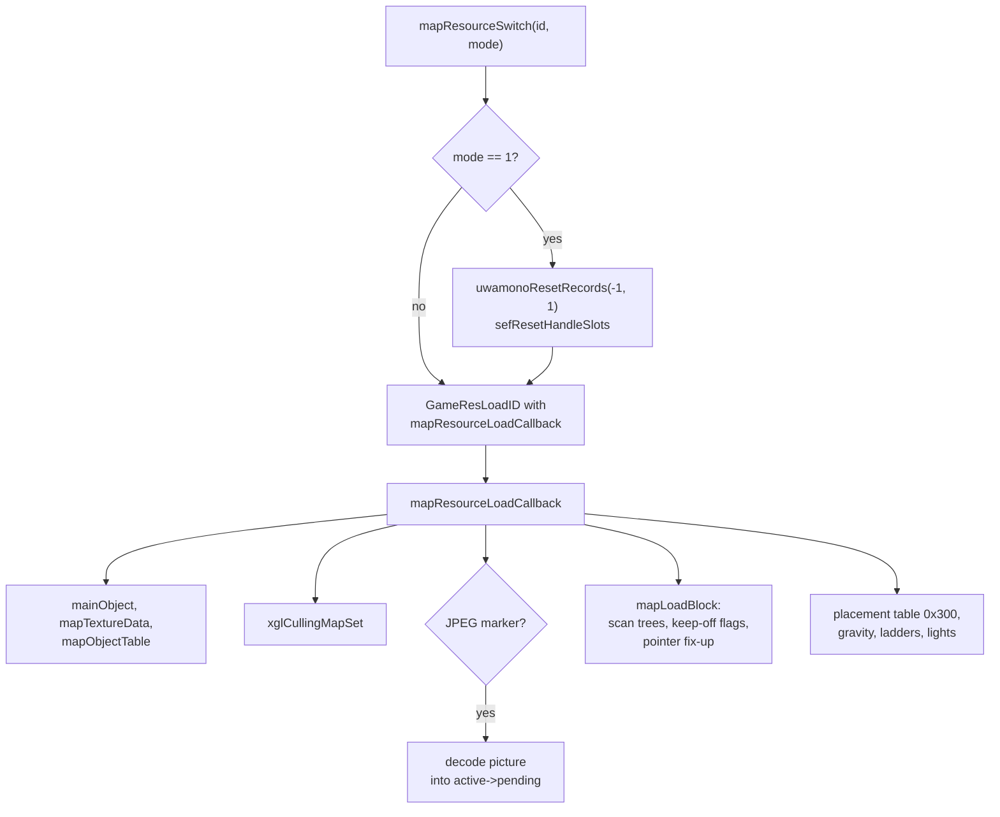

The place script is loaded separately. `mapSceneScriptLoad(id, 1)` reads
`cf\scNNNN.sb` and its language file, starts the script image, sets
`gameWork.mapId` and resets the unit records. The script then builds the
place: it calls `runtime.mapChange`, creates units, sets up doors, ladders and
locators. That flow belongs to [Events](../scripting/events.md).

### Shared unit resources

Some unit models are the same in every place: traps, treasure boxes, save
points and item pickups. `mapObjectResourcesLoad` in `src/main/game_camera.c`
loads them once when the field starts. It walks the name list
`mapObjectResourceNames` and stores one pointer per name in
`mapObjectResources[54]`. All files are in the `matumoto\` folder.

| Index | File | Use |
| --- | --- | --- |
| 0 | `kowaremono.dat` | Name rows of breakable and other named objects, 48 bytes each |
| 1 | `treasurebox.dat` | The pickup table `uwamonoEventTable`, 8 bytes per row |
| 2 | `enemyorder.dat` | The key row table `uwamonoKeyRowTable`, 16 bytes per row, used for enemies |
| 3 | `spline.dat` | Weight table for B-splines, `DataSpline` |
| 4 to 53 | 25 pairs of `.pxy` model and `.txy` texture | The models of the unit types below |

A unit with a built-in model has a type number in `UwamonoRecord.type`. The
model of type `t` is at index `(t + 2) * 2` and its texture at the next
index.

| Type | Model file | Tag in the code | Unit |
| --- | --- | --- | --- |
| 0 to 3 | `Tra001` to `Tra004` | `ExTrp` | Traps |
| 4, 5, 6 | `Tre001`, `Tre002`, `Tre101` | `ExTbx` | Treasure boxes |
| 7, 8 | `Save_P`, `Save_P2` | `ExSav` | Save points |
| 9 | `Evs_P` | `ExSav` | A third symbol handled like a save point model |
| 10, 11 | `Ret_P`, `Ret_P2` | `Dummy` | Return point symbols |
| 12 to 24 | `Item001`, `Item002`, `Item101`, `Item102`, `Item103`, `Item003` to `Item010` | `ExItm` | Item pickups |

"Kowaremono" is Japanese for "breakable thing". The byte layout of the four
data files is the subject of
[Maps and field data](../formats/maps-and-field-data.md).

### Drawing the map

`mapObjectsDraw` draws the scenery once per frame, after the units were
updated. It does nothing while there is no model, while the map is a picture,
or while a place change is pending (`gameWork.nextMap != -1`).

The function first sets the fog when both fog distances are non-zero. Then it
gives the model library the hide mask `mapMainHideMask`, the texture block
and the colour scale `gameWork.mapColor`, and submits `mainObject` with
`pxySubmitModel`. When the model has a second pack, it is submitted the same
way with `mainObject` as parent, with `mapSecondHideMask` and with the part
mask `mapSecondPartMask`. The model library is described in
[pxy](../libraries/pxy.md).

The hide masks are how units switch pieces of the map on and off. Bit `n` of
a mask hides entry `n` of the pack. A flag record (kind 3) owns one entry of
the main pack. A model record (kind 2) owns one entry of the second pack and
also moves it, because the pack draws each entry with the matrix the record
writes every frame.

A picture map has no model. `DispMapObject` then calls `mapBackdropDraw`,
which projects the world origin with the field camera, turns the result into
a scroll position inside the decoded picture, clamps it to the picture size
and sends the visible window to the GS as four strips of 0x7000 bytes each.
Units and actors are still updated on such a map, so characters walk in front
of the picture.

### Culling volumes

`src/main/face_point.c` holds a small occlusion system. A culling volume is a
rectangle in the world, placed by a position, three angles and a scale.
Anything that lies completely behind the rectangle, seen from the camera, does
not need to be drawn.

`xglCullingMapSet` takes the name of the scenery pack and looks it up in the
table `s_aCullingMap`. The table names 13 packs: `E2_MIL06`, `E2_KUK06`,
`E2_DYU01`, `E2_UMN01`, `E2_VEC02`, `E2_MIL02`, `E2_MID02`, `E2_RAV03`,
`E2_EXB02`, `E2_EXB05`, `E2_EXB06`, `E2_SUI02` and `E2_ELS04`. Each row points
to a list of 9-float records (position, rotation, scale) that ends at a record
with a negative scale. At most 10 volumes are kept. `culling_matrix` builds
the transform of each volume, its inverse, its facing direction and its four
corners. A map whose name is absent from the table has no volumes.

`xglCullingCheck(camera, point)` tests a bounding sphere (the centre in x, y,
z and the radius in w). For each volume, `setup_occlusion` moves the four
corners into camera space and builds five planes: the rectangle itself and
the four sides of the pyramid from the eye through its edges.
`check_occlusion` reports the sphere as hidden when it is farther than the
nearest corner and behind all five planes by at least its radius. The model
library asks through `nmlModelCalcClipCulling` before it draws a part.
`xglCullingIgnore` and `xglCullingIgnoreOff` switch the test off and on.

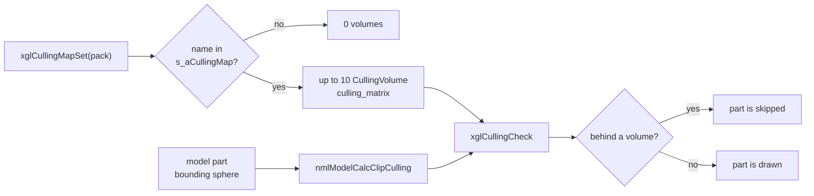

## The collision mesh

### Blocks, groups and entries

The collision block is a small tree of tables. The block header
(`MapFixupBlock`) has a flag byte, a group count and a list of group offsets.
Each group (`MapFixupGroup`) has a type word, an entry count and a list of
entry offsets. Each entry (`MapFixupEntry`, also called `MapRecordGroup`) is
one triangle mesh.

```
MapFixupBlock                     MapFixupGroup                MapFixupEntry
+0x00 flags (3, then 0x83)        +0x00 typeWord               +0x00 recordCount
+0x01 groupCount                  +0x02 entryCount             +0x02 keepId
+0x04 group offsets[...]  ----->  +0x03 relocated              +0x04 vertices   (Vector4[])
                                  +0x04 entry offsets[...] --> +0x08 planes     (Vector4[])
                                                               +0x0C kindTable  (8-byte rows)
                                                               +0x10 records[recordCount]
```

`UnduInit` turns the file offsets into pointers. It accepts a block whose
flag byte is 3. Any other value prints a message that says the ID data has an
unknown version, and the map then has no collision. For every group it adds
the block address to the group offset and to every entry offset. When the
group's `relocated` byte is 0 it also relocates the three pointers inside the
entry. At the end it sets bit `0x80` of the flag byte, so a loaded block reads
`0x83` and is never fixed up twice.

`mapLoadBlock` is the entry point used by the map loader. It registers the
scan trees (see below), clears the two elevator masks, sets all 32 keep-off
flags to 1, runs `UnduInit` and then stores every entry of a keep-off group
in its keep-off flag.

The type word of a group says what its meshes are for. `UnduDataGetHeader(
groupType, keepId)` finds an entry: the first entry of the group when
`keepId` is negative, otherwise the entry whose `keepId` matches. The code
asks for these types.

| Type | Asked by | Purpose |
| --- | --- | --- |
| `0x100` | the player probe, `CheckUwamonoHeight`, `objx.changeId` | Walkable ground. The entry id selects one of several floors |
| `0x300` | `mapResourceLoadCallback` | The placement table: rows of `UwamonoEntry` (x, y, z, angle, key) in place of triangles |
| `0x700` | `Sound_FootStep` | Footstep materials. The entry id is the unit's `footId` |
| `0x200` | the field camera | Camera surfaces (see [The field game](field.md)) |
| `0x600` | the field camera | Camera areas |
| `0x800` | `Get_EnemyIDPos`, `Check_Straight_ID` | Ground that field enemies may walk on. No map on the discs has such a group, so the query finds nothing and `mapSetupCollisionObject` falls back to the first ground entry |
| `0xA00` | `uwamonoStartAreaBlend` | Light areas |
| `0xB00` | `mapLoadBlock`, `id.keepoff` | Keep-off zones |

The placement table reuses the entry header. Its `recordCount` is the number
of rows, and the rows start right after the header. `uwamonoFindEntry(key)`
searches a row by key. `uwamonoGetEntryPose(key, out)` returns the position
and converts the angle, which is stored in 4096ths of a full turn, to
radians. Ladders and locators take their positions from this table.

### Triangles and attributes

One triangle is a `MapRecord` of 16 bytes.

| Offset | Type | Field | Meaning |
| --- | --- | --- | --- |
| `+0x00` | `u16` | `kind` | Attribute, or an index into the entry's `kindTable` when the entry has one. In the shipped maps every mesh entry outside the keep-off group has a table, so `kind` is always an index. Keep-off entries have no table and their `kind` is never read |
| `+0x02` | `s16[3]` | `neighbour` | Index of the triangle across each edge, -1 for an open edge |
| `+0x08` | `u16[3]` | `vertexIndex` | Indices into the vertex array |
| `+0x0E` | `u16` | `planeIndex` | Index into the plane array |

The mesh is used from above. All inside tests work in the XZ plane, and the
plane vector gives the height of the surface at a point (`mapPlaneDistance`).
The vertices of a keep-off entry are special: the y and w of each vertex hold
the bottom and the top of the zone, which the keep-off code reads from
`vertices[0]` as a quick range test. In every other group w is 0 and y is the
plain height of the vertex.

The attribute of a triangle is a 32-bit word. With a `kindTable` the 16-bit
`kind` is an index and the word comes from the table. The code tests these
values.

| Attribute | Meaning in the code |
| --- | --- |
| `0` | Plain ground |
| `3`, `0x13`, `0x23` ... | A wall for walkers. The high nibble of the low byte names a class. Nibble 0 blocks every probe, another nibble blocks the probes whose `probeEnabled` byte equals it. The player's byte is 1 |
| `4` | A triangle that height scans skip. Leaving a mesh over the open edge of such a triangle forces a full rescan, and the player starts to fall (bit `0x10` of the probe result) |
| `0x100` to `0x11F` | A jump area. The low five bits plus 1 are sent to the script as event 3 |
| `0x200` to `0x207` | The platform of elevator 1 to 8. The height comes from the elevator, not from the plane |
| `0x500` + n in the low byte | In a light area mesh: light set n + 1 |
| `0x10000` + bits | A slope or a conveyor (see [Slopes](#slopes)) |
| `0x08000000` to `0x0F000000`, `0x18000000` to `0x1F000000` | Enemy territory numbers, listed in `eneTerritoryID` |
| `0x300` + n | In a camera area mesh: camera record n + 1 |
| `0x400` + surface, in a footstep mesh | The low byte is the floor material. `resFootMaterialIndex` accepts only codes whose high part is `0x400` for the sound. The footstep effect uses the low byte of any code |

Not every value the code can test occurs in the shipped maps. The walls on
the discs are `3` and `0x13` only, the jump areas run from `0x100` to `0x110`,
the elevator platforms from `0x200` to `0x202`, and no map has an enemy
territory code. The values found in the files are listed in
[Maps and field data](../formats/maps-and-field-data.md).

### The scan tree

A height query without history has to find the triangle under a point. To
avoid testing every triangle, `mapRegisterBlock` in
`src/main/map_scan_node.c` builds a binary tree for the meshes of the block
when the map is loaded. It walks the groups whose `relocated` byte is 0 and
calls `mapRegisterNode` for each entry.

`mapRegisterNode` computes the bounding box of the mesh with VU0 minimum and
maximum instructions and calls `mapBuildScanNode` on that box. A node splits
its box in the middle of the longer of the two horizontal axes. Each triangle
is classed as in front of the split, behind it, or straddling it, with a
tolerance of 1% of the box size. Straddling triangles are stored in the node
itself. The others go to the front or back child, which splits again. The
depth limit is 8, and at that depth every remaining triangle is stored.

All nodes come from one pool of 1600 cells of 16 bytes (`mapScanPool`). A
node is a 16-byte `MapScanNode` header followed by its triangle indices,
rounded up to 16 bytes. Four meshes can be registered at a time
(`mapRegisteredSlots`), and a mesh needs fewer than 3073 triangles to use its
tree.

`mapScanRegisteredNode(set)` runs a query. It finds the slot whose triangle
array matches the probe, then `mapScanNode` tests the triangles stored in the
node and descends into the child on the side of the query point. It returns 0
when the mesh has no tree, and the caller then tests all triangles one by
one.

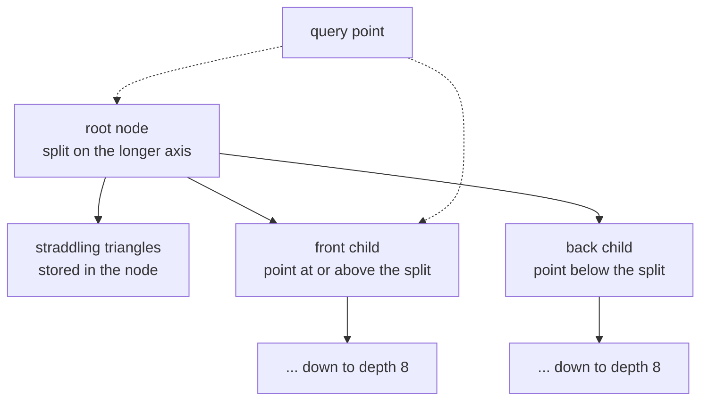

### The probe

Every collision question is asked with a `MapCollisionObject`, a 0x40-byte
request and result block. An actor owns one (`XenoActor.collision`), and
helpers use shared ones such as `unduTest`. `UnduParamInit` fills the
defaults.

| Offset | Field | Default | Meaning |
| --- | --- | --- | --- |
| `+0x00` | `record` | 0 | The triangle the probe stands on after the last call |
| `+0x04` | `previousRecord` | 0 | The triangle before that |
| `+0x08` | `flags` | 0 | Request flags, see below |
| `+0x0A` | `bits` | 0 | Result bits: the low two bits hold the last edge code, `0x10` means a skip triangle was left |
| `+0x0C` | `count` | 16 | How many times the walk may be redirected by a slide |
| `+0x0D` | `loopCount` | 16 | How many triangles one walk may cross |
| `+0x0E` | `missCount` | 0 | Frames without ground, for the snap |
| `+0x0F` | `probeEnabled` | `0xFF` | Wall class of the walker |
| `+0x10` | `heightTolerance` | 1.0 | How far above the probe a nearer surface may be and still win |
| `+0x14` | `distance` | -1000 | The height found |
| `+0x18` | `block` | 0 | The mesh to use. 0 means the first `0x100` entry |
| `+0x1C` | `recordSet` | scratchpad | Work area (`MapRecordSet`, 0x1A0 bytes). The default is the EE scratchpad at `0x70000000` |
| `+0x20` | `kind` | 0 | Attribute of the triangle found |
| `+0x28` | `radius` | 0.5 | Body radius for push-out and keep-off |
| `+0x30` | `keyMask` | 0 | An extra wall rule: an edge is closed when `(attribute & keyMask) == keyValue` |
| `+0x38` | `keyValue` | 1 | |

The value -1000 (`MAP_HEIGHT_NONE`) means "no ground" everywhere in this
system.

| Flag | Meaning |
| --- | --- |
| low 3 bits = 1 | Stop at the first closed edge and keep the start position |
| low 3 bits = 2 | Slide along a closed edge |
| low 3 bits = 3 | Stop at the exact point where the path meets the closed edge |
| `0x100` | Keep the body radius away from closed edges (`mapPushOutByRadius`) |
| `0x200` | After 61 calls without ground, snap to the nearest triangle |
| `0x800` | Skip the keep-off zones and the class walls |
| `0x1000` | Forget the walk history and rescan once. `UnduCheckResultCheck` clears the bit |
| `0x4000` | Always rescan |

The player walks with `0x302`: slide, keep the radius, snap when lost.

### `UnduCheck` step by step

`UnduCheck(position, delta, object)` is the one entry point. With `delta`
null it answers "what is under this point". With a delta it moves the point
and answers "where do I end up, and how high is the floor there". It returns
the floor height or -1000 and updates the position in place.

1. When no map block is loaded, the delta is simply added and the result is
   height 0 with no triangle.
2. `mapSetupCollisionObject` binds the work area to the mesh, copies the
   start point, the radius and the key filter, and treats a delta whose words
   are `0x7FFFFFFF` as no delta.
3. With flag `0x200`, a probe without a triangle counts its misses. At 61 the
   position is moved to the centroid of the nearest triangle
   (`mapSnapToNearestTriangle`).
4. A full scan runs when the probe has no triangle yet, when flag `0x1000` or
   `0x4000` is set, when control bit `CONTROL_MAP_LOADED` is set, or when the
   last attribute was an elevator. `UnduCheckSubCheckAll` uses the scan tree
   or the plain loop. Every triangle that contains the point is offered to
   `UnduCheckSubHeightCheck`, which keeps the surface nearest to the probe
   height, as long as it is not more than `heightTolerance` above it. Without
   a delta the function returns here.
5. With a delta, the end point is computed. If it is still inside the current
   triangle, only the height is refreshed. Otherwise
   `UnduCheckSubCrossCheck` walks from triangle to triangle towards the end
   point.
6. With flag `0x100`, `mapPushOutByRadius` runs up to 32 times while it
   reports a correction.
7. `UnduCheckResultCheck` copies the result into the probe: triangle,
   attribute, height. For an elevator attribute it replaces the height by the
   elevator's y. With a delta it writes the final point back to `position`.
8. Unless flag `0x800` is set, `mapPushOutOfKeepOff` moves the point out of
   closed keep-off zones.

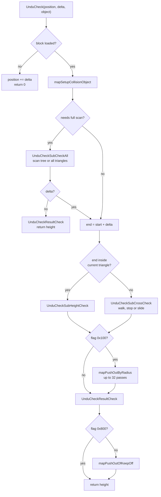

### Walking across triangles

`mapStepRecord(set, record, from, to)` is one step of the walk. It loads the
three vertices into VU0 registers and computes three edge values for the end
point with `mapTriangleEdgePlanes`. The step has four possible results.

| Result | Meaning |
| --- | --- |
| 4 | The end point is inside this triangle. The walk is over |
| 0 | No edge is crossed by the path |
| 1, 2, 3 | The path leaves through edge 1, 2 or 3 and that edge is open. The triangle's attribute is stored in `hitKind` |
| edge + 256 | The path leaves through an edge whose neighbour is closed by `CheckWallAttr` |
| a pointer | The neighbour triangle. The walk continues there |

`CheckWallAttr` decides whether a neighbour may be entered. It reads the
neighbour's attribute and applies four rules.

- The key filter of the probe: closed when `(attribute & keyMask) ==
  keyValue`. With the default values this rule never fires.
- Class walls: attribute 3 with a class nibble closes the edge for matching
  probes, unless the probe has flag `0x800`.
- Leaving an elevator: when the probe stands on attribute `0x200` exactly and
  the neighbour is plain ground, the edge is closed while bit 0 of
  `elvNoOutMask` is set.
- Entering an elevator: a neighbour with attribute `0x200 + n` is closed
  while bit n of `elvActiveMask` is clear, and also while the platform is
  more than 0.5 above or below the probe.

`UnduCheckSubCrossCheck` repeats the step, at most `loopCount` triangles per
walk. When the walk ends on a closed or open edge, the low three flag bits
choose the reaction.

- Mode 1 gives up. The position stays at the start.
- Mode 2 slides. The heading of the edge and the heading of the motion are
  computed with `mapHeadingXZ`. The motion is projected onto the edge
  direction (its length times the cosine of the angle between them), a new
  end point is set along the edge, and the walk starts again from the first
  triangle. This may happen `count` times.
- Mode 3 computes the point where the path crosses the edge, from the slopes
  of both lines, moves back by 0.001 and ends there.

When all `count` redirections are used up, the walker stays where it started.

`mapPushOutByRadius` keeps a round body off the walls. It places sample
points on a circle of the probe radius around the new position: 3 points per
unit of circumference above radius 1, 10 below, rounded down to a multiple of
four. A sample that falls outside the current triangle is walked to with
`mapWalkSegment`. When that walk hits a closed edge, the centre is moved away
from the edge by the distance the sample overshoots it. After all samples the
corrected centre is tested like a normal move.

### Keep-off zones

A keep-off zone is a mesh of group type `0xB00` whose outline acts as a
switchable fence. The array `elvKeepOffFlags[32]` holds one word per zone id:
the address of the mesh with a mode in the low two bits, or 0 when the zone is
off. `mapLoadBlock` switches every zone of a new map on with mode 1. The
script native `id.keepoff(no, keep)` switches a zone off with `keep` 0 and on
otherwise, with the low bit of `keep` as the mode.

`mapPushOutOfKeepOff` runs at the end of each probe. For each active zone
whose height range contains the point, it looks at the open edges of the
zone mesh. A point inside the zone is moved out through the nearest open
edge: onto the edge in mode 0, one body radius beyond it in mode 1. A point
outside the zone but closer than the radius to an open edge is pushed away
from it (mode 1 only). A zone therefore works as a solid block that scripts
can remove, for example a barrier that disappears after an event.

The same function contains one fixed rule for elevator 1: while bit `0x80` or
`0x40` of `elvActiveMask` is set, the z coordinate is clamped to within 7
units of that elevator, less the body radius, on the low or the high side.

### Geometry helpers

`src/main/get.c` wraps the probe for the rest of the game.

| Function | What it does |
| --- | --- |
| `Get_HeightAttr(position, _, flags, request)` | Height under a point with the given flags |
| `Get_Attr(position, _, flags)` | Attribute under a point, through the shared probe `unduTest` |
| `Get_Attr_NU(position, groupType, flags)` | The same in the first entry of another group type |
| `unduGetSlotHeight(index, position, _, groundId, flags)` | Height under a point in the ground entry `groundId`, with the wall class of unit `index`. Uses flags `0x4303` |
| `Check_Undu(index, from, to, groupType, id, hit, flags)` | Walks from one point to another and stores where the walk ends. Returns 1 when the end is within 0.01 of the target |
| `Check_Straight`, `Check_Straight_ID` | Test a straight line in steps for ground, units and actors, and return the last free step |
| `Check_Wall` | Samples a ring of points around a position and flags the blocked ones |
| `Check_InsideFan` | A field of view test: range, angle sector, units in the way, walls in the way and a height limit of 3.2 |
| `Check_MoveSquare` | A corner-cutting test from a debug tool that also prints to the screen |
| `Get_EnemyIDPos` | The nearest point on enemy ground among eight points on a ring of radius 2 |

The file also holds pure maths used all over the field: `Get_Distance` (in
the XZ plane), `Get_Distance3D`, `Get_Angle` (`atan2f` of the x and z
differences), `Get_Decimal_Surplus_for_Radius` (wrap an angle into -π to π),
`Check_Angle` (is an angle inside a sector), `Get_Cursol_by_Reduce_Speed_Angle_Loop`
(turn towards an angle by a fraction, the shorter way round),
`Get_Point_By_AngleLength`, `Get_One_Step`, and the interpolators
`Get_MiddlePoint` (linear), `Get_MiddlePoint_Curve` (linear with a speed
profile) and `Get_MiddlePoint_Parabora` (linear with a parabolic height
bump).

`GetBSplineLoop` evaluates a closed cubic B-spline through a ring of control
points. The four basis weights come from the table in `spline.dat`, which
holds rows of four 16-bit weights, 256 rows of 8 bytes for each of its five
segment blocks (so a segment is 2048 bytes long), and the weighted sum is
divided by 24576. `BSpline_Add` stores a control point. `TM_Script_Spline_Add`
in `src/main/enemy_system_init.c` appends a point to the trail of a unit's
state block. Enemy patrol routes use these, see
[Field enemies](field-enemies.md).

`src/main/outer_product.c` has the 2D primitives. `CheckPointLine` returns on
which side of a directed line a point lies (1 left, 2 right, 0 on it).
`CheckCrossLine` and its twin `Check_CrossingOver` report whether two
segments cross, which is true when each segment has its ends on opposite
sides of the other. `CalcCrossPoint` computes the crossing point, and
`CheckDist2D` is the distance in the XZ plane.

## Map units

### The record table and the kinds

`uwamonoRecords` has 256 records of 0x870 bytes each (`UwamonoRecord` in
`include/main/ytachi_test.h`). The byte `kind` says what a record is.

| Kind | Name in the source | What it is |
| --- | --- | --- |
| 0 | `MAP_KIND_FREE` | Unused record |
| 1 | `MAP_KIND_ACTOR` | A walking character with an actor and AI: enemies and people. Updated by `ACT_updateEnemy` |
| 2 | `MAP_KIND_MODEL` | A model unit: a movable entry of the map's second pack, or a built-in model by type. Doors, breakables, boxes, traps, save points, items |
| 3 | `MAP_KIND_FLAG` | A switch for one entry of the main scenery pack. It only shows or hides the entry |
| 4 | `MAP_KIND_ACTOR_STATIC` | An actor without AI. The player is the record of this kind |
| 5 | `MAP_KIND_PART` | A part actor attached to the player |
| 6 | `MAP_KIND_EFFECT` | A visual effect placed in the map |
| 7 | `MAP_KIND_MOVER` | A point without a model. Locators are pairs of these |
| 8 | `MAP_KIND_MODEL_REQUEST` | Used only when creating: a built-in model by type, which becomes kind 2 |

Records are allocated from the front. `uwamonoCountLeadingInUse` returns the
index of the first free record, and that is where a new unit goes. A script
names a unit by its 16-bit `id`. `uwamonoFindIndexByShortKey(id)` finds the
record index, and almost every native starts with that call.

Records of kind 1 and 4 also own one of 32 state blocks, `uwamonoStates`
(`UwamonoState`, 0x40C0 bytes each). The block holds the AI state, routes and
paths. It is described in [Field enemies](field-enemies.md). This page uses
only a few of its fields: `groundId`, `footId`, `walk[]` and the path used by
`objx.setParent`.

### The record

The table lists the fields that the unit code uses. Offsets are in bytes
from the start of the record.

| Offset | Type | Field | Meaning |
| --- | --- | --- | --- |
| `0x000` | `s16` | `id` | The id scripts use for the unit |
| `0x002` | `u8` | `kind` | Record kind, see above |
| `0x004` | `int` | `key` | Pack entry index (kinds 2, 3), model id (kinds 1, 4, 5), effect id (kind 6). -1 for a built-in model |
| `0x008` | `int` | `type` | Built-in model type, -1 for none |
| `0x010` | vector | `position` | World position |
| `0x020` | vector | `previous` | Position of the last frame (kind 7) |
| `0x030` | vector | `velocity` | y is the fall speed of a falling unit |
| `0x040` | vector | `rotation` | Angles in radians. y is the heading |
| `0x050` | vector | `scale` | |
| `0x060` | vector | `pivot` | Rotation centre, relative to the position |
| `0x070` | `float` | `transparency` | Percent, 0 is opaque |
| `0x080`, `0x090` | vector | `moveFrom`, `moveTo` | End points of the running move |
| `0x0A0`, `0x0B0` | vector | `turnFrom`, `turnTo` | End angles of the running turn. A locator keeps its angle and width in the x fields |
| `0x0C0`, `0x0D0` | vector | `scaleFrom`, `scaleTo` | End values of the running scale |
| `0x0E0`, `0x0E4` | `float` | `transparencyFrom`, `transparencyTo` | |
| `0x0F0` to `0x1FF` | vectors | `startA` ... `followC` | Start and target values of the light blend |
| `0x200` | vector | `tilt` | x is the lid angle of a treasure box |
| `0x210` | `s16` | `moveEndMode` | Actor mode to request when a move ends, -1 for none |
| `0x212`, `0x214` | `s16` | `moveStep`, `moveCount` | Frame counter and length of the move. A step of -1 means idle |
| `0x216`, `0x218` | `s16` | `turnStep`, `turnCount` | The same for the turn |
| `0x21A`, `0x21C` | `s16` | `scaleStep`, `scaleCount` | The same for the scale |
| `0x21E`, `0x220` | `s16` | `transparencyStep`, `transparencyCount` | The same for the fade |
| `0x222` to `0x245` | `s16` | `cursorA` ... `countC` | Counters of the light blend |
| `0x248` | `int` | `lightArea` | Light set the unit is blended to, -1 after a map load |
| `0x24C` | `s16` | `eventTimer` | Countdown to the delayed event, -1 for none |
| `0x250` | `int` | `event` | 0 place change, 1 player model change |
| `0x254`, `0x258` | `int` | `eventState`, `eventStateArg` | Next place and entry key for event 0 |
| `0x25C`, `0x25E` | `s16` | `moveTicks`, `moveDuration` | A general purpose timer: door travel, lid opening, item flight |
| `0x260` | `s8` | `rotationOrder` | Order of the three rotations, 0 to 5. The default is 5 |
| `0x264` | pointer | `transform` | The matrix the model is drawn with: a row of the pack's matrix table, or `savedMatrix` |
| `0x270` | matrix | `savedMatrix` | Private draw matrix of a built-in model |
| `0x2B0` | matrix | `pose` | Original pack matrix, restored when a place script is loaded |
| `0x2F0` | matrix | `matrix` | The placement matrix. Children of the unit are drawn relative to it |
| `0x330` | pointer | `body.actor` | The `XenoActor` of kinds 1, 4 and 5 |
| `0x334` | pointer | `body.motions` | The state block of kinds 1 and 4 |
| `0x338` | `float` | `form` | Size class of the unit: 1.0 or 5.0 |
| `0x33C` | `s16` | `motion` | Copied to the actor's `drawMode` |
| `0x340`, `0x3C0` | `float[32]` | `moveX`, `moveY` | Speed profile of moves: segment weights and speeds |
| `0x440` | `s16` | `moveStepCount` | Number of profile segments, 0 for a linear move |
| `0x444`, `0x4C4`, `0x544` | | `turnX`, `turnY`, `turnStepCount` | The same for turns |
| `0x546` | `s16` | `parent` | Record this unit follows or is attached to, -1 for none |
| `0x548` | `s16` | `attached` | 1 when the unit is rigidly attached to the parent |
| `0x550`, `0x560` | vector | `savedPosition`, `savedRotation` | Offset from the parent |
| `0x570` | `int` | `flags` | Unit flags, see below |
| `0x574` | `int` | `landedFlags` | `0x80000` once a falling unit has come to rest |
| `0x580` | vector | `extent` | Collision size: x half width or radius, y height, z half depth |
| `0x590` | `s8` | `searchMode` | Collision shape: 0 none, 1 box, 2 circle |
| `0x591` | `s8` | `searchShape` | Locator type (kind 7) |
| `0x592` | `s16` | `elevatorMotion` | Elevator number that carries the unit, -1 for none |
| `0x59C` | `int` | `level` | Strike height step 0 to 2, which selects the player's strike motion |
| `0x5A0` | `int` | `effectId` | Effect started when the unit is broken |
| `0x5A4` | `int` | `enemyLink` | Record of an actor that appears when the unit is broken, -1 for none |
| `0x5A8` | `int` | `itemLink` | Record of an item that appears, -1 for none |
| `0x5B0` | vector | `focusOffset` | Offset of the target marker from the position |
| `0x5C0` | `s8` | `motionKind` | Door kind: 0 no door, 1 sliding, other values turning |
| `0x5C1` | `s8` | `openerKind` | Who may open a door: 0 a character on foot, 1 nobody, 2 an E.S. |
| `0x5C2` | `s8` | `busy` | Door: 0 open, 1 closed. Treasure box: 3 open, 4 closed |
| `0x5C4` | `s16` | `timer` | Frames a door needs to open or close |
| `0x5D0`, `0x5E0` | vector | `closedPosition`, `openPosition` | The two positions of a sliding door |
| `0x5F0`, `0x600` | vector | `closedRotation`, `openRotation` | The two angles of a turning door |
| `0x610` | `float` | `speed` | Distance from which a door can be opened |
| `0x614` | `float` | `swingLength` | Default travel of a door |
| `0x618` | `int` | `lookLink` | The partner record: second door leaf, second locator point |
| `0x61C` | `s16` | `eventRow` | Row of `treasurebox.dat` for an item pickup |
| `0x620` | `int` | `triggerSound` | Sound played when the unit is broken, -1 for none |
| `0x624` | `int` | `moveSound` | Sound played when a door starts to move |
| `0x62C` | `s8` | `state` | Target state: 0 out of reach, 1 selected, 2 in reach |
| `0x634` | `int` | `cellMask` | From which of the eight surrounding cells the unit can be targeted. `0xFF` is all |
| `0x638` | pointer[3] | `handles` | Effect handles: [0] the unit's own effect, [1] and [2] the two target markers |
| `0x644` | `int` | `releaseNextIndex` | Record released together with this one |
| `0x648` to `0x86F` | | `savedProbe` ... | Actor state saved while the actor pool is rebuilt around a battle |

### Unit flags

`UwamonoRecord.flags` starts as `0xA` (shown, falling). Scripts change bits
with `objx.enableFlags(id, bits, [target])` and `objx.disableFlags`. A target
of 99 applies the bits to every used record, another target to every record
of that kind.

| Bit | Meaning |
| --- | --- |
| `0x2` | Shown. A hidden model unit is not drawn and does not block the player |
| `0x8` | Falls under gravity until it lands (`CheckUwamonoHeight`) |
| `0x10` | The fall is resolved within one frame, without a bounce |
| `0x400`, `0x400000` | Set together while a person is being talked to. The unit turns to its actor's target heading |
| `0x800` | A person whose talk starts by walking up to them, without a button press |
| `0x1000` | Clears the unit's bit in `mapSecondPartMask` |
| `0x2000` | The unit's effect follows its owner (copied to the effect's follow bit) |
| `0x4000` | No footstep effects |
| `0x20000` | Can be targeted and struck |
| `0x40000` | Breaks when struck |
| `0x80000` | Target markers stay hidden |
| `0x100000` | Target for an E.S. only. Without the bit the unit is a target for a character on foot only |
| `0x200000` | No line-of-sight test when targeting |
| `0x2000000` | Dormant: ignored by collision, targeting and pickup. Used for the hidden contents of a box |
| `0x4000000` | On the player: skip the ground probe |
| `0x8000000` | A scripted move follows the ground height |
| `0x10000000` | A falling unit does not bounce |

### Creating a unit

The script native `runtime.setNumber(id, kind, entry, fourth, fifth)` creates
a unit. With the kind left out it releases the unit of that id instead. The
entry may be a number or a name. A name is looked up in the second pack of
the map with `pxyFindEntryIndex`, or converted to an effect id with
`srsEffectNameToID` when the kind is 6.

`uwamonoCreateRecord(key, kind, entry, fourth, fifth)` does the work. It
takes the first free record, stores the id, the kind and the entry as `key`,
and then sets the record up by kind.

- **Actor kinds 1, 4 and 5.** The model resource `entry` is loaded and an
  actor is allocated from the pool (see [Actors](../libraries/actors.md)).
  Model ids up to `0x6FFFF` get a body of radius 0.6 and height 1.8 with no
  unit collision shape. Higher ids get radius 0 and the circle shape. Ids
  from `0x10000` to `0x13FFF` get `form` 1.0, all others 5.0. Kinds 1 and 4
  take the next free state block. Kind 1 also fills its AI defaults.
- **Kind 1 with a key row.** When `fourth` is given, it is searched in the
  512 rows of `enemyorder.dat`. The row supplies the model id. A row whose
  flag in `gameWork.rowFlags` is set, and whose gate byte for the current
  state of control bit `0x800` is 0, creates nothing and returns -1. This is
  how defeated enemies stay away.
- **Kind 8, a built-in model.** The entry is the type. Type 12 means "an
  item pickup for row `fourth` of `treasurebox.dat`". If
  `gameWork.eventFlags[fourth]` is already 1 the item was taken before and
  the record is freed at once. Otherwise the model type is chosen from the
  row (see [Item pickups](#item-pickups)), or forced to `fifth + 12`. The
  record becomes kind 2 with `key` -1 and draws with its private matrix.
- **Kind 2, a pack entry.** Position and angles are read from the entry's
  matrix in the pack (`uwamonoObjectEntryPositionGet`,
  `uwamonoObjectEntryAnglesGet`). The record keeps a copy of the original
  matrix in `pose` and points `transform` at the pack's own matrix row, so
  writing the matrix moves the piece of scenery.
- **Kind 6, an effect.** The effect `entry` is started at the record position
  and its handle stored in `handles[0]`. See [sef](../libraries/sef.md).
- **Kind 3, a flag.** Only the position is cleared.

Kinds 2 and 8 then call `uwamonoInitRecord`, which decides the collision
shape.

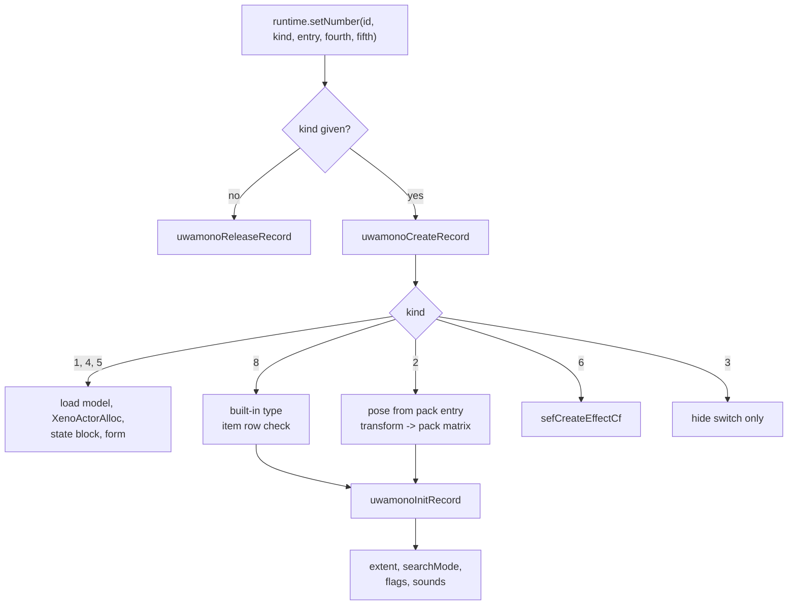

### Shape by type or by name

`uwamonoInitRecord(index)` in `src/main/uwamono_record_init.c` has two paths.

A built-in model (key -1) gets fixed values from its type.

| Type | Extent x, y, z | Shape | Flags added | Other |
| --- | --- | --- | --- | --- |
| 0, 1 (trap) | 0 | none | `0x60000` | Break effect `0x10000035`. Sound `0x0200000B` for type 0, `0x0200000A` for type 1 |
| 2, 3 (trap) | 0 | none | `0x160000` | The same sounds for types 2 and 3 |
| 4, 6 (box) | 0.35, 0.55, 0.225 | box | | `level` 2, `busy` 4 |
| 5 (box) | 1.75, 2.5, 1.6 | box | | `level` 2, `busy` 4 |
| 7, 8, 9 (save) | 0 | none | | |
| 10, 11 | 0.5, 1.0, 0.5 | box | `0x60000` | Break effect `0x100C8008`, `level` 1 |
| 12 and up (item) | 0.25, 0.5, 0.25 | none | | `level` 2 |

A pack entry is set up from its name. The function reads the entry name from
the pack and scans the rows of `kowaremono.dat`. A row is 48 bytes: a name of
up to 12 characters (all 375 names in the shipped file have 7), a strike level, a shape, an effect number, three scale
values and a sound number.

- A name that starts with `door` makes a door: a box whose half sizes come
  from the row's scale, `timer` 30, `speed` 1.0, no fall. The door sound is
  `0x03000000` when the scale x is 1.5 and `0x03000001` otherwise. The test
  is made on the first row that is visited, whatever its name, so a door
  takes its size from the first row of the file.
- A name that matches a row and has `_sh` at characters 9 to 11 is a
  companion piece of the entry before it. It gets no collision and is
  attached to the record of entry `key - 1` with `uwamonoSetTarget`. The
  suffix probably stands for shadow.
- Any other matching name is a breakable object. Half sizes, height, level
  and shape come from the row. The break effect is `0x100C8000 | (number +
  900)`, the break sound is `0x02000000 + number`, and the flags `0x60008`
  are added: targetable, breakable, falling.

For the last two cases the first two characters matter too. A name that
starts with `ck` clears flag `0x100000` and a name that starts with `rk`
sets it. So `ck` objects are broken on foot and `rk` objects are broken with
an E.S.

### Releasing and resetting

`uwamonoReleaseRecord(index)` frees a unit. It first releases every record
whose `parent` is this unit, and the record named by `releaseNextIndex`. If
the unit was the selected target, all markers are removed with
`UnlockMapUnit`. An actor is hidden and returned to the pool. A model unit
sets its bit in `mapSecondHideMask` and a flag unit its bit in
`mapMainHideMask`, so the scenery piece disappears. The three effect handles
are deleted, the state block is marked free, and `uwamonoResetRecords(index,
1)` clears the record.

`uwamonoResetRecords(index, mode)` in `src/main/ytachi_test.c` writes the
default values: kind 0, type -1, all tween counters idle, scale 1, flags
`0xA`, `cellMask` `0xFF`, no parent, no links. With index -1 it resets all
256 records and the 32 state blocks. With mode 1 it keeps the player (kind 4)
and its parts (kind 5), so they survive a place change, and it releases the
actors of the records it clears.

### The frame

The field loop in `src/main/game_data.c` runs the scripts first and then
calls four functions in a row: `DispMapObject`, `uwamonoPlayerUpdate`,
`cameraUpdateFrame` and `mapObjectsDraw`. They are skipped while a cutscene
owns the screen (control bit `0x200`).

`DispMapObject` is the unit update. It makes three passes over the table.

**Pass 1, actors and timers.** Every used record counts down its
`eventTimer`. At zero, event 0 stores the next place and entry key in
`gameWork` and event 1 changes the player model and starts a fade-in. For
kinds 1 and 4 the function then

1. plays footsteps with `Sound_FootStep`,
2. shows or hides the actor from flag `0x2` and starts a light blend when
   the actor entered a new light area,
3. advances the tweens with `mapObjectAdvanceTweens` and copies position and
   rotation to the actor when one ran. With flag `0x8000000` the y comes from
   the ground,
4. copies the scale, and turns transparency into the actor's alpha,
5. runs the AI with `ACT_updateEnemy` for kind 1,
6. turns a talking person and advances the light blend.

**Pass 2, models and the rest.** When the map is a picture, only effects are
updated and the backdrop is drawn. Otherwise each record is handled by kind.
A model unit copies flag `0x2` into the hide mask, advances its tweens and
its `moveTicks` timer, or takes its pose from its parent offset when it is
attached. A door of kind 2 switches its collision off while it stands open.
`uwamonoUpdateTransform` lets the unit fall and writes the position into the
matrix. An elevator rider is moved by `elvUpdateMotion`. Then the matrix is
built: parent matrix or identity, translation, pivot, the three rotations in
the order `rotationOrder` selects, pivot back, scale. The result is saved to
`*transform` and to `matrix`. A unit with a built-in type submits its model
with that matrix. A flag unit copies its shown bit into the main hide mask.
An effect unit copies position, rotation and scale to its effect. A mover
unit remembers its previous position and advances its tweens.

**Pass 3, targets and doors.** For kinds 1 to 3, `uwamonoUpdateInReach`
updates the target state and the markers are placed. Open doors that the
player has left close again. At the end `uwamonoUpdatePoints`,
`uwamonoUpdateItemPickups` and the debug outline `DispCollUwamono` run.

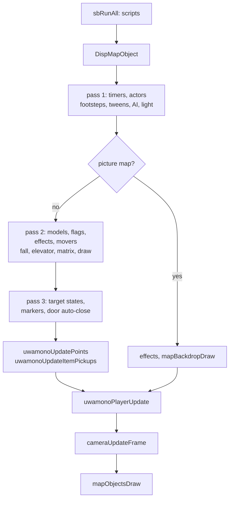

### Tweens and the `objx` natives

Four properties of a unit can change over time: position, rotation, scale
and transparency. Each has a "from" value, a "to" value, a frame counter and
a length. `mapObjectAdvanceTweens` advances all four by one frame and returns
1 when any of them ran. Nothing moves while the game is paused
(`CONTROL_PAUSED`).

Moves and turns are linear by default (`Get_MiddlePoint`). A unit can also
carry a speed profile of up to 32 segments, added with `objx.setStepMove(id,
step, speed)` and `objx.setStepRotate`. Each segment has a weight (a share of
the time) and a speed. `Get_MiddlePoint_Curve` then covers more distance in
the fast segments. A step of -1 clears the profile. Doors use a fixed
seven-segment profile that starts slowly, runs fast in the middle and eases
out.

| Native | Arguments | Effect |
| --- | --- | --- |
| `objx.move` | id, frames, x, y, z, [motion], [mode] | Move to a point given in hundredths. 0 frames jumps there. With a motion, an actor plays it and turns towards the goal over 15 frames. Mode 1 returns the actor to mode 0 at the end |
| `objx.rotate` | id, frames, x, y, z | Turn to angles given in hundredths of a degree |
| `objx.scale` | id, frames, x, y, z | Scale in percent |
| `objx.transparent` | id, frames, value | Transparency in percent |
| `objx.offsetPivot` | id, x, y, z | Set the rotation centre |
| `objx.setRotateTurn` | id, order | Set `rotationOrder` |
| `objx.setStepMove`, `objx.setStepRotate` | id, step, speed | Add a profile segment |
| `objx.enableFlags`, `objx.disableFlags` | id, bits, [target] | Change unit flags. Clearing `0x20000` also removes the unit's target markers |
| `objx.setParent` | id, [other], [attach] | Follow or attach, see below |
| `objx.setPair` | id, other | Link two units as partners (`lookLink`), or give an effect unit an owner actor |
| `objx.changeId` | id, groundId | Move an actor to another ground entry of group `0x100` |
| `objx.footId` | id, footId | Select the footstep material entry |
| `objx.getParam` | [id], param | Read a position or rotation component, or player facts such as the model kind |

An omitted argument keeps the current value in all of these. The natives are
listed with their script side in [Natives](../scripting/natives.md).

`objx.setParent` has three behaviours. With the third argument present, the
unit's effect is tied to the other unit's actor (or record) and the two are
released together. Otherwise `uwamonoSetTarget(index, target, 1)` runs. When
either unit is an actor, the unit walks to the target: 128 path points are
laid on the straight line between them and the AI is put into action 5. When
both are models, the unit stores its offset from the target and is from then
on drawn in the target's coordinate system, so it rides along when the target
moves or turns. A target of -1 detaches the unit and reads its position and
angles back from its matrix.

### Falling units

A model unit with flag `0x8` and no parent falls. `CheckUwamonoHeight` asks
the ground height under the unit in the first `0x100` entry. Each frame the
fall speed grows by `gameWork.gravity`, up to 0.6 per frame. When the unit
passes the ground it is placed 0.001 above it and bounces with its speed
divided by `gameWork.bounceDivisor`. A bounce slower than 0.05 ends the fall
and sets `0x80000` in `landedFlags`. A unit can also land on top of another
unit: `HitCheckUwamono` finds a box or circle unit under it, and the unit
comes to rest on that unit's top. With flag `0x10` the loop runs until the
unit rests, all within one frame. This is what makes an item hop out of a
broken crate and settle on the floor.

### Light areas

Actors are lit by a light set of three directional lights, a fourth light
and an ambient colour. A map can define up to 16 sets in `gameWork.lights`
(the script fills them with `runtime.setLight`). The light area mesh of group
`0xA00` says which set applies where.

`uwamonoStartAreaBlend(index)` probes that mesh under the actor each frame.
An attribute with both bits of `0x500` selects set `(attribute & 0xFF) + 1`,
anything else set 0. When the set differs from the record's `lightArea`, the
function copies the actor's current light values as start values, the new
set as targets, and starts all blend counters with 5 steps.
`uwamonoLightBlendStep` then moves each direction, each colour, the ambient
colour, the fourth light and its strength one step per frame with
`Get_MiddlePoint`. An actor that walks from a bright hall into a dark
corridor therefore changes its lighting over five frames.

## The player on the map

### The player record and its forms

The player is the record of kind 4, and `uwamonoCurrentIndex` is its index.
`uwamonoChangePlayerModel(request)` in `src/main/game_camera.c` creates it or
swaps its model. The request is a model id. The special value -1000 means
"the counterpart of the current model", which the key range table supplies.

The model id decides the form. Ids from `0x10000` to `0x13FFF` give `form`
1.0 and all others give 5.0. The values that follow from the form show what
the two forms are. Form 1.0 has a body radius of 0.64, a targeting reach of
6.0 and the small treasure box and item models. Form 5.0 has a body radius
of 4.0, a targeting reach of 20.0 and the large models. `objx.getParam` maps
the ids `0x10001` to `0x1002B` to seven groups and the ids `0x14002`,
`0x14003` and `0x14005` to three more. The reading that fits all of this is
that form 1.0 is a party member on foot (seven characters with costume
variants) and form 5.0 is an E.S. The source names the two values
`UWAMONO_FORM_FOOT` (1.0) and `UWAMONO_FORM_ES` (5.0).

| Value | On foot (form 1.0) | E.S. (form 5.0) |
| --- | --- | --- |
| `gameWork.frameScale` (speed per stick unit) | 0.00051 | 0.001445 |
| Body radius | 0.64 | 4.0 |
| Record scale | 1.0 | 0.9 |
| `playerParams[0][0]` (target reach) | 6.0 | 20.0 |
| `playerParams[1][0]` (target height reach) | 0.2 | 1.0 |

The function also creates up to two part records (kind 5) from
`uwamonoAttachIdTable`, which lists for a range of model ids the two part
models that belong to it. `uwamonoAttachPlayerParts` hangs them on joints of
the player actor: joints 80 and 81 on foot, joints 10 and 7 otherwise. One
part has a node named `jin_saya_tuka` (scabbard and hilt), so on foot the
parts are the weapons the characters draw when they strike something. The
ten rows of `uwamonoKeyRangeTable` add per-model data: the frame counts of
the three strike motions, the strike effect id and the counterpart model.

The script native `runtime.setPlayer` changes the movement values at run
time: scripted control on or off, `frameScale`, body radius, the five
`playerParams`, `climbFrames`, `gravity` and `bounceDivisor`.

### `uwamonoPlayerUpdate`

The function runs once per frame after the unit update. After the first step
below it returns early while the game is paused or while the field camera is
not in game state 4.

1. It saves the position as `previous` for the actor and its parts.
2. It blinks the player while `gameWork.fadeTimer` counts down: the actor and
   its parts are drawn translucent on every second frame.
3. It calls `Ladder_Main`. While the player is on a ladder, the rest of the
   movement is skipped.
4. It counts down the two strike timers (see [Striking](#striking)). While a
   strike runs, no input is read.
5. It reads the input. The stick value and the pressure-sensitive D-pad are
   merged per axis. The length is capped at 256, and at 191 while R2 is held,
   which keeps the player walking. The direction is snapped to 16 sectors and
   added to the camera's north angle. That angle is latched while the stick
   is held, so a camera cut does not turn the player around mid-step. The
   step `length * frameScale` is added to the actor's velocity.
6. It picks the motion: idle, walk below 192 or run. The actor mode comes
   from the state block's `walk[]` table and the motion speed follows the
   stick. Running calls `Enemy_FindByEar`, so enemies can hear it.
7. It handles CIRCLE on a talk target, L1 and R1 for target selection and
   SQUARE for a strike.
8. It applies the ground attribute under the player: slopes, conveyors and
   the carry of a moving elevator.
9. It turns the body towards the direction by a quarter of the difference per
   frame.
10. It moves. The probe flags are set to `0x302` and `UnduCheck` is called
    with the velocity. The actual displacement is written back to the
    velocity. With ground under the player, gravity applies: the player
    snaps to the floor when below it or resting within the height tolerance,
    and otherwise falls with an acceleration of 0.011 per frame. Without
    ground the move is cancelled.
11. It resolves unit collisions with `HitCheckMapUnitWithNyuru` and actor
    collisions with `uwamonoFindOverlapRecord` and `uwamonoPushOutOfActor`.
12. It sends event 3 once when the player enters a jump area.
13. It copies the actor's position and rotation to the record and to the
    part actors, picks a look-at target (`uwamonoPickTarget`), lets enemies
    notice the player (`Check_EnemyFound`) and tests the locators
    (`Check_Locater`).

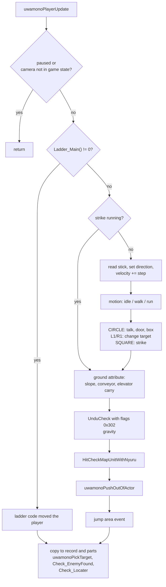

### Collision with units

Units are not part of the mesh. They are tested separately, as upright boxes
or cylinders. `searchMode` selects the shape, and `extent` and the heading
give its size and direction. Only shown model units (kind 2) block.

`HitCheckMapUnitAt(actor, unit)` is the basic test. The actor must overlap
the unit's height range, from the unit's base to 0.9 of its height. A circle
unit hits when the XZ distance is below the sum of the radii. A box unit goes
to `HitCheckBox`, which projects the actor onto the box's x axis, requires
the projection to be within the half width plus the actor radius and the
distance from that axis to be within the half depth plus the radius. It then
lets the actor go when it is moving almost straight away from the box
centre. That last rule lets a body that got slightly inside walk out again.

`HitCheckMapUnitWithNyuru(actor)` is what the player calls. "Nyuru" is a
Japanese sound word for something slippery, and the function makes the
player glide along units and not stick to them.

1. It collects every unit the actor now overlaps.
2. With no hit it returns.
3. With one hit it calls `HitCheckNyuru`. For a circle, `NyuruCircle` places
   the actor just outside the circle, on the line from the centre through the
   actor. For a box, `NyuruMatrix` steps the actor back and keeps only the
   part of the velocity that runs along the side of the box it is next to.
   When that leaves almost no speed and the actor is past the end of the
   side, it gets half its speed along the side, which carries it round the
   corner. Both then move the actor with `UnduCheck`, so the slide still
   respects the walls. If the slide ends inside any unit, the whole move of
   the frame is undone.
4. With several hits it tries the slide of each unit in turn and accepts the
   first that ends free. If none does, the move is undone.

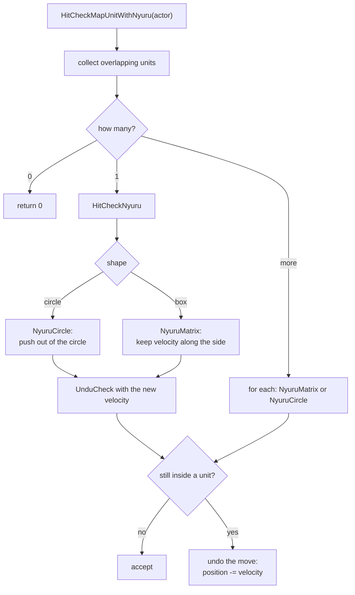

Other helpers in `src/main/init_uwamono_sys.c` answer questions for the AI
and for targeting.

| Function | Question |
| --- | --- |
| `HitCheckMapUnit(actor)` | Index of the first unit the actor overlaps, or -1 |
| `HitCheckMapUnitPos(position)`, `HitCheckMapUnitPosSize(position, radius)` | The same for a point or a circle. It tests every unit with a shape except walking characters (kind 1) and movers (kind 7) |
| `CrossPointUwamono(origin, target, radius, out)` | Where does a body of this radius, moving from origin to target, first touch a unit. Tests the two side lines of the swept path and the centre line against each candidate, with `CalcNearCrossPointBox` and `CalcNearCrossPointCircle` |
| `CrossCheckMapUnitAim(point, unit)` | Does any other unit stand on the line from the point to this unit |
| `AimMapUnitLookCheck(unit)` | Can the player see the unit: no unit on the line, and a mesh walk with flags `0x803` reaches the unit's position |
| `UwamonoAreaCheck(point, unit, radius)` | Is the point within the radius of the unit's footprint and height band |

Actors block each other as circles. `uwamonoFindOverlapRecord` finds a
character (kind 1 or 4) whose height range overlaps the mover's and whose
circle touches it. `uwamonoPushOutOfActor` then places the mover on the rim
of the other circle. The new spot is rejected, and the move undone, when it
overlaps another actor or a unit or has no ground.

### Targets

Units that can be struck or examined are targets. Each record of kind 1 to 3
has a target `state`.

`uwamonoUpdateInReach(actor, index)` computes it every frame. A unit is a
candidate when it has flag `0x20000`, is not dormant, and matches the
player's form through flag `0x100000`. The player must be able to see it
(`AimMapUnitLookCheck`, skipped with flag `0x200000`). It is in reach when
the 3D distance is within `playerParams[0][0]`, the height difference within
`playerParams[1][0]`, the player is not on a ladder, and the player stands in
one of the cells the unit allows.

The cells come from `cellMask`. `uwamonoIsActorInCells` divides the
surroundings of the unit into a 3 by 3 grid by the unit's own extent: left
of it, level with it or right of it, and the same in z. The eight outer cells
have the bits 0 to 7. A crate against a wall can thus be limited to the side
the player can actually reach.

A unit that comes into reach goes to state 2, gets its two marker effects
(`0x100C801D` and `0x100C801E`) and plays sound `0x2000003`. If it is the
only one in reach and nothing is selected, it becomes the selected target,
state 1. A unit that leaves reach drops to state 0 and loses its markers, and
if it was selected the selection moves on.

`uwamonoMoveSelection(step)` changes the selection. L1 calls it with 1 and R1
with -1, which step through the records in reach in table order. Walking
calls it with 0, which selects the nearest unit in reach. Pass 3 of
`DispMapObject` shows one marker for the selected unit and the other for
units merely in reach, at `position + focusOffset` and half the unit's
height, scaled by the player's form.

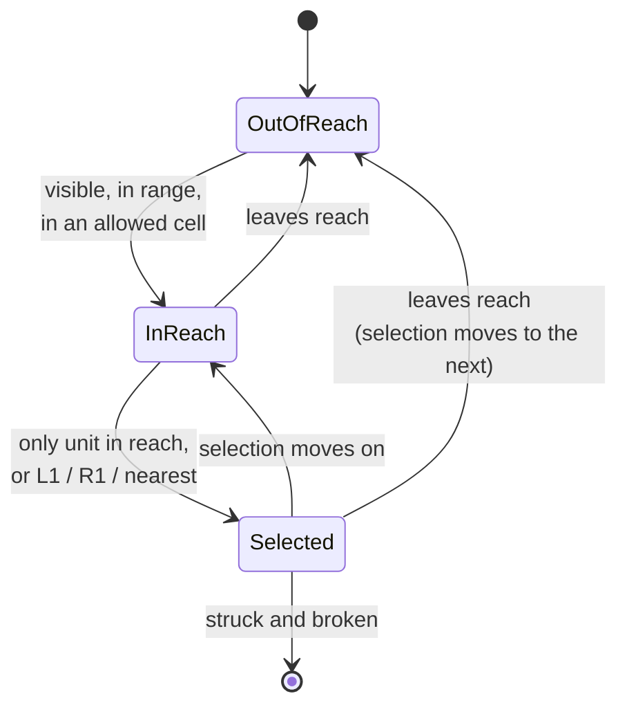

### Striking

SQUARE strikes the selected target. The code calls the action a search
(`CONTROL_MAP_ATTACK`).

When SQUARE is pressed with a target that has flag `0x20000`, the player
turns to the target and event 0 is sent with the target id. The actor plays
mode `level + 3`, so the target's `level` (0 low, 1 middle, 2 high) picks one
of three strike motions. Two frame counters are loaded from the tables that
`uwamonoChangePlayerModel` filled for the current model:
`uwamonoSquareEventCount` is the frame on which the blow lands and
`uwamonoSquareWaitCount` is the length of the motion. A strike effect and a
voice start, the part actors play the same mode, and the pad gives a short
weak vibration.

When the first counter runs out, event 1 is sent with the target id. If the
target has flag `0x40000`, `uwamonoTriggerRecord` breaks it and the markers
are removed. When the second counter runs out, the strike ends, the control
bit is cleared and input is read again.

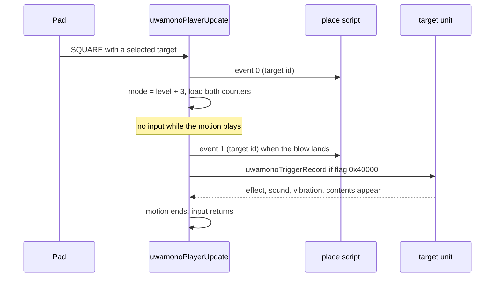

### Talking, opening and examining

`uwamonoFindTalkTarget(actor, 50.0)` finds what CIRCLE would act on. It is
the nearest of three kinds of candidate.

- A treasure box (kind 2, type 4 to 6). The player must be at the box's
  height, face its front within 30 degrees either side, and have it within a
  60 degree view fan of length 1.5 on foot or 7.5 in an E.S.
- A door (another kind 2 unit with `motionKind` set). The reference point is
  the door's closed position, or the midpoint of the two leaves. The player
  must be within the door's `speed` distance, or five times that for an E.S.
  door, and have the point in a 60 degree fan.
- A person (kind 1). The player must be within the sum of the two radii plus
  0.6 and face the person within a 90 degree fan. A person with flag `0x800`
  needs only the distance, and less of it.

On CIRCLE a door opens when the player's form matches its `openerKind`, a
treasure box opens, and a person starts a talk: `talkSetResult(id)` records
who was addressed, and the place script picks it up. A person with flag
`0x800` starts the talk without the button. The talk itself is described in
[Events](../scripting/events.md).

## Kinds of unit

### Doors

A door is a pack entry whose name starts with `door`. The script finishes it
with `uwamono.setDoorAll`, a native with 13 arguments.

| Argument | Field | Meaning |
| --- | --- | --- |
| 1 | | Unit id |
| 2 | `motionKind` | 1 slides, other values turn. Kind 2 also loses its collision while open |
| 3 | `timer` | Frames to open or close |
| 5, 6, 7 | | Travel in hundredths: a displacement for a sliding door, half the turn angles for a turning one |
| 8 | `speed` | Distance from which the door reacts, in hundredths |
| 9, 10 | `extent.y`, `extent.x` | Height and width of the collision box |
| 11 | `swingLength` | Travel used when 5 to 7 are left out. The door then slides sideways by this length |
| 12 | `openerKind` | 0 opened on foot, 1 opened by script only, 2 opened by an E.S. |
| 13 | `moveSound` | Sound of the door |

A call with only the id and argument 3, or only the id and argument 12, just
changes the time or the opener, for both leaves. The full call stores the
closed pose (the current one) and the open pose, sets `busy` to 1 (closed)
and loads the seven-segment speed profile. Two door leaves are linked with
`objx.setPair`, and most settings are copied to the partner.

`uwamonoSetPairMode(index, mode)` moves the door: mode 0 opens, 1 closes and
2 toggles. It does nothing while the door or its partner is still moving.
For each leaf it starts the `moveTicks` timer, plays the door sound once, and
starts a move to the other position or a turn to the other angles over
`timer` frames.

Three things call it. The player opens a door with CIRCLE. The script opens
or closes one with `uwamono.SendSignal(id, 0)`, `1` or `2`. And pass 3 of
`DispMapObject` closes an open door on its own when the player is farther
than five times the player's `form` from it, unless `openerKind` is 1.

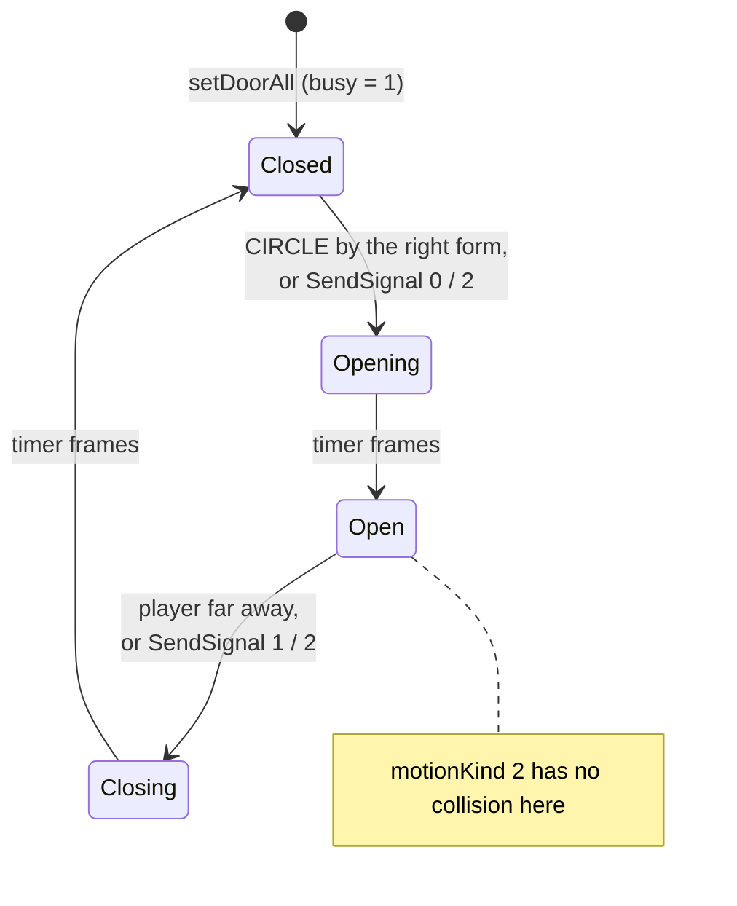

### Breakable objects

A breakable object is a pack entry whose name matches a row of
`kowaremono.dat`. `uwamonoInitRecord` already made it targetable, breakable
and falling. The script adds the details with `uwamono.setKowaremonoAll`.

| Argument | Field | Meaning |
| --- | --- | --- |
| 1 | | Unit id |
| 2 | `searchMode` | Collision shape |
| 3 | `effectId` | Break effect, as a number or an effect name. The effect file is loaded at once |
| 4 | `searchFlag` | Stored only |
| 5 | `enemyLink` | Unit of an actor that appears when the object breaks |
| 6 | `itemLink` | Unit of an item that appears |
| 7 | `level` | Strike height step |
| 8 | `triggerSound` | Break sound |
| 9, 10, 11 | `focusOffset` | Marker offset in hundredths |
| 12 | `cellMask` | Eight decimal digits, each 0 or 1, for the eight cells |

The two linked units are made dormant: hidden and flagged `0x2000000`. They
wait inside the object.

`uwamonoTriggerRecord(index)` breaks a unit. It starts the break effect at
the unit, sized from the unit's extent, plays the break sound and
shakes the pad for 30 frames (except on map 3560). The item unit `itemLink` is
placed at the object's position, 0.5 higher when it is an item pickup, woken
up, scaled from 0 to full size over 20 frames and given an upward speed of
0.4, so it pops out and falls to the floor. The actor unit `enemyLink` is placed
there the same way with an appearance effect, which is how an enemy can jump
out of a crate. Finally the broken unit is released, which hides its scenery
piece. `uwamono.SendSignal(id, 6)` breaks a unit from the script.

### Traps

Traps are the built-in types 0 to 3. They are targets without a collision
shape. Types 0 and 1 are for a character on foot, types 2 and 3 carry flag
`0x100000` and are for an E.S.

A trap is struck like any breakable unit. In addition
`uwamonoTriggerRecord` calls `uwamonoAddPoint(position, 300, radius)` with
radius 3.0 for the small traps and 15.0 for the large ones, and uses a break
effect five times larger for the latter. The point goes into one of the 16
slots of `uwamonoPoints` with a lifetime of 300 frames.

`uwamonoUpdatePoints` runs every frame. For each live point it looks at every
actor unit of kind 1 within the radius. An enemy whose cooldown is 0 and
that is not already in action 9 or 6 is put into action 9 with
`Enemy_ActionReady`. Action 9 is the "caught by an explosion" behaviour of
the enemy AI (see [Field enemies](field-enemies.md)). A trap therefore
affects every enemy that is inside its radius or walks into it during the
next five seconds.

### Treasure boxes

Treasure boxes are the built-in types 4 to 6. Type 5 is the large box for an
E.S. A box is a box-shaped unit with `busy` 4, which means closed. Its
content is set with `uwamono.setKowaremonoAll`, where `itemLink` names the item
unit inside. A box set up without content is shown open at once.

CIRCLE in front of a box calls `uwamonoStartPairMove(index, 5, 30)`. It plays
sound `0x0200000F` and starts a 30-frame timer during which `tilt.x` runs
from 0 to -2.094 radians, 120 degrees. The box model has two parts, and the
draw code rotates the second one, the lid, by that angle. `busy` becomes 3.
The item unit is placed 0.5 above the box, grows from nothing over 20 frames,
is thrown upward and immediately starts its flight to the player with
`uwamonoStartItemFlight`.

### Item pickups

An item pickup is a built-in model of type 12 or more, created for a row of
`treasurebox.dat` (`UwamonoEventRow`). The row says what the pickup gives.

| Row type | Gives | Model type |
| --- | --- | --- |
| 0 | Nothing. No case handles it, the pickup only sets its flag. The shipped table has 12 such rows | |
| 1 | `count` of hit action `id` (`dataBoxIncCategory1`) | From the hit action record, by form |
| 2 | `count` of item `id` (`dataBoxIncCategory2`) | From the item record, by form |
| 3 | `count` of data box category 4 entry `id` | 18 |
| 4 | `count` of data box category 3 entry `id` | From that record, by form |

The inventory behind these calls is described in
[Party and growth](party-and-growth.md).

`uwamonoUpdateItemPickups` handles all item units each frame. An item starts
to fly when the player's centre comes within the player's body radius of it.
The flight takes 60 frames and goes in a straight line from where the item
lay to a point 1.0 above the player's position, which is tracked as the
player moves. Halfway the item starts to shrink to nothing. On the first
frame of the flight the reward is added `count` times,
`gameWork.eventFlags[row]` is set to 1 so the item never appears again, the
message "name, count" is shown with `msgChoiceShowPair`, and event 8 is sent
with the unit id. After the last frame the unit is released.

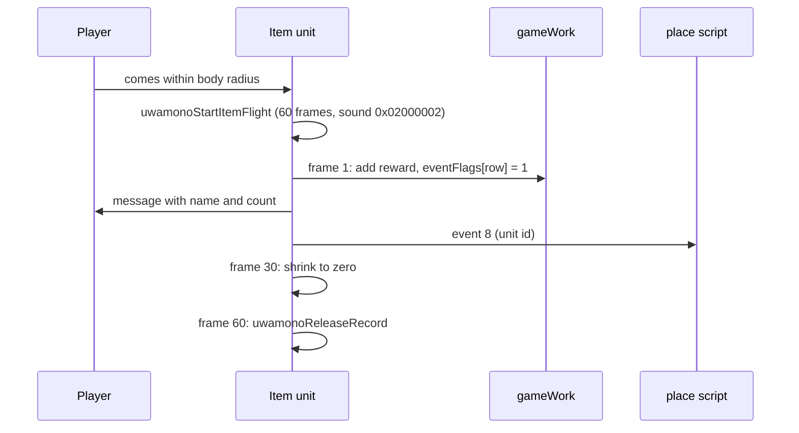

### Save points and other symbols

The built-in types 7 to 11 are floating symbols. They have no collision and
spin by 0.1 radians per frame, as do the item models.

For types 7 to 9, `DispMapObject` watches the distance to the player. Inside
half the player's `form` (0.5 on foot, 2.5 in an E.S.) it starts a glow
effect on the symbol (`0x100C8032` on foot, `0x100C8064` in an E.S.), plays
sound `0x02000010` and calls `battleSlotsRestoreAll`, which by its name
restores the party's battle slots. The effect is deleted when the player
leaves.

The field loop then reacts to CIRCLE. `uwamonoGetNearbyUnitType` returns
the type of a symbol of type 7 to 11 that the player stands in. For type 7 or
8 the loop opens the save screen with `MenuFileMain(0)` (see
[Save data](../architecture/save-data.md)). For type 9 it calls
`menuSceneRunKeyCheck`, which belongs to the [main menu](main-menu.md). The
menu code also stores the value in `ptState.nearbySearchType`, which is how
it learns that the player stands on a return point of type 10 or 11.

### Locators

A locator is an invisible trigger made of two mover units (kind 7).
`runtime.setLocater` creates the pair from two points, a type and two angles.
The first unit holds the type in `searchShape`, the second holds 10. The two
points define a line, a circle, a square or a strip depending on the type.

`Check_Locater` runs for the player each frame. It finds the first locator
whose height band contains the player and whose shape test
`Check_InsideID` succeeds, and then applies the trigger rule of the type:
once on entry, every frame while inside, or on CIRCLE while inside and
facing the right way. A hit sends event 2 to the script. The shapes, the
rules of the eleven types and the script side are described in
[Events](../scripting/events.md).

### Effects and scenery switches

An effect unit (kind 6) is a placed visual effect that scripts can move,
turn, scale and attach like any other unit. `mapObjectUpdateEffectTransform`
copies the unit's pose to the effect each frame and its shown bit to the
effect's gate.

A flag unit (kind 3) owns one entry of the main scenery pack. Showing or
hiding the unit shows or hides that piece of the map. Scripts use it for
things like a wall that is gone after an event.

## Ladders

A map can have up to 16 ladders (`ladderSlots`, 208 bytes each). The script
defines one with `ladder.setLadder(id, key, height)`: the foot position and
the facing angle come from row `key` of the placement table, and the height
is in hundredths. `ladder.setEntrance(id, rungHeight, left, right)` adds up
to 32 "rungs". A rung here is a height at which the player can step off
sideways, onto a platform to the left or to the right.

`Ladder_Main` is called from the player update and drives a small state
machine in `uwamonoLadderState.state`.

**Getting on.** In state 0, `Ready_Ladder` tests every ladder. The player
gets on at the foot when within 0.7 of it, at the foot's height, and facing
the ladder within 30 degrees. The player gets on from a platform when at a
rung's height, within 0.75 of the point beside the ladder on that side, and
heading across the ladder's facing, inside a 60 degree sector on that side. The state becomes 2. `Fly_to_Ladder` waits 7
frames while the body turns, starts the mount motion, and in state 3 moves
the player onto the ladder over 32 frames from the foot or 57 frames from the
side.

**Climbing.** State 4 is "on the ladder". A table of step heights is laid
out 0.8 apart around the height where the player got on. The stick is
rotated by the ladder's compass sector, so "up" on the stick is up the ladder
from the camera's point of view. Up starts state 5 and down state 6: the
player moves one step over `gameWork.climbFrames` frames (15 by default)
with the climb motion and a step sound.

**Getting off.** Climbing above the top sends event 4 with the ladder id.
With control bit `CONTROL_MAP_LOADED` set the state becomes 8 and the ladder
code stands still, which leaves the next move to the script that received the
event.
Climbing below 0.4 above the foot sends event 5 and starts an exit 0.8
backwards. Pushing sideways at a rung with an exit on that side starts an
exit 1.2 to the side. An exit is state 7: `Get_Off_Ladder` moves the player
along a line with `Get_MiddlePoint_Parabora`, puts the player on the ground,
forces a full collision rescan and returns to state 0.

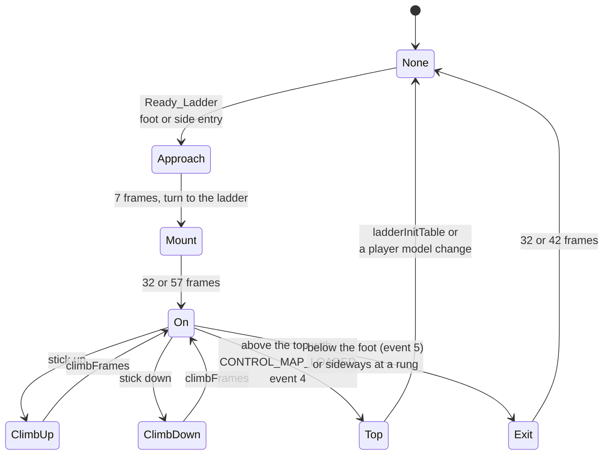

| State | Value | Handler |
| --- | --- | --- |
| None | 0 | `Ready_Ladder` looks for a ladder |
| Approach, Mount | 2, 3 | `Fly_to_Ladder` |
| On, ClimbUp, ClimbDown | 4, 5, 6 | `On_Ladder` |
| Exit | 7 | `Get_Off_Ladder` |
| Top | 8 | none, the script takes over |

## Elevators and slopes

### Elevators

An elevator has three parts that share a number from 1 to 8: an
`ElevatorRecord` that holds the moving position, floor triangles with
attribute `0x200 + number - 1`, and usually a model unit that shows the
platform. The natives are in the module `id`, registered by `elvReset`.

| Native | Effect |
| --- | --- |
| `id.elvMove(no, x, y, z, frames)` | Move the elevator to a point in hundredths over a number of frames, or at once with 0 frames. An omitted axis is not driven and follows the carrying unit |
| `id.elvActive(no, on)` | Set or clear the elevator's bit in `elvActiveMask`. Walkers can step onto the platform only while it is set |
| `id.elvNoOut(no, on)` | Set or clear the bit in `elvNoOutMask`, which stops the rider from stepping off |
| `runtime.setElevator(id, no, arg)` | Make a model unit ride elevator `no` |

`elvUpdateMotion(unit)` runs in the unit update for a unit with
`elevatorMotion` set. It remembers the old position as a reference, advances
the linear move by one frame with a VU0 interpolation, and writes the
position into the unit. `elvGetPosition(no, position, delta)` gives the rest
of the game the current position and the movement since the last frame.

The mesh uses both. `UnduCheckResultCheck` returns the elevator's y as the
floor height for a platform triangle, so the player rises with it. The
player update adds the elevator's x and z movement to the player's velocity,
so the player is carried sideways. When a move ends, `elvSetStatusFlag` sets
a camera flag if the player stands on that elevator, which makes the camera
catch up.

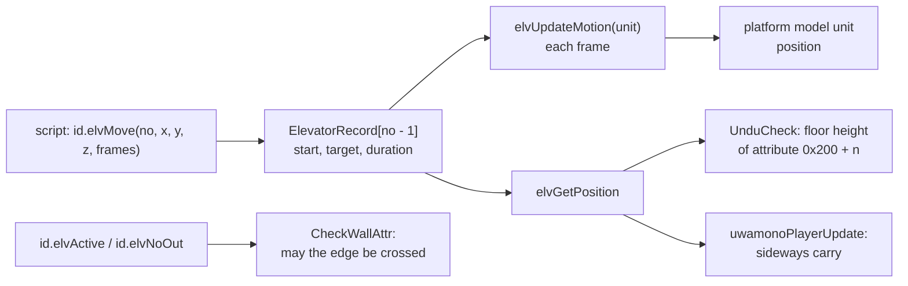

### Slopes

Ground whose attribute has the value 1 in its upper 16 bits is special
ground. Bits 0 to 3 and 8 to 11 select the behaviour in
`uwamonoPlayerUpdate`.

- With bits 8 to 11 clear and bit 3 clear, the ground changes the walking
  speed. The low two bits pick a factor from 0.5, 1.0, 2.0 and 3.0.
- With bit 3 set, the low three bits pick one of eight scripted entries in
  `gameWork.slopes`. `id.slopeSet(no, angle, push, speed)` fills an entry:
  the direction from an angle in hundredths of a degree, a push strength and
  a speed factor. The ground pushes the player in that direction every frame
  and scales the walking speed.
- With bits 8 to 11 set, the ground is a conveyor. The bits pick one of
  eight compass directions through `uwamonoSlopeDirectionTable`, and the low
  two bits pick the strength. The player is moved even when standing still.

## Footsteps

`Sound_FootStep(index)` runs for every actor unit. It probes the footstep
mesh of group `0x700`, entry `footId`, under the actor. The low byte of the
attribute plus 1 is the surface number. For characters whose model id is at
most `0x6FFFF` it then decides whether this frame is a footfall. The
animation frame of the last call is kept in the state block, and a footfall
happens when the frame counter passes a fixed frame of the walk or run
cycle. The table `footStepTable` gives those frames for 44 enemy and NPC
models, and built-in values serve the player forms.

A footfall creates the effect `(500 or 501) << 12 | surface | 0x10000000`,
tied to the actor, unless the actor is hidden or the unit has flag `0x4000`.
It also plays the step sound of the surface: directly for the player, and
with a pan and volume from the position for others. The sound banks behind
it are described in [Audio](../architecture/audio.md).

## Events to scripts

Units report to the place script through `uwamonoSendEvent(slot, first,
second)`. The script registers a thread per slot with `runtime.message`. The
slots that the code on this page sends are listed here. The mechanism and
the remaining slots are described in [Events](../scripting/events.md).

| Slot | When | Arguments |
| --- | --- | --- |
| 0 | SQUARE starts a strike on a target | target id, 0 |
| 1 | The strike lands | target id, 0 |
| 2 | The player triggers a locator | a unit id, locator id |
| 3 | The player enters a jump area | area number plus 1, 0 |
| 4 | The player climbs past the top of a ladder | ladder id, 0 |
| 5 | The player climbs down to the foot of a ladder | ladder id, 0 |
| 8 | An item pickup was collected | unit id, -1 |

The script answers by calling natives: `uwamono.SendSignal` to open a door
or break a unit, `objx.move` to slide a wall, `runtime.setNumber` to create
or remove units, `runtime.jumpCF` to change the place.

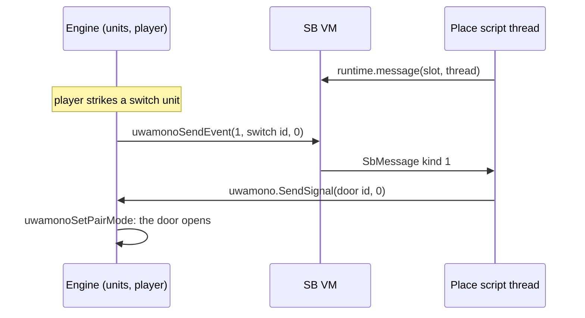

## Debug drawing

`src/main/pause_menu_page_uwamono.c` holds the outline drawing of a
development build. Each function computes the lines of an outline: the
footprint and top of every box unit and a 16-sided ring for every circle
unit (`DispCollUwamono`, `DispPillar`), the route points and links of an
enemy (`uwamonoDrawPointPath`, `uwamonoDrawStateLinks`), a ladder with its
rungs and exits (`uwamonoDrawLadder`), locator boxes
(`uwamonoDrawSegmentBox`) and coordinate axes at a point
(`uwamonoDrawPointAxes`). All of them are gated by the flag
`uwamonoDrawDisabled`. In this build the final line call, `uwamonoDrawLine`,
is an empty function, so the outlines are computed and never shown. The many
`xglFontDebugPrintf` calls in the unit code (talk target, locator numbers,
ladder mode, light ids) belong to the same tooling, see
[Debug tools](debug-tools.md).
