# Party and growth

The party of Xenosaga Episode II is managed by a small system whose functions
all start with `pt`. It knows the seven playable characters and the three E.S.
(the mechas the characters ride), keeps them in ten slots, decides who walks on
the map, who fights and who waits in reserve, and pairs each E.S. with a main
pilot and a co-pilot. Scripts change the party through a handful of natives
(`ptJoin`, `ptLeave`, `ptChangeMode` and others), and the main menu changes it
through the Party and E.S. screens.

Growth is the second subject of this page. Every unit has a parameter block
that holds its hit points, ether points, level and six combat parameters. A
second record holds its experience, its Skill Points and its Class Points, and
the bits that say which skills, ethers and Double Techs it has learned. Battles
pay experience and points into these records, levels raise the parameters along
a growth curve, and the skill board of the main menu turns points into skills.
The inventory (four boxes of item counts) and the rules that decide which item
can be used on whom complete the picture.

The party code lives in the main executable (`src/main/`). The parameter
blocks, the tables of `bat.dat` and the stat calculation live in overlay OV01
(`src/ov01/`), which is loaded for the whole play session, so the menu calls
straight into it. The fight itself is described in [battle](battle.md), the
screens that show all of this in the [main menu](main-menu.md).

[← Back to the overview](../README.md)

## Files

| File | Contents |
| --- | --- |
| `src/main/pt_member.c` | The party state `ptState`: slots, roster, add, remove, swap, current slot, split mode, pilots and co-pilots, cloth ids and models, the status block. Also holds the save image functions described in [save data](../architecture/save-data.md) and the two menu text buffers |
| `src/main/save_party_init.c` | `ptReset`, the ten member records, `ptMemberRecordAt`, `ptMemberRecordFindById`, the attach functions, and the tables of the skill board and of the special attack lists |
| `src/main/menu_selection.c` | The rules: which items are usable and on whom, the skill board (open a class, take a skill), equipped entries, Double Tech and co-pilot attack lists, `ptStateInit` |
| `src/main/runtime_menu.c` | Script natives `ptInit` and `ptClear` (and the registration of the `math` module) |
| `src/main/runtime_menu.c` | Script natives `ptJoin`, `ptLeave`, `ptChangeMode`, `ptSet` |
| `src/main/runtime_menu.c` | Script natives `ptSetPilot`, `ptGetLeader`, `ptSetArray`, `ptTent`, `umnReturn` |
| `src/main/runtime.c` | Script native `Item` (`runtimeItem`): gives and takes items, teaches skills. Also `TimeAttack` and `GetAnalogR` |
| `src/main/battle_result.c` | The result screen after a battle and its scene loop |
| `src/ov01/calc.c` | The parameter side: parameter blocks, totals for the menu, learning bits, experience, levels, growth, battle rewards. The combat formulas of the same file belong to [battle](battle.md) |
| `src/ov01/data_record_get.c` | Getters over the tables of `bat.dat`: units, techniques, ethers, skills, items, Double Techs, experience and growth |
| `src/ov01/data_unit_org_get.c` | The OV01 heap and the two file read helpers of the overlay. Described in [battle engine](battle-engine.md), summarised [below](#the-overlay-heap-and-file-helpers) |
| `src/ov01/debug_entry.c` | The BATTLE CONFIG debug menu. Its equip page edits the same records, which shows what "learning" stores |
| `src/ov01/data_box.c` | The four inventory boxes (read for this page, small) |

## The cast and its ids

The party code never uses names. It uses a **member id**, a small number that
is also the unit number in `bat.dat` and the key of the unit's parameter block.
The ids 1 to 7 are the characters and the ids 11 to 13 are the E.S. The names
can be read from two tables of the source: the character name table of
`src/ov01/data_file_load.c` (`chaosName`, `kosmosName`, `shionName`, `jinName`,
`ziggyName`, `momoName`, `jrName`, in id order) and the model table of
`src/main/res_get_path.c`, into which the cloth ids of `memberClothIdTable`
point.

| Id | Member | Late model (`memberClothIdTable`) | Record index |
| --- | --- | --- | --- |
| 1 | chaos | `chaos00` (65552) | 0 |
| 2 | KOS-MOS | `kosmos00` (65546) | 1 |
| 3 | Shion | `shion00` (65538) | 2 |
| 4 | Jin | `jin00` (65574) | 3 |
| 5 | Ziggy | `ziggy00` (65571) | 4 |
| 6 | MOMO | `momo00` (65564) | 5 |
| 7 | Jr. | `jr00` (65558) | 6 |
| 11 | E.S. with main pilot 2 (KOS-MOS) | 81922 | 7 |
| 12 | E.S. with main pilot 6 (MOMO) | 81923 | 8 |
| 13 | E.S. with main pilot 7 (Jr.) | 81925 | 9 |

The source does not name the three E.S. The pilot pairing comes from
`backMemberCounterpartIdTable` (`{2, 6, 7}`) and from `dataPlUnitInit`, which
links unit 11 to 2, 12 to 6 and 13 to 7. In the game KOS-MOS pilots E.S. Dinah,
MOMO pilots E.S. Zebulun and Jr. pilots E.S. Asher, so ids 11, 12 and 13 are
most likely Dinah, Zebulun and Asher. The ids 8 to 10 and 14 and 15 have a
parameter block and a place in `bat.dat` but no member record. The party code
never adds them.

Because characters use ids below 11 and E.S. use ids from 11 up, the test
`id >= BACK_MEMBER_ID` (11) appears all over the code. The source calls the
characters **front members** and the E.S. **back members**, after the slots
they occupy.

## Where the data lives

Four groups of objects describe the party. The party state and the member
records are in the main executable. The parameter blocks, the point records and
the inventory boxes are also in main memory but are owned by OV01 code. All of
them are copied into the save image by `saveWriteImage` and back by
`saveReadImage` (see [save data](../architecture/save-data.md#the-party-block)).

### The member record

`ptMemberRecords` (`src/main/save_party_init.c`) is an array of ten
`PartyMember` records, one per member of the table above. A record is only four
words. It holds the id and three pointers to the places where the member's data
really lives. `ptReset` rebuilds the ten records every time the party is reset.

| Offset | Type | Name | Meaning |
| --- | --- | --- | --- |
| `+0x00` | `int` | `id` | Member id (1 to 7, 11 to 13). Also the key passed to `calcTotalParaMenu` |
| `+0x04` | `PartyMemberStatus *` | `status` | Name texts and icon index, `&ptMemberStatuses[i]` |
| `+0x08` | `PartyMemberExpPoints *` | `limits` | Experience and points, one record of `slotRecordTable` |
| `+0x0C` | `PartyTakenBits *` | `buffer` | Skill board state and equipped entries, `&ptMemberTakenTable[i]` |

Records 0 to 6 point at `slotRecordTable[0]` to `[6]`. Records 7 to 9 (ids 11
to 13) point at `slotRecordTable[10]` to `[12]`. In both cases the index is
`id - 1`, which is how OV01 addresses the same table (`slotRecordByIndex`).
`ptMemberRecordAt(index)` returns a record by position and
`ptMemberRecordFindById(id)` searches the ten records for an id.

`PartyMemberStatus` (12 bytes, `ptMemberStatuses[10]`) holds what the menus
print for a member.

| Offset | Type | Name | Meaning |
| --- | --- | --- | --- |
| `+0x00` | `char *` | `text` | Entry `i` of `yosikawa\MainMenu.txd`, the member's name |
| `+0x04` | `char *` | `textAlt` | Entry `i + 17` of the same file, a second text for the member |
| `+0x08` | `unsigned char` | `memberIndex` | Icon index. Starts as `i`. `ptRefresh` replaces it for three members as the story advances |

`ptRefresh` rewrites `memberIndex` on every call. All ten start at their own
index. From story progress `0x2B` records 2 and 5 (Shion and MOMO) take the
icons 11 and 12, and from `0x57` record 1 (KOS-MOS) takes icon 10. These are
the same thresholds at which the three characters change their model (see
[Cloth ids and models](#cloth-ids-and-models)), so the icon follows the costume.
The save image stores `memberIndex + 1` per slot so that the save screen can
draw the faces without the party code.

### The point record

`PartyMemberExpPoints` is the main executable's name for one `0x40`-byte record of
`slotRecordTable`. OV01 calls the same record `SlotRecord` and knows more of its
fields. The table has sixteen records (`0x400` bytes, cleared by
`dataPlUnitInit`). The save page calls the saved copy `slotRecords`.

| Offset | Type | Name (main / OV01) | Meaning |
| --- | --- | --- | --- |
| `+0x00` | `int` | `total_exp` / `expGain` | Total experience earned, capped at 99,999,999 |
| `+0x04` | `int` | `next_level_exp` / `expCounter` | Experience still missing for the next level. Counts down |
| `+0x08` | `int` | `skillPoints` / `skillPointsGain` | Skill Points (S.Pt), capped at 99,999 |
| `+0x0C` | `int` | `classPoints` / `classPointsGain` | Class Points (C.Pt), capped at 99,999 |
| `+0x10` | `unsigned short[8]` | `growth` | Current position on the eight growth curves |
| `+0x20` | `unsigned char[8]` | `codeBits` | Learned ethers, bit `n - 1` for ether `n` (1 to 59) |
| `+0x2C` | `unsigned char[13]` | `flagBits` | Learned skills, bit `n - 1` for skill `n` (settable 1 to 64, testable 1 to 104) |
| `+0x3C` | `unsigned char[2]` | `pairBits` | Double Techs known, bit `n - 1` for pair `n` (1 to 16) |
| `+0x3E` | `unsigned char[3]` | `markBits` | Twenty-one marks, bit `n - 1` for mark `n` |

### The skill board record

`PartyTakenBits` (`0x2B` bytes, `ptMemberTakenTable[10]`) is the member's state
on the skill board, plus the list of entries the member has equipped. The save
page calls the saved copies `SaveParty.takenBits`.

| Offset | Type | Name | Meaning |
| --- | --- | --- | --- |
| `+0x00` | `unsigned char[4]` | `header` | Per level, one bit per class that has been opened |
| `+0x04` | `unsigned char[4][8]` | `cells` | Per level and class, one bit per skill taken (four bits) |
| `+0x24` | `unsigned char` | `openGroup` | Highest level that is open (0 to 3) |
| `+0x25` | `unsigned char` | `takenCount` | Number of skills taken |
| `+0x26` | `unsigned char[4]` | `entries` | The four equip slots. For a character an entry of the skill board, for an E.S. an item id of box 2 |
| `+0x2A` | `unsigned char` | `entry_count` | Number of equip slots in use |

### The parameter block

`battleSlotTable` holds fifteen `StatBlock` records of `0x108` bytes, one per
unit key 1 to 15. `battleSlotGet(key)` returns `&battleSlotTable[key - 1]`. A
block is the unit's persistent parameters. The battle makes working copies of
it, and the menus always read it through a computed copy (see
[Totals](#totals-for-the-menu)). The save page calls the saved table
`battleSlots`. These are the fields the party and growth code uses.

| Offset | Type | Name | Meaning |
| --- | --- | --- | --- |
| `+0x02` | `int` (unaligned) | `maxHp` | Hit point cap |
| `+0x06` | `short` | `maxEp` | Ether point cap |
| `+0x08` | `short` | `physAttack` | Physical attack |
| `+0x0A` | `short` | `physDefence` | Physical defence |
| `+0x0C` | `short` | `magAttack` | Ether attack |
| `+0x0E` | `short` | `magDefence` | Ether defence |
| `+0x10` | `signed char` | `hitRate` | Base hit rate, percent |
| `+0x11` | `signed char` | `evadeRate` | Base evade rate, percent |
| `+0x12` | `unsigned char` | `counter12` | A small parameter capped at 15 that skills can raise. The turn order code reads it as a bias |
| `+0x13` | `signed char` | `expLevel` | Level, at most 99 |
| `+0x34` | `signed char[4]` | `effectCode` | Equipped skills, as skill table indices |
| `+0x5C` | `int` | `hp` | Current hit points |
| `+0x60` | `short` | `ep` | Current ether points |
| `+0x62` | `short` | `key` | The unit key |
| `+0x74` | `short[3]` | `pairFirst` | Three values from the unit's row of the slot pair table. The battle loader reads them as model ids |
| `+0x7A` | `unsigned short[3]` | `pairSecond` | The partner values of the same row |
| `+0x86` | `short[4]` | `equipId` | Equipped items of box 2 (the debug menu calls them `ACC`) |
| `+0x8E` | `short[2]` | `linkedSlots` | For keys 11 to 15: `[0]` the main pilot id, `[1]` the co-pilot id |

The first `0x5C` bytes of a block have the same layout as a unit record of
`bat.dat`. `battleEntryLoad(entry, key)` clears a block, copies those `0x5C`
bytes from `batUnitRecordGet(key)`, sets `hp` and `ep` to the caps and stores
the key. This is how every unit, party member or enemy, gets its starting
parameters.

The diagram shows how the records hang together for one member.

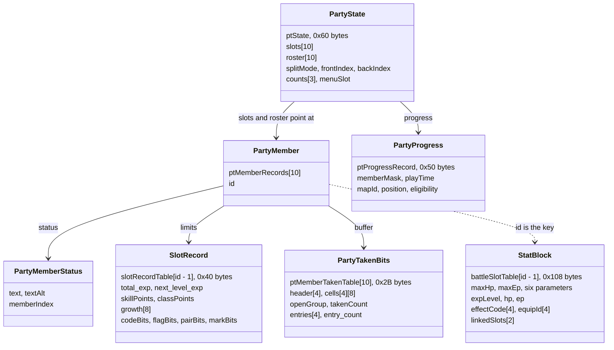

## The party state

`ptState` (`PartyState`, `0x60` bytes, defined in `src/main/pt_member.c`) is the
live party. `ptGetState()` returns its address and `ptGetMember(index)` returns
`ptState.slots[index]`.

| Offset | Type | Name | Meaning |
| --- | --- | --- | --- |
| `+0x00` | `PartyProgress *` | `progress` | Always `&ptProgressRecord` |
| `+0x04` | `PartyMember *[10]` | `slots` | Slots 0 to 6 are the front slots (characters), slots 7 to 9 the back slots (E.S.) |
| `+0x2C` | `PartyMember *[10]` | `roster` | The seating plan of split mode: pilots, co-pilots and reserve |
| `+0x54` | `unsigned char` | `splitMode` | 0 the party is on foot, 1 the party rides the E.S. |
| `+0x55` | `unsigned char` | `frontIndex` | The current front slot, the leader on foot |
| `+0x56` | `unsigned char` | `backIndex` | The current back slot minus 7, the leading E.S. |
| `+0x57` | `unsigned char[3]` | `counts` | `[0]` all members, `[1]` characters, `[2]` E.S. |
| `+0x5A` | `unsigned char` | `menuSlot` | The member the main menu shows (the menu stores its cursor here) |
| `+0x5C` | `int` | `nearbySearchType` | The kind of object the leader stands next to on the map. Values 7 and 8 allow restricted items |

`PartyProgress` (`ptProgressRecord`, `0x50` bytes) holds the facts about the
party that are not a seating order.

| Offset | Type | Name | Meaning |
| --- | --- | --- | --- |
| `+0x00` | `unsigned short` | `memberMask` | One bit per member who has ever joined: bit `id - 1` for characters, bit `id - 4` for E.S. |
| `+0x04` | `unsigned int` | `playTime` | Clock reading taken as the start of play (see [save data](../architecture/save-data.md#dates-and-play-time)) |
| `+0x08` | `int` | `mapId` | The map the party left when it was attached to another map, -1 otherwise |
| `+0x10` | `PartyValue64[2]` | `position` | The leader's position at that moment |
| `+0x20` | `unsigned char` | `savedSplitMode` | `splitMode` at that moment |
| `+0x21` | `unsigned char` | `mapFlag` | Set when a save is made on the last map of the game |
| `+0x22` | `PartyEligibility` | `eligibility` | 256 bits, one per special item (box 3) the party has ever held |

The attach fields belong to `uwamonoAttachCurrent` and `uwamonoDetachCurrent`
of `src/main/save_party_init.c`. They send the party to one of the eight maps
of `partyAttachMapIdTable` (1010, 2110, 2210, 3120, 3410, 4310, 4610, 5010),
remember where it came from, and bring it back. The script native `umnReturn`
calls the detach function. The mechanism is described in
[save data](../architecture/save-data.md#attaching-the-party-to-another-map).

### Slots

The ten slots are split into two groups that never mix. Characters only ever
occupy the front slots 0 to 6, and E.S. only the back slots 7 to 9. Within a
group the order matters. On foot, the first three front slots are the battle
party and the rest are the reserve. In the E.S., the first two back slots are
the battle party.

`ptGroupCount()` returns the size of the fighting group: `counts[1]` limited to
three on foot, `counts[2]` limited to two in split mode. The result screen and
the battle set-up use it.

```
ptState.slots
  index   0      1      2      3      4      5      6    |   7      8      9
        +------+------+------+------+------+------+------+------+------+------+
        | battle party (foot)| reserve characters        | E.S.  E.S. | E.S.  |
        +------+------+------+------+------+------+------+------+------+------+
          ^ frontIndex picks the leader among 0..2          ^ backIndex + 7
          front slots: ids 1..7                             back slots: ids 11..13
```

The lookup functions are simple loops over these arrays.

| Function | Result |
| --- | --- |
| `ptFindSlot(id)` | Index of the slot that holds member `id`, or -1 |
| `ptFindRecord(id)` | The member record in the slots with that id, or 0. This is the "is this member in the party" test |
| `ptFindRosterEntry(id)` | Index of the roster entry that holds `id`, or -1 |
| `ptFindFrontSlot(rosterIndex)` | The front slot that holds the same member as a roster entry, or -1 |
| `ptGetCurrentSlot()` | `backIndex + 7` in split mode, else `frontIndex` |
| `ptGetCurrentId()` | The id of the member in the current slot |
| `ptGetMenuMember()` | The member the menu shows. On foot it is `slots[menuSlot]`. In split mode `menuSlot` 0 to 2 selects back slots 7 to 9 and higher values select `roster[menuSlot - 3]` |
| `ptGetMenuMemberState()` | The computed parameter block of that member (`calcTotalParaMenu`) |

### Adding and removing members

`ptAddMember(id)` puts a member into the first free slot of its group. It does
nothing when a slot already holds the id. Otherwise it finds the member record
with that id, leaves split mode for the duration of the change, scans the group
(back slots for ids from 11, front slots for the others), stores the record in
the first empty slot, raises `counts[0]` and the group count, sets the member's
bit in `ptProgressRecord.memberMask`, calls `ptRefresh`, and enters split mode
again if it was on before.

`ptRemoveMember(id)` is the reverse. It finds the slot, closes the gap by
moving the following members of the same group one slot down, clears the last
slot, lowers the counts and calls `ptRefresh`. The current slot follows the
members: if the removed member was the leader, the index falls back to 0, and
if the leader sat behind the removed member, the index moves down with it. The
bit in `memberMask` stays set, because the mask records who has ever joined.

`ptResetSlots()` empties all ten slots and clears the counts and both indices.

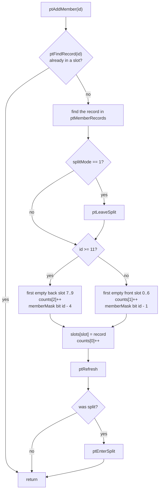

### Order and the current slot

`ptSwapSlots(a, b)` exchanges two occupied slots. When both are among the first
three front slots, `frontIndex` follows its member, so the leader stays the
leader. When both are back slots, `backIndex` follows in the same way and the
roster entries that belong to the two E.S. are swapped too (`a - 7` with
`b - 7` for the main pilots, `a - 4` with `b - 4` for the co-pilots), so each
E.S. keeps its crew. `ptSwapRosterEntries(a, b)` exchanges two roster entries
and is also used directly to change seats.

`ptSetCurrentSlot(slot)` makes an occupied slot the current one. It writes
`backIndex` for a back slot and `frontIndex` for a front slot.
`ptSelectMember(id)` does the same by id. `ptPlaceMember(id)` is the strongest
form: it adds the member if needed, switches to the right mode (split for an
E.S., on foot for a character), swaps the member into the first slot of its
group, makes that slot current and reloads the models. No other file of the
recovered source calls it.

### The status block

`ptStatusBlock` (`PartyStatusBlock`, `0x24` bytes) is a digest of the party for
code that does not want to walk the slots: the battle set-up, the model loader
and the debug menu. `ptGetStatusBlock()` returns it. `ptRefresh()` rebuilds it
and is called after every change.

| Offset | Type | Name | Meaning |
| --- | --- | --- | --- |
| `+0x00` | `unsigned char[3]` | `memberIds` | Ids of the fighting group: front slots 0 to 2, or back slots 7 and 8 (the third is 0) in split mode |
| `+0x03` | `unsigned char` | `leaderId` | Id of the member in the current slot |
| `+0x04` | `unsigned short` | `memberMask` | Copy of `ptProgressRecord.memberMask` |
| `+0x06` | `unsigned short` | `presentMask` | One bit per member of the active group that is in a slot now, same bit numbering as `memberMask` |
| `+0x08` | `int[7]` | `clothIds` | The cloth id of each character 1 to 7 |

OV01 turns the two masks back into unit keys with `battleMaskWordTable`
(`{1, 2, 3, 4, 5, 6, 7, 11, 12, 13}`): `battleMaskWordsMember` lists everyone
who has joined and `battleMaskWordsPresent` lists the active group. The second
list is the target list of an item or ether that affects the whole party when
it is used from the menu.

`ptRefresh` does three more things. In split mode it writes the crew of each
E.S. into the E.S. parameter block with `battleSlotLinkedSlotSet` (see
[Pilots and co-pilots](#pilots-and-co-pilots)). It rewrites the icon indices of
the status records as described above. And when script flag `0x1EE` is above
zero it reads the two-bit script flag `0x1D6` and teaches Shion (unit 3) one of
the ethers `0x37`, `0x38` or `0x39` for the values 1, 2 and 3. This is one of a
group of four two-bit flags (`0x1DE`, `0x1E1`, `0x1D6`, `0x1DB`) that
`ptFlagCombinationIndex` looks up in `flagCombinationTable`, a list of the 81
combinations of three values in four positions, returning the 1-based row. The
ethers `0x34` to `0x39` are the six extra ethers that only Shion can hold (see
[Extra entries](#extra-entries)). A likely reading is that the four flags are
the four parts of a robot built in a side quest and that the ether Shion gets
depends on one part. The recovered source has no caller of
`ptFlagCombinationIndex`.

### Cloth ids and models

A **cloth id** is the resource id of a member's model. `ptGetClothId(id)`
returns it. For an E.S. it is a fixed entry of `memberClothIdTable`. For a
character it depends on the story progress, the 8-bit script flag
`STORY_PROGRESS_FLAG` (`0x191`): each character has a threshold in
`memberClothProgressTable` and wears the early model below it and the late
model from it on. chaos has two thresholds and a third model in between.

| Id | Member | Early model | Late model | Threshold |
| --- | --- | --- | --- | --- |
| 1 | chaos | 65553 (`chaos01`), then 65554 (`chaos02`) from progress 22 | 65552 (`chaos00`) | 31 |
| 2 | KOS-MOS | 65547 (`kosmos01`) | 65546 (`kosmos00`) | 87 |
| 3 | Shion | 65541 (`shion03`) | 65538 (`shion00`) | 43 |
| 4 | Jin | 65575 (`jin01`) | 65574 (`jin00`) | 22 |
| 5 | Ziggy | 65571 (`ziggy00`) | 65571 (`ziggy00`) | 0 |
| 6 | MOMO | 65565 (`momo01`) | 65564 (`momo00`) | 43 |
| 7 | Jr. | 65560 (`jr02`) | 65558 (`jr00`) | 31 |

Three functions use the cloth id. `ptLoadPartyModels()` passes the ids of the
three members on screen (front slots 0 to 2, or back slots 7 to 9) to
`resPlayerSlotsLoadModels`. `ptApplyCurrentModel()` passes the leader's id to
`uwamonoChangePlayerModel`, with bit 31 set when the leader is an E.S.
`ptRefreshCurrent()` wraps that call: when the player object on the map is
already of the right kind for the mode, it saves and restores the object's
state around the model change with `uwamonoLoadCurrent` and
`uwamonoStoreCurrent`. The map side of these calls is described in
[map and units](map-and-units.md).

## On foot and in the E.S.

The party has two modes. On foot (`PARTY_SPLIT_OFF`) the characters of the
front slots walk and fight. In the E.S. (`PARTY_SPLIT_ON`, which the source
calls **split mode**) the E.S. of the back slots walk and fight, and the
characters become their crews. The same ten characters and E.S. stay in their
slots in both modes. What changes is which group is active and how the roster
is filled.

`ptEnterSplit()` switches to the E.S. It does nothing when the mode is already
on or when the party has no E.S. (`counts[2] == 0`). `ptLeaveSplit()` switches
back and needs at least one character (`counts[1] != 0`). Both end with
`ptRefresh`. The script native `ptChangeMode` and the map attach functions call
them, and `ptAddMember` and `ptRemoveMember` leave and re-enter the mode around
their change so that the roster is rebuilt.

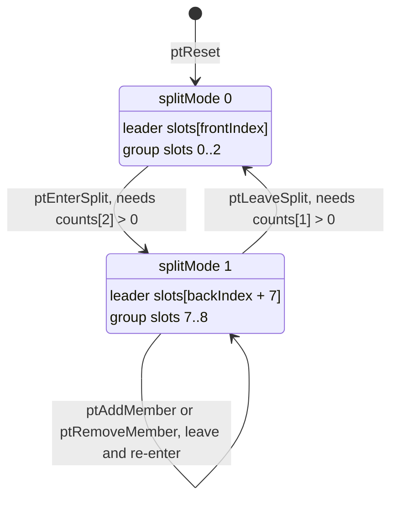

### The roster

`ptState.roster` is the seating plan of split mode. It has ten entries in three
ranges.

| Entries | Role | Filled by |
| --- | --- | --- |
| 0 to 2 | Main pilot of the E.S. in back slot 7, 8, 9 | `ptEnterSplit`, from `backMemberCounterpartIdTable` |
| 3 to 5 | Co-pilot of the E.S. in back slot 7, 8, 9 | `ptFillCopilots`, the menu, `ptSetPilot` |
| 6 to 9 | Reserve: characters without a seat | `ptFillReserve` |

`ptEnterSplit` rebuilds the plan in five steps.

1. For each back slot, the main pilot entry becomes the record of the fixed
   pilot of that E.S. (2, 6 or 7), if that character is in the party, or empty
   when the back slot is empty.
2. Each co-pilot entry is cleared when its character has left the party, when
   the character is now a main pilot, or when its E.S. slot is empty.
3. Each reserve entry is cleared when its character has left the party or is
   now a main pilot.
4. `ptFillCopilots()` walks the front slots. Every character that has no
   roster entry yet takes the next free co-pilot entry whose E.S. slot is
   occupied.
5. `ptFillReserve()` walks the front slots again. Every character still
   without an entry takes the next free reserve entry.

Because steps 2 and 3 keep valid entries, the player's seating survives a
change of mode. Only new members and broken pairings are reseated.

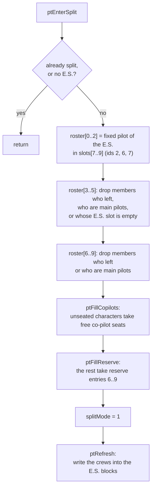

### Pilots and co-pilots

Each E.S. has a fixed **main pilot** and a free **co-pilot** seat. The seats
are read with two functions that take the E.S. id: `ptGetMainPilotId(id)`
returns the id in roster entry `slot - 7` and `ptGetCopilotId(id)` the id in
roster entry `slot - 4`, where `slot` is the back slot of the E.S. Both return
0 for a character id or an empty seat. `ptAllCopilotsAssigned()` is 1 when
every occupied back slot has a co-pilot. The E.S. screen of the main menu uses
it to refuse leaving the screen with an empty seat, and
`ptResetSplitReserve()` clears the three co-pilot entries and refills the
reserve when the player starts the seating over.

The crew matters in battle, so `ptRefresh` copies it into the E.S. parameter
block: `battleSlotLinkedSlotSet(esId, 0, mainPilotId)` and
`battleSlotLinkedSlotSet(esId, 1, copilotId)` write `linkedSlots[0]` and
`[1]` of the block (the function accepts only keys 11 to 15). When a working
copy of an E.S. block is made, `calcCopyParaMake` rebuilds the E.S.'s learned
bits from its main pilot: every learned skill of the pilot whose skill record
has the bits `0x8000` and `0x2000` in `slotFlags` is copied to the E.S., the
pilot's four equipped skills are copied when their record has bit `0x8000`,
and for unit 12 only, every learned ether of the pilot whose ether record has
flag `0x4000` is copied too. In short, an E.S. fights with the skills of its
pilot that are marked as valid for an E.S.

The co-pilot decides which special attacks the E.S. can use. The menu lists
them from `attackRecordTable` (88 `LookupRecord` entries, texts from
`MainMenu.txd` entry `0x50` on, bound by `commandRecordTextsBind`). For E.S.
`member` the seven records from index `member * 10 - 58` are its co-pilot
attacks. In these records `attributes[1]` is a mask of character ids (bit `n`
for id `n + 1`) and `attributes[2]` a bit number in a mask the caller passes.
`selectionCopilotRecordCount(member, mask)` counts the records that are enabled
in the mask and whose character mask contains at least one character who is in
the party, and `selectionCopilotRecordAt(member, nth, mask)` returns the index
of the nth such record. The drawing code then dims a record unless the seated
co-pilot (`ptGetCopilotId`) is in its mask.

## Script natives

Scripts reach the party through the `menu` module of the native registry
(`menuNativeTable` in `src/main/runtime_menu.c`, see
[natives](../scripting/natives.md#the-menu-module)). Every native first checks
its argument count and requests a script error jump (`sbSlotJumpRequest(context, 2)`)
when it is wrong.

| Native | Arguments | Effect | Returns |
| --- | --- | --- | --- |
| `ptInit` | none | `ptStateInit()`: a full new-game reset of units, points, boxes and party | 1 |
| `ptClear` | none | `ptResetSlots()`: empties the ten slots | 1 |
| `ptJoin` | id | `ptAddMember(id)`, then reloads the models | 1 |
| `ptLeave` | id | `ptRemoveMember(id)`, then reloads the models | 1 |
| `ptChangeMode` | mode | 0 leaves the E.S., 1 enters them, any other value toggles. Sets `playerSlotSkipHeaderFlag` and reloads the models | 1 |
| `ptSet` | 1 to 7 ids | Removes all seven characters, then adds the given ids in order. This sets the whole foot party and its order in one call | 1 |
| `ptSetPilot` | E.S. id, character id | In split mode only: swaps the character (who must be in roster entries 3 to 9) into the co-pilot seat of the E.S. and refreshes | 1, or 0 on failure |
| `ptGetLeader` | which | 0 returns the id in `slots[frontIndex]`, nonzero the id in `slots[backIndex + 7]`, or 0 when empty | the id |
| `ptSetArray` | id, slot | Moves a character to a front slot by swapping. The target must be below `counts[0]` | 1, or 0 on failure |
| `ptTent` | none | `battleSlotsRestoreAll()`: full hit points and ether points for units 1 to 15 | 1 |
| `umnReturn` | none | `uwamonoDetachCurrent()` | 1 |

`ptJoin`, `ptLeave`, `ptSet`, `ptChangeMode` and `ptSetArray` all end with
`ptLoadPartyModels()` and `ptRefreshCurrent()`, so the map shows the new leader
at once.

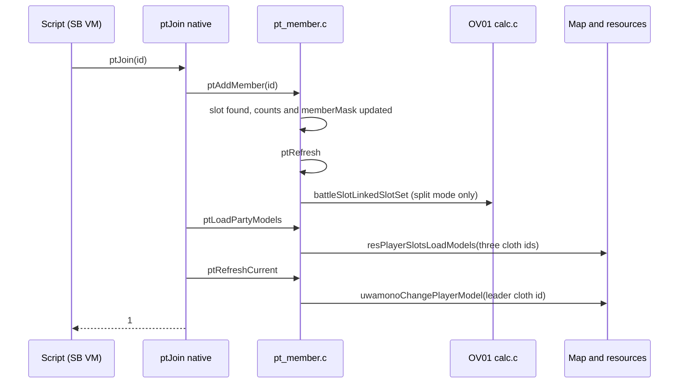

## Reset and new game

Two functions bring the party to a known state. They are called at different
moments and do different halves of the work.

`ptReset()` (`src/main/save_party_init.c`) prepares the structures. On the
first call after boot or after `menuRequestLoad()` it also writes the default
options and loads the two menu text files, which is described in
[save data](../architecture/save-data.md#a-new-game). Then it clears the
progress record, rebuilds the ten status records and member records, clears
the skill board records, empties the slots and the roster, stamps the play
time, resets the status block and adds all ten members in the order 1, 4, 5,
2, 3, 6, 7, 11, 12, 13. The result is a full party with chaos, Jin and Ziggy in
the three battle slots. This is the party of the debug entry points (the
BATTLE CONFIG menu calls `ptReset` from `configInit`). A real game replaces it
at once through the script.

`ptStateInit()` (`src/main/menu_selection.c`) is the new-game reset, reached
through the script native `ptInit`. It runs these steps.

1. `dataPlUnitInit()` rebuilds the fifteen parameter blocks and the point
   records from `bat.dat` (see [Unit initialisation](#unit-initialisation)).
2. `dataBoxClearAll()` empties the four inventory boxes and
   `sdvInitSpecialWork()` clears a 128-bit table kept per enemy unit key.
3. For each of the ten members it clears the skill board record, sets
   600 Skill Points and 600 Class Points (`SELECTION_START_POINTS`), and
   empties the member's slot and roster entry.
4. Jin (id 4) starts with class A of level 1 open and its first two skills
   taken. The two records are applied exactly as the menu would, so Jin knows
   ethers 1 and 4 from the start.
5. The party state is cleared: on foot, no members, no attached map, empty
   `memberMask`. The cursor buffers and the `eligibility` bitmap are cleared.
6. The bonus for save data of the earlier games is applied (below).
7. `selectionKeyItemBitsFill()` records the special items held and the play time is
   stamped.

After `ptInit` the party is empty. The opening script fills it with `ptJoin`
or `ptSet`.

### The bonus for Episode I save data

Before the first map, the configuration screen can search the memory cards for
saves of Xenosaga Episode I and its relatives (see
[save data](../architecture/save-data.md#save-data-of-the-earlier-games)).
`oldDataMaximaCopy` hands the result to `ptStateInit`: six bytes, which are
most likely the levels of six characters in the old save, and a set of notice
bits. When bit 0 or 1 is set the bonus is paid.

| Byte | Member record | Character | Bonus |
| --- | --- | --- | --- |
| 0 | 0 | chaos | 30 Skill Points per unit of the byte |
| 1 | 1 | KOS-MOS | 30 Skill Points per unit of the byte |
| 2 | 2 | Shion | 30 Skill Points per unit of the byte |
| 3 | 4 | Ziggy | 30 Skill Points per unit of the byte |
| 4 | 5 | MOMO | 30 Skill Points per unit of the byte |
| 5 | 6 | Jr. | 30 Skill Points per unit of the byte |

Jin has no byte, because record 3 is skipped. In addition Ziggy and KOS-MOS
learn skill `0x3F` (`dataEtherLearnSet(5, 0x3F)` and `(2, 0x3F)`) and one
special item of box 3, id `0x45`, is added. Skill `0x3F` is the one the model
loader tests with `battleUnitHasEffectCode(key, 0x3F)` to pick another model
file for the unit, which fits the swimsuit skills that the game awards to these
two characters for Episode I data. The same skill adds 10 percent to the Skill
Points earned in battle and one point to `counter12`.

## The game tables

All numbers of growth come from one file, `bat.dat`, which
`dataBatDatLoad` (`src/ov01/data_file_load.c`) reads into the object `batDat`.
The file starts with a header of offsets. `src/ov01/data_record_get.c` holds
one getter per table. Each getter adds its header word to the start of the
file and indexes fixed-size records, numbered from 1. An index outside the
table returns 0 in most getters. The file layout itself belongs to the
[game tables](../formats/game-tables.md) page.

| Getter | Record | Size | Indices | Contents |
| --- | --- | --- | --- | --- |
| `batUnitRecordGet` | unit | `0x5C` | 1 to 15 party, 16 to 140 enemies | Starting parameters, same layout as the head of a `StatBlock` |
| `batUnitNameGet` | text | | same | Name of a unit (the record's first halfword is the text offset) |
| `tecRecordGet` | `TecRecord` | `0x20` | from 1 | A technique: targets, power, EP cost, status effects. Used by attacks, ethers and items |
| `etherRecordGet` | `EtherRecord` | 12 | 1 to 109 | An ether: two texts, flags and the technique it performs |
| `skillRecordGet` | `SkillRecord` | 12 | 1 to 104 | A skill or passive effect: two texts, flags and a code word |
| `usableItemRecordGet` | `UsableItemRecord` | 16 | 1 to 40 | A usable item (box 1): texts, flags, technique, amount |
| `accessoryRecordGet` | `EsAccessoryRecord` | 16 | 1 to 40 | An equippable item (box 2): texts and the skill code it grants |
| `dataBoxKeyItemRecordGet` | `TextRecord8` | 8 | 1 to 99 (107 records in the file) | A special item (box 3): texts and a map model |
| `dataBoxSecretKeyRecordGet` | `RecordTexts` | 4 | 1 to 99 (31 records in the file) | A key (box 4): texts only |
| `pairLinkGet` | `DoubleTechRecord` | 16 | 1 to 16 | A Double Tech: technique, required level, the two units |
| `attackLevelRecordGet` | `EsSpecialRecord` | 16 | 1 to 21 | A special attack with a required level and an entry mask |
| `attackTargetRecordGet` | `SpecialAttackRecord` | 16 | 1 to 10 | An attack with its own model and a minimum level |
| `slotPairRowGet` | `ShortPair[3]` | 12 | 1 to 15 | Three pairs of halfwords per party unit, loaded into `pairFirst` and `pairSecond` |
| `growthRecordGet` | `GrowthRecord` | `0x20` | 1 to 15 | Start and target of the eight growth curves of a party unit |
| `dataExpTblGet` | `UnitExpEntry` | 4 | by level | Experience needed per level |
| `enemyRewardRecordGet` | `EnemyRewardRecord` | 16 | 16 to 143 (the file has keys 16 to 140) | What an enemy pays when defeated |
| `tableKeyRowGet` | `TableKeyRow` | 20 | from 1 | Ten halfwords per row, read by the enemy thinking code |
| `effectIdListGet` | `short[3]` | 6 | from 1 | Effect ids of an action |
| `stringOffsetsGet`, `tableStringGet` | text | 2 | from 1 | A list of string offsets and the string behind one |

Every record that starts with a `RecordTexts` pair has two texts, a name
(`RECORD_TEXT_NAME`, 0) and a description (`RECORD_TEXT_INFO`, 1). The two
halfwords are offsets from the start of the record's table. The `*TextGet`
functions (`battleLookupTextGet`, `statusTextGet`, `hitActionTextGet`,
`itemTextGet`, `dataBoxCategory3TextGet`, `dataBoxCategory4TextGet`,
`pairLinkTextGet`, `calcLevelTextGet`, `tgtIdTextGet`) return one of them. The
menus and the result screen print item and skill names this way.

`batUnitRecordGet` has one special case. An index of 141 or more is not in the
file. It returns the party record of the unit named by the battle state's
`slotIndex`, which lets a transformed or summoned unit borrow the parameters
of a party member.

The file also holds three small helpers that have nothing to do with
`bat.dat`: `dataModelKeyGet` returns a model key from a 26-entry table by unit
index, and `dataMotNameIndexGet` and `dataVoiceNameIndexGet` return their
argument unchanged.

### Skills and ethers in the source names

The source has two families of learn functions, and their names read the wrong
way round compared with the tables they index.

| Function family | Bits | Table the number indexes | What it really records |
| --- | --- | --- | --- |
| `dataEtherLearnSet`, `dataEtherLearnGet`, `dataEtherLearnClear` | `flagBits` (`slotFlagSet`, `slotFlagTest`, `slotFlagClear`) | `skillRecordGet` | Learned **skills** |
| `dataSkillLearnSet`, `dataSkillLearnGet` | `codeBits` (`slotCodeSet`, `slotCodeTest`) | `etherRecordGet` | Learned **ethers** |

The evidence is consistent. The debug menu's `LEARN SKILL` row reads and writes
through `dataEtherLearnGet` and `dataEtherLearnSet` (`unitLearnMaskGet`,
`unitLearnMaskSet` in `src/ov01/debug_entry.c`). Its `EQUIP SKILL` row edits
`effectCode`, whose values `calcSkillInit` looks up with `skillRecordGet`.
On the other side, `calcUseEtherMenu` and `calcTakeEpGetMenu` take a number,
read `etherRecordGet(number)->tecIndex` and charge the technique's EP cost,
which is what casting an ether does. This page says "skill" for the status
table and "ether" for the lookup table, and keeps the function names as they
are in the source.

The debug menu also shows the scale of things. `LEARN ALL`
(`configLearnAllApply`) sets ethers 1 to 59 for units 1 to 10, sets all 16
Double Tech bits, puts 99 of each item 1 to 40 into boxes 1 and 2, and sets
mark 4 of KOS-MOS.

## Parameters

### Unit initialisation

`dataPlUnitInit()` builds the starting state of all fifteen party units. It
clears `slotRecordTable` and a start-of-battle boost counter, then for each key
1 to 15:

1. `battleEntryLoad(slot, key)` copies the unit's `bat.dat` record into its
   parameter block and fills hit points and ether points.
2. `expCounter` becomes `dataExpTblGet()[expLevel].exp`, the experience needed
   to leave the starting level.
3. The eight `growth` values become the `start` values of the unit's
   `GrowthRecord`.
4. The three pairs of the unit's slot pair row are loaded into `pairFirst` and
   `pairSecond`.
5. Units 11, 12 and 13 get their main pilot (2, 6, 7) in `linkedSlots[0]`.
6. KOS-MOS (unit 2) gets marks 1, 2 and 3 (`markBits[0] = 7`).

At the end `slotPairSet(1)` teaches Double Tech 1 to its two units.

### Totals for the menu

The menus never show a parameter block directly. They ask for a **total**, a
working copy with all bonuses applied. `calcTotalParaMenu(key)` returns it, and
`ptGetMenuMemberState()` is the short form for the member the menu shows. The
work is done by `calcTotalParaMenuSub(key, contextIndex)`, which has two
contexts (`battleStateTable[2]` with a dummy unit each in
`battleContextTable[2]`) so that an attacker and a target can be computed at
the same time.

1. `calcCopyParaMake` copies the persistent block into the context block, and
   for an E.S. first rebuilds its learned bits from the main pilot.
2. `calcSkillInit` applies the bonuses from three sources: the four equipped
   items (`equipId`, each item's `code` is a skill index), the four equipped
   skills (`effectCode`), and every learned skill whose record has bit
   `0x2000` in `slotFlags`, which marks skills that work without being
   equipped.
3. The persistent `hp` and `ep` are clamped to the new caps, so losing a bonus
   cannot leave a unit above its maximum.

`calcSkillInitSub` applies one skill record. The record's `flags` say which
kind of effect it is and its `code` carries the details.

| `flags` bit | Effect |
| --- | --- |
| `0x8000` | Parameter bonus. The value is `code & 0x7F`, multiplied by `calcSkill(unit, 0x8000, 0x80)` when that sum is positive. The other bits of `code` choose the parameters |
| `0x4000` | Status protection: `calcStatProtectSet(unit, flags & 0xF, code)` |
| `0x2000` | Status resistance: adds `((flags & 0xF0) >> 4) * 5` percent to the resistance cell of status `code` in row `flags & 0xF`, capped at 100. Row 15 means every cell of rows 1 and 2 |

| `code` bit (with `0x8000`) | Parameter | Cap |
| --- | --- | --- |
| `0x8000` | `physAttack` += value | 999 |
| `0x4000` | `physDefence` += value | 999 |
| `0x2000` | `hitRate` += value | 100 |
| `0x1000` | `evadeRate` += value | 100 |
| `0x0800` | `magAttack` += value | 999 |
| `0x0400` | `magDefence` += value | 999 |
| `0x0200` | `counter12` += value | 15 |
| `0x0100` | `maxHp` and `maxEp` raised by value percent | 9,999 HP for characters, 99,999 HP for keys 11 to 15, 99 EP |

After the three loops `calcSkillInit` checks five fixed skills with
`calcSkillEquChk`: skill `0x0F` sets `effectFlag72` to 4, skill `0x32` starts
the unit at `level` 1 (a battle gauge level, not the experience level), skill
`0x3F` adds one to `counter12`, skill `0x63` starts `current` at 100 and skill
`0x64` raises `currentMax` to 300. These are battle start values and are
explained in [battle](battle.md).

`calcSkillEquChk(unit, skill)` is the general "does this unit have this skill
active" test. For a skill that works unequipped it tests the learned bit. For
any other skill it looks for the number among the codes of the four equipped
items and among the four equipped skills. `calcSkill(unit, flagMask, codeMask)`
sums `code & 0x7F` over all active skill records that pass both masks, and is
how percent bonuses such as extra experience are collected.

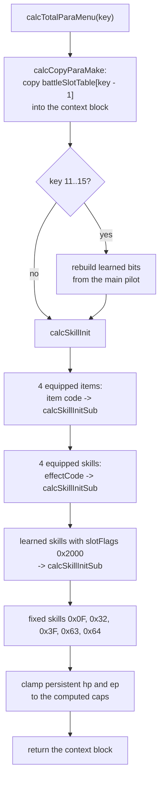

### Writing back

The menu changes parameters only through OV01 functions that work on a total
and then commit it. `calcPara2OrgSub(unit)` copies `hp` and `ep` of a working
block back into the persistent block of the same key. `calcPara2Org()` does it
for every party unit that has a battle entry, and is the first step when a
battle ends.

| Function | Use |
| --- | --- |
| `calcUseItemMenu(targetKey, itemId)` | Uses an item of box 1 from the menu. The target is one unit, or the whole active group when the item's technique has target flag 8. Applies `calcUseItem`, commits, and takes one item from the box |
| `calcUseEtherMenu(casterKey, targetKey, etherId)` | Casts an ether from the menu. Runs the normal hit and damage code for each target, commits, and charges the caster's EP |
| `calcTakeEpGetMenu(key, etherId)` | The EP cost the menu shows for an ether |
| `battleSlotsRestoreAll()` | Full HP and EP for units 1 to 15, computed against the totals |
| `calcSkillEquipOrg(key, slot, skill)` | Writes one of the four `effectCode` slots |
| `calcAccEquipOrg(key, slot, itemId)` | Writes one of the four `equipId` slots |
| `battleSlotMarkSet`, `battleSlotMarkTest`, `battleSlotMarkClear` | The 21 marks of a unit |

The marks are a third bit set next to skills and ethers. The owned code shows
three uses: KOS-MOS starts with marks 1 to 3, the script native `Item` can set
a mark of KOS-MOS (kind 7), and mark 4 of KOS-MOS adds one row to her command
page (`selectionMemberCapacity`). A likely reading is that marks are attacks a
unit gains through story events instead of the skill board.

## Levels and experience

Experience is counted in two fields of the point record. `total_exp` only ever
grows and is shown on the status screen. `next_level_exp` is a countdown: it
starts at the table value of the current level and every gain is subtracted
from it.

`calcLvUp(key, gain, row)` applies a gain. A unit at level 99 gains nothing.
Otherwise the gain is subtracted, and while the counter is zero or below and
the level is under 99, the level rises by one, the table value of the new
level is added to the counter and `unitGrowthStep(key)` raises the
parameters. One large gain can therefore give several levels at once. The
function returns 1 when at least one level was gained.

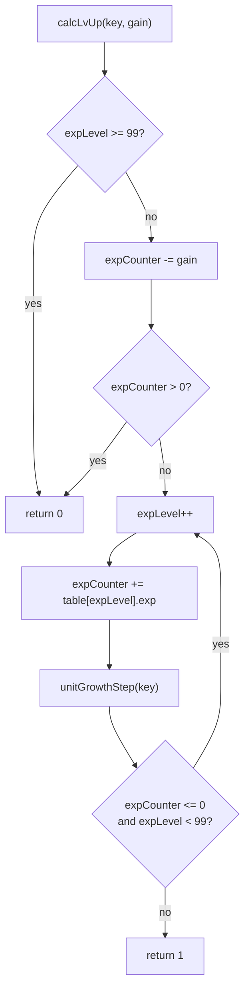

### The growth curves

A unit does not have a table of parameters per level. It has eight **growth
curves**, each defined by a start value and a target value in its
`GrowthRecord`, and the point record remembers where on each curve the unit
is (`growth[8]`). At every level `unitGrowthStep` moves each curve a fraction
of the remaining distance toward the target:

```
next = (100 * (target - current) / (100 - expLevel) + 25) / 50 + current
```

`expLevel` is the level just reached. The step is roughly twice the remaining
distance divided by the levels left before 100, rounded. The difference
`next - current` is then added to the parameter the curve feeds.

| Curve | Parameter | Cap |
| --- | --- | --- |
| 0 | `physAttack` | 999 |
| 1 | `physDefence` | 999 |
| 2 | `magAttack` | 999 |
| 3 | `magDefence` | 999 |
| 4 | `hitRate` | 100 |
| 5 | `evadeRate` | 100 |
| 6 | `maxHp` | 999,999 |
| 7 | `maxEp` | 99 |

The caps here are those of the persistent block. The totals apply their own,
lower caps to hit points when skills raise them.

The debug menu's `LV UP` row shows the same machinery from the other side.
`unitSetLevel(key, level)` resets the growth values and the eight parameters
to the `bat.dat` record, then calls `unitGrowthStep` once per level up to the
requested one, refills hit points and ether points, and reloads the
countdown. A unit's parameters at any level are therefore fully determined by
its `bat.dat` record and its growth record.

## Skills

The skill system of the game has four **levels**, each divided into
**classes** (A to H, and A to D on level 4), and each class holds four
**skills**. A character spends **Class Points** to open a class and **Skill
Points** to learn a skill in an open class. Learning all four skills of a
class masters it, which pays Class Points back and can open the next level.
Some skills are locked until the party owns the matching key. Every character
has the same board. The source calls a level a group, a class a slot and a
skill a sub.

### The record table

`selectionRecordTable` holds one `SelectionRecord` of six bytes per position of
the board. The position is packed into a **record index**:
`selectionRecordIndex(group, slot, sub)` is `group * 32 + slot * 4 + sub`, a
number from `0x00` to `0x6F`. The same number is what the equip slots store.

| Offset | Type | Name | Meaning |
| --- | --- | --- | --- |
| `+0x00` | `unsigned char` | `kind` | 2 an ether (lookup table), 0 or 1 a skill (status table) |
| `+0x01` | `unsigned char` | `dispatch_value` | The ether or skill number |
| `+0x02` | `unsigned short` | `value` | Cost in Skill Points |
| `+0x04` | `unsigned char` | `bit` | Key needed, 0 for none |

The table defined in `src/main/save_party_init.c` has 128 records. Of the 112
board positions, 49 are ethers, 30 are skills of kind 0 and 33 are skills of
kind 1. Kind 0 skills have numbers 1 to 28 and kind 1 skills numbers 29 to 62.
The menu's equip list has one tab per kind and a fourth tab for everything.
The rule code treats kinds 0 and 1 alike. The tabs, and which kind the equip
screen accepts, are described in [main menu](main-menu.md#skills-on-foot).
Costs run from 100 Skill Points on level 1 to 9,600 for the first skill of
level 4 class D. Thirty-one positions need a key, numbered 1 to 31 in board
order: four in level 1 class H, the last eight on level 4.

`selectionSubTextGet` returns the name or description of a position (through
`statusTextGet` for skills and `battleLookupTextGet` for ethers) and
`selectionSubCostGet` its cost.

### Opening a class

`selectionCanOpenSlot(holder, group, slot)` allows opening a class when it is
not open yet, when its level is open (`openGroup >= group`), and when the
character has the Class Points. `selectionSlotOpen` sets the class bit in
`header[group]` and pays the cost from `selectionSlotOpenCostTable`.

| Level | Cost to open a class (C.Pt) | Reward for mastering (C.Pt) |
| --- | --- | --- |
| 1 | 300 (A to G), 600 (H) | 450 (A to G), 900 (H) |
| 2 | 600 (A to G), 1,200 (H) | 900 (A to G), 1,800 (H) |
| 3 | 1,200 (A to G), 2,400 (H) | 1,800 (A to H) |
| 4 | 2,400 (A to C), 4,800 (D) | 3,600 (A to C), 7,200 (D) |

A mastered class pays back one and a half times its cost, except level 3
class H, which costs 2,400 and pays 1,800.

### Learning a skill

`selectionCanTakeSub(holder, group, slot, sub)` allows a skill when it is not
taken, when its class is open, and when the character has the Skill Points.
The menu adds the key test: `selectionEntryBitOutsideMask(group, slot, sub, mask)`
is nonzero when the record's `bit` is not set in the party's key mask. The mask
`menuItemCategoryMask` is rebuilt when the menu opens: bit 0 is always set and
bit `i` is set when the party holds item `i` of box 4 (ids 1 to 31). These are
the **Secret Keys** of the game. A locked skill is shown with the text of
entry 400 instead of its description.

`selectionApplyEntry` performs the purchase. It teaches the ether
(`dataSkillLearnSet(id, dispatch_value)` for kind 2) or the skill
(`dataEtherLearnSet` otherwise) and calls `selectionTakeSub`, which sets the
bit in `cells[group][slot]`, pays the Skill Points and counts the skill in
`takenCount`. When that was the fourth skill of the class
(`cells == 0xF`), `selectionTakeSub` returns 1 and, if the class belongs to
the highest open level and that level is below 4, opens the next level. The
caller (`src/main/menu_scene.c`) then adds the reward of
`selectionSlotRewardTable` to the Class Points, capped at 99,999, and shows
the mastery message built from the level name (entry `0x36 + group`) and the
class name (entry `0x3A + slot`).

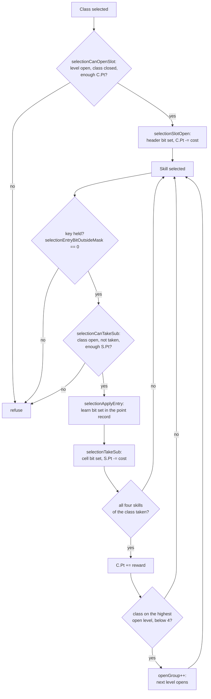

Several helpers count and query the board. `selectionSubIsTaken` reads one
bit, and reports the missing classes E to H of level 4 as taken.
`selectionSlotTakenCount` and `selectionGroupTakenCount` count taken skills
in a class and in a level, and `selectionGroupIsComplete` is true for 32
taken skills in a level (16 for level 4, which the four missing classes
already supply, so level 4 always reads as complete).

### Equipping

Learned skills go into the equip slots of the character
(`PartyTakenBits.entries`, mirrored in `StatBlock.effectCode`). A character
has three slots, and a fourth when the second skill of level 2, class H
(sub index 1) is taken (`menuEquipRowCount = selectionSubIsTaken(member, 1, 7, 1) + 3`).

`selectionCollectEntries(list, holder, kind, mask)` builds the list the equip
screen offers: every taken position whose record has the requested kind
(kind 3 lists every position of the board, taken or not), followed by the
extra entries. `menuPlaceKey(context, key, row)` of
`src/main/menu_scene.c` puts an entry into a row. If the entry is already
equipped in another row, the two rows exchange their contents. Both rows are
written to the parameter block with `calcSkillEquipOrg`, using the record's
`dispatch_value` as the skill number. `selectionFindIndex(holder, value)`
finds the row that holds an entry, and `selectionHolderHasEntry` tests whether
a character owns an entry at all.

For an E.S. the same four `entries` hold accessory ids of box 2 instead.
`menuTakePlainEntry` stores the item, writes it to `equipId` with
`calcAccEquipOrg` and takes one item out of the box. The item's `code` is a
skill number, so equipping an item gives the E.S. that skill for as long as
the item is fitted.

### Extra entries

Seven entries exist outside the board. They use the record indices `0x70` to
`0x76`, which are the first positions of the unused classes E and F of
level 4, so their names and numbers come from the same record table.

| Entry | Record | Who can hold it |
| --- | --- | --- |
| `0x70` (`SELECTION_ENTRY_EXTRA_FLAG`) | skill `0x3F`, kind 1 | Any character who has learned skill `0x3F` |
| `0x71` to `0x76` (`SELECTION_ENTRY_EXTRA_CODES`) | ethers `0x34` to `0x39` | Shion (id 3) only, each when learned |
| `0x7F` (`SELECTION_ENTRY_NONE`) | none | Nobody. Marks an empty choice |

Skill `0x3F` is the bonus skill for Episode I data, and the script native
`Item` can teach it to any unit (kind 8). The six ethers are taught to Shion
by `Item` (kind 6) and by `ptRefresh`.

### Double Techs

A **Double Tech** is an attack two characters perform together. Each of the 16
`DoubleTechRecord` records names its two units (`slotFirst`, `slotSecond`), its
technique and a required level. `slotPairSet(index)` sets bit `index - 1` in
the `pairBits` of both units, and `slotPairTest(index)` reads it from the
first. The script teaches one with `Item` kind 5.

The menu shows Double Techs from the last 16 records of
`attackRecordTable` (indices 79 to 94), in which `attributes[0]` and
`attributes[1]` are the two character ids and `attributes[2]` is the pair
number minus one. When the menu opens it builds `menuPartnerMask` with one bit
per known pair. `selectionPairRecordCount(member, mask)` counts the records
that are known, that name `member`, and whose other character is in the
party. `selectionPairRecordAt(member, nth, mask)` returns the nth of them.
The battle side (level requirement, both partners ready) is in
[battle](battle.md).

## Items and the inventory

### The boxes

The inventory is four **boxes** (`src/ov01/data_box.c`), each an array of 255
unsigned halfwords (`dataBoxQuantityTable1` to `4`) holding the count of one
item id. `dataBoxChk(category, id)` reads a count, `dataBoxInc` adds one up to
the limit of 99 and `dataBoxDec` takes one away. Each returns 1 on success and
0 at the limit. Twelve small wrappers (`dataBoxChkCategory1` and so on) fix
the category. `dataBoxClearAll` empties everything. The four tables are saved
as the `shortTables` of the save image.

| Box | Record table | Contents | Evidence |
| --- | --- | --- | --- |
| 1 | `usableItemRecordGet` (40) | Usable items | `calcUseItemMenu` consumes them, each has a technique |
| 2 | `accessoryRecordGet` (40) | Accessories that an E.S. equips | `menuTakePlainEntry`, `calcAccEquipOrg`, the debug row `ACC` |
| 3 | `dataBoxKeyItemRecordGet` (99) | Special items | Listed on their own menu page, never consumed by the owned code |
| 4 | `dataBoxSecretKeyRecordGet` (99) | Keys, among them the Secret Keys 1 to 31 | `menuItemCategoryMask` |

When the menu opens, each held key `i` of box 4 also adds special item
`i + 76` to box 3 if it is missing, so every Secret Key appears in the special
item list.

The `eligibility` bitmap of the progress record remembers which special items
the party has ever held. `selectionKeyItemBitsFill()` sets bit `id` for every id 1
to 254 of box 3 with a count above zero, `selectionKeyItemBitsClear()` clears all
256 bits, and `selectionKeyItemBitTest(id)` reads one. The special item page
shows an unknown entry (text 400) for ids whose bit is clear. Because bits are
only ever set, an item that was taken away again stays known.

### The Item native

`runtimeItem` (`src/main/runtime.c`) is the script native `Item` of the
`runtime` module. Scripts use it for treasure, rewards and story events. It
takes at least three arguments: a kind, a target number and a count, plus an
optional message flag.

| Kind | Action | Returns |
| --- | --- | --- |
| 1 | Adds `count` of item `target` to box 1, or removes `-count` when negative | New count |
| 2 | The same for box 2 | New count |
| 3 | The same for box 4 (keys) | New count |
| 4 | The same for box 3 (special items), then `selectionKeyItemBitsFill()` | New count |
| 5 | `slotPairSet(target)`: teaches a Double Tech | 0 |
| 6 | `dataSkillLearnSet(3, target)`: teaches Shion an ether | 0 |
| 7 | `battleSlotMarkSet(2, target)`: sets a mark of KOS-MOS | 0 |
| 8 | `dataEtherLearnSet(target, 63)`: teaches unit `target` skill `0x3F` | 0 |

Kinds 3 and 4 are crossed on purpose in the code: kind 3 addresses box 4 and
kind 4 box 3. Items are added one at a time, so the limit of 99 holds.

When the message flag is 1 the native also announces the item. It writes the
count as two digits into the text `itemObtainedCountText` (the item name
followed by a fixed phrase that says the amount was obtained), copies the
result to `itemPickupMessageBuffer` and pushes it to the cursor buffer display
(`cursorBufferPush`, see [UI windows](../libraries/ui-windows.md)).

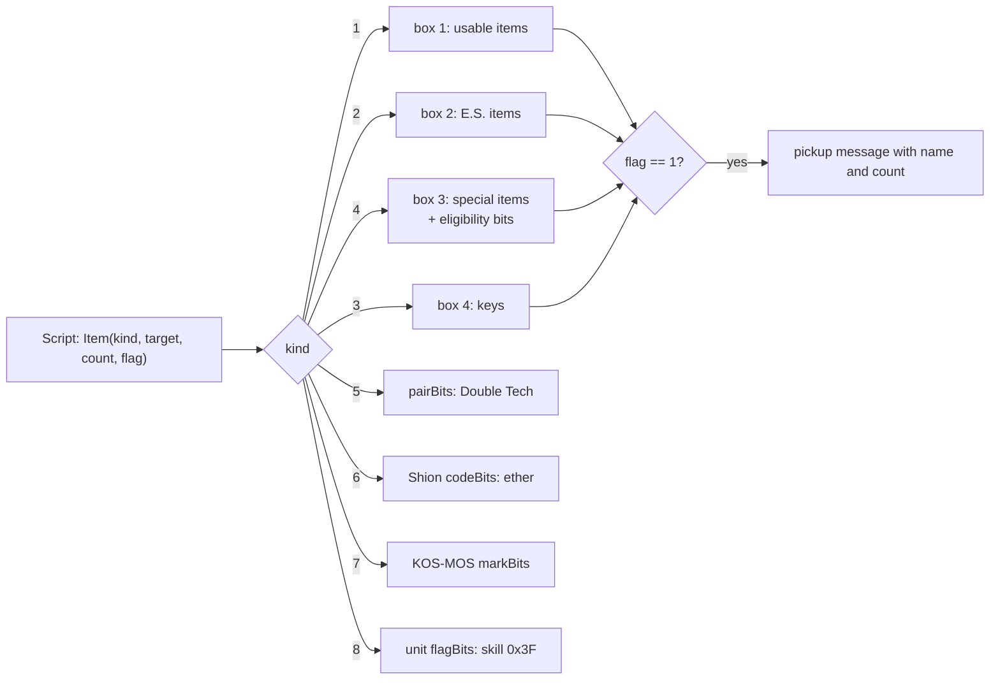

The two other natives of the file are unrelated to items. `TimeAttack`
(`runtimeTimeAttack`) opens, clears and reads a countdown panel through
`gameWork.panelMode` and `gameWork.panelValue`, and `GetAnalogR`
(`runtimeGetAnalogR`) resets or reads a debug pad counter. Both are listed in
[natives](../scripting/natives.md#the-runtime-module).

### Who can use what

The item page of the main menu works on two lists that
`src/main/menu_selection.c` builds from the boxes. The **window list**
(`selectionUsableItemList`, `selectionWindowCount`) holds the ids of box 1 with a
count above zero. `selectionRebuildWindowList()` builds it. In split mode it
puts the items 30 to 32 first and then the rest. The **plain list**
(`selectionAccessoryList`, `selectionPlainCount`) holds the held ids of box 2,
built by `selectionRebuildList()`. `selectionWindowListDropAt(index)` and
`selectionListDropAt(index)` return the remaining count of an entry and remove
it from the list when it has run out. The second one also takes one item from
the box.

What an item may do is not read from `bat.dat` by the menu. It comes from
`selectionFlagTable`, a table of 16-bit flag words per item id that
`selectionFlagTableInit()` fills with fixed values for ids 0 to 40.

| Flag | Name | Meaning |
| --- | --- | --- |
| `0x001` | `SELECTION_FLAG_RESTORE_HP` | Useful on a member whose HP is below the cap |
| `0x002` | `SELECTION_FLAG_RESTORE_EP` | Useful on a member whose EP is below the cap |
| `0x004` | `SELECTION_FLAG_WHOLE_PARTY` | Always useful. Also marks items that act on the whole party |
| `0x008` | `SELECTION_FLAG_RESTRICTED` | Usable only while `nearbySearchType` is 7 or 8 |
| `0x010` | `SELECTION_FLAG_DISABLED` | Never usable from the menu |
| `0x020` | `SELECTION_FLAG_SPLIT_ONLY` | Usable only in the E.S. Without it, only on foot |
| `0x040` | `SELECTION_FLAG_ANY_MODE` | Usable in both modes |
| `0x080` | `SELECTION_FLAG_CLASS_POINTS` | Useful on a member below 99,999 Class Points |
| `0x100` | `SELECTION_FLAG_SKILL_POINTS` | Useful on a member below 99,999 Skill Points |

| Item ids | Flags | Reading |
| --- | --- | --- |
| 0, 10 to 16, 18 to 20, 33 to 36 | disabled | Battle-only items |
| 1 to 4 | restore HP | Hit point medicine |
| 5 to 7 | restore EP | Ether point medicine |
| 8, 9 | restore HP and EP | Combined medicine |
| 17 | any mode | Usable everywhere, no condition on the target |
| 21 | restore HP and EP, always | Whole-party restore |
| 22 to 26 | Skill Points | Items that add Skill Points |
| 27 to 29 | Class Points | Items that add Class Points |
| 30, 31 | restore HP and EP, split only | E.S. repair items |
| 32 | restore HP and EP, always, split only | Whole-group E.S. repair |
| 37 to 40 | always | Always usable on foot |

The readings in the last column follow from the flags and from `calcUseItem`,
which adds an item's `amount` to the Skill Points for technique flag `0x10`
and to the Class Points for flag `0x20`. The item names are in `bat.dat`.

`selectionEntryIsEligible(index)` decides whether an entry of the window list
can be chosen at all: not disabled, the restricted condition met, and the
right mode. `selectionEntryIsUseful(index, holder)` adds the test against one
member: it computes the member's total and returns 1 when any condition flag
of the item is met, or when the item has no condition flag at all.
`selectionWindowEntryTargetsParty` reports the "always" flag and
`selectionWindowEntryMarkedFlags` returns the flags of a point item so the
menu can draw the point counter. `selectionActiveMemberNeedsHp()` and
`selectionCountedMemberNeedsHpEp()` answer for the whole active group and are
used for party-wide items.

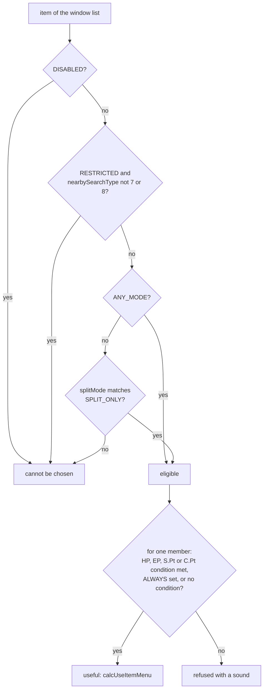

Two more small functions belong to the same file. `selectionMemberCapacity(id)`
returns the number of rows on a member's command page from a per-id table,
plus three for KOS-MOS and one more when her mark 4 is set.
`menuSceneResetStub()` is empty.

## Awards after battle

A battle pays in two stages. During the fight, every defeated enemy adds its
reward to a running total. After the fight, the result screen splits the total
among the party and applies it. The screen itself (panels, fonts, layout) is
described in [main menu](main-menu.md#the-battle-result-screen). This section
covers what is awarded and when.

### Collecting rewards

`battleResult` (`struct BattleResult`, `0x50` bytes) is the running total.
`monsGainInit()` clears it when the battle work tables are reset and
`monsGainPtrGet()` returns it.

| Offset | Type | Name | Meaning |
| --- | --- | --- | --- |
| `+0x00` | `int` | `exp` | Experience |
| `+0x04` | `int` | `skillPointsTotal` | Skill Points |
| `+0x08` | `int` | `classPointsTotal` | Class Points |
| `+0x0C` | `int[8]` | `categories` | Box of each dropped item |
| `+0x2C` | `int[8]` | `ids` | Id of each dropped item |
| `+0x4C` | `int` | `count` | Number of drops, at most 8 |

`monsGainSet(unit)` is called for a defeated enemy. It reads the enemy's
`EnemyRewardRecord` with `enemyRewardRecordGet(key)`.

| Offset | Type | Name | Meaning |
| --- | --- | --- | --- |
| `+0x00` | `int` | `exp` | Experience |
| `+0x04` | `short` | `skillPoints` | Skill Points |
| `+0x06` | `short` | `flat` | Class Points |
| `+0x08` | `unsigned char` | `secondChance` | Percent chance of the second drop |
| `+0x09` | `unsigned char` | `firstChance` | Percent chance of the first drop |
| `+0x0A` | `unsigned char` | `secondCategory` | Box of the second drop, 0 for none |
| `+0x0B` | `unsigned char` | `firstCategory` | Box of the first drop |
| `+0x0C` | `unsigned char` | `secondId` | Id of the second drop |
| `+0x0D` | `unsigned char` | `firstId` | Id of the first drop |

Experience and Class Points are added as they are. Skill Points are multiplied
when the battle's step counter (the event slot described in
[battle](battle.md)) stands on step 2 at that moment. The multiplier is 2, 4
or 10 and was drawn when the counter was set.

An enemy drops at most one item. The first drop is rolled first. Its chance is
`firstChance` plus the sum of the killer's active skills with flag `0x400` and
code bit `0x2000`, limited to 100. The bonus is only added when the enemy has
a recorded `source` unit, the unit that defeated it. Without one the code
rolls the Skill Point multiplier as the percent instead of `firstChance`,
which looks like an oversight of the original. If the first roll fails, or the
enemy has unit flag `0x10000`, the second drop is rolled with `secondChance`,
and enemy flag `0x8000` blocks it. A drop with a nonzero box is appended to
the list while there is room.

### Paying out

`battleResultScene` is called by the play session (`src/main/game_data.c`)
after `ov01SceneEnd()`. It is skipped when `battleRetCodeGet()` is 5, and
return code 2 leaves the play loop before the screen is reached. Before it
draws anything it calls `calcResult(rows)`, which pays everything.

Three party snapshots matter here. When the battle ends,
`partySnapshotBuild()` commits hit points and ether points
(`calcPara2Org`), stores the party's boost stock for the next battle, and
copies the up to three party units into `partySnapshots`, so that the result
code can still read their flags and keys after the battle objects are gone.

`calcResult` then runs these steps.

1. It counts the snapshot units that are not down (`UNIT_FLAG_DOWN`). This
   number is the divisor.
2. It adds every dropped item to its box with `dataBoxInc`.
3. For each snapshot unit with a party key that is not down, `calcResultSub`
   computes and pays the three gains, and `calcLvUp` spends the experience. A
   unit that is down gets a row of zeros.
4. `battleAbsentUnitsApply` pays the members who did not fight.

`calcResultSub(unit, gains, divisor, row)` computes one unit's share.

| Gain | Formula | Paid into | Cap |
| --- | --- | --- | --- |
| Experience | `points / divisor`, plus that times the skill bonus (flag `0x400`, code bit `0x8000`) percent | `total_exp`, and through `calcLvUp` the countdown | 99,999,999 |
| Skill Points | `skillPointsTotal / divisor`, plus that times the skill bonus (flag `0x400`, code bit `0x4000`, and 10 more with skill `0x3F`) percent | `skillPoints` | 99,999 |
| Class Points | `classPointsTotal / divisor` | `classPoints` | 99,999 |

The totals are divided among the survivors, so a smaller surviving party earns
more per head, and a member who is down at the end earns nothing.

`battleAbsentUnitsApply(lowKeys, divisor)` looks at everyone in `memberMask`
who was not in a snapshot. It only handles members of the same kind as the
ones who fought: characters after a battle on foot, E.S. after an E.S.
battle. Each of them receives experience only, no points. The base is the
full `points` when the member has a battle entry (it took part at some moment
of the fight) and three quarters of `points` otherwise. It is divided by the
same divisor and goes through the same bonus and `calcLvUp`. Finally the
absent member recovers a quarter of its maximum hit points and ether points,
or half with skill 20 active.

When the screen closes, `calcDeadReset()` gives every party unit that ended
the battle down, or with zero hit points, one hit point.

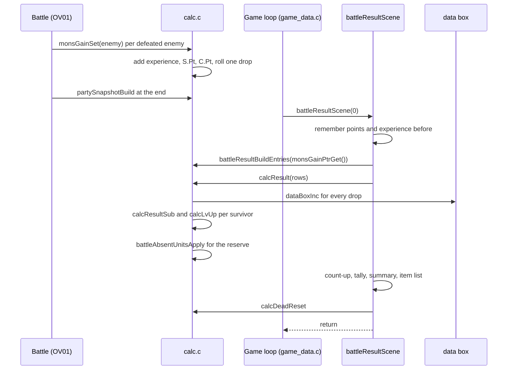

### The result screen

`battleResultScene(mode)` ignores its argument. It opens a temporary arena
(`xglCdArenaOpen`), reads the battle length in frames with
`ov01SceneFrameCount()`, and allocates three work areas from the arena: 128
bytes for eight `BattleResultEntry` records, 280 bytes for ten
`BattleResultRow` records and 64 bytes for `battleResultStats`, four values
for each of up to four members.

The member count is `ptGroupCount()` limited to the three snapshots. For each
member the scene stores the values before payment in `battleResultStats`:
`[0]` the experience countdown, `[1]` the Class Points, `[2]` the Skill
Points and `[3]` the total experience. Then it builds the item list and calls
`calcResult`. If the member count is zero the scene ends without showing
anything.

`calcResult` fills one `BattleResultRow` (28 bytes) per member.

| Offset | Name | Meaning |
| --- | --- | --- |
| `+0x00` | `key` | Unit key |
| `+0x04` | `expGain` | Experience gained |
| `+0x08` | `skillPointsGain` | Skill Points gained |
| `+0x0C` | `classPointsGain` | Class Points gained |
| `+0x10` | `levelGain` | Levels gained |
| `+0x14` | `maxHpGain` | Increase of the HP cap |
| `+0x18` | `maxEpGain` | Increase of the EP cap |

`battleResultBuildEntries(result)` turns the up to eight drops into the item
list. Equal drops are merged into one entry with a count. An entry is
highlighted when its count plus the count already in the box reaches 100,
which means the box limit of 99 cut some of it off. The list then shows a
mark on that line and a note (menu text `0xE7`) below.

The scene loop runs once per frame. It reads the pad, advances the state,
queues `battleResultDrawCallback` and runs the actor update and draw, so the
background layers keep moving behind the panels. Holding the soft reset
combination ends it at once.

| State | Value | What happens | Leaves when |
| --- | --- | --- | --- |
| `BATTLE_RESULT_STATE_COUNT_UP` | 0 | The rows show the values before payment and the full gain beside them | 180 frames, or Circle |
| `BATTLE_RESULT_STATE_TALLY` | 1 | A tally counter runs from 0 to the largest gain. Each row shows `before + gain * tally / max` and the rest still to add. Holding Circle adds `max / 32 + 1` per frame. A tick sound plays every fourth frame | The counter reaches the largest gain |
| `BATTLE_RESULT_STATE_SUMMARY` | 2 | Final values, the level-up mark and the new HP and EP caps. A fanfare sound plays once if anyone gained a level | Circle pressed, or held for 30 frames |
| `BATTLE_RESULT_STATE_ENTRY_LIST` | 4 | The list of dropped items replaces the rows. Skipped when nothing dropped | Circle pressed, or its auto-repeat 16 times |

Because every row is scaled by the same largest gain, all counters finish on
the same frame. During the first two states a row shows the member's level and
caps as they were before the battle, by subtracting `levelGain`, `maxHpGain`
and `maxEpGain` from the current values. The experience countdown switches
from the old value to the new one when the tally completes.

`battleResultDrawRow` draws one member: icon and name from the status record,
level, hit points and ether points from the total, the experience line, the
Class Point line and the Skill Point line, each with the running value capped
for display (99,999,999 for experience, 99,999 for points). A row for an E.S.
(key 11 or more) is drawn 17 pixels wider and shows dashes in the two point
lines. `battleResultDrawScreen` draws the title `RESULT`, the label
`ClearTime` with the battle length as hours, minutes and seconds at 30 frames
per second (capped at 99:59:59), and then either the rows or the item list
(`battleResultDrawEntries`), whose names come from the text getter of the
drop's box.

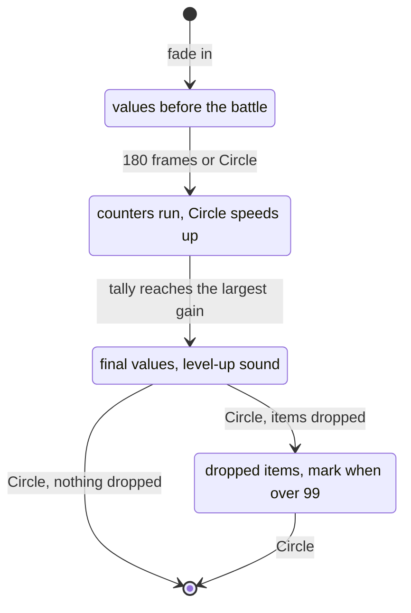

After the loop the scene fades out over 16 frames, calls `calcDeadReset()`,
releases the background layers and the arena, and fades the field back in.
The file also defines a few label strings used by other menus (`STATUS`,
`W ETHER`, `SPECIAL`, `DOUBLE`, `EXPLANATION`).

## The debug menu as a cross-check

The BATTLE CONFIG menu of `src/ov01/debug_entry.c` belongs to
[debug tools](debug-tools.md), but its equip page is a compact description of
a unit's growth data, because each row edits one of the fields above.

| Row | Field | Range |
| --- | --- | --- |
| `EQUIP SKILL` | `StatBlock.effectCode[0..3]` | 0 to 64 |
| `LEARN SKILL` | `flagBits`, skills 1 to 32 as four bytes (`unitLearnMaskGet`, `unitLearnMaskSet`) | 0 to 255 per byte |
| `ACC` | `StatBlock.equipId[0..3]` | 0 to 40 |
| `CLOTH` | `ptStatusBlock.clothIds[unit - 1]` | `0x10001` to `0x10028` |
| `SUB PILOT` | `StatBlock.linkedSlots[1]` | 0 to 10 |
| `LV UP` | `expLevel`, through `unitSetLevel` | starting level to 99 |

The main page has three related rows. `MEMBER` edits
`ptStatusBlock.presentMask` directly, `TENT` calls `battleSlotsRestoreAll()`
like the `ptTent` native, and `LEARN ALL` applies `configLearnAllApply()` when
the menu closes. The three `PLAYER` rows are copied from and to
`ptStatusBlock.memberIds`, which is how a test battle gets its party.

## The overlay heap and file helpers

`src/ov01/data_unit_org_get.c` keeps its name from an earlier game, but in
this game it holds no unit data. It contains the heap that OV01 uses for
battle resources and two wrappers for file reads. Both are covered in depth
in [battle engine](battle-engine.md). In short:

- `ov01HeapInit()` reserves `0xA00000` bytes (10 MiB) from the resource work
  area and makes it one free block. Every block has a `0x40`-byte header with
  a flags word (bit 0 means in use) and a payload size.
- `ov01HeapAlloc(size)` rounds the size up to a multiple of `0x40`, takes the
  first free block that is large enough and splits off the remainder.
  `ov01HeapFree(payload)` clears the in-use bit and then merges every run of
  free neighbours in the whole heap.
- `ov01HeapProbeLargeAlloc()` reports whether `0x2A800` bytes are still
  available, and `ov01LookupNonHeap(key)` finds a resource by id and returns
  it only when it lies outside the heap.
- `dataFileLoad(name, buffer)` reads a file and waits. `dataFileLoadNB` starts
  an asynchronous read and counts it in a pending counter that `dataCdSync()`
  returns and the completion callback `dataNBreadCB` lowers.
