# Boot and title screen

This page follows the game from the moment the console starts the executable
until a play session begins, and then covers the full-screen pictures that end
or interrupt a session. The first half is the start-up code in the main
executable (`src/main/control_entry.c`), the memory card check, the logo
pictures and the title screen with its New Game and Load Game entries. These
screens live in the small overlay OV02 (`src/ov02/`). The second half is the
set of picture screens in the main executable: the story synopsis shown while
a session loads, the disc change request, the intermission save offer between
chapters, the game over picture, the ending picture and the display position
screen.

`main()` is also the dispatcher of the whole game. The title screen returns a
small encoded value that names an overlay and a function, and `main()` loads
that overlay and calls that function. In the shipped game the function is
always `Game()`, the play session described in [field.md](field.md). When
`Game()` returns, the title screen comes back.

All these screens share one technique. A picture is stored on the disc as a
JPEG file, it is decoded into a raw 512 by 448 image in main memory, and that
image is sent to the frame buffer every frame while text or a fade is drawn on
top of it. The same forty lines of drawing code appear in five files, each
with its own copy of the packet templates.

[← Back to the overview](../README.md)

## Files

| File | Contents |
| --- | --- |
| `src/main/control_entry.c` | `main()`, `InitializeSystem()`, the IOP module names, the work pointer `WorkEnd`, the start-up arguments `mainParamArgc` and `mainParamArgv` |
| `src/ov02/boot_display.c` | `BootDisplay()`, an empty function called first by `main()` |
| `src/ov02/logo.c` | `LogoFirst()`, the frame helper `device_check_sync()`, the stubbed `hdd_check()`, the memory card check `mc_check()`, the logo slide show `logoShowSlides()` and its drawing function `logoDrawFadedPicture()` |
| `src/ov02/title.c` | `Title()`, the title demo scene (`titleRunScene`, `titleTableReadNotify`), the music start (`titleStartBgm`), the drawing callback (`titleDrawFrame`), the fade (`titleFadeTransition`), the frame copy (`copyframe`) and all their tables |
| `src/ov02/title_game_init.c` | `TitleGameInit()`, which clears the game state before New Game and Load Game |
| `src/ov02/title_hdd_install.c` | `TitleHddInstall()` and its install and uninstall dialogs, the progress callback `HddInstallCB()` and the frame helper `HddInstallSync()` |
| `src/main/game_over.c` | `GameOver()`, `GameEnd()`, `Intermission()`, the picture drawing helpers `DrawImage()`, `DrawBack()`, `redraw_frame()`, `GameCopyFrame()`, `GameSynopsisDrawPanel()` and `GameSceneReset()` |
| `src/main/game_disk_change.c` | `GameDiskChange()`, `GameDiskSetDiscDigit()`, `GameSynopsis()` and `GameSynopsisCrossfadeWait()` |
| `src/main/tya_display_setting.c` | The display position screen `tyaDisplaySetting()`, `tyaSetDisplayOffset()` and a private picture drawing function |
| `src/main/yajima_test.c` | `tyaRunDisplaySetting()`, a stand-alone entry to the display position screen. The rest of the file is the developer menu `YajimaTest()` and four sound level helpers (see [Other contents of the owned files](#other-contents-of-the-owned-files)) |
| `src/main/game_over_095.c` | A third copy of the picture loader and drawer (`gameOverLoadFile`, `DrawImage_0020CAB0`), the dimming quad `screenFadeQuadDraw()`, `gameOverDrawSprite()` and `bgLayerReady()` |
| `include/ov02/*.h`, `include/main/game_over.h`, `tya_display_setting.h`, `game_over_095.h`, `game_disk_change.h`, `yajima_test.h`, `control_entry.h` | Prototypes, the `HDD_SCREEN_*` commands, the `TYA_DISPLAY_*` modes, `GameSynopsisPanel` and the packet unions |

## 1. From `main()` to the title loop

The executable starts in the C runtime start-up code, which calls `main()` in
`src/main/control_entry.c` (see
[runtime-libraries.md](../architecture/runtime-libraries.md)). `main()` never
returns. It performs the whole start-up itself and then becomes the title
loop. Its steps are, in order:

1. It stores `argc` and `argv` in `mainParamArgc` and `mainParamArgv`.
2. It calls `BootDisplay()`. This function lives in OV02
   (`src/ov02/boot_display.c`) and has an empty body. The call works this
   early only because OV02 is already in memory when the program starts (see
   [section 2](#2-the-two-overlays-and-the-two-discs)).
3. It calls `InitializeSystem()`, which restarts the I/O processor (IOP),
   loads the IOP modules and initialises every `xgl` module.
4. It calls `xglCdOpenDevice()`, which opens the disc device of the CRI file
   library with `ADXF_Open` and keeps the handle in `xglCdDeviceHandle`.
5. It calls `xglRenderAndMovieInit()`, which runs `xglRenderInit()` a second
   time and then `moviePlayerLibraryInit()`.
6. It runs one frame by hand: `xglRenderFrame()`, `xglCdControlThread()`,
   `xglStudioSetup()` and `xglStudioUpdate()`. The first, second and fourth
   call are exactly the body of `xglSleep()`. `xglStudioSetup()` sits between
   them because the studio (the set of cameras, see
   [xgl.md](../libraries/xgl.md)) must exist before it can be updated.
7. It turns the display on with `xglRenderDispOn()`.
8. It loads the system sound bank with
   `seBankLoad(SYSTEM_SE_SLOT, "SYS_SE", SYSTEM_SE_ADDRESS)`, which is bank slot
   1 with `0x5000` bytes of sound memory. This bank holds the cursor, confirm
   and cancel sounds that every menu uses (see
   [audio.md](../architecture/audio.md)).
9. It asks for overlay 2 with `xglCdLoadOverlay(OVERLAY_TITLE)` and calls
   `LogoFirst()`, which runs the memory card check and shows the logo
   pictures.
10. It enters the endless title loop of
    [section 3](#3-the-title-loop-and-the-title-return-value).

The game has no threads of its own. `xglSleep()` in `src/main/xgl_thread.c`
is three calls: `xglRenderFrame()` finishes and sends the frame and reads the
pads, `xglCdControlThread()` gives the disc service one tick, and
`xglStudioUpdate()` moves the cameras. Every screen on this page is therefore
an ordinary loop that draws something and calls `xglSleep()` once per frame.
A screen that waits for the player simply does not leave its loop.

### `InitializeSystem()`

`InitializeSystem()` follows a fixed order. It first brings the IOP into a
known state:

1. `sceSifInitRpc(0)` and `sceCdInit(0)` start the remote procedure calls and
   the disc driver.
2. `sceSifRebootIop` restarts the IOP with the replacement module image
   `cdrom0:\IOP\IOPRP271.IMG;1`. The call is repeated until it succeeds, and
   `sceSifSyncIop()` is polled until the IOP answers.
3. `sceSifInitRpc(0)`, `sceSifInitIopHeap()`, `sceSifLoadFileReset()` and
   `sceCdInit(0)` set the services up again on the fresh IOP.
4. `sceCdMmode(SCECdDVD)` selects DVD media and `sceFsReset()` resets the
   file system.

It then loads eight IOP modules with `xglCdSifLoadModule`. That function
builds the path from `cdrom0:\IOP\`, the module name in upper case and
`.IRX;1`, and passes the argument block to `sceSifLoadModule`.

| Order | Name | Arguments | Purpose |
| --- | --- | --- | --- |
| 1 | `sio2man` | none | Serial bus manager for pads and memory cards |
| 2 | `mcman` | none | Memory card manager |
| 3 | `mcserv` | none | Memory card server for the EE library |
| 4 | `padman` | none | Controller driver |
| 5 | `cdvdstm` | none | Disc streaming |
| 6 | `libsd` | none | Sound chip library |
| 7 | `cri_adxi` | `spucore=1` | CRI ADX stream driver, used for music files and movie sound |
| 8 | `korgivag` | `vag=256`, `key=256`, `prg=64`, `sbf=128`, `seq=64`, `ply=16` | KORG sound driver for sound effects and sequenced music |

The six arguments of `korgivag` are stored as one block of zero-separated
strings. They size the driver's tables. Both sound drivers are described in
[audio.md](../architecture/audio.md) and
[runtime-libraries.md](../architecture/runtime-libraries.md).

Last, the function prepares memory and the `xgl` modules. It sets `WorkEnd`,
the bump pointer of the work area, to `WORK_HEAP_START` (`0x00B00000`). Then
it calls `xglCdInitial()`, `soundDriverInit()`, `xglPadInitial()`,
`xglMcInitial()`, `xglTaskInitial(0, 0, 0)`, `xglDmaInitial()`,
`xglIntrInit()`, `xglGeometryInit()`,
`xglPacketInit(0xC00000, 0x400000, 50.0f)`, `xglRenderInit()`,
`xglFontInitial()`, `xglMovieInit()` and `xglMenuInitial()`. The meaning of
each region is explained in [memory.md](../architecture/memory.md), and the
modules in [xgl.md](../libraries/xgl.md).

The diagram below shows the boot sequence up to the first title screen.

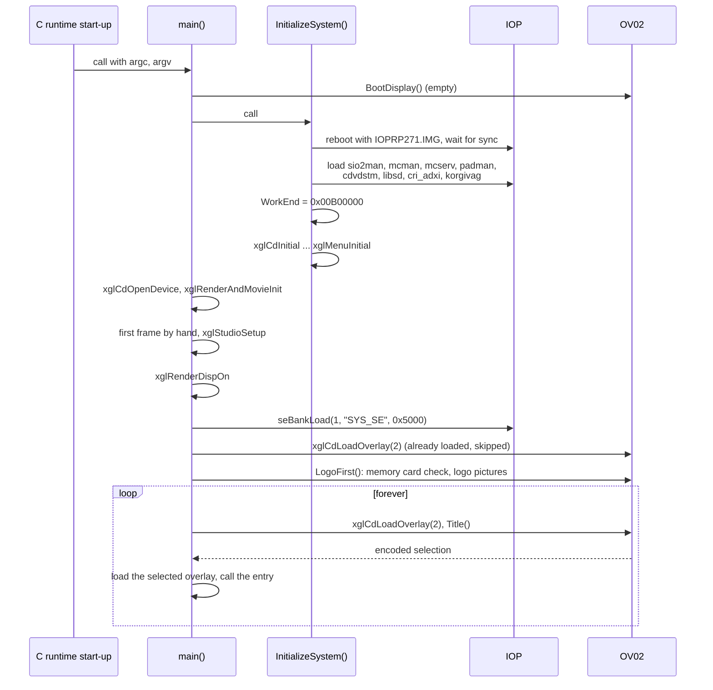

## 2. The two overlays and the two discs

The game has two overlays, `OV01.OVL` and `OV02.OVL`. Both are linked for the
same address, `0x00A80000`, so only one of them can be in memory at a time.
OV01 is the battle overlay. Its code and data take `0x6D088` bytes. OV02 is
the title overlay. It holds only the files of `src/ov02/` named above, and its
section is `0x3E28` bytes long.

`xglCdLoadOverlay(n)` in `src/main/xgl_cd.c` loads an overlay. It does
nothing when `n` equals the remembered number in `loaded_overlay`. Otherwise
it stores the new number, builds the name `cdrom0:\OVnn.OVL;1` with two
decimal digits, clears `CD_OVERLAY_SIZE` (`0x80000`) bytes at
`CD_OVERLAY_ADDRESS` (`0x00A80000`), flushes the caches, and calls
`sceSifLoadElf` until it succeeds. It flushes the caches once more so that the
new code is executed and not a stale copy.

OV02 is special because the main executable `SLUS_208.92` carries a copy of
it. The executable has a third loadable segment at `0x00A80000` whose bytes
are identical to the `ov02` section of the file `OV02.OVL`. The console's
loader therefore places the title overlay in the overlay slot together with
the main program. `xglCdInitial()` records this by setting `loaded_overlay` to
`OVERLAY_TITLE` (2) during start-up. The first two requests for overlay 2 in
`main()` are skipped, and the memory card check, the logos and the first title
screen appear without an overlay read. The disc copy is needed later, when
the title screen has to come back after a play session replaced it with OV01.

The slot ends where the work area starts. The layout below shows the area
around it.

```
0x00120000 +--------------------------------------+
           | main program code and data           |
0x009D5D70 +--------------------------------------+
           | (not assigned)                       |
0x00A80000 +--------------------------------------+  overlay slot
           | OV02 (0x3E28 bytes), resident at boot|
           | or OV01 (0x6D088 bytes)              |
0x00B00000 +--------------------------------------+  WorkEnd starts here
           | work area (bump allocated)           |
0x00C00000 +--------------------------------------+
           | packet buffers (0x400000 bytes)      |
0x01000000 +--------------------------------------+
           | resource area during a session,      |
           | picture buffers of the screens on    |
           | this page outside a session          |
0x02000000 +--------------------------------------+
```

The game ships on two discs. Disc 1 starts the executable `SLUS_208.92` and
disc 2 starts `SLUS_211.33`. The two executables are byte for byte the same
file, and the two overlays and the IOP directory are identical on both discs
as well. The program therefore cannot know from its own code which disc it
was started from. It asks the drive.

`xglCdDiskCheck()` in `src/main/xgl_cd.c` identifies the disc. It requires a
PlayStation 2 DVD, and it looks for two small archive header files:
`xenosaga.10` sets the flag `CD_DISC_FLAG_ARC10` (1) and `xenosaga.20` sets
`CD_DISC_FLAG_ARC20` (2). A disc with neither file is not accepted. It also
reads `system.cnf` and checks that the third letter of the executable name is
`U`, the mark of the North American release. The result is the flag word, so
a return value of 1 means disc 1 and 2 means disc 2. A return of 0 means no
disc, and the negative values mean an unsupported disc (-1), an open tray (-2)
and a drive that is not ready (-3). The archives and the file system behind
them are described in
[files-and-resources.md](../architecture/files-and-resources.md).

Three places on this page use the disc number: the title screen chooses its
logo picture by it, `GameSynopsis()` asks for the disc that fits the story
progress when a session starts, and the scene resource command `;disk` asks
for the other disc in the middle of the story (see
[section 10](#10-the-disc-change-screen)).

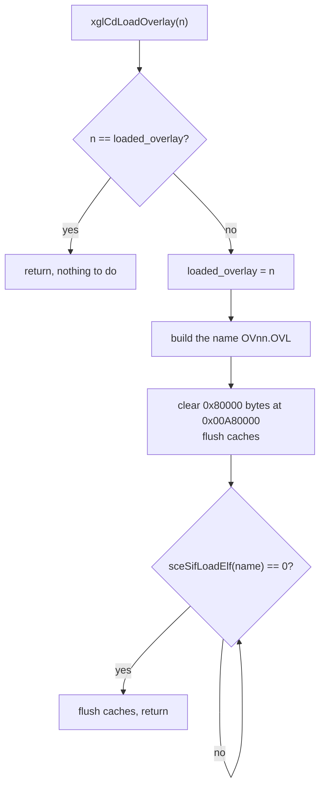

## 3. The title loop and the title return value

After `LogoFirst()`, `main()` repeats the same few steps forever:

1. Ask for OV02 with `xglCdLoadOverlay(OVERLAY_TITLE)`. This reads `OV02.OVL`
   only when OV01 is in the slot.
2. Call `Title()`. It returns an unsigned 32-bit selection.
3. If the selection is 0, start again at step 1. The title screen returns 0
   when the chosen action ends on the title screen again, such as a cancelled
   load.
4. Take the low 24 bits (`TITLE_ENTRY_MASK`) as a function address. If that
   address is `Title` itself, start again at step 1.
5. Otherwise load the overlay whose number is in the high 8 bits
   (`selection >> TITLE_OVERLAY_SHIFT`) and call the function. When it
   returns, start again at step 1.

The title return value packs two things into one word. The function address
fits in 24 bits because all code lies below `0x01000000`. The overlay number
takes the top byte.

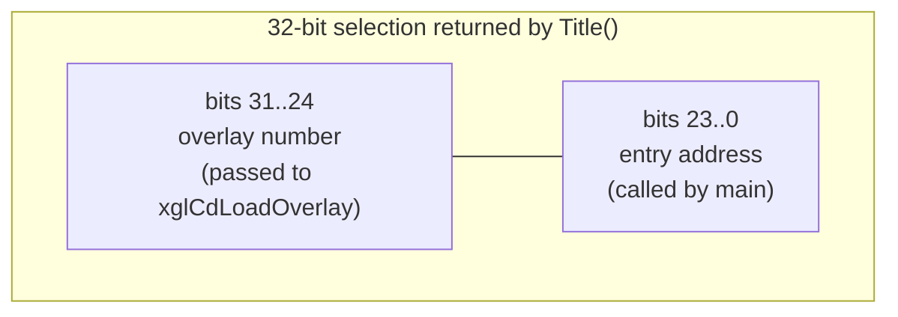

`Title()` builds these values with the two constants `ONE_OVERLAY`
(`0x01000000`) and `TWO_OVERLAY` (`0x02000000`) added to a function address.
The table lists every value that the code of `Title()` can produce.

| Value | Overlay | Entry | Meaning | Reachable from the menu |
| --- | --- | --- | --- | --- |
| `ONE_OVERLAY + Game` | 1 (OV01) | `Game` in `src/main/game_data.c` | Start or continue a play session | yes |
| `0` | none | none | Stay on the title screen | yes |
| `TWO_OVERLAY + logoShowSlides` | 2 (OV02) | `logoShowSlides` in `src/ov02/logo.c` | Show the logo pictures again | no |
| `titleGroupMinus2Dummy()` | none | none | A function that returns 0 | no |
| `-1` | none | none | Returned after the slow fade for menu slot 4 | no |

`Game()` is in the main executable, not in OV01, but it needs OV01 because
the battle code and the `SB` script machine must be resident during play (see
[field.md](field.md) and [sb-vm.md](../scripting/sb-vm.md)). When `Game()`
returns, after a game over, after the ending or after a soft reset, `main()`
loads OV02 again and the title screen reappears.

The last three rows belong to cursor positions and menu slots that the menu
logic of the shipped game never produces (see
[section 6](#6-the-title-screen)). The arm for cursor position -1 looks like
the remains of an idle timeout that replays the logos, but nothing in
`Title()` sets the cursor to -1.

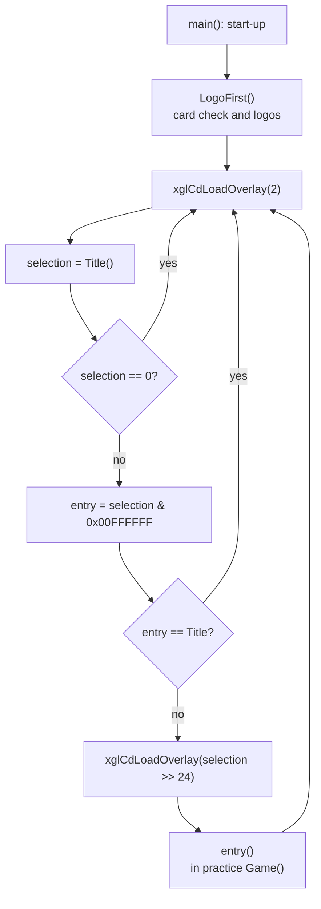

## 4. The memory card check

`LogoFirst()` in `src/ov02/logo.c` runs once per boot. It turns frame
clearing on with `xglRenderClearFrame()`, sets the clear colour to black with
`xglRenderClearColor(0x80000000)` and waits one frame. Then it calls
`hdd_check()`. In this release `hdd_check()` is a stub that returns 1, and a
return of 1 means "run the memory card check", so `mc_check()` always runs.
After the check `LogoFirst()` prints the one-byte font control string
`logoFontModeText` and calls `logoShowSlides()` for the logos.

`mc_check()` advances frames through `device_check_sync()`. That helper polls
the memory card module with `xglMcMain()`, runs one frame with `xglSleep()`
and prints the font control string `deviceCheckFontModeText`. It returns the
state of both card ports as one word. `mc_check()` reads the word through the
union `McSlotState` as two halfwords: `slot0` is MEMORY CARD slot 1 and
`slot1` is MEMORY CARD slot 2.

| Halfword value | Name | Meaning |
| --- | --- | --- |
| 1 | `LOGO_MC_STATUS_READY` | A formatted card is present |
| 2 | `LOGO_MC_STATUS_UNFORMATTED` | A card is present but not formatted |
| `0x80` | `LOGO_MC_STATUS_ERROR` | The port is not settled yet |
| `0xFF` | `LOGO_MC_STATUS_BUSY` | A request is running |
| other | | No usable card |

The check asks the card library two questions per port with `xglMcRequest`
(see [save-data.md](../architecture/save-data.md)). Request 1
(`LOGO_MC_REQUEST_FREE_SPACE`) returns the free space of the card in
kilobytes. Request 2 (`LOGO_MC_REQUEST_DIRECTORY`) with the file number -1
scans the game's save folder and returns how many saves the card already
holds. The source stores the first answer in an array named `free_kb` and
the second in an array named `save_count`. The comparison against 34 KB shows
which is which.

One pass of the check works as follows:

1. Eight frames pass so that the card state can settle
   (`LOGO_CARD_SETTLE_FRAMES`).
2. The four requests are sent, two per port.
3. `device_check_sync()` is called until neither port reports busy or error,
   and then eight more times.
4. If neither port holds a ready or unformatted card, the warning is
   `logoNoCardText`: "No memory card (8MB) (for PlayStation 2) in MEMORY CARD
   slot 1 and MEMORY CARD slot 2."
5. If either card is unformatted, there is no warning. An unformatted card
   can be formatted later by the save screen.
6. Otherwise a ready card is "full" when it holds no save of this game and
   has less than 34 KB free (`LOGO_SAVE_MIN_FREE_KB`). A card that already
   holds a save is never full, because the save can be overwritten. If the
   card in slot 1 is ready and not full, there is no warning. If slot 2 is
   ready and not full, there is no warning either. The remaining cases select
   `logoNoSpaceSlot1Text`, `logoNoSpaceSlot2Text` or `logoNoSpaceBothText`
   ("Insufficient space on memory card ...").
7. With no warning the check ends.

A warning is printed at (16, 64) and followed by two more texts:
`logoSaveSpaceHeaderText` ("Xenosaga Episode II requires 34KB of free space
to save data.") and the question `logoStartGamePromptText` ("Start game?"
with Circle for Yes and Cross for No). While the question is shown, the card
state is read every frame. The player has three ways out:

- Circle plays the confirm sound and ends the check. The game starts without
  a usable card.
- Cross plays the cancel sound and shows `logoInsertCardText` ("Please insert
  a memory card (8MB) (for PlayStation 2) with at least 34KB of free space
  into MEMORY CARD slot 1 or MEMORY CARD slot 2."). This text stays until the
  card state changes or Cross is pressed again. Then the whole pass is
  repeated from step 2.
- Any change of the card state, such as a card being inserted, repeats the
  pass from step 2 at once.

The texts of this check are English. They begin with font control codes that
select the font and colour, which are explained in
[fonts-and-text.md](../libraries/fonts-and-text.md).

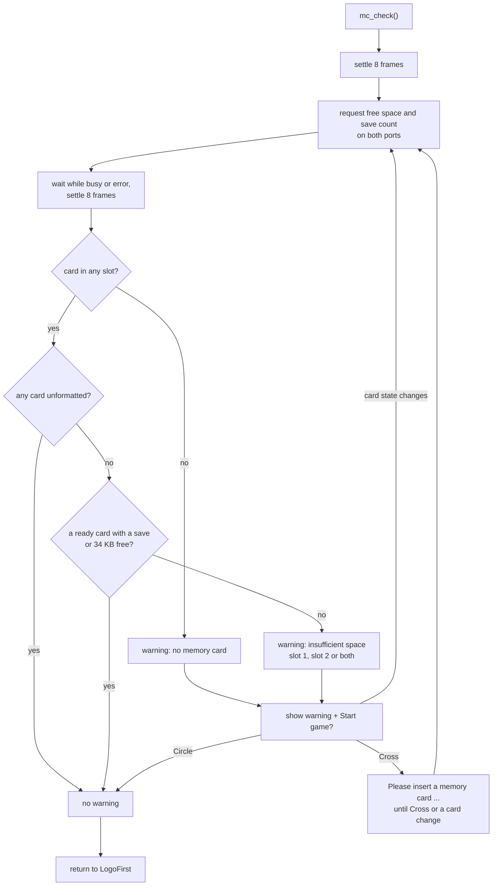

## 5. The logo pictures

`logoShowSlides()` shows a sequence of full-screen pictures, each of which
fades in from black, stays for a moment and fades out again. The source calls
the pictures "credit bands", and the file is `credit.bin`. At boot this is the
sequence of company and licence screens before the title. The file on the
discs holds six pictures, in this order: Namco, Monolith Soft, the CRI Sofdec
and ADX logos, KORG, Dolby Digital and Pro Logic II, and "Produced by NAMCO"
(see [Movies, images and icons](../formats/movies-images-and-icons.md)).

The file is read to `0x01000000` (`LOGO_CREDIT_FILE_BASE`) with a blocking
read. It is a small pack of JPEG pictures:

| Offset | Content |
| --- | --- |
| `0x00` | Size of the table in bytes. The number of pictures is this value divided by 4 |
| `0x04` ... | One 32-bit word per picture: the end of that picture, counted from the start of the picture data and not rounded. Picture k starts at the end of picture k - 1 rounded up to 64 bytes |
| after the table, rounded up to 64 bytes | The JPEG pictures, each starting on a 64-byte boundary |

The first word doubles as the offset of the first picture, which is 0, so the
function overwrites it with 0 after reading the size. It then decodes every
picture with `xglJpegDecode` (see
[save-data.md](../architecture/save-data.md) for the decoder). Picture `n` is
decoded to `0x01100000 + n * 0x100000` (`LOGO_CREDIT_BAND_BASE` and
`LOGO_CREDIT_BAND_STRIDE`), and the table entry is replaced by that address.
A decoded picture is 512 by 448 pixels with 4 bytes per pixel, which is
`0xE0000` bytes, so each picture fits in its 1 MiB slot.

Each picture then runs through a small state machine. `logoDrawFadedPicture()`
takes the picture and a brightness from 0 to 128. It sends the picture to the
frame buffer in two halves of `0x7000` quadwords and, when the brightness is
below 128, draws a black sprite over the whole screen whose alpha is 128 minus
the brightness.

| Phase | Frames | Brightness |
| --- | --- | --- |
| 1, fade in | 7 | 0, 16, 32 ... 96 |
| 2, hold | about 31 | 128 |
| 3, fade out | 7 | 112, 96 ... 16 |

After the last picture the function draws two frames with no picture and a
fully opaque black sprite, so that both display buffers end black.

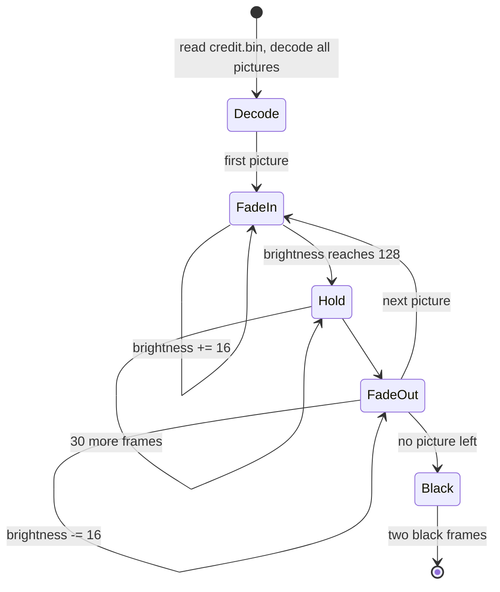

## 6. The title screen

`Title()` in `src/ov02/title.c` shows three layers. The bottom layer is a
real-time 3D demo scene with characters, a stage and a moving camera. Over it
lies the title picture with the game logo. On top are the menu entries. The
function loads its files, runs a frame loop until the player confirms an
entry, performs the chosen action and returns the selection for `main()`.

### State

All state of the screen is in two file-local blocks, `titleState` and
`titleTable`.

| Offset | Type | Name | Meaning |
| --- | --- | --- | --- |
| `0x00` | `u8 *` | `texture` | The title picture, a raw 512 by 448 image |
| `0x04` | `u8 *` | `object_buffer` | `titleobj.xtx`, the texture with the menu entries, at `0x01000000` |
| `0x08` | `int` | `selected_group` | Cursor position, 0 to 3 |
| `0x0C` | `int` | `hdd_stage` | State of the hard disk, -1 for none |
| `0x10` | `s16` | `fade_level` | Cross-fade from the previous screen, 128 down to 0 |
| `0x12` | `s16` | `scene_cover` | Black cover over the demo scene, 128 down to 0 |
| `0x14` | `s16` | `field_14` | Alpha of the title picture and the menu, 0 to 128 |
| `0x16` | `u8` | `timer` | Timer of the hidden viewer mode |
| `0x20` | `s8[4]` | `group_slot` | Menu entry shown at each cursor position, -1 for none |
| `0x30` | `Vector4` | `pan` | Camera rotation added by the left stick in viewer mode |

`titleTable` (`TitleTableState`) belongs to the demo scene:

| Offset | Type | Name | Meaning |
| --- | --- | --- | --- |
| `0x00` | `u8` | `table_ready` | Scene state, see the table in [The demo scene](#the-demo-scene) |
| `0x01` | `u8` | `list_index` | Number of the current cut, 0 to 12 |
| `0x03` | `u8` | `table_count` | Number of records of `titlebg2.bin` that are in memory, 255 for "all" |
| `0x04` | pointer | `table` | The record table of `titlebg2.bin` |
| `0x08` | `TiCameraRecord *` | `record` | Camera record of the current cut |
| `0x0C` | `short` | `frame` | Current frame of the cut |
| `0x0E` | `short` | `frame_end` | Frame at which the cut ends |
| `0x10` | `XglLightSet` | `lights` | The light set of the scene, `0x180` bytes |

### Loading

`Title()` starts by turning depth clearing on and saving the picture that is
on screen with `copyframe()`. That picture is what the title later fades away
from. It then waits until the memory card module reports a settled state on
both ports.

Next it finds out whether a save exists, because that decides where the
cursor starts. It sends request 2 (the save folder scan) to both card ports
and calls `xglHddMcExist` for the hard disk. If any of the three reports at
least one save, the cursor starts on the second entry, Load Game. Otherwise it
starts on the first entry, New Game.

It loads font 1 with `xglFontLoad(1, ...)`, and then it waits for a disc. The
loop calls `xglCdDiskCheck()` until the result is exactly 1 or 2. Disc 1
selects the title picture `yajima\title.bin` and disc 2 selects
`yajima\title2.bin`. The two files hold the same logo picture and differ only in the digit of a
small "DISC 1" or "DISC 2" label.

Three files are then read into upper memory, one behind the other, each
rounded up to a 64-byte boundary:

| File | Address | Read | Content as the code uses it |
| --- | --- | --- | --- |
| `yajima\titleobj.xtx` | `0x01000000` | queued | A texture transfer set handed to `xglPacketTextureTrans`. It holds the menu entries as strips of 120 by 18 texels, one below the other |
| `yajima\title.bin` or `yajima\title2.bin` | after it | queued | The title picture, sent as two halves of `0x7000` quadwords like a decoded JPEG, but stored raw |
| `yajima\titlebg2.bin` | after it | queued, with the callback `titleTableReadNotify` | The demo scene: models, textures, skeletons, motions and camera records |

`Title()` waits until the first two reads are finished. The third file is
large, and the screen does not wait for it. It is started just before the
frame loop and streams in while the title is already visible.

Before the loop the function also asks `xglHddMount()` for the state of the
hard disk and fills the menu (see [The menu](#the-menu)), stops sound slots 0
and 1, starts the music with `titleStartBgm()`, and sets
`xglRenderVSyncInterval` to 3. The interval is the number of vertical blanks
per frame. The rest of the game uses 2, so the title screen runs at two thirds
of the normal frame rate. The value is set back to 2 when the player confirms
an entry.

The memory used by the title screen looks like this:

```
0x01000000 +--------------------------------------+ titleState.object_buffer
           | titleobj.xtx (menu entry texture)    |
           +--------------------------------------+ titleState.texture
           | title.bin / title2.bin               |
           | raw 512 x 448 picture, 0xE0000 bytes |
           +--------------------------------------+ titleTable.table
           | titlebg2.bin                         |
           |   record table (offsets -> pointers) |
           |   records, arriving while the        |
           |   screen already runs                |
           +--------------------------------------+
```

### The music

`titleStartBgm()` plays the ADX stream `yajima\M-01.adx`. It looks the file
up with `xglCdGetFileData`, which gives the position of the file on the disc
and its size. It formats the two numbers as the key `"%08x.%08x"`, the first
sector and the length in sectors, sets the volume of sound slot 0 with
`soundSlotSetVolume(0, -1, 0)` and starts the stream with
`soundSlotStartFile(0, key)`. Sound slots and ADX playback are described in
[audio.md](../architecture/audio.md).

The same function is called again each time the demo scene starts over from
its first cut. The scene is cut to the music, so restarting both together
keeps them in step.

### The demo scene

`titlebg2.bin` begins with a table of 32-bit words. Word 0 is the size of the
table, and the further words are offsets of the records, measured from the
end of the table rounded up to 64 bytes. `titleTableReadNotify` is the
completion callback of the read. The disc service calls it with event 3 while
the read is in progress and passes the number of bytes that have arrived.

1. The callback ignores progress below 2048 bytes
   (`TITLE_TABLE_MIN_READ`), because the table itself must be complete first.
2. On the first later call it relocates the table: word 0 becomes the address
   of the record data and every other word has that address added. The marker
   for "not relocated yet" is the value 255 in `table_count`.
3. On every call it counts how many records lie completely inside the bytes
   read so far and stores the number in `table_count`.
4. When at least 13 records (`TITLE_TABLE_MIN_RECORDS`) are present, it sets
   `table_ready` to `TITLE_TABLE_READY`. Thirteen records are exactly what the
   first cut needs.
5. Event 4, the end of the read, sets `table_count` back to 255. From then on
   255 stands for "every record is present", since no cut needs that many.

The scene is a sequence of 13 cuts. Each cut is described by a byte list in
`titleTableLists` (`titleActorList00` to `titleActorList12`). A list has
three parts:

| Bytes | Meaning |
| --- | --- |
| 0 | `head`: table index of the first motion record of this cut |
| 1 | Number of records the cut needs. The cut can start only when `table_count` is at least this value |
| 2 ... `0xFF` | The actor keys of the cut, one byte each, ended by `0xFF` |
| pairs ... `0xFF` | One pair per actor to create: the actor key and a placement number. A key of `0xFF` ends the list and creates the stage |

An actor key is the table index of a group of three records: the model, the
texture and the skeleton, stored in the actor's resource slots
`XAct_Rsrc_MDL`, `XAct_Rsrc_TEX` and `XAct_Rsrc_XHR`. The key `0xFA` is an
alias for index 19 and lets the same model appear a second time with its own
motion. The position of the key among the actor keys of the list selects the
motion: actor number `pos` gets the two records at `head + 2 * pos` and
`head + 2 * pos + 1` (slots `XAct_Rsrc_3` and `XAct_Rsrc_SlotEntry`). The
camera record of the cut follows the motions, at
`head + 2 * (number of actor keys)`. The final actor, created for the `0xFF`
key, is the stage. It uses records 0 and 1 as model and texture and has no
skeleton and no motion.

The placement number selects one of the ten rows of `titleActorPlacements`, a
position and a rotation of three floats each. Row 0 is the origin. In cut 7
the actors with placement 6 or 7 are also given draw mode 1 with the
parameter 0.8.

`titleRunScene()` runs once per frame and steps the scene through
`table_ready`:

| Value | Name | What happens |
| --- | --- | --- |
| 0 | `TITLE_TABLE_IDLE` | Nothing is drawn. The file has not delivered 13 records yet |
| 1 | `TITLE_TABLE_READY` | Sets the cut number to 0 and falls into the next state |
| 2 | `TITLE_TABLE_BEGIN_LIST` | Builds the current cut and falls into the next state |
| 3 | `TITLE_TABLE_PLAYING` | Plays one frame of the cut |

Building a cut means the following. If the list pointer is null (the end of
`titleTableLists`) or the file has not delivered the records this cut needs,
the music is restarted and the sequence starts over at cut 0. The actor pool
is cleared with `XenoActorPoolInitDefault()`. The camera record is looked up
and its `frameStart` and `frameEnd` become the frame range of the cut. One
actor is allocated per pair with `XenoActorAlloc()`, filled as described
above, and started with `XenoActorAllocMatrices()` and `XenoActorSetMode(actor,
0)`. The actor system is described in [actors.md](../libraries/actors.md).
Then the light set is filled: seven light directions are made by rotating the
vector (0, 0, 1) by the angle pairs of `titleLightAngles`, and eight colour
rows are copied from `titleLightVectors`. The viewer pan is reset to zero.

Playing a frame means the following. The black cover `scene_cover` drops by 4
until it reaches 0, so the scene fades in from black over 32 frames after it
first appears. The lights are installed with `pxySetDefaultLight`, the fog
colour and distances with `nmlModelSetGlobalFogCol` and
`nmlModelSetGlobalFogDist`, and `pxyRequestOverlayPass()` is called. The
camera of the studio is posed from the camera record at the current frame with
`tiCameraReadRecord` and applied with `xglCameraMove`. `XenoActorDoit()` and
`XenoActorDisp()` animate and draw the actors. The frame counter advances, and
when it reaches `frame_end` the next cut is built on the following frame. The
animation and camera formats belong to
[animation.md](../libraries/animation.md).

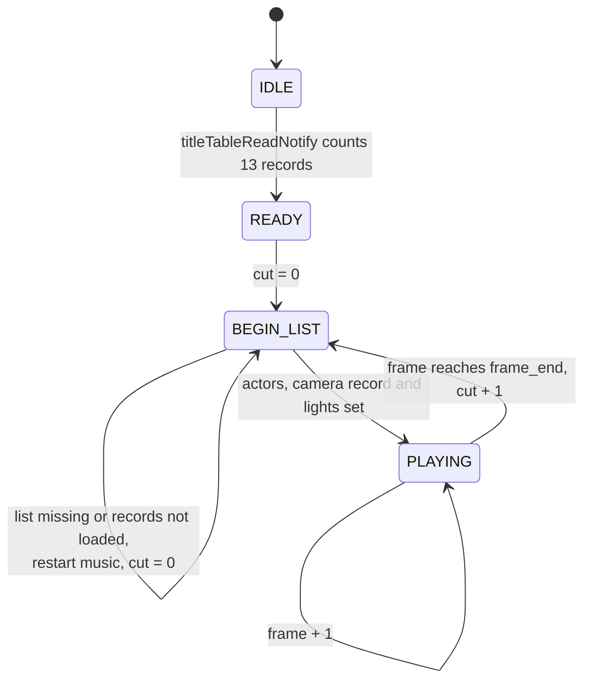

### The hidden viewer mode

`titleRunScene()` ends with a small state machine on `field_14`, the alpha of
the title picture and the menu. It lets the player remove the logo and the
menu and look at the demo scene alone.

While the menu is fully visible (`field_14` is 128), the function calls
`padRightStickRotate(12)` every frame. That helper in `src/main/get.c`
divides the circle into 12 sectors, follows the right analog stick from sector
to sector and counts completed turns in `padDebugCount`. It also prints the
current sector and the count as debug text. Each time the count rises, the
title screen starts a timer of 30 frames. When the count reaches 3 while the
timer runs, `field_14` drops to 0 and the timer is set to 64. If the timer
runs out first, the count is cleared. Three quick full turns of the right
stick therefore hide the title picture and the menu.

While they are hidden (`field_14` is 0), the menu ignores all input. The left
stick turns the camera: each frame its vertical value times 0.0003 is
subtracted from `pan.x` and its horizontal value times 0.0003 from `pan.y`,
and the pan is added to the camera rotation. Holding R3 keeps the timer at 64.
Once R3 is released the timer counts down, and at 0 the picture and the menu
fade back in by 2 per frame until `field_14` is 128 again. A new cut resets
the pan.

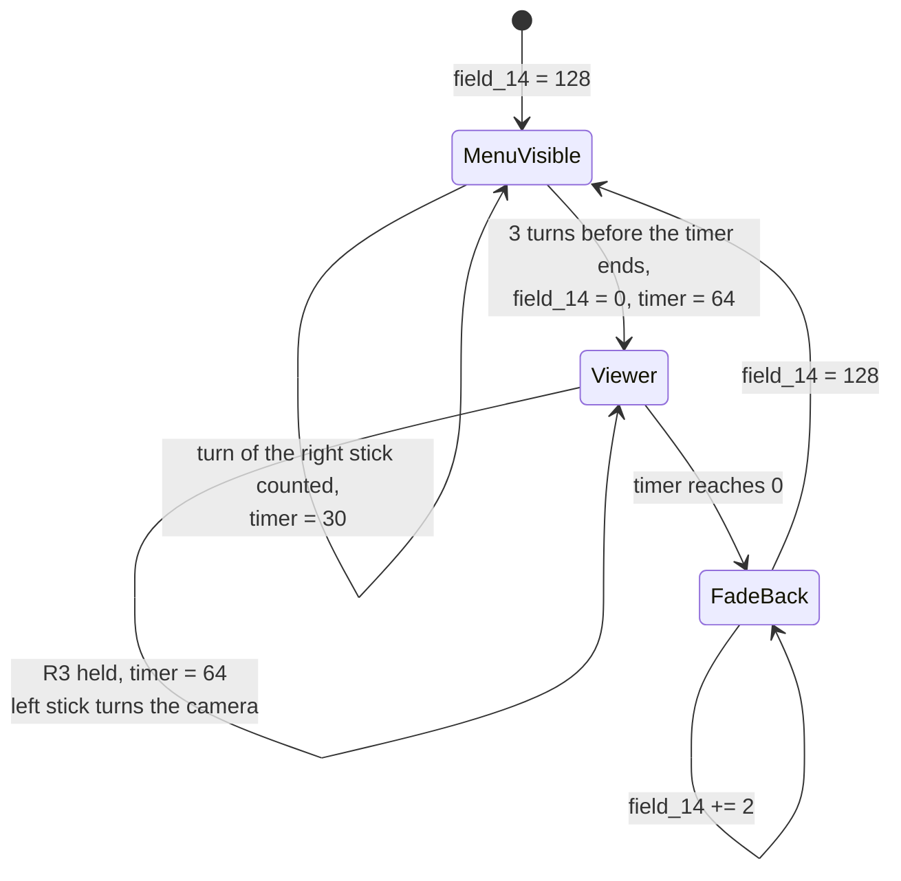

### The menu

The menu has four cursor positions. `group_slot[position]` says which entry
is shown at a position, and -1 means the position is empty. The entries are
identified by their row in the texture `titleobj.xtx`.

| Entry | Shown when | Action |
| --- | --- | --- |
| 0 | always, at position 0 | New Game |
| 1 | always, at position 1 | Load Game |
| 2 | at position 2 when a hard disk is present and the game is not installed | `TitleHddInstall(hdd_stage)` |
| 3 | at position 2 when the game is installed on the hard disk | `TitleHddInstall(1)`, the uninstall dialog |

`hdd_stage` is derived from the result of `xglHddMount()`:

| `xglHddMount()` | `hdd_stage` | Meaning |
| --- | --- | --- |
| 0 | 0 | Ready to install |
| 1 or -5 | 1 | Installed |
| -2 | 2 | The disk cannot be accessed |
| -3 | 3 | The disk is not formatted |
| -4 | 4 | Not enough free space |
| other | -1 | No hard disk |

In this release the hard disk probe in `src/main/xgl_hdd.c` always reports
"no hard disk" (see [save-data.md](../architecture/save-data.md)), so
`hdd_stage` is -1 and the menu has exactly two entries.

Input is read from pad 0. Up and Down in `directionRepeated` move the cursor
to the next non-empty position in that direction. The cursor does not wrap:
above position 0 it stays at 0, and below the last entry it stays where it
is. A move plays the cursor sound `0x1000001` and blocks the confirm buttons
for 4 frames (`TITLE_PREROLL_FRAMES`). The same 4-frame block applies when the
screen opens. Start or Circle confirms the entry under the cursor, but only
after the opening cross-fade has finished (`fade_level` is 0).

Confirming plays the accept sound `0x1000002`, sets the frame interval back
to 2, restarts the sound slots with `soundSlotsRestart()` (which ends the
title music), cancels the running read of `titlebg2.bin` with
`xglCdReadCancel(0)`, clears the actor pool, saves the frame with
`copyframe()` and leaves the loop.

### Drawing

Each frame the loop calls `titleRunScene()`, the empty hook
`titleFrameHookDummy()`, and registers `titleDrawFrame` as an external font
drawing function with `xglFontPrintExtFunc`. The callback runs when the font
layer is drawn, after the 3D scene, and adds five things to the packet in
this order:

1. The black cover over the demo scene, with the alpha `scene_cover`, while
   that value is above 0.
2. The title picture. It is uploaded in two halves of `0x7000` quadwords
   (`TITLE_TEXTURE_QWC`), and each half is drawn as a sprite over the upper
   and the lower 224 lines with the alpha `field_14`.
3. The menu texture, uploaded with `xglPacketTextureTrans` from
   `titleobj.xtx`.
4. One sprite per non-empty cursor position. The entry under the cursor is
   drawn at its full size of 120 by 18 pixels starting at x 196. The other
   entries are drawn smaller, 80 by 12 pixels starting at x 216 and 3 pixels
   lower, so both sizes are centred on x 256. The vertical position is spread
   over a band of 72 pixels below y 288: with `n` visible entries, entry `i`
   is at `288 + 72 / (n + 1) + i * (72 / n)`. With the two entries of the
   shipped game they are at y 312 and y 348.
5. The cross-fade from the previous screen. While `fade_level` is above 0,
   the frame saved by `copyframe()` is drawn over everything with that alpha.
   `fade_level` starts at 128 (`TITLE_FADE_MAX`) and drops by 4 per frame
   (`TITLE_FADE_STEP`), so the title replaces the previous picture over 32
   frames.

`copyframe()` builds its packet in the scratchpad at `0x70000000`. It is a
VIF1 direct packet with one GIF tag of eight register writes that performs two
local-to-local transfers of the whole 512 by 448 screen inside video memory.
The second transfer ends in the page `sRender.vram.work_buffer_base`, the page that
the cross-fade sprite uses as its texture. Video memory pages are described in
[rendering.md](../architecture/rendering.md).

`titleFadeTransition(mode)` is the fade used after an entry is confirmed. It
draws the saved frame as a sprite whose colour falls from 128 to 0. Mode 0
lowers all three colour values by 16 per frame, a fade to black in 8 frames.
Mode 1 lowers the level by 4 per frame and the colour channels at different
rates, a slower tinted fade that only the unreachable menu slot 4 uses. The
function ends with `copyframe()`, so the black result becomes the saved frame
for whatever screen follows.

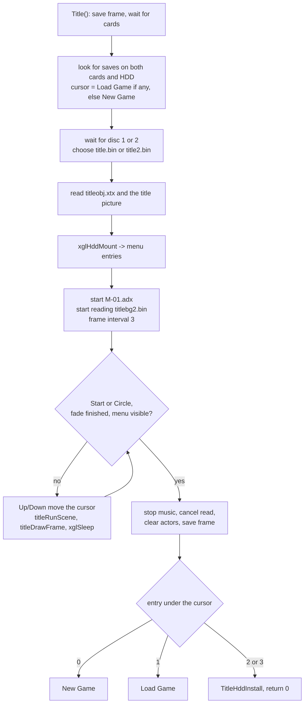

## 7. New Game and Load Game

Both entries start the same way. `TitleGameInit()` in
`src/ov02/title_game_init.c` wipes the state of the previous session:

1. `memset(&gameWork, 0, sizeof(gameWork))` clears the session work
   structure, including the `control` flags and the map numbers.
2. `xglFlagsInitial()` clears the script flags.
3. `menuSceneReset()` resets the main menu state and, through `ptReset`, the
   party.
4. `yg2PathResetAll()` clears the G.S. Campaign paths (see
   [gs-campaign.md](gs-campaign.md)).
5. `msgBalanceReset()` resets the money balance.

What each of these means for the saved data is explained in
[save-data.md](../architecture/save-data.md). After the reset both entries
fade to black with `titleFadeTransition(0)`.

### New Game

New Game calls `configScreenRun()` in `src/main/save_screen.c`. This is the
screen that offers to search the memory cards for data of the earlier games
and then shows the option list. When it returns, `Title()` checks the
`CONTROL_SOFT_RESET` bit (`0x10000000`) of `gameWork.control`. If the player
pressed the soft reset combination on that screen, `Title()` returns 0 and the
title screen starts again. Otherwise it sets `gameWork.nextMap` to 7001
(`0x1B59`, named `MAP_ID_NEW_GAME` in `src/main/game_disk_change.c`) and
`gameWork.loadStage` to 0 and returns `ONE_OVERLAY + Game`.

The search for older saves is the game's bonus for returning players. The
card library looks for the save folders of Xenosaga Episode I and Episode I
Reloaded. When a finished save is found, six characters receive extra skill
points according to values read from that save, two characters learn an extra
ether, and one extra item is added. The bonus is applied by `ptStateInit`
when the opening script initialises the party. The whole mechanism, with the
states of the configuration screen, is described in
[save-data.md](../architecture/save-data.md) under "Save data of the earlier
games".

### Load Game

Load Game calls `MenuFileMain(1)`, the save and load screen in load mode (see
[save-data.md](../architecture/save-data.md)). The screen returns 1 when a
save was loaded and 0 when the player cancelled. On 1, `Title()` sets
`gameWork.loadStage` to 1 and returns `ONE_OVERLAY + Game`. On 0 it returns 0
and the title screen starts again.

`gameWork.loadStage` is how `Game()` tells the two cases apart. With a value
of 0 it sets up a fresh party. With a nonzero value it copies the loaded save
image into the live game state with `saveReadImage()` and
`saveReadGameWork()`, which also sets `gameWork.nextMap` to the saved map.

### The unreachable arms

The `switch` at the end of `Title()` has more arms than the menu can reach.
The cursor `selected_group` only takes the values 0 to 3, and `group_slot`
only holds the entries 0 to 3. The code still handles these cases:

| Case | What the code does |
| --- | --- |
| Cursor -2 | Returns `titleGroupMinus2Dummy()`, which is 0 |
| Cursor -1 | Returns `TWO_OVERLAY + logoShowSlides` |
| Cursor 4 | Calls `menuRequestLoad()` and `TitleGameInit()`, sets `gameWork.nextMap` to 10 and `loadStage` to 0, and starts `Game()` |
| Entry 4 | Runs `titleFadeTransition(1)` and returns -1 |
| Entry 5 | Returns 0 |

The cursor 4 arm starts a session directly on map 10 with freshly loaded
default options. `GameSynopsis()` and `GameSynopsisCrossfadeWait()` both
test for `nextMap == 10` and skip their pictures in that case. Map 10 is
therefore very likely a developer start that bypasses the story. The test
programs that it leads to are the subject of [debug-tools.md](debug-tools.md).

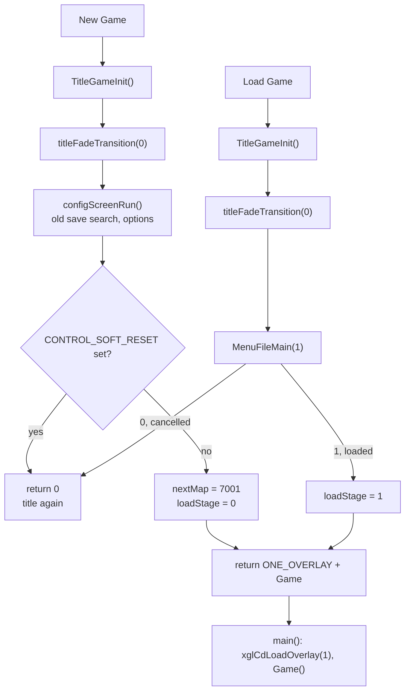

## 8. HDD install and uninstall

`src/ov02/title_hdd_install.c` holds the dialogs for copying the game to the
PlayStation 2 hard disk and for removing it again. The title menu only offers
them when `xglHddMount()` finds a hard disk, which the probe of this release
never does, so the player of the shipped game cannot reach these screens. The
code is complete, and its texts are Japanese (stored as EUC-JP), while the
texts of the memory card check are English. The copying itself is done by
`xglHddInstall` and `xglHddUninstall` in `src/main/xgl_hdd.c`, described in
[save-data.md](../architecture/save-data.md) under "The hard disk".

### The dispatcher

`TitleHddInstall(command)` is called by `Title()` with `hdd_stage` as the
command.

| Command | Name | Screen |
| --- | --- | --- |
| 0 | `HDD_SCREEN_INSTALL` | The install dialog |
| 1 | `HDD_SCREEN_UNINSTALL` | The uninstall dialog |
| 2 | `HDD_SCREEN_MESSAGE_FIRST` | "Cannot access the hard disk drive" |
| 3 | | "The hard disk drive is not formatted" |
| 4 | `HDD_SCREEN_MESSAGE_LAST` | "Not enough free space, at least 1792 MB are required" |
| 5 | `HDD_SCREEN_REACTIVATE` | "Cannot access the hard disk drive", uninstall variant |

The function first re-checks the disk. For the install command a failing
`xglHddCheck()` changes the command to 2. For the uninstall command a failing
`xglHddCheck2()` switches the installed copy off with `xglHddActivate(0)` and
changes the command to 5.

It then loads the background pictures. `data\yajima\hddi.bin` is read to
`WorkEnd`. The file has a header of `0x40` bytes (`HDD_ARCHIVE_HEADER_SIZE`)
that starts with a table of 32-bit offsets, followed by five JPEG pictures
(`HDD_PROGRESS_IMAGES`). The first picture is decoded into a transfer buffer
placed after the file, and `WorkEnd` is moved `0xE0000` bytes past that
buffer, the size of one decoded picture. The three values are kept in a local
`HddInstallParams` structure that `HddInstallParam` points to:

| Offset | Type | Name | Meaning |
| --- | --- | --- | --- |
| `0x00` | `u8 *` | `image_data` | The loaded `hddi.bin` |
| `0x04` | `u8` | `step` | Number of the picture that is currently decoded, 0 to 4 |
| `0x08` | `u8 *` | `transfer_buffer` | The decoded 512 by 448 picture |

`HddInstallSync()` is the frame function of all these dialogs. It sends the
decoded picture to the frame buffer in two halves of `0x7000` quadwords, runs
one frame with `xglSleep()` and prints the font control string
`installScreenFontText`. When the dialog is done, the function restores
`WorkEnd` to its value at entry, which frees the pictures. `Title()` then
returns 0 and the title screen starts again.

The message screens 2 to 4 print their message from `hddScreenMessages`
followed by "The installation is canceled" and wait for Circle. Screen 5
prints the access error with "The uninstallation is canceled", waits for
Circle and then calls `xglHddActivate(0x103)` and `xglHddCheck()`. All
dialogs ignore the pad for the first 4 frames (`HDD_INPUT_DELAY`).

### The install dialog

`TitleHddInstallSubInstall()` asks "Starting the Xenosaga installation. Is
this okay?". Cross cancels and returns. Circle runs `xglHddCheck()` and, when
that succeeds, `xglHddInstall(HddInstallCB, &installStatus)`. The result
decides what follows:

- A result of 1 means the player aborted the copy. The dialog returns.
- A result of 0 means success. The installed copy is switched on with
  `xglHddActivate(1)`. If the switch reads back as on, the dialog shows "The
  installation finished successfully" and waits for Circle.
- Any other outcome shows "The installation failed. Cancel the
  installation?". Circle returns to the title. Cross starts the whole dialog
  again.

`HddInstallCB(command, offset, param)` is called by the installer for every
step. `param` points to `installStatus`, which stays 0 while the copy runs.
The callback prints the Japanese notice "Installing. Do not turn off the
power of the PlayStation 2 console" and, as debug text at (84, 208), an
English name for the step.

| `command` | Debug text |
| --- | --- |
| 0 | `Install Start` |
| 1 | `Create Partition` |
| 2 | `Write Resource` |
| 3 | `Create Sub Partition %1d` with `offset` |
| 4 | `Format Partition` |
| 5 | `Mount Partition` |
| 6 with `offset` 0 | `Start Install` |
| 6 with `offset` not 0 | The progress display, see below |
| 7 | `CheckFile Create`, `Write`, `Close`, `Unmount` or `Mount` for `offset` 0 to 4 |
| 8 | `Install Complete` |
| -1 to -15 | `Error %2d/%8x` with the failure code, also written to the console with `printf` |

During the copy (command 6) `offset` carries two numbers: the low 16 bits are
the work done and the high 16 bits are the total. The callback draws a gauge
of 320 by 12 pixels at (168, 416) with `tyaDrawGauge`
(`src/main/tya_draw_gauge.c`), the hint "Cross
button: Abort", a spinner character that changes every 8 calls
(`hddSpinnerTable`), and the percentage `done * 100 / total`.
`tyaDrawGauge` is a small general gauge drawer. It takes a position, a size,
a current value and a maximum, computes the filled width as `current * width
/ maximum`, writes the corners of two sprites (the filled part and the rest)
into a prepared packet of nine quadwords and sends it. The install dialog is
its only real user. The percentage
also selects the background: for every full 20 percent
(`HDD_PROGRESS_PERCENT_PER_IMAGE`) the next of the five pictures of
`hddi.bin` is decoded into the transfer buffer, so the background changes four
times during the installation.

Pressing Cross during the copy opens a confirmation: "The installation is not
finished yet. Abort it?". Circle sets `installStatus` to 1 and returns 1,
which makes the installer stop. Cross continues the copy, unless
`xglHddCheck()` now fails. In that case the status becomes 2 and the copy
stops as well. Once the status is not 0, every further callback only draws a
frame and returns the status.

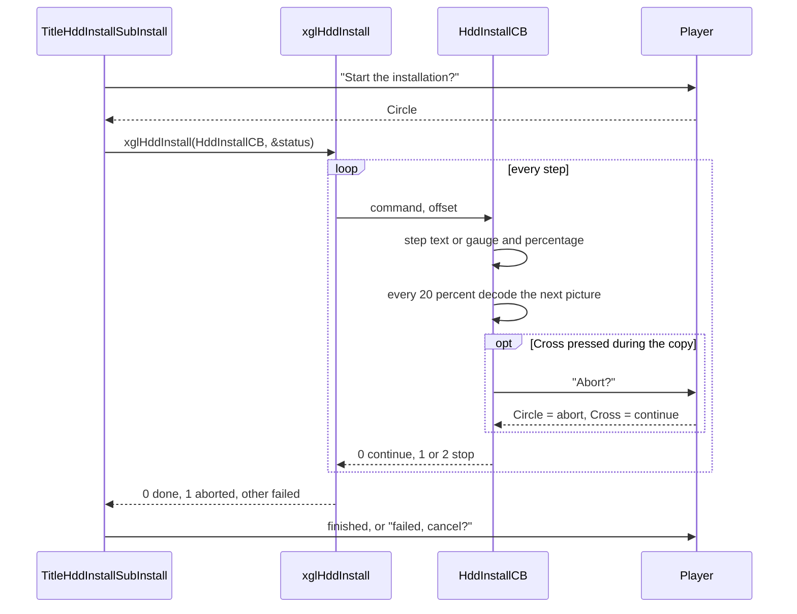

### The uninstall dialog

`TitleHddInstallSubUninstall()` has the same shape without a progress
callback. It asks "Starting the Xenosaga uninstallation. Is this okay?". After
Circle it runs `xglHddCheck2()` and then `xglHddUninstall()`. A result of 0
shows "The uninstallation finished successfully" and waits for Circle. Any
other result shows "The uninstallation failed. Cancel the uninstallation?",
where Circle runs `xglHddCheck()` and returns and Cross starts the dialog
again.

## 9. Starting a session: the synopsis

`Game()` in `src/main/game_data.c` is described in [field.md](field.md). Two
functions of `src/main/game_disk_change.c` frame its loading phase. They show
a story picture while the session loads and hold it until the player
confirms.

`GameSynopsis()` is the second call in `Game()`, right after the saved pad
options are applied. It returns at once when `gameWork.nextMap` is 10. Else it
works as follows:

1. It reads the story progress, the 8-bit script flag `0x191`
   (`STORY_PROGRESS_FLAG`). Below `0x4C` the story is on disc 1, and from
   `0x4C` on it is on disc 2. It calls `GameDiskChange(0x11)` or
   `GameDiskChange(0x12)`, which returns immediately when the right disc is in
   the drive and otherwise asks for it. A player who loads a late save while
   disc 1 is in the drive is asked for disc 2 here.
2. It saves the frame with `GameCopyFrame()` and reads `yajima\synopsis.bin`
   to `0x01E00000`. The file has the same table layout as `credit.bin`: the
   size of the table, then offsets relative to the aligned end of the table.
   The function turns the offsets into addresses.
3. The first two entries of that pack are the two panels. Each is a complete
   `XTX` texture file of 512 by 128 pixels with a header of `0x50` bytes, of
   which the code uploads the upper 512 by 64 pixels (`0x2000` quadwords). They are stored in `GameSynopsisPanels` as the `outgoing` and the
   `incoming` panel.
4. For a new game (`nextMap` is 7001) there is no background picture. The
   frame is cleared.
5. For a loaded game it chooses the picture of the current chapter, writes
   its two-digit number into the path `yajima\synopsis\00.jpg`, reads the
   JPEG to `0x01D00000` and decodes it to `0x01C00000`.
6. It draws two frames with the background and the outgoing panel at the
   bottom of the screen (x 0, y 384) at full alpha.

The picture number comes from a table of 21 progress thresholds: 9, 13, 21,
23, 30, 37, 43, 51, 59, 66, 68, 76, 78, 81, 88, 91, 96, 102, 112, 122 and
255. The number is one more than the count of thresholds that the progress
has reached. A progress below 9 gives picture 1, and a progress of 122 or
more gives picture 21. Two cases override the table: a progress of exactly
`0x87` gives picture 20, and the 1-bit flag `0x279` gives picture 22. The
story meaning of these two cases is not visible in the code.

A panel is described by `GameSynopsisPanel`:

| Offset | Type | Name | Meaning |
| --- | --- | --- | --- |
| `0x00` | `void *` | `image` | Raw 32-bit image data |
| `0x04` | `int` | `width` | Width in pixels |
| `0x08` | `int` | `height` | Height in pixels |
| `0x0C` | `int` | `qwc` | Size of the image in quadwords |

`GameSynopsisDrawPanel(panel, x, y, alpha)` in `src/main/game_over.c`
draws one. It does nothing for a missing image or an alpha of 0. Otherwise it
patches two packet templates: the first uploads the image as a texture of the
panel's size, and the second draws a sprite of that size at the position with
the given alpha.

`Game()` then loads everything a session needs. When that is done it calls
`GameSynopsisCrossfadeWait()`. For map 10 and for a new game the function
returns 0 at once. For a loaded game it plays the sound `0x1000006` and
cross-fades the panels: the alpha of the incoming panel rises by 4 per frame
to 128 while the outgoing one falls. The outgoing panel reads
"Loading..." and the incoming one shows the circle button with the word
"Start". The summary of the story itself is not text: it is painted into the
`synopsis\NN.jpg` pictures, full pages titled "The Story So Far...". The
function then waits:

- Circle plays the confirm sound, draws two frames of the background alone
  and returns 0. `Game()` goes on to its map loop.
- The soft reset combination (L1, L2, R1, R2 and Select held, Start pressed)
  sets `CONTROL_SOFT_RESET` in `gameWork.control` and returns 1. `Game()`
  returns immediately and the title screen comes back.

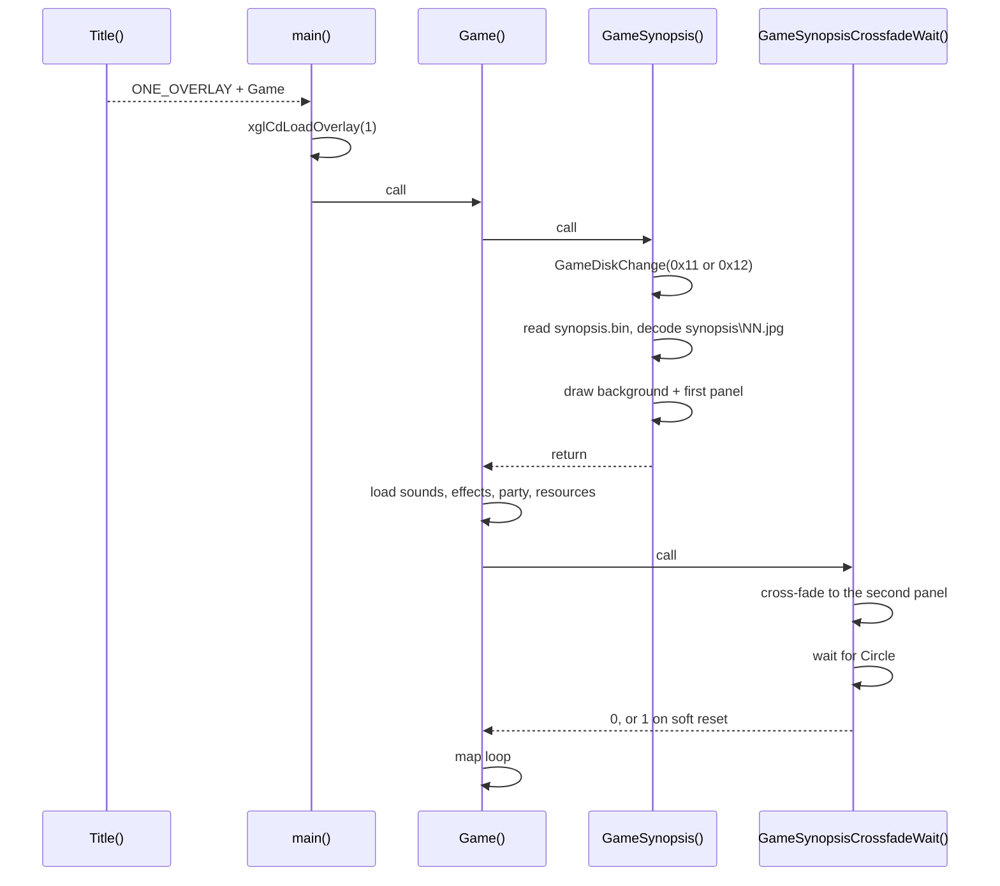

## 10. The disc change screen

`GameDiskChange(request)` asks the player for a disc. The low four bits of
`request` are the disc number, 1 or 2, and any other number makes the
function return -1. It writes the line `GameDiskChange:%d` to the console.
Bit `0x10` of the request selects the memory for the picture: the callers
inside a running session pass 1 or 2 and the picture goes into the largest
free block of the resource area (`GameResourceGetFreeAddr(0)`), while
`GameSynopsis()` passes `0x11` or `0x12` and the picture goes to the fixed
address `0x01000000`, because the resource area is not set up yet at that
point.

The function has two callers. `GameSynopsis()` was described above. The other
is the scene resource script: the command `;disk` followed by the digit 1 or
2 adds an event entry to the scene's resource list, and when the resources of
the scene are loaded, the entry calls `GameDiskChange` with that digit. Scene
resource scripts are described in [events.md](../scripting/events.md).

The function first turns the global fade off and calls `xglCdDiskCheck()`. An
open tray (-2) is checked a second time. If the result has the bit of the
requested disc, nothing is shown and the function returns 0 after restoring
the fade. Otherwise:

1. `yajima\diskchg.jpg` is read 1 MiB past the picture buffer
   (`IMAGE_LOAD_OFFSET`) with the mode `CD_READ_WHILE_BUSY` and decoded into
   the buffer.
2. `GameDiskSetDiscDigit` rewrites the three message texts for the requested
   disc. It replaces every character `1` or `2` in a text by the disc digit.
   The texts are stored for disc 2, for example "Please insert DISC 2 of
   Xenosaga Episode II."
3. A loop draws the picture with `DrawImage`, checks the disc and prints one
   message at (32, 64) each frame.

The message depends on what has happened so far:

| Situation | Text |
| --- | --- |
| The tray has not been opened yet | `gameDiskInsertText`: "Please insert DISC n of Xenosaga Episode II." |
| The drive is not ready, or the disc vanished between two checks | `gameDiskCheckingText`: "Checking disc..." |
| The tray is open | `gameDiskInsertText` |
| The disc is not a supported disc | `gameDiskIncorrectText`: "Incorrect disc. Please insert DISC n ..." |
| There is no disc | `gameDiskMissingText`: "There is no disc inserted. Please insert DISC n ..." |
| The right disc was seen once | `gameDiskCheckingText` |
| The other disc of the game is in the drive | `gameDiskIncorrectText` |

The right disc must be identified on two frames in a row. On the first of
them the function calls `xglCdArcCheck()`, which reads the archive headers of
the new disc again so that file lookups use the new disc's contents. On the
second the loop ends. The function restores the global fade, waits two frames
and returns 0.

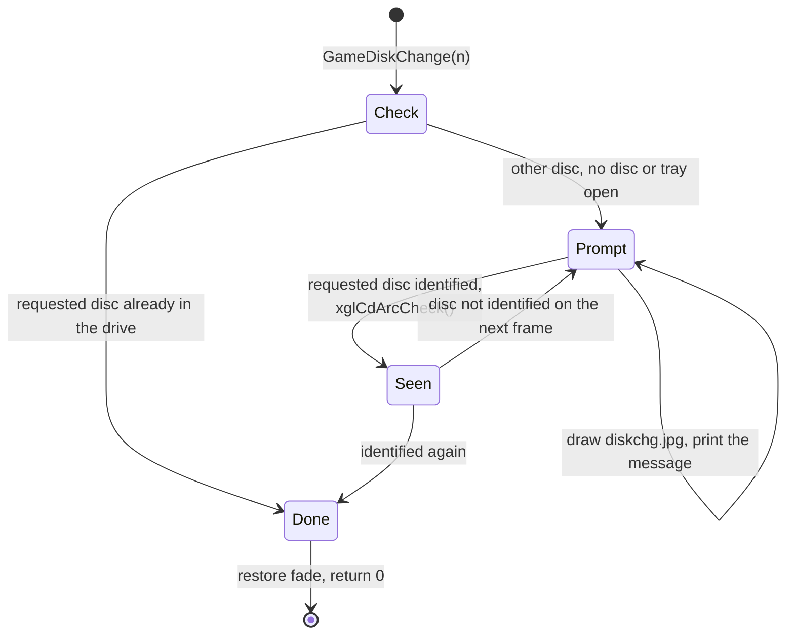

## 11. The intermission

`Intermission(chapter)` is the save offer between two parts of the story. It
is started by the scene resource command `;save` followed by a number. The
command adds an event entry to the resource list, and loading the resources
of the scene calls `Intermission` with that number (see
[events.md](../scripting/events.md)).

The function does nothing when `gameWork.loadStage` is 1. That is the state
right after a save was loaded, and it prevents the offer from appearing again
when the player loads the save that was made at this very intermission.

Otherwise it sets `gameWork.resourceId` to `chapter + 1`, saves the frame
with `GameCopyFrame()` and reads `yajima\im.bin` 1 MiB past the start of the
largest free resource block. The file is a JPEG pack with the same table
layout as `credit.bin`. Entry `chapter` of the table is decoded to the start
of the block.

The picture fades in over 64 frames: `DrawImage` draws it and
`DrawBack(alpha)` draws the saved previous frame over it with an alpha that
falls from 128 by 2 per frame. After 5 more frames the question
`intermissionSaveQuestion` ("Save game data?", Circle for Yes, Cross for No)
is printed at (32, 32) over the picture.

- Circle plays the confirm sound, copies `gameWork.nextMap` to
  `gameWork.mapId` and calls `GameSceneReset(framebuffer)`. The map number is
  changed first so that the save records the map that comes next, and loading
  it continues after the intermission.
- Cross plays the cancel sound and asks `intermissionNoSaveQuestion`
  ("Continuing without saving. Is this okay?"). Circle confirms and the
  function continues without a save. Cross returns to the first question.

`GameSceneReset(framebuffer)` prepares the save screen and runs it. It sets
the state of the main camera to 1, turns depth clearing on, resets the fades,
clears the actor pool and the map unit records, redraws the picture on both
display buffers with `redraw_frame()` and calls `MenuFileMain(0)`, the save
screen in save mode. The function ends with `GameCopyFrame()` and one frame.

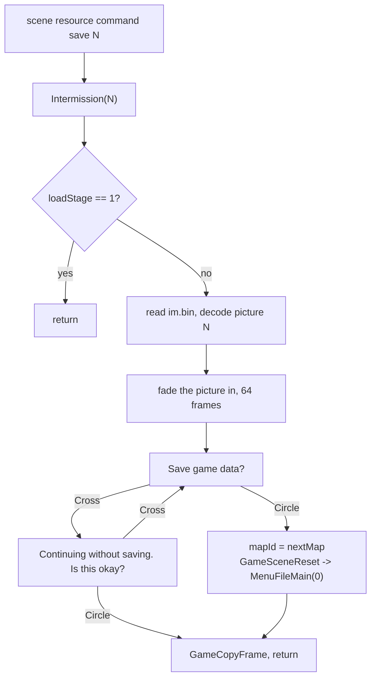

## 12. Game over and the ending

A session ends through bits of `gameWork.control`. The script native `System`
with the argument 0 sets bit `0x08000000`. The frame loop of `Game()` sees
the bit after the scripts have run and leaves the map loop, just as it does
for `CONTROL_SOFT_RESET`. After its clean-up `Game()` calls `GameOver()` when
bit `0x08000000` is set. `GameOver()` itself returns at once when a soft
reset is pending.

The same bit serves two purposes. `GameOver()` looks at the current map: when
`gameWork.mapId` is 7057 (`0x1B91`, `MAP_ID_GAME_END`), the session ended
because the story is over, and `GameEnd()` runs. On any other map the party
was defeated and the game over picture is shown.

### Game over

1. Depth clearing is turned on and the frame is saved with `GameCopyFrame()`.
2. The music `203_game_over` starts with `seBgmPlay(1, "203_game_over",
   0x19000)`.
3. `yajima\gameov1.jpg` is read to `0x010E0000` and decoded to `0x01000000`.
4. The picture fades in over 64 frames, with the saved frame on top at a
   falling alpha.
5. The picture stays. After 121 further frames the function starts to accept
   Circle or Start.
6. The music is faded with `seVolumeSet(0, 2)` and the picture fades to black:
   a black sprite is drawn over it whose alpha rises from 4 to 255 in steps of
   4.
7. The music is stopped with `seBgmPlay(1, 0, 0x19000)`, the black frame is
   saved with `GameCopyFrame()`, and two frames pass.

`GameOver()` returns to `Game()`, `Game()` returns to `main()`, and the title
screen appears. The saved black frame is what the title cross-fades from.

### The ending

`GameEnd()` shows the last picture of the game and offers to save the clear
data. It sets `gameWork.resourceId` to 10, saves the frame, reads
`yajima\end.jpg` to `0x010E0000` and decodes it to `0x01000000`. The picture
fades in over 64 frames and is held for 120 more.

Then the question `GameEndSaveQuestion` ("Save Xenosaga Episode II clear
data?") is printed at (32, 32).

- Circle calls `GameSceneReset(framebuffer)`, which opens the save screen.
  The save is made on map 7057. Loading such a save later is a special case:
  the game resumes on map 2540 with a fixed story progress, as described in
  [save-data.md](../architecture/save-data.md) under "Loading into the game".
- Cross asks `GameEndQuestion` ("Ending without saving. Is this okay?").
  Circle confirms and the picture fades to black with the same rising black
  sprite as the game over screen. Cross returns to the first question.

Both paths end with `GameCopyFrame()` and return to the title screen through
`Game()` and `main()`.

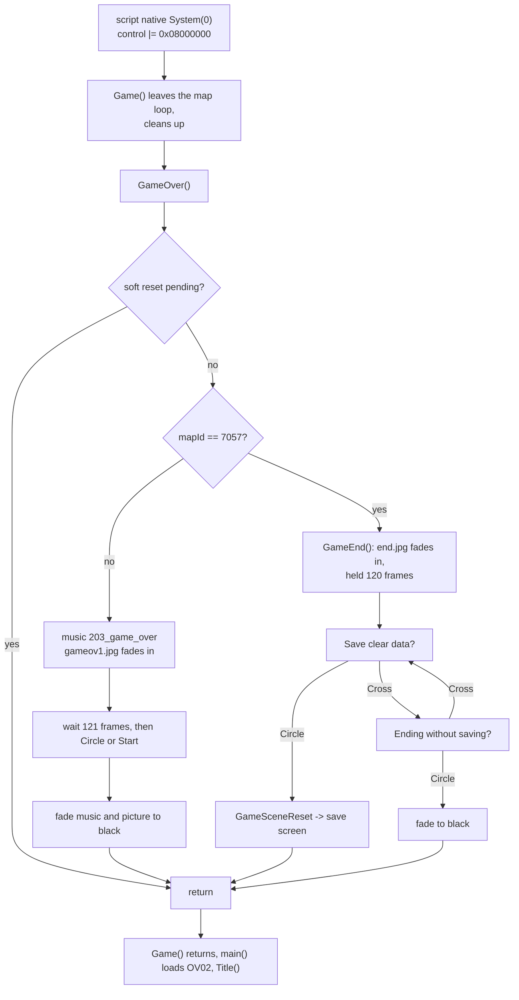

## 13. Drawing a decoded picture

The screens of sections 9 to 12 share the helpers at the top of
`src/main/game_over.c`.

`DrawImage(framebuffer)` sends a decoded picture to the display. It does
nothing for a null pointer. The picture is a raw image of 512 by 448 pixels
with 4 bytes per pixel, `0xE0000` bytes. The function patches the destination
page of a packet template with `sRender.display_buffer_base` and adds five
pieces to the current packet: the transfer set-up (`TestEnv_0_002BCD00`: a
transfer to a buffer 512 pixels wide with a size of 512 by 448), then twice an
image header for `0x7000` quadwords (`TransEnv_1_002BCD60`) followed by a
reference to one half of the picture, and a texture flush
(`FlushEnv_2_002BCD80`). The picture data is not copied. The packet refers to
it in place, which is why the buffer must stay untouched until the frame has
been sent.

`DrawBack(alpha)` draws the frame that `GameCopyFrame()` saved as a
full-screen sprite with the given alpha. Drawn after `DrawImage` with a
falling alpha, it gives a cross-fade from the previous screen to the new
picture.

`GameCopyFrame()` is the main program's version of the title screen's
`copyframe()`. It builds a `GameCopyFramePacket` in the scratchpad at
`0x70000000` and sends it through VIF1.

| Offset | Field | Content |
| --- | --- | --- |
| `0x00` | `header_padding` | 0 |
| `0x08` | `vif_direct` | `0x51000009`, a DIRECT code for 9 quadwords |
| `0x10` | `gif_tag`, `gif_registers` | 8 register writes in address and data form |
| `0x20` | `bitbltbuf` | Source and destination page of the first copy |
| `0x30` | `trxpos` | 0 |
| `0x40` | `trxreg` | 512 by 448 |
| `0x50` | `trxdir` | 2, local to local |
| `0x60` | `texflush` | 0 |
| `0x70` | `second_bitbltbuf` | Source and destination page of the second copy, ending in `sRender.vram.work_buffer_base` |
| `0x80` | `second_trxdir` | 2 |
| `0x90` | `second_texflush` | 0 |

`redraw_frame(framebuffer)` draws the picture on two successive frames so
that both display buffers show it. The fade to black of `GameEnd()` and
`GameOver()` uses a black sprite template (`TestEnv_4_002BCF70` and
`TestEnv_5_002BCFD0`) whose ALPHA register is rewritten with the current
level every frame.

The buffers used by the picture screens are summarised below.

| Screen | Compressed file read to | Decoded picture at |
| --- | --- | --- |
| Logo pictures | `0x01000000` (the whole pack) | `0x01100000 + n * 0x100000` |
| Title picture | stored raw | after `titleobj.xtx` at `0x01000000` |
| HDD dialogs | `WorkEnd` (the whole pack) | after the pack, 64-byte aligned |
| Synopsis | `0x01D00000`, panels at `0x01E00000` | `0x01C00000` |
| Disc change from `GameSynopsis()` | `0x01100000` | `0x01000000` |
| Disc change from a scene | free block + `0x100000` | start of the largest free resource block |
| Intermission | free block + `0x100000` (the whole pack) | start of the largest free resource block |
| Game over, ending | `0x010E0000` | `0x01000000` |
| Display position | buffer + `0xE0000` | the caller's buffer |

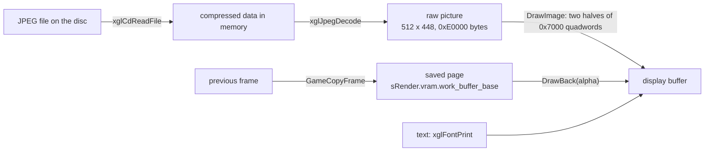

## 14. The display position screen

`tyaDisplaySetting()` in `src/main/tya_display_setting.c` lets the player shift the
picture on the television. The shift is stored in the save data as
`SaveData.displayOffsetX` and `SaveData.displayOffsetY`, and it is applied by
changing the display position registers that the render module keeps in
`DispEnv`.

The single argument is either a mode or a buffer:

| Argument | Name | Effect |
| --- | --- | --- |
| 0 | `TYA_DISPLAY_APPLY` | Sets the display position from the saved offset and returns |
| 1 | `TYA_DISPLAY_RESET` | Clears the saved offset, restores the base position and returns |
| a buffer address | | Runs the interactive screen. The buffer must have room for the decoded picture and the JPEG file `0xE0000` bytes behind it |

The arithmetic is the same everywhere: the horizontal display position is the
base value plus 5 times the horizontal offset, and the vertical position is
the base value plus the vertical offset. The base values are kept at offset
`0x50` of `DispEnv`. `tyaSetDisplayOffset(horizontal, vertical)` performs just
this calculation. It is called when saved options are applied, by
`padApplySaveSettings()` at the start of `Game()`, by `ptReset` and by the
"default settings" row of the configuration page.

The interactive screen is opened from the configuration page of the main
menu (`src/main/menu_scene.c`, see [main-menu.md](main-menu.md)), which
reserves 1 MiB of the CD buffer for it. It waits for pending disc reads, loads
`yajima\mnt_set.jpg`, a test picture, and decodes it. Then it loops:

- Left and Right change the horizontal offset by 1, Up and Down the vertical
  offset. Both are limited to the range -20 to 20
  (`TYA_DISPLAY_OFFSET_LIMIT`). A change made with the direction buttons plays
  the cursor sound.
- Square sets both offsets to 0 and plays a sound.
- Circle keeps the new values, plays the confirm sound and leaves.
- Cross restores the values the screen was opened with, plays the cancel
  sound and leaves.
- The soft reset combination restores the old values as well, sets
  `CONTROL_SOFT_RESET` and leaves.

Every frame the new offset is written to `SaveData` and to `DispEnv`, so the
picture moves while the player adjusts it. The loop also prints the two
register values and the two offsets as debug text and draws the test picture
with `DrawImage_001EE618`, the file's own copy of `DrawImage`.

`saveDataSetDefaults()` in `src/main/save_party_init.c` calls
`tyaDisplaySetting(TYA_DISPLAY_RESET)` as part of the default options.

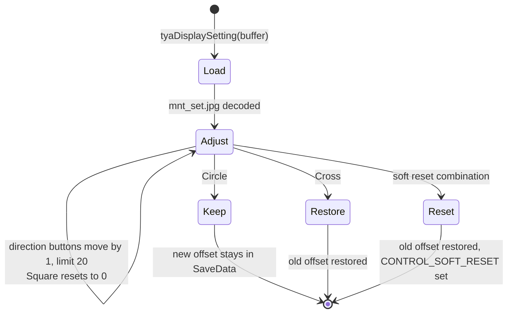

## 15. The soft reset

Several screens on this page react to the soft reset combination: L1, L2, R1,
R2 and Select held while Start is pressed (`PAD_SOFT_RESET` in
`include/main/pad_buttons.h`). There is no jump to the start of the program.
The combination only sets the bit `CONTROL_SOFT_RESET` (`0x10000000`) in
`gameWork.control`, and every loop on the way out tests the bit and returns.

| Where it is detected | What follows |
| --- | --- |
| `configScreenRun()` after New Game | `Title()` returns 0 and no session starts |
| `GameSynopsisCrossfadeWait()` | Returns 1, and `Game()` returns before its map loop |
| The frame loop of `Game()` | The map loop ends and `Game()` returns without `GameOver()` showing a picture |
| `tyaDisplaySetting()` | The old display offset is restored and the screen closes |

In every case control arrives back in the loop of `main()`, which loads OV02
and calls `Title()`. `TitleGameInit()` clears `gameWork`, and with it the bit,
before the next session starts.

## Other contents of the owned files

`src/main/yajima_test.c` and `src/main/game_over_095.c` hold several
functions that belong to other subjects.

`tyaRunDisplaySetting()` calls `tyaDrawGauge(NULL)`, resets the elevator
records with `elvReset()` and runs the display position screen with the
buffer `0x01000000`. No function of the game calls it. It looks like a
stand-alone test entry to the screen.

`YajimaTest()` in the same file is a developer menu titled `SELECT` with ten
rows that start test programs (font, pad, hard disk, memory card, resources,
movie, sound and others) and a clock line. It is described in
[debug-tools.md](debug-tools.md). The four functions `bgmSlotLevelSet`,
`actionSoundSlotLevelSet`, `streamKeySlotLevelSet` and `streamSetLevel` set
the volume of a sound slot to `0x5A` or `0x7A` and belong to
[audio.md](../architecture/audio.md).

`src/main/game_over_095.c` contains a third copy of the picture code.
`gameOverLoadFile(path, buffer)` reads a JPEG file `0xE0000` bytes past a
destination (the given buffer, or `WorkEnd` when the buffer is null), decodes
it to the destination and returns that address. `DrawImage_0020CAB0` is
identical to `DrawImage`. `gameOverDrawSprite(x0, y0, x1, y1)` queues a
translucent green rectangle between two corners. No caller of these three
functions was found in the game code. Two functions of the file are used
elsewhere: `screenFadeQuadDraw(fade_value)` draws a full-screen black quad
whose alpha is the low byte of the argument, and the main menu calls it with
`0x40` to dim the screen behind the tutorial panel. `bgLayerReady(index)`
reports whether a background layer of the menu has finished loading (see
[screen-effects.md](../libraries/screen-effects.md)).

## Data files

| File | Used by | Content as the code reads it |
| --- | --- | --- |
| `cdrom0:\IOP\IOPRP271.IMG` | `InitializeSystem` | Replacement IOP module image |
| `cdrom0:\IOP\*.IRX` | `InitializeSystem` | The eight IOP modules |
| `cdrom0:\OV01.OVL`, `OV02.OVL` | `xglCdLoadOverlay` | The two overlays |
| `sound\vsf\SYS_SE.vsf` and `.prj` | `main` | System sound bank |
| `credit.bin` | `logoShowSlides` | Pack of full-screen JPEG pictures |
| `yajima\titleobj.xtx` | `Title` | Texture with the menu entries |
| `yajima\title.bin` | `Title` on disc 1 | Raw title picture |
| `yajima\title2.bin` | `Title` on disc 2 | Raw title picture |
| `yajima\titlebg2.bin` | `Title` | Record pack of the demo scene |
| `yajima\M-01.adx` | `titleStartBgm` | Title music |
| `data\yajima\hddi.bin` | `TitleHddInstall` | Pack of five JPEG backgrounds |
| `yajima\synopsis.bin` | `GameSynopsis` | Pack with the two raw panels |
| `yajima\synopsis\NN.jpg` | `GameSynopsis` | Chapter pictures 01 to 22 |
| `yajima\diskchg.jpg` | `GameDiskChange` | Background of the disc request |
| `yajima\im.bin` | `Intermission` | Pack of JPEG pictures, one per intermission |
| `yajima\gameov1.jpg` | `GameOver` | Game over picture |
| `yajima\end.jpg` | `GameEnd` | Ending picture |
| `yajima\mnt_set.jpg` | `tyaDisplaySetting` | Test picture of the display position screen |

The packs `credit.bin`, `synopsis.bin`, `im.bin` and `titlebg2.bin` all use
the same header: a first word with the size of the offset table, further
words with offsets relative to the end of the table rounded up to 64 bytes.
The code turns the table into pointers in place after reading the file.
`hddi.bin` differs: its table sits in a fixed header of `0x40` bytes and its
offsets count from the end of that header. That file is named by the hard
disk install code only and is not on the discs.
