# Actors

A `XenoActor` is the engine's record for one animated 3D object. The player
character on the field, the weapon or cockpit part attached to the player,
field enemies and people, the characters of a cutscene, the units of a battle
and their weapons, the citizens of the G.S. Campaign screen, the moving
background of the main menu and the models of the title screen are all
actors. One record joins a transform (position, rotation, scale), a set of
loaded files (model, texture, hierarchy, motion), two animation clocks, the
joint matrices of the current frame, a light set, a collision probe and the
switches that decide how the model is drawn.

All actors live in one pool of 48 records. The `XenoActor*` functions of
`src/main/xenoActor.c` manage that pool. They hand out and take back records,
allocate the joint matrix buffers, choose motions, link actors into parent and
child trees, and run two passes every frame: `XenoActorDoit` animates every
actor and `XenoActorDisp` draws every actor. The record does not solve the
skeleton or build the draw packets itself. The skeleton and motion code is the
`Ti` library, explained on the [animation page](animation.md), and the model
is drawn by the model library, explained on the [pxy page](pxy.md).

[← Back to the overview](../README.md)

## Files

| File | Contents |
| --- | --- |
| `include/main/xenoActor.h` | The `XenoActor` record, its helper structures (`XenoMatrix`, `XenoJointRecord`, `XenoMotionState`, `XenoLight`, `XenoHrc`, `XenoTransform`), the resource index `enum XActRsrc` and the prototypes of the library |
| `src/main/xenoActor.c` | The pool and its heap, `XenoActorInit`, `XenoActorAlloc`, `XenoActorRelease`, matrix allocation, parent and child links, motion channels and modes, the per-frame update (`XenoActorDoit`, `XenoActorUpdateTree`) and the draw (`XenoActorDisp`, `XenoActorDrawMotion`), part visibility, the clip sweep and the camera fade |
| `src/main/xeno_actor_set.c`, `include/main/xeno_actor_set.h` | Four small setters and getters: `cfeDampDirOffset`, `XenoActorGetHrcPoint`, `XenoActorSetChannelFlag80`, `XenoActorSetState`, and the table `cfeDirOffsetTable` |
| `src/main/act_3.c`, `include/main/act_3.h` | Ground shadows drawn after the models: the circle shadow, the "Zelda" shadow, the drop circle and the drop shadow, with `ACT_DrawShadowBegin`, `ACT_DrawShadow` and `ACT_DrawShadowEnd` |
| `src/main/xgl_vector_ops.c` | `tiMRPackageFillNodes` (prepares the dynamics bodies of an actor), `XenoActorConvertSourceRecord`, and a group of VU0 vector helpers used by the update |
| `src/main/bg_layer.c`, `include/main/bg_layer.h` | The three background layers of the menu screens, each an actor. The fade and camera side of these layers is on the [screen effects page](screen-effects.md) |
| `src/main/glow.c`, `include/main/glow.h` | A developer test scene that builds two actors by hand from files. It is the shortest complete example of the actor API |
| `include/main/pxy_shadow.h` | The shadow projector record of the model library, listed here because the actor's shadow modes select it. It is explained on the [pxy page](pxy.md) |

## What an actor is

The engine has one pipeline for everything that moves with a skeleton. A
model file holds the mesh, a texture file its images, a hierarchy file the
tree of joints, and a motion file the animation curves. An actor is the object
that owns one such set and the state needed to play it: where it stands, which
motion it plays and at which frame, the matrices produced this frame, how it
is lit and how it is drawn. A model without a hierarchy is also a valid actor.
It is then a rigid object that is only placed and drawn.

The actor library knows nothing about the game rules. It does not know what a
player, an enemy or a battle unit is. Each game system keeps its own record
with the rules it needs and stores a pointer to the actor that shows it. The
field keeps `uwamonoRecords[]` entries, the battle keeps `BattleUnit` objects,
the cutscene player keeps `cfeActors[]`. Those owners move the actor by
writing `position` and `rotation`, choose its motion with `XenoActorSetMode`,
and leave the animation and the drawing to the two frame passes.

The table below lists the kinds of actors the game creates. Each row is
explained in [Who creates actors](#who-creates-actors).

| Kind of actor | Created by | Owner record |
| --- | --- | --- |
| Player character on the field | `uwamonoChangePlayerModel` → `uwamonoCreateRecord` (`src/main/game_camera.c`, `src/main/uwamono_objx.c`) | `uwamonoRecords[]`, kind 4 |
| Parts attached to the player | `uwamonoChangePlayerModel`, attached by `uwamonoAttachPlayerParts` | `uwamonoRecords[]`, kind 5 |
| Field enemies and people | `uwamonoCreateRecord` called from a script | `uwamonoRecords[]`, kind 1 |
| All field actors after a battle or a menu | `src/main/game_data.c`, the restore loop over the 256 records | `uwamonoRecords[]` |
| Cutscene actors and cutscene maps | `cfeLoadActorObject`, `cfeLoadResourceObject` (`src/main/cfePlugIn.c`) | `cfeActors[]`, `cfeMaps[]` |
| Battle units and their attached models | `unitCreateSide`, `unitBindActors`, `unitAttachChild` (`src/ov01/unit_cmd.c`) | `BattleUnit` |
| Battle model slots | `monsSlotNew` (`src/ov01/mons_slot.c`) | `MonsSlot` |
| G.S. Campaign citizen | `src/main/yg2path.c` | `yg2PathModelHandles` |
| Menu background layers | `bgLayerAdvance` (`src/main/bg_layer.c`) | `bgLayerObjects[]` |
| Title screen models | `src/ov02/title.c` | none, found again through the pool |
| Developer test scenes | `glowRunScene` (`src/main/glow.c`), `src/main/TiWater.c` | local variables |

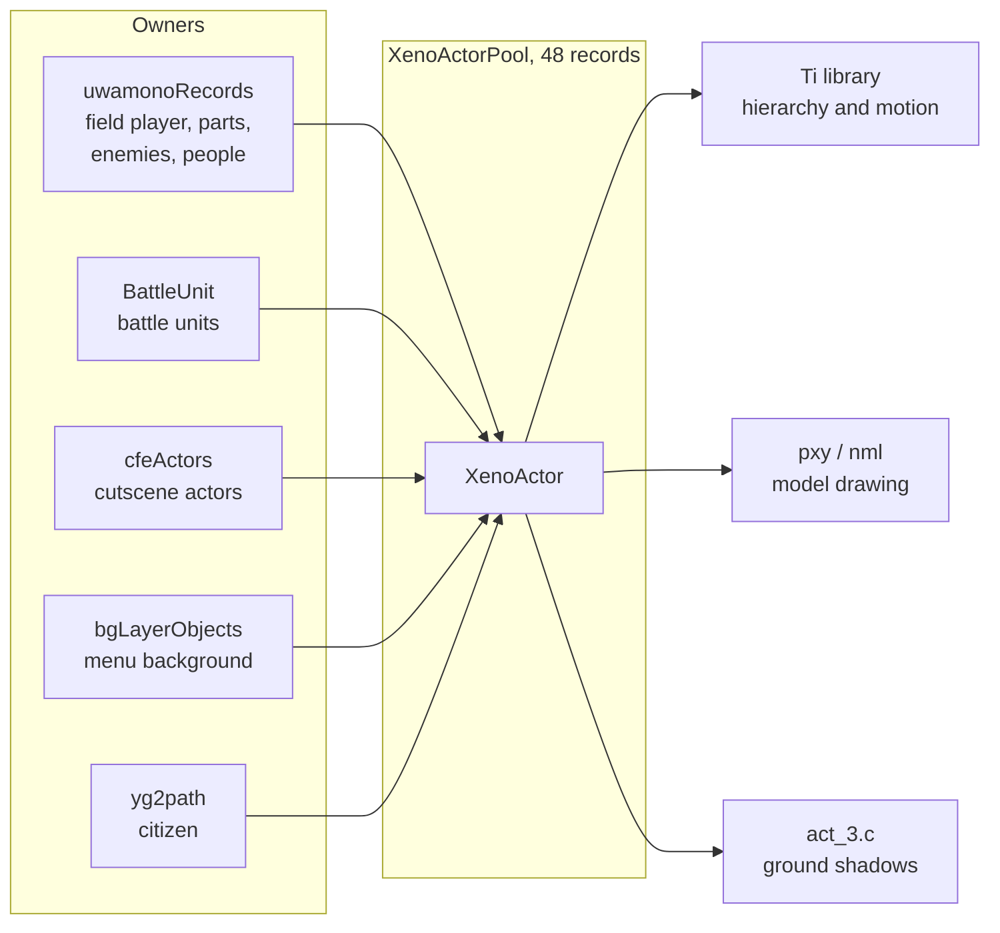

## The pool and the matrix heap

The actor records are never allocated one by one. `xenoActor.c` holds a static
buffer, `xenoActorPoolBuffer`, of 97728 bytes. It contains 48 records of
`0x7F0` (2032) bytes each, which is 97536 bytes, followed by the active table
of 48 words, which is 192 bytes. `XenoActorPool` points to the first record,
`XenoActorActiveTable` to the active table, and `XenoActorPoolCount` holds the
number of records, 48.

A record is free when its first field, `attr`, is 0. The active table is a
second view of the same pool. It is a list of pointers to the records in use,
with a null word for every empty slot. The two frame passes walk the active
table, not the pool. `XenoActorPoolGet(index)` returns the record at a pool
index, or null when the index is outside the pool, and
`XenoActorGetPoolCount` returns the count. The menu background code uses
these two to visit every record.

The joint matrices do not fit in the record, because their number depends on
the hierarchy file. They come from a separate heap. `XenoActorInitHeap`
initialises RG heap number 5 over `xenoActorHeapBuffer` with a size of
`0x38000` bytes (229376 bytes). The heap system itself is explained on the
[memory page](../architecture/memory.md). Every allocation that
`XenoActorAllocMatrices` makes comes from heap 5 and is tagged with the file
name `xenoActor.euc.c` and a line number.

`XenoActorPoolInit(data, size)` builds the whole thing. It stores the pool
base and the count, places the active table right after the last record, calls
`XenoActorInit` on every record, clears the active table, initialises heap 5
and clears the update hold flag. It returns the address after the active
table. `XenoActorPoolInitDefault` is the only caller and passes the static
buffer and the count `0x30`.

```
xenoActorPoolBuffer (97728 bytes)
+----------------------+  <- XenoActorPool
| record 0   (0x7F0)   |
| record 1   (0x7F0)   |
|        ...           |
| record 47  (0x7F0)   |
+----------------------+  <- XenoActorActiveTable (+97536)
| 48 pointers (192 b)  |
+----------------------+

xenoActorHeapBuffer -> RG heap 5, 0x38000 bytes
+----------------------+
| pLocalMat  of actor  |  transformCount x 0x40
| pGlobalMat of actor  |  transformCount x 0x40
| pBlendMat  of actor  |  transformCount x 0x40
| pDynamics  of actor  |  dynamicsCount  x 0x40
| pPartsMat  of actor  |  geometryCount  x 0x40
|        ...           |
+----------------------+
```

`XenoActorPoolInitDefault` is a full reset. Every system that starts a new
scene with its own set of actors calls it: the field when it rebuilds its
actors (`src/main/game_data.c`), the cutscene player (`src/main/cfePlugIn.c`),
the title screen (`src/ov02/title.c`), the game over screen
(`src/main/game_over.c`), and the developer test scenes
(`src/main/glow.c`, `src/main/TiWater.c`, `src/main/debug_test.c`,
`src/ov01/yamamoto_test.c`). It does not free anything first. It simply
rebuilds the pool and the heap from nothing, so every older actor pointer is
dead after the call.

## The resource set

An actor does not load files. Its owner loads them and stores the addresses in
the array `rsrc[]` of the record. The index names come from `enum XActRsrc`.
The first names (`XAct_Rsrc_MDL`, `XAct_Rsrc_TEX`, `XAct_Rsrc_XHR`,
`XAct_Rsrc_XAP`, `XAct_Rsrc_XAP_Ext2`) are the names the game's own assert
texts use, for example `pChaos->rsrc[XAct_Rsrc_MDL]`.

| Index | Name | File kind | What the actor does with it |
| --- | --- | --- | --- |
| 0 | `XAct_Rsrc_MDL` | `.pxy` model | Read as a `PxyHeader`. The draw checks the magic `p`, `x`, `y`, reads the bounding sphere, the geometry table, the joint matrix table and the optional second pack, and submits it with `pxySubmitModel` |
| 1 | `XAct_Rsrc_TEX` | `.txy` texture | Passed to `nmlModelSetTexture` before the model is submitted |
| 2 | `XAct_Rsrc_XHR` | `.xhr` hierarchy | Read as `TiHrcData`. Its `transformCount` and `dynamicsCount` size the matrix buffers. It is bound to the motion package with `tiMRPackageSetHrcData` |
| 3 | `XAct_Rsrc_3` | one motion entry | A single animation entry bound directly with `tiMRPackageSetAnimData`. The title screen uses it in place of a motion table |
| 4 | `XAct_Rsrc_XAP` | `.xap` motion table | Mode slot 0. An `OffsetTable` of motion entries. `XenoActorSetMode` picks an entry of it by number |
| 5 | `XAct_Rsrc_5` | motion table | Mode slot 1. The battle stores the motion table of the current attack here. The field stores an extra motion table of an enemy here |
| 6 | `XAct_Rsrc_XAP_Ext2` | `.xap` motion table | Mode slot 2. The water test scene loads a second `.xap` file here |
| 7 | `XAct_Rsrc_7` | motion table | Mode slot 3 |
| 8 | `XAct_Rsrc_SlotEntry` | one face entry | A single face animation entry bound with `tiMRPackageSetFaceAnimData` |
| 9 | `XAct_Rsrc_SlotTableB` | face table | The table of face animations, bound with `tiMRPackageSetFaceAnimTable`. `XenoActorSetSelector` picks an entry of it. The field and the cutscenes load it as resource `0x30041`. The battle loads the same resource, or the file `motion\face_all.fap` when it is not already in memory |
| 10 | `XAct_Rsrc_PAM` | parts animation | Read as `TiPamData`. When set, the actor gets one matrix per model geometry and the parts are animated without a skeleton |
| 11 | `XAct_Rsrc_EntryTableC` | node table | Bound with `tiMRPackageSetEntryTableC`. It names points on the skeleton that other code can ask for by key. The loaders call it the look link |

The elements are stored as `int` values that hold addresses. Four of them
form the four mode slots: `rsrc[XAct_Rsrc_XAP + slot]` for slot 0 to 3.

Most actors get their files through the resource block system, explained on
the [files and resources page](../architecture/files-and-resources.md).
`GameResLoadID(id, &data, 0, 0)` returns a block of five addresses for one
character or object id. The loaders name its members `pack`, `effect`,
`hierarchy`, `lookLink` and `slotTable`. Every loader copies them the same
way:

| Block word | Goes to |
| --- | --- |
| 0, `pack` | `rsrc[XAct_Rsrc_MDL]` |
| 1, `effect` | `rsrc[XAct_Rsrc_TEX]` |
| 2, `hierarchy` | `rsrc[XAct_Rsrc_XHR]` |
| 3, `lookLink` | `rsrc[XAct_Rsrc_EntryTableC]` |
| 4, `slotTable` | `rsrc[XAct_Rsrc_XAP]` |

The byte layouts of these files belong to the file format pages:
[models and textures](../formats/models-and-textures.md) and
[skeletons and motion](../formats/skeletons-and-motion.md).

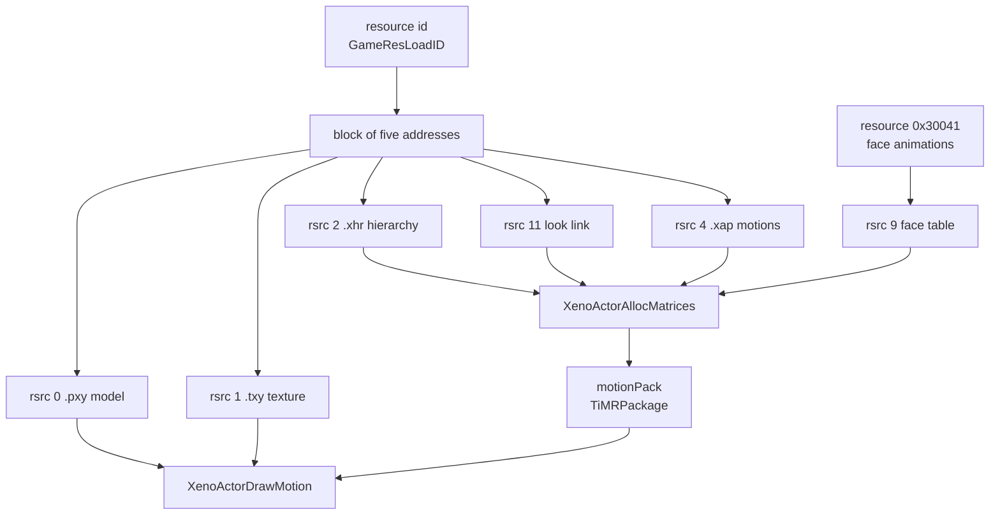

## The actor record

`struct XenoActor` is `0x7F0` bytes. The table lists the fields the code
gives a meaning to. Offsets that are missing from the table are not read by
any function with a known purpose.

| Offset | Type | Name | Meaning |
| --- | --- | --- | --- |
| `0x000` | `unsigned short` | `attr` | 0 marks a free record. `XenoActorAlloc` sets it to 1. Bit 2 makes the draw call the joint debug drawer, bit 4 the debug rings |
| `0x010` | vector | `position` | World position. `w` is 1 |
| `0x020` | vector | `previousPosition` | Position at the end of the last update, used to push the dynamics bodies |
| `0x030` | `float[4]` | `angle` | Rotation of the last update with each angle raised to 0 or more |
| `0x040` | vector | `velocity` | Movement of this frame, written by the field code |
| `0x050` | vector | `rotation` | Euler angles in radians. `y` is the facing angle |
| `0x060` | vector | `direction` | `y` is the moving angle, written by the field code |
| `0x070` | vector | `vector70` | A local offset applied after the scale when the actor matrix is built |
| `0x080` | vector | `vector80` | The translation of global matrix 1 of the skeleton, refreshed by every update. It is the place of the body relative to the actor origin |
| `0x090` | vector | `scale` | Scale, (1, 1, 1) by default |
| `0x0B0` | `float` | `radius` | Body radius, 0.3 by default. Also the radius of the circle shadows |
| `0x0B4` | `float` | `height` | Body height, set by the field |
| `0x0B8` | `int` | `enemyFlags` | Mode bits of the field enemy code, see [field enemies](../game/field-enemies.md) |
| `0x0BC` | `int` | `drawFlags` | Draw switches, see [Draw flags](#draw-flags) |
| `0x0C0` | `float` | `alpha` | Opacity, 1 by default |
| `0x0C4` | `int` | `shadowType` | Shadow type, see [Shadows](#shadows) |
| `0x0CC` | `float` | `drawParam` | Shadow strength, 0.2 by default |
| `0x0D0` | `int` | `renderFlags` | Passed to `nmlModelSetRenderLevel` |
| `0x0D4` | `float` | `renderValue` | Model animation time, passed to `pxySetAnimTime` |
| `0x0D8` | `float` | `renderValue2` | Added to `renderValue` every update, 1 by default |
| `0x0DC` | bytes | `lightSource` | A light name. With draw flag `0x10` the light set is rebuilt from it every draw |
| `0x100` | `XenoMatrix` | `localMatrix` | The actor's world matrix, built by `XenoActorPushMatrix` |
| `0x140` | `float` | `focusX`, `focusY` | A pair passed to `pxySetFocus`, read from the hierarchy or damped by `cfeDampDirOffset` |
| `0x148` | `float` | `modeValue2`, `modeValue3` | Shadow parameter and sort offset. `modeValue3` goes to `nmlModelSetSortOffset` |
| `0x150` | `float` | `sweepPhase` | Phase of the clip sweep, 0 to 1 |
| `0x154` | `float` | `sweepSpeed` | Speed of the clip sweep. Its sign is the direction. 1 by default |
| `0x158` | `float` | `clipPlaneValue` | Parameter of the masked clip plane |
| `0x15C` | `int` | `clipPlaneCount` | Non-zero while the clip sweep runs |
| `0x160` | `int` | `moveState` | Shape of the clip sweep, 0 to 7 |
| `0x164` | `float` | `clipPlaneValue2`, `shadowValue3` | Parameters of the masked clip plane. `clipPlaneValue2` receives the model radius |
| `0x16C` | `float` | `heightOffset` | Added to the height of the model position that the draw reports |
| `0x170` | `float` | `shadowHeightA`, `shadowHeightB`, `shadowHeightC`, `shadowHeightD` | Height range of the projected shadow. `shadowHeightC` is 0.5 and `shadowHeightD` is -1 by default |
| `0x180` | `float` | `modeValue4`, `modeValue5` | Shadow parameter, 1 by default, and a spare value |
| `0x188` | `float` | `alphaScale` | Result of the camera fade, 0 to 1 |
| `0x18C` | `float` | `fadeRadius` | Fade distance. 0 means the model's own radius |
| `0x190` | `XenoLight` | `light` | The light set of the actor, `0x180` bytes |
| `0x310` | `XenoLight` | `sourceLight` | The light set built from `lightSource` |
| `0x490` | vector | `fogDist` | Four fog distance values, passed to `nmlModelSetFogDist` |
| `0x4A0` | vector | `fogColor` | Fog colour, passed to `nmlModelSetFogCol` |
| `0x4B0` | vector | `sourceBlock` | World position of the body, rebuilt every update |
| `0x4C0` | `u32[8]` | `visibility` | Hide mask, one bit per geometry of the model |
| `0x4E0` | `u32[8]` | `subVisibility` | Hide mask of the second pack |
| `0x500` | `u32[8]` | `geometryMask` | One bit per geometry that the masked clip plane applies to |
| `0x540` | vectors | `clipPlaneA`, `clipPlaneA2`, `shadowB`, `clipPlaneB2`, `clipPlaneC` | Clip plane points and angles |
| `0x590` | `u8[16]` | `colorIndex` | Colour index source. `0xFF` in the first byte means none |
| `0x5A0` | pointer | `overrideMatrix` | When set, a matrix that the actor matrix is multiplied by. Joint attachment points it at a matrix of the parent |
| `0x5A4` | pointer | `parent` | The actor this one is attached to |
| `0x5A8` | `int` | `slotIndex` | Slot of a slot attachment, -1 for none |
| `0x5AC` | pointers | `children[8]` | The attached actors |
| `0x5CC` | `u32` | `flags` | Animation flags, see [Animation flags](#animation-flags) |
| `0x5D0` | `float` | `frame` | Play position of the body motion |
| `0x5D4` | `int` | `mode` | Number of the current motion in its slot |
| `0x5D8` | `int` | `slot` | Mode slot of the current motion, 0 to 3 |
| `0x5DC` | `int` | `requested_mode` | A motion to start when the current one ends, -1 for none |
| `0x5E0` | `float` | `cachedValue` | Play position of the face animation |
| `0x5E4` | `int` | `selector` | Number of the current face animation |
| `0x5EC` | `int[12]` | `rsrc` | The resource set |
| `0x620` | `int` | `link` | When set, a record with a transform curve that drives position, rotation and scale |
| `0x628` | pointer | `pLocalMat` | Local matrices, one per hierarchy transform |
| `0x62C` | pointer | `pGlobalMat` | Global matrices |
| `0x630` | pointer | `pBlendMat` | Matrices of the pose a blend starts from |
| `0x634` | pointer | `pPartsMat` | Part matrices, one per model geometry |
| `0x638` | pointer | `pDynamics` | Dynamics bodies, one per dynamics node |
| `0x640` | `TiMRPackage` | `motionPack`, `motion[2]`, `motionKeys[4]`, `pHrcData`, `pPamData`, `matrices`, `pMotionGlobalMat`, `jointRecords`, `channelMatrix` | The motion package of the `Ti` library, `0x100` bytes. The actor reads some of its members directly |
| `0x740` | `MapCollisionObject` | `collision` | The probe the actor uses against the map, see [map and units](../game/map-and-units.md) |
| `0x780` | vector | `previous` | Position before this frame's move, kept by the field |
| `0x794` | `int` | `moved` | Index of the actor's entry in `uwamonoRecords[]` |
| `0x798` | `int` | `kind` | The resource id the actor was loaded from |
| `0x79C` | `int` | `state` | A value handed once to `pxyLatchActorState` by the next draw |
| `0x7A0` | `short` | `itemCursorA`, `itemCursorB`, `activeItem` | Item indices of the debug ring drawer, -1 for none |

### The motion package inside the record

The 256 bytes from `0x640` are a `TiMRPackage`. The actor passes this address
to every `tiMR*` function through the macro `XenoActorMotionPack`. The record
also names some members of the package as its own fields, because
`xenoActor.c` reads them directly.

| Actor field | Package member | Use in the actor code |
| --- | --- | --- |
| `motionPack[0]` | `solverPasses` | Number of blend and global passes of the next update |
| `motionPack[1]` | `targetNode` | Node the aim solver turns. `XenoActorSetInitCode` writes it |
| `motion[0]` | `state_a` | Body channel: flags, speed, position, blend length, play range, aim target |
| `motion[1]` | `state_b` | Face channel |
| `motionKeys[0]`, `[1]` | `entryA`, `entryTableA` | Current body motion entry and its table |
| `motionKeys[2]`, `[3]` | `entryB`, `entryTableB` | Current face entry and its table |
| `pHrcData` | `hrcData` | The hierarchy |
| `pPamData` | `pamData` | The parts animation data |
| `matrices` | `localMat` | Same buffer as `pLocalMat` |
| `pMotionGlobalMat` | `globalMat` | Same buffer as `pGlobalMat`. The draw and the attachments read joint matrices from here |
| `jointRecords` | `dynMat` | Same buffer as `pDynamics` |
| `channelMatrix` | `placeMat` | Set to `localMatrix` before each solve |

### The light set

`XenoLight` is `0x180` bytes and has the layout of the `XglLightSet` of the
system library. It holds three light directions at `0x00`, three light
colours at `0x70`, an ambient colour at `0xD0`, a fourth direction at `0xF0`
and an intensity at `0x12C`. `XenoActorInit` fills `light` with
`xglLightSetDefault`. Owners then copy a prepared set over it. The battle
copies its current light block into every unit actor, and the field restores
the saved light of each record. The draw hands the set to the model library
with `pxySetLightPtr`. Lights as a subject are explained on the
[xgl page](xgl.md).

## Flags

The record has three flag fields with different jobs. `attr` says whether the
record is in use. `flags` controls the animation. `drawFlags` controls the
draw.

### Animation flags

These are the bits of `flags` at `0x5CC`.

| Bit | Name in the source | Meaning |
| --- | --- | --- |
| `0x1` | `XENO_FLAG_FREEZE_A` | The body motion does not advance |
| `0x2` | `XENO_FLAG_UNWRAP_A` | The body motion does not wrap at the end of its range. It is used for motions that play once |
| `0x4` | `XENO_FLAG_FREEZE_B` | The face animation does not advance |
| `0x8` | `XENO_FLAG_UNWRAP_B` | The face animation does not wrap |
| `0x10` | `XENO_FLAG_BLEND_SWAPPED` | The blend buffers were already swapped this frame. The update clears it |
| `0x40` | `XENO_FLAG_RANGE_SET` | A play range was set by `XenoActorSetPlayRange` |
| `0x80` | `XENO_FLAG_CHANNEL_BIT20` | One of the two channel states had its bit `0x20` set after the solve. The draw then calls `nmlModelSetTexMapCircle` |
| `0x100` | `XENO_FLAG_DRAW_POINTS` | `XenoActorSetFocusTarget` draws a debug axis at the target |
| `0x200` | `XENO_FLAG_RESET_CHANNEL` | The next update cancels any running blend. `XenoActorAlloc` sets it so a new actor does not blend from an empty pose |
| `0x400` | `XENO_FLAG_SHIFT_JOINTS` | The next update moves the dynamics bodies by `vector80` |
| `0x800` | `XENO_FLAG_SKIP_DELTA` | The next update does not push the dynamics bodies |

### Draw flags

These are the bits of `drawFlags` at `0x0BC` that `xenoActor.c` tests.

| Bit | Name in the source | Meaning |
| --- | --- | --- |
| `0x1` | `XENO_DRAW_COLOR` | Use the actor's fog colour and fog distances |
| `0x2` | `XENO_DRAW_SKIP_ONCE` | Skip the next draw of this actor. The draw clears the bit |
| `0x4` | `XENO_DRAW_HIDDEN` | Do not draw the actor or its children |
| `0x8` | `XENO_DRAW_LIGHT` | Use the actor's light set |
| `0x10` | `XENO_DRAW_LIGHT_SOURCE` | Rebuild `sourceLight` from the name in `lightSource` and use that set |
| `0x20` | `XENO_DRAW_LIGHT_ACTIVE` | Set by the draw when the chosen light set has an intensity above 0 |
| `0x40` | `XENO_DRAW_FOCUS_PENDING` | The draw read a focus pair from the hierarchy and must pass it on |
| `0x80` | `XENO_DRAW_OFFSET_B` | Pass `modeValue2` and `modeValue3` to `pxySetFocus` |
| `0x100` | `XENO_DRAW_FOCUS_LOCKED` | The focus pair was set from outside by `cfeDampDirOffset` |
| `0x200` | `XENO_DRAW_AFTER_POSITION` | Call `pxyRequestForcedVisibility` |
| `0x400` | `XENO_DRAW_NO_TREE_UPDATE` | `XenoActorDoit` does not update this root actor |
| `0x10000` | `XENO_DRAW_ALPHA` | Draw with the opacity in `alpha` |
| `0x20000` | `XENO_DRAW_RENDER_2` | Add bit 2 to the render level |
| `0x40000` | `XENO_DRAW_SHADOW_PROJECT` | Draw with a clip plane and an angle (`shadowA`, `shadowB`, `clipPlaneC`) and the opacity in `alpha` |
| `0x80000` | `XENO_DRAW_SHADOW_STENCIL` | Add two clip plane pairs for this draw only |
| `0x100000` | `XENO_DRAW_AFTER_LIGHT` | Call `nmlModelSetDropPass` |
| `0x200000` | `XENO_DRAW_PRE_VISIBILITY` | Call `nmlModelSetShadowMapEntry` |
| `0x800000` | `XENO_DRAW_SOURCE` | Call `pxySetSourceDrawPass`. The water test sets it on its source actor |
| `0x1000000` | `XENO_DRAW_SOURCE_DIRTY` | Cleared by every update |
| `0x2000000` | `XENO_DRAW_POST_FIRST` | Call `pxySetShadowFirstPass` |
| `0x4000000` | `XENO_DRAW_CAMERA_FADE` | Fade the actor out when the camera comes close |
| `0x8000000` | `XENO_DRAW_TRANSLUCENT` | Call `pxySetFogWhite`. The cutscene player sets it from its translucent track |
| `0x10000000` | `XENO_DRAW_MODEL_HIDDEN` | Result of the last draw: set when `pxyIsModelHidden` returned non-zero after the model was submitted |

The `pxy*` and `nmlModel*` calls named in this table set the state of the
next model submission. What each of them does to the packets is explained on
the [pxy page](pxy.md).

`XenoActorSetFlagAll(flag)` sets bits of `drawFlags` on every record in use.
The menu screens use it with 2 to make every actor skip one draw, and with
`0x400` to stop the updates of the field actors while a menu is open, as
shown in [Background layers](#background-layers-of-the-menus).

## The life of an actor

An actor goes through the same steps whoever owns it. The owner takes a
record, stores the resource addresses, asks for the matrices, chooses a first
motion and places the actor. From then on the two frame passes keep it alive
until the owner releases it.

`XenoActorAlloc` searches the pool for the first record with `attr` equal to
0. It calls `XenoActorInit` on it, sets `attr` to 1, writes the record's
address into the first empty slot of the active table and sets
`XENO_FLAG_RESET_CHANNEL`. It returns the record, or null when all 48 are in
use.

`XenoActorInit` clears the whole record and then writes the defaults: the
item cursors are -1, `drawParam` is 0.2, `radius` is 0.3, `requested_mode` and
`slotIndex` are -1, `shadowHeightC` is 0.5, `shadowHeightD` is -1, `alpha` is 1, the scale is
(1, 1, 1), `renderValue2`, `sweepSpeed`, `clipPlaneValue2`, `shadowValue3` and
`modeValue4` are 1. It fills `colorIndex` with `0xFF` and `geometryMask` with
`0xFF` bytes, initialises the motion package with `tiMRPackageInit`, sets the
default light set and resets the collision probe with `UnduParamInit`.

`XenoActorAllocMatrices` is called after the owner has stored the resources.
It first frees `pLocalMat`, `pGlobalMat`, `pBlendMat` and `pDynamics` when
they exist, so it can be called again after a model change. Then, when the
actor has a hierarchy, it does this:

1. Allocate `pLocalMat`, `pGlobalMat` and `pBlendMat` from heap 5, each
   `transformCount * 0x40` bytes, where `transformCount` comes from the
   hierarchy.
2. When the hierarchy has dynamics nodes, allocate `pDynamics` with
   `dynamicsCount * 0x40` bytes.
3. Stop with an assert when one of the buffers is missing. The assert texts
   are `pAct->pLocalMat != NIL` and its siblings.
4. Initialise the motion package again and bind everything to it: the three
   matrix buffers, the hierarchy, the motion entry of `rsrc[3]`, the motion
   table of slot 0, the face entry of `rsrc[8]`, the face table of `rsrc[9]`
   and the node table of `rsrc[11]`.
5. Call `tiMRPackageFillNodes` to prepare the dynamics bodies.
6. Select motion 0 with `XenoActorSetMode(actor, 0)` and face animation 0
   with `XenoActorSetSelector(actor, 0)`.

When `rsrc[XAct_Rsrc_PAM]` and the model are both set, it also allocates
`pPartsMat` with one matrix per geometry of the model, and binds that buffer
and the parts data to the package. Note that this second branch initialises
the package again, so a parts-animated actor has no skeleton binding.

`tiMRPackageFillNodes` (`src/main/xgl_vector_ops.c`) walks the dynamics
records of the hierarchy. Each record is `0xB0` bytes followed by a variable
number of collision entries. For each one it fills a body in `pDynamics`: the
start position, the previous position and the accumulator come from three
vectors of the record, the body remembers its node, and its gust factor
starts at 1. The bodies are the hair, cloth and other loose pieces that the
dynamics solver moves, see the [animation page](animation.md).

`XenoActorRelease` gives a record back. It frees all five heap buffers,
removes the record from the active table (an assert with the text `bRelease`
fires when it was not there), removes it from its parent's child list, clears
the `parent` pointer of each of its own children, and ends with
`XenoActorInit`, which sets `attr` back to 0. `XenoActorReleaseAll` releases
every record of the active table. The cutscene player, the battle scene
(`src/ov01/scene.c`) and the test scenes call it when they end.

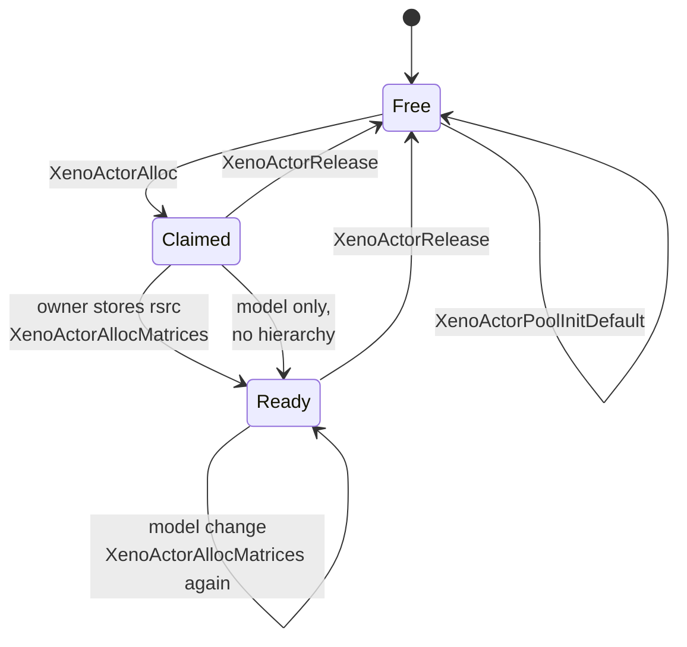

The sequence below shows the calls of `glowRunScene`, the smallest complete
user. The real game systems do the same with files from the resource system.

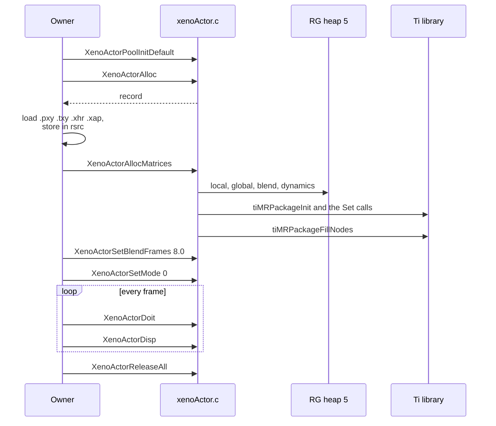

## Motion channels and modes

Every actor has two animation channels. Channel A plays the body motion and
channel B plays the face animation. Each channel is one `XenoMotionState` of
`0x50` bytes inside the motion package (`motion[0]` and `motion[1]`). A state
has a flag word, a speed, a position in frames, a blend length, a play range
and, for channel A only, the target of the aim solver. How the two channels
are evaluated into matrices is the subject of the
[animation page](animation.md). This section explains how the actor steers
them.

### Modes and slots

A body motion is called a mode. A mode is an entry number inside a motion
table, and the actor can hold four motion tables at once, the mode slots 0 to
3 in `rsrc[4]` to `rsrc[7]`. The pair (`slot`, `mode`) names the motion that
plays.

`XenoActorSetMode(actor, mode)` starts a motion of slot 0.
`XenoActorSetModeInSlot(actor, slot, mode)` does the same for any slot below
4. Both work like this:

1. Clear `requested_mode`, store `mode` and `slot`.
2. Bind the table of the slot and its entry number `mode` to channel A with
   `tiMRPackageSetAnimTableAndEntry`. This also sets bit `0x40` of the state,
   which asks for a blend.
3. Clear `XENO_FLAG_RANGE_SET` and clear bit 8 (the end marker) of both
   states.
4. Set `frame` to the start of the entry's range, or to the end when the
   speed of channel A is negative, and write it to the state.
5. When a blend is switched on for the channel and the buffers were not
   swapped yet this frame, call `tiMtnBlendSwapLocal` and
   `tiMtnBlendSwapGlobal` and set `XENO_FLAG_BLEND_SWAPPED`. The swap keeps
   the pose of the old motion as the start of the blend.

`XenoActorCheckMode(actor, mode)` calls `XenoActorSetMode` only when the
actor is not already in that mode. The field code uses it for motions that
must keep running, such as walking.

The field enemy code packs the slot and the mode into one motion number:
`motion / 100` is the slot and `motion % 100` the mode
(`src/main/enemy_1.c`). The battle uses slot 0 for the standing motions of a
unit and slot 1 for the motions of the attack it has loaded
(`unitSetPhase` and `unitSetTimedPhase` in `src/ov01/unit_cmd.c`).

`XenoActorRequestMode` stores a mode in `requested_mode`. The update starts
it when the current motion has reached its end. `XenoActorIsDone` returns 1
when channel A has its end marker (bit 8) set, which the advance functions do
when the position passes the range.

`XenoActorGetSlotRange(actor, slot, idx, &start, &end)` reads the frame range
of a motion without starting it, and `xenoActorSlotRangeValid` only says
whether entry `idx` of a slot exists and has a valid range. The battle uses
the second to test whether a child actor has its own version of an attack
motion.

### Blending

`XenoActorSetBlendFrames(actor, value)` writes the blend length of channel
A, in frames. The blend code compares it with the frames played since the
start of the range: while fewer frames than `value` have passed, the pose is
a mix of the old pose in `pBlendMat` and the new motion. A value of 0 means
no blend. The game uses 4.0 for most field motion changes, 8.0 for some
battle changes and 0.0 when a motion must start at once.
`XenoActorSetBlendFramesB` does the same for the face channel.

`XenoActorSetBlendLocal` sets bits 4 and 2 of the state A flag word, and
`XenoActorSetBlendGlobal` clears bit 4 and sets bit 2. In the blend code bit
2 means that a blend runs and bit 4 chooses the blend of the local matrices.
Without bit 4 the global matrices are blended. So both functions start a
blend, in two different ways. `XenoActorSetBlendLocalB` and
`XenoActorSetBlendGlobalB` do the same for channel B. A caller that wants a
blended change calls `XenoActorSetBlendFrames`, `XenoActorSetBlendLocal` and
then `XenoActorSetMode`, in this order.

`XenoActorResetChannelFlags` clears bits 2 and `0x40` of both states, which
cancels any blend. `XenoActorClearChannel` removes the motion table and the
motion entry from channel A, so the actor falls back to the rest pose of its
hierarchy.

### Play range, speed and face animation

`XenoActorSetPlayRange(actor, start, end)` limits channel A to a part of the
motion. It sets `XENO_FLAG_RANGE_SET`, moves `frame` to `start` (or to `end`
for a negative speed) when it lies outside the new range, and stores the
range in the state. Cutscenes use it to play a slice of a long motion, and
the field uses it for ladders and enemy motions.

The speed of a channel is `motion[n].speed`, 1.0 by default. Owners write it
directly or through `tiMRStateSetSpeed`. A negative speed plays backwards.

`XenoActorSetSelector(actor, selector)` chooses the face animation. It
stores the number, binds entry `selector` of the face table to channel B,
sets `cachedValue` to the start of its range and swaps the blend buffers like
`XenoActorSetMode` does.

`XenoActorApplySourceValue` sets `frame` to the first word of the play range
and writes the same value into the state through
`XenoActorConvertSourceRecord` (`src/main/xgl_vector_ops.c`). The ladder code
uses it to restart the range.

### Other channel settings

| Function | Effect |
| --- | --- |
| `XenoActorSetSolverPasses(actor, n)` | The next update runs the blend and global pass `n` times. The battle passes 20 for a new unit and the ladder code 15 or 20, which lets the dynamics bodies settle at once |
| `XenoActorSetVector(actor, x, y, z)`, `XenoActorSetVectorUniform` | Set the scale vector of the package, which multiplies the translation of the second locator |
| `XenoActorSetInitCode(actor, value)` | Sets the node that the aim solver turns. The field sets it per player character |
| `XenoActorSetFocusTarget(actor, target)` | Gives channel A a world point to aim at and sets bit `0x10` of the state for this frame. The field uses it to make a character look at something (`src/main/set_motion.c`) |
| `XenoActorSetChannelFlag80(actor)` | Sets bit `0x80` of the state A flags. The battle sets it on every unit root. Its effect is not visible in the actor code |
| `XenoActorSetState(actor, state)` | Stores a value that the next draw hands to `pxyLatchActorState` and then clears |

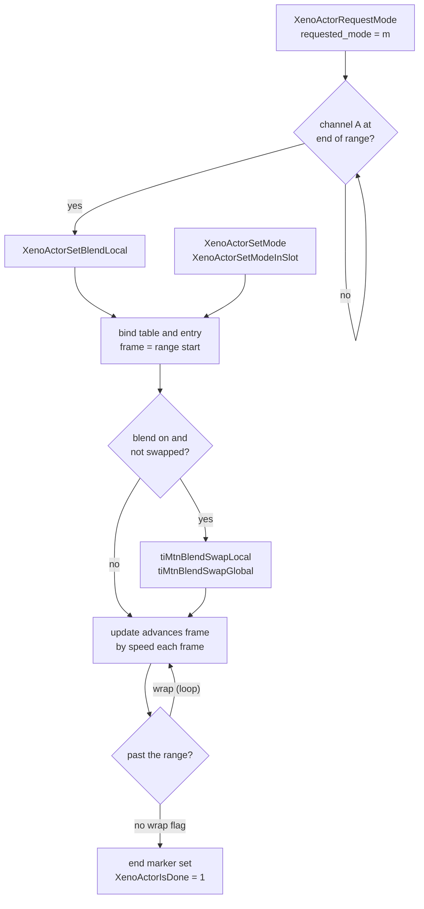

## The update each frame

`XenoActorDoit` is the animation pass. When the global `XenoActorHoldFlag` is
0, it walks the active table and calls `XenoActorUpdateTree` on every actor
that has no parent and does not have draw flag `0x400`. Children are updated
by the recursion inside `XenoActorUpdateTree`, so each tree is updated once,
parent first.

`XenoActorSetHoldFlag` and `XenoActorClearHoldFlag` set and clear the hold.
The cutscene player sets it while the player has paused a cutscene and
clears it when START is pressed again. While it is set no actor animates,
but `XenoActorDisp` still draws them.

`XenoActorUpdateTree` does the following for one actor:

1. Copy `position` to `sourceBlock` and clear draw flag `0x1000000`. When
   the model is a valid `pxy` pack, add the centre of its bounding sphere.
2. Add `renderValue2` to `renderValue`. This is the clock of the model's own
   animations.
3. `XenoActorUpdateLinkMatrix`: when `link` is set, evaluate the transform
   curve of the link record at `frame` and write the result to `position`,
   `rotation` and `scale`.
4. When the actor has matrices, build `localMatrix` with
   `XenoActorPushMatrix`, push the dynamics bodies (see below), cancel the
   blend when `XENO_FLAG_RESET_CHANNEL` is set, write `frame` and
   `cachedValue` into the two states and call
   `XenoActorApplyRequestedMode`.
5. When `XENO_FLAG_SHIFT_JOINTS` is set, call `XenoActorShiftJoints` once.
6. Copy the translation of global matrix 1 to `vector80`.
7. Rebuild `sourceBlock` as the world position of the body: `vector80`
   divided by the x scale, transformed by `localMatrix`.
8. Advance channel A unless `XENO_FLAG_FREEZE_A` is set, and read the new
   position back into `frame`. Advance channel B unless `XENO_FLAG_FREEZE_B`
   is set, and read it back into `cachedValue`.
9. Run the clip sweep and the camera fade.
10. Update each of the eight children.

An actor without matrices but with parts animation data takes a shorter path
in step 4: the states are written, `XenoActorApplyRequestedMode` runs and
`vector80` is set to zero. An actor with neither only gets a zero `vector80`.

`XenoActorApplyRequestedMode` is where the skeleton is solved. It starts the
requested mode when there is one and the current motion is done. Then, when
the actor has a hierarchy, it points `channelMatrix` at `localMatrix` and
calls `tiMRPackageUpdate`, which evaluates the motion curves, runs the
solvers and blends, and fills `pGlobalMat`. After the call it sets
`XENO_FLAG_CHANNEL_BIT20` when one of the states has bit `0x20`. When the
actor has parts animation data it samples the part matrices with
`tiPartsAnimSamplePose`. It ends by clearing `XENO_FLAG_BLEND_SWAPPED` and
the aim bit `0x10` of channel A, so an aim target must be given again every
frame.

The channels advance by `speed` times a step factor that is read from camera
0 (`xglStudioGetCamera2(0)`), 1.0 after the camera is initialised. The normal
advance wraps the position to the other end of the range and sets the end
marker for one frame. With the no-wrap flag the position keeps its value
past the range and the end marker stays set.

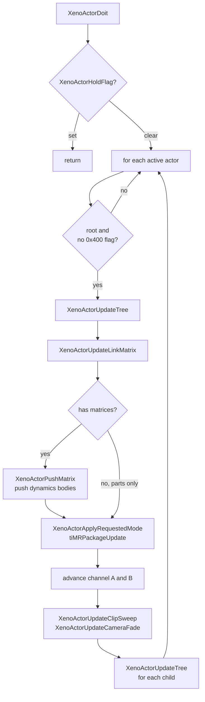

### Pushing the dynamics bodies

The dynamics bodies live in the actor's local space, so a moving or turning
actor must tell them about its own movement. Step 4 of the update does this
when the hierarchy has dynamics nodes and `XENO_FLAG_SKIP_DELTA` is clear.
It transforms `previousPosition` into the actor's local space with the
inverse of `localMatrix` and scales the result by 0.3. It also builds a
rotation from the difference between the last angles and the current ones.
Each body then gets the scaled offset added to its accumulator, and 0.6 of
the movement that the rotation gives its position. At the end
`previousPosition` and `angle` take the current values.

`XenoActorWrapRotation` copies the current position and rotation into
`previousPosition` and `angle` and sets `XENO_FLAG_SKIP_DELTA`. A caller uses
it after moving an actor by a large step, so that the hair and cloth do not
whip. The ladder code (`src/main/get_ladder.c`) calls it when the player is
placed on a ladder.

`XenoActorShiftJoints(actor, sign, x, y, z)` adds or subtracts `vector80`
to the position of every body on the chosen axes.
`XenoActorApplyRootOffset(actor, moveX, moveY, moveZ)` moves the actor
itself to where its body currently is: it transforms `vector80` through the
actor matrix, writes the chosen axes into `position` and subtracts `vector80`
from the bodies. The battle uses it after a motion that carries a unit away
from its origin.

### The clip sweep

`XenoActorUpdateClipSweep` runs while `shadowCount` is not 0. It moves a
clip plane through the model, which makes the model appear or vanish slice
by slice. `sweepPhase` grows by `|sweepSpeed| / 30` per update. The model
radius from the bounding sphere scales the travel. `moveState` chooses one
of eight directions:

| `moveState` | Plane movement |
| --- | --- |
| 0 | Along the facing direction of the actor |
| 1 | Along the opposite direction |
| 2, 3 | Vertical, with a plane angle of -π/2 or +π/2 |
| 4, 5, 6, 7 | Vertical travel with tilted planes (angles of ±π/4 or -3π/4, turned by ±π/2) |

The result is the point `shadowA` and the angles `shadowB`, to which the
body offset and the actor position are added. With a negative speed the
sweep ends by itself: when the phase reaches 1 it is set to 0 and
`shadowCount` is cleared. The draw passes the pair to
`pxySetClipPlaneMasked`.

### The camera fade

`XenoActorUpdateCameraFade` sets `alphaScale`. It is 1 unless the actor has
draw flag `0x4000000`, has no parent and has a valid model whose flags do not
have bits `0x81`. In that case the function measures the distance from the
active camera to the body. Inside the fade radius the value is 0. Between
the radius and 1.6 times the radius it rises linearly to 1. The radius is
`fadeRadius`, or the radius of the model's bounding sphere when `fadeRadius`
is 0. The draw multiplies `alpha` by `alphaScale`, so a character that the
camera runs into becomes transparent and does not block the view.

## The actor matrix

`XenoActorPushMatrix` builds `localMatrix`, the matrix that places the whole
model in the world. It uses the matrix stack of the system library, see the
[math page](math.md).

1. Take the transform source: the parent when the actor has one, otherwise
   the actor itself.
2. Start from the unit matrix and apply the translation by `position`, the
   rotations about Z, Y and X, the scale and the translation by `vector70`
   of the source.
3. Save the result in `localMatrix`.
4. When `overrideMatrix` is set, multiply by it. For a child attached to a
   joint this is the global matrix of that joint in the parent.
5. When `slotIndex` is 2 or more and the parent has global matrices,
   multiply by the parent's global matrix number `slotIndex` and by entry
   `slotIndex - 2` of the joint matrix table of the parent's model.

An attached child therefore ignores its own position and rotation. It stands
where its parent stands, moved to the joint or slot it hangs on.

Other code may call `XenoActorPushMatrix` to refresh the matrix outside the
update, as the map object code does after it moves a record.
`XenoActorTransformOffset` and `XenoActorGetHrcPoint` return a transformed
point. `XenoActorMulMatrix(actor, nodeKey, matrix, useBaseMatrix)` and
`XenoActorMulVector(actor, nodeKey, vector, apply)` ask the motion package for
the matrix or the point of a named node (`tiMRPackageGetNodeMatrix`,
`tiMRPackageGetNodePoint`) and bring it into world space with
`overrideMatrix` or `localMatrix`. The field uses the second to find a point
on a character, for example a hand, as an anchor for the camera or an
effect.

## Drawing

`XenoActorDisp` is the draw pass. It first calls `pxyAbortModel` to drop any
half-prepared model state. Then it walks the active table and calls
`XenoActorDrawMotion` on every actor without a parent. Children are drawn by
the recursion at the end of `XenoActorDrawMotion`. While it walks, it
remembers whether any root actor has `drawMode` 6 or 7. In that case it runs
the shadow pass afterwards: `ACT_DrawShadowBegin`, then `ACT_DrawShadow` for
every active actor, then `ACT_DrawShadowEnd`.

`XenoActorDrawMotion` does not build packets. It sets up the state of the
model library with a long list of calls and then submits the model. The
steps are:

1. Clear the result flag `0x10000000`. Return at once when the actor is
   hidden or must skip this draw. A hidden parent also hides its children,
   because the recursion is at the end.
2. Build `localMatrix` again with `XenoActorPushMatrix`.
3. When `attr` has bit 2 and the actor has global matrices, draw the joints
   with the debug drawer `tiDrawJointDrawLists`, and with bit 4 also the
   debug rings (`XenoActorRefreshItems`).
4. Continue only when the model is a valid `pxy` pack.
5. Hand over `state` when it is set, the draw matrix, the scale and the
   colour index source.
6. For a child: name the parent's model with `nmlModelSetParent`, and follow
   the parent's camera fade.
7. For a root: choose the light set when flag 8 is set, and mark the model
   as a lit character model (`nmlModelSetHumanModel`) when the light has an
   intensity. Apply the actor's own camera fade. A fade or alpha result of 0
   or less ends the draw with `pxyAbortModel`.
8. Apply the fog colour and distances with flag 1, and the opacity with flag
   `0x10000`.
9. Pass the hide mask, the sort offset and the model position
   (`vector80` with `heightOffset` added to y).
10. Choose the projected shadow mode from `drawMode`, see
    [Shadows](#shadows).
11. For an animated actor, build the skinning matrices (see below), update
    the visibility from the motion with `tiMotionUpdateVisibility` and read
    the focus pair. For a parts-animated actor, pass `pPartsMat` with
    `pxySetPartMatrices`.
12. Set the texture.
13. Apply the clip planes, the sweep and the other optional states.
14. Set the animation time and the render level and call `pxySubmitModel`.
15. When the model has a second pack (`subPackOffset`), set the same state
    again with `subVisibility` as the hide mask and submit the second pack.
16. Draw the eight children.

The skinning matrices of step 11 join the skeleton and the model. The model
has `nJointMatrix` joint matrices in a table of its own. They are the rest
matrices of the joints that the mesh is bound to. The draw allocates an array
in the packet buffer with `nmlPacketSetAttributeAlloc16N` and fills each
entry with the product of the animated global matrix and the model's rest
matrix: `joints[j] = pMotionGlobalMat[j + 2] × jointBase[j]`. The first two
global matrices are skipped. They most likely belong to the two locators
that every hierarchy has before its joints. An assert checks that the hierarchy has
at least as many transforms as the model needs
(`pAct->motionPack.pHrcData->numTransform - 2 >= pPxyHead->nJointMatrix`).

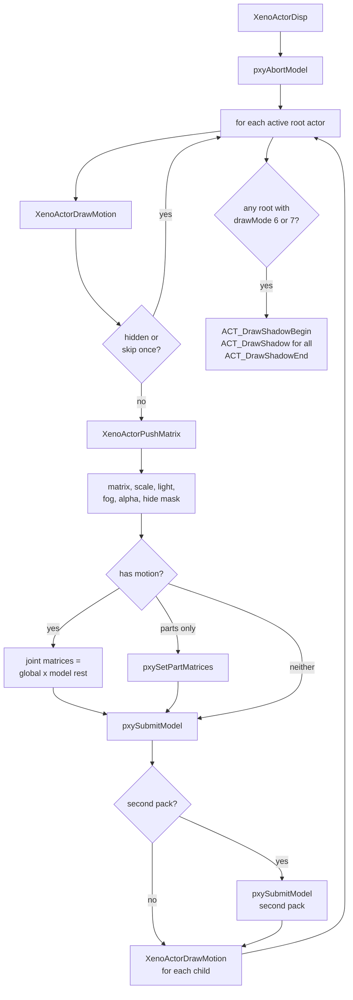

### Where the passes sit in a frame

The two passes are always called together, update first. On the field they
run inside the frame of `src/main/game_data.c`: `XenoActorDoit` is skipped
while the lowest bit (value 1) of `gameWork.control` is set, and both are skipped while an
encounter reaction plays or control bit `0x200` is set. In a battle,
`src/ov01/scene.c` runs the scripts, updates all battle objects, applies the
camera, advances the wind, then calls the two passes and then runs the
effects. The cutscene player calls them after it has evaluated all its
tracks for the frame. The menu screens, the save screen, the battle result
screen and the G.S. Campaign screens call them in their own loops to draw
the background layers. The frame as a whole is described on the
[field page](../game/field.md) and the [battle engine page](../game/battle-engine.md).

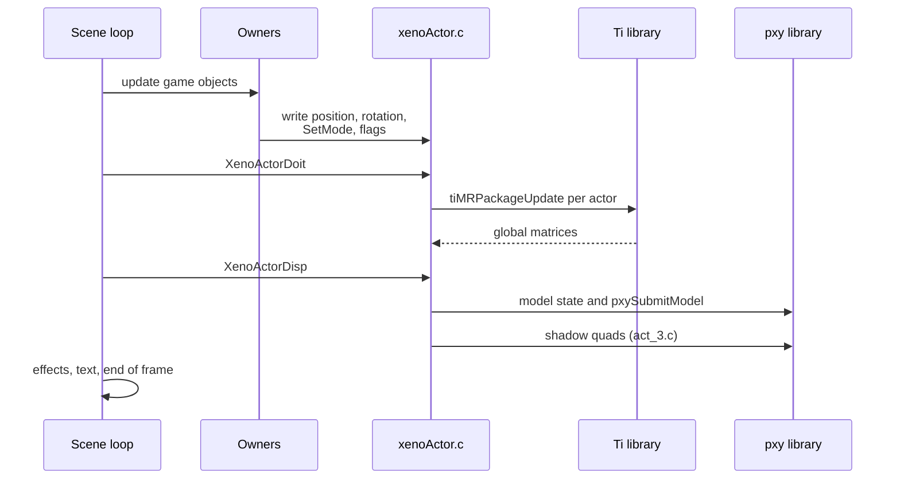

## Parents, children and attachments

An actor can carry up to eight other actors in `children[]`. A child has one
parent in `parent`. The link has three effects. The child is updated and
drawn through its parent and not by the two frame loops, which only start
from roots. The child takes its place from the parent's transform, as
explained in [The actor matrix](#the-actor-matrix). And a hidden parent
hides the child.

This is how a character holds a weapon. The weapon is a separate actor with
its own model, and often its own hierarchy and motion. It is attached to the
hand joint of the character, so it follows the hand in every motion.

There are three ways to attach:

| Function | Effect |
| --- | --- |
| `XenoActorAttachChild(parent, child)` | Links the child into the first free child slot. Both actors must be in use and the child must have no parent. The child then follows the parent's root transform |
| `XenoActorAppendChildOnJoint(parent, child, joint)` | Links the child and points its `overrideMatrix` at global matrix number `joint` of the parent. A negative `joint` clears the override |
| `XenoActorAttachChildToJoint(actor, child, jointId)` | Finds the attachment node with the given id in the parent's hierarchy and calls `XenoActorAppendChildOnJoint` with its matrix index |
| `XenoActorAttachAtSlot(parent, actor, slotIndex)` | Stores `slotIndex` in the child and calls `XenoActorAttachChild`. The child's matrix is then multiplied by the parent's global matrix of that index and by the matching rest matrix of the parent's model |

`XenoActorAttachChildToJoint` knows two versions of the hierarchy file. For a
version below 2.4 the id is used directly as an index and must be below the
count at `0x24` of the hierarchy. From version 2.4 on, the hierarchy has a
table of attachment nodes with an id each (`TiHrcStatic`), and the function
searches that table. In both cases the matrix index is the sum of four counts
of the hierarchy (the two joint counts at `0x10` and `0x14`, the count at
`0x1C` and the dynamics count at `0x20`) plus the position found, because the
attachment nodes come after those groups in the matrix array.

`XenoActorReleaseChild(parent, child)` removes the link. It clears the child
slot, sets the child's `slotIndex` to -1 and clears its `parent` and
`overrideMatrix`. The child is then a root again and is drawn at its own
position. `XenoActorRelease` also unlinks an actor from both sides, but it
only clears the `parent` pointer of the children and leaves their
`overrideMatrix`.

The game uses attachments in these places:

| Where | What is attached |
| --- | --- |
| `uwamonoAttachPlayerParts` (`src/main/game_camera.c`) | The two part actors of the player. In one player form they go to attachment ids 80 and 81, the first shown and the second hidden, with shadow type 1. In the other form they are released and attached again to ids 10 and 7 |
| `runtimeSetPlayer` (`src/main/uwamono_objx.c`) | A script can attach another record's actor to attachment id `0x4D` of the player, or release it with a negative key |
| `unitBindActors` (`src/ov01/unit_cmd.c`) | Up to three child actors of a battle unit. A child of type 1 or 2 is attached at slot 27. Any other child goes to the attachment id stored in the unit's data |
| `unitAttachChild` (`src/ov01/unit_cmd.c`) | An extra model loaded with an attack, attached as child 2 of the unit |
| `cfeEvaluate.c` | A cutscene actor with a parent actor track and a parent matrix track is attached with `XenoActorAppendChildOnJoint` and released when the track says so |

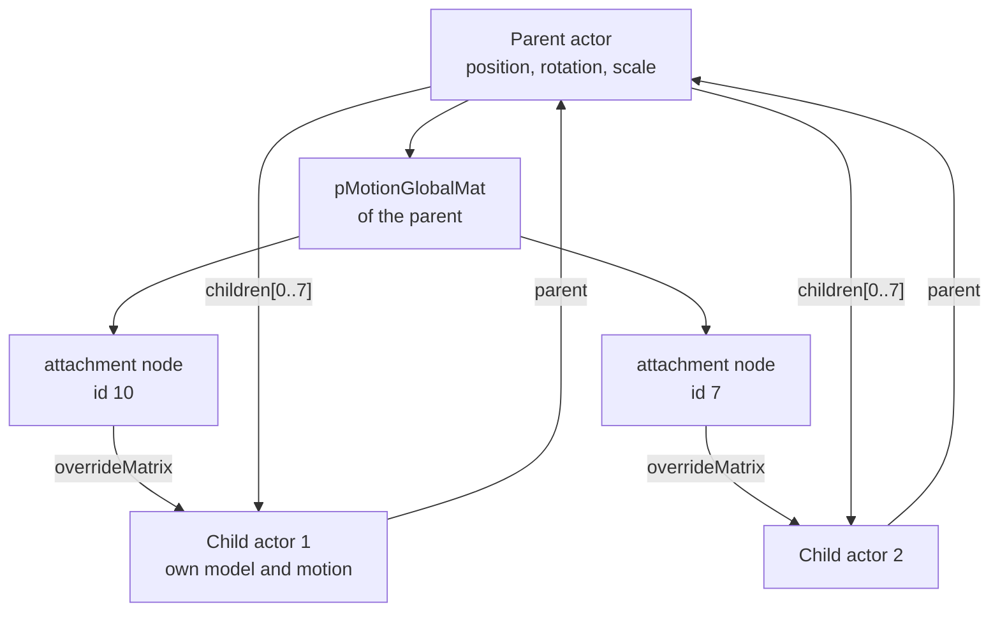

## Visibility

Several independent switches decide whether an actor, or a part of it,
appears on screen.

The whole actor is hidden by draw flag 4 and skipped for one frame by draw
flag 2. Owners use flag 4 freely. The battle sets it on a unit and its
children while the unit is not bound to a model yet. The field sets it on a
record's actor just before it releases it.

Opacity comes from `alpha` together with draw flag `0x10000`. The draw
switches the stencil and, when the model asks for it, depth writing on, sets
the transparency and ends early when `alpha` is 0 or less. The cutscene
player keeps the flag in step with its alpha track: at exactly 1 the flag is
cleared, and at 0 or less the actor is hidden. New battle units start with
`alpha` 0 and are faded in by the battle code, see
[battle effects](../game/battle-effects.md).

Single parts of a model are hidden through the hide masks. A model is made
of named geometries. `visibility` has one bit per geometry of the main pack
and `subVisibility` one bit per geometry of the second pack. A set bit hides
the geometry. `XenoActorHidePart(actor, name)` searches the second pack
first and then the main pack for a geometry with that name and sets its bit.
`XenoActorShowPart` clears it. Both return 1 when the name was found.
`XenoActorFindPart` returns the index of a geometry of the main pack. The
field hides and shows the part `jin_saya_tuka` of a rider model, the battle
hides parts such as `ck_sc3m01`, and battle scripts reach the two functions
through natives of `src/ov01/sb_natives_unit.c`, see
[natives](../scripting/natives.md).

The motion can also change the hide mask. In each draw of an animated actor,
`tiMotionUpdateVisibility` applies the visibility tracks of the current
motion to the mask before the model is submitted.

The camera fade and the clip sweep, both explained under
[The update each frame](#the-update-each-frame), are two more ways for an
actor to be partly or fully invisible.

## Shadows

The field `drawMode` at `0x0C4` is the shadow type of the actor. Some values
select a shadow that the model library projects with the model, and others
select a ground shadow that `act_3.c` draws after all models. `drawParam` is
the strength of the shadow and `radius` its size.

| `drawMode` | Shadow |
| --- | --- |
| 0 | None |
| 1 | `pxySetShadowMode(1, ...)` with a height range. The range is `shadowHeightA`, `shadowHeightB` when one of them is not 0. Otherwise it is `shadowHeightC`, `shadowHeightD`, multiplied by 5 for models with a radius of 3 or more |
| 2 | `pxySetShadowMode(2, ...)`. Battle units use it with `drawParam` 0.5 |
| 3 | `pxySetShadowMode(3, ...)` |
| 4, and 10 or more | Circle shadow (`DrawCircleShadow`) |
| 5 | "Zelda" shadow (`DrawZeldaShadow`) |
| 6 | Drop circle (`DrawDropCircle`). Cutscene actors use it |
| 7 | Drop shadow (`DrawDropShadow`) |
| 8 | `pxySetShadowMode(4, ...)` with the height range `shadowHeightA`, `shadowHeightB` |
| 9 | `pxySetShadowMode(5, ...)` |

The `pxySetShadowMode` calls receive `drawParam`, `modeValue2` and
`modeValue4`. The projected shadow itself is explained on the
[pxy page](pxy.md).

The ground shadow pass has one condition that is easy to miss. It only runs
in a frame in which at least one root actor has type 6 or 7. When it runs,
`ACT_DrawShadow` is called for every active actor, children included, and
draws the shadow that matches each actor's type. An actor without global
matrices gets no ground shadow.

All four ground shadows are built in the scratchpad at `0x70000000` and sent
with `nmlModelDirectSend`. Each one looks up the active camera among the
eight camera slots, projects its points with `xglRotTransPersN`, and gives up
when the points are off screen or behind the camera. The ground height is
the actor's `position.y`, or the height that the last map probe found
(`collision.distance`) when that is not the "none" value -1000.

`ACT_DrawShadowBegin` sends ten register writes that prepare the frame
buffer for the pass, and `ACT_DrawShadowEnd` sends three that restore the
state. The register side of this is explained on the
[rendering page](../architecture/rendering.md).

### Circle shadow

`DrawCircleShadow` draws a flat disc under the actor. It builds a ring of
sixteen points around the origin with radius `radius`. The four diagonal
points sit at 0.7 of the radius. The ring is placed 0.02 above the ground
and turned by the actor's facing angle. All sixteen points must be on
screen. The disc is black, and its alpha is `drawParam × 90` in the middle
and 0 at the rim, so it fades out toward the edge. It is sent as two
packets of eight vertices.

### Zelda shadow

`DrawZeldaShadow` draws two small pointed shadows, one for each of two
skeleton matrices (numbers 9 and 5 of the global matrices, which in a
character model are likely the two feet). Each shadow is a fan of five
points: the centre, two side points 0.1 away, a back point 0.15 behind and
a tip. The tip points away from the light. Its length is half of the
horizontal part of the light direction, at least 0.15, and its angle is
`atan2(-x, -z)` of the light direction. The light direction is the first
direction of the actor's light set, or the fourth direction when that one
has a non-zero `w`. The alpha of each shadow falls with the height of the
joint above the ground: it is full at a height of 0.13 and gone at 0.18, so
the shadow of a lifted foot disappears.

### Drop circle

`DrawDropCircle` draws a round shadow as a volume. It builds an eight-point
ring 0.2 above the ground and a copy of it 0.5 below the ground, sixteen
points in total. When the actor is animated and has a body offset, the
ground height is taken from the lowest joint of the model. The fourteen
quads of this prism are listed in `dropCircleQuadIndices`.
`DrawDropShadowSubChk` sorts them by their winding on screen into
back-facing and front-facing ones. `DrawDropShadowSubBack` then draws the
back faces, `DrawDropShadowSubFront` the front faces with a texture and the
shadow alpha, and `DrawDropShadowSubBack` runs once more with the value
128. Drawing the two sides of a volume in separate steps marks exactly the
pixels where the volume cuts the ground. This is the classic shadow volume
method, and the frame buffer writes in the packets fit it.

### Drop shadow

`DrawDropShadow` casts the shape of the body. It uses a table of contacts,
chosen by the actor's `kind`: `dropShadowContactDefinitions` has one entry
for ids with `(kind & 0xFFFF4000) == 0x10000` and one for `0x14000`. An
actor with any other id gets no drop shadow. Each table describes five
chains of joints: a chain is a list of global matrix numbers with two
widths each, closed by an end record that gives the offset and axis of the
last point. The two tables differ by a factor of ten in their widths (0.03
to 0.10 in the first and 0.3 to 1.0 in the second), so the first fits a
human body and the second a body ten times as large.

`DrawDropShadowSub` handles one chain. For each pair of neighbouring joints
it builds a box around the bone: two points at each end and at the middle,
offset sideways by the widths in the direction perpendicular to both the
bone and the light, plus two end caps. Each of these eight points gets a
second copy pushed along the light direction onto the ground by the matrix
`flatten`. The sixteen points form a volume from the limb to the ground.
Its fourteen quads go through the same back and front steps as the drop
circle. The result is a shadow with arms and legs that follows the motion.

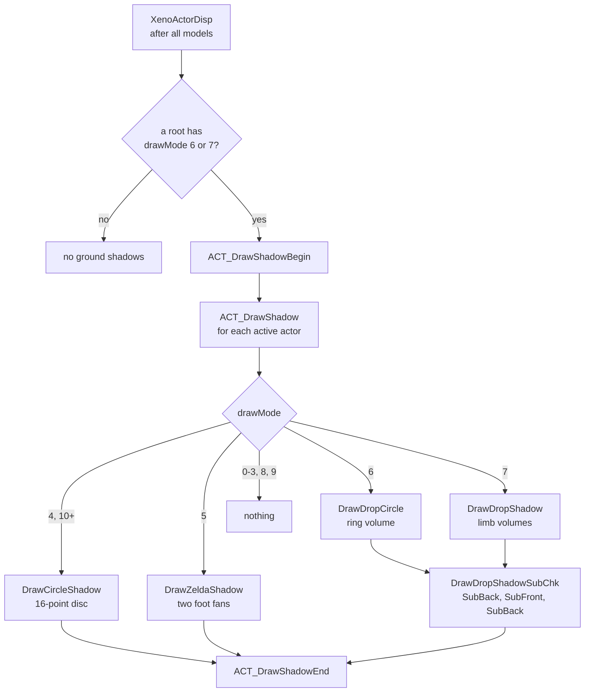

## Who creates actors

### The field: player, parts, enemies and people

The field keeps a table of 256 map object records, `uwamonoRecords[]`. A
record of kind 1 (a moving actor), 4 (the player) or 5 (a part attached to
the player) owns an actor in `body.actor`. All three are created by
`uwamonoCreateRecord` (`src/main/uwamono_objx.c`). It loads the resource
block of the id, takes an actor, copies the five addresses, loads the face
table (resource `0x30041`) into `rsrc[9]`, calls `XenoActorAllocMatrices`,
sets the blend length to 0 and starts motion 0. It stores the id in `kind`
and the record index in `moved`, switches the actor's light on (draw flag
8), and sets the body size: radius 0.6 and height 1.8 for ids up to
`0x6FFFF`, radius 0 above. Scripts create enemies and people through a
native of the same file. The records themselves and what they do each frame
are explained on the [map and units page](../game/map-and-units.md) and the
[field enemies page](../game/field-enemies.md).

The player is special in one way. `uwamonoChangePlayerModel`
(`src/main/game_camera.c`) creates the player record when there is none.
When one exists, it keeps the record and the actor and only swaps the
resources: it loads the new block, stores the five addresses, calls
`XenoActorAllocMatrices` again and starts motion 0 with a blend length of 4.
It then releases the old part records, creates the parts listed for the new
id in `uwamonoAttachIdTable` (up to two) and attaches them with
`uwamonoAttachPlayerParts`. Which character is the player, and the party
behind it, is explained on the
[party and growth page](../game/party-and-growth.md).

When the field comes back from a battle, a menu or a cutscene, the actor
pool has been reset and all field actors are gone. The restore function in
`src/main/game_data.c` calls `XenoActorPoolInitDefault` and walks the 256
records. For every record that had an actor it loads the resource block
again, takes a new actor and writes back everything the record saved:
position and facing, body size, the collision probe, the light set, the fog
values, the shadow type and strength, the draw flags, and the motion state
(slot, mode, frame, requested mode, speed and play range). It adds
`XENO_FLAG_RESET_CHANNEL` so the actor does not blend into its restored
pose. After the loop the parts are attached to the player again.

### Cutscenes

The cutscene player (`src/main/cfePlugIn.c`, see
[cutscenes](../scripting/cutscenes.md)) has two loaders.
`cfeLoadActorObject(id)` builds a full actor for the script command
`cfe.ldAt`. It copies the five block addresses, sets shadow type 6, and
loads the face table only when the hierarchy says it needs one (a non-zero
word at `0x1C`). Both blend lengths are set to 0 and motion 0 of slot 0 is
started. The command `cfe.ldMt` later loads a motion file by name into
`rsrc[XAct_Rsrc_XAP + index]`, so a cutscene actor can have up to four
motion tables. `cfeLoadResourceObject(id)` builds a model-only actor (model
and texture) for the script command `cfe.ldMp` (cutscene maps) and registers the model as the culling map.

While a cutscene plays, `src/main/cfeEvaluate.c` drives each actor from its
tracks every frame: position, rotation and scale, blend length, the speed of
both channels, slot and mode, play range, face animation, shadow type,
translucency, alpha, the parent actor and parent matrix, and the number of
solver passes. `cfeDampDirOffset` (`src/main/xeno_actor_set.c`) moves the
focus pair of an actor toward one of nine fixed offsets in
`cfeDirOffsetTable` by a tenth of the distance each call, and sets draw flag
`0x100` while the pair is not zero. When the cutscene ends, the player calls
`XenoActorReleaseAll` and then takes fresh actors for the field records of
kind 4 and 5, so the player record has a valid pointer until the field
restores itself.

### Battle

A battle unit (`BattleUnit`, `src/ov01/unit_cmd.c`) has a root actor in
`unit` and up to three child actors in `children[]`. `unitCreateSide` takes
the root. For most unit kinds it sets draw flags `0x10001` (alpha and fog
colour), `alpha` 0, shadow type 2 and `drawParam` 0.5. It copies the
battle's light block and fog values into the actor. It then takes one child
actor for every child the unit's data lists, with the same flags, plus the
hidden flag for children marked with `0x4000`.

The resources arrive later, when the unit's files are loaded.
`unitBindActors` copies the model, texture, hierarchy, look link and motion
table of the root and of each child from the data slot, sets the face table
on the root, calls `XenoActorAllocMatrices`, asks for 20 solver passes on
the root and starts motion 0. Each child is then attached at slot 27 or to a
joint. `unitAttachChild` stores an attack's motion table in `rsrc[5]` (mode
slot 1) of all the unit's actors and may add a third child model.
`unitRemove` releases all of them. The unit object, its commands and how
motions are chosen during a fight are explained on the
[battle engine page](../game/battle-engine.md).

`monsSlotNew` (`src/ov01/mons_slot.c`) takes a hidden actor at the origin
for a `MonsSlot`. `monsSlotCopyParams` later gives it a model and a texture
from a data stream record. It has no hierarchy, so it is a rigid model.

### Other screens

The G.S. Campaign path screen (`src/main/yg2path.c`, see
[G.S. Campaign](../game/gs-campaign.md)) loads four files by name,
`model\char\citizen\ukun00.pxy`, `.txy`, `.xhr` and `motion\ukun00.xap`, and
builds one citizen actor from them with shadow type 0 and motion 0.

The title screen (`src/ov02/title.c`, see
[title and boot](../game/title-and-boot.md)) resets the pool and builds one
actor per entry of the current model list. Each gets a model and a texture.
The entry with key 0 ends the list and stays a rigid model. The others also
get a hierarchy, and a motion entry and a face entry stored directly in
`rsrc[3]` and `rsrc[8]` with no table. All of them have
draw flag 1.

`oLibLoadObject` (`src/main/oLib.c`) is a general helper that builds a full
actor from a resource id with shadow type 1. No caller of it is present in
the game code.

## Background layers of the menus

`src/main/bg_layer.c` shows a moving 3D background behind the menu screens.
It is made of three actors: a back layer, a middle layer and a front layer.
The same file also holds `ScissorReset`, a small packet helper that is not
related to actors.

The layers are loaded in the background. `bgLayerLoad` reserves buffers and
starts asynchronous reads of `yosikawa\model\back.pxy` and `.txy`,
`midle.pxy` and `.txy`, `front.pxy` and `.txy`. A fourth step, `BG_MENUBG`,
reads `midle.xhr`, `front.xhr` and `menubg.xap` at once. The two hierarchy
files are copied into static blocks of 512 bytes, and the motion file stays
in the read buffer. `bgLayerInit` clears the state and runs this fourth step,
and `bgLayerLoadAll` starts all four.

`bgLayerAdvance(index)` is called when one of the six model and texture
files has arrived. It counts the file for its layer. A layer whose two files
are in gets its actor:

| Layer | Resources | Start |
| --- | --- | --- |
| `BG_BACK` | model, texture | Rigid, at the origin |
| `BG_MIDDLE` | model, texture, `midle.xhr`, `menubg.xap` | Motion 1 of the shared motion file |
| `BG_FRONT` | model, texture, `front.xhr`, `menubg.xap` | Motion 0 |

The middle and front layers wait until the hierarchies are loaded. A layer
that is done has the state byte `0x80` (`BG_LAYER_DONE`).

The menus draw over a field that still has its actors in the pool. Three
calls keep the two groups apart:

1. `bgLayerCameraSetup` sets up the background camera once (14 units back,
   a field of view of about 40 degrees, a 512 by 448 window), then sets draw
   flag `0x400` on every actor with `XenoActorSetFlagAll`. No actor is
   updated from now on. It also starts an 8-frame fade-in.
2. Each frame the menu calls `XenoActorSetFlagAll(2)`, which makes every
   actor skip its next draw, and then `bgLayerClearFlags` or
   `bgLayerClearAllFlags`, which clear `0x400` and `2` on the layers only.
   `XenoActorDoit` and `XenoActorDisp` then animate and draw the layers and
   nothing else.
3. `bgLayerRelease` releases the three layer actors and clears `0x400` on
   every record of the pool, so the field actors run again.

`bgLayerResetState` forgets the buffers and states without releasing
anything, for use after a pool reset.

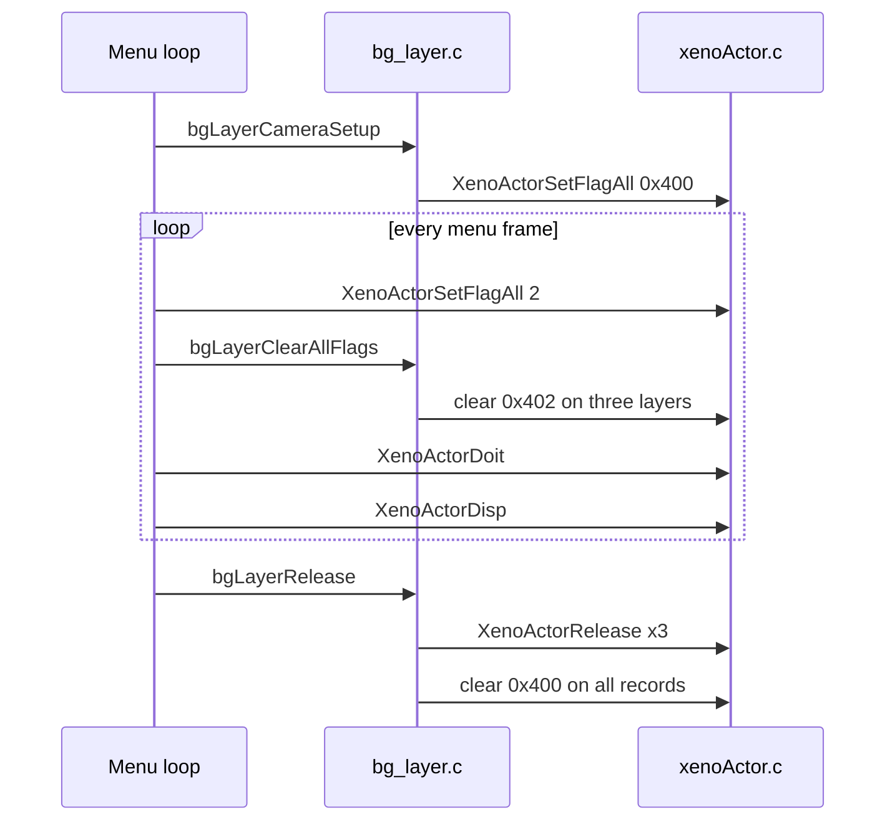

## The glow test scene

`glowRunScene` in `src/main/glow.c` is an entry of the developer test menu
(see [debug tools](../game/debug-tools.md)). It reads its files from the
development host and shows how little is needed for a working actor.

It resets the pool and takes two actors. The first, `pLandscape`, only gets
`glow3.pxy` and `glow3.txy`. It needs no matrices and is drawn as a rigid
model at the origin. The second, `pChaos`, gets `ziggy00.pxy`,
`ziggy00.txy`, `ziggy00.xhr` and `ziggy00.xap`. It is placed at x = 2, gets
its matrices from `XenoActorAllocMatrices`, a blend length of 8 and motion
0. Asserts with the texts `pLandscape->rsrc[XAct_Rsrc_MDL]` and so on check
that the model and texture files were found.

The loop runs until SELECT and START are held together. Each frame it clears
the frame, moves the second actor with the left stick and the up and down
buttons (`glowUpdateFromPad`, which also turns the actor toward the stick
direction), requests the overlay pass of the model library, and calls
`XenoActorDoit` and `XenoActorDisp`. L2 starts a test read of a file from
the disc. On exit it calls `XenoActorReleaseAll`.

## Small helpers

`src/main/xeno_actor_set.c` holds four functions that did not fit elsewhere.
`cfeDampDirOffset` and `XenoActorSetState` and `XenoActorSetChannelFlag80`
were explained above. `XenoActorGetHrcPoint(actor, out)` builds a matrix from
the transform block at `0x70` of the actor's hierarchy (translation,
rotations about Z, Y and X, scale) and applies it to the point stored in the
same block. It returns 0 when the actor has no hierarchy.

`src/main/xgl_vector_ops.c` holds, next to the two actor functions, a set of
short VU0 routines: a vector copy, the sum and the difference of the xyz
parts of two vectors, a component-wise product, a normalisation, a 4x4
matrix copy, and `tiVu0LoadIdentityMatrix`, which loads the identity into
the current matrix registers. The actor update uses the xyz sum to push the
dynamics bodies. Vector and matrix code as a subject is on the
[math page](math.md).

`XenoActorRefreshItems` is a debug drawer. For each collision item of the
hierarchy it draws a ring at the item's position with
`tiDrawCollisionDrawObjectRing`, in a brighter colour for the item whose
index is in `activeItem`. It runs only for actors whose `attr` has bit 4.
