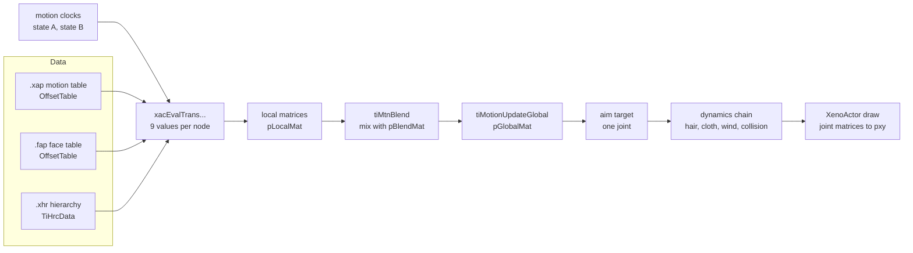
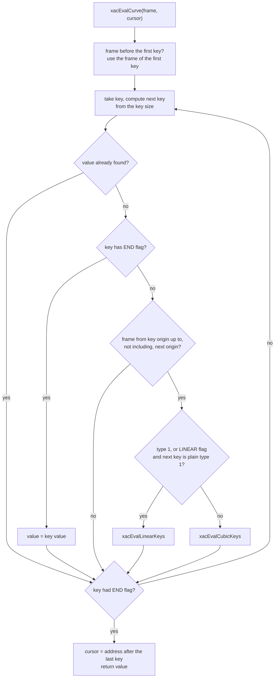
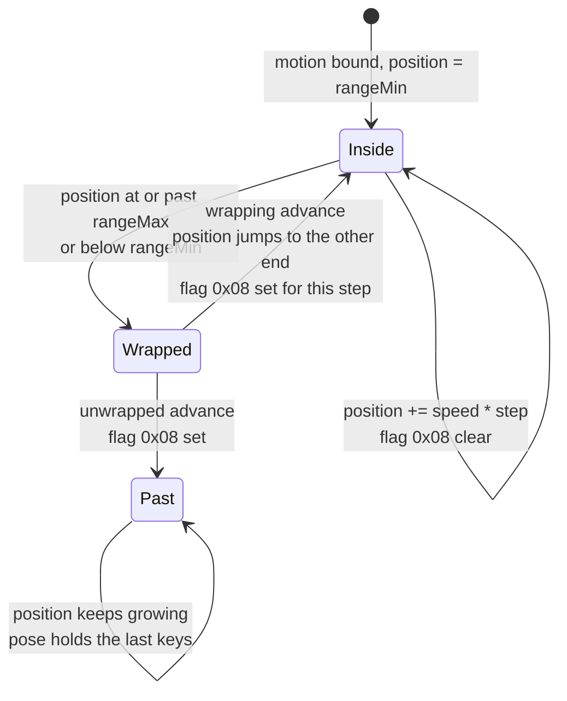
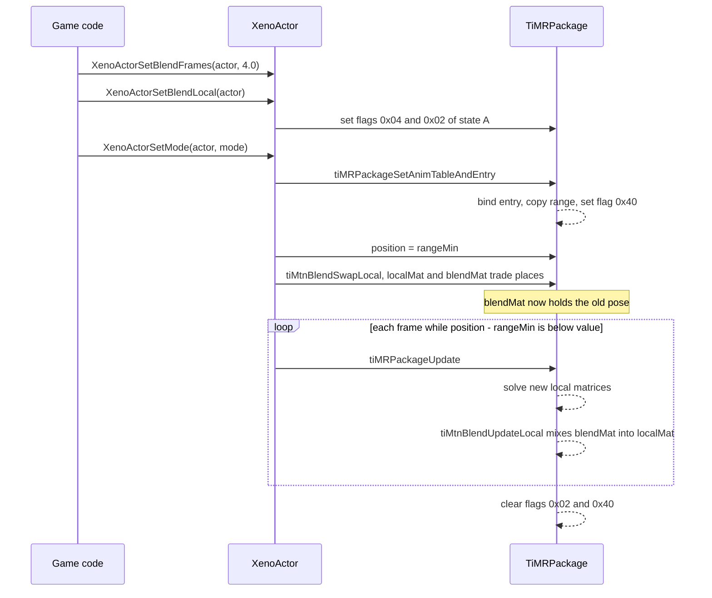
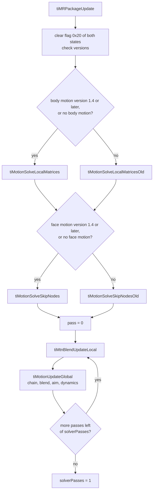
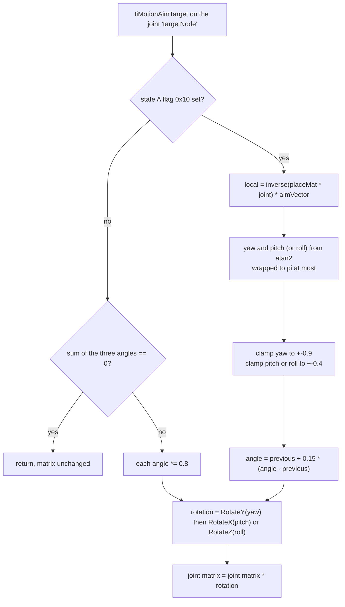
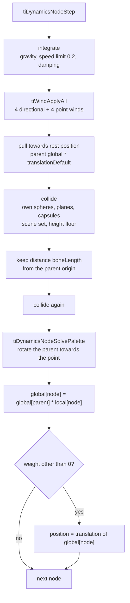
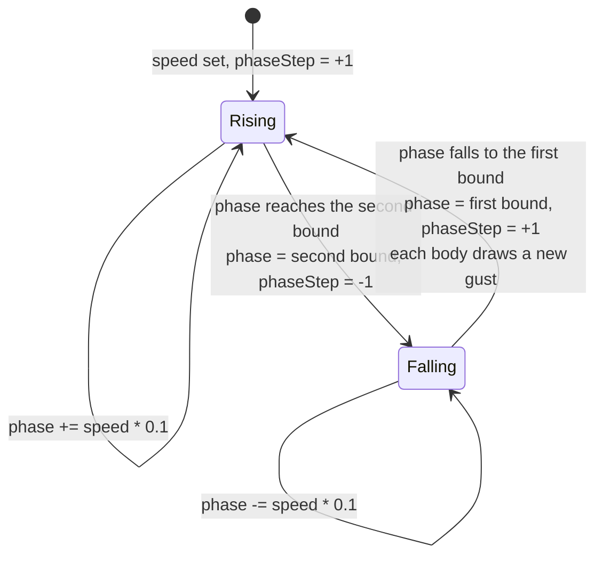
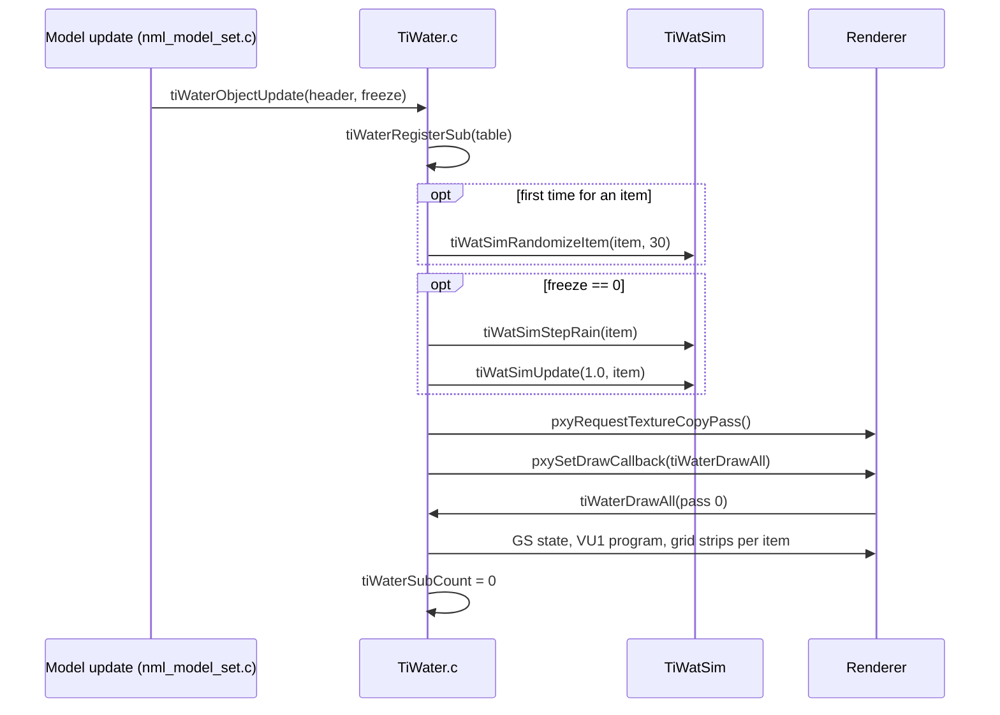
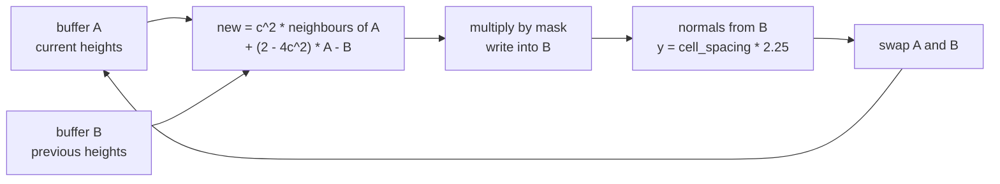

# Animation: the Ti library and XAC curves

Every animated model in Xenosaga Episode II is moved by a hierarchy of nodes.
A node is a joint, a locator, a face node, a hair or cloth node or a fixed
attachment point, and each one has a translation, a rotation and a scale
relative to its parent. A motion is a set of curves that give those values
over time. Every frame the engine samples the curves at the current frame
number, builds one matrix per node, blends the result with the previous
motion, turns the head towards a target, simulates hair and cloth and hands
the matrices to the model renderer.

The code that does this is the `Ti` library in `src/main/`. Its original file
names survive in the assert texts of the program (`../TiMRPackage.euc.c`,
`../TiMotionSolver.euc.c`, `../TiXacAnimCurve.euc.c` and so on). The centre of
the library is the motion/render package, `TiMRPackage`, a 0x100-byte block
that every [actor](actors.md) carries. It binds the hierarchy data, the motion
data and the matrix buffers of one model, and all solvers work on it. Around
it sit the curve reader (`xac`), the motion solver, the blender, the dynamics
for hair and cloth with their collision shapes, the wind sources, the animated
camera reader and a small water surface simulation.

The library has no file loading and no drawing of models of its own. The
[actor library](actors.md) loads the files, owns the buffers, calls the
package once per frame and passes the finished matrices to the
[model library](pxy.md).

[← Back to the overview](../README.md)

## Files

| File | Prefix | Contents |
| --- | --- | --- |
| `src/main/TiMRPackage.c` | `tiMRPackage`, `tiMRState`, `tiWord` | The motion/render package: initialization, binding of data and buffers, the two motion clocks, the per-frame update |
| `src/main/TiXacAnimCurve.c` | `xac` | XAC curve evaluation: key search, the transform readers for joints, locators, face nodes and dynamics nodes, the fixed-count readers, visibility tables |
| `src/main/xac_eval.c` | `xac` | The cubic and linear segment evaluation between two keys |
| `src/main/TiVu0.c` | `xac`, `tiVu0` | The two tangent readers of the curve keys and two assert-only stubs |
| `src/main/TiMotionSolver.c` | `tiMotion` | Local matrices of every node, face (skip) nodes, parent chaining into global matrices, the aim target, the dynamics chain, visibility bits |
| `src/main/TiMtnBlend.c` | `tiMtnBlend` | Blending between the previous pose and the new motion |
| `src/main/TiPartsAnim.c` | `tiPartsAnim`, `tiMRPackage` | Parts animation (one matrix per model part) and the node table lookup for attach points |
| `src/main/TiCameraSolver.c` | `tiCamera` | Reading an animated camera record into an `XglCamera` |
| `src/main/ti_dynamics_node.c` | `tiDynamicsNode`, `Xrg` | One simulation step of a dynamics node, the rotation of its parent, matrix and quaternion conversion |
| `src/main/TiDynamicsColl.c` | `tiDynamicsColl`, `tiMRPackage` | Per-frame preparation of the collision shapes of the hierarchy, node point lookup |
| `src/main/ti_dynamics_coll_push.c` | `tiDynamicsColl` | Pushing a point out of a sphere, above a plane and out of a capsule, for single nodes and for linked pairs |
| `src/main/TiGlobalColl.c` | `tiGlobalColl` | The scene-wide collision set (spheres, planes, cylinders) that all dynamics nodes test against |
| `src/main/TiWindBase.c` | `tiWind`, `tiDynamics` | The four directional and four point wind sources, their oscillation and their push, and the link pass of the dynamics |
| `src/main/TiWindAnim.c` | `tiWindAnim` | Driving the wind sources from curves stored in a collision set |
| `src/main/TiWater.c` | `tiWater` | Registration, stepping and drawing of water surfaces, and the water test scene |
| `src/main/TiWatSim.c` | `tiWatSim` | Disturbing the water height field: rain, footsteps, random start heights |
| `src/main/ti_wat_sim_update.c` | `tiWatSim` | The wave equation step of the water height field |
| `src/main/xrg_rand_int.c` | `Xrg` | Quaternion and vector helpers: normalize, Euler and axis-angle conversion, product, slerp |
| `src/main/TiDrawJoint.c` | `tiDrawJoint` | Debug drawing of the skeleton as line meshes and axes |
| `src/main/TiDrawCollision.c` | `tiDrawCollision` | Debug drawing of a collision sphere as a ring |
| `src/main/set_motion.c` | `Actor_LookAt` | The field look-at target bookkeeping that feeds the aim solver (the rest of the file belongs to [field enemies](../game/field-enemies.md)) |
| `include/main/TiMRPackage.h` | | The package, the motion state, the hierarchy and motion data structures |
| `include/main/TiXacAnimCurve.h`, `include/main/xac_eval.h` | | Curve keys, transform headers, the curve functions |
| `include/main/TiDynamicsColl.h`, `include/main/ti_dynamics_node.h`, `include/main/TiGlobalColl.h`, `include/main/TiWindBase.h` | | Collision records, the collision set, link records |
| `include/main/TiWatSim.h`, `include/main/TiWater.h` | | The water item and water table |
| `include/main/TiMotionSolver.h`, `include/main/TiMtnBlend.h`, `include/main/TiPartsAnim.h`, `include/main/TiCameraSolver.h`, `include/main/TiDrawJoint.h`, `include/main/TiDrawCollision.h`, `include/main/xrg_rand_int.h` | | Function declarations of the files above |

## From motion data to a drawn model

An actor holds its files in the resource array `XenoActor.rsrc[]`. The Ti
library uses five kinds of data from it:

- the hierarchy (`.xhr`), the list of nodes with their rest pose, the hair and
  cloth nodes and the collision shapes that belong to the body,
- the motion file (`.xap`), a table of motions, each one a set of XAC curves,
- the face motion file (`.fap`), a table with the same form whose curves
  drive the face nodes,
- the parts animation data (called `pPamData` in the assert texts), used by
  models that move whole parts without a skeleton,
- the node table (called `lookLink` in the resource records of the game), a
  list of named points on the skeleton for attaching effects and objects.

The byte layouts of these files are the subject of
[Skeletons and motion](../formats/skeletons-and-motion.md). This page
describes them as far as the structures of the code show them.

At run time the work for one actor and one frame has six stages. The motion
clock holds the current frame number of the body motion and of the face
motion. The curve reader samples the curves of every node at that frame. The
solver turns the sampled values into one local matrix per node. The blender
mixes these with the pose of the previous motion while a blend is running.
The solver then chains the matrices from parent to child into global
matrices, applies the aim target to one joint and simulates the dynamics
nodes. At the end the actor multiplies the global matrices with the inverse
bind matrices of the model and gives them to the model library.

The diagram below shows this flow.



## The hierarchy data

### Node groups

The hierarchy is one block, `TiHrcData`. The package asserts that its version
float is at least 2.3 (the assert text reads `illegal xhr version`). The block
holds seven groups of nodes. The groups are stored one after another, and the
matrix index of a node is its position in this order:

| Order | Group | Record | Size | Count field | Animated by |
| --- | --- | --- | --- | --- | --- |
| 1 | Locators | `TiHrcLocator` | 0x40 | always 2 | body motion |
| 2 | Joints | `TiHrcJoint` | 0x50 | `jointCount - 2` | body motion |
| 3 | Second joints | `TiHrcJoint` | 0x50 | `joint2Count` | body motion |
| 4 | Third joints | `TiHrcJoint` | 0x50 | `joint3Count` | body motion |
| 5 | Skip nodes (face) | `TiHrcSkip` | 0x70 | `skipCount` | face motion |
| 6 | Dynamics nodes | `TiHrcDynamics` | 0xB0 plus entries | `dynamicsCount` | simulation and body motion |
| 7 | Static nodes | `TiHrcStatic` | 0x40 | `staticCount` | nothing, fixed transform |

`jointCount` includes the two locators, so the first joint group has
`jointCount - 2` records. The two locators and the first joints lie directly
in the header (`locators[2]`, `joints[]`). The other groups are found through
byte offsets from the start of the block. `transformCount` is the total number
of nodes. The actor allocates three buffers of `transformCount` matrices of
0x40 bytes each from it: the local matrices, the global matrices and the
blend matrices.

The name "skip node" comes from the solver functions (`tiMotionSolveSkipNodes`).
The curve reader calls the same records `pTransFace`, and they are driven by
the face motion, so they are the nodes of the face.

The header fields that the code reads are these:

| Offset | Type | Name | Meaning |
| --- | --- | --- | --- |
| 0x04 | float | `version` | File version, at least 2.3 |
| 0x0C | u32 | `transformCount` | Number of nodes of all groups |
| 0x10 | int | `jointCount` | Locators plus first joints |
| 0x14 | int | `joint2Count` | Second joint group |
| 0x18 | int | `joint3Count` | Third joint group |
| 0x1C | int | `skipCount` | Face nodes |
| 0x20 | int | `dynamicsCount` | Dynamics nodes |
| 0x24 | int | `staticCount` | Static nodes |
| 0x28 to 0x38 | int | `joint2Offset`, `joint3Offset`, `skipOffset`, `dynamicsOffset`, `staticOffset` | Byte offsets of the groups |
| 0x3C | u32 | `sphereCount` | Collision spheres |
| 0x40 | u32 | `matrixCount` | Collision planes |
| 0x44 | u32 | `capsuleCount` | Collision capsules |
| 0x48 | int | `linkCellCount` | Cells of the link table |
| 0x4C to 0x58 | int | `sphereOffset`, `matrixOffset`, `capsuleOffset`, `linkCellOffset` | Byte offsets of the collision records and the link table |
| 0x70 | `TiHrcLocator[2]` | `locators` | The two locators |
| 0xF0 | `TiHrcJoint[]` | `joints` | The first joint group |

### Node records

Every animated record carries the rest pose of its node as nine stored
defaults: three translations, three rotation angles and three scales. A
channel that has no curve in the current motion takes its default. Every
record also has a `flags` word and a `scale` vector that the solver writes.
The `scale` vector holds the scale the node had in the last solved frame, so
that a child can undo it.

A joint (`TiHrcJoint`) has two more values. `orient` is a fixed rotation that
is applied before the animated rotation, the joint orientation of the
modelling tool. `rotationScale` multiplies the three animated rotation angles
when it differs from 1.0.

| Offset | Type | Name | Meaning |
| --- | --- | --- | --- |
| 0x00 | int | `parent` | Matrix index of the parent, negative for a root |
| 0x04 | float[3] | `translationDefault` | Rest translation. The aim solver also reads its first two values |
| 0x10 | float[3] | `orient` | Fixed joint orientation |
| 0x1C | float[3] | `rotationDefault` | Rest rotation angles |
| 0x28 | float[3] | `scaleDefault` | Rest scale |
| 0x34 | float[3] | `scale` | Scale of the last solved frame |
| 0x40 | float | `rotationScale` | Multiplier of the animated rotation |
| 0x44 | int | `flags` | Bit 0x2: undo the scale of the parent |

A locator (`TiHrcLocator`) is the same without `orient` and `rotationScale`.
The first locator is the root of the model. The second locator carries the
movement of the body: its translation is multiplied by the package scale
vector, and the actor reads the translation of global matrix 1 back after
every update.

A face node (`TiHrcSkip`) adds a word `limitFlags` and six floats `limit[6]`,
a minimum and a maximum for each rotation axis. A static node (`TiHrcStatic`)
is a fixed transform (`TiMotionTransform`: parent, offset, rotation, scale)
with an `id` at 0x38. The actor searches this id when a child actor is
attached to a joint. The dynamics node is described in
[Dynamics](#dynamics-hair-and-cloth).

## Motion data

### Motion tables and entries

A motion file is a counted table, `OffsetTable`. The entry count is at offset
8, and a list of byte offsets, each one relative to the table, starts at
offset 0xC. One entry (`TiOffsetEntry`) is one motion.

| Offset | Type | Name | Meaning |
| --- | --- | --- | --- |
| 0x04 | float | `version` | Version of the motion data, at least 1.2 |
| 0x08 | float | `rangeMin` | First frame of the motion |
| 0x0C | float | `rangeMax` | Last frame of the motion |
| 0x10 | union | `tables` | Counts and offsets of the curve streams |

An entry is valid when `rangeMin <= rangeMax`. `tiMRPackageSetAnimData` and
`tiMRPackageIsAnimEntryValid` both use this test, and an invalid entry is not
bound.

The part from 0x10 has one of two layouts, chosen by the version. Below
version 1.4 (`TiXacTables1`) the entry lists four curve streams: the joints,
the second joints, the dynamics nodes and the face nodes, each with a count
and a byte offset from the entry (the face stream is read by
`tiMotionSolveSkipNodesOld`). From version 1.4 on (`TiXacTables2`) it adds
the third joints and the visibility tables. `tiMRPackageUpdate` picks the
matching solver for each entry, `tiMotionSolveLocalMatricesOld` for the first
layout and `tiMotionSolveLocalMatrices` for the second.

A face motion file (`.fap`) is the same kind of table. The loader in
`src/main/res_get_path.c` (`xglCdLoadXapFile`) even treats the two as
alternatives: it asks for the `.xap` name first and falls back to `.fap` when
no such file exists. The game binds a face table to state B of the package
and a body table to state A. The field and the map code take the face table
of every actor from resource `0x30041`, and the battle overlay loads
`motion\face_all.fap`.

### Curve streams and transform headers

A curve stream is a sequence of node blocks without any index. The block of
one node starts with a transform header (`TiXacTransformHeader`) and continues
with the curves of the channels that the header announces, one after another.
The reader cannot skip a node, so the stream order must be the node order of
the hierarchy.

| Offset | Type | Name | Meaning |
| --- | --- | --- | --- |
| 0x00 | u16 | `channelFlags` | One bit per channel that has a curve |
| 0x02 | u16 | `headerFlags` | Bit 0x1: the node undoes the scale of its parent |
| 0x04 | float | `weight` | Only in dynamics node blocks from version 1.3 on: the animation weight |

The nine channel bits follow the order of the nine values:

| Bit | Value index | Channel |
| --- | --- | --- |
| 0x001, 0x002, 0x004 | 0, 1, 2 | Translation X, Y, Z |
| 0x008, 0x010, 0x020 | 3, 4, 5 | Rotation X, Y, Z |
| 0x040, 0x080, 0x100 | 6, 7, 8 | Scale X, Y, Z |

For the body nodes the header is 4 bytes long and the curves start right after
it. For a dynamics node of version 1.3 or later the header is 8 bytes long
because of the weight.

The number of node blocks in a stream may be smaller than the number of nodes
of the hierarchy. The solver compares its loop counter with the count in the
entry and sets its cursor to null when the stream is used up. A null cursor
makes the reader return the stored defaults, so the remaining nodes stand in
their rest pose. The same happens for every node when no motion is bound at
all.

### Keys

A curve is a run of keys (`TiXacKey`). Each key starts with a 16-bit
`typeFlags` word and a signed 16-bit `origin`, the frame number of the key.
The low 12 bits of `typeFlags` are the key type (`XAC_KEY_TYPE_MASK`). Two
high bits are flags: `XAC_KEY_END` (0x4000) marks the last key of the curve,
and `XAC_KEY_LINEAR` (0x8000) asks for a straight segment to the next key.
The type decides the size of the key and where its value and tangents are.

| Type | Size | Layout after the 4-byte head | Tangents |
| --- | --- | --- | --- |
| 0 | 8 bytes | value | Both zero, a flat ease in and out |
| 1 | 8 bytes | value | None, the segment after it is always linear |
| 2 | 12 bytes | tangent, value | One float used for both sides |
| 3 | 12 bytes | in tangent (u16), out tangent (u16), value | Two 16-bit values, each multiplied by 0.0001 |
| 5 | 16 bytes | in tangent, out tangent, value | Two floats |

Type 4 is named `XacKeyType_Hermite` in an assert text. The reader stops with
that assert when it meets one, so the game data never contains it. Any other
type number stops with the assert `IllegalCurveType`.

The value of a key is read by `xacGetKeyValue`. The tangents are read by
`xacGetKeyOutTangentAngle` (the side towards the next key) and
`xacGetKeyInTangentAngle` (the side towards the previous key), both in
`src/main/TiVu0.c`. A tangent is stored as an angle in radians, the slope
angle of the curve in a diagram of value over time in seconds.

### Evaluating a curve

`xacEvalCurve(curveParam, keyCursor)` returns the value of one curve at the
frame `curveParam` and moves the cursor to the first byte after the curve. It
is the only way to get past a curve, which is why even the channels whose
value is not needed are always evaluated.

The function first clamps the frame: a frame before the first key is replaced
by the frame of the first key. It then walks the keys in order. For each key
it knows the address of the next key from the key size. As long as no value
has been found it tests the key:

1. If the key has the `XAC_KEY_END` flag, the value is the value of this key.
   This is how a frame after the last key holds the last value.
2. Otherwise, if the frame lies in `[key.origin, next.origin)`, the value
   comes from the segment between the two keys.
3. A segment is linear when the key is of type 1. It is also linear when the
   key has the `XAC_KEY_LINEAR` flag and the `typeFlags` word of the next key
   is exactly 1, a type 1 key without flags. Every other segment is cubic.

The walk does not stop when the value is found. It continues to the key with
the end flag so that the cursor ends up behind the curve.



**Linear segments.** `xacEvalLinearKeys` computes the fraction
`(frame - key.origin) / (next.origin - key.origin)` and returns
`a + (b - a) * fraction`. Both differences are divided by 30.0 first, which
cancels out. A span of zero frames counts as one frame.

**Cubic segments.** `xacEvalCubicKeys` builds a Hermite curve from the two
keys. Time is measured in seconds: a frame number times `1/30`
(`xacKeyOriginScale`, 0.0333333351). The motion data is therefore authored at
30 frames per second. For each end the function forms a helper point one unit
along the tangent direction: `(t0 + cos(a0), v0 + sin(a0))` for the start and
`(t1 - cos(a1), v1 - sin(a1))` for the end, where `a0` is the out tangent of
the first key and `a1` the in tangent of the second.

`xacBuildCubicSegment` turns the four points into the coefficients of a cubic
polynomial. The slope at each end is the rise over the run to its helper
point, `sin(a) / cos(a)`. When the run is zero, a vertical tangent, the slope
is set to 5729578.0. With `span = t1 - t0`, `d = v1 - v0` and the two slopes
`m0` and `m1`, the coefficients are:

```
c3 = v0
c2 = m0
c1 = (3*d - 2*span*m0 - span*m1) / span^2
c0 = (span*m0 + span*m1 - 2*d) / span^3
```

`xacEvalCubicSegment` evaluates `((c0*s + c1)*s + c2)*s + c3` with
`s = (frame - key.origin) * 1/30`, the time in seconds since the first key.
This is the standard cubic Hermite form: the curve passes through both key
values and has the two given slopes at its ends.

### The transform readers

Four functions read the block of one node into an array of nine floats. They
differ only in the record type whose defaults they use:

| Function | Record | Used for |
| --- | --- | --- |
| `xacEvalTransLocator` | `TiHrcLocator` | The two locators |
| `xacEvalTransJoint` | `TiHrcJoint` | The three joint groups |
| `xacEvalTransFace` | `TiHrcSkip` | The face nodes |
| `xacEvalTransDynamics` | `TiHrcDynamics` | Dynamics nodes, version 1.3 and later |
| `xacEvalTransDynamicsNoWeight` | `TiHrcDynamics` | Dynamics nodes of older motion data |

Each one works the same way. With a null cursor it copies the nine defaults
and clears bit 0x2 of the record flags. With a cursor it copies bit 0x1 of
`headerFlags` into bit 0x2 of the record flags, then goes through the nine
channel bits. A set bit evaluates the next curve of the stream. A clear bit
takes the default of that channel. At the end it stores the advanced cursor.

The dynamics reader also copies the `weight` of the header into the node. With
a null cursor it sets the weight to 0.0. The older variant has no weight in
its header and always leaves the weight at 0.0. The weight decides how much of
the node comes from animation, see [The animation weight](#the-animation-weight).

`xacEvalTransform` is a fifth reader without a record. Its defaults are 0.0
for translation and rotation and 1.0 for scale.

### Fixed-count readers

Some data is not a node of a hierarchy. For it the file stores a 4-byte header
followed by a fixed number of curves, and the reader evaluates all of them.

| Function | Curves | Used by |
| --- | --- | --- |
| `xacEvalJointValue` | 1 | The field of view of an animated camera |
| `xacEvalJointPose` | 6 | Position and rotation of an animated camera |
| `xacReadJointCurves9`, `xacEvalJointCurves9` | 9 | One part of the parts animation |
| `xacReadWindDirCurves`, `xacReadWindPointCurves` | 12 | One wind source of a collision set |
| `xacReadJointCurves12Padded` | 12, then three values of 1.0 | `tiGlobalCollEvalSubobject`, older data |
| `xacReadJointCurves15` | 15 | `tiGlobalCollEvalSubobject`, newer data |

The two wind readers stop after the first curve when its value is 0.0, the
"disabled" case. They then leave the cursor where it was.

`tiGlobalCollEvalSubobject` chooses between the last two readers by a version
float below or from 1.5. It has no caller in the game code, and neither has
`tiMotionSampleJoint`, a thin wrapper around `xacEvalJointCurves9`.

## The motion/render package

### Layout

`TiMRPackage` is the working state of one animated model. It sits inside the
actor at offset 0x640 (`XenoActor.motionPack`, the name used by the assert
texts of the actor library). `tiMRPackageInit` clears all 0x100 bytes and sets
the defaults named in the table.

| Offset | Type | Name | Meaning |
| --- | --- | --- | --- |
| 0x00 | int | `solverPasses` | Number of solver passes of the next update, 1 by default |
| 0x04 | int | `targetNode` | Matrix index of the joint that the aim solver turns, 0x1D after initialization |
| 0x10 | `TiMRState` | `state_a` | Clock and flags of the body motion, and the aim state |
| 0x60 | `TiMRState` | `state_b` | Clock and flags of the face motion |
| 0xB0 | float[3] | `scale` | Scale of the body movement, (1, 1, 1) by default |
| 0xC0 | `TiOffsetEntry *` | `entryA` | Current body motion (`pAnimData`) |
| 0xC4 | `OffsetTable *` | `entryTableA` | Table the body motion is chosen from |
| 0xC8 | `TiOffsetEntry *` | `entryB` | Current face motion (`pFaceAnimData`) |
| 0xCC | `OffsetTable *` | `entryTableB` | Table the face motion is chosen from |
| 0xD0 | `TiHrcData *` | `hrcData` | The hierarchy (`pHrcData`) |
| 0xD4 | `TiPamData *` | `pamData` | Parts animation data (`pPamData`) |
| 0xD8 | `TiNodeTable *` | `nodeTable` | The node table for attach points |
| 0xDC | `Matrix4 *` | `localMat` | One local matrix per node (`pLocalMat`) |
| 0xE0 | `Matrix4 *` | `globalMat` | One global matrix per node (`pGlobalMat`) |
| 0xE4 | `Matrix4 *` | `blendMat` | The pose kept for blending (`pBlendMat`) |
| 0xE8 | `Matrix4 *` | `partsMat` | One matrix per model part (parts animation) |
| 0xEC | `TiDynamicsOut *` | `dynMat` | One simulation body per dynamics node |
| 0xF0 | `Matrix4 *` | `placeMat` | The placement of the actor in the world (`pPlaceMat`) |

The "global" matrices are global within the model. They are relative to the
root of the hierarchy, and the actor multiplies them with its own placement
matrix when it draws. `placeMat` points at that placement matrix
(`XenoActor.localMatrix`). The aim solver needs it to bring a world position
into the space of a joint.

### The motion state

Each of the two states is a `TiMRState` of 0x50 bytes.

| Offset | Type | Name | Meaning |
| --- | --- | --- | --- |
| 0x00 | int | `flags` | State flags, see below |
| 0x04 | float | `speed` | Frames added per step, 1.0 by default, negative to play backwards |
| 0x08 | float | `position` | The current frame number |
| 0x0C | float | `value` | Length of a blend in frames |
| 0x10 | int | `rangeMin` | First frame of the play range |
| 0x14 | int | `rangeMax` | Last frame of the play range |
| 0x20 | `Vector4` | `aimVector` | World position to aim at (state A only) |
| 0x30 | float[4] | `aimPrevious` | The aim angles of the previous frame (state A only) |
| 0x40 | float | `aimRotateX` | Current pitch of the aim |
| 0x44 | float | `aimAngle` | Current yaw of the aim |
| 0x48 | float | `aimRotateZ` | Current roll of the aim |

The flag word is changed with `tiWordSetBits` and `tiWordClearBits`.

| Bit | Set by | Meaning |
| --- | --- | --- |
| 0x02 | `XenoActorSetBlendLocal`, `XenoActorSetBlendGlobal` | A blend is wanted or running. Cleared when the blend ends and when the clock wraps |
| 0x04 | `XenoActorSetBlendLocal` | The blend works on local matrices. Clear means it works on global matrices |
| 0x08 | the advance functions | The clock passed the end of its range in this step. `XenoActorIsDone` reads it |
| 0x10 | `XenoActorSetFocusTarget` | An aim target is set for this frame. The actor clears it after every update |
| 0x20 | the solver | A node had a scale other than 1 in this frame. Cleared at the start of every update |
| 0x40 | the entry selectors | A new motion was bound, a blend may start |
| 0x80 | `XenoActorSetChannelFlag80` | State A only: dynamics bodies are kept above a height of 0.03 |

### Binding data

The actor fills the package in `XenoActorAllocMatrices`
(`src/main/xenoActor.c`). It allocates the local, global and blend matrix
buffers from heap 5, `transformCount * 0x40` bytes each, and a body buffer of
`dynamicsCount * 0x40` bytes when the hierarchy has dynamics nodes. It then
calls the setters in this order: `tiMRPackageInit`, `tiMRPackageSetLocalMat`,
`tiMRPackageSetGlobalMat`, `tiMRPackageSetBlendMat`, `tiMRPackageSetHrcData`,
`tiMRPackageSetAnimData`, `tiMRPackageSetAnimTable`,
`tiMRPackageSetFaceAnimData`, `tiMRPackageSetFaceAnimTable`,
`tiMRPackageSetEntryTableC` (the node table) and `tiMRPackageFillNodes`.

`tiMRPackageFillNodes` (in `src/main/xgl_vector_ops.c`) prepares the
simulation bodies. For every dynamics node it copies three start vectors from
the end of the node record into the body (previous position, position and
accumulator), stores the pointer to the node and sets the gust factor to 1.0.

An actor that has parts animation data is set up a second time: the package is
initialized again and only gets the parts matrices (`tiMRPackageSetPartsMat`)
and the parts data (`tiMRPackageSetClampRange`). Such an actor is animated by
parts alone.

## The motion clock

### Advancing

The package has two clocks, one in each state. `position` is the current
frame, `speed` the number of frames per step. Four functions advance them:

| Function | Clock | At the end of the range |
| --- | --- | --- |
| `tiMRPackageAdvanceAnim` | body (state A) | wraps around |
| `tiMRPackageAdvanceAnimUnwrapped` | body (state A) | keeps running |
| `tiMRPackageAdvanceFaceAnim` | face (state B) | wraps around |
| `tiMRPackageAdvanceFaceAnimUnwrapped` | face (state B) | keeps running |

All four add `speed * step` to the position. The step is a float of studio
camera 0 (`xglStudioGetCamera2(0)->unknown_5f4`), which `xglCameraInit` sets
to 1.0. With that value a clock moves by `speed` frames per game frame.

The wrapping functions then compare the position with the range. A position
at or past `rangeMax` jumps to `rangeMin`. A position below `rangeMin`, which
happens when the speed is negative, jumps to `rangeMax`. Both cases set flag
0x08 and clear the blend flag 0x02. A position inside the range clears flag
0x08. The flag is therefore set for exactly one step each time a motion
reaches its end, and a looping motion and a motion that plays once differ only
in what the caller does when it sees the flag.

The unwrapped functions set flag 0x08 in the same cases but leave the position
alone. The motion then holds its last key values, because the curve reader
returns the value of the last key for any later frame.

For the body clock a second range can apply. When parts animation data is
bound, the two 16-bit limits at offsets 8 and 10 of that data (`lowerLimit`
and `upperLimit`) are tested after the motion range in the same way, and
their result replaces flag 0x08.



### How the actor drives the clocks

The actor keeps its own copies of the two frame numbers, `XenoActor.frame`
for the body and `XenoActor.cachedValue` for the face. In
`XenoActorUpdateTree` it first writes them into the package
(`tiMRStateSetPosition`), then solves the pose, and only then advances the
clocks and reads the new positions back. The pose of a frame is thus solved
from the frame numbers that the previous step left.

Four actor flags choose the advance function. `XENO_FLAG_FREEZE_A` (0x1) and
`XENO_FLAG_FREEZE_B` (0x4) stop the body or the face clock.
`XENO_FLAG_UNWRAP_A` (0x2) and `XENO_FLAG_UNWRAP_B` (0x8) select the unwrapped
variants.

Other code changes the speed directly. The field enemy code sets
`motion[0].speed` to 0.0 or 1.0 to stop and start a motion, and the player
movement code in `src/main/game_camera.c` derives the speed of the walk and
run motions from the movement speed of the player (`speed * 2.6 / 192` below a
speed of 192 and `speed / 256` from there on).

`XenoActorSetPlayRange` limits a motion to a part of its frames. It stores a
new range in state A with `tiMRStateSetRange`, and when the current frame
lies outside the new range it restarts from the start, or from the end when
the speed is negative.

## Choosing a motion and blending

### Selecting an entry

The actor calls a motion a "mode". A mode is an index into a motion table.
The actor can hold several tables at once in `rsrc[XAct_Rsrc_XAP + slot]`,
and `XenoActorSetModeInSlot` accepts slots 0 to 3. `XenoActorSetMode` is the
same for slot 0.

Both end in `tiMRPackageSetAnimTableAndEntry(package, table, index)`. This
stores the table, binds entry `index` with `tiMRPackageSetAnimData` and sets
flag 0x40 of state A. Binding copies the frame range of the entry into the
state. The actor then puts the frame number at `rangeMin`, or at `rangeMax`
when the speed is negative, and clears flag 0x08.

`tiMRPackageSelectAnimEntry` does the same with the table that is already
stored. `tiMRPackageSelectFaceAnimEntry` is the counterpart for state B and
is used by `XenoActorSetSelector` to choose a face motion.

`XenoActorRequestMode` queues a motion instead. The request is applied in
`XenoActorApplyRequestedMode` in the first frame in which the current motion
is done (flag 0x08). The actor then enables a local blend and sets the mode.

### How a blend is prepared

A blend mixes the last pose of the old motion with the frames of the new one.
It needs three things: a blend length, the two blend flags and a copy of the
old pose.

The length is `TiMRState.value`, set with `XenoActorSetBlendFrames` (state A)
or `XenoActorSetBlendFramesB` (state B). The game uses values such as 4.0
for the ladder and enemy motions, and 0.0 switches blending off.

The flags are set with `XenoActorSetBlendLocal` (0x04 and 0x02, a blend of
local matrices) or `XenoActorSetBlendGlobal` (0x02 only, a blend of global
matrices).

The copy of the old pose costs nothing. When a mode is set while flag 0x02 is
set, the actor calls `tiMtnBlendSwapLocal` and `tiMtnBlendSwapGlobal`. One of
them exchanges two buffer pointers of the package: with flag 0x04 the local
and blend buffers trade places, without it the global and blend buffers do.
The matrices of the last solved frame are now the blend pose, and the solver
writes the new motion into the other buffer. The actor flag
`XENO_FLAG_BLEND_SWAPPED` (0x10) prevents a second swap in the same frame.



### The blend itself

`tiMtnBlendUpdateLocal` runs after the local matrices are solved, and
`tiMtnBlendUpdateGlobal` after the global matrices are chained. Each acts only
on a state whose flags fit: flag 0x40 must be set, flag 0x02 must be set, and
flag 0x04 must be set for the local function and clear for the global one.
When flag 0x40 is clear, the function clears flag 0x02 as well.

The progress of a blend is measured on the motion clock itself:

```
remaining = position - rangeMin
progress  = remaining / value        (clamped to 0..1)
```

The blend ends when `value` is 0.0, when `remaining` reaches `value` or when
`remaining` is negative. The function then clears flags 0x02 and 0x40. A
motion that starts at its end and plays backwards therefore never blends,
because its first `remaining` is already the full length of the motion.

While the blend runs, every matrix of the affected nodes is replaced by
`tiMtnBlendMatrix(blendMat[i], newMat[i], progress)`. State A covers the
locators and the three joint groups. State B covers the face nodes. Dynamics
and static nodes are never blended.

`tiMtnBlendMatrix` blends the translation linearly. For the rotation it
converts both matrices to quaternions (`XrgMatrixToQuaternion`), interpolates
them with `XrgQuaternionSlerp` and converts the result back
(`XrgQuaternionToMatrix`). The result has no scale. Before that the function
checks the length of the three linearly blended rotation rows. If one of them
is 1e-6 or shorter it returns without writing, and the node keeps the pose of
the new motion.

`tiMtnBlendLerpMatrix` is a plain element by element blend of two matrices.
The dynamics code uses it for the animation weight.

## The per-frame update

### tiMRPackageUpdate

`tiMRPackageUpdate` is the one entry point that solves a pose. The actor
calls it from `XenoActorApplyRequestedMode` for every actor that has a
hierarchy.

1. It asserts that the package and its global and local buffers exist.
2. It clears flag 0x20 of both states.
3. It asserts the versions: hierarchy at least 2.3, body motion at least 1.2,
   face motion at least 1.2.
4. It solves the local matrices of the body with
   `tiMotionSolveLocalMatrices`, or with `tiMotionSolveLocalMatricesOld` when
   the body motion is older than version 1.4.
5. It solves the local matrices of the face nodes with
   `tiMotionSolveSkipNodes`, or `tiMotionSolveSkipNodesOld` for a face motion
   older than version 1.4.
6. It runs `tiMtnBlendUpdateLocal` and `tiMotionUpdateGlobal`, `solverPasses`
   times in a row.
7. It sets `solverPasses` back to 1.

The repeat count of step 6 exists for the dynamics. One pass of
`tiMotionUpdateGlobal` is one simulation step of every hair and cloth node.
When an actor is placed somewhere new, one step would leave its hair hanging
behind for many frames. The game therefore asks for several steps at once
with `XenoActorSetSolverPasses`: 15 and 20 passes in the ladder code
(`src/main/get_ladder.c`), 20 passes when a battle unit is set up
(`src/ov01/unit_cmd.c`), and a value given by the cutscene data and by a
script native.



### Local matrices

`tiMotionSolveLocalMatrices` walks the node groups in matrix order with one
stream cursor per curve stream. For each node it reads the nine values with
the matching transform reader at the frame `state_a.position` and builds the
local matrix on the current matrix of the [math library](math.md):

1. Start from the identity (`tiVu0LoadIdentityMatrix`).
2. Multiply the translation, when it is not zero.
3. If the node has flag 0x2, look up the scale that its parent had in this
   frame (`tiMotionFindParentScale`) and multiply the inverse of it, when it
   is not (1, 1, 1). This lets a parent be scaled without scaling the child.
4. For joints and dynamics nodes, multiply the fixed `orient` rotation, in
   the order Z, Y, X.
5. Multiply the animated rotation, in the order Z, Y, X. For a joint the three
   angles were first multiplied by `rotationScale`.
6. Multiply the scale, when it is not (1, 1, 1), and set flag 0x20 of state A
   in that case. Store the scale in the node record.
7. Store the matrix in `localMat[nodeIndex]`.

Each of these multiplications is skipped when its values are neutral, which
saves most of the work for nodes that only rotate.

After the two locators the function multiplies the translation of local
matrix 1, the second locator, by the package `scale` vector. The game sets
this vector with `XenoActorSetVector` and `XenoActorSetVectorUniform`. It
scales the distance that a motion moves the whole body.

The static nodes get their matrix from `tiMotionTransformToMatrix`, which
builds offset, rotation and scale from the fixed transform of the record.

The older function `tiMotionSolveLocalMatricesOld` differs in three points.
It reads the first table layout. It gives the third joint group no curves, so
those joints always stand in their rest pose. And for motion data older than
version 1.3 it reads the dynamics nodes with the reader that has no weight.

### Face nodes

`tiMotionSolveSkipNodes` does the same for the face nodes, with the cursor of
the face motion (`entryB`) and the frame `state_b.position`. The matrix index
of the first face node is `jointCount + joint2Count + joint3Count`.

A face node multiplies its translation only when its stored default
translation is not zero, and its scale only when its default scale is not
(1, 1, 1). It sets flag 0x20 of state B when it applies a scale.

The record carries rotation limits. `limitFlags` has one bit for the minimum
and one for the maximum of each axis (0x1 and 0x2 for X, 0x4 and 0x8 for Y,
0x10 and 0x20 for Z), and `limit[6]` holds the six bounds. The solver clamps
the three sampled angles to them. In the code as it stands the clamp comes
after the rotation was multiplied into the matrix, so the limits change the
sampled values but have no effect on the matrix of the frame.

### Global matrices

`tiMotionUpdateGlobal` chains the nodes. The rule for one node is simple: its
global matrix is the global matrix of its parent times its own local matrix,
and a node with a negative parent index starts from the identity. Because a
parent always has a smaller matrix index than its child within the order of
the walk, one pass is enough.

The walk goes through the locators, the first joints, the second joints, the
third joints, the face nodes and the static nodes. It leaves out the dynamics
nodes at first. When it reaches the joint whose matrix index is `targetNode`,
it calls the aim solver on that joint's global matrix right away, so that all
children chained afterwards follow the turned joint.

After the walk come five more steps, in this order:

1. `tiMtnBlendUpdateGlobal`, the blend of global matrices.
2. `tiDynamicsCollTransformVectors`, which moves the collision spheres of the
   body to their place for this frame.
3. `tiDynamicsCollBuildInverseMatrices` and
   `tiDynamicsCollBuildWideInverseMatrices`, which prepare the collision
   planes and capsules.
4. `tiMotionChainDynamics`, the simulation and chaining of the dynamics
   nodes.
5. Inside it, `tiDynamicsSolveCellPairs`, the link pass.

## Aim control

### Setting a target

A character looks at something through the aim solver. The caller gives a
world position with `XenoActorSetFocusTarget(actor, target)`. The function
sets flag 0x10 of state A, copies the target into `aimVector` and copies the
three current aim angles into `aimPrevious`, which makes them the "previous"
angles for the smoothing of this frame. The actor clears flag 0x10 again at
the end of every update, so a target must be set anew in every frame in which
it shall hold.

Two parts of the game set targets. The cutscene player sets one in every
frame for each shown actor entry, from the position stored in the entry
(`src/main/cfePlugIn.c`). In the field,
`Actor_LookAt` in `src/main/set_motion.c` does it for a map unit. Each unit
keeps a target slot, a target priority and a target vector.
`Actor_LookAt_Set` offers a target with a priority and is refused when a
higher priority is held. `Actor_LookAt_Release` drops the target when the
given threshold is not below the held priority, and `Actor_LookAt_Init`
clears it. A target can be a fixed point or another unit. For a unit that is
a character (kind 1 or 4) the point is the unit position raised by its full
height (`extent.y`). For other units it is the position plus a focus offset
plus half the height.

### tiMotionAimTarget

`tiMotionAimTarget(destination, placeMat, target, range)` turns one global
matrix. `destination` is the global matrix of the target joint, and `range`
points at the default translation of that joint. The first two floats of that
translation select one of two axis conventions: the first when
`range[1] > range[0]`, the second otherwise. This is likely a way to tell the
bone direction of the head joint in different skeletons.

With flag 0x10 set, the function works in four steps.

1. It multiplies the placement matrix of the actor with the joint matrix,
   inverts the result and transforms the world target into the space of the
   joint.
2. It computes two angles from the local target with `xglAtan2Angle`, a yaw
   (`aimAngle`) and a pitch (`aimRotateX`), or a yaw and a roll
   (`aimRotateZ`) in the second convention. Both are wrapped into the range
   up to pi.
3. It clamps the yaw to plus or minus 0.9 radians and the pitch or roll to
   plus or minus 0.4 radians. A character cannot turn the head further than
   that.
4. It smooths each angle: the new value is the previous value plus 0.15 of
   the difference. The head therefore follows a moving target with a soft
   delay.

Without the flag the three angles decay. If their sum is not zero, each one
is multiplied by 0.8, so the head returns to the animated pose over a few
frames. If the sum is zero the function returns at once.

At the end the function builds a rotation, yaw about Y and then pitch about X
or roll about Z, and multiplies it into the joint matrix.



`tiMotionApplyTargetAngle` is a related function that multiplies a rotation of
minus half the yaw about X into a matrix. It has no caller in the game code.

## Dynamics: hair and cloth

### What a dynamics node is

Hair strands, skirts, ribbons and similar parts are not keyframed. Each of
them is a chain of dynamics nodes, and each dynamics node is simulated as one
point mass that hangs at a fixed distance from its parent. The simulation
moves the point, and the solver then rotates the parent so that its bone
points at the point.

A dynamics node record (`TiHrcDynamics`) has a header of 0xB0 bytes followed
by a list of 16-byte collision entries (`TiCollEntry`). Because the list
length differs from node to node, the records cannot be indexed. Every walk
steps from one record to the next by adding
`(sphereCount + matrixCount + capsuleCount) * 16` to the end of the header.

| Offset | Type | Name | Meaning |
| --- | --- | --- | --- |
| 0x00 | int | `parent` | Matrix index of the parent node |
| 0x04 | u32 | `solverFlags` | Bit 0x2: keep the point in the plane z = 0 of the parent. Bit 0x4: in the plane y = 0 |
| 0x08 | float | `boneLength` | Distance of the point from the parent, the bone length |
| 0x0C | float | `gravity` | Subtracted from the vertical velocity each step, the gravity |
| 0x10 | float | `damping` | The velocity is multiplied by it after each step |
| 0x14 | float | `pullScale` | Strength of the pull towards the rest position |
| 0x18 | float | `windMultiplier` | Multiplier of the wind push |
| 0x1C | u32 | `sphereCount` | Collision entries that name spheres |
| 0x20 | u32 | `matrixCount` | Collision entries that name planes |
| 0x24 | u32 | `capsuleCount` | Collision entries that name capsules |
| 0x28 | int | `flags` | Bit 0x2: undo the scale of the parent |
| 0x2C | float | `weight` | Animation weight, written by the curve reader |
| 0x30 | `Vector4` | `translationDefault` | Rest position relative to the parent |
| 0x40 | float[3] | `orient` | Fixed orientation |
| 0x50 | float[3] | `rotationDefault` | Rest rotation |
| 0x60 | float[3] | `scaleDefault` | Rest scale |
| 0x70 | float[3] | `scale` | Scale of the last solved frame |
| 0xB0 | `TiCollEntry[]` | `entries` | Indices into the sphere, plane and capsule tables of the hierarchy |

The moving state of a node is its body, a `TiSolverState` of 0x40 bytes in
the buffer `dynMat`.

| Offset | Type | Name | Meaning |
| --- | --- | --- | --- |
| 0x00 | float[4] | `previous_position` | Position before the last step |
| 0x10 | `Vector4` | `position` | Position of the point, in the space of the global matrices |
| 0x20 | `Vector4` | `velocity` | The velocity, to which all corrections are added |
| 0x30 | pointer | `node` | The dynamics node record |
| 0x34 | float | `gust` | Random wind factor of this body |

### One step of one node

`tiMotionChainDynamics` goes through the dynamics nodes in order. For each one
it calls `tiDynamicsNodeSolveNext`, which runs `tiDynamicsNodeStep` and then
`tiDynamicsNodeSolvePalette`. The step has six parts.

1. **Integrate** (`tiDynamicsNodeIntegrate`). Subtract `gravity` from the
   vertical velocity. Remember the position. If the velocity is 0.2 or longer,
   shorten it to 0.2. Add the velocity to the position. Multiply the velocity
   by `damping`.
2. **Wind** (`tiWindApplyAll`). Every enabled wind source moves the position,
   see [Wind](#wind).
3. **Pull to the rest position** (`tiDynamicsNodePullToTarget`). When
   `pullScale` is not zero, transform `translationDefault` by the global
   matrix of the parent. This is where the node would be without simulation.
   Add `pullScale` times the difference between that point and the position
   to the velocity. This is the stiffness of the strand.
4. **Collide** (`tiDynamicsCollSolveNode`).
5. **Keep the length** (`tiDynamicsNodeConstrainNormal`). Take the offset of
   the position from the origin of the parent, normalize it and scale it to
   `boneLength`. Put the position at that distance. Add `damping` times the
   change of the offset to the velocity.
6. **Collide again**, because the length correction may have pushed the point
   back into a shape.

The collision pass of steps 4 and 6 tests the point against the shapes of its
own body (`tiDynamicsCollPushOutSphereList`, `tiDynamicsCollPushOutPlaneList`,
`tiDynamicsCollPushOutCapsuleList`), then against the scene-wide collision set
(`tiGlobalCollSolveBody`), and at the end applies the height floor
(`tiGlobalCollClampHeight`) when flag 0x80 of state A is set.



### Turning the parent

`tiDynamicsNodeSolvePalette` makes the simulation visible. It works on the
global matrix of the parent of the node and does nothing when the weight of
the node is 1.0 or more.

It inverts the parent matrix and brings the point into the space of the
parent. If one of the plane bits of `solverFlags` is set, it zeroes the y or
z component there and writes the corrected point back to the body. This holds
a strand in a plane, for example so that a skirt panel only swings forwards
and backwards.

It then normalizes the local point and the rest position
(`translationDefault`) and builds the quaternion that rotates the rest
direction onto the simulated direction (`XrgQuaternionFromVectors`). When the
two directions are opposite, that function returns a fixed fallback
quaternion. The quaternion becomes a matrix (`XrgQuaternionToMatrix`), and
the parent matrix is multiplied with it.

After the parent is turned, `tiMotionChainDynamics` chains the node itself:
its global matrix is the turned parent matrix times its local matrix. The
node therefore lands where the simulated point is, apart from differences in
length.

### The animation weight

The `weight` of a node comes from the motion data and can change from motion
to motion. It mixes animation and simulation.

| Weight | Effect |
| --- | --- |
| 0.0 | The parent is fully turned towards the simulated point. This is also the value when the motion has no block for the node |
| between 0 and 1 | The turned matrix and the animated matrix are mixed element by element, `turned * (1 - weight) + animated * weight` (`tiMtnBlendLerpMatrix`), and the three rotation rows are normalized again (`tiMatrixNormalizeRows`) |
| 1.0 or more | The parent is left as animated |

In addition, for any weight other than 0.0, `tiMotionChainDynamics` copies the
translation of the chained global matrix back into the body. The point is then
carried along by the animation, and the simulation only adds a deviation
within each frame. A motion can in this way take hold of a strand of hair,
for example while a character is lying down, and release it again.

### Links between nodes

Cloth needs more than chains. Neighbouring strands must keep their distance,
or a skirt would fall apart into separate ribbons. The hierarchy has a link
table for this (`linkCellOffset`, `linkCellCount`). It is a list of cells. A
cell starts with a header record (`firstNode`, `linkCount`) and is followed
by that many link records (`restLength`, `node`). All records are 16 bytes
long (`TiLinkRecord`). The node numbers are matrix indices.

`tiDynamicsSolveCellPairs` runs once per solver pass after all nodes were
stepped. For every link it does four things:

1. `tiDynamicsSolveLink` moves the body of `firstNode` relative to the global
   matrix of the linked node. It takes the offset between the two, compares
   its length with `restLength` and moves the position and the velocity of
   the body by the offset times the length error.
2. `tiDynamicsCollSolveSpherePair` tests the midpoint between the two bodies
   against the collision spheres of the first node. A correction of the
   midpoint is added to the position and to the velocity of both bodies.
3. `tiDynamicsCollSolvePlanePair` does the same with the planes.
4. `tiDynamicsCollSolveCapsulePair` does the same with the capsules.

The midpoint test closes the gap between two strands. Without it a thin
obstacle such as an arm could pass between two neighbouring points of a
skirt.

### Collision shapes of the body

The hierarchy carries three tables of collision shapes that belong to the
model itself, such as a sphere for the head or a capsule for a thigh. A
dynamics node does not test all of them. Its entry list names the shapes it
must avoid, first the spheres, then the planes, then the capsules.

**Spheres** (`TiCollSphere`, 0x30 bytes). A sphere has a matrix index, a
radius, a flag word, a source centre `src` and a current centre `center`.
Once per pass `tiDynamicsCollTransformVectors` computes `center` as the
global matrix of the named node times `src`. `tiDynamicsCollPushOutSphere`
then tests a point: if each component of the offset from the centre is
smaller than the radius, and the distance is smaller too, the point is moved
to the surface along the offset. 0.2 of the movement is added to the
velocity.

**Planes** (`TiCollPlane`, 0xD0 bytes). A plane record holds three matrices.
Once per pass `tiDynamicsCollBuildInverseMatrices` fills `matrix_90` with the
inverse of the global matrix of the named node, or with the identity when the
index is -1. `tiDynamicsCollClampAbovePlane` takes a point through
`matrix_90` and then `matrix_50` into the space of the plane. A point with a
negative y there lies behind the plane. It is set to y = 0, taken back out
through `matrix_10` and the global matrix of the node, and 0.2 of the
movement is added to the velocity.

**Capsules** (`TiCollCapsule`, 0xE0 bytes). A capsule has a radius, a half
height and three matrices that work like those of a plane (`matrix_a0`,
`matrix_60` into the capsule space, `matrix_20` back out).
`tiDynamicsCollPushOutCapsule` first pushes the local point out of two
spheres of the capsule radius centred at `y = +height` and `y = -height`.
Then, if the point lies between the two ends and closer to the axis than the
radius, it moves the point outwards to the radius, takes it back to model
space and adds 0.2 of the movement to the velocity. A point that ends up
outside the height range is left as it was, including the push of the end
spheres.

Bit 0 of a shape's flag word (`TI_DYNAMICS_COLL_RECORD_DISABLED`) switches the
shape off.

```
 sphere                 plane                    capsule

    ___                 allowed side              ( )   <- sphere at y = +height
  /     \                  ^ y                    | |
 |   c   | r        -------+------- y = 0         | |   radius
  \ ___ /               blocked side              | |
                                                  ( )   <- sphere at y = -height
 push along the      set y = 0 in the        push away from the axis
 offset from c       space of the plane      between the two ends
```

### The scene collision set

Besides the shapes of its own body, every dynamics node is tested against one
scene-wide set, `TiGlobalCollSet`. It describes the surroundings of a
cutscene: a chair a character sits on, a floor, a pillar. The set is a single
pointer, `tiGlobalCollHandle`, set with `tiGlobalCollSetHandle` and cleared
with `tiGlobalCollClearHandle`. The [cutscene player](../scripting/cutscenes.md)
sets it from the collision data of a cutscene group while that group is
visible (`src/main/cfeEvaluate.c`). The field code and the cutscene player
clear it when they load or leave a scene.

| Offset | Type | Name | Meaning |
| --- | --- | --- | --- |
| 0x10 | int[4] | `windDirOffsets` | Offsets of the four directional wind curve blocks |
| 0x20 | int[4] | `windPointOffsets` | Offsets of the four point wind curve blocks |
| 0x30 | u32 | `sphereCount` | Number of spheres |
| 0x34 | u32 | `planeCount` | Number of planes |
| 0x38 | u32 | `cylinderCount` | Number of cylinders |
| 0x3C | int | `sphereEntriesOffset` | Offset of the sphere entries |
| 0x40 | int | `planeEntriesOffset` | Offset of the plane entries |
| 0x44 | int | `cylinderEntriesOffset` | Offset of the cylinder entries |

`tiGlobalCollSolveBody` runs three passes over the set.

- `tiGlobalCollPushOutSpheres`: a sphere entry is 0x20 bytes, a radius and a
  centre. A point inside is moved to the surface. The velocity gains the
  direction times the radius times the depth of the penetration.
- `tiGlobalCollClampAbovePlanes`: a plane entry is 0x80 bytes, a matrix back
  to model space (`toWorld`) and a matrix into plane space (`toLocal`). A
  point with negative local y is set onto the plane. A point exactly on the
  local origin gets x = 0.0001 first.
- `tiGlobalCollPushOutCylinders`: a cylinder entry is 0x90 bytes, a radius, a
  half height and the same two matrices. A point within the half height and
  closer to the axis than the radius is moved out to the radius.

The planes and cylinders of the set move only the position and leave the
velocity alone.

`tiGlobalCollClampHeight` is the height floor. A body whose y is below 0.03 is
set to 0.03, and 0.2 of its old height is subtracted from its vertical
velocity. It applies only to actors with flag 0x80 in state A.

### Inertia from the actor

The bodies live in the space of the model, so they would not notice when the
whole actor moves through the world. `XenoActorUpdateTree` adds that motion
by hand before the solver runs, for every actor with dynamics nodes.

It transforms the previous world position of the actor into the current
actor space and adds 0.3 of that vector to the velocity of every body. A step
forwards thus pushes all hair backwards. It also builds a rotation from the
difference between the previous and the current rotation angles of the actor,
rotates each body position by it and adds 0.6 of the resulting displacement
to the velocity, so a quick turn swings hair and skirts outwards. An actor
flag (`XENO_FLAG_SKIP_DELTA`) skips this for one frame after the rotation was
wrapped.

## Wind

### Wind sources

The library has two tables of wind sources, each with four entries
(`DIR_WIND_MAX` and `POINT_WIND_MAX` are both 4). A directional wind
(`DirWind`, 0x60 bytes) blows along a direction. A point wind (`PointWind`,
0x40 bytes) blows away from a position, like a blast. The tables are global,
so every dynamics node of every actor feels the same wind.

| Setter | Directional | Point | Effect |
| --- | --- | --- | --- |
| Enable | `tiWindDirSetEnabled` | `tiWindPointSetEnabled` | Sets or clears the enabled flag (0x1) |
| Position | `tiWindDirSetPosition` | `tiWindPointSetPosition` | Centre of the source |
| Direction | `tiWindDirSetDirection` | | Normalizes the direction and resets the velocity |
| Speed | `tiWindDirSetSpeed` | `tiWindPointSetSpeed` | Rate of the oscillation. A new value restarts the phase step at +1 |
| Range | `tiWindDirSetRange` | `tiWindPointSetRange` | The two bounds of the oscillation |
| Radius | `tiWindDirSetRadius` | `tiWindPointSetRadius` | Radius of effect, or the global flag (0x2) for a wind without a radius |

`tiWindClearTables` zeroes both tables, and `tiWindDisableAll` clears all
enabled flags but keeps the settings.

### Oscillation

A wind is not constant. Each source has a `phase` that swings between two
bounds, which gives the hair a slow rhythm of stronger and weaker wind.
`tiWindAdvanceAll` advances every enabled source by one step:

```
phase += speed * phaseStep * 0.1
```

When the phase falls to the first bound or below, it is set to that bound and
the step becomes +1. When it reaches the second bound, it is set to that
bound and the step becomes -1. In the source the first bound is named `upper`
and the second `lower`, but the code uses the first as the low end and the
second as the high end.

From the phase the strength follows. A directional wind stores
`velocity = direction * phase * 0.1`. A point wind stores the scalar
`wave = phase * 0.1`.



The only call of `tiWindAdvanceAll` in the game code is in the frame loop of
the battle scene (`src/ov01/scene.c`), which also clears the tables when the
scene starts.

### The push on a body

`tiWindApplyAll` is step 2 of the dynamics step. It calls `tiWindDirApply`
for every enabled directional wind and `tiWindPointApply` for every enabled
point wind.

Both first handle the gust. When the phase of the source is exactly at its
first bound, the body draws a new random factor:
`gust = (xglSRand() % 70) * 0.01 + 0.5`, a value from 0.5 to 1.19. Each body
keeps its own factor until the next low point of the wind, so the strands of
one head of hair do not all move alike.

A directional wind with the global flag moves the position by
`velocity * node.timeStep * gust`. Without the flag the wind acts only on
bodies within `radius` of its position, and the push is multiplied by
`distance / radius`.

A point wind computes the unit direction from its position to the body and
moves the position by `direction * wave * node.timeStep * gust`, again
multiplied by `distance / radius` and limited to the radius when the global
flag is clear.

Wind changes the position of a body and not its velocity. The effect on the
velocity comes later, through the length constraint of the same step.

### Who sets the wind

Two sources feed the tables. The effect sequence driver creates wind from its
sequence keys, with four slots and all values scaled by 0.01. This is
described on the [sdv page](sdv.md).

The other source is `src/main/TiWindAnim.c`. A collision set carries up to
four directional and four point wind blocks of twelve curves each.
`tiWindAnimUpdate(time)` evaluates them and calls the setters.

| Index | Value | Use |
| --- | --- | --- |
| 0 | enabled | 0.0 disables the source and ends the block |
| 1 to 3 | position | `tiWind...SetPosition` |
| 4 to 6 | rotation X, Y, Z | Directional only: rotates the vector (0, 0, 1) into the wind direction |
| 7 | speed | `tiWind...SetSpeed` |
| 8, 9 | bounds | `tiWind...SetRange` |
| 10 | global | Not zero: no radius |
| 11 | radius | Used when value 10 is zero |

`tiWindAnimUpdate` has no caller in the game code. The wind in the game
therefore comes from the effect sequences.

## Parts animation

Some models have no skeleton. A machine with turning wheels or a door with
moving panels is built from rigid parts, and the model file numbers them
(`PxyHeader.geometryCount`). For such models the actor holds parts animation
data (`TiPamData`): two 16-bit frame limits at offsets 8 and 10, and from
offset 0xC one block of nine curves for each part.

`tiPartsAnimSamplePose(matrices, package, count)` samples all parts at the
frame of state A. The nine values of a part are an offset, three rotation
angles and a pivot. The matrix is built as translate by the offset, translate
by the pivot, rotate Z, Y, X, translate back by the negative pivot. When the
pivot is zero the two pivot translations are left out. The results go into
`partsMat`, which the actor allocated with one matrix per part.

The clock of a parts animation is the body clock. `tiMRPackageAdvanceAnim`
wraps it at the two limits of the parts data.

## Node tables and attach points

Effects, weapons and other objects are attached to named points of a
skeleton, for example a hand or the muzzle of a gun. The points are listed in
the node table (`TiNodeTable`), a separate small resource: the `.epf` file
that sits next to the model on the disc. Its float at
offset 4 is a version. Below 1.1 the entries are `TiNodeSlot` records of 0x1C
bytes that are addressed by index. From 1.1 on they are `TiNodeKey` records
of 0x20 bytes with an id in front, and the table is searched for the id.

Each entry names a matrix index, an offset and a rotation relative to that
node. Two functions read the table.

`tiMRPackageGetNodeMatrix(package, key, out, useBaseMatrix)` returns the
matrix of a point: the global matrix of the node (or the identity when
`useBaseMatrix` is 0), then the rotation Z, Y, X, then the offset.

`tiMRPackageGetNodePoint(package, key, dst, apply)` returns only the
position: the offset with w = 1, transformed by the global matrix of the node
when `apply` is set.

Both return 0 when the table or the entry is missing. The actor wraps them as
`XenoActorMulMatrix` and `XenoActorMulVector`, which also multiply the
placement of the actor so that the result is in world space.

## Visibility curves

A motion of version 1.4 or later can hide and show parts of the model. The
entry has a list of
visibility tables (`visibilityCount`, `visibilityOffset`). One table
(`XacCurveKeyTable`) is a key count followed by pairs of floats, a frame and
a value.

`tiMotionUpdateVisibility(package, pVisible)` goes through the tables.
`xacFindVisibilityKey` finds the key that covers the current frame: the first
key whose frame is at or after the current one, or the last key when the
frame lies behind all of them. A value other than 0.0 means shown and 0.0
means hidden. The
function also returns the address behind the table, which is the start of the
next one.

The result is written into a bit array of the actor, one bit per table in
table order. A shown part clears its bit and a hidden part sets it, because the array
is a hide mask: the actor passes it to the model library
(`pxySetHideMask`, see [pxy](pxy.md)), where a set bit removes the geometry.

The shipped data hardly uses the feature. Only 31 motion entries carry
visibility tables (the menu background and four enemy packs), and every
table holds one key with the value 1.0, so every part stays shown. The
layouts of the motion files are described in
[Skeletons and motion](../formats/skeletons-and-motion.md).

## Animated cameras

`src/main/TiCameraSolver.c` reads a camera that was animated in the modelling
tool. A camera record (`TiCameraRecord`) has a version float at offset 4, a
first and a last frame as 16-bit values at offsets 8 and 10, and its curve
data from offset 0xC.

`tiCameraReadRecord(camera, record, frame)` reads two blocks from it.

1. `tiCameraReadPose` evaluates six curves with `xacEvalJointPose`. The first
   three are the camera position and go to `camera->travel.position`. The
   other three are rotation angles, converted by `xglEulerFromRotation` into
   `camera->travel.rotation`.
2. One more curve is the field of view. For a version below 1.1
   `tiCameraReadScalar` stores it as it is. From 1.1 on `tiCameraReadAngle`
   treats it as degrees and multiplies it by pi / 180. Both zero two more
   words of the camera travel block (`fov_velocity` and `scale`).

The title screen uses this (`src/ov02/title.c`): it steps a frame counter
through the range of the record and reads the camera of studio 0 from it each
frame. The camera structure itself belongs to the [xgl library](xgl.md).

`tiCameraFovDegrees(focal_length_mm, frame_size)` converts a focal length in
millimetres and a film size in inches into a field of view in degrees:
`2 * atan((frame_size / 2) / (focal_length * 0.03937)) * 57.29578`.

## Quaternions

The blender and the dynamics need quaternions, and the library brings its own
set with the prefix `Xrg`. A quaternion is stored in a `Vector4` as
(x, y, z, w). The general vector and matrix functions are described on the
[math page](math.md).

| Function | File | Purpose |
| --- | --- | --- |
| `XrgQuaternionNormalize` | `xrg_rand_int.c` | Scale to unit length. A zero length is replaced by 1e-8 |
| `XrgEulerToQuaternion` | `xrg_rand_int.c` | Quaternion from three Euler angles in radians |
| `XrgQuaternionToEuler` | `xrg_rand_int.c` | Euler angles from a quaternion, with a separate branch when the Y angle is at plus or minus 90 degrees |
| `XrgQuaternionToAxisAngle`, `XrgAxisAngleToQuaternion` | `xrg_rand_int.c` | Conversion to and from an axis with an angle in w |
| `XrgQuaternionMultiply` | `xrg_rand_int.c` | The Hamilton product. Both operands are copied first, so the result may be one of them |
| `XrgQuaternionCombine` | `xrg_rand_int.c` | A product built from the scaled vectors, the cross product and the dot product |
| `XrgQuaternionSlerp` | `xrg_rand_int.c` | Spherical interpolation |
| `XrgQuaternionLerpNormalized` | `xrg_rand_int.c` | Linear interpolation followed by normalization |
| `XrgScaleVector`, `XrgMultiplyVector`, `XrgAccumulateVector`, `XrgInnerVector`, `XrgOuterVector` | `xrg_rand_int.c` | Scale, component product, sum, dot product and cross product |
| `XrgQuaternionToMatrix` | `ti_dynamics_node.c` | Rotation matrix from a unit quaternion |
| `XrgMatrixToQuaternion` | `ti_dynamics_node.c` | Quaternion from a rotation matrix. It uses the trace when that is 1.0 or more and the largest diagonal element otherwise |
| `XrgQuaternionFromVectors` | `ti_dynamics_node.c` | The rotation that takes one unit vector onto another. Returns 0 and a fixed quaternion when they are opposite |

`XrgQuaternionSlerp` has two special cases. When the dot product of the two
quaternions is above 0.99 it returns the first one unchanged, so two almost
equal rotations are not interpolated at all. When the dot product is below
-0.2 it negates the second quaternion in place, in the caller's variable, to
take the shorter way round.

## Water

### Water tables

A water surface is part of a model. The header of a [`.pxy` model](pxy.md)
has a word `waterOffset` at offset 0xC0. When it is not zero it is the offset of
a water table (`TiWaterSub`) inside the model file. The table starts with the
tag `"WAT "` and holds a count and that many items (`TiWatSimItem`, 0x110
bytes each). One item is one rectangular sheet of water.

| Offset | Type | Name | Meaning |
| --- | --- | --- | --- |
| 0x00 | u32 | `flags` | 0x2 and 0x4 select the two draw passes, 0x100 marks the item as set up |
| 0x04 | int | `cell_count` | Number of grid cells |
| 0x08 | int | `cols` | Grid columns |
| 0x0C | int | `rows` | Grid rows |
| 0x10 | `Vector4` | `translate` | Position of the sheet |
| 0x24 | float | `rotateY` | Rotation of the sheet about Y |
| 0x30 | `Vector4` | `scale` | Scale of the sheet |
| 0x40, 0x48 | float | `grid_origin_x`, `grid_origin_z` | Corner of the grid in sheet space |
| 0x50 | float | `cell_spacing` | Size of one cell |
| 0x54 | float | `wave_speed` | Speed of the waves |
| 0x58 | float | `drop_amount` | Depth of one disturbance |
| 0x60 | float[2] | `drawPair` | Two draw parameters sent to the VU1 program: the base brightness and the grazing-angle brightness of the reflection pass |
| 0x68, 0x6C | float * | `height_buffer_a`, `height_buffer_b` | The two height fields |
| 0x70, 0x74 | u32 | `height_offset_a`, `height_offset_b` | Their offsets from the table |
| 0x78 | u32 | `mask_offset` | Offset of the mask, one float per cell |
| 0x7C | u32 | `normals_offset` | Offset of the normals, one vector per cell |
| 0x84 | u8 * | `block` | Base address for the offsets, the table itself |
| 0x90 | `Matrix` | `transform` | Sheet to model: translate, rotate Y, scale |
| 0xD0 | `Matrix` | `matrix` | The inverse of `transform` |

The mask shapes the water. A cell with mask 0.0 is land and always has height
0. Any other mask value multiplies the height of the cell, so values below
1.0 near the shore calm the waves there.

### The frame of a water surface

The model library calls `tiWaterObjectUpdate(header, stepMode)` at the end of
its per-model animation update (`src/main/nml_model_set.c`) for every model
whose `waterOffset` is set. For a table with at least one item the function
does four things:

1. `tiWaterRegisterSub` appends the table to `tiWaterSubList`, a list of at
   most 64 tables for this frame. An item seen for the first time is set up:
   its buffer pointers are computed from the offsets, its transform and
   inverse are built, and `tiWatSimRandomizeItem` gives every water cell a
   small random start height (range 30, which gives values from -0.15 to
   +0.14).
2. If `stepMode` is 0, `tiWaterStepSub` advances every item: one call of
   `tiWatSimStepRain` and one of `tiWatSimUpdate`. The caller passes the
   freeze flag of the model animation, so a paused scene has still water.
3. `pxyRequestTextureCopyPass` asks the renderer for a copy of the frame, the
   picture that the water will distort.
4. `pxySetDrawCallback(tiWaterDrawAll)` installs the draw function.



### The wave step

`tiWatSimAdvance` in `src/main/ti_wat_sim_update.c` is a finite difference
form of the wave equation on the grid. It keeps two height fields. Buffer A
is the current state and buffer B the state before it. For every interior
cell the new height is:

```
c    = wave_speed * 0.111
new  = c*c * (up + down + left + right of A) + (2 - 4*c*c) * A - B
```

The new height is multiplied by the mask of the cell, or set to 0.0 where the
mask is 0.0, and written into buffer B. The cells on the border are never
written, so the edge of a sheet is fixed at its start height.

In the same loop the function computes a normal for the cell from buffer B:
x is the height difference of the left and right neighbours, z that of the
upper and lower neighbours, and y is `cell_spacing * 2.25`. The three values
are divided by the squared length of that vector. At the end the two buffer
pointers are swapped (`tiWatSimSwapWords`), so the new field becomes buffer A.



### Disturbances

Still water stays still, so something must push it. A disturbance lowers
cells of buffer A, and the wave step spreads the dent as rings.

- **Rain** (`tiWatSimStepRain`). A countdown shared by all items starts at a
  random value from 10 to 29. When it reaches zero, one random cell is
  lowered by four times `drop_amount`, unless it lies on the border.
- **A moving object** (`tiWatSimDisturbAt`, `tiWatSimDisturbAll`). A world
  position is brought into sheet space with the inverse matrix of the item
  and converted to a column and a row. If the cell is an interior water cell,
  it is lowered by `drop_amount` and its four neighbours by half of that.
- **Random heights** (`tiWatSimRandomizeItem`). Every water cell gets a
  random height and buffer B is cleared. This is the start state.

In the game code the only caller of `tiWatSimDisturbAll` is the water test
scene. A debug helper, `tiWatSimPadDrop`, lets a cursor cell be moved with
the pad and lowers it, and it has no caller.

### Drawing

`tiWaterDrawAll` runs as the draw callback of the model library in pass 0. It
draws every registered table and then empties the list, so a table must be
registered again in every frame.

For each table it resets the [GS register queue](screen-effects.md), sets the
texture clamp and sends a prepared block of GS settings
(`tiWaterStateTemplate`) in which two words are patched for the current
frame: the frame buffer address and a `TEX0` setting that makes the display
buffer a 512 by 512 texture.

For each item `tiWaterDrawItem` then sends the data for the VU1 program
through helpers in `src/main/xgl_packet_unpack.c`: the view matrix times the
item transform, the item transform, two more matrices, two rows of screen
parameters of the camera, the camera position and the direction from the
camera to the sheet. They go to the VU1 data addresses 0x3C0 to 0x3DE.

An item is drawn in up to two passes, chosen by its flags. Flag 0x4 runs the
surface pass and flag 0x2 a second pass, which the source calls the depth
pass. Each pass sets its own blend and
texture state, starts a VU1 microprogram and sends the grid with
`tiWaterSendGrid`. The grid goes out in triangle strips between two
neighbouring rows, at most 29 columns per strip (`tiWaterStripColumns`). For
each vertex the strip carries a flat position (y = 0) and the simulated
normal of the cell. The waves are thus not drawn as moving geometry. The
microprogram receives a flat sheet and the normals, and it uses the normals
to shift the lookup into the copied frame, which gives the look of
refraction. The surface pass bends the lookup by 0.05 times the wave vector.
The second pass does no depth work. It is a reflection pass with a bend of
0.7, whose brightness is `drawPair[0] + drawPair[1] * (1 - |N·V|)^4`, so the
sheet is brightest where it is seen at a flat angle, and it is added to the
frame. The VU1 side is described in
[pxy.md](pxy.md#the-water-program).

### The water test scene

`tiWaterSceneLoop` is a developer test that the test menu lists as
"WaterTest" (see [Debug tools](../game/debug-tools.md)). It loads a landscape
model and a character from the development host (`host0:` paths), puts the
character on the water and runs a frame loop. The left stick moves the
character, and while it moves `tiWatSimDisturbAll` dents every registered
water table at its position. L2 toggles a panel of twelve parameters of the
screen effect, and Select held together with Start ends the scene. The file
also contains two free camera controls for the pad,
`tiWaterCameraPadControl` and `tiWaterCameraPadControlFine`.

## Debug drawing

Two files draw the internals of the library as lines. They are covered in
more detail on the [Debug tools](../game/debug-tools.md) page.

`src/main/TiDrawJoint.c` draws a skeleton. `tiDrawJointDrawLists` goes through
all node groups of a hierarchy. For each node with a parent it orients a
small mesh of 16 points along the default translation of the node
(`tiDrawJointOrientMesh`) and draws it through the global matrix of the
parent, which gives one bone shape per node. The joint selected by the actor
is drawn in another colour. When the axis length in its settings is not zero
it also draws three coloured axes at each node with `tiDrawJointDrawAxes`.
The actor calls it while drawing when bit 0x2 of its `attr` word is set.
`XenoActorSetFocusTarget` uses `tiDrawJointDrawAxes` to mark the aim target
with axes of length 1.5 when the actor flag 0x100 is set.

`src/main/TiDrawCollision.c` draws a ring. `tiDrawCollisionDrawObjectRing`
builds a circle of 24 line segments in the plane that faces the camera, with
a given radius and position. The actor uses it to show the collision spheres
of a hierarchy when bit 0x4 of its `attr` word is set.

`src/main/TiVu0.c` holds, besides the two tangent readers, two functions that
only raise an assert with the file name `../TiVu0.euc.c`. They are the
remains of code paths that must never be reached.
