# Fonts and text drawing

Every letter on the screen of Xenosaga Episode II comes from one of two
drawing systems. The first is the **font module** `xglFont`, part of the xgl
system library. It keeps a queue of text records, reads control codes and
`$` commands inside the strings, and turns each character into a textured
sprite cut from the font texture. Dialogue, menu descriptions, battle
messages, help lines and debug output all go through it.

The second system is the **font object** layer of `src/main/font_obj.c`. In
spite of its name it draws pictures more than letters. It owns a table of 758
rectangular **cells** spread over eleven texture files, and it draws window
frames, icons, button pictures and the decorative digit and letter strips of
the menus from them. It also provides the animated tracks, boxes and
typewriter text blocks that the small text boxes are built from.

On top of these two sit several thin layers that add their own escapes to a
string: the menu text layer, the battle text layer with its `&NN` icon codes
and page markers, and the button tags of the message windows. This page
describes all of them, from the bytes of a string to the GS packet.

[← Back to the overview](../README.md)

## Contents

- [Files](#files)
- [The layers of text drawing](#the-layers-of-text-drawing)
- [Character encoding](#character-encoding)
- [The font texture](#the-font-texture)
- [The font state](#the-font-state)
- [The print queue](#the-print-queue)
- [Control codes](#control-codes)
- [Inline commands](#inline-commands)
- [Drawing one glyph](#drawing-one-glyph)
- [The flush](#the-flush)
- [Measuring text](#measuring-text)
- [Language handling](#language-handling)
- [Font objects](#font-objects)
- [Text blocks and the typewriter layout](#text-blocks-and-the-typewriter-layout)
- [Text box stacks](#text-box-stacks)
- [The menu text layer](#the-menu-text-layer)
- [The battle text layer](#the-battle-text-layer)
- [Button tags in message windows](#button-tags-in-message-windows)
- [Text slots and scrolling](#text-slots-and-scrolling)
- [Line helpers for text files](#line-helpers-for-text-files)
- [All escapes at a glance](#all-escapes-at-a-glance)

## Files

| File | Contents |
| --- | --- |
| `src/main/xgl_font.c` | The font module: font state, print queue, `xglFontPrint` family, printf expansion, control codes, `$` inline commands, ruby text, glyph lookup, proportional widths, glyph sprites, the flush, font file loading |
| `include/main/xgl_font.h`, `include/main/font_draw_cursor.h` | Public functions of the font module and the draw cursor `FontDrawCursor` |
| `src/main/xgl_font_width.c` | Width of a text line whose `%d` placeholders stand for numbers of a list |
| `src/main/font_obj.c` | Font objects: tracks, texture slots and their upload packets, the cell table, `fontObjDraw`, colour, opacity and depth, box quads, text blocks, the typewriter layout, cursor buffer entries |
| `include/main/font_obj.h` | `FontObject`, `FontTextBlock`, `FontCursorEntry`, `FontDrawItem` and the draw flags |
| `src/main/xgl_tick.c` | The tick counter, `xglTickWave`, and the track easing `fontTrackEase` and `fontTrackSetTarget` |
| `src/main/text_box.c` | The eight text boxes and their four-slot stacks, the pool of four cursor buffers, selection highlight |
| `src/main/text_marker.c` | The battle text layer: page markers, `textDrawString` with the `&NN` icon codes, the text window, text entries, choice menu drawing, the ANALYZE panel |
| `src/main/text_window.c` | The one-line text window and `xglFontGetMarkupWidth` |
| `src/main/text_tag.c` | The table of button tags of the message windows, the button pictures of `omiya\botan.xtx`, the GS state of the window frames |
| `src/main/interp_text.c` | Setters of a text slot of a message window: arguments, speaker name, opening |
| `src/main/interp_update.c` | Per-frame update of a text slot: opening and closing, the reveal cursor, the cosine scroll |
| `src/main/yg2_text.c` | Line search helpers for plain text files |
| `src/main/menu_draw.c` (top part) | The menu text layer: `textDrawSegment`, `textDrawLines`, glyph strip strings, decimal numbers, and the `MsgRange` help line with its `&NN` icons |
| `src/main/test_129.c` | `sjisToEuc`, the Shift-JIS to EUC conversion of one character |
| `src/main/save_screen.c` | `eucStrClear`, `eucStrcat` and `eucStrLength`, string helpers that keep two-byte characters whole |

## The layers of text drawing

A string passes through up to three stages before it becomes pixels. A
caller layer first prepares it. This layer cuts the string into lines or
pages, replaces its own escapes such as `\n` or `&03`, and decides how many
characters are visible in this frame. The prepared pieces are then handed to
`xglFontPrint`, which copies them into the print queue together with a screen
position and an order key. Nothing is drawn at this point. Once per frame, and
also whenever a layer asks for it, `xglFontFlush` walks the queue, interprets
every byte, and adds sprites to the current VIF1 packet.

The font object layer works beside this path. Its `fontObjDraw` writes GS
registers directly into the packet stream at the moment it is called. A
window therefore draws its frame cells first, then queues its text, and the
text appears on top when the queue is flushed. The two systems share video
memory, which has one important effect that is explained in
[Textures and slots](#textures-and-slots): the font texture is sent again at
the start of every flush.

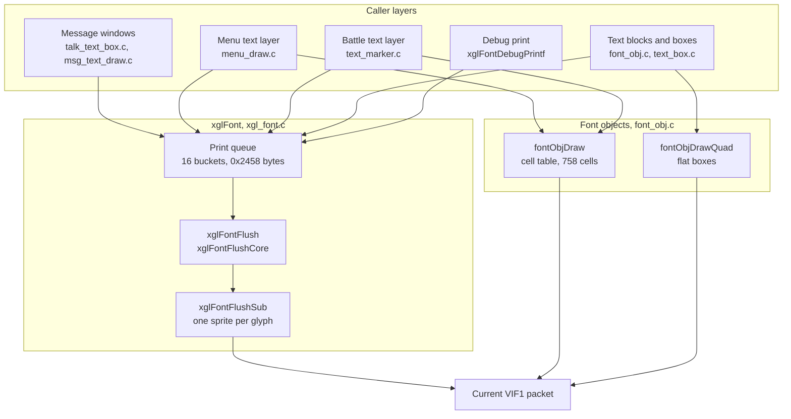

The message windows and talk windows are described in
[ui-windows.md](ui-windows.md). The menus that use the menu text layer are
described in [main-menu.md](../game/main-menu.md), and the battle screens in
[battle.md](../game/battle.md) and
[battle-engine.md](../game/battle-engine.md). The packet and GS side is
covered by [rendering.md](../architecture/rendering.md), and the rest of the
xgl library by [xgl.md](xgl.md).

## Character encoding

### EUC-JP in the source

The game was written with Japanese tools and its strings are in **EUC-JP**.
The original file names that survive in assertion strings end in `.euc.c`,
for example `../cfePlugIn.euc.c`, `../test.euc.c`, `../ysegf.euc.c` and
`xenoActor.euc.c`. In EUC-JP a byte below 0x80 is plain ASCII. A character of
the Japanese set JIS X 0208 takes two bytes, both from 0xA1 to 0xFE. The
first byte selects a row and the second a column of the 94 by 94 character
grid.

The North American release keeps the encoding and writes its English text in
ASCII. Japanese symbols still appear where the English text needs them. The
circle button is written `\xa1\xfb` (○), the cross button `\xa1\xdf` (×), the
square `\xa2\xa2` (□) and the triangle `\xa2\xa4` (△). The musical note
`\xa2\xf6` (♪) closes several help lines of the G.S. Campaign screens, and the
full-width percent sign `\xa1\xf3` is the unit mark of the choice menus.

Most caller layers use a simpler rule than the font module to step over a
string. They treat any byte with the high bit set as the first byte of a
two-byte character and skip the next byte with it. `textMarkerScan`,
`textDrawString`, `textDrawLines`, `msgRangeSetText`, `textEncodeNewlines`
and the `eucStr*` helpers all work this way.

### One-byte and two-byte characters in the font

The font module is stricter. `xglFontIsTextureGlyphCode(high, low)` decides
whether a byte with the high bit set starts a two-byte character. It answers
yes only for the pairs below, and only when the second byte is not zero.

| First byte | Second byte | Characters |
| --- | --- | --- |
| 0xA4 | any | the hiragana row |
| 0xA6 | any | the Greek row |
| 0xAD | any | the NEC special character row |
| 0xA1 | 0xBD, 0xDA, 0xDB, 0xDF, 0xF9, 0xFA, 0xFB | ―, 【, 】, ×, ☆, ★, ○ |
| 0xA2 | 0xA2, 0xA3, 0xA4, 0xF6 | □, ■, △, ♪ |

Every other byte from 0x80 to 0xFF is a **single-byte character**. The font
gives it the code `0xA9xx` with `xx = byte + 0x80` (the sum wraps to 0x00 to
0x7F), and the glyph lookup turns row 0xA9 into glyph index `256 + xx`. The
bytes 0x80 to 0xFF therefore select the glyphs 256 to 383 directly. These are
the same glyph positions that the kana rows map to. The font files of this
release are named `font0.us` and `font1.us`, and their pictures confirm what the names suggest: glyphs 256 to 383
hold the upper half of the Windows-1252 character set, in code order, in
place of kana. The text of the game does not use this single-byte path,
though. It writes its few accented characters as two-byte codes of the
hiragana row: `A4 A1` is ä, `A4 A2` é, `A4 A3` ê, `A4 A4` Ä and `A4 A5` ®
(glyphs 192 to 196). The rest of that row is blank, so the shipped fonts have
no large kana at all (see [Text and fonts](../formats/text-and-fonts.md)).

The same test is used by the measuring functions and by `xglFontCopyTextUnit`,
so wrapping and drawing agree on where a character ends.

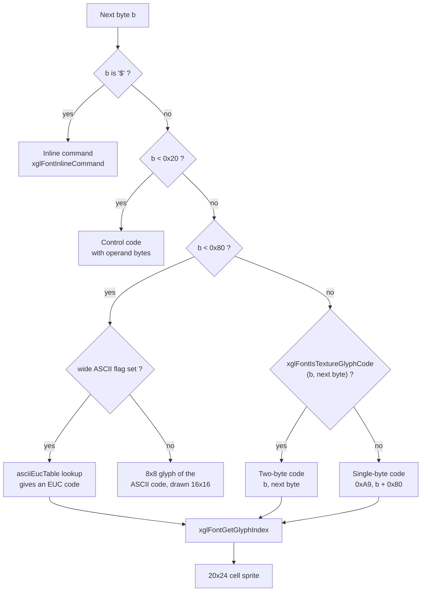

### The ASCII to EUC table

An ASCII byte is drawn in one of two ways. Without the **wide ASCII** flag
the font draws it from the small 8 by 8 pixel glyph set, doubled to 16 by 16.
This is the debug look. With the flag set, `xglFontAscii2Euc` first converts
the byte through `asciiEucTable` to a full-width EUC code, and the character
is then drawn from the large glyph cells like any Japanese character. All
game text turns the flag on, with the control code 25 or with `$han1;`.

A byte below 0x20 converts to the full-width space `0xA1A1`. The printable
characters convert as follows. Digits and letters go to the full-width
alphanumeric row 0xA3, and punctuation goes to the standard full-width
punctuation of row 0xA1.

| ASCII | EUC code | ASCII | EUC code | ASCII | EUC code |
| --- | --- | --- | --- | --- | --- |
| space | `A1A1` | `0`–`9` | `A3B0`–`A3B9` | `A`–`Z` | `A3C1`–`A3DA` |
| `a`–`z` | `A3E1`–`A3FA` | `!` | `A1AA` | `"` | `A1C9` |
| `#` | `A1F4` | `$` | `A1F0` | `%` | `A1F3` |
| `&` | `A1F5` | `'` | `A1C7` | `(` | `A1CA` |
| `)` | `A1CB` | `*` | `A1F6` | `+` | `A1DC` |
| `,` | `A1A4` | `-` | `A1DD` | `.` | `A1A5` |
| `/` | `A1BF` | `:` | `A1A7` | `<` | `A1E3` |
| `=` | `A1E1` | `>` | `A1E4` | `?` | `A1A9` |
| `@` | `A1F7` | `[` | `A1CE` | `\` | `A1EF` |
| `]` | `A1CF` | `^` | `A1B0` | `_` | `A1B2` |
| `` ` `` | `A1C6` | `{` | `A1D0` | `\|` | `A1C3` |
| `}` | `A1D1` | `~` | `A1C1` | 0x7F | `A1A1` |

The semicolon converts to `A1A8`. The function also receives the address of
the text pointer but never moves it, so one ASCII byte always gives exactly
one character. Letters outside ASCII are written as single bytes from 0x80
up, as described above.

### Shift-JIS input and string helpers

Some text files on the disc are stored in Shift-JIS. `sjisToEuc(first,
second)` in `src/main/test_129.c` converts one two-byte character in place.
It doubles the lead byte and adds 0x9F (lead bytes 0x81 to 0x9F) or 0x1F
(lead bytes from 0xE0), then moves the trail byte: a trail byte below 0x7F
gains 0x61, one from 0x80 to 0x9E gains 0x60, and one from 0x9F up gains 2
and adds one more to the lead byte. This is the standard arithmetic that
maps Shift-JIS onto the EUC row and column bytes. Its only caller is
`yg2PathReadTaggedText` in `src/main/yg2path.c`, which reads the quoted
texts of the G.S. Campaign data and converts every character with the high
bit set. That reader is described in
[gs-campaign.md](../game/gs-campaign.md).

The save screen builds its header line with three small helpers in
`src/main/save_screen.c`. `eucStrClear` empties a string. `eucStrcat` appends
one string to another, and both its search for the end and its copy take a
high-bit byte together with the byte after it. `eucStrLength` counts bytes
the same way, so a two-byte character counts two. The save screen halves the
result to centre the header.

## The font texture

### Font files and loading

The font lives in two files, `font0.us` and `font1.us`. Only one is in
memory at a time. `xglFontLoad(font_index, notify)` stores the index in
`font_selection`, reads the chosen file with `xglCdReadFile` into the font
buffer, and returns the index that was selected before. The buffer is the
static array `fontTextureBuffer` of 0x78800 bytes, and the font state keeps
its address in `texture_buffer`. When the caller passes `CD_NOTIFY_CURRENT` the
read is made in the blocking mode with the dummy completion callback. Any
other callback is passed through with read mode 1.

`xglFontInitial()` runs once at start-up from `src/main/control_entry.c`. It
points `texture_buffer` at the buffer, loads font 1, empties the queue and sets
the defaults of the font state. Font 1 is the normal font of the game. Font 0
is loaded in two places: `cfeCmdInit` loads it when a cutscene starts, and
the movie player in `src/main/game_movie.c` loads it before a movie. Both
switch back to font 1 when they end. Font 0 is therefore the caption font of
cutscenes and movies, see [cutscenes.md](../scripting/cutscenes.md). The
title program in OV02 also requests font 1 again after its memory card check,
and the font test page `FontTestP1` in `src/main/yajima_test.c` switches
between the two with Circle and Cross.

| Offset in the buffer | Size | Contents |
| --- | --- | --- |
| 0x00000 | 0x3C020 | first image block: 2 quadwords of header and 0x3C00 quadwords of texel data. `xglFontReloadTexture` sends these 0x3C02 quadwords |
| 0x3C020 | 0x3C020 | second image block of the same size (`kanji_texture_1` in the source). The upload code of this game does not reference it |
| 0x78040 | 2 bytes per glyph | `proportional_widths`, the left and right bounds of the proportional glyphs |

### Texel layout

The texel data is sent to GS memory as a 320 by 192 image of 32-bit pixels
at block address 0x3C20 with buffer width 5. The font is then read back as a
**4-bit texture** at the same address with buffer width 10. In that format
the same memory is 640 texels wide and 768 texels high. The texture register
`TEX0` declares it as 1024 by 1024, the next power of two.

The 640 by 768 area is a grid of 32 columns and 32 rows of **glyph cells**.
A cell is 20 texels wide and 24 texels high. A glyph with index `n` sits in
column `n & 31` and row `(n >> 5) & 31`. A full cell is drawn 19 texels wide
and 24 high (`0x1318` in the size argument of `xglFontFlushSub`).

```
        0        20       40                 620     640
      0 +--------+--------+------- ... -------+--------+
        | glyph  | glyph  |                   | glyph  |   rows 0 to 11:
     24 |   0    |   1    |                   |   31   |   glyphs 0x000 to 0x17F
        +--------+--------+------- ... -------+--------+   (fixed cells)
        |                     ...                      |
    432 +----------------------------------------------+
        | rows 18 to 29: the same 384 glyphs again,    |   proportional
        | read by the proportional path                |   drawings
    720 +----------------------------------------------+
        | row 30                                       |
    736 |   8x8 strip: katakana                        |
    744 +----------------------------------------------+
        |   8x8 strip: hiragana, marks, small symbols  |   row 31:
    752 |   8x8 strip: codes 0x00 to 0x3F              |   three strips of
    760 |   8x8 strip: codes 0x40 to 0x7F              |   64 small glyphs
    768 +----------------------------------------------+
```

The fixed path reads a glyph at `U = column * 20`, `V = row * 24`. The
proportional path reads the glyphs below index 0x180 from a second area that
starts 432 texels down (`row * 384 + 0x1B00` in sixteenths of a texel), so
the first 384 glyphs exist twice: once in fixed cells and once in the form
that the proportional table describes.

### Two sheets in one texture

Each texel has four bits, but a glyph needs only four grey levels. The file
packs **two glyph sheets** into the same texels, one in the low two bits and
one in the high two bits, and two colour tables pick them apart. The colour
tables are part of the packet `KanjiClutEnv`, which uploads a 16 by 2 block
of 32-bit colours to block address 0x3C00.

| Colour table | Block address | Entry `i` shows | Used for |
| --- | --- | --- | --- |
| 0 | 0x3C00 | level `i & 3` | glyph indexes 0x000 to 0x3FF, all 8 by 8 glyphs, proportional glyphs |
| 1 | 0x3C01 | level `i >> 2` | glyph indexes 0x400 to 0x7FF |

The four levels are transparent black (0x00000000) and the three greys
0x55, 0xAA and 0xFF with alpha 0x80. The glyph sprite is tinted by the
current text colour, so the greys act as coverage values and give
anti-aliased edges.

The sheet is chosen by bit 0 of the fourth argument of `xglFontFlushSub`,
which the caller sets to `glyph index >> 10`. The level 1 kanji occupy the
indexes 0x400 to about 0xFBF, and only bit 0 of that number is used. Indexes
from 0x800 up therefore read the same texels as the indexes 0x800 below
them. The English text of this release stays below 0x400.

### Glyph indexes

`xglFontGetGlyphIndex(high, low)` converts an EUC code to a glyph index.
Rows below 0xB0 map into the first 0x400 positions. The level 1 kanji rows
0xB0 to 0xCF follow from 0x400. Rows from 0xD0 are looked up in the pair list
`fontPairGlyphCodes`, which is empty in this release, so they all give the
"no glyph" index 0x7F.

| EUC row | Second byte | Glyph index | Contents |
| --- | --- | --- | --- |
| 0xA1 | any | `low − 0xA1` (0 to 93) | punctuation and symbols |
| 0xA2 | 0xA0–0xAF | `(low & 0xF) + 93` | shapes such as □ ■ △ |
| 0xA2 | 0xE0–0xEF | `(low & 0xF) + 108` | |
| 0xA2 | 0xF0–0xFF | `(low & 0xF) + 117` | includes ♪ |
| 0xA3 | 0xB0–0xB9 | `(low & 0xF) + 128` (128 to 137) | full-width digits |
| 0xA3 | 0xC1–0xDA | `(low & 0x1F) + 137` (138 to 163) | full-width capitals |
| 0xA3 | 0xE1–0xFA | `(low & 0x1F) + 163` (164 to 189) | full-width small letters |
| 0xA4 | any | `low + 31` (192 up) | the hiragana row. In the shipped fonts it holds ä é ê Ä ® at 192 to 196 and is otherwise blank |
| 0xA5 | any | `low + 127` (288 up) | the katakana row. In the shipped fonts these positions hold Windows-1252 characters |
| 0xA6 | below 0xC0 | `(low & 0x1F) + 383` | Greek capitals |
| 0xA6 | 0xC0 and up | `(low & 0x1F) + 407` | Greek small letters |
| 0xA7 | below 0xD0 | `low + 271` | Cyrillic capitals |
| 0xA7 | 0xD0 and up | `low + 256` | Cyrillic small letters |
| 0xA8 | any | `low + 351` | box-drawing lines |
| 0xA9 | 0x00–0x7F | `low + 256` (256 to 383) | the single-byte characters 0x80 to 0xFF |
| 0xAD | any | `low + 383` | NEC special characters |
| 0xB0–0xCF | any | `0x400 + (high − 0xB0) * 94 + (low − 0xA1)` | level 1 kanji |
| 0xD0 and up | any | 0x7F | no glyph |

The printable ASCII characters land on the indexes 0 to 189 after the
conversion of the previous section. This is why the proportional path, which
covers the indexes below 0x180, is enough for all English text.

### Small glyphs

The last cell row of the texture holds strips of 8 by 8 pixel glyphs, 64 to
a strip, addressed as `U = index * 8`.

| V | Contents |
| --- | --- |
| 736 | katakana, reached through `kanaFontCodeTable` |
| 744 | hiragana through the same table, small punctuation, and the two voicing marks in columns 62 and 63 |
| 752 | codes 0x00 to 0x3F. Columns 0 to 15 are the hex digits, 16 is the minus sign, 17 the decimal point and 32 a blank. Columns 0x20 to 0x3F are the ASCII characters space to `?` |
| 760 | codes 0x40 to 0x7F, the ASCII characters `@` to `~` |

Three users draw from these strips. Plain ASCII without the wide flag uses
the strips at 752 and 760 and doubles each glyph to 16 by 16 pixels. The
number codes 16 and 17 and the `%d`, `%x`, `%b` and `%f` conversions draw
their digits with `xglFontFlushSubHex` as 6 by 8 texel pieces of the hex
digit columns, also doubled.

The third user is the **compact mode**, switched on by control code 24 or
inside a ruby annotation. In compact mode `xglFontGetDebugCell` maps an EUC
code to a small glyph: the alphanumeric row 0xA3 to the ASCII strips, five
punctuation marks of row 0xA1 to the 744 strip, and the kana rows through
`kanaFontCodeTable`, which has one entry per kana. Bit 6 of a table entry
adds the dakuten mark and bit 7 selects the handakuten mark, drawn as a
second 5 by 8 glyph after the kana. Any other code gives a blank cell.
Compact glyphs are scaled by `compact_width / 16` and `compact_height / 16`,
both 16 by default.

### Proportional widths

A fixed glyph advances the cursor by 19 pixels. English text would look
wrong at that pitch, so the font has a **proportional mode**, switched on by
bit 0 of control code 25 or by `$prop1;`. It applies to glyph indexes below
0x180.

`xglFontGetProportionalSize(code)` returns the left and right texel bound of
a glyph inside its 20-texel cell, packed as `right << 8 | left`. The value
comes from the `proportional_widths` table of the font file. The table
stores `left + 1` in the low byte and `right − 1` in the high byte, and the
function adds 0xFF to restore both. A stored low byte of zero means the
glyph has no entry. Such a glyph gets the bounds 0 and `default_width`. The
default width is 4, so a space, which has no pixels, comes out 5 pixels
wide. The message windows change this value on purpose to leave room for a
button picture, see [Button tags in message windows](#button-tags-in-message-windows).

The glyph is then drawn from `U = column * 20 + left` with a width of
`right − left + 1` texels, and the cursor advances by the same amount times
the scale. When the state byte `proportional_mode` is not zero the table is
ignored and every glyph uses the fixed bounds 6 and 15, which gives a narrow
fixed pitch of 10 pixels.

## The font state

All settings that outlive a single string are kept in one block of static
data. The source reaches it through two names, `FS` and
`fontStateFromWindow`, which describe the same memory from two starting
points. The block ends where the print queue begins.

| Field | Type | Default | Meaning |
| --- | --- | --- | --- |
| `font_image` | pointer | | first word of the block |
| `texture_buffer` | pointer | `fontTextureBuffer` | address of the loaded font file |
| `flags` | u16 | 9 | bit 0 enabled, bit 1 debug print allowed, bit 3 clip glyphs outside the drawing area |
| `font_selection` | u8 | 1 | index of the loaded font file, 0xFF before the first load |
| `debug_mode` | u8 | 0 | non-zero draws the queue into a separate debug frame |
| `line_height` | u16 | 24 | pixels that a newline moves down |
| `wrap_width` | u16 | 0 | automatic wrap width in pixels, 0 for off |
| `default_width` | u8 | 4 | right bound of a proportional glyph without a table entry |
| `text_mode` | u8 | 0 | measuring state: bit 0 proportional, bit 1 wide ASCII |
| `proportional_mode` | u8 | 0 | non-zero forces the fixed bounds 6 to 15 |
| `horizontal_shift` | u8 | 0 | pixels that the top edge of a glyph is moved right, for slanted text |
| `stored_value` | int | 0 | address of a prefix string for debug lines |
| `ruby_base` | pointer | | start of the base text of the current ruby annotation |
| `ruby_advance` | u16 | | distance from the end of an annotation back to the end of its base text |
| `ruby_offset_y` | u16 | 2 | extra rise of an annotation above the line |
| `compact_width`, `compact_height` | s8 | 16, 16 | scale of compact glyphs in sixteenths |
| `word_buffer` | char[0x100] | | scratch copy of one word or one ruby text while measuring |
| `queue_cursor` | pointer | | next free byte of the print queue |

The only use of the field `wrap_width` in the
draw loop is as the wrap width described under
[Automatic wrapping](#automatic-wrapping).

`xglFontSetFlags(flags)` replaces the flag word but always clears bit 1, and
`xglFontInitial` sets only bits 0 and 3. The debug print functions test for
bits 0 and 1 together, so they draw nothing unless something sets bit 1
directly. `xglFontGetFlags` returns the word and `xglFontGetLoadAddress`
returns `texture_buffer`.

The second kind of state is the **draw cursor** `FontDrawCursor`. It exists
only during a flush, at the base of the EE scratchpad (0x70000000), and
holds everything that the control codes change.

| Offset | Type | Name | Meaning |
| --- | --- | --- | --- |
| 0x00 | pointer | `packet` | the VIF1 packet that receives the sprites |
| 0x04 | s16 | `origin_x` | X that a newline returns to |
| 0x08 | u16 | `x` | pen position |
| 0x0A | u16 | `y` | pen position |
| 0x0C | int | `depth` | GS depth of the next glyph |
| 0x10 | u16 | `offset_x` | screen origin, 0x700 (1792) |
| 0x12 | u16 | `offset_y` | screen origin, 0x720 (1824) |
| 0x14 | u8 × 3 | `red`, `green`, `blue` | text colour, 0x80 is neutral |
| 0x18 | u8 | `flags` | bit 0 compact, bit 1 proportional, bit 2 wide ASCII, bit 3 small glyphs at native size, bit 4 ruby base marked |
| 0x19 | u8 | `effect` | 0 or 1 plain, 2 shadow, 3 outline, 4 bold |
| 0x20 | s8 × 2 | `effect_x`, `effect_y` | offset of the shadow or reach of the outline |
| 0x24 | u8 × 3 | `effect_red`, `effect_green`, `effect_blue` | colour of the shadow or outline |
| 0x28 | u8 | `alpha_abcd` | the A, B, C, D selectors of the GS register `ALPHA_1` |
| 0x29 | u8 | `alpha_fix` | the FIX value of `ALPHA_1` |
| 0x2A | u8 | `alpha` | alpha of the glyph colour |
| 0x2C | u16 × 2 | `scale_x`, `scale_y` | glyph scale, 16 is 1.0 |
| 0x30 | | `work` | scratch space for small packets. The glyph sprite is built at scratchpad offset 0x100 |

## The print queue

### Records and buckets

The queue is a single buffer of 0x2458 bytes, `fontPrintQueueBuffer`. Its
first 64 bytes are sixteen **bucket slots** of four bytes each. Everything
after them is a stream of records. A record is a two-byte link followed by
the text bytes and a terminating zero.

Each bucket is a linked list. The `link` half of a slot holds the buffer
offset of the first record of that bucket, or zero. The `selfOffset` half
holds the offset of the place where the next link must be written, which is
the slot itself at first and the link field of the newest record afterwards.
`set_ot(key)` appends a record this way: it picks the bucket, writes the
current queue offset into the previous link, remembers the new record as the
tail, writes a zero link and advances the cursor by two bytes. The text
bytes are then copied behind it.

```
fontPrintQueueBuffer
+--------+--------+-- ... --+--------+----------------------------------------+
| slot 0 | slot 1 |         | slot15 | records, in the order they were queued |
+--------+--------+-- ... --+--------+----------------------------------------+
 link,self                             | link | text bytes ... 00 | link | ...

bucket 3:   slot 3.link ---> record A ---> record D ---> 0
bucket 0:   slot 0.link ---> record B ---> record C ---> record E ---> 0
```

`buffer_reset()` empties the queue. It points every slot at itself, clears
the links, zeroes `stored_value` and `text_mode`, and sets `queue_cursor` to
the first byte after the slots. It runs at the end of every flush. No
function checks the cursor against the end of the buffer, so the callers
rely on flushing often enough.

### The order key

The third argument of the print functions is called `color` in the source,
but it is an **order key**. Bits 24 to 27 select the bucket (`set_ot`
computes `((key >> 22) & 0x3C) / 4`), and the low 24 bits become the GS depth
of the record. The flush walks the buckets from 0 to 15 and each bucket in
queue order.

Almost every caller uses bucket 0 and a depth close to the top of the range.
The default key of the menu and battle layers is `0xFFFFF0`. The text block
stacks use `0xFFFFF0 + slot` for the box and one more for its text. The
message windows pass their slot depth `z` and draw their text at `z + 7`.
Because the font draws with the depth test "greater", a record with a higher
depth wins where two overlap.

### Print calls

| Function | Effect |
| --- | --- |
| `xglFontPrint(x, y, key, text)` | queues a position and the text as it is |
| `xglFontPrintf(x, y, key, args)` | queues a position and expands a format string. `args` points to 8-byte argument slots, the first of which is the format |
| `xglFontPrintDirectOT(key, text)` | queues the text without a position. It continues where the pen stands |
| `xglFontPrintDirect(text)` | the same with key 0 |
| `xglFontPrintExtFunc(key, function, argument)` | queues a callback record (control code 23) |
| `xglFontDebugPrintf(x, y, format, ...)` | debug text with a printf format, see below |
| `xglFontDebugHex(x, y, value, digits)` | debug hex number |

All of them return at once when bit 0 of the state flags is clear.

`set_xyz(x, y, key)` writes the position. When `x` is below 768 and `y` is
from 0 to 511 it uses the compact form of eight bytes: an X code (1 to 3), the
low X byte, a Y code (4 or 5), the low Y byte, then code 6 with the
three depth bytes. Any other position uses the long form, code 8 with the
flag byte 7 and X, Y and depth as two, two and three bytes.

`xglFontPrintDirectCore` copies the text. It copies a control code together
with its operand bytes in one step, so that an operand byte of zero does not
end the string. The length of each code comes from `xglFontGetSPcodeSize`.

A print with no visible text is the usual way to change the style. The
layers queue strings such as `"\031\003"` or `"$prop1;$zoom12,16;"` at
position (0, 0) before the real text. Since all records of a bucket share
the one draw cursor, the style stays in force for the following records.

### Formatted printing

`xglFontPrintSub` expands a format string into the queue. It does not build
a string of digits. For a number it queues a number code, and the digits are
produced during the flush.

| Conversion | Result in the queue |
| --- | --- |
| `%d`, `%x`, `%b` | control code 17 with radix 10, 16 or 2, the digit count and the 32-bit value. A decimal count before the letter, as in `%3d`, sets the number of digits. The default is 1 |
| `%f` | control code 17 with radix 0xFF and the bits of the single-precision value |
| `%s` | the bytes of the string argument, copied in place |
| `%c` | the character argument |
| `%$`, `%%` | the character itself |

Control codes inside the format are copied with their operands like in
`xglFontPrintDirectCore`. A `%s` argument is copied byte by byte up to its
terminating zero, so it should not contain control codes with zero operands.

The message windows use this for their numbers. `fontPrintIntRow` in
`src/main/msg_text_draw.c` formats ten integers as decimal strings and passes
them as `%s` arguments, because the message formatter has turned every `%d`
of the message into `%s` beforehand.

### Debug printing

`xglFontDebugPrintf` copies its format pointer and 31 following argument
slots into a local array and prints through `xglFontPrintSub`. Outside the
debug frame mode it doubles `x` and `y`, so debug coordinates are in units
of half the screen resolution. It queues the position with the key −1, which
selects bucket 15 and the highest depth, then a reset code 11. When a prefix
string was registered with `xglFontDebugPrefixSet`, an include code 22 with
the address of that string takes the place of the reset, so every debug line
starts with the same style. The test menu in `src/main/test_129.c`
registers such a prefix.

`xglFontDebugHex` queues a reset, then control code 16 with a digit count
and a value. Both functions need bit 1 of the state flags, which the game
never sets through `xglFontSetFlags`. The many debug screens described in
[debug-tools.md](../game/debug-tools.md) are therefore silent unless that
bit is forced.

`xglFontDebugMode(mode)` stores `debug_mode` and patches the frame register
of the two packets in `ModeEnv`. With the mode on, the flush draws with a
zero screen offset, without the alpha of the texture, and into the frame
selected by those packets, and it restores the depth buffer and frame
registers at the end from `zbuf_14`.

## Control codes

Bytes from 1 to 31 inside a queued string are control codes. Each has a
fixed or computed number of operand bytes, given by the table `spcode_0[32]`
through `xglFontGetSPcodeSize(code, text)`. Two entries are 255, which means
"computed": code 8 adds the sizes of the fields that its flag byte selects
(from `spCodeParameterSizeTable`), and code 21 reads its length byte.

| Code | Name in the source | Operand bytes | Effect |
| --- | --- | --- | --- |
| 1–3 | `FONT_OP_POS_X_0` to `_2` | 1 | X = (code << 8) + operand − 0x100. Also sets the line origin |
| 4–5 | `FONT_OP_POS_Y_0`, `_1` | 1 | Y = (code << 8) + operand − 0x400 |
| 6 | `FONT_OP_DEPTH` | 3 | 24-bit depth, high byte first |
| 7 | `FONT_OP_NOP` | 0 | nothing. The caller layers use it as a filler byte |
| 8 | `FONT_OP_POSITION` | 1 + fields | flag byte, then the selected fields, high byte first: 0x01 X (2 bytes), 0x02 Y (2), 0x04 depth (3), 0x08 add to X (2), 0x10 add to Y (2). Flag 0x80 keeps the line origin |
| 9 | `FONT_OP_TAB` | 0 | X moves to the next multiple of 64 |
| 10 | `FONT_OP_NEWLINE` | 0 | X returns to the line origin, Y grows by `line_height` |
| 11 | `FONT_OP_RESET` | 0 | plain effect, neutral colour and alpha, scale 1.0, blend selectors 0, style flags cleared, and a GS packet that resets the filter, the test and the blend register |
| 12 | `FONT_OP_COLOR` | 3 | red, green, blue |
| 13 | `FONT_OP_EFFECT_MODE` | 1 | 0 plain with alpha test, 1 plain, 2 shadow, 3 outline, 4 bold |
| 14 | `FONT_OP_EFFECT_PARAMS` | 5 | effect X, effect Y, red, green, blue |
| 15 | `FONT_OP_BLEND` | 3 | blend selectors, FIX value, glyph alpha. Writes `ALPHA_1` at once |
| 16 | `FONT_OP_HEX_DIGITS` | 5 | digit count minus one, 32-bit value. Draws hex digits |
| 17 | `FONT_OP_NUMBER` | 6 | radix, digit count minus one, 32-bit value. Radix 0xFF draws a float |
| 18 | `FONT_OP_SCALE` | 2 | X scale, Y scale in sixteenths. Selects the texture filter |
| 19 | `FONT_OP_EFFECT_PACKET` | 2 | horizontal and vertical repeat masks for the texture clamp register |
| 21 | `FONT_OP_CONFIG` | 1 + length | length, sub-command, value |
| 22 | `FONT_OP_INCLUDE` | 4 | address of another string, drawn in place |
| 23 | `FONT_OP_CALLBACK` | 7 | 24-bit function address and 32-bit argument |
| 24 | `FONT_OP_COMPACT` | 1 | non-zero switches the compact 8-pixel glyphs on |
| 25 | `FONT_OP_STYLE` | 1 | bit 0 proportional, bit 1 wide ASCII |
| 27 | `FONT_OP_GLYPH` | 1 | draws one 8 by 8 glyph by number, 0 to 127 |
| 20, 26, 28–31 | none | 0 | no action |

The draw loop has an empty case for the unused codes 20, 26 and 28 to 31
that does not step over the byte. A string that reached the flush with one
of them would never finish, so no layer emits them.

### Style codes in practice

The usual style prefix of game text is five bytes: `0B 19 02 0D 02`. It
resets the cursor, selects wide ASCII, and switches the shadow effect on.
`fontStylePrefix` of the message windows starts with exactly these bytes and
continues with inline commands. The menu layer prints `19 03` before every
segment, which selects proportional spacing and wide ASCII together. Its
alpha tag is `0F 44 00 aa`: the selector byte 0x44 is the normal "source
over destination" blend, and `aa` is the alpha of the glyphs.

Code 13 does two things. It stores the effect, and it sends a small packet
that sets the GS register `TEST_1`. Effect 1 uses the value 0x70000, a depth
test only. The other effects use 0x7000D, which adds an alpha test "greater
than zero". With that test the fully transparent texels of a glyph do not
write depth, so a shadow drawn afterwards can show through them.

### Numbers

Code 16 draws `digits` hex digits of the value from the top down. Code 17
with an integer radix fills a digit buffer from the right. For radix 10 it
replaces leading zeros with blanks, and for a negative value it draws a
minus sign in the last blank before the first digit. Other radixes keep
their leading zeros.

The float form takes the bits of an IEEE single apart by hand. It splits
the mantissa into an integer and a fraction with the exponent, produces
eight integer digits and eight fraction digits, and draws a sign or a blank,
the integer digits without leading zeros, a decimal point, and then fraction
digits until nine characters have been drawn in total.

### Configuration and wrapping

Code 21 changes the font state. Its sub-commands are checked against the
length byte and ignored when the length does not fit.

| Sub-command | Length | Field |
| --- | --- | --- |
| 1 | 2 | `line_height` |
| 2 | 2 | `default_width` |
| 3 | 3 | `wrap_width`, the wrap width, as a 16-bit value |
| 4 | 2 | `proportional_mode` |
| 5 | 2 | `horizontal_shift` |

### Automatic wrapping

When the wrap width is greater than zero the draw loop examines every
space. It measures the text after the space up to the next space with
`xglFontGetStringWidth2(text, 1)`. If the pen position relative to the line
origin plus that width exceeds the wrap width, the loop starts a new line
instead of drawing the space. On that path it also steps over one more byte
of the text. The game layers do not rely on this mechanism. Their style
strings start with `$init;`, which clears the wrap width, and they break
their lines themselves.

### Include and callback

Code 22 carries the address of another string. The flush calls
`xglFontFlushCore` recursively on it and then continues behind the code. The
debug prefix is its only user.

Code 23 calls `function(cursor, argument)` in the middle of the flush. The
callback receives the draw cursor and may add any packet through
`cursor->packet`. This is how a window limits its text to its own
rectangle. `ScissorSet` in `src/main/gr_screen.c` is such a callback. It
takes four integers, orders and clamps them to the frame size, and adds a
packet that sets `SCISSOR_1`. `ScissorReset` restores the full screen. The
text blocks queue `ScissorSet`, their text and `ScissorReset` in this order.
The message windows use `talkBoxScissorCallback` the same way.

## Inline commands

A `$` in a queued string starts an **inline command**. The text after the
`$` is compared with the names of the table `fontInlineCommands`, in table
order, and the first name that is a prefix of the text wins. Its handler
parses the arguments, which end with a `;`. When the handler accepts them
the draw loop continues after the `;`. When no name matches, the function
prints `[*error*:` and the next four characters to the console, and the `$`
is drawn as an ordinary character. The same happens when a handler rejects
its arguments.

The commands give text authors a readable alternative to the control codes,
and they can be typed in a script or a data file. Almost all style strings
of the game are written with them.

| Command | Arguments | Effect |
| --- | --- | --- |
| `$ax`, `$ay`, `$az` | number | absolute X (also the line origin), Y or depth |
| `$rx`, `$ry` | number | add to X or Y |
| `$init;`, `$save;`, `$load;` | none | reset the cursor and the font state to their defaults. All three names share one handler |
| `$col` | hex `bbggrr` | text colour |
| `$bg` | one digit 0 to 3 | effect mode and its `TEST_1` value, like code 13 |
| `$shadow` | x, y, hex `bbggrr` | effect offset and effect colour, like code 14 |
| `$alpha` | a, b, c, d, fix, alpha | the four blend selectors, the FIX value and the glyph alpha. Writes `ALPHA_1` |
| `$zoom` | x or x, y | glyph scale in sixteenths. One value sets both axes |
| `$xx` | n, value | font state: 0 line height, 1 default width, 2 wrap width, 3 proportional mode, 4 horizontal shift. `$xx5,u;` or `$xx5,u,v;` writes the texture clamp register like code 19 |
| `$ruby…` | see below | ruby annotations |
| `$prop` | 0 or 1 | proportional spacing off or on |
| `$han` | 0, 1 or 2 | 0 small ASCII doubled, 1 wide ASCII, 2 small glyphs at their native 8 by 8 size |
| `$mark` | hex index | draws one 8 by 8 glyph, 0 to 0x7F, doubled |

Numbers are parsed by `xglFontParseNumber`. It accepts an optional `+` or
`-`, then decimal digits or `0x` and hex digits, up to a `,` or `;`. This is
why the shadow strings of the game read `$shadow+1,+3,000000;`. Colours and
the mark index are parsed by `xglFontParseHex`, which reads hex digits up to
a `,` or `;` without a `0x` prefix. Its handling of the capital digits `A`
to `F` subtracts where it should add and gives wrong values, so a colour
string is only read as written when it uses lower case, for example
`$colc0c0c0;`. The game data does not always do so. The map text uses
`$col7AF9FB;` 411 times and `$colFAB2AA;` 64 times, and by the parser's
arithmetic these give the colours `BB F5 36` and `6A AE B6` in place of the
ones written (see [Text and fonts](../formats/text-and-fonts.md)).

Typical style strings found in the source:

| String | Owner | Meaning |
| --- | --- | --- |
| `$init;$bg0;` | `fontInitTagText`, text blocks | defaults, plain glyphs with alpha test |
| `$init;$bg2;$shadow+1,+3,000000;$han1;$prop1;` | `textBoxInitText`, battle text | shadow one pixel right and three down, wide proportional text |
| `$init;$bg2;$shadow+1,+3,000000;$zoom13;$han1;$prop1;$xx0,21;$colc0c0c0;` | `msgStyleInit`, menu help line | the same at 13/16 size with 21-pixel lines in light grey |
| `$xx0,30;$rubyz23,21;$rubyy-2;` | `fontStylePrefix`, message windows | 30-pixel lines, ruby glyphs scaled 23/16 by 21/16, ruby rise −2 |
| `$mark1f;` | `textBoxMarkText` | the "more text" mark of a text box |
| `$zoom8,16;` | `choiceValueZoomText` | half-width digits for the values of a choice menu |

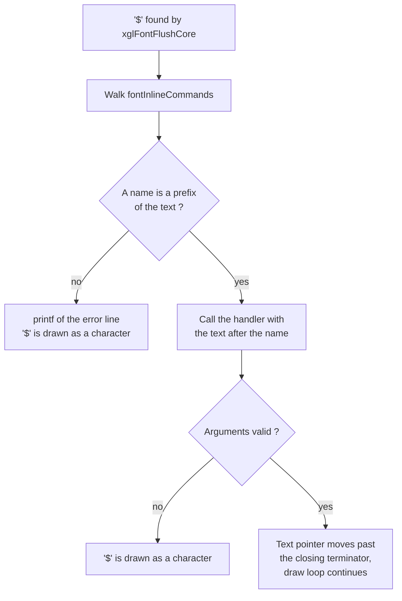

### Ruby annotations

Ruby text is the small reading aid printed above a word in Japanese text.
The font supports it with five commands that all start with `$ruby`.

| Command | Effect |
| --- | --- |
| `$rubyb;` | marks the start of the base text and sets the ruby flag of the cursor |
| `$rubys;` | ends the base text and starts the annotation |
| `$rubye;` | ends the annotation and returns to the end of the base text |
| `$rubyzW,H;` | sets `compact_width` and `compact_height`. One value sets both |
| `$rubyyN;` | sets `ruby_offset_y` |

At `$rubys;` the handler measures two widths. It copies the base text, from
the marked start up to the command, into the word buffer and measures it.
It then builds the annotation in the word buffer with a compact code in
front and measures that too. The pen moves up by `ruby_offset_y` plus half a
compact glyph height, and left by half the base width plus half the
annotation width, so the annotation is centred over the base text. The
compact flag is set, and the annotation is drawn with the small glyphs.

At `$rubye;` the pen moves down again and right by `ruby_advance`, the
difference of the two half widths, which puts it back at the end of the base
text. The measuring and word-copy functions know these commands as well.
They skip from `$rubys;` to `$rubye;`, so an annotation takes no width in a
line and is never split from its base text.

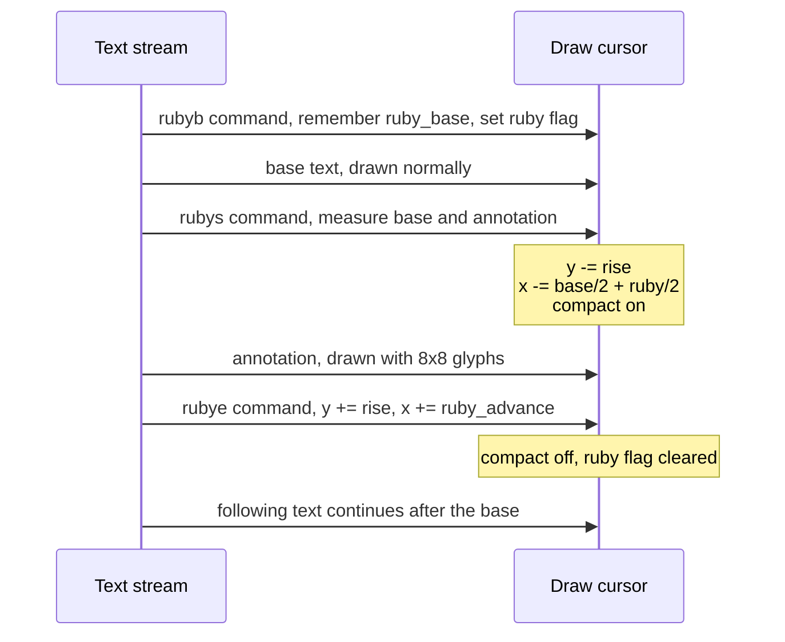

## Drawing one glyph

`xglFontFlushSub(texture_u, texture_v, size, flags)` draws one glyph at the
pen position and advances the pen. `size` packs the width and height in
texels. The low bits of `flags` select the colour table, 0x10 asks for
double size, and 0x20 marks a compact glyph.

The function first computes the drawn size. A double-size glyph is doubled
unless the debug frame mode is on or the cursor flag of `$han2;` is set. A
compact glyph is scaled by the compact size of the font state, and any other
glyph by the cursor scale. The pen then advances by the drawn width, also
when the glyph itself is skipped. With the clip flag set, a glyph whose top
left corner lies beyond 0xF000 in GS coordinates is not drawn.

The sprite is built in the scratchpad as a GIF packet of seven quadwords:
the tag, `TEX0_1`, `RGBAQ`, and two pairs of `UV` and `XYZ2`. The texture
register names the 4-bit font texture at 0x3C20 and one of the two colour
tables. The top left corner is `(offset + pen) * 16 − 8` in X and `− 9` in
Y, in the 12.4 fixed point of the GS.

After the face, the effect copies are drawn one depth step lower than the
face. Since the depth test is "greater", they never cover a face pixel.

| Effect | Extra sprites |
| --- | --- |
| 1 plain | none |
| 2 shadow | one copy in the effect colour, moved by (`effect_x`, `effect_y`) pixels |
| 3 outline | copies in the effect colour in the four directions up, left, right and down, for every distance from 1 to `effect_y` rows and 1 to `effect_x` columns |
| 4 bold | two copies in the text colour, one pixel to the right and one pixel down |

When `horizontal_shift` is not zero the glyph is drawn as a triangle strip
of four vertices instead of a sprite. The two top vertices are moved right
by the shift, which slants the glyph. This path draws no effect copies.

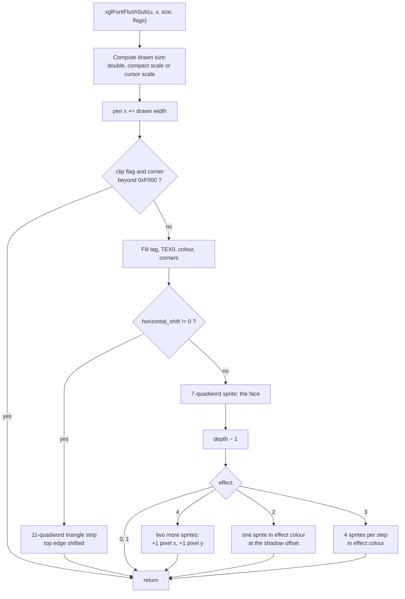

The scale also selects the texture filter. `xglFontSetTextureFilter` sends
the packet `nearest_5` when both scale values are 16 and `biliner_6`
otherwise, so unscaled text stays sharp and scaled text is smoothed.

## The flush

`xglFontFlush()` empties the queue into the current packet. The render
thread calls it once per frame in `src/main/xgl_render.c`, after the 3D
scene, the effects and the final scene packet, and before the global fade.
Text is therefore drawn over the world and under the fade. Many screens also
call it themselves in the middle of their drawing, to force the text queued
so far in front of what they draw next, or behind it.

The steps of a flush are these.

1. A zero byte ends the last record.
2. The draw cursor is built in the scratchpad with its defaults: depth −1,
   colour 127, screen origin (0x700, 0x720), effect 1 with offset (1, 1) and
   a black effect colour, scale 16, blend selectors 0x44, alpha 0x80.
3. `xglFontReloadTexture` closes any open direct block of the packet and
   adds references to four static packets: the transfer setup
   `KanjiTex0Env_8`, the 0x3C02 quadwords of the font image, the colour
   tables `KanjiClutEnv`, and the draw environment `KanjiDrawEnv`. It then
   opens a new direct block and writes `TEST_1` for the current effect.
4. The sixteen buckets are walked in order. Each record is passed to
   `xglFontFlushCore`, which is the interpreter of the control codes, inline
   commands and characters.
5. In debug frame mode the depth buffer and frame registers are restored.
   The packet `test_15` (a texture flush) is added and the direct block is
   closed.
6. `buffer_reset()` empties the queue.

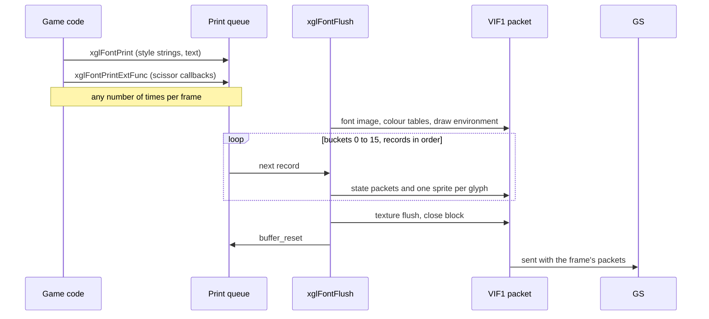

The whole font image, almost 246 KB, is referenced by every flush. It is
sent by reference from the font buffer and not copied into the packet, but
the GS still receives it each time. The reason is that the font objects use
the same area of video memory, as the next sections show.

## Measuring text

Layout code needs the width of a string before it is drawn.
`xglFontGetStringWidth(text)` returns it in pixels, and
`xglFontGetStringWidth2(text, delimiter)` is the same function with the
option to stop at the first space after the start. The measurer cannot use
the draw cursor, so it keeps its own copy of the style in the font state:
`text_mode` with the proportional and wide ASCII bits.

The function understands the parts of a string that change widths. Control
code 25 sets `text_mode`, code 24 switches the compact widths on, and code
21 with the sub-commands 2 and 4 changes the default width and the
proportional mode. Of the inline commands it reads `$prop`, `$han`, `$xx1,`
and `$xx3,`, and it skips a ruby annotation as a whole. Every other control
code and inline command is stepped over.

| Character | Width added |
| --- | --- |
| ASCII with wide ASCII off | the entry of `fontAsciiWidthTable` for the character, from 4 to 19 pixels |
| compact mode | `compact_width * 8 / 16`, plus `compact_width * 5 / 16` for a kana with a voicing mark |
| proportional and glyph index below 0x180 | `right − left + 1` from the proportional table |
| anything else | 19 |

The scale of `$zoom` is not applied here. `xglFontGetMarkupWidth` in
`src/main/text_window.c` adds it for the battle layer. It keeps the global
`xglFontZoom`, set to 16 by `$init` and to the first number of a `$zoom`
command, measures each character on its own through a scratch string that
starts with `19 03`, and multiplies each width by the zoom. All other inline
commands are skipped up to their `;`.

`xglFontCopyTextUnit(word, text, &length)` copies the next indivisible unit
of a string: any leading control codes and inline commands, a ruby
annotation as a whole, and then one character of one or two bytes.
`xglFontFitWords(text, &width)` adds up the widths of such units until the
next one would pass the given width, and returns how many bytes fit. The
message formatter `textFormatWrapped` uses it to wrap dialogue, and the
reveal cursor of a text slot uses `xglFontCopyTextUnit` to step over
commands, see [Text slots and scrolling](#text-slots-and-scrolling).

### Lines with number placeholders

A message can contain placeholders for numbers that are only known when it
is shown. `src/main/xgl_font_width.c` measures such a line. The caller
`textBoxMeasure` in `src/main/msg_text_draw.c` drives it.

`xglFontWidthBegin(values)` stores the list of values and clears the running
sum. On its first call it also measures a template once: the message style
prefix, `$prop1;` and the two literal characters `%s`. This is the width that
a placeholder takes while it is still unexpanded. `xglFontWidthAddValue()`
formats the next value of the list with `%d`, measures the same template
with the digits in place of `%s`, and adds the difference to the sum.
`xglFontWidthReset()` clears the sum at each line break, and
`xglFontWidthGetSum()` returns it. The measurer adds the sum to the width of
the raw line and so gets the width of the line as it will appear.

## Language handling

The executable holds one set of strings. They are the English texts of the
North American release, and no code path selects a different string table
by language. The font side is equally fixed: the two font files carry the
`.us` suffix, and which of them is loaded depends on the situation
(cutscene or movie against everything else) and not on a language.

A language code exists for data files. `xglGetLanguageCode(buffer)` in
`src/main/xgl_timer0.c` returns one of nine two-letter codes and optionally
writes the two letters to a buffer.

| Index | Code | Index | Code | Index | Code |
| --- | --- | --- | --- | --- | --- |
| 0 | `en` | 3 | `de` | 6 | `es` |
| 1 | `jp` | 4 | `fr` | 7 | `zh` |
| 2 | `en` | 5 | `it` | 8 | `ko` |

The index is the save data field `SaveData.caption_all`. That field is the
caption option of the configuration screen. It is 2 in a new save, and the
caption code treats any non-zero value as "show every line". The menu takes
the values it stores from `menuConfigButtonIndexTable`, which holds only 0
and 2. Index 0 and index 2 both give `en`, so every setting that the menu
can produce selects English data, and the other seven codes are never
returned in normal play. The configuration screen is described in
[save-data.md](../architecture/save-data.md).

The code is used to build paths. `src/main/res_get_path.c` inserts it as a
directory in front of a `.sbl` file name when it loads the text that belongs
to a resource, and the movie player builds the path of a caption file as
movie directory, language code, `/`, movie name and `.txt`. These files are
described in [files-and-resources.md](../architecture/files-and-resources.md)
and [cutscenes.md](../scripting/cutscenes.md).

## Font objects

### Tracks

A **track** (`struct FontTrack`, 0x1C bytes) is a two-dimensional value
that moves toward a target. Windows use tracks for positions, sizes and
fades.

| Offset | Type | Name | Meaning |
| --- | --- | --- | --- |
| 0x00 | int × 2 | `current_pair` | current x and y in pixels |
| 0x08 | int × 2 | `target_pair` | where the track is heading |
| 0x10 | int × 2 | `scaled_pair` | current value in sixteenths of a pixel |
| 0x18 | int | `step_count` | the speed of the easing |

`fontTrackSetBoth` places the current and the target value at the same
point. `fontTrackSetPoint` sets only the current value, `fontTrackSetTarget`
only the target, and `fontTrackAtTarget` compares the two. `fontTrackAdvance`
jumps to the target at once.

`fontTrackEase` in `src/main/xgl_tick.c` moves one tick. For each axis it
adds `distance * speed / 128` to the scaled value, where the distance is
measured in sixteenths. When less than one pixel remains the axis snaps to
the target. The speed starts at 1, grows by 24 per tick and stops at 64, so
a movement starts slowly, reaches half the remaining distance per tick, and
then slows down as the distance shrinks.

The same file keeps a 16-bit **tick counter** that `textUpdate` increments
once per frame. `xglTickWave(divisor, amplitude)` returns
`sin(tick * π / divisor) * amplitude`, which the menu text layer uses to
pulse the colour of a selected line.

### Objects, opening and closing

A **font object** (`struct FontObject`) is an animated rectangle built from
four tracks.

| Track | Role |
| --- | --- |
| 0 | position of the box |
| 1 | size of the box |
| 2 | position during an opening or closing |
| 3 | size during an opening or closing |

Beside the tracks it holds `draw_bits`, the order key of the box,
`flags`, and `move_phase`. `fontObjInitObject` sets the flags to 0x12: bit
0x2 (`FONT_OBJ_EASE`) selects eased movement and bit 0x10 makes the box grow
from its centre.

`fontObjStartOpen` begins an opening. Track 2 takes the position, and track
3 starts at zero size and heads for the size of track 1. `fontObjStartClose`
sends track 3 back to zero. `fontObjUpdate` runs once per frame. It moves
tracks 0 and 1, and in a phase it also moves tracks 2 and 3 and sets the
flag 0x20000 that tells the drawing code to use them. When an opening
arrives, the reached values become the targets of tracks 0 and 1 and the
phase returns to idle. When a closing arrives, the active flag 0x10000 is
cleared and the box disappears. `fontObjAdvanceTracks` ends any movement at
once.

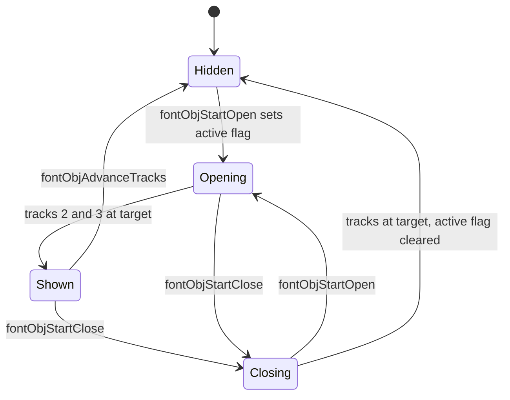

`fontObjGetQuadCorners` turns the tracks into a rectangle. With the centre
flag it moves the origin by half the difference between the final size and
the current size. `fontObjDrawIfActive` draws the rectangle through
`fontObjDrawQuad` while the active flag is set.

`fontObjDrawQuad(x0, y0, x1, y1, rgba, z)` draws a flat, untextured sprite.
A colour with an alpha below 0x80 is blended and drawn without writing
depth. An opaque colour is drawn plain. The text boxes use it for their
background and for the highlight bar of the selected line.

### Textures and slots

The pictures of the font object layer come from eleven texture files in the
directory `yosikawa\`. A file is not loaded into its own buffer. It is
assigned to one of six **slots**, and several files share a slot, so only
some combinations can be in memory together.

| Texture | File | Slot | Cells | Likely use |
| --- | --- | --- | --- | --- |
| 0 | `yosikawa\font.xtx` | 0 | 0–200 (201) | the base sheet: frames, cursors, letter and digit strips, button icons |
| 1 | `yosikawa\bg00.xtx` | none | 201 (1) | has no slot, so this loader never reads it. The file is not on the discs |
| 2 | `yosikawa\bg01.xtx` | 2 | 202–252 (51) | menu background parts |
| 3 | `yosikawa\obj01.xtx` | 1 | 253–396 (144) | menu objects and icons |
| 4 | `yosikawa\g2_00.xtx` | 3 | 397–400 (4) | G.S. Campaign screens |
| 5 | `yosikawa\g2_01.xtx` | 4 | 401–534 (134) | G.S. Campaign screens |
| 6 | `yosikawa\seg01.xtx` | 3 | 535–672 (138) | segment address screen |
| 7 | `yosikawa\battle01.xtx` | 5 | 673–702 (30) | battle windows |
| 8 | `yosikawa\ctrl_pic.xtx` | 3 | 703–705 (3) | controller picture |
| 9 | `yosikawa\ctrl01.xtx` | 4 | 706–720 (15) | controller labels |
| 10 | `yosikawa\g2_02.xtx` | 5 | 721–757 (37) | G.S. Campaign screens |

The slot numbers come from `fontObjTextureSlot` and the cell ranges from the
`kind` byte of the cell table. The uses in the last column are readings of
the file names and of the screens that draw the cells.

`fontObjLoadTexture(texture_index)` makes sure a texture is on its way. If
the slot already holds this texture it returns 1. If the slot is still
loading something it returns 0. Otherwise it allocates the slot buffer on
first use and starts an asynchronous read with `xglCdReadFileAsync`. The
buffers come from the CD arena: 0x40800 bytes for the slots 0 to 2 and
0xB800 bytes for slot 5 through `xglCdSectorAlloc`, and 0x40800 bytes for
the slots 3 and 4 through `xglCdBufferReserve`. The read carries the slot
number as its completion tag. When it finishes, the arena code in
`src/main/xgl_cd_arena.c` calls `fontObjMarkSlotLoaded(slot)`.

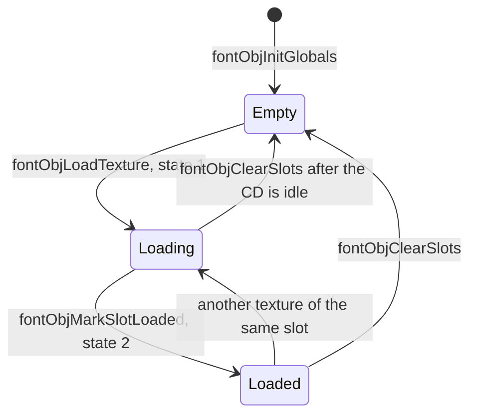

A loaded file starts with a small directory: two header words, an entry
count and the offset of the entries. Each entry of 20 bytes describes one
image transfer with a width and buffer width, a height, a destination offset
in GS memory, a quadword count and the offset of the pixel data.
`fontObjBuildVifPacket` walks the entries and, for each one, patches the
transfer registers of a template packet and adds a reference to the pixel
data. The format itself belongs to
[models-and-textures.md](../formats/models-and-textures.md).

Two destinations exist. `fontObjBuildBaseVifPacket` sends texture 0 to GS
word address 0xE0000, which is block 0x3800. `fontObjBuildVifPacket` sends
any other texture to 0xF0000, block 0x3C00. Only one such texture can be in
video memory at a time, and the variable `fontObjBoundSlot` remembers which.

Block 0x3C00 is also where the font module keeps its colour tables, with
the glyph texture right behind at 0x3C20. A font object texture and the
glyph texture therefore overwrite each other. Both sides are built for
this. The font module sends its image again at the start of every flush.
The font object side calls `fontObjResetState()`, which forgets the bound
texture, so that the next cell from a secondary texture uploads it again.
This is the reason for the pattern `xglFontFlush(); fontObjResetAndBuild();`
that appears throughout the menu code: flush the text queued so far, then
restore the base sheet and forget the secondary one.

### Cells

`fontObjCellTable` has 758 entries of 16 bytes. A cell is a rectangle in
one texture plus the colour table to use with it.

| Offset | Type | Name | Meaning |
| --- | --- | --- | --- |
| 0x00 | u8 | `kind` | texture index, 0 for the base sheet |
| 0x02 | u16 | `x` | left texel |
| 0x04 | u16 | `y` | top texel |
| 0x06 | u16 | `w` | width in texels |
| 0x08 | u16 | `h` | height in texels |
| 0x0C | u32 | `clut_block` | block address of the colour table. `fontObjDraw` shifts the value into the CBP field of `TEX0` |

Many cells are **strips**: a row of equally wide pictures of which the cell
describes only the first. The caller selects a picture with an offset. Cell
0xA0, for example, is 10 by 14 texels at (0, 0) and is the first capital
letter of a 26-letter strip. `fontObjCellOffsetX` and `fontObjCellOffsetY`
return the width and height of a cell for this purpose.

### Drawing a cell

`fontObjDraw(item)` draws one cell. The request is a `FontDrawItem` with the
cell index, the screen position, an optional texel offset, an optional draw
size and a flag word. The function first makes sure the texture is in video
memory. A base cell needs slot 0 in the loaded state. Another cell triggers
`fontObjBuildVifPacket` when its texture is not the bound one, and the cell
is skipped for this frame if the file has not arrived yet.

It then writes the GS registers one by one: the depth test and depth
buffer, `TEX0`, a clamp region that limits sampling to the cell, the
filter, the blend mode, the colour, and a sprite of two vertices.

| Flag | Meaning |
| --- | --- |
| 0x1 | additive blending |
| 0x2 | subtractive blending. Without 0x1 and 0x2 the blend is normal |
| 0x4 | `FONT_DRAW_COLOR_ALPHA`: use the current colour, with its alpha multiplied by the opacity. Without it the cell is drawn in neutral grey with the opacity as alpha |
| 0x8 | `FONT_DRAW_USE_SIZE`: stretch to `size_w` by `size_h` |
| 0x10 | nearest filtering. Without it the cell is filtered bilinearly |
| 0x20 | `FONT_DRAW_OFFSET`: add `offset_x`, `offset_y` to the texel position, to pick a picture of a strip |
| 0x40 | the texture is 4-bit. Without it it is 8-bit |
| 0x80 | draw a textured line along the left edge instead of a sprite |
| 0x100, 0x800, 0x1000 | shorten the texel rectangle by one texel in both axes, in X, or in Y |
| 0x200, 0x400 | mirror horizontally or vertically |
| 0x2000 | sample half a texel lower |
| 0x8000 | repeat the cell over the drawn area instead of clamping |
| 0x10000 | the cell is in a 256 by 256 8-bit texture with buffer width 16 at block 0x3C00 |
| 0x20000 | test against the depth buffer and do not write depth. Without it the cell always passes and writes depth |

Screen coordinates use the same origin as the font module: `x * 16 +
0x7000` and `y * 16 + 0x7200`. The depth of both vertices is the value set
with `fontObjSetDepth`.

### Colour, opacity and depth

Three module variables act as the pen of the font object layer.

| Variable | Default | Functions |
| --- | --- | --- |
| colour | `0x3F80000080808080` (neutral grey, alpha 0x80, Q = 1.0) | `fontObjSetColor`, `fontObjSetColorRgba`, `fontObjSetAlpha`, `fontObjGetColor`, `fontObjResetColor` |
| opacity | 0x80 | `fontObjSetOpacity`, `fontObjGetOpacity`, `fontObjResetOpacity` |
| depth | 0 | `fontObjSetDepth`, reset by `fontObjResetState` |

The colour is a complete `RGBAQ` register value. The opacity is a second
alpha factor that windows use for fades. A window that opens sets the
opacity from its tick, draws its frame, and resets it. The menu text layer
reads the opacity back and puts it into the alpha tag of its text, so frame
and text fade together.

`menuDrawCell(cell, x, y, flags)` and `menuDrawCellSized(cell, x, y, w, h,
flags)` in `src/main/menu_draw.c` are the usual way to call `fontObjDraw`.
They fill the shared request `packetRequest` and submit it.

## Text blocks and the typewriter layout

A **text block** (`FontTextBlock`, 0xD4 bytes) joins a font object with a
text and a reveal state. It is the unit of the text box stacks, and the
cursor buffer entries of the talk windows use the same code with a counter
word added (`FontCursorEntry`, 0xD8 bytes).

| Offset | Name | Meaning |
| --- | --- | --- |
| 0x00 | `origin` | a track. Its Y value is the scroll offset of the text inside the box |
| 0x1C | `flags` | block flags |
| 0x20 | `corners[4]` | the scissor rectangle of the text |
| 0x30 | `cursor` | the layout record, see below |
| 0x58 | `sub_object` | the font object of the box |

`fontObjInitBlock` gives a block the prefix string `$init;$bg0;`, the reveal
mode 1, and a box at (16, 352) with the size 480 by 80. `fontObjSetText`
stores a new text and restarts the reveal.

The layout record is used under two names. The cursor code calls it
`FontBlockCursor`. The layout function reads the same bytes as `FontLayout`.

| Offset | `FontLayout` name | `FontBlockCursor` name | Meaning |
| --- | --- | --- | --- |
| 0x00 | `origin_x` | `cursor` | X of the text |
| 0x04 | `origin_y` | `previous_cursor` | Y of the text |
| 0x08 | `color` | `capacity` | order key of the text |
| 0x0C | `prefix` | `unit_size` | style string printed first |
| 0x10 | `text` | `text` | the text |
| 0x14 | `flags` | `status_flags` | 0x10000 end of text reached, 0x20000 waiting for a key |
| 0x18 | `limit` | `count` | characters revealed so far |
| 0x1C | `pending` | `state` | frames to wait before the next reveal step |
| 0x20 | `newlines` | `aux_value` | line breaks revealed so far |
| 0x24 | `reset` | `mode` | frames between two reveal steps |
| 0x25 | `width` | `step` | characters revealed per step |

`fontObjDrawText(block)` draws a block once per frame. It updates the box
and the scroll track and draws the box while it is active. Unless the box
is still opening, it computes the scissor rectangle from the box, queues
`ScissorSet`, lets `fontObjLayoutAtOffset` print the text at the box
position plus the scroll offset with the key `draw_bits + 1`, and queues
`ScissorReset`.

### The layout function

`fontObjLayoutString` is the typewriter. It prints the prefix, then scans
the text and counts characters until it reaches `limit + width`. It cuts
the string there by writing a zero byte, prints it with `xglFontPrint`, and
puts the original byte back. The text is thus printed from the start in
every frame, a little longer each time.

The scan treats the bytes of the text as follows.

| Bytes | Treatment |
| --- | --- |
| control code below 32, except 10 | skipped with its operands, not counted |
| `$` … `;` | skipped as a whole, not counted |
| `\n` (backslash and `n`) | the backslash becomes the filler code 7 and the `n` becomes a real newline, counted as one character |
| `\k`, `\s` | both bytes become the filler code 7. The step that reveals this point stops and waits for a key |
| `\` and any other character | the backslash becomes code 7 and the character is taken literally |
| byte with the high bit set | counted as one character together with the next byte |
| anything else | one character |

All replaced bytes are recorded in `fontLayoutRestoreTable` and restored
after the print, so the text itself is unchanged. This matters because the
text may be a constant that is shown again later.

When the count reaches the limit, the function decides what happens next.
If a delay is pending or the block already waits for a key, nothing changes.
If the limit fell on a `\k` or `\s`, the flag 0x20000 is set. Otherwise the
limit grows by `width`, the delay restarts from `reset`, and a revealed
newline is added to `newlines`. Reaching the end of the text sets the flag
0x10000. The delay counts down by one per call.

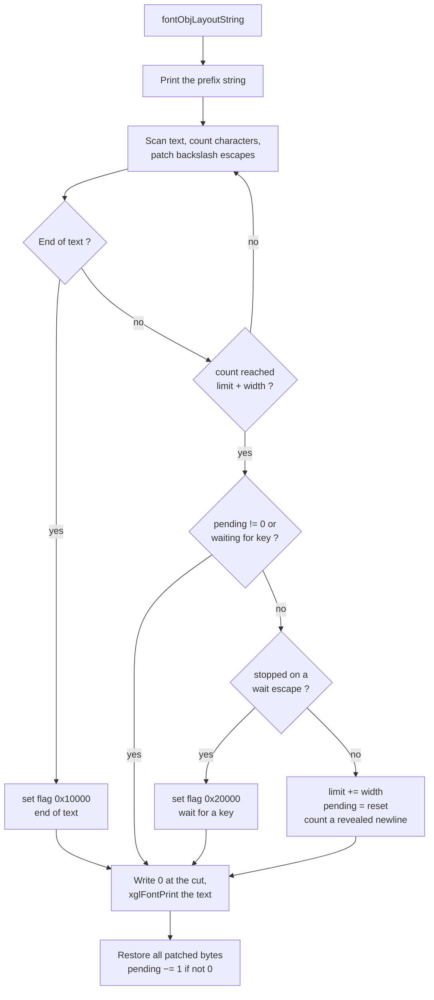

The owner of the block reacts to the flags. `cursorBufferTick` clears the
wait flag and adds `step` to the count, which continues the reveal after a
key press. Setting `step` to 100 reveals the rest of the page at once.

## Text box stacks

`src/main/text_box.c` builds two pools from text blocks.

The first is a pool of four **cursor buffers** of 0xD8 bytes, the talk
window records. Their behaviour belongs to
[ui-windows.md](ui-windows.md). This page only notes how they use the font
layer: `cursorBufferInitEntry` gives each a box at (16, 352) of 480 by 80
with the key `0xFFFFF0`, a line step of 0x18 and three visible lines.
`cursorBufferUpdateEntry` scrolls the text track up by one line step for
every revealed line beyond the visible ones and then draws the entry like a
text block. `cursorBufferPush(text)` takes a free buffer, gives it the text
and activates it. The item pickup message of `src/main/runtime.c`
arrives this way.

The second pool holds eight **text boxes**. A text box is a small
selection window: a text of several lines, one of which is highlighted.

| Structure | Field | Meaning |
| --- | --- | --- |
| `TextBox` | `visible_lines` | index of the selected line |
| | `lineCount` | number of lines of the text |
| | `text` | the text, with lines separated by a literal `\n` |
| | `stack` | a `TextBoxStack` |
| `TextBoxStack` | `visible_lines` | number of visible lines, 3 |
| | `shownFlags` | bit 0 selection box, bit 1 hides the "more" mark |
| | `entries[4]` | four text blocks |
| | `top` | index of the top entry, −1 when empty |
| | `pendingScroll` | lines to scroll, −1 for automatic |

`textBoxSetText(index, text)` stores a text and `textBoxQueue(index)` marks
the box as pending. `textBoxShowPending()` opens the pending box. It pushes
the text on the stack, places the box at (30, 200), and sizes it from the
text: the height is 24 pixels per line (`textBoxCountLines` counts the
`\n` pairs) and the width is ten pixels per character of the longest line
(`textBoxMaxLineWidth`). It then starts the opening animation.

`textBoxUpdate` runs each stack. It draws every entry up to the top one,
applies pending scroll steps of 24 pixels, and handles the Circle button.
When the top entry waits for a key it draws the mark `$mark1f;` at the
lower right of the box, and Circle continues the text. When the text has
ended, Circle starts the closing, and the entry is popped once the box has
closed. A press while the text is still appearing reveals the rest.

`textBoxUpdateAll` also draws the highlight bar of each open box as a
blended quad behind the selected line, and `textBoxUpdateInput` moves the
selection with Up and Down, wrapping at both ends. The alpha of the bar
swings between 0x21 and 0x50 in steps of 2 to make it pulse.
`textBoxConfirmSelection(index)` returns the selected line when Circle is
pressed after the text has ended, and −1 otherwise.

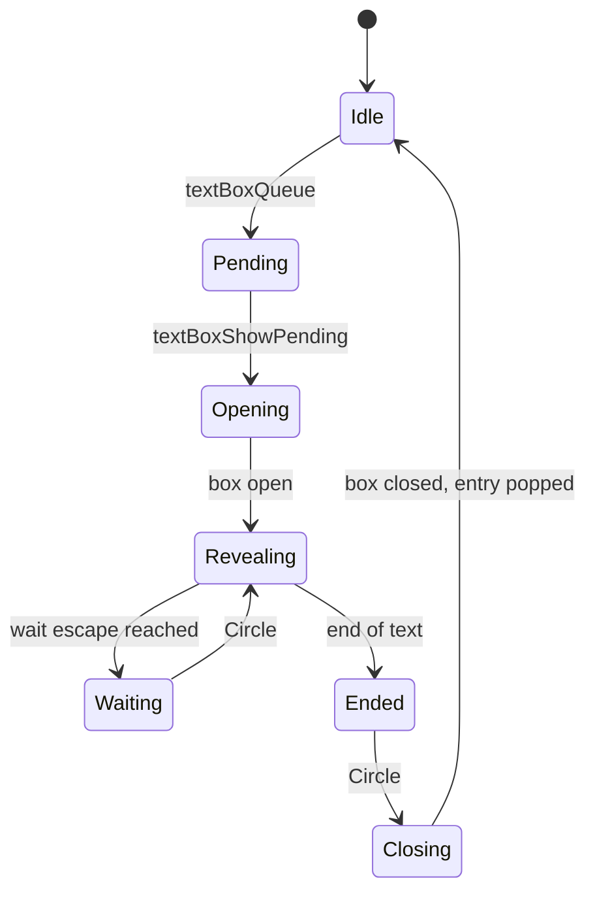

`textSystemInit` and `textSystemUpdate` set up and run both pools. The
source contains no call to either of them, and the same is true of
`textBoxSetText` and `textBoxQueue`. The cursor buffer functions are called
from the talk window code, but the eight selection boxes appear to be unused
in the finished game.

## The menu text layer

The first functions of `src/main/menu_draw.c` are the text helpers of the
main menu and of every screen that shares its look. The menu itself is
described in [main-menu.md](../game/main-menu.md).

### Segments and lines

`textDrawSegment(x, y, text, flags)` is the basic call. It queues up to six
records with the key `textDrawColor`, which is `0xFFFFF0` unless a screen
changes it.

1. The style bytes `19 03`: proportional, wide ASCII.
2. With flag 1, a colour code with the red byte 0xC0 and the green and blue
   bytes `xglTickWave(32, 24) + 0x68`, which swing between 0x50 and 0x80.
   The line pulses in a reddish tint, which marks the selected row.
3. An alpha code `0F 44 00 aa`. The alpha is 0x80, or 0x40 with flag 2, and
   with flag 4 it is multiplied by the font object opacity.
4. The text at (x, y).
5. With flag 1, the closing colour `$colc0c0c0;`.
6. The closing blend `$alpha0,0,0,0,0,0x80;`.

Style strings are passed through the same function at position (0, 0), for
example `textDrawSegment(0, 0, textBoxInitText, 0)`.

`textDrawLines(x, y, text, flags)` draws a text of several lines. It first
rewrites every literal `\n` pair in place into a real newline followed by
the filler code 7, counts the lines, and prints the text as one segment. It
keeps a running Y position in `textCursorY`: a negative `y` continues below
the previous call, and each call advances the position by 20 pixels per
line break plus 30.

### Strip text

Headings, labels and numbers of the menus are not drawn with the font
texture. They use the letter and digit strips of the base sheet, which have
a designed look. `textDrawGlyphString(x, y, text, colour)` maps each
character to a strip and an index: capitals to cell 0xA0, small letters to
0x16, digits to 0x17, the full stop to 0x20 and the plus sign to 0x4B. The
hyphen, slash and colon are extra pictures at the end of the letter and
digit strips. Any other character is skipped, and a space advances by
`textCharSpacing` pixels.

Every character is drawn twice. First a larger outline picture from a
parallel set of cells (0x12 to 0x15 and 0x4C) is drawn four pixels up and
left in the colour passed by the caller. Then the face is drawn in the
current font object colour. The pen advances by the cell width minus one,
with small corrections for narrow and wide letters such as `i`, `l`, `m`
and `w`.

| Function | Strips | Notes |
| --- | --- | --- |
| `textDrawGlyphString` | 0xA0, 0x16, 0x17 with outlines 0x12 to 0x14 | the standard menu lettering |
| `textDrawShadow` | the same | draws the string twice, first in black at (x + 1, y + 3) |
| `textDrawStringAlt`, `textDrawShadowAlt` | 0x7A to 0x7F | a second, smaller set. Small letters and digits sit two pixels lower |
| `textDrawTitle` | 0x18 to 0x1B, or 0x2BA to 0x2BD inside a window of the battle texture | window titles, with a dark copy one pixel right and two down |

### Numbers

`textFormatDecimal(value, digits, zeroPad)` writes a right-aligned decimal
number into a static buffer and returns it. Leading positions are filled
with spaces or zeros. A family of wrappers sets the character spacing,
formats the number and draws it with one of the strip functions.

| Function | Digits | Spacing | Drawn with |
| --- | --- | --- | --- |
| `textDrawDecimal`, `textDrawDecimalZero` | 1 to 9 | 9 | `textDrawGlyphString`, space or zero padded |
| `textDrawDecimalShadow`, `textDrawDecimalShadowZero` | 1 to 9 | 9 | `textDrawShadow` |
| `textDrawDecimalAlt`, `textDrawDecimalAltShadow` | 1 to 10 | 7 | the second strip set |
| `textDrawSignedDecimalShadow` | 1 to 9 | 9 | a `+` or `-` in front, in a fixed colour |
| `textDrawDigits`, `textDrawDigitsZero` | any | 9 | the small digit strip of cell 0x1D, right to left |
| `textDrawDigitsPair` | any | 9 | two numbers with a separator picture between them |
| `textDrawDigitsWide`, `textDrawDigitsWideAlt` | any | 12 | 17-texel digit strips of the cells 0x27B and 0x20C |

The digit strips start with the picture of `1` and end with `0`, so the
code selects picture `(digit + 9) % 10`.

### The help line and its icons

The line of help text at the bottom of a menu screen is a `MsgRange`. It
reveals its text a few characters per frame and can contain small pictures.

| Field | Meaning |
| --- | --- |
| `text` | the text |
| `glyph_count` | number of tokens of the text |
| `reveal_pos` | tokens fully faded in. Starts at −8 as a short lead-in |
| `drawn` | tokens drawn in this frame |

`msgRangeSetText` stores the text and counts its tokens. A two-byte
character is one token. A `$…;` command is one token. A literal `\n` is
rewritten to a newline and a filler code and counts once. An `&` followed
by two digits is one token.

`msgRangeDrawRevealed(range, x, y)` prints the style `msgStyleInit` and
`$prop1;$xx3,0;` and then draws token by token. It prints each character as
its own segment and advances the pen by 13/16 of the measured width plus
one pixel, since the style scales the glyphs with `$zoom13;`. A space
advances 8 pixels and a newline returns to `x`, 20 pixels lower. The tokens
past `reveal_pos` are drawn with a fading alpha, 16 less per token, and
each one pixel further to the right, which gives the text a soft sliding
edge. Each call then moves `drawn` and `reveal_pos` three tokens forward.
`msgRangeDraw` prints the whole text at once, and `msgRangeIsRevealed`
reports when the reveal has finished.

The `&NN` tokens are drawn by `msgRangeDrawIcon` from cells of the base
sheet.

| Code | Picture | Width |
| --- | --- | --- |
| `&01` | cell 0x49 on the dark plate 0x44 | 20 |
| `&02` | cell 0x48 on the plate | 20 |
| `&03` | cell 0x4A on the plate | 20 |
| `&04` | cell 0x47 on the plate | 20 |
| `&10`, `&11`, `&12` | cells 0x131, 0x132, 0x133 of `obj01.xtx` | 18 |

The four cells 0x47 to 0x4A are 18 by 21 pictures next to each other with
four different colour tables. They are the four face buttons of the
controller. The help texts of the game use `&03` where a press confirms
("Press &03 for details") and `&04` where it cancels ("Press &04 to go
back"), and the windows of this game confirm with Circle. `&03` is
therefore the Circle picture and `&04` the Cross picture. The pictures
in `omiya\botan.xtx` settle the other two: `&01` is Square and `&02` is
Triangle.

## The battle text layer

`src/main/text_marker.c` draws the small windows of the battle screen and
of the test menus: the one-line text window, up to four text entries, two
choice menus, and the ANALYZE panel. `textUpdate()` advances them once per
frame and queues `textDrawAll` as a draw callback. The battle scene loop in
`src/ov01/scene.c` calls it. The windows themselves belong to
[battle-engine.md](../game/battle-engine.md). This section covers the text
side.

### textDrawString and its icon codes

`textDrawString(x, y, text)` draws a text with line breaks and inline
pictures. It walks the string and prints it in segments through
`textDrawSegment`. At a newline it prints the line so far, moves down by
the current line height and starts the next line at `x`. At an `&` followed
by two digits from 01 to 29 it prints the segment so far, advances by its
width (measured with `xglFontGetMarkupWidth`), and draws the picture with
`textDrawControlCode`, which returns the width of the picture.

| Code | Picture | Advance | Line height |
| --- | --- | --- | --- |
| `&01` to `&04` | an 18 by 18 button icon through `keyGideDisp`, icon columns 1, 2, 0 and 3: Square, Triangle, Circle and Cross | 20 | 24 |
| `&05` | a 27 by 17 sprite of the step icon texture, an R2 plate | 29 | 24 |
| `&06`, `&07`, `&08` | a key picture through `menuKeyDraw`, keys 52, 53 and 16: the icons of the three enemy types (biological, mechanical, Gnosis) | 26 | at least 27 |
| `&09` to `&15` | a 24 by 42 sprite, seven pictures from `textCodeUv9`: the panels of the Event Slot | 26 | at least 34 |
| `&16` to `&29` | a 36 by 17 status icon from `textCodeUv16`: the attack attribute plates (physical, ether, near, far, strike, slash, pierce, fire, ice, thunder, aura, beam, Air, Down) | 38 | 24 |

The pictures come from the battle menu textures of OV01 and are drawn
directly, in front of the text queue of that moment. The normal line height
is 24 pixels. Tall pictures raise the height of their line through the
global `textLineHeight`. Because the picture hangs above the base line as
well, `textAddNextLineSize` looks ahead at the next line when a line break
is processed and adds 3 pixels for a line with `&06` to `&08` and 10 pixels
for a line with `&09` to `&15`.

Texts for this layer write their line breaks as the two characters `\n`.
`textEncodeNewlines` in `src/main/choice_menu.c` rewrites each pair in
place into a real newline and the filler code 7 before the text is drawn.

### Page markers

A long text entry is shown in steps. The steps are marked in the text by
the two bytes `A1 FC`, the EUC code of the filled circle ●. The marker is
never drawn.

`textMarkerCount(text)` counts the markers of a text.
`textMarkerScan(text, page)` cuts the text at marker number `page`: it
writes a zero at that marker and turns every earlier marker into two filler
codes, recording each position in `textMarkerPtrs` (16 places).
`textMarkerRestore()` writes all markers back. `textDrawAll` brackets the
drawing of an entry with these two calls, so the entry shows the text up to
its current step and the text is whole again afterwards.

`textEntryUpdate` advances an entry. An entry has a list of pages, each a
separate string. While its step count is non-zero, it compares the count
with the markers of the current page. When the count passes the last
marker, the entry moves to the next page if there is one, and otherwise
stays at the end and sets `atLastPage`. An entry without a step count shows
each page for 20 ticks and starts over after the last one.

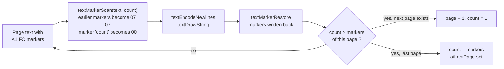

### The text window

The `TextWindow` of `src/main/text_window.c` is a single bar with one line
of text that slides in from the left, stays for a given time and fades out.
The battle unit scripts open it, most likely to announce what a battler
does.

| Field | Meaning |
| --- | --- |
| `track` | position of the bar, eased toward its target |
| `width` | width of the bar |
| `fade` | remaining frames. The bar fades out over the last 8 |
| `text` | the text |

`textWindowShow(x, y, minWidth, text, fadeBase)` measures the text with
`xglFontGetMarkupWidth`, adds 24 for the frame, applies the minimum width,
and starts the track two bar widths to the left of the screen with the
target (x, y), so the bar slides in. The life time is `fadeBase + 8`
frames. A script native in `src/ov01/sb_natives_unit.c` passes its five
arguments straight to this function, see
[natives.md](../scripting/natives.md). `textWindowReset` clears the window.

`textDrawAll` draws the bar as cell 0x2BE of the battle texture, stretched
to the width, with opacity `fade << 4` during the last frames, and prints
the text at (x + 12, y + 6) after the style `textBoxInitText`.

### Entries, choice menus and the ANALYZE panel

`textDrawAll` uses one pattern for all its windows. It flushes the queue,
resets the font object state, draws the frame with `menuDrawTitledWindow`,
sets a scissor rectangle inside the frame, queues the style string and the
text, flushes again and resets the scissor. A window that is opening or
closing is drawn at `tick / 4` of its size around its centre with the
opacity `tick << 5`.

A choice menu prints its items in rows of 24 pixels and one or more
columns. The style argument of `textDrawSegment` is 1 for the row under the
cursor, so that row pulses, and bit 1 comes from the item flags and dims an
item. An optional value is printed after each item with `%3d` at half width
(`$prop0;` and `$zoom8,16;`), followed by a full-width percent sign when
the menu flag 0x10 is set.

The ANALYZE panel is a 256 by 192 window that shows the data of an analysed
enemy. `analyzePanelStart(x, y, stats)` copies an `AnalyzeStats` record and
opens it, `analyzePanelUpdate` closes it on Circle or Cross, and
`analyzePanelIsActive` reports whether it is open. The panel prints the
labels `HP`, `W.ATK.`, `W.ATR.`, `EXP`, `S.Pt`, `C.Pt`, `RARE` and `ITEM`
in light grey and the values at 12/16 width. An unknown value is shown as
`????` and a missing item as `----`. The weak attributes are joined with
`/` through `xglFontPrintDirectOT`, which continues at the pen position of
the previous print. The battle rules behind these values are in
[battle.md](../game/battle.md).

## Button tags in message windows

Dialogue text can name a controller button, as in "Press <○> to jump". The
message windows replace such a name with a picture. Five names exist, in
the table `textTagGlyphNames`.

| Kind | Name in the text | Bytes | Picture rectangle in `botan.xtx` (top, left, right, bottom) |
| --- | --- | --- | --- |
| 1 | `<○>` | `<`, A1 FB, `>` | 0, 0, 19, 18 |
| 2 | `<□>` | `<`, A2 A2, `>` | 0, 18, 37, 19 |
| 3 | `<△>` | `<`, A2 A4, `>` | 17, 0, 19, 35 |
| 4 | `<×>` | `<`, A1 DF, `>` | 17, 18, 37, 35 |
| 5 | `<R3>` | ASCII | 0, 36, 65, 18 |

The replacement happens while a message is formatted. `textFormatWrapped`
in `src/main/msg_slot_core.c` copies the message into the output buffer
and wraps it. At each position it asks `textStartsWithGlyphName(text,
kind)` for the five kinds. On a match, `textFormatInsertGlyphTag` does
three things. It measures the text written so far to find the pixel
position of the tag. It records a **text tag** with `textTagAdd`. And it
writes a 16-byte gap into the output in place of the name:
`$xx1,18; $xx1,4;` for the four face buttons and `$xx1,28; $xx1,4;` for
R3. The gap sets the default width to 18 or 28, prints one space, and sets
the default width back to 4. Since a space has no entry in the
proportional table, it takes the default width, and the line gets a hole of
exactly the size of the picture. `textSkipGlyphName` then steps over the
name in the source text.

A text tag is one entry of `textTagTable`, which has 20 entries.

| Field | Meaning |
| --- | --- |
| `key` | start of the formatted text that the tag belongs to |
| `position` | address of the gap inside that text |
| `x`, `y` | screen position of the picture |
| `kind` | 1 to 5, 0 for a free entry |

`textTagDrawActive(text, yOffset, slot)` draws the pictures of one text
slot. Its first argument is the reveal cursor of the slot. `textTagIsActive`
accepts a tag when the cursor lies inside the tag's text and has passed the
tag's position, so a button picture appears at the moment the typewriter
reaches it. The function uploads the texture `omiya\botan.xtx`, sets up the
GS state with a scissor that matches the window (`grSetupFrameState`),
draws each active tag with `textTagDrawGlyph` at its position minus the
scroll offset, and closes the batch with `grFlushQuadBatch`.

`msgWindowLoadBotanXtx` loads the texture through the resource system and
waits for it, and `msgWindowUnloadBotanXtx` frees it. `textTagTableClear`
clears the first six entries when the output buffer is reset, and
`textTagRemoveKey(key)` removes the tags of one text when a slot is
rewound. `msgWindowDrawListIcons` uses the same pictures for the two button
hints under a list window: the Circle picture, dimmed when the list is
empty, and the Cross picture.

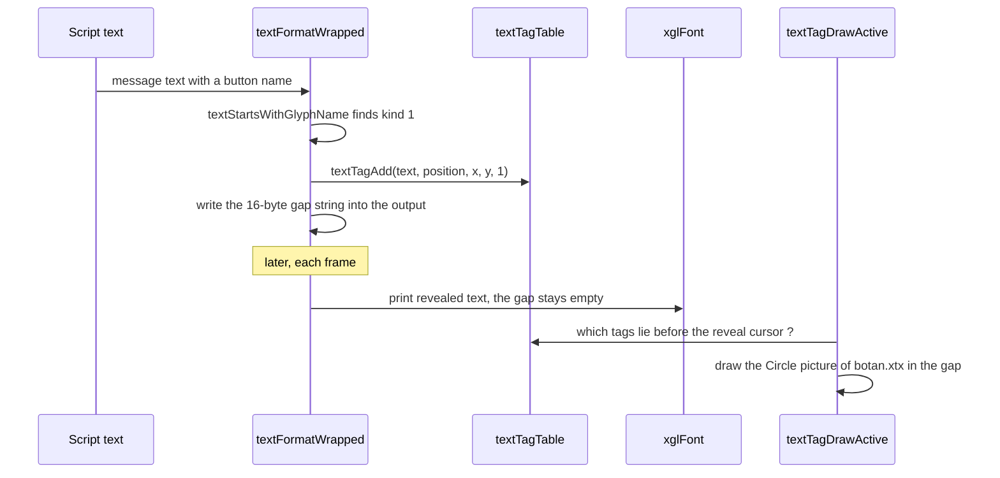

Two more markers of message text are handled by the message window code
and are listed here for completeness. A message that starts with
`[name]` names its speaker. `textTagBody` and `textSkipBracketTag` in
`src/main/msg_text_draw.c` return the name and the text after the closing
bracket, and `msgEntryFeedText` stores the name as the speaker of the text
slot. A `%d` in a message is a number placeholder. The formatter turns it
into `%s`, and the number is supplied as a string when the text is printed
with `xglFontPrintf`. Both are described with the windows in
[ui-windows.md](ui-windows.md) and with the scripts that produce the
messages in [events.md](../scripting/events.md).

## Text slots and scrolling

A **text slot** is a message window slot in the state
`MSG_SLOT_TYPE_TEXT`. The slot system, its other states and the window
frames are the subject of [ui-windows.md](ui-windows.md). The two files
below hold the part that drives the text.

`src/main/interp_text.c` has three setters that act only on a text slot.
`interpSetTextArg(slot, index, value)` stores one of ten number arguments
(index 1 to 10) for the placeholders of the message.
`interpSetSpeakerName(slot, name)` stores the speaker name.
`interpSetOpening(slot)` clears the closing flag and sets the opening flag.

`interpUpdate(slot)` in `src/main/interp_update.c` runs once per frame and
does nothing while the game is paused. An opening slot counts up for 12
frames (`INTERP_OPEN_FRAMES`) and then becomes open and starts revealing. A
closing slot counts down and is released at zero.

The reveal is done by `interpAdvanceCursor`. The slot shows a range of
lines, from `first_line` for `visible_rows` rows, and `reveal` points to
the first byte that is still hidden. Every `pending` frames the function
steps over any `$` commands at the cursor with `xglFontCopyTextUnit`, then
advances the cursor with `textSkipTwoUnits`. When the cursor reaches the
end of the visible range, the reveal flag is cleared and the slot starts
its wait counter (`talkAdvanceCounter`). `interpSetPending` changes the
reveal delay.

Scrolling is eased with a cosine. `interpScrollBy(slot, advance)` changes
`first_line`, clamps it so that the last page stays full, and prepares a
movement of `scroll_y` from its current value to the pixel offset of the
new first line. `interpStepCosine` adds `angle_step` to an angle each
frame and sets `scroll_y = midpoint + (midpoint − target) * cos(angle)`.
At 180 degrees the scroll offset is exactly the target and the flag is
cleared.

`interpDrawTextSlot` draws the slot: the frames while it opens or closes,
and for an open slot the frames, the text through `talkDrawTextBox`, and
the button pictures through `textTagDrawActive` with the reveal cursor and
the scroll offset. `interpRewind` closes a slot and gives its part of the
output buffer back, which also removes its tags.

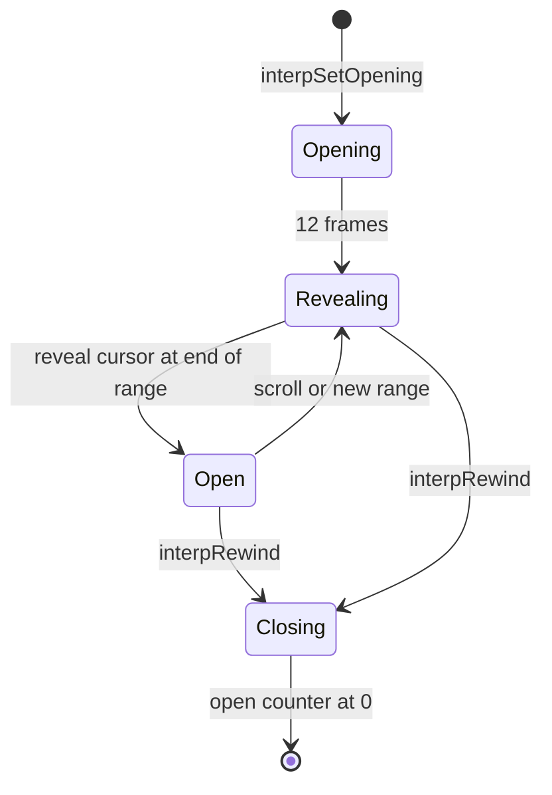

## Line helpers for text files

`src/main/yg2_text.c` holds three small functions for plain text files
with one statement per line. `yg2TextNextLine(text, lines)` moves past the
next newline and then past spaces and tabs. `yg2TextCompareLine(pattern,
text)` compares a text with a pattern up to the newline of the pattern, and
a `%` in the pattern matches the rest of the line. It returns 0 on a match.
`yg2TextFindLine(start, pattern)` walks line by line until a line matches.

The file name places them with the cutscene player of
[cutscenes.md](../scripting/cutscenes.md), but their one caller is the
G.S. Campaign reader. `yg2PathReadTaggedText` uses `yg2TextCompareLine` to
find a tagged, quoted text before it converts its characters with
`sjisToEuc`. The other two functions have no caller.

## All escapes at a glance

The same string can pass through several layers, and each layer consumes
its own markers. The table lists every marker, the layer that reads it, and
the function.

| Marker | Read by | Function | Effect |
| --- | --- | --- | --- |
| bytes 1 to 31 | font module | `xglFontFlushCore` | control codes |
| `$name…;` | font module | `xglFontInlineCommand` | inline commands |
| `%d %x %b %f %s %c` | font module, printf calls only | `xglFontPrintSub` | formatted values |
| byte 0x80 to 0xFF | font module | `xglFontIsTextureGlyphCode` | two-byte or single-byte character |
| `\n` (two characters) | text blocks, menu and battle layers | `fontObjLayoutString`, `textDrawLines`, `msgRangeSetText`, `textEncodeNewlines` | line break |
| `\k`, `\s` | text blocks | `fontObjLayoutString` | wait for a key |
| `&01` to `&12` | menu help line | `msgRangeDrawIcon` | button and menu icons |
| `&01` to `&29` | battle text | `textDrawControlCode` | button, key and status icons |
| `A1 FC` | battle text entries | `textMarkerScan` | step marker inside a page |
| `<○> <□> <△> <×> <R3>` | message windows | `textFormatWrapped` | button picture |
| `[name]` at the start | message windows | `textTagBody`, `textSkipBracketTag` | speaker name |
| `%d` in a message | message windows | `textFormatWrapped`, `fontPrintIntRow` | number argument |

Code 7 has a special place in this list. It does nothing in the font
module, and that is exactly its use: every layer that removes a marker of
two bytes and needs only one writes 7 into the spare byte, so the string
keeps its length and can be restored or reused.
