# Math helpers

Xenosaga Episode II has no single math library. Vector, matrix, quaternion and
curve code is spread over several small libraries that were clearly written by
different people at different times: the math file of the `xgl` system
library, the `MMath` library of the battle and effect code, three separate
"current matrix" interfaces that keep a matrix inside the VU0 vector unit, the
`Xrg` quaternion helpers of the animation library, and a handful of small
files with line tests, lookup tables and easing steps.

All of them share the same vector and matrix types and the same layout
conventions, and most of them do their arithmetic on the VU0 unit of the
PlayStation 2. The page starts with those conventions, then explains VU0 and
the two header files that hold the recurring VU0 and quadword shapes, and then
goes through each library in turn. The system library that owns `xgl_2.c` is
described in [xgl.md](xgl.md).

[← Back to the overview](../README.md)

## Files

| File | Prefix | Contents |
| --- | --- | --- |
| `src/main/xgl_2.c` | `xgl` | Random numbers, float conversions, sine, cosine and arctangent, memory copies, vector and matrix functions, the VU0 matrix stack, projection, quaternions, Euler angles |
| `src/main/m_math.c` | `MMath` | Mersenne Twister random numbers, angle differences, Hermite curves, vectors, rotations, matrices, projection with clipping, quaternions. Also the `MOutputDebugString` debug print |
| `src/main/m_math_geom.c` | `MMath` | Hermite key tracks, the point-in-triangle test and the range tests between two actors used by battle |
| `src/main/vu0_matrix.c` | `vu0` | The VU0 current matrix in `vf26` to `vf29`: multiply, set to a rotation about one axis |
| `src/main/vu0_rotate.c` | `vu0` | The same current matrix: rotate, translate, transform a point, build a rotation from a direction |
| `src/main/vu0_vector.c` | `vu0` | Normalising a vector in `vf20`, a copy that sets w, one more multiply of the same current matrix, two empty log functions |
| `src/main/xgl_cur_matrix.c` | `xglCur` | The VU0 current matrix in `vf27` to `vf30`: set, get, multiply, apply, and "set to rotation, translation or scale" |
| `src/main/xgl_cur_mul.c` | `xglCurMul` | Multiply that current matrix by a rotation, a translation, a scale or an inverse scale |
| `src/main/cur_matrix_asm.c` | `_Cur` | Screen projection with clip flags, view scale and translation, box visibility, on the `vf27` to `vf30` matrix |
| `src/main/nml_packet_add.c` | `_Cur` | Set, multiply and apply the `vf27` to `vf30` matrix for the model library |
| `src/main/model_calc_clip.c` | `_Cur`, `_ModelCalcClip` | Projection with fog, projection with float output, and the sphere tests against the clip planes |
| `src/main/xgl_vector_ops.c` | `xgl...`, `ti...` | Local copies of the small vector helpers, the identity load `tiVu0LoadIdentityMatrix`, and two unrelated animation helpers |
| `src/main/xgl_matrix_axes.c` | `xgl` | A matrix built from three axes, an in-place transpose, a read of the VU1 float registers |
| `src/main/xgl_vu1_regs.c` | `xgl` | `xglAtan2Angle`, and reads of the VU1 integer and control registers |
| `src/main/xrg_rand_int.c` | `Xrg` | Plain C vector helpers and quaternions: normalise, Euler angles, axis and angle, product, spherical interpolation |
| `src/main/ti_dynamics_node.c` | `Xrg`, `tiDynamics` | Quaternion to matrix and back, the quaternion between two directions, and the node step of the cloth and hair simulation that uses them |
| `src/main/outer_product.c` | `Calc`, `Check` | Perpendicular vectors, distance from an edge, intersection point, side of a line and segment crossing on the ground plane |
| `src/main/ease_step.c` | `ease` | The step size of a cosine ease, with an override |
| `src/main/oLib.c` | `oLib`, `xgl`, `gs` | Sine and cosine tables in degrees, coordinate rounding to GS fixed point, an integer distance. Also the set-up of the object library heap |
| `src/main/runtime_math.c` | `math` | The four script natives of the `math` module |
| `src/main/gs_make_frame.c` | `gs`, `xgl` | `xglVectorNormalInPlace`, next to two GS register helpers |
| `src/main/gs_make_tex0.c` | `gs`, `xgl` | `xglColorLerp` and `xglWrapDegrees`, next to one GS register helper |
| `src/main/TiVu0.c` | `tiVu0`, `xac` | Two assert stubs of the `Ti` library's VU0 file, and two animation key readers |
| `include/vu0_macro.h` | `Vu0` | The recurring VU0 macro-mode blocks as macros |
| `include/quadword.h` | `Quadword` | The 128-bit copy and clear macros |

The math functions of the C runtime (`sinf`, `cosf`, `atanf`, `atan2f`,
`asinf`, `acosf`, `fmodf`, `sqrtf`) come from the bundled runtime libraries,
described in [runtime-libraries.md](../architecture/runtime-libraries.md).
Some game code calls them and other code calls the game's own VU0 versions.
The choice follows the library, not the task: the `xglCur` functions use
`cosf` and `sinf`, while `xglMatrixRotX` and all of `MMath` use the VU0
routines.

The flowchart below shows which part of the game uses which math library.

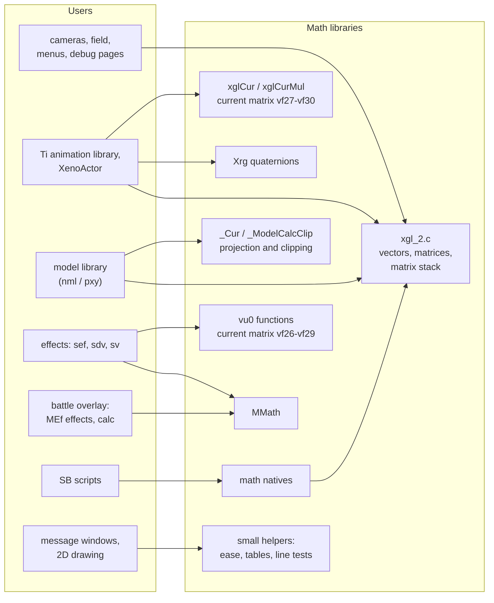

## Conventions

### Types

All libraries use the types of `include/shared.h`, plus two that live in
library headers.

| Type | Definition | Use |
| --- | --- | --- |
| `Vector4` | struct of four floats `x`, `y`, `z`, `w` | Points, directions, colours, Euler angles, quaternions, planes |
| `AlignedVector4` | `Vector4` aligned to 16 bytes | Vectors that are moved as whole quadwords |
| `DoublewordAlignedVector4` | `Vector4` aligned to 8 bytes | Vectors copied as two 64-bit words |
| `DoublewordVector4` | union of a `Vector4` and two 64-bit words | The same, where the code really reads the two words |
| `Vector4Elements` | union of a `Vector4` and its four floats by index | Vectors that the code indexes |
| `Matrix4` | `float[4][4]` | A 4 x 4 matrix, 64 bytes |
| `Matrix` (`include/main/xgl_2.h`) | union of 16 floats `elements`, a `Matrix4` `rows`, 4 x 4 ints `words`, four 128-bit `quadwords` and four `Vector4` `vectors` | One matrix seen in five ways |
| `HermiteVector` (`include/main/m_math.h`) | another name for `Vector4` | Control points and tangents of Hermite curves |
| `ScreenVector4` (`include/main/cur_matrix_asm.h`) | ints `x`, `y`, `z` and a float `w` | A projected point in GS fixed point |

A vector always has four floats, also when only x, y and z mean something.
VU0 loads and stores 16 bytes at a time, so a three-float vector would not be
cheaper and would not fit the registers.

Many functions come in two versions. The plain version works on all four
components. The `XYZ` version works on x, y and z and passes w through from
one of its sources. `xglVectorScale` and `xglVectorScaleXYZ` are an example
of such a pair. The source of w is not always the same operand:
`xglVectorInterXYZ` takes w from its end point, most others take it from the
first operand.

### Matrix layout: rows

A `Matrix4` is four rows of four floats. Rows 0, 1 and 2 are the X, Y and Z
axes of the transformed space. Row 3 is the translation. The comments in the
headers use the same words: `Vu0MMathSetTranslation` stores a point "as the
translation row (row 3, +48)".

```
            lane x   lane y   lane z   lane w        byte offset
 m[0] = (    Xx,      Xy,      Xz,      0   )        +0     X axis
 m[1] = (    Yx,      Yy,      Yz,      0   )        +16    Y axis
 m[2] = (    Zx,      Zy,      Zz,      0   )        +32    Z axis
 m[3] = (    Tx,      Ty,      Tz,      1   )        +48    translation
```

A vector is a **row vector** and the matrix stands on its right. The
transformed vector is a weighted sum of the four rows:

```
v' = v.x * m[0] + v.y * m[1] + v.z * m[2] + v.w * m[3]
```

This is exactly what `xglVectorMulMat` and `MMathApplyMatrix` do on VU0: one
multiply for the first row and three multiply-adds into the accumulator. A
point has w = 1 and therefore picks up the translation row. Several helpers
do not read w at all and add the translation row unconditionally
(`Vu0ApplyMatrixXYZ`, `_CurApplyMatrix`). The 3 x 3 versions stop after row 2
and so rotate a direction without moving it (`Vu0ApplyMatrix33XYZ`,
`_CurApplyMatrix33`).

Each row fits one VU0 register. A matrix that is kept in VU0 therefore takes
four neighbouring registers, one row each, and the first register holds
row 0.

### Order of multiplication

With row vectors, the matrix that acts on a point first stands on the left
of a product. The libraries do not agree on the order of their arguments, so
the table lists each multiply by what it does to a vector.

| Function | Result |
| --- | --- |
| `xglMatrixMul(d, left, right)` | Each row of `right` is transformed by `left`. A vector goes through `right` first, then `left` |
| `MMathMulMatrix(out, rhs, lhs)` | Each row of `lhs` is transformed by `rhs`. A vector goes through `lhs` first, then `rhs` |
| `xglCurMatrixMul(m)`, `_CurMatrixMul(m)`, `vu0CurMatrixMul(m)` | Each row of `m` is transformed by the current matrix. A vector goes through `m` first, then the old current matrix |
| `vu0CurMatrixMulRight(rows)` | Each row of the current matrix is transformed by `rows`. A vector goes through the old current matrix first, then `rows` |
| `xglMatrixStackMul(m)` | Passes `m` to the VU0 microprogram, which multiplies the stack's current matrix by it |

The functions that add one rotation, translation or scale to an existing
matrix (`xglMatrixRotX`, `xglMatrixTrans`, `xglMatrixScale`, the
`MMathRotateMatrix` family, the `xglCurMul` family, `vu0RotateCurrentX`) all
work on the rows directly and all in the same way: the new transform acts
**before** the old matrix. A rotation about X, for example, replaces rows 1
and 2 by a mix of the two and leaves rows 0 and 3 alone. The result is that
a chain of calls reads like classic OpenGL code: start from the parent
matrix, add the object's translation, then its rotation, then its scale, and
the point is scaled first and moved last.

### Axes, headings and pitch

The ground is the XZ plane and Y is the vertical axis. The code shows this
in many places: the range tests of battle set y to 0 before they compare two
actors, `CheckDist2D` and `xglPointLengthXZ` measure with x and z only, and
an actor's facing is its `rotation.y`.

A heading is measured from the +Z axis toward the +X axis. `MMathCalcAngle`
computes the heading from one point to another as `srsAtan2(dx, dz)`, and a
rotation about Y by an angle `a` turns the Z axis row of the identity into
`(sin a, 0, cos a)`. A heading of 0 faces +Z and a heading of pi/2 faces +X.

Pitch is a rotation about X. A positive rotation about X turns the Z axis row
into `(0, -sin a, cos a)`, which points downward. `MMathCalcAngle` matches
this: it computes the pitch as the arctangent of `source.y - target.y` over
the horizontal distance, so a target below the source gives a positive
pitch. `vu0SetRotationFromDirection` negates the y difference for the same
reason.

The projection matrix built by `xglMatrixFrustum` has the form of the OpenGL
`glFrustum` matrix. The w of a projected point is minus its z, so a camera
looks along its own -Z axis.

### Angles

Angles are `float` radians in the `xgl`, `MMath`, `vu0`, `xglCur` and `Xrg`
functions. Other units appear at the edges of the engine:

| Unit | Where |
| --- | --- |
| Whole degrees, `int` | `xglCosDeg`, `xglSinDeg`, the step of `easeAngleStep` |
| Degrees, `float` | `xglWrapDegrees`, the source of `MMathDeg2RadVector` |
| Hundredths of a degree, `int` | The arguments of the script natives `math.sin` and `math.cos` |
| Radians times 10000, `int` | The result of the script native `math.atan` |

`MMathDeg2RadVector` and `MMathRad2DegVector` convert the x, y and z of a
whole vector of Euler angles with the factors 0.017453292 and 57.29578. The
`...I` versions read or write integer degrees: `MMathDeg2RadVectorI` converts
the integers to float first, and `MMathRad2DegVectorI` truncates the result
to integers.

### Screen coordinates

A projected point is in GS coordinates. x and y are 12.4 fixed-point numbers
(the pixel position times 16), z is an integer depth. The VU0 instructions
`vftoi4` and `vftoi0` make these conversions at the end of each projection
routine. The scale and offset that map the normalised result of the
perspective divide onto the GS drawing area come from the camera, in
`camera->screen.screenScale` and `camera->screen.screenOffset` of
`XglCamera`. Cameras are described in [xgl.md](xgl.md), and the GS side in
[rendering.md](../architecture/rendering.md).

The flowchart below shows how a point travels from an object's own space to
the screen, with the convention of each step.

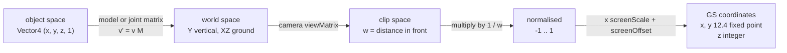

## The VU0 unit in plain terms

The main processor of the PlayStation 2 (the EE) has two vector units. VU1
runs the geometry programs of the model library (see [pxy.md](pxy.md)).
**VU0** is tightly coupled to the EE and is the unit all the math code on
this page uses.

VU0 has 32 vector registers, `vf0` to `vf31`. Each holds four floats in the
lanes x, y, z and w, and one instruction works on all four lanes at once.
`vf0` is the constant (0, 0, 0, 1), which the code uses as its source of 0
and 1. There are 16 integer registers `vi0` to `vi15`, an accumulator `ACC`
for multiply-add chains, a `Q` register that receives the result of a divide
or a square root, and an `R` register that generates random numbers. Higher
register numbers in the `ctc2` and `cfc2` instructions name control
registers: `vi18` is the clip flag register and `vi27` is `CMSAR0`, the
start address for a microprogram call.

### Macro mode

In **macro mode** VU0 behaves like coprocessor 2 of the EE. The EE executes
VU0 instructions one by one inside its own instruction stream. Data moves
with these instructions:

- `lqc2` and `sqc2` load and store a vector register from memory.
- `qmtc2` and `qmfc2` move 128 bits between an EE register and a vector
  register. Only the low 32 bits matter when the value is one float.
- `ctc2` and `cfc2` write and read VU0 integer and control registers.

The arithmetic instructions have a lane mask (`.xyz`, `.x` and so on) and
can take one lane of the second operand as a scalar (`vmulx`, `vaddy`).
`vopmula` and `vopmsub` together form a cross product. `vdiv`, `vsqrt` and
`vrsqrt` put their result in `Q`, and `vwaitq` waits for it. The length of a
vector is computed in `xglVectorLength` like this:

```c
__asm__ __volatile__(
    "lqc2 vf3, 0(%1)\n"           /* load the vector */
    "vmul.xyz vf3, vf3, vf3\n"    /* square x, y, z */
    "vaddy.x vf3, vf3, vf3y\n"    /* x*x + y*y */
    "vaddz.x vf3, vf3, vf3z\n"    /* + z*z */
    "vsqrt Q, vf3x\n"             /* square root into Q */
    "vwaitq\n"
    "vaddq.x vf4, vf0, Q\n"       /* move Q into a register */
    "qmfc2 $2, vf4\n"
    "sw $2, 0(%0)\n"              /* store the result */
    : : "r"(destination), "r"(vector) : "$2", "memory");
```

Blocks of this kind are hardware code. They are written as inline assembly,
and the ones that repeat are collected as macros in `include/vu0_macro.h`
(see [VU0 macros](#vu0-macros)).

### Micro mode and the resident microprogram

In **micro mode** VU0 runs a program from its own instruction memory while
the EE continues. The EE starts a routine with `vcallms address`, or with
`vcallmsr vi27` after it has written the address to `CMSAR0`. The address
counts instruction pairs of 8 bytes, which is why the C code shifts each
entry address right by 3. The EE puts the arguments in agreed vector
registers first and reads the result from agreed registers afterwards. To be
sure the routine has ended, it reads the result with an interlocked
transfer, one with the `.i` suffix such as `qmfc2.i` or `cfc2.i`, which
waits until the running routine stops.

The game keeps one microprogram in VU0 for its whole run. `xglGeometryInit`
in `src/main/xgl_2.c`, called once from the start-up code in
`src/main/control_entry.c`, sends the DMA chain `xglVu0ResidentMicroprogram` on
channel 0, the VIF0 path. The chain holds one `MPG` block of 224 instruction
pairs, 1792 bytes, which is the whole program. It has 19 routines and one
idle loop at address 0. Every routine ends with a jump to address 0, where a
pair with the E bit stops VU0.

The routines keep the **current matrix** in `vf28` to `vf31`, one column per
register. `vf24` to `vf27` hold a result before it becomes the current
matrix. `vi13` is the stack pointer.

| Entry (byte address) | Caller | Passed in | Work | Result |
| --- | --- | --- | --- | --- |
| `0x20` | `xglSin`, `Vu0Sin`, `vcallms 0x20` | angle in `vf4.x` | Sine | `vf1.x` |
| `0xE8` | `xglCos`, `Vu0Cos`, `vcallms 0xE8` | angle in `vf4.x` | Adds pi/2 and runs the sine | `vf1.x` |
| `0x108` | `xglMatrixStackUnit` | | Current = identity | |
| `0x130` | `xglMatrixStackMul` | matrix in `vf4` to `vf7` | Current = current times the matrix | |
| `0x1B8` | `xglMatrixStackReverse` | | Current = its transpose | |
| `0x218` | `xglMatrixStackInverse` | | Current = its inverse, see below | |
| `0x2E8` | `xglMatrixStackScale` | scale in `vf4` | Each column times one lane of the scale, w included | |
| `0x310` | `xglMatrixStackTrans` | translation in `vf4` | Column 3 = current times the vector | |
| `0x338` | `xglMatrixStackRotV` | axis in `vf5`, angle in `vf4.x` | Builds the rotation about the axis and multiplies | |
| `0x3D0`, `0x418`, `0x460` | `xglMatrixStackRotX`, `RotY`, `RotZ` | angle in `vf4.x` | Mixes two columns with sine and cosine | |
| `0x4A8` | `xglMatrixStackFrustum` | two vectors in VU0 data memory at 128 and 129 | Builds a perspective matrix and multiplies | |
| `0x538` | `xglMatrixStackPushUnit` | | Pushes, then current = identity | |
| `0x580` | `xglMatrixStackPush` | | Pushes | |
| `0x5C8` | `xglMatrixStackPop` | count in `vi1` | Steps back `count` matrices and loads | |
| `0x620` | `xglMatrixStackMulVector` | vector in `vf4` | Current times the vector | `vf5` |
| `0x648` | `xglMatrixStackRTPS` | point in `vf4`, scale in `vf5`, offset in `vf6` | Transform, divide, scale and offset | `vf7` |
| `0x6A8` | no caller found | `vf4` to `vf10` | Builds two matrices in `vf24` to `vf27` and `vf20` to `vf23` | |

**Sine.** The routine reduces the angle to a remainder r in the range of
plus or minus half of pi. It computes n as the angle times 0.31831 (1/pi)
plus or minus 0.5, by the sign of the angle, cut to an integer, and r as the
angle minus n times 3.14159. It then evaluates the polynomial
r - r³/6 + 0.00833303 r⁵ - 0.000198074 r⁷ + 0.00000260188 r⁹ and changes the
sign when n is odd. The cosine routine adds 1.5708 to the angle and jumps
into the sine. The rotation routines call both as subroutines.

**The matrix stack** lives in VU0 data memory at quadwords 0 to 127. A
matrix takes four quadwords, so the stack holds 32 matrices. A push stores
`vf28` to `vf31` at `vi13` and adds 4. A pop subtracts 4 times the count and
loads. Both mask `vi13` with 124, so the stack wraps around instead of
running into other memory. Nothing in the program checks for overflow.

**Inverse.** The routine at `0x218` inverts a matrix whose upper three rows
are any 3 by 3 matrix and whose last column is a translation. It builds the
three cross products of the columns, divides them by the determinant and
transposes. The new translation is minus the inverted matrix times the old
one. The fourth lanes are set to 0, 0, 0 and 1. A matrix with a projection
row is therefore not inverted correctly, which is fine for the model and
view matrices that the callers pass.

**Frustum.** The routine reads two vectors from data memory, the minimum
corner (left, bottom, near) at quadword 128 and the maximum corner (right,
top, far) at 129. It builds the usual perspective matrix: 2 near / (right -
left) and 2 near / (top - bottom) on the diagonal, the two center terms
(right + left) / (right - left) and (top + bottom) / (top - bottom), the
depth terms -(far + near) / (far - near) and -2 far near / (far - near), and
-1 in the row that produces w. It then multiplies the current matrix by it.

**RTPS** ("rotate, translate, perspective, screen") multiplies the point by
the current matrix, divides by w, multiplies x, y and z by the scale and
adds the offset. It returns x and y in 12.4 fixed point, z as an integer and
1/w in lane w, which is the form a GS vertex needs.

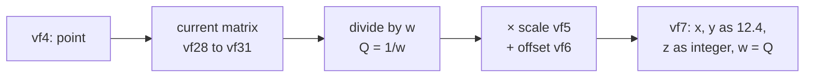

The current matrix of the microprogram lives in `vf28` to `vf31`. This is
visible from the EE side: `xglMatrixStackSave` stores exactly these four
registers and `xglMatrixStackLoad` loads them.

An EE function that calls a routine follows the same pattern every time. The
sequence diagram below shows `xglSin(angle)`.

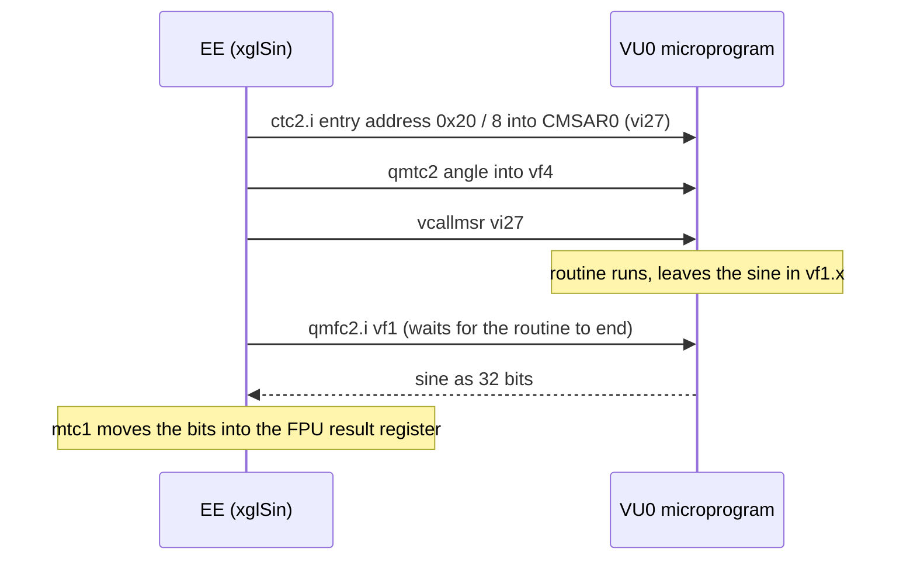

### Three current matrices

A "current matrix" is a matrix that stays in VU0 registers between calls, so
that a chain of small functions can build it step by step without loading
and storing 64 bytes each time. The game has three interfaces of this kind,
and each one keeps its matrix in a different set of four registers.

| Interface | Registers | Files | Main users |
| --- | --- | --- | --- |
| `xglMatrixStack` | `vf28` to `vf31` | `xgl_2.c` and the microprogram | Cameras, field and map drawing, menus |
| `xglCur`, `xglCurMul`, `_Cur`, `Vu0SetCurrentMatrix` | `vf27` to `vf30` | `xgl_cur_matrix.c`, `xgl_cur_mul.c`, `cur_matrix_asm.c`, `nml_packet_add.c`, `model_calc_clip.c` | The `Ti` animation library, `XenoActor`, the model library |
| `vu0...` | `vf26` to `vf29` | `vu0_matrix.c`, `vu0_rotate.c`, `vu0_vector.c` | The effect code `sef.c`, `sdv.c`, `sv_get_image_item.c` |

The three sets overlap, as the layout below shows. Row 0 of one interface is
row 1 of the next.

```
 register        vf25    vf26    vf27    vf28    vf29    vf30    vf31
 xgl stack                               row 0   row 1   row 2   row 3
 xglCur / _Cur                   row 0   row 1   row 2   row 3   (scratch)
 vu0 functions           row 0   row 1   row 2   row 3
 _Cur projection scale   offset
```

A library therefore cannot trust its matrix after another library has run.
The plain `xgl` functions add to this: `xglMatrixMul`, `xglVectorMulMat`,
`xglMatrixRotX`, `RotY` and `RotZ` and `xglQuaternion2Matrix` work from
memory to memory, but they use `vf27` to `vf31` as scratch on the way.
`_ModelCalcClipInitMat1` loads `vf20` to `vf31` with clip data. In the
recovered code each chain loads its matrix at the start (`xglCurMatrixSet`,
`tiVu0LoadIdentityMatrix`, `_CurMatrixSet`, `vu0SetCurrentRotationY`) and
stores the result to memory at the end, so no chain depends on what an
earlier one left behind.

## Quadword copies

File: `include/quadword.h`

The EE has 128-bit general registers. The instructions `lq` and `sq` load and
store 16 bytes at once, so a whole `Vector4` moves in two instructions and a
whole `Matrix4` in eight. The game writes these copies as small
inline-assembly blocks, in the style of the SDK's `sceVu0CopyVector`, and the
header collects them as macros.

| Macro | Effect |
| --- | --- |
| `QuadwordCopy(d, v)` | `*d = *v`, one 16-byte vector, through register `$2` |
| `QuadwordZero(d)` | `*d = 0`, stored from the zero register |
| `QuadwordCopyMatrix(d, v)` | Copy a 64-byte matrix, load and store interleaved row by row |
| `QuadwordZeroMatrix(d)` | Clear a matrix |
| `QuadwordCopyT0(d, v)` | One vector through register `$8` |
| `QuadwordCopyA0(d, v)` | One vector through register `$4` |
| `QuadwordCopyT0NoClobber(d, v)` | The same as `QuadwordCopyT0`, written so the compiler may keep memory values in registers across it |
| `QuadwordCopyMatrixT0(d, v)` | A matrix with all four loads first, through `$8` to `$11` |
| `QuadwordMergeMatrixPosition(d, m, p)` | Rows 0 to 2 from `m`, row 3 from the vector `p` |
| `QuadwordCopyArray(d, v, n)` | A loop over `n` quadwords, the body of `xglMemCopy16` |
| `QuadwordCopyMatrixArray(d, v, n)` | A loop over `n` blocks of 64 bytes, the body of `xglMemCopy64` |

`lq` and `sq` ignore the low four bits of the address, so both addresses
must be 16-byte aligned. This is why so many structures keep their vectors on
16-byte boundaries and why `AlignedVector4` exists.

`QuadwordMergeMatrixPosition` shows the row layout at work: a matrix with a
new position is the three axis rows of the old matrix plus a point as row 3.
The two loop macros advance their pointers and count down, so they need at
least one element. A count of 0 would wrap around and copy about four
billion elements.

## VU0 macros

File: `include/vu0_macro.h`

Each macro is one macro-mode block: it loads its operands into fixed VU0
registers with `lqc2`, runs a few VU0 instructions and stores the result with
`sqc2`. The comment at the top of the header states the rule behind the
file. Each library has its own register convention, so the same operation
written by two libraries is two macros.

| Group | Macros | Registers |
| --- | --- | --- |
| Shared vector operations | `Vu0AddVectorXYZ`, `Vu0SubVectorXYZ` | `vf2`, `vf3`, second operand loaded first |
| The same through other registers | `Vu0SubVectorXYZ12` (`vf1`, `vf2`), `Vu0SubVector`, `Vu0AddVector` (all four lanes) | `vf1`, `vf2`, or `vf20`, `vf21` |
| Effect library | `Vu0SefAddVectorXYZ`, `Vu0SefSubVectorXYZ`, `Vu0SefMulVectorXYZ`, `Vu0SefScaleVectorXYZ`, `Vu0SefScaleVectorXYZNI`, `Vu0SefIntToFloatVector` | `vf1`, `vf2` |
| Effect library particle state | `Vu0SefSetInverseView`, `Vu0SefSetRotation`, `Vu0SefQuadCornersXY`, `...XZ`, `...YZ` | `vf16` to `vf19`, `vf13` to `vf15`, `vf1` to `vf7` |
| Matrices | `Vu0ApplyMatrixXYZ`, `Vu0ApplyMatrix33XYZ`, `Vu0ApplyMatrix2XYZ` | Matrix in `vf27` to `vf30`, vector in `vf31` |
| Constants | `Vu0UnitMatrix`, `Vu0CopyUnitMatrix`, `Vu0SetOrigin`, `Vu0MMathCopyPoint`, `Vu0MMathSetTranslation` | `vf0` to `vf3` |
| Current matrix `vf26` to `vf29` | `Vu0SetCurrentIdentity` | `vf26` to `vf29` |
| Current matrix `vf27` to `vf30` | `Vu0SetCurrentMatrix`, `Vu0GetCurrentMatrix`, `Vu0ApplyCurrentMatrix`, `Vu0CurrentRotTransPersClip` | `vf27` to `vf31`, `vf23`, `vf25`, `vf26` |
| Projection and clip state | `Vu0SetViewScaleTranslation`, `Vu0SetClipMatrices` | `vf25`, `vf26`, and `vf12` to `vf19` |
| Model library | `Vu0DistanceSquaredXYZ` | `vf10`, `vf11` |
| Micro subroutine calls | `Vu0Sin`, `Vu0SinNI`, `Vu0Cos`, `Vu0CallMicro`, `Vu0CallMicroArgument`, `Vu0CallMicroVector`, `Vu0CallMicroResult` | `vf4` in, `vf1` out, `vi27` |

A few of them deserve a closer look.

`Vu0UnitMatrix` builds the identity without reading memory. `vf0` is
(0, 0, 0, 1). The instruction `vmr32` rotates the four lanes of a register
by one place, so three rotations of `vf0` give (0, 0, 1, 0), (0, 1, 0, 0)
and (1, 0, 0, 0), and the four registers are stored as rows 3 down to 0.
`Vu0SetOrigin` stores `vf0` itself, the point (0, 0, 0, 1).
`Vu0MMathCopyPoint` copies a vector and forces its w to 1, and
`Vu0MMathSetTranslation` does the same into row 3 of a matrix.

The three `Vu0SefQuadCorners` macros build the four corners of a sprite quad
around a centre point, in the XY, XZ or YZ plane. They take the half width
and the half height as floats and leave the corners in `vf1` to `vf4`. The
effect library uses them for its particles, as described in
[sef.md](sef.md).

`Vu0CurrentRotTransPersClip` is the model library's "rotate, translate,
perspective" step as one macro. It transforms a point by the current matrix
in `vf27` to `vf30`, runs the clip test against w, multiplies by `1 / w`,
applies the scale in `vf25` and the offset in `vf26`, converts x and y to
12.4 fixed point and z to an integer, and returns the low six clip flag bits.
`_CurRotTransPersClipScreen` in `src/main/cur_matrix_asm.c` is the same
block as a function, with one difference described in
[Projection and clipping](#projection-and-clipping).

`Vu0Sin` and `Vu0Cos` call the two trigonometry routines of the resident
microprogram directly with `vcallms`. `Vu0SinNI` differs only in using the
non-interlocked move `qmtc2.ni` for the argument. The four `Vu0CallMicro`
macros are the building blocks of the matrix stack functions: write the
entry to `vi27`, optionally place one argument in `vf4`, call, and
optionally read `vf1` back.

## xgl math

File: `src/main/xgl_2.c`

`xgl_2.c` is the general math file of the system library. Its functions take
the destination first, as in `xglVectorScale(destination, source, scale)`,
and most of them return nothing. The file mixes plain C, macro-mode VU0
blocks and calls into the resident microprogram.

### Vectors

| Function | Result |
| --- | --- |
| `xglVectorScale(d, v, s)`, `...XYZ` | `d = v * s` |
| `xglVectorScaleAdd(d, v, s, o)`, `xglVectorScaleSub`, `...XYZ` | `d = v * s + o`, or `- o` |
| `xglVectorMulAdd(d, a, b, c)`, `xglVectorMulSub`, `...XYZ` | `d = a * b + c` per component, or `- c` |
| `xglVectorDiv(d, a, b)`, `xglVectorDivAdd`, `xglVectorDivSub`, `...XYZ` | Per-component division, with an optional addend or subtrahend |
| `xglVectorInter(d, from, to, t)`, `...XYZ` | Linear interpolation `d = from + (to - from) * t` |
| `xglVectorSubXYZ(d, a, b)` | `d = a - b` on x, y, z, on VU0 |
| `xglVectorInner(&r, a, b)` | Dot product of x, y, z |
| `xglVectorInner4(a, b)` | Dot product of all four components, returned |
| `xglVectorOuter(d, a, b)` | Cross product of x, y, z on VU0 |
| `xglVectorOuterNormal(d, a, b)` | The cross product scaled to length 1 |
| `xglPlaneOuter(d, a, b, c)` | `(a - b) x (c - b)`, the normal of a triangle |
| `xglPlaneNormal(d, a, b, c)` | The same normal scaled to length 1 |
| `xglPlaneParameter(d, a, b, c)` | The plane through three points |
| `xglVectorLength(&r, v)` | Length of x, y, z (VU0 square root) |
| `xglVectorNormal(d, v)` | `v` scaled to length 1 (VU0 reciprocal square root). w is kept |
| `xglPointLength(a, b)`, `xglPointLengthXZ(a, b)` | Distance in 3D, or on the ground plane |
| `xglVectorClamp(d, v, min, max)`, `...XYZ` | Clamp each component |
| `xglVectorMulMat(d, m, v)` | `d = v` transformed by `m`, all four components |

The arithmetic functions in the first rows are plain C, one statement per
component. The products, lengths and normals are VU0 blocks.

`xglPlaneParameter` stores a plane as a `Vector4`. x, y and z are the unit
normal `normalize((b - a) x (c - b))`, and w is minus the dot product of the
normal with `a`. A point `q` is on the plane when `dot(normal, q) + w` is 0.
The camera code in `src/main/xgl_camera.c` is its only caller and uses it to
build the planes of the view volume.

`xglVectorInner` writes its result through a pointer and stores each partial
sum as it goes. The result is the same as a single expression. No normalise
function guards against a zero vector: `xglVectorNormal` of (0, 0, 0)
divides by zero inside VU0.

`xglVectorNormalInPlace(v)` in `src/main/gs_make_frame.c` copies its
argument and calls `xglVectorNormal` on the copy, for callers that want to
normalise a vector where it stands. It has no callers in the recovered code.

### Matrices

| Function | Result |
| --- | --- |
| `xglMatrixUnit(m)` | Identity, copied from `xglIdentityMatrix` |
| `xglMatrixUnit4s(m)` | The table `xglUnit4sMatrix`: an identity with 1 in the w lane of every row |
| `xglMatrixCopy(d, s)` | Copy 64 bytes with `lq` and `sq` |
| `xglMatrixMul(d, left, right)` | The product, on VU0 (see [Order of multiplication](#order-of-multiplication)) |
| `xglMatrixReverse(d, m)` | Transpose |
| `xglMatrixInverse(d, m)` | Inverse of an affine matrix |
| `xglMatrixScale(d, m, s)` | Row `i` multiplied by `s[i]`, row 3 by `s.w` |
| `xglMatrixTrans(d, m, t)` | Rows 0 to 2 copied, row 3 = `t` transformed by `m` |
| `xglMatrixRotX(d, m, a)`, `RotY`, `RotZ` | Rotation about one axis, acting before `m` |
| `xglMatrixRotV(d, m, axis, a)` | Rotation about a free axis, acting before `m` |
| `xglMatrixFrustum(d, m, l, r, b, t, n, f)` | Perspective projection, acting before `m` |

`xglMatrixInverse` is not a general 4 x 4 inverse. It inverts the 3 x 3 part
from its cofactors and the determinant, transforms the translation to match,
and sets the w lanes to (0, 0, 0, 1). This is correct for matrices made of
rotations, scales and translations, such as object and camera matrices. It
is not correct for a projection.

`xglMatrixTrans` multiplies the translation vector by the matrix, so the
vector is a point with w = 1 and the result is "move along the matrix's own
axes". `xglMatrixScale` scales along the matrix's own axes in the same way.
With w = 1 in the scale vector the translation row is left as it is.

The three axis rotations take the sine and cosine from the VU0 routines
through `xglSin` and `xglCos`, place both in one small vector, and mix two
rows in a VU0 block. RotX mixes rows 1 and 2, RotY rows 0 and 2, RotZ rows 0
and 1. The other two rows are copied as quadwords. `xglMatrixRotV` builds a
full rotation matrix from the axis with Rodrigues' formula
(`(1 - cos) * axis * axis` terms plus `cos` on the diagonal and `sin * axis`
off it) and multiplies. The axis must already have length 1.

`xglMatrixFrustum` fills a matrix with the six values of a view volume and
multiplies it in:

```
 row 0 = ( 2n/(r-l),     0,            0,            0 )
 row 1 = ( 0,            2n/(t-b),     0,            0 )
 row 2 = ( (r+l)/(r-l),  (t+b)/(t-b),  -(f+n)/(f-n), -1 )
 row 3 = ( 0,            0,            -2fn/(f-n),    0 )
```

Two more matrix helpers live in `src/main/xgl_matrix_axes.c`.
`xglMatrixFromAxes(m, axis0, axis1, axis2)` negates and normalises each of
three axes, writes them as rows 0 to 2 with (0, 0, 0, 1) as row 3, and then
transposes the result with `xglMatrixReverseInPlace`. The three axes
therefore end up as the columns. For axes at right angles this is the
inverse of the rotation that has the negated axes as rows.
`xglMatrixReverseInPlace` is a transpose that copies its source first, so
the same matrix can be both arguments. The only caller is the water code in
`src/main/xgl_packet_unpack.c`, which builds an orientation from the three
vectors `tiWaterAxes` (see [animation.md](animation.md)).

### The matrix stack

The **matrix stack** keeps a current matrix and a stack of saved matrices
inside VU0, in the manner of classic OpenGL. The EE functions are thin
wrappers. Each one writes the entry address to `vi27`, passes its arguments
in `vf4` and up, and starts a routine of the resident microprogram.

| Function | Effect, as far as the EE side and the name show |
| --- | --- |
| `xglMatrixStackUnit()` | Current = identity |
| `xglMatrixStackLoad(m)`, `xglMatrixStackSave(m)` | Load `vf28` to `vf31` from memory, or store them |
| `xglMatrixStackPush()`, `xglMatrixStackPushUnit()` | Save the current matrix on the stack. `PushUnit` very likely loads the identity afterwards |
| `xglMatrixStackPop(n)` | Take back a saved matrix. The count `n` goes to `vi1` |
| `xglMatrixStackMul(m)` | Multiply the current matrix by `m` |
| `xglMatrixStackTrans(t)`, `Scale(s)`, `RotX/Y/Z(a)`, `RotV(axis, a)` | Add one transform to the current matrix |
| `xglMatrixStackReverse()`, `xglMatrixStackInverse()` | Transpose or invert the current matrix |
| `xglMatrixStackFrustum(l, r, b, t, n, f)` | Multiply the current matrix by a perspective projection |
| `xglMatrixStackMulVector(out, v)` | Transform a vector by the current matrix |
| `xglMatrixStackRTPS(out, p, scale, offset)` | Project a point to the screen |

`xglMatrixStackSave` and `xglMatrixStackLoad` are the only two that do not
call the microprogram. They start with `ctc2.i` to `vi0`. Writing `vi0` has
no effect, but the interlocked form waits until a running routine has
finished, so the four registers are complete when they are read or written.
`xglMatrixStackMulVector` and `xglMatrixStackRTPS` use `cfc2.i` in the same
way before they store the result register.

`xglMatrixStackFrustum` passes its six arguments through memory, because
they do not fit one register. It writes left, bottom, near and a zero, then
right, top, far and a zero, as two quadwords at `0x11004800`, an address
inside VU0 data memory, and starts the routine after a `sync` instruction.

The stack is the most widely used of the three current matrix interfaces.
About twenty files call it, among them the cameras, the field and map
drawing, the menu scene and the debug pages. A typical use builds a matrix
from a position and angles and saves it. `xglEulerFromRotation` in the same
file is a compact example:

```c
xglMatrixStackUnit();
xglMatrixStackRotZ(rotation->z);
xglMatrixStackRotY(rotation->y);
xglMatrixStackRotX(rotation->x);
xglMatrixStackSave(matrix);
```

The sequence diagram below shows the current matrix and the stack during a
push, a few transforms and a pop, the pattern of `xglRotTransPers`.

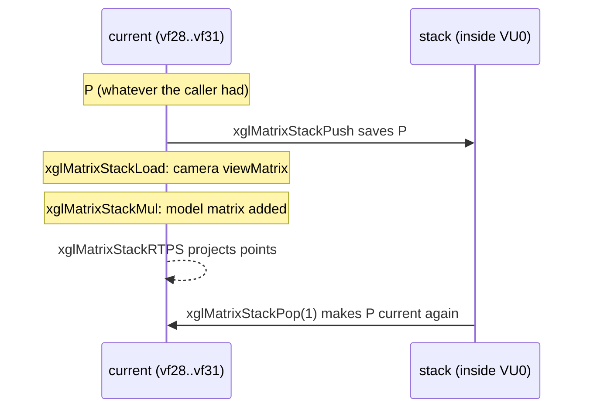

### Projection to the screen

**RTPS** stands for rotate, translate, perspective: the step that turns a 3D
point into a screen position. `xglMatrixStackRTPS(out, point, scale,
offset)` hands the point, a scale and an offset to the microprogram and
stores the result as a `ScreenVector4`: integer x, y and z in GS format and
a float w.

`xglRotTransPers(out, matrix, point, cameraId)` wraps the routine for one
point:

1. Push the stack.
2. Fetch camera `cameraId` of the current studio with
   `xglStudioGetCamera2` and load its `volume[0].viewMatrix`.
3. Multiply in `matrix` when it is not null.
4. Run RTPS with the camera's `screen.screenScale` and
   `screen.screenOffset`.
5. Pop the stack and return the w of the result.

`xglRotTransPersN` does the same for an array of points with one push and
one pop around the loop. The actor code in `src/main/act_3.c` is its caller.
`xglRotTransPers` itself has no callers left in the recovered code. The
joint drawing of `src/main/TiDrawJoint.c` uses the push, RTPS and pop calls
directly.

### Quaternions

A quaternion is stored in a `Vector4` as (x, y, z, w) with w as the scalar
part. A rotation by an angle `a` about a unit axis `u` is
`(u * sin(a/2), cos(a/2))`.

| Function | Use |
| --- | --- |
| `xglMatrix2Quaternion(q, m)` | The quaternion of the rotation part of `m`. Uses the trace when it is positive, otherwise the largest diagonal element |
| `xglQuaternion2Matrix(m, q)` | The rotation matrix of `q` with (0, 0, 0, 1) as row 3, on VU0 |
| `xglQuaternionInterpolateLinear(d, a, b, wa, wb)` | `normalize(a * wa + b * wb)`. `b` is negated first when `dot(a, b)` is not positive, so the blend takes the shorter arc |

None of the three has a caller in the recovered code. The animation library
uses its own `Xrg` functions instead (see [Xrg quaternions](#xrg-quaternions)).

### Euler angles

`xglEulerFromRotation(euler, rotation)` converts a set of three rotation
angles into the equivalent angles of another rotation order. It builds the
matrix shown in the code sample above (Z, then Y, then X on the stack),
saves it, and reads the angles back from the Z axis row and from the second
column:

```
euler.x = -asinf(m[2][1])
euler.y = atan2f(m[2][0], m[2][2])
euler.z = atan2f(m[0][1], m[1][1])
```

When both `m[2][0]` and `m[2][2]` are within 0.0001 of zero the Z axis
points straight up or down, the heading is undefined, and the function
copies the input angles unchanged. The camera solver of the animation
library, `src/main/TiCameraSolver.c`, is the caller.

### Random numbers

The game has three random number generators. Two are in `xgl_2.c` and the
third belongs to `MMath` (see [Mersenne Twister](#mersenne-twister)).

The first is a **linear congruential generator** on the EE with the 64-bit
seed `iRandSeed`. Each step computes `seed = seed * 1103515245 + 12345`, the
classic C library constants.

| Function | Result |
| --- | --- |
| `xglSRand()` | One step. Bits 16 to 30 of the new seed: 0 to 32767 |
| `xglLRand()` | Two steps combined into 32 bits. The seed is cut to 32 bits on the way |
| `xglRandSeedInit()` | Seed = `0x12345678` |

`xglGeometryInit` sets the seed to `0x12345678` at start-up. The seed is
never taken from a clock, and `xglRandSeedInit` has no callers. The sequence
still varies in play, because how many numbers are drawn before a given
moment depends on timing and on the player's input. `xglSRand` is the
everyday generator of the main program. Seventeen other files call it, from
field enemies to the wind of the cloth simulation.

The second generator is the **VU0 random register** `R`. `xglFRand()`
advances it with `vrnext` and returns the value. VU0 builds this value with
a fixed exponent, so it lies in the range from 1 to 2. `xglFSrand(seed)`
reseeds the register with `vrinit`, and `xglGeometryInit` seeds it with 0.1.
Four other files use `xglFRand`, mostly camera and defocus code.

Two helpers in `src/main/get.c` build on these.
`Get_Rnd(min, max)` returns `min + xglSRand() % (max - min + 1)`, a random
integer from `min` to `max` with both ends included. `Get_RndFloatRange(min,
max)` returns `(int)(min + xglFRand() * (max - min))`. Because `xglFRand`
returns 1 to 2 and not 0 to 1, this result lies between `max` and
`2 * max - min`. This looks like an oversight in the original code.

### Trigonometry

`xglSin(a)` and `xglCos(a)` call the routines at `0x20` and `0xE8` of the
resident microprogram, as shown in the sequence diagram earlier.

`xglAtan2(y, x)` is computed on the EE and returns a value from -pi to pi.
It handles the zero cases first, notes the quadrant, makes both arguments
positive, divides the smaller by the larger so the ratio is at most 1,
evaluates an odd polynomial of degree 17 in the ratio, and then undoes each
reduction. The flowchart below shows the steps.

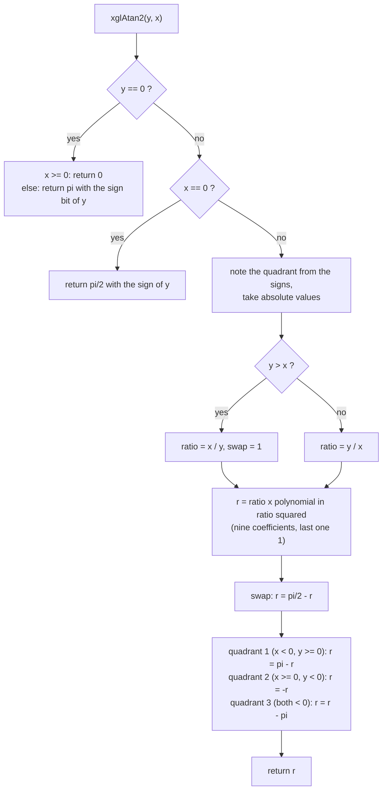

There are three more arctangents outside this file:

- `xglAtan2Angle(x, y)` in `src/main/xgl_vu1_regs.c` takes x first and
  returns the angle of the vector (x, y) in the range 0 to 2 pi. It divides
  `y` by `x`, calls `atanf`, and adds pi when x is negative or 2 pi when the
  result is negative. An x of exactly 0 is replaced by 0.00001. The aiming
  code of `src/main/TiMotionSolver.c` uses it.
- `srsAtan2(x, y)` in `src/main/sef.c` looks the angle up in the table
  `atanTbl_0` with 1024 steps. It returns the angle measured from its second
  argument, so `srsAtan2(dx, dz)` is a heading. `MMath` and the `vu0`
  functions use it. The table belongs to the effect library, see
  [sef.md](sef.md).
- The C library `atan2f` and `atan2`, used by the script natives and by the
  `Xrg` quaternion code.

### Sine and cosine in degrees

`src/main/oLib.c` holds a coarse pair of trigonometry functions for 2D
drawing. `xglCosDeg(degrees)` and `xglSinDeg(degrees)` take whole degrees
and return a value from a table of 37 floats, one per 10 degrees from 0 to
360. Each table is filled with `cosf` or `sinf` on the first call, guarded
by the flags `xglCosDegTableReady` and `xglSinDegTableReady`.

The lookup takes the absolute value of the angle, reduces it modulo 360 and
divides by 10 with truncation. The functions therefore have a resolution of
10 degrees: 45 degrees gives the value for 40. A negative angle gives the
value of the positive angle. For the cosine this is correct. For the sine it
means `xglSinDeg(-30)` returns `sin(30)` and not its negative. The only
caller, the circle and arc drawing in `src/main/circle_draw.c`, steps round
a circle in positive angles.

`xglWrapDegrees(degrees)` in `src/main/gs_make_tex0.c` brings an angle back
toward the range 0 to 360 by one turn: it subtracts 360 once when the angle
is above 360 and then adds 360 once when it is below 0. It has no callers in
the recovered code.

### Conversions and rounding

`F2I(value)` converts a float to an int with the FPU instruction
`cvt.w.s`, written as inline assembly. On the EE's FPU this truncates toward
zero, like a C cast. `I2F(value)` is a plain cast. Camera, actor and script
runtime code call the pair.

`src/main/oLib.c` also holds four integer helpers for 2D drawing. All four
shift a pixel coordinate left by 4 to make a 12.4 fixed-point number and add
8, half a pixel:

| Function | Result for a positive input | Result otherwise |
| --- | --- | --- |
| `xglRoundCoord(v)`, `gsRoundCoord(v)` | `(v << 4) + 8` | `-(abs(v) << 4) - 8`, so 0 gives -8 |
| `gsVertexX(x)` | `(x << 4) + 0x7008` | `-(abs(x) << 4) - 0x7008` |
| `gsVertexY(y)` | `(y << 4) + 0x7208` | `-(abs(y) << 4) - 0x7208` |

The constants of the last two are 1792.5 and 1824.5 in pixels. These are
the GS centre 2048 minus 256 and minus 224, plus the half pixel, so the two
functions move a screen position on a 512 x 448 screen into the GS drawing
area. None of the four has a caller in the recovered code.
`xglPointDistanceInt(from, to)` returns the 3D distance between two points
truncated to an integer, also without callers.

`xglColorLerp(from, to, t)` in `src/main/gs_make_tex0.c` interpolates two
packed 32-bit colours. It masks out the four 8-bit channels, moves each one
from its `from` value toward its `to` value by the factor `t` in float, and
masks the result back into its channel. The 2D drawing code (strips, quads,
circles and the debt box of the quest screens) uses it for gradients.

### Memory copies

| Function | Unit | Instructions |
| --- | --- | --- |
| `xglMemCopy64(d, s, n)` | 64-byte blocks | `lq`, `sq` |
| `xglMemCopy16(d, s, n)` | 16-byte quadwords | `lq`, `sq` |
| `xglMemCopy8(d, s, n)` | 8 bytes | `ld`, `sd` |
| `xglMemCopy4(d, s, n)` | 4 bytes | `lw`, `sw` |
| `xglMemCopy2(d, s, n)` | 2 bytes | `lh`, `sh` |

`n` counts units, not bytes, and must be at least 1: the loops test the
count after the first copy. Each function has a `...b` version that moves
both pointers backward. The caller passes the address of the last unit and
the copy runs from the end toward the start, which is the safe direction
when the destination overlaps the source at a higher address. The 64-byte
and 16-byte copies need 16-byte aligned addresses.

## Local copies of the small helpers

Several source files contain their own copy of a tiny helper that also
exists elsewhere under the same name. The original program has each copy at
its own address, so the recovered source keeps each one and tells them apart
by adding the address to the name. `xglVectorCopy_001CC998` in
`src/main/nml_model_set.c` and `xglVectorCopy_001B2008` in
`src/main/xgl_camera.c` are the same two-instruction quadword copy. They are
what a compiler emits when a small `inline` function of a shared header is
also needed out of line in each file that includes it, which is very likely
how they came to be.

| Helper | What it does | Copies (file, name suffix) |
| --- | --- | --- |
| `xglVectorCopy` | `QuadwordCopy` of one vector | `xgl_camera.c` `_001B2008`, `nml_model_set.c` `_001CC998`, `xgl_vector_ops.c` `_00292E28` (through `vf2`) |
| `xglMatrixCopy` | `QuadwordCopyMatrix` | `xgl_camera.c` `_001B2034`, `nml_model_set.c` `_001CC9C4`, `pxy_packet_state.c` `_001D44C4`, `xgl_vector_ops.c` `_00292EB8` (through `vf2` to `vf5`) |
| `xglVectorZero` | `QuadwordZero` | `face_point.c` `_001B7408`, `pxy_packet_state.c` `_001D4508` |
| `xglVectorAddXYZ` | `Vu0AddVectorXYZ` | `xgl_camera.c` `_001B20B0`, `face_point.c` `_001B7430`, `nml_model_set.c` `_001CCA30`, `xgl_vector_ops.c` `_00292E38` |
| `xglVectorSubXYZ` | `Vu0SubVectorXYZ` | `xgl_light.c` `_001AF3F0`, `xgl_camera.c` `_001B20E8`, `face_point.c` `_001B7468`, `nml_model_set.c` `_001CCA68`, `pxy_packet_state.c` `_001D4530`, `xgl_vector_ops.c` `_00292E58` |
| `MMathQuatToMatrix` | Quaternion to rotation matrix | `m_math.c`, plain and `_00272EC8` |

The copies in `src/main/xgl_vector_ops.c` are a separate family. They do the
same jobs, but each instruction is its own statement and the vector copies
go through VU0 registers instead of an EE register. The file also has
`xglVectorMul_00292E78` (component-wise product of all four lanes) and
`xglVectorNormal_00292E90` (normalise x, y, z). They sit next to
`tiVu0LoadIdentityMatrix` and belong to the animation library's side of the
program. `XenoActor` uses the add helper when it moves joint rest positions.

`xgl_vector_ops.c` also contains two functions that are not math.
`tiMRPackageFillNodes` builds the node list of the cloth and hair simulation
from the skeleton data, and `XenoActorConvertSourceRecord` converts one
field of a motion state to float. Both are described in
[animation.md](animation.md) and [actors.md](actors.md).

## The xglCur current matrix

Files: `src/main/xgl_cur_matrix.c`, `src/main/xgl_cur_mul.c`,
`src/main/xgl_vector_ops.c`

The `xglCur` functions keep a current matrix in `vf27` to `vf30`. There is
no stack and no microprogram. Each function is either a short macro-mode
block or a few lines of C that fill a matrix in memory and hand it to one of
two basic functions.

| Function | Effect |
| --- | --- |
| `tiVu0LoadIdentityMatrix()` | Current = identity, loaded from the table `tiVu0IdentityMatrix` |
| `xglCurMatrixSet(m)` | Current = `m` |
| `xglCurMatrixGet(m)` | `m` = current |
| `xglCurMatrixMul(m)` | Current = `m` acting before the old current matrix |
| `xglCurApplyVector(d, v)` | `d = v` transformed by the current matrix, all four lanes |
| `xglCurSetRotateX(a)`, `SetRotateY`, `SetRotateZ` | Current = a rotation about one axis |
| `xglCurSetTranslate(v)` | Current = a translation |
| `xglCurSetScale(s)`, `xglCurSetScaleXYZ(v)` | Current = a uniform or per-axis scale |
| `xglCurMulRotateX(a)`, `MulRotateY`, `MulRotateZ` | Add a rotation |
| `xglCurMulTranslate(t)` | Add a translation |
| `xglCurMulScale(s)`, `xglCurMulScaleXYZ(s)` | Add a scale |
| `xglCurMulInvScaleXYZ(s)` | Add the inverse of a scale |
| `xglCurDummy()` | Empty |

The "set" and "mul" functions share one technique. Each has its own static
`Matrix4` that starts as the identity: `xglRotMatrixX`, `xglRotMatrixY`,
`xglRotMatrixZ`, `xglTranslateMatrix`, `xglScaleMatrix` and
`xglScaleXYZMatrix` for the set functions, and seven more with the prefix
`xglMul` for the mul functions. A call overwrites only the cells that depend
on its argument and then passes the whole matrix to `xglCurMatrixSet` or
`xglCurMatrixMul`. `xglCurMulRotateY(a)`, for example, computes
`cosf(a)` and `sinf(a)`, writes the cosine to `[0][0]` and `[2][2]`, the
sine to `[2][0]` and its negative to `[0][2]`, and multiplies.

`xglCurMulInvScaleXYZ` writes `1 / x`, `1 / y` and `1 / z` on the diagonal,
but skips a component that is 0. The cell then keeps the value from the
previous call, not 1.

The main user is the motion solver of the animation library. It builds the
local matrix of each joint from the animated values with one chain, shown
here from `tiMotionTransformToMatrix` in `src/main/TiMotionSolver.c`:

```c
tiVu0LoadIdentityMatrix();
xglCurMulTranslate(transform->offset);
xglCurMulRotateZ(transform->rotation[2]);
xglCurMulRotateY(transform->rotation[1]);
xglCurMulRotateX(transform->rotation[0]);
xglCurMulScaleXYZ(transform->scale);
xglCurMatrixGet(matrix);
```

In the original each step is skipped when its value is neutral (a zero
offset, a zero angle, a scale of 1). Every call acts before what is already
there, so a point of the joint is scaled first, then rotated about X, Y and
Z in that order, then moved by the offset. The solver then walks the
skeleton: it loads the parent's global matrix with `xglCurMatrixSet`,
multiplies in the joint's local matrix with `xglCurMatrixMul`, and stores
the joint's global matrix with `xglCurMatrixGet`. The whole solver is
described in [animation.md](animation.md).

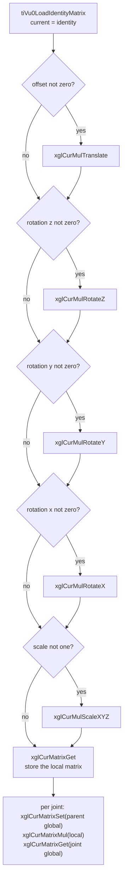

## Projection and clipping

Files: `src/main/cur_matrix_asm.c`, `src/main/nml_packet_add.c`,
`src/main/model_calc_clip.c`

The functions with a leading underscore are the model library's own view of
the `vf27` to `vf30` current matrix. They are pure VU0 blocks. The model
library and its draw lists are described in [pxy.md](pxy.md). This section
covers the math.

| Function | Effect |
| --- | --- |
| `_CurMatrixSet(m)` | Current = `m` (`Vu0SetCurrentMatrix`) |
| `_CurMatrixMul(m)` | Current = `m` acting before the old current matrix |
| `_CurMatrixScale(s)` | Multiply the x, y, z lanes of row 0 by `s.x`, of row 1 by `s.y` and of row 2 by `s.z` |
| `_CurApplyMatrix(d, v)` | `d` = the point `(v.xyz, 1)` transformed by the current matrix |
| `_CurApplyMatrix33(d, v)` | `d = v` transformed by rows 0 to 2 only |
| `_CurSetViewScaleTrans(scale, offset)` | `vf25 = scale`, `vf26 = offset` for the projection functions |
| `_CurRotTransPersClipScreen(out, p)` | Project to a `ScreenVector4`, return six clip flags |
| `_CurRotTransPersClipFloat(out, p)` | The same with a float result |
| `_CurRotTransPersFog(out, p, fog)` | Transform, with a fog value in w |
| `_CurBoxVisible(min, max)` | 1 when a box may be on screen |
| `_ModelCalcClipInitMat1(clip, m)` | Load two plane matrices and a model matrix for the sphere tests |
| `_ModelCalcClipMat1(sphere)` | 1 when a sphere passes the test against six planes |
| `_ModelCalcClipMat1Xy(sphere)` | A stricter test against four planes |

### Projecting one point

A caller that wants a screen position sets the state in three calls and then
projects, as `src/main/nml_model_set.c` does:

```c
_CurMatrixSet(&camera->volume[0].viewMatrix);
_CurSetViewScaleTrans(&camera->screen.screenScale, &camera->screen.screenOffset);
_CurRotTransPersClipScreen(&screen.projected, point);
```

`_CurRotTransPersClipScreen` goes through these steps inside VU0:

1. Clear the clip flag register `vi18`.
2. Transform the point `(p.xyz, 1)` by the current matrix.
3. `vclipw` compares x, y and z of the result with plus and minus its w and
   records six flags, one per side of the view volume.
4. Compute `Q = 1 / w` and multiply the vector by it.
5. Multiply by the scale in `vf25` and add the offset in `vf26`.
6. Convert x and y to 12.4 fixed point and z to an integer.
7. Store the result with `1 / w` as the float w, and return the flags
   `& 0x3f`.

A return value of 0 means the point is inside the view volume. The macro
`Vu0CurrentRotTransPersClip` is the same sequence with w cleared to 0
instead of `1 / w`. `_CurRotTransPersClipFloat` skips step 6 and stores
float x, y and z.

`_CurRotTransPersFog(out, p, fog)` transforms the point but does not divide
it. It replaces w with a fog value computed from the vector `fog`: the VU0
block forms `fog.z + fog.w * (1 / w)` and clamps it to the range from
`fog.x` to `fog.y`. The model library calls it with a camera's view matrix
to get the fog of a position.

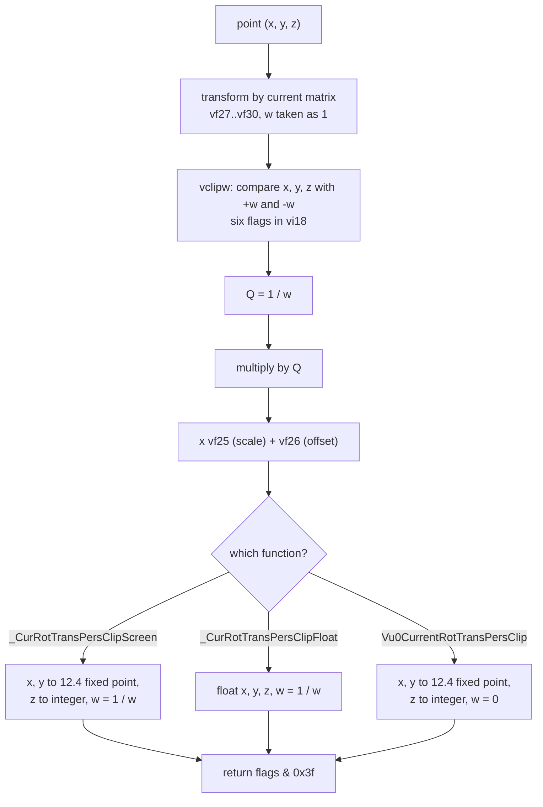

### Sphere tests

Whole models and model parts are culled with bounding spheres. A sphere is a
`Vector4` with the centre in x, y, z and the radius in w.

`_ModelCalcClipInitMat1(clip, matrix)` loads eight rows from `clip` into
`vf24` to `vf31` and the model matrix into `vf20` to `vf23`. The eight rows
are two matrices. The model library passes `camera->volume[0].planeSet[0]`,
the camera's plane set, so each of the two matrices holds three planes of
the view volume, one plane per column. Transforming a point by such a matrix
gives three plane distances at once, in the x, y and z lanes.

`_ModelCalcClipMat1(sphere)` then does the following:

1. Transform the centre by the model matrix.
2. Transform the result by the second plane matrix and compare each of the
   three lanes with the radius.
3. Do the same with the first plane matrix.
4. Return 1 when all six values are below the radius, and 0 as soon as one
   is not.

The values are therefore distances measured outward from the view volume,
and the sphere is rejected when its centre is farther outside any one plane
than its radius. `_ModelCalcClipMat1Xy` compares against minus the radius
and uses only the first two lanes of each matrix. It returns 1 only when the
sphere lies completely inside those four planes, which are very likely the
four side planes. It has no callers in the recovered code.

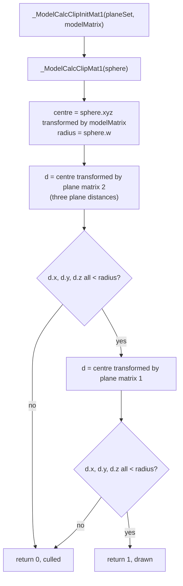

### Box test

`_CurBoxVisible(min, max)` tests an axis-aligned box. It builds the eight
corners from the two given ones by mixing their lanes, transforms each by
the current matrix and multiplies it by its own `1 / w`, and collects the
smallest and the largest x, y and z of the eight results. The box counts as
invisible when its smallest x or y is above 0.125, when its largest x or y
is below -0.125, or when its largest z is below 0. Otherwise the function
returns 1. The limits of plus and minus 0.125 imply a current matrix scaled
for this test. The function has no callers in the recovered code, so the
intended matrix cannot be read from a use.

## The vu0 current matrix

Files: `src/main/vu0_matrix.c`, `src/main/vu0_rotate.c`,
`src/main/vu0_vector.c`

The third current matrix lives in `vf26` to `vf29` and belongs to the effect
code. Its functions take sine and cosine from the resident microprogram with
`vcallms`, and they read the identity from the table `vu0IdentityMatrix`
(defined in `src/main/test_128.c`).

| Function | Effect |
| --- | --- |
| `vu0SetCurrentRotationX(a)`, `...Y`, `...Z` | Current = a rotation about one axis. An angle of exactly 0 loads the identity without calling the microprogram |
| `vu0SetCurrentRotationYXZ(angles)` | Current = rotation about Y, then `vu0RotateCurrentX` and `vu0RotateCurrentZ` |
| `vu0RotateCurrentX(a)`, `...Y`, `...Z` | Add a rotation that acts before the current matrix. Nothing happens for an angle of 0 |
| `vu0RotateCurrentXYZ(angles)`, `...YXZ`, `...ZYX` | Three such rotations, called in the order of the name |
| `vu0CurMatrixMul(m)` | Current = `m` acting before the old current matrix |
| `vu0CurMatrixMulRight(rows)` | Current = the old current matrix acting before `rows` |
| `vu0CurMatrixMulRows3(rows)` | The same with only three rows given. Rows 0 to 2 of the current matrix are transformed, each keeps its own w through `vf0`, and row 3 is untouched |
| `vu0TranslateCurrent(offset)` | Multiply on the outside by a translation: `offset` is added to row 3, and to any other row in proportion to its w |
| `vu0TransformPoint(p)` | Transform `p` by the current matrix and leave the result in `vf29`, where it replaces row 3 |
| `vu0SetRotationFromDirection(m, to, from)` | Build the rotation that points the Z axis from `from` toward `to` |
| `vu0CopyMatrixWithTranslationDist(d, m, t, p)` | Copy rows 0 to 2 of `m` and `t` as row 3, return the distance from `t` to `p` |
| `vu0NormalizeVf20()`, `vu0NormalizeVector(v)` | Normalise x, y, z of `vf20` and set its w to 1. The second form loads `v` first and leaves the result in the register |
| `vu0CopyVectorSetW(d, v, w)` | Copy a vector and replace its w |

`vu0TransformPoint` is the unusual one. It does not store its result. The
transformed point simply becomes the translation row of the current matrix.
A caller that wants "the same rotation, but placed at this transformed
point" gets it with one call, and reads the whole matrix from the registers
afterwards.

`vu0SetRotationFromDirection(matrix, to, from)` is the look-at function of
the effect library. It uses rows 2 and 3 of the output matrix as scratch
space while it works:

1. Store `to - from` in row 3.
2. When the difference is exactly zero, load the identity and return 0
   later.
3. Otherwise compute the horizontal length of the difference on VU0, the
   pitch `srsAtan2(-dy, length)` and the heading `srsAtan2(dx, dz)`.
4. Set the current matrix to a rotation about Y by the heading and add a
   rotation about X by the pitch.
5. Store `vf26` to `vf29` to the matrix and return 1.

The two functions `LOG_00251F78` and `LOG_00251FC0` in `vu0_vector.c` take a
format string and a variable argument list and do nothing. They are the
remains of debug logging that was compiled out. `vu0NoOpUnused` in
`vu0_rotate.c` is an empty function as well.

The users are `src/main/sef.c`, `src/main/sdv.c` and
`src/main/sv_get_image_item.c`, described in [sef.md](sef.md) and
[sdv.md](sdv.md), and the range tests of `MMath` below.

## MMath

Files: `src/main/m_math.c`, `src/main/m_math_geom.c`

`MMath` is a complete second vector and matrix library, written almost
entirely in VU0 macro mode. It serves the battle overlay (the `MEf` battle
effects of `src/ov01/m_ef*.c` and the battle rules in `src/ov01/calc.c`)
and the effect code of the main program (`sef.c`, `sdv.c`,
`sv_get_image_item.c`). Battle is described in
[battle.md](../game/battle.md) and its effects in
[battle-effects.md](../game/battle-effects.md).

Its conventions differ from `xgl` in three ways:

- Most functions that produce a vector or a matrix return the destination
  pointer, so calls can be nested.
- A null source matrix is replaced by `MMathUnitMatrix`, the identity, and a
  null source point by `MMathUnitVector`, (0, 0, 0, 1). Both constants are
  defined in `src/main/sm_initilize.c`. The replacement happens inside the
  VU0 block with a conditional move. Passing null as the matrix of a
  rotation function is the normal way to say "build a pure rotation".
- Sine and cosine come from the resident microprogram with `vcallms 0x20`
  and `vcallms 0xE8` directly.

| Group | Functions |
| --- | --- |
| Random | `MMathRandomSeed`, `MMathRandomNext`, `MMathMakeRandomInt`, `MMathMakeRandom`, `MMathMakeRandomSigned`, `MMathMakeRandom2PI`, `MMathMakeRandomPI` |
| Angles | `MMathCalcRotNear`, `MMathCalcRotFar`, `MMathDeg2RadVector(I)`, `MMathRad2DegVector(I)` |
| Lengths | `MMathCalcLength`, `...XY`, `...XZ`, `...YZ`, `MMathCalcDist`, `MMathCalcDistXZ` |
| Vectors | `MMathNormalizeVector2`, `MMathVectorDotProduct`, `MMathVectorCrossProduct`, `MMathVectorInterpolation`, `MMathSubVectorMulS`, `MMathSubVectorDivS`, `MMathDivVector`, `MMathDivVectorS`, `MMathDivVector4`, `MMathDivVectorS4`, `MMathIsVectorEqual`, `MMathIsVectorEqual4` |
| Directions | `MMathCalcDirVector`, `MMathCalcDir`, `MMathCalcAngle`, `MMathCalcOffset`, `MMathCalcOffsetXYZ` |
| Rotations | `MMathRotateMatrixX`, `Y`, `Z`, `XY`, `YX`, `XYZ`, `YXZ`, `ZXY`, `ZYX` |
| Matrices | `MMathApplyMatrix`, `MMathMulMatrix`, `MMathScaleMatrix`, `MMathScaleMatrixRotS`, `MMathScaleMatrixS`, `MMathTranslateMatrix`, `MMathTransposeMatrix3`, `MMathTransposeMatrix` |
| Matrix and direction | `MMathCalcLookAtMatrix`, `MMathCalcMatrixVector`, `MMathCalcVectorMatrixZ`, `MMathCalcAngleMatrixZ` |
| Curves | `MMathCalcHermite`, `MMathCalcHermitePrm`, `MMathEvalHermiteKeys` |
| Projection | `MMathRotTransPers`, `MMathRotTransPersClip` |
| Quaternions | `MMathQuatBetweenVectors`, `MMathQuatToMatrix` |
| Range tests | `MMathPointInTriangle`, `MMathIsWithinDistXZ`, `MMathIsInFrontRectXZ`, `MMathIsInFanSectors`, `MMathActorsInRangeByKind` |

The most used ones are `MMathApplyMatrix` (about fifteen files),
`MMathCalcAngle` and `MMathRotTransPersClip` (about ten files each) and the
random functions.

`m_math.c` also starts with two debug print functions that have nothing to
do with math. `MOutputDebugString(message, ...)` and
`MOutputDebugStringWarn(message, ...)` format the text
`MDMSG: <message>` with the tag in cyan or magenta (ANSI colour codes) into
a 256-byte buffer and print it with `vprintf`. The battle effect code calls
the warning form.

### Mersenne Twister

The random generator of `MMath` is the **Mersenne Twister** MT19937, the
well-known generator with 624 state words and a period of 2^19937 - 1. The
code follows the reference implementation closely: the same multiplier
1812433253 in the seeding loop, the twist offset 397, the constant
`0x9908B0DF`, and the tempering masks `0x9D2C5680` and `0xEFC60000`.

| Function | Result |
| --- | --- |
| `MMathRandomSeed(seed)` | Fill the 624 words of `MMathRandomState` from `seed` |
| `MMathRandomNext()` | The next 32-bit value |
| `MMathMakeRandomInt()` | `MMathRandomNext() >> 1`, from 0 to 2^31 - 1 |
| `MMathMakeRandom()` | A float from 0 up to 1: the value times 2^-32 |
| `MMathMakeRandomSigned()` | A float from -1 up to 1: the value times 2^-31, minus 1 |
| `MMathMakeRandom2PI()` | An angle from 0 up to 2 pi |
| `MMathMakeRandomPI()` | An angle from -pi up to pi |

The game adds one rule of its own to the seeding. A seed of 0 means "the
previous seed plus `0x1571`". The previous seed is kept in
`MMathRandomLastSeed`, which starts at 0, so the first call with 0 seeds the
generator with `0x1571`, the second with `0x2AE2`, and so on. Both callers
pass 0: the battle effect set-up in `src/ov01/m_gs.c`, which reseeds each
time it initialises the effect system, and `sefNoiseInit` in `src/main/sef.c`, which
reseeds once before it fills the noise table of the effect library. Battle
effects therefore do not replay the same random sequence after each
set-up, but the sequence of seeds itself is fixed from power-on.

The index `MMathRandomIndex` starts at 625, one past the end of the state.
`MMathRandomNext` treats that value as "never seeded" and seeds with 0
before the first twist.

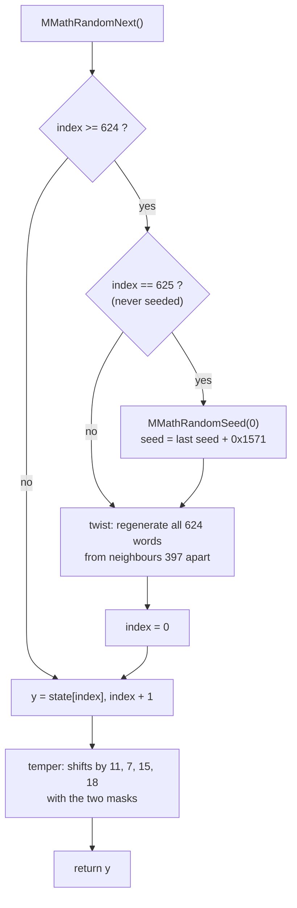

### Angles and lengths

`MMathCalcRotNear(from, to)` returns the signed difference `to - from` along
the shorter way round. It reduces the difference with `fmodf` by 2 pi and
then adds or subtracts 2 pi when the absolute value is above pi.
`MMathCalcRotFar` returns the difference along the longer way: it adjusts
when the absolute value is below pi. Neither has a caller in the recovered
code.

The length functions square the chosen lanes, add them and take the VU0
square root. `MMathCalcLength` uses x, y and z, and the `XY`, `XZ` and `YZ`
versions use two lanes. `MMathCalcDist` and `MMathCalcDistXZ` subtract two
points first.

### Vectors

| Function | Result |
| --- | --- |
| `MMathNormalizeVector2(d, v)` | `v.xyz` scaled to length 1, w set to 1 |
| `MMathVectorDotProduct(a, b)` | Dot product of x, y, z, returned |
| `MMathVectorCrossProduct(d, a, b)` | Cross product, w set to 1 |
| `MMathVectorInterpolation(d, a, b, t)` | `a * (1 - t) + b * t` on x, y, z |
| `MMathSubVectorMulS(d, a, b, s)` | `(a - b) * s` |
| `MMathSubVectorDivS(d, a, b, s)` | `(a - b) / s` |
| `MMathDivVector(d, a, b)` | `a / b` per component on x, y, z, w from `a` |
| `MMathDivVector4(d, a, b)` | The same on all four components |
| `MMathDivVectorS(d, v, s)`, `MMathDivVectorS4` | `v / s` on three or four components |
| `MMathIsVectorEqual(a, b)` | 1 when x, y and z of two vectors have the same bits |
| `MMathIsVectorEqual4(a, b)` | 1 when all four components have the same bits |
| `MMathCalcDirVector(d, from, to)` | The unit vector from `from` toward `to` |

The two equality functions are the only `MMath` functions that do not use
VU0. They load both vectors into 128-bit EE registers, exclusive-or them
with the multimedia instruction `pxor`, and test the result in two steps.
The first step covers x and y. For the second step the plain version brings
z into the tested half with `pexew`, and the `4` version brings in z and w
together with `pcpyud`. Both compare bit patterns, so 0.0 and -0.0 are
different.

### Directions

`MMathCalcAngle(out, source, target)` turns the direction from one point to
another into two Euler angles. `out.x` is the pitch and `out.y` is the
heading, in the sense described in
[Axes, headings and pitch](#axes-headings-and-pitch). `out.z` is set to 0
and `out.w` to 1. Both angles come from the table arctangent `srsAtan2`. A
null `source` stands for the origin, so `MMathCalcAngle(out, 0, v)` gives
the angles of the vector `v` itself.

`MMathCalcDir(first, second)` computes only the heading,
`srsAtan2(dx, dz)`.

`MMathCalcOffset(d, base, offset)` treats `offset` as a polar description.
It adds `offset.y` to `base.w` and takes the sum as a heading, takes
`offset.x` as a pitch, and moves `offset.w` units from `base` along the
resulting direction. The w of `base` therefore holds the heading of the
object the point belongs to. `MMathCalcOffsetXYZ(d, base, offset)` is the
Cartesian version: it rotates `offset` about the Y axis by `base.w` and adds
it to `base`. Neither has a caller in the recovered code.

### Rotations and matrices

The nine rotation functions share one shape:
`MMathRotateMatrixYXZ(out, matrix, angles)` takes the matrix to rotate (or
null for the identity) and either one angle or a vector of three. The name
gives the order in which the single rotations are applied to the matrix,
each acting before the result so far. The three-angle versions collect all
sines and cosines first with up to six microprogram calls and then mix the
rows in one block.

`MMathScaleMatrix(out, m, s)` multiplies row `i` by `s[i]`, row 3 by `s.w`.
`MMathScaleMatrixRotS(out, m, s)` multiplies rows 0 to 2 by one float and
copies row 3. `MMathScaleMatrixS` also scales x, y and z of row 3.
`MMathTranslateMatrix(out, m, t)` moves along the matrix's own axes: row 3
becomes `t` transformed by `m`. `MMathTransposeMatrix3` transposes the
3 x 3 part and keeps the w lanes and row 3. `MMathTransposeMatrix` is the
full transpose.

Four functions connect matrices and directions:

| Function | Result |
| --- | --- |
| `MMathCalcMatrixVector(out, target)` | The rotation (Y then X) that turns the Z axis toward the vector `target` |
| `MMathCalcLookAtMatrix(out, source, target, position, roll)` | The rotation (Y, X, Z) that looks from `source` toward `target` with a roll angle. A non-null `position` becomes row 3 |
| `MMathCalcVectorMatrixZ(out, m)` | The point (0, 0, 1) transformed by `m`: the Z axis row plus the translation row |
| `MMathCalcAngleMatrixZ(out, m)` | The pitch and heading of that point |

`MMathCalcLookAtMatrix` is how the battle effects orient an object along a
path, in `src/ov01/m_ef_actor_path.c`.

### Hermite curves

A **cubic Hermite curve** goes from a start point to an end point with a
given tangent (direction and speed) at each end. For a parameter `t` from 0
to 1 the point is:

```
P(t) = h00(t) * start + h01(t) * end + h10(t) * tangent_start + h11(t) * tangent_end

h00 = 2t^3 - 3t^2 + 1      h01 = 3t^2 - 2t^3
h10 = t^3 - 2t^2 + t       h11 = t^3 - t^2
```

`MMathCalcHermite(d, tangent_first, tangent_second, endpoint_first,
endpoint_second, t)` computes the four weights from `t` in VU0 registers
and accumulates the weighted sum in one multiply-add chain. The w of the
result is set to 1.

`MMathCalcHermitePrm(tangent_start, tangent_end, prev, start, end, next)`
computes the tangents from the neighbouring points:
`tangent_start = (end - prev) / 2` and `tangent_end = (next - start) / 2`.
These are the **Catmull-Rom** tangents, which make a chain of Hermite
segments pass smoothly through every point.

`MMathEvalHermiteKeys(result, keys, time)` in `m_math_geom.c` evaluates a
whole track of keys. A key is an `MMathHermiteKey`, a union that overlays a
point with a time:

| Offset | Type | Name | Meaning |
| --- | --- | --- | --- |
| +0x00 | float | `point.x` | Position x |
| +0x04 | float | `point.y` | Position y |
| +0x08 | float | `point.z` | Position z |
| +0x0C | u16 | `key.time` | Key time in frames, in the low half of the w slot. `MMATH_HERMITE_END` (0x400) ends the track |

The function counts the keys, finds the key before `time` and chooses one
of four answers:

- No keys: the origin (0, 0, 0, 1).
- One key, or a time before the first key: that key's point.
- A time at or after the last key: the last key's point.
- Otherwise: the Catmull-Rom segment between the two keys around `time`.
  The neighbours on both sides give the tangents. At the first segment the
  start key doubles as its own previous point, and at the last segment the
  end key doubles as its own next point.

The effect library calls it for its position tracks (see
[sef.md](sef.md)).

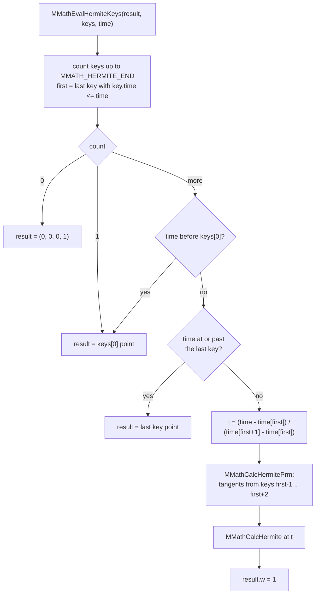

### Projection

`MMathRotTransPers(out, camera, matrix, point)` projects a point in macro
mode, without the matrix stack. The matrix must already contain the view
and projection, because only `camera->screen.screenScale` and
`camera->screen.screenOffset` are taken from the camera. It transforms the
point, multiplies x, y and z by `1 / w`, applies scale and offset, and
stores x and y as 12.4 fixed point, z as an integer and 0 in w.

`MMathRotTransPersClip` does the same and also tests the point after the
divide against the cube from -1 to 1 with `vclipw`. When any clip flag is
set it returns `0x8000` and stores `0x8000` in the w word of the result.
Otherwise both are 0. The value `0x8000` in the fourth word of a GS vertex
position is the "no drawing kick" bit, so a caller can copy the result
straight into a packet and the primitive that ends at this vertex is not
drawn. This is a likely reading of why the value is stored in w. The
battle effects and `sdv.c` use this function for every sprite and trail
vertex they place on the screen.

### Quaternions in MMath

`MMathQuatBetweenVectors(d, from, to)` gives the shortest rotation from one
unit vector to another as a quaternion. With `s = sqrt(2 * (1 + from . to))`
the result is `((from x to) / s, s / 2)`. When `s` is below 0.01 the two
vectors point in nearly opposite directions and the axis is undefined. The
function then stores (0, 1, 0, 0), a half turn about Y, and returns 0.
Otherwise it returns 1.

`MMathQuatToMatrix(d, q)` writes the rotation matrix of a quaternion as four
rows, with (0, 0, 0, 1) as row 3. `sdv.c` uses the pair to orient its strip
effects (see [sdv.md](sdv.md)). The second copy
`MMathQuatToMatrix_00272EC8` computes the same matrix and has no callers.

### Range tests between actors

`m_math_geom.c` ends with the geometry behind the area of effect of battle
actions. All of these tests work on the ground plane: they take the
positions of two actors (`XenoActor`, see [actors.md](actors.md)), set y to
0 and ask whether the second actor stands inside a shape attached to the
first.

`MMathPointInTriangle(first, second, third, origin)` is the building block.
It forms the three vectors from `origin` to the corners, takes the three
cross products of neighbouring pairs, and returns 1 when the dot products of
the first cross product with the other two are not negative. In other words
the three small triangles around the point all turn the same way, which is
true exactly when the point is inside.

| Function | Shape around the first actor |
| --- | --- |
| `MMathIsWithinDistXZ(a, b, limit)` | A circle of radius `limit` |
| `MMathIsInFrontRectXZ(a, b, limit)` | A rectangle from `-limit` to `+limit` across and from 0 to 50 units ahead, turned by the actor's `rotation.y` |
| `MMathIsInFanSectors(a, b, kind)` | A fan of `kind - 3` sectors of 15 degrees on each side of straight ahead, 50 units long |

The rectangle test builds the four corners in the actor's own space, sets
the `vu0` current matrix to a rotation about Y by the actor's facing with
the actor's position as row 3, transforms the corners, and tests the two
triangles that make up the rectangle.

The fan test stores the same matrix to memory and then loops over the
sectors. Sector `i` spans the angles `i * pi/12` to `(i + 1) * pi/12`,
measured from straight ahead. Each sector is tested twice, once with the
angles multiplied by 1 and once by -1 (the first two entries of
`svDefaultScreenParams`), which mirrors the fan to the other side. Each test
is a triangle from the actor to two points at radius 50, built with `xglCos`
and `xglSin`. A `kind` of 4 gives one sector per side, a total opening of 30
degrees, and a `kind` of 7 gives four per side, 120 degrees.

`MMathActorsInRangeByKind(kind, a, b, limit)` selects the test:

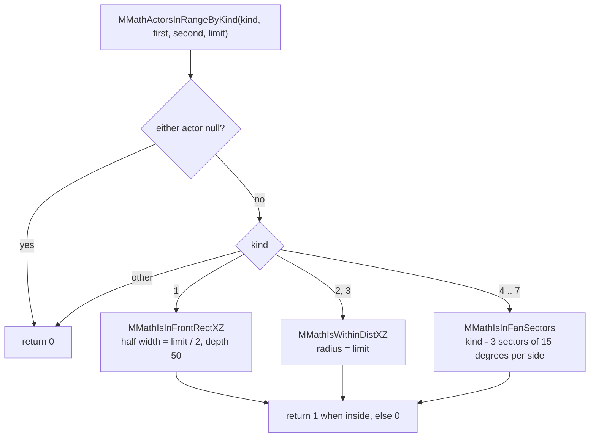

The caller is the battle rule code in `src/ov01/calc.c`. It passes the
`code` of an action's range record as the kind, the actors of the acting
unit and of a candidate target, and the record's `scale` divided by 100 as
the limit. The meaning of the range records in battle terms is described in
[battle.md](../game/battle.md).

## Xrg quaternions

Files: `src/main/xrg_rand_int.c`, `src/main/ti_dynamics_node.c`

The `Xrg` functions are a small quaternion and vector library in plain C,
with no VU0 code. They serve the `Ti` animation library and the cutscene
player. They use the C runtime for `sinf`, `cosf`, `acosf`, `sqrt` and
`atan2`.

| Function | Result |
| --- | --- |
| `XrgScaleVector(d, v, s)` | `d = v * s`, four components |
| `XrgMultiplyVector(d, a, b)` | `d = a * b` per component |
| `XrgAccumulateVector(d, v)` | `d += v` |
| `XrgInnerVector(a, b)`, `XrgOuterVector(d, a, b)` | Dot and cross product of x, y, z |
| `XrgQuaternionNormalize(d, q)` | `q` scaled to length 1. A length of 0 is replaced by 1e-8 |
| `XrgEulerToQuaternion(q, euler)` | Quaternion from three Euler angles in radians |
| `XrgQuaternionToEuler(euler, q)` | Euler angles from a quaternion |
| `XrgAxisAngleToQuaternion(q, aa)` | From an axis in x, y, z and an angle in w |
| `XrgQuaternionToAxisAngle(aa, q)` | To an axis and an angle. A zero sine is replaced by 1e-6 |
| `XrgQuaternionMultiply(d, a, b)` | The Hamilton product. Both operands are copied first, so `d` may be one of them |
| `XrgQuaternionCombine(d, a, b)` | The same product written with vector operations |
| `XrgQuaternionSlerp(d, from, to, t)` | Spherical interpolation |
| `XrgQuaternionLerpNormalized(d, from, to, t)` | Linear interpolation, then normalise |
| `XrgQuaternionToMatrix(m, q)` | Rotation matrix of a unit quaternion, rows 0 to 2, with (0, 0, 0, 1) as row 3 |
| `XrgMatrixToQuaternion(q, m)` | Quaternion of the rotation part of a matrix |
| `XrgQuaternionFromVectors(d, a, b)` | Shortest rotation from unit vector `a` to unit vector `b` |

Only four of them have callers outside their own file in the recovered
code: `XrgQuaternionSlerp`, `XrgQuaternionToMatrix`,
`XrgMatrixToQuaternion` and `XrgQuaternionFromVectors`.

### Blending two matrices

The motion blending of `src/main/TiMtnBlend.c` shows the intended use. To
blend the rotations of two joint matrices it converts both to quaternions,
interpolates, and converts back:

```c
XrgMatrixToQuaternion(&startQuat.x, *matA);
XrgMatrixToQuaternion(&endQuat.x, *matB);
XrgQuaternionSlerp(&blendQuat, &startQuat, &endQuat, t);
XrgQuaternionToMatrix(*dst, &blendQuat);
```

`XrgMatrixToQuaternion` adds the four diagonal elements. When this sum is at
least 1 it takes w from the square root of the sum and x, y, z from the
differences of the off-diagonal pairs. Otherwise it picks the largest of the
three diagonal elements, computes that component first, and derives the
other three from sums and differences of off-diagonal pairs. Starting from
the largest element keeps the divisor away from zero.

`XrgQuaternionSlerp` has two special cases before the usual formula:

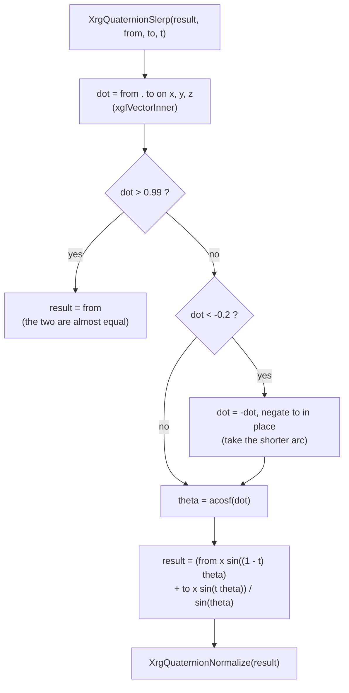

Three details follow from the code. The dot product uses only x, y and z,
not all four components. The shorter-arc flip happens below -0.2, not below
0. And the flip writes the negated quaternion back into the caller's `to`.
A negated quaternion is the same rotation, so the caller's data stays
valid, but it is changed.

### Euler angles and quaternions

`XrgEulerToQuaternion` halves the three angles, takes their sines and
cosines, and combines the products into the four components before it
normalises the result. `XrgQuaternionToEuler` goes back through the first
column and the third row of the rotation matrix: the sine of the Y angle is
minus `m[2][0]`, the X angle comes from `m[2][1]` and `m[2][2]`, and the Z
angle from `m[1][0]` and `m[0][0]`. When the sine of Y is exactly 1 or -1
the other two angles are no longer independent. The function then sets Z to
0 and puts the whole remaining rotation in X. Neither function has a caller
in the recovered code.

### The quaternion between two directions

`XrgQuaternionFromVectors(d, left, right)` is the plain C twin of
`MMathQuatBetweenVectors`: the cross product divided by
`s = sqrt(2 * (1 + dot))` and `s / 2` as w. For nearly opposite vectors
(`s` below 0.01) it stores (0, 1, 0, 0) and returns 0. The joint drawing,
the cutscene evaluation in `src/main/cfeEvaluate.c` and the simulation
below use it to turn a bone from its rest direction to a new direction.

### The simulation node step

The second half of `ti_dynamics_node.c` is the per-node step of the cloth
and hair simulation of the animation library. It is the main customer of
the `Xrg` and `xgl` math in that library, and it shows how the pieces fit
together. The simulation as a whole (nodes, collision shapes, wind) is
described in [animation.md](animation.md).

Each simulated node has a `TiSolverState` with a `position`, a
`previous_position` and an `accumulator` that acts as its velocity, and a
`TiHrcDynamics` record with its constants. `tiDynamicsNodeSolveNext` runs
one step for one node and returns the address of the next record:

| Step | Function | What it does |
| --- | --- | --- |
| 1 | `tiDynamicsNodeIntegrate` | Subtract `gravity` from the y of the accumulator (a constant downward pull), save the position, limit the accumulator to a length of 0.2, add it to the position, and multiply it by `damping` |
| 2 | `tiWindApplyAll` | Add the wind |
| 3 | `tiDynamicsNodePullToTarget` | Add a pull toward the rest position, which is `translationDefault` transformed by the parent joint's matrix, weighted by `pullScale` |
| 4 | `tiDynamicsCollSolveNode` | Push the point out of the collision spheres, matrices and capsules and the global collision body |
| 5 | `tiDynamicsNodeConstrainNormal` | Put the point back at the distance `boneLength` from the parent joint, along its current direction, and feed the correction into the accumulator |
| 6 | `tiDynamicsCollSolveNode` | Collide once more |
| 7 | `tiDynamicsNodeSolvePalette` | Rotate the parent joint's matrix so that the bone points at the new position |

Step 7 is pure math. It inverts the joint matrix with `xglMatrixInverse`
and brings the node position into the joint's own space with
`xglVectorMulMat`. Two flag bits of the node can clear the local y or z
there, which confines the bone to a plane. It then normalises the local
position and the rest direction, gets the rotation between them from
`XrgQuaternionFromVectors`, converts it with `XrgQuaternionToMatrix` and
multiplies it into the joint matrix with `xglMatrixMul`. A node `weight`
between 0 and 1 blends the rotated matrix with the unrotated one
(`tiMtnBlendLerpMatrix`) and renormalises the three axis rows with
`tiMatrixNormalizeRows`. A weight of 1 or more skips the whole step.

## Line and point tests

File: `src/main/outer_product.c`

These helpers are built on the outer (cross) product. The map unit code in
`src/main/init_uwamono_sys.c` is their caller, and `src/main/get.c` uses
`CheckPointLine`. Map units are described in
[map-and-units.md](../game/map-and-units.md).

| Function | Use |
| --- | --- |
| `CalcVerticalVector(p1, p2, p3, v)` | A vector in the plane of three points, at right angles to the edge p1-p2 |
| `CalcLength(p1, p2, p3)` | The distance of p3 from the edge p1-p2, measured in their plane, with a sign |
| `CalcCrossPoint(p1, p2, p3, p4, out)` | The point where the line from p3 through p4 reaches the edge p1-p2 |
| `CheckPointLine(a, b, p)` | Side of `p` relative to the line a-b on the ground plane |
| `CheckCrossLine(a1, a2, b1, b2)` | 1 when two segments cross on the ground plane |
| `CheckDist2D(a, b)` | Distance on the ground plane |

`CalcVerticalVector` takes the two edges from p1, crosses them to get the
normal of the triangle, and crosses the first edge with that normal. The
result lies in the triangle's plane and is perpendicular to the first edge.
`CalcLength` normalises this vector and projects `p1 - p3` on it.

`CalcCrossPoint` uses both. It takes the distance of p3 from the edge, the
direction from p3 to p4, and the part of that direction that points toward
the edge. The ratio of the two tells how far along the direction the edge
is reached, and the function adds that much of the direction to p3.

`CheckPointLine` computes the two-dimensional cross product
`dx1 * dz2 - dz1 * dx2` of `b - a` and `p - a`. It returns 1 when the value
is positive, 2 when it is negative and 0 when the point is on the line.
`CheckCrossLine` calls it up to four times: two segments cross when each
one has the ends of the other on different sides.

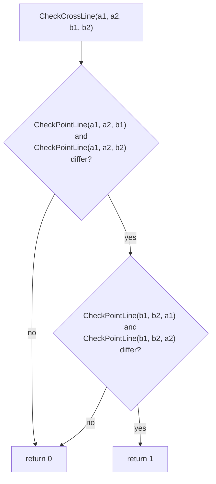

Because "on the line" is its own answer 0, a segment that only touches the
other with an end point counts as crossing: the two sides are 0 and 1 or 0
and 2, which differ.

## Easing steps

File: `src/main/ease_step.c`

The message windows and the timecode counter move their contents with a
cosine ease: an angle counts up from 0 to 180 degrees, and the position is
the midpoint between start and target plus half the distance times the
cosine of the angle. `interpStepCosine` in `src/main/interp_update.c` is one
of these loops. The windows are described in
[ui-windows.md](ui-windows.md). This file supplies the step sizes.

`easeAngleStep(start, target)` returns the number of degrees to add per
frame. For a distance `|target - start|` below 31 it returns 45, so the
ease takes 4 frames. For a longer distance it returns 23 and the ease takes
8 frames. Short moves are quick and long moves get more frames.

The step can be overridden. `easeStepOverrideSet(value)` stores a value and
sets the flag `easeStepOverrideEnabled`, and from then on `easeAngleStep`
returns that value for every distance. `easeStepOverrideClear()` clears the
flag. Neither of the two has a caller in the recovered code, so the
override stays off.

`deltaPerStep(start, target, divisor)` is the linear counterpart. It
returns `(target - start) / divisor`, computed in float and truncated to an
integer: the amount to add per frame so that a value reaches its target in
`divisor` frames. The message list and the timecode counter use it.

## Script math natives

File: `src/main/runtime_math.c`

Scripts of the SB virtual machine (see [sb-vm.md](../scripting/sb-vm.md))
work with integers only. The `math` module gives them four functions and
passes angles and results as scaled integers. `mathRegisterNatives` in
`src/main/runtime_menu.c` registers the table `mathNativeTable` under the
module name `math`. All natives are listed in
[natives.md](../scripting/natives.md).

| Native | Arguments | Result |
| --- | --- | --- |
| `math.atan` | y and x, each in hundredths | `atan2f(y / 100, x / 100) * 10000`, radians times 10000 |
| `math.sin` | An angle in hundredths of a degree | `sinf(angle) * 10000` |
| `math.cos` | An angle in hundredths of a degree | `cosf(angle) * 10000` |
| `math.random` | `min` and `max` | `Get_Rnd(min, max)`, an integer from `min` to `max` |

Each native first checks its argument count. With the wrong count it calls
`sbSlotJumpRequest(context, 2)` and returns 0. The angle of `math.sin` and
`math.cos` is divided by 100, then by 180, and multiplied by pi. The
natives use the C library functions, not the VU0 routines, and
`math.random` draws from the `xglSRand` generator.

## Remaining functions of the owned files

A few functions in the files of this page belong to other subjects and are
only placed here by the way the program was linked.

| File | Functions | Subject |
| --- | --- | --- |
| `src/main/gs_make_frame.c` | `gsMakeFrame(buffer, flag)` returns the GS `FRAME` register value of one of three 512-pixel-wide frame pages. `gsMakeAlpha(blend)` returns the GS `ALPHA` register value of a blend mode: `0x48` for 1 (additive), `0x42` for 2 (subtractive), `0x84` for 3, and `0x44` (normal alpha blending) for anything else | [rendering.md](../architecture/rendering.md) |
| `src/main/gs_make_tex0.c` | `gsMakeTex0(buffer, tex_cc)` returns the GS `TEX0` register value that uses one of the same three pages as a 512 x 512 texture | [rendering.md](../architecture/rendering.md) |
| `src/main/oLib.c` | `oLibInit` sets up heap 4 at `0x01000000` and allocates the resource buffer, `oLibExit` frees it, and `oLibLoadObject(object, Id)` loads an object resource and creates a `XenoActor` from its table of model, texture, hierarchy and motion entries | [memory.md](../architecture/memory.md), [actors.md](actors.md) |
| `src/main/TiVu0.c` | `tiVu0AssertUnreachable739` and `tiVu0AssertUnreachable758` call `assertFailed` with the file name `../TiVu0.euc.c`. `xacGetKeyOutTangentAngle` and `xacGetKeyInTangentAngle` read one value of an animation curve key by key type | [animation.md](animation.md) |
| `src/main/xgl_matrix_axes.c`, `src/main/xgl_vu1_regs.c` | `xglVu1ReadFloatRegisters`, `xglVu1ReadIntegerRegisters` and `xglVu1ReadControlRegisters` | See below |

The name `TiVu0` is worth a note. The original file `TiVu0.euc.c` was the
animation library's own VU0 file, and the `xglCur` functions and
`tiVu0LoadIdentityMatrix` are very likely what it contained. Only the two
assert stubs carry its name in the recovered source.

The three `xglVu1Read` functions read the registers of the other vector
unit. VU0 can see the registers of VU1 through a window in its data memory:
the float registers at quadword address `0x400`, the integer registers at
`0x420` and the control registers at `0x430`. Each function sets `vi1` to
the window address and loads 32 or 16 quadwords with post-increment into
`vf2`, storing each to one scratch variable. The values are thrown away.
The functions have no callers and look like the remains of a debug dump
whose printing was removed.
