# pxy — the model library

`pxy` draws every 3D model of the game: maps, characters, E.S., weapons, map
objects, the meshes used by visual effects and the models shown in menus. A
model is one `.pxy` file loaded into main memory. Its textures are a separate
`.txy` file. The library never changes the geometry of a model. It decides
which parts of the model are visible, sorts them, and writes VIF1 packet data
that makes the VU1 microcode transform, light and draw the vertex data stored
in the file.

The library is used in two steps. During the game's turn, code describes one
model at a time with `nmlModelSet*` and `pxySet*` calls and registers it with
`pxySubmitModel`. Nothing is drawn at that moment. At the end of the frame the
render code calls `pxyFlush`, which walks the registered models once per
camera and writes all the drawing commands in the right order: opaque parts,
shadows, translucent parts and the extra passes for water reflection and glow.

The function names carry three prefixes. `nmlModel*` and `nmlPacket*` are the
names kept from the model library of Xenosaga Episode I. `pxy*` is the prefix
of the code written for the `.pxy` format. `sv*` is a separate layer in the
same group of files: it draws the sprites, polygons and models of the visual
effect system and keeps the texture lists that those effects use. The code is
in `src/main/nml_model_set.c`, `src/main/pxy_packet_state.c` and
`src/main/sv_get_image_item.c`, with a few small helper files.

[← Back to the overview](../README.md)

## Files

| File | Contents |
| --- | --- |
| `src/main/nml_model_set.c` | The model state (`pxyState`), the setters for the next model, `pxySubmitModel`, part visibility, the batch tables and the sorted batch list, the draw passes, shadows, the direct-send queue, `pxyFlush` and the per-frame reset |
| `src/main/pxy_packet_state.c` | Packet building: microcode selection, VU1 data uploads for a model and for a part, bone matrices, texture upload, the GS register queue and its flush variants, screen clears and screen copies, the circle shadow quad, the caches |
| `src/main/nml_packet_add.c` | The VU0 "current matrix" helpers `_CurMatrixSet`, `_CurApplyMatrix`, `_CurApplyMatrix33` and `_CurMatrixMul` |
| `src/main/model_calc_clip.c` | Clip tests on VU0: `_ModelCalcClipInitMat1`, `_ModelCalcClipMat1`, `_ModelCalcClipMat1Xy`, and the projection helpers `_CurRotTransPersFog` and `_CurRotTransPersClipFloat` |
| `src/main/pxy_profile.c` | The frame profiler (`pxyProfile*`), the key interpolation `pxyKeyInterpolate` and the light direction helper `_CurMatrixMul33normXYZW` |
| `src/main/xgl_light.c` | Light sets (`XglLightSet`) and light packs (`lxy` files): the default light, the pack table, key evaluation and the conversion of a pack into the light set of one model |
| `src/main/sef_light_set.c` | Three copies of a light set kept for the effect system: active, default and applied |
| `src/main/sv_get_image_item.c` | The `sv` layer: depth sort buckets, the draw list, the image mappers (texture lists), resources by name, texture pages and uploads, effect slots, and the drawing of effect records as sprites, polygons or models |
| `src/main/draw_list.c` | Small accessors of the `sv` draw list: next slot, commit, append |
| `src/main/sv_scene_flags.c` | The `svSceneFlags` word, a direction-to-angles helper and the light set log dump |
| `src/main/txd_table_entry.c` | `txdTableEntry`, the offset table lookup, and two empty functions |
| `include/main/nml_model_set.h` | Prototypes of the model API, `PxyRowBits`, `PxyAngle` |
| `include/main/pxy_packet_state.h` | `PxyHeader`, `PxyPart`, `PxyPacket`, `PxyTableEntry`, `PxyClipPlanes`, `TxyBlock`, the direct queue types |
| `include/main/pxy_shadow.h` | `PxyShadow`, the shadow projector, and `PxyShadowLight` |
| `include/main/xgl_light.h` | `XglLightSet` |
| `include/main/sv_get_image_item.h` | `SvTypeList`, `SvTypeListEntry`, the chunk types, `DrawList`, `SvDrawSlot`, `SvTexParam`, `SefPartTransform` |
| `include/main/pxy_profile.h`, `nml_packet_add.h`, `model_calc_clip.h`, `sv_scene_flags.h`, `txd_table_entry.h`, `pxy_frame_alpha.h` | Prototypes of the small files and of the frame alpha helpers |

The whole-frame view of drawing, from packet buffers to the display, is in
[rendering.md](../architecture/rendering.md). Actors, which are the main
callers of this library, are in [actors.md](actors.md). The skeleton and
motion code that produces the bone matrices is in
[animation.md](animation.md). The byte layout of the files is planned for
[models-and-textures.md](../formats/models-and-textures.md).

## Using the library

The library keeps one block of global variables that describes "the next
model". It starts at `nmlRenderStatus` and is 0x2a0 bytes long. Every setter
writes one or two of these variables. `pxySubmitModel(header)` then copies the
whole block into the current packet buffer with
`nmlPacketSetAttributeData16N(&nmlRenderStatus, 0x2A)`. The copy is the
model's `PxyPacket`. From then on the draw code only reads the copy, so the
block can be reset for the next model. `pxySubmitModel` ends with
`pxyResetGlobals()`, which puts every variable back to its default.

A typical call sequence is the one of the map in `src/main/game_map_object.c`:

```c
nmlModelSetFogDist(near, far, min, max);   /* fog range of the map */
nmlModelSetFogCol(&gameWork.fogColor);
pxySetHideMask(&mapMainHideMask);          /* geometry hidden by the game */
nmlModelSetTexture((TxyBlock *) mapTextureData);
pxySetColorScale(&gameWork.mapColor);
pxySubmitModel(mainObject);                /* the .pxy file of the map */
```

Actors do the same in `src/main/xenoActor.c` with many more setters: the
draw matrix, the scale, the light, the shadow mode, the bone matrices, clip
planes and the render level. That sequence is described in
[actors.md](actors.md). Effect models go through `svSetModelRenderState` in
`src/main/sv_get_image_item.c`, and five battle effects in `src/ov01`
(`m_ef_sway.c`, `m_ef_create_smp_01.c`, `m_ef_missile_trail.c`,
`m_ef_thunder25.c`, `m_ef_thunder31.c`) call `pxySubmitModel` directly.

The sequence below shows the two halves of the work. The first half runs in
the game's own code. The second half runs in `xglRenderMove`
(`src/main/xgl_render.c`) when the frame is closed.

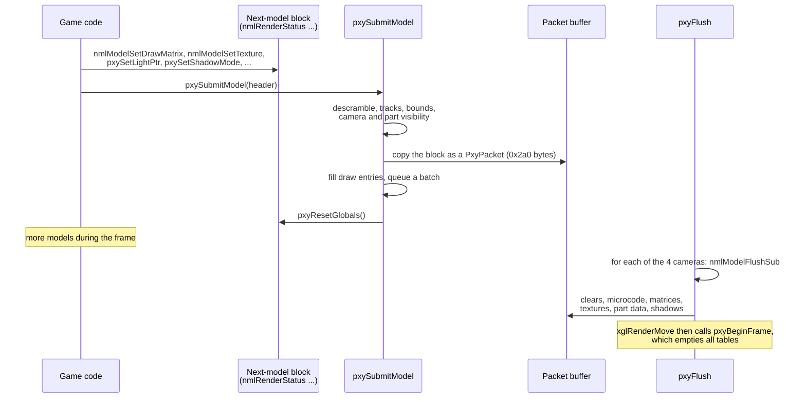

`xglRenderMove` calls the pieces in a fixed order: `sefDrawEffect` (which
submits the effect models), `pxyFlush`, the screen effect hook, the final
packet, fonts and the global fade. After the packet has been sent it calls
`pxyBeginFrame`, which runs `nmlModelFlushClear` and clears the "flush done"
flags. When drawing is switched off for a frame, `xglRenderMove` skips
`pxyFlush` and calls `nmlModelFlushClear` directly, so the tables never keep
models from an older frame.

`nmlModelConstruct` is the start-up function. It is called once from
`src/main/xgl_render.c`. It resets the slots, the counters, the tables and
the batch tables, builds the circle shadow texture with
`CONSTRUCT_CIRCLR_SHADOW`, and installs two hooks used by the render code:
`pxyAddFrameCopyPacket` in `pxyFrameCopyHooks[0]` and `pxyPlayEntryGroup5` in
`pxyEntryGroupHooks[0]`.

## Model data

### The `.pxy` file

A model is one file image. It must be 16-byte aligned in memory and start
with the three letters `pxy`. `PxyHeader` in
`include/main/pxy_packet_state.h` is its header. Almost every table of the
file is found through a byte offset from the start of the header. The code
writes this as `PXY_HEADER_AT(header, offset)`.

| Offset | Field | Meaning |
| --- | --- | --- |
| +0x00 | `magic` | `pxy` |
| +0x04 | `version` | A float. `pxySubmitModel` refuses the model when `(int)(version * 10)` is not positive |
| +0x08 | `flags` | Model flags, see the table below |
| +0x0c | `fileSize` | Size of the file in bytes, used by the descrambler |
| +0x10 | `name` | Model name, 0x20 bytes. Compared with `MOM2_B04` in one special case |
| +0x30 | `layerCount` | Number of layers. A layer is also the index of the texture set the parts use |
| +0x34 | `entryCount` | Number of geometry entries the map code can hide one by one. In every model on the discs it equals `geometryCount` at +0x60 |
| +0x3c | `entryTableOffset` | Offset of the table of part data records (`PxyTableEntry`, 0x20 bytes each) |
| +0x40 | `partOffset` | Offset of the part array (`PxyPart`, 0x60 bytes each) |
| +0x48 | `partCount` | Number of parts |
| +0x54 | `rangeOffset` | Offset of two `PxyPartRange` records: the opaque parts, then the translucent parts |
| +0x58 | `materialOffset` | Offset of a table that `pxySubmitModel` stores in the packet at +0x18. The draw code in these files does not read it. In the files it is the material table, records of 0x60 bytes. The renderer's own copy of a material is the material batch inside the mesh's VIF stream (see [Models and textures](../formats/models-and-textures.md)) |
| +0x5c | `nJointMatrix` | Number of joint matrices of a skinned model, 0 for a rigid one |
| +0x60 | `geometryCount` | Number of geometry records |
| +0x64 | `jointMatrixOffset` | Offset of the joint base matrices, one 0x40-byte matrix per joint |
| +0x68 | `entryMatrixOffset` | Offset of the default part matrices, one 0x40-byte matrix per geometry |
| +0x6c | `geometryOffset` | Offset of the geometry array, 0x70 bytes per record. Each record starts with its name |
| +0x70 | `defaultJointOffset` | Offset of the default joint matrices, used when the caller gives none |
| +0x74, +0x78 | `trackHeaderOffset`, `trackTableOffset` | A `PxyTrack` header and its table of offsets, for models with flag 0x4 |
| +0x80 | `sphere` | Bounding sphere: center, with the radius in `w` |
| +0x90, +0x98 | `minX`, `minZ` | Lower corner of the bounding box on the ground plane |
| +0xa0, +0xa8 | `maxX`, `maxZ` | Upper corner of the bounding box on the ground plane |
| +0xc0 | `waterOffset` | Nonzero makes `pxyEvaluateTracks` call `tiWaterObjectUpdate` for this model. In the files this word is the offset of a `WAT ` chunk and is nonzero in every model, so the call is always made. The item count inside the chunk decides whether water runs, and only ten models (in five map files) have a table with items |
| +0xc8, +0xcc | `trackOffset`, `entryOffsets` | A second `PxyTrack` header and its offsets, for models with flag 0x10 |
| +0xd0 | `subPackOffset` | Offset of a second model packed in the same file, 0 if none |
| +0xe8 | `sortEntryOffset` | Offset of the `PxySortEntry` table used to sort translucent groups, for models with flag 0x1000 |

The ASCII diagram below shows how the tables hang from the header. The order
of the tables in the file does not matter to the code, because it always goes
through the offsets.

```
header +0x000  +---------------------------------------------+
               | PxyHeader: "pxy", version, flags, size,     |
               | name, counts, offsets, sphere, box          |
               +---------------------------------------------+
  partOffset ->| PxyPart[partCount]            0x60 each     |
 rangeOffset ->| PxyPartRange[2]               0x20 each     |
               |   [0] opaque parts, [1] translucent parts   |
    entryTableOffset ->| PxyTableEntry[]               0x20 each     |
               |   offset and quadword count of part data    |
geometryOff. ->| geometry records              0x70 each     |
               |   name at +0x00, flags at +0x20             |
entryMatrix. ->| default part matrices         0x40 each     |
jointMatrix. ->| joint base matrices           0x40 each     |
    defaultJointOffset ->| default joint matrices        0x40 each     |
 tracks      ->| PxyTrack, offsets, keyed parts              |
 sort entries->| PxySortEntry[]                0x10 each     |
               +---------------------------------------------+
               | part data: VIF code with the vertex data,   |
               | referenced from the packet, never copied    |
               +---------------------------------------------+
subPackOff.  ->| optional second PxyHeader with its tables   |
               +---------------------------------------------+
```

The flags of `PxyHeader.flags` select most of the special paths of the
library.

| Bit | Effect in the code |
| --- | --- |
| 0x00000001 | The model uses the environment microcode (packet mode 1). Its parts are culled one by one and need at least one of the four camera bits to be listed. No shadow projector is built for it. Together with 0x80 it makes the model an overlay batch |
| 0x00000002 | The model is tested against the culling volumes of the camera, fades out with distance in field and battle mode, and gets the joint-based visibility fallback when it casts a projected shadow |
| 0x00000004 | The model has keyed tracks at `trackHeaderOffset` and `trackTableOffset`. Their values are sent to VU1 for the microcode |
| 0x00000008 | The model is always visible in every enabled camera. Together with 0x80 (mask 0x88) its parts take their own part matrices and fog values |
| 0x00000010 | The model has track entries at `trackOffset` and `entryOffsets`. For each entry the best branch is chosen and sent to VU1 |
| 0x00000020 | The Z-write pre-pass is enabled for the translucent parts, like `nmlModelSetZwrite` |
| 0x00000040 | The model takes part in the water reflection pass (draw mode 1) |
| 0x00000080 | Overlay model: its batch is kept in the overlay list, is drawn before the sorted models and receives projected shadows |
| 0x00000100 | The model takes part in the glow source pass (draw mode 2) |
| 0x00000200 | The translucent parts are listed as leader and follower groups (part flags 0x80 and 0x240) |
| 0x00000400 | The model has parts that sample the screen (part flag 0x8000) |
| 0x00000800 | The model is drawn in the early source pass (draw mode 4) |
| 0x00001000 | The translucent parts are sorted by depth in groups, with the table at `sortEntryOffset` |
| 0x00002000 | The geometry records carry a shadow bit (0x100000 at +0x20), which the actor code turns into a geometry mask |
| 0x80000000 | The file is still scrambled. `pxyDescrambleHeader` clears the bit after decoding |

A file with bit 31 set is decoded in place the first time it is submitted.
`pxyDescrambleHeader` first walks the bytes from the end of the file down to
offset 16. For byte `i` it computes a partner index
`((2121 * i - 909) * (i - 1) + 0x16253495 - 1) % i` and swaps the two bytes
when both are nonzero and the partner is at 16 or above. Then it walks the
file in 4-byte words from word 4 on and swaps two bytes inside each nonzero
word. The pair of byte positions comes from `pxyDescrambleSwapTable`, indexed
by the word number modulo 8. The first 16 bytes of the file are never
touched, so the magic, the version, the flags and the size are always
readable.

Two helpers read the geometry records by name. `pxyFindEntryIndex(header,
name)` compares the name with the start of each 0x70-byte record and returns
the index or -1. `pxyGetEntry(header, index)` returns the address of a
record. The map unit code and the menu use them to find a named piece of a
model.

### Parts

A part is the unit of drawing. It is one piece of mesh with one material
state, one layer and one matrix. `PxyPart` is 0x60 bytes.

| Offset | Field | Meaning |
| --- | --- | --- |
| +0x04 | `entryIndex` | Index into the table of `PxyTableEntry` records. The record gives the offset and the quadword count of the part's VIF data |
| +0x08 | `layer` | Layer of the part. Parts are listed layer by layer, and the layer selects the texture set of the `.txy` file |
| +0x10 | `matrixIndex` | Index of the geometry the part belongs to. It selects the part matrix, the bit in the hide masks and the row of the sort table |
| +0x14 | `index` | Index of the part's byte in the per-part flag bytes of the packet |
| +0x18 | `flags` | Part flags, see below |
| +0x1c | `styleLevel` | A small level sent to VU1 with the part state. A nonzero level turns on back-face removal in the microcode, and levels 2 and above remove the other side |
| +0x20 | `boundsMin` | Bounding box corner, used by the shadow receiver test in field mode |
| +0x30 | `boundsMax` | The other corner |
| +0x40 | `sphere` | Bounding sphere of the part: center, radius in `w` |

The part flags decide in which pass a part is drawn.

| Bit | Effect in the code |
| --- | --- |
| 0x00002 | The part is drawn in the Z-write pre-pass of its model |
| 0x00004 | The part is drawn only in draw mode 1, the water reflection pass |
| 0x00008 | The view data of the part is computed relative to its own bone matrix |
| 0x00010 | The part is left out when a whole model is drawn as translucent. It is drawn by the frame-mask pass instead, and shadow caster mode 1 skips it |
| 0x00020 | Together with 0x40: the part gets the bit of every tested camera without a clip test |
| 0x00040 | The GS writes the alpha correction bit (FBA) while the part is drawn |
| 0x00080 | Group leader of a translucent group. In the translucent pass the top alpha bit of the frame is cleared before it is drawn |
| 0x00100 | After the part, the depth buffer is cleared where the frame alpha bit is set |
| 0x00200 | Follower of a group. With 0x1000 and without 0x4000 the part is skipped |
| 0x00800 | The frame-mask pass skips the part |
| 0x01000 | The part does not receive projected shadows |
| 0x02000 | The part is drawn only in draw mode 2, the glow source pass |
| 0x04000 | The part sets its own frame write mask before it is drawn |
| 0x08000 | The part samples the screen: it is drawn by `pxyDrawScreenSampledParts` |
| 0x10000 | The part belongs to draw mode 4, the source pass |
| 0x20000 | Shadow caster mode 2 uses this bit to choose the parts of each pass |

`PxyPartRange` describes a run of parts with `first` (+0x14) and `count`
(+0x18). The file has two ranges. Range 0 holds the opaque parts and range 1
the translucent parts.

### Part data and materials

The vertex data of a part is not described by a C structure. It is a ready
block of VIF code inside the file. The `PxyTableEntry` of the part gives its
byte offset from the header and its size in quadwords. `pxyDrawPartData`
adds a DMA reference tag that points straight into the file, so the vertices
are never copied on the EE. The block holds its own unpack commands. What the
code sends before it is the state the microcode needs: matrices, lights,
flags and GS registers.

For the same reason a material is not a structure the C code reads. The
texture of a part comes from its layer, the blending and test state come from
the pass and from the part flags, and everything else (see [The setup batch and the material](#the-setup-batch-and-the-material)) is inside the VIF block
and the microcode. The planned page
[models-and-textures.md](../formats/models-and-textures.md) describes the
bytes of these blocks.

### Bones and matrices

The library uses two kinds of matrices.

**Part matrices** place each geometry of a rigid model. There is one 0x40-byte
matrix per geometry. The file has a default set at `entryMatrixOffset`. A
caller that animates the pieces of a model gives its own set with
`pxySetPartMatrices`. The map objects do this to tilt a piece, and actors
without a skeleton do it with the matrices of their parts animation. The
packet field `boneMatrices` points at the set in use, and
`part->matrixIndex` selects the matrix of a part.

**Joint matrices** skin a model that has `nJointMatrix` above zero. The actor
code multiplies the global matrix of each joint by the joint base matrix of
the file and passes the result with `pxySetJointMatrices(joints, global)`.
When the caller gives none, `pxySubmitModel` uses the default joint matrices
at `defaultJointOffset`. `pxySetMotionGlobalMatrices` stores the global matrices of the
motion a second time. The packet copy of that pointer is at +0xa0.

`pxyUploadBoneMatrices` sends the joint matrices to VU1 address 0x228, four
quadwords per matrix. A model with up to 0x40 joints sends the whole table
once, and the cache `pxyBoneCachePacket` remembers which packet's table is in
VU1. A table of exactly 0x40 matrices is sent in two pieces, 0xfc quadwords
at 0x228 and the last matrix at 0x324. A model with more than 0x40 joints
cannot keep its table in VU1. For such a model each part names the joints it
needs: the code reads a 0x70-byte record per geometry from the packet's
`channelTable`, takes the list of joint numbers at +0x30 of the record (each byte is the joint number plus one), which
ends with 0, and uploads only those matrices, the first at 0x228, the second
at 0x22c and so on.

### Tracks

Models can carry small animations that do not move bones, for example a
scrolling texture or a blinking light. They are keyed tracks stored in the
file, and `pxyEvaluateTracks` advances them when the model is submitted.

A track part (`PxyTrackRecord`) has a key count, a minimum and a maximum time, a
running time in 24.8 fixed point and a list of key rows that starts at +0x20.
Each frame the time grows by 256, which is one unit, unless
`pxyFreezeAnimation` is set. The time is wrapped into the range between the
minimum and the maximum, and `pxyInterpolateKeys` reads the value. Models
with header flag 0x4 store the result of track `k` in
`pxyState.trackValues` at index `k + 1`. For modes 0 and 1 the value is kept
between -8 and 8 by adding or subtracting 8. For mode 2 a fraction of one
half or more is pushed up by one half.

A track part can be driven by the caller instead of by keys. When its
`focusDriven` byte is 1, `pxyTrackStoreFocus` stores `pxyFocusX` (mode 0) or
`pxyFocusY` (mode 1) in the same table. Actors set these two values with
`pxySetFocus`, from a matrix of their skeleton. A likely use is an eye
texture that follows the look direction.

Models with header flag 0x10 have track entries (`PxyTrackEntry`). An entry
has a loop start, a loop end, its own running time and up to 31 branches.
Each branch is a track part or a leaf with one fixed value. The code
evaluates all branches, keeps the largest value and stores the value, the
index of the winning branch and the branch count in `pxyState.bestRecords`.
A frozen entry is skipped.

Both tables are part of the next-model block, so they are copied into the
packet. `pxyUploadPacketState` sends the eight track rows to VU1 address
0x370 and the four best-record rows to 0x37c.

`pxyInterpolateKeys(count, keyframes, time, weight)` returns the value of a
key list at a time. A key row is four floats, with the time in the first and
the value in the second. Before the first key and after the last key the
function returns the end value. Between two keys it calls `pxyKeyInterpolate`
in `src/main/pxy_profile.c`, a VU0 routine that blends the two rows. One
special case exists: when `weight` is 0.2 or more and the lowest bit of the
bit pattern of the key value is set, the key value is returned without
blending, which gives a step. `pxySetAnimTime` replaces the running time by a
time chosen by the caller and sets status bit 0x100. The light packs use the
same function for their curves.

### The `.txy` texture block

`TxyBlock` is the header of a texture file.

| Offset | Field | Meaning |
| --- | --- | --- |
| +0x00 | `magic` | `txy` |
| +0x04 | `setCount` | Number of texture sets |
| +0x08 | `size` | Size in bytes of the area that the first-use pass walks |
| +0x0c | `flags` | Bit 31 is set while the block has not been prepared |
| +0x10 | `setOffset[]` | One byte offset per set, from the start of the block. The files have room for 32 sets here and use up to 23 |

`nmlModelSetTexture(block)` selects the texture block of the next model. The
pointer must be 16-byte aligned and the magic must match, otherwise the call
does nothing. The first time a block is selected its flag bit 31 is still
set. The function then walks every byte from +0x10 up to `size`: a byte of 1
becomes 0xff, any other nonzero byte is decreased by one, and zero bytes stay
zero. After that the bit is cleared, so the pass runs once per loaded file.

A texture set is the group of images that one layer of the model needs. The
set has a record count at +0x14 and 0x20-byte records from +0x20. A record
gives the offset of its image data, an x origin that is added to the base
address of the texture area, a width, a height and the quadword count of the
data. How a set is sent to the GS is described in
[Texture upload](#texture-upload).

## The next-model block and the packet

The block that starts at `nmlRenderStatus` and the `PxyPacket` structure are
the same 0x2a0 bytes. The table lists the variable of the block, the name of
the packet field that the draw code reads, and what the value does. Some
packet fields have names that describe only one of their uses. The table
gives the meaning that the code shows.

| Offset | Variable (setter) | Packet field | Meaning |
| --- | --- | --- | --- |
| +0x00 | `nmlRenderStatus` | `renderStatus` | Status bits of the model, see below |
| +0x04 | `pxyActiveCameraIndex` | `camera` | Camera that owns the model. Always 0 after a reset |
| +0x08 | `pxyShadowMode` (`pxySetShadowMode`) | `drawMode` | Shadow mode of the model, 0 to 5 |
| +0x0c | `pxyHideMask` (`pxySetHideMask`) | | One bit per geometry. A set bit hides the parts of that geometry |
| +0x10 | `pxyCurrentHeader` | `header` | The model |
| +0x14 | `pxyPartRanges` | `ranges` | The two part ranges |
| +0x1c | `pxyHeaderTable6C` | `channelTable` | The geometry array |
| +0x20 | `pxyParts` | `parts` | The part array |
| +0x2c | `pxyJointMatrices` (`pxySetJointMatrices`) | `matrixTable` | Joint matrices, 0 for a rigid model |
| +0x34 | `pxyPartVisibilityFlags` | `partFlags` | One byte per part, allocated in the packet buffer |
| +0x38 | `pxyTxyBlock` (`nmlModelSetTexture`) | `textureTable` | The texture block |
| +0x18 | `pxyHeaderTable58` | | The table at `materialOffset` of the header |
| +0x24, +0x28 | `pxyDefaultPartMatrices`, `pxyDefaultJointMatrices` | | The default matrices of the file |
| +0x30 | `pxyHeaderTable64` | | The joint base matrices of the file |
| +0x3c | `pxyHeaderTable3C` | `entries` | The part data records (`PxyTableEntry`) |
| +0x40 | `pxyParentHeader` (`nmlModelSetParent`) | | Model whose batch this model joins |
| +0x44 | `pxyReflTransparency` (`nmlModelSetReflTransparency`) | `reflectTransparency` | Second alpha of the model, 1.0 by default. Zero selects part style 1 |
| +0x48 | `pxyTransparency` (`nmlModelSetTransparency`) | | Transparency of the model, 0.0 to 1.0 |
| +0x4c | `pxyCircleShadowScale` (set with the transparency) | `circleShadowScale` | Copy of the transparency. It scales the color sent to VU1 and the strength of the shadows |
| +0x58 | `pxyShadowAlpha` (`pxySetShadowMode`) | `shadowAlpha` | Strength of the shadow |
| +0x5c | `pxyPartMatrices` (`pxySetPartMatrices`) | `boneMatrices` | Part matrices in use |
| +0x60 | `pxyFocusX`, `pxyFocusY` (`pxySetFocus`) | | Values for focus-driven tracks |
| +0x68 | `pxyGeometryFogFactors` | `levelTable` | Per-geometry fog values, four ints per geometry, or 0 |
| +0x6c | `pxyCurrentLight` (`pxySetLightPtr`, `pxySetLightCopy`) | `light` | Light set of the model |
| +0x70 | `nmlStencilAlphaData`, `nmlStencilAlphaRegister` (`nmlModelSetStencilAlpha`) | | A GS ALPHA_1 value and its register number, sent to VU1 as one quadword |
| +0x80 | `pxyCurrentShadow` | `shadow` | Shadow projector of the model |
| +0x84 | `pxyRenderLevel` (`nmlModelSetRenderLevel`) | `drawFlags` | Render level bits, see below |
| +0x88 | `pxyModelScaleMax` (`nmlModelSetScale`) | | Largest of the three scale factors |
| +0x8c | `pxyAnimTime` (`pxySetAnimTime`) | | Track time chosen by the caller |
| +0x94 | `pxyShadowPlaneHeight` (`pxySetShadowMode`) | `shadowY` | Height of the ground under the model, for circle and planar shadows |
| +0x98 | `pxyShadowMatrix` | `shadowMatrix` | Matrix that flattens the model for a planar shadow |
| +0x9c | `pxyVisibleOverride` | `frameWriteMask` | Frame write mask of the model. -1 when render level bit 0x10 is set, so the color buffer is not written |
| +0xa4 | `pxyClipPlaneCount` | `planeCount` | Number of clip planes, 0 to 2 |
| +0xa6 | `pxyClipPlaneMaskedCount` | `clipPlaneMaskedCount` | The count argument of `pxySetClipPlaneMasked` |
| +0xa8 | `pxyClipPlanes` | `planes` | The clip planes (`PxyClipPlanes`) |
| +0xac | `pxyGlobalMatrices` (`pxySetJointMatrices`) | | Global joint matrices, used for the visibility fallback and the group sort |
| +0xb0 | `pxyClipPlaneMaskedX` | `clipPlaneMaskedTime` | First float of `pxySetClipPlaneMasked` |
| +0xb4 | `pxyClipPlaneMask` | `clipPlaneMask` | Geometry mask of `pxySetClipPlaneMasked` |
| +0xb8, +0xbc | `pxyClipPlaneMaskedY`, `pxyClipPlaneMaskedZ` | `clipPlaneMaskedScale`, `clipPlaneMaskedPush` | Second and third float |
| +0xc0 | `pxyShadowHeightLower` (`pxySetShadowHeightRange`) | `lowerClipHeight` | Lower height limit of the shadow on the receivers, -1.0 by default |
| +0xc4 | `pxySecondPartMask` (`pxySetSecondPartMask`) | `secondPartMask` | Geometry mask used by the draw modes to split a model between the source pass and the main pass |
| +0xc8 | `pxyShadowHeightUpper` | `upperClipHeight` | Upper height limit, 0.5 by default |
| +0xcc | `pxyFadeMetric` | | Size of the model on screen, computed at submit time |
| +0xd0 | `pxyColorIndexSource` (`pxySetColorIndexSource`) | `shadowReceiverParts` | Up to 16 part indices ended by 0xff. Only these parts of the map receive this model's shadow |
| +0xd4 | `pxyStateFlags` (`pxySetStateFlag`) | | Bit 0 removes the model from the translucent listing |
| +0xd8 | `pxyFadeAlpha` | `fadeAlpha` | Distance fade factor, 1.0 by default, sent to VU1 as a vector |
| +0xe0 | `nmlModelDrawMatrix` (`nmlModelSetDrawMatrix`) | `localMatrix` | Model-to-world matrix |
| +0x120 | `nmlModelDrawInverseMatrix` | `worldMatrix` | Its inverse, computed at submit time |
| +0x160 | `pxyModelScale` (`nmlModelSetScale`) | | Scale vector |
| +0x170 | `pxyState.cameraVisible[4]` | `cameraMask[4]` | Nonzero where a camera draws the model |
| +0x180 | `pxyState.cameraFog[4]` | `cameraFog[4]` | Fog value per camera, 0 to 4080. The reset value is 0xff0, no fog |
| +0x190 | `pxyFogColor` (`nmlModelSetFogCol`) | `fogColorR`, `G`, `B` | Fog color |
| +0x1a0 | `pxyFogParams` (`nmlModelSetFogDist`) | | Fog parameters, sent to VU1 |
| +0x1b0 | `pxyModelPosition` (`pxySetModelPosition`) | `center` | World position of the bounding sphere, radius in `w` |
| +0x1c0 | `pxyLatchedActorState` (`pxyLatchActorState`) | `preDraw` | Function called before the batch is drawn in the main pass |
| +0x1d0 | `pxyLatchedSecondState` (`pxyLatchSecondState`) | `postDraw` | Function called after the batch |
| +0x1e0 | `pxyState.trackValues` | | Track values, eight rows |
| +0x260 | `pxyState.bestRecords` | | Best records of the track entries, four rows |

The block overlaps the end of the static object `pxyState`. That object
starts with the default light set (`pxyState.light`, 0x180 bytes) and also
holds the lists that follow the block in memory: the 16 registered draw
callbacks, the overlay, shadow and separate batch pointer lists, the ring of
four slots and the list of tracked headers.

### Status bits

The status word collects what the setters asked for and what
`pxySubmitModel` found out. The draw passes add three more bits for a short
time while they run.

| Bit | Set by | Meaning |
| --- | --- | --- |
| 0x00000001 | `nmlModelSetFogCol`, `nmlModelSetFogDist`, global fog | Fog is on for the model |
| 0x00000002 | `pxyRequestForcedVisibility`, `pxySetShadowMode` for modes 1, 4 and 5 | The parts are listed even when the model is off screen, so that it can cast a shadow |
| 0x00000004 | `nmlModelSetStencil` | The whole model is drawn as translucent: its opaque parts go to the translucent list |
| 0x00000008 | `nmlModelSetZwrite` | Z-write pre-pass for the translucent parts |
| 0x00000010 | `pxyCalcCameraVisibility` | The model is not visible in any camera |
| 0x00000020 | `pxySubmitModel` | The light that casts the shadow points straight down (no x or z part) |
| 0x00000040 | `nmlModelSetHumanModel` | The point lights of the light set are sent to VU1 |
| 0x00000080 | `nmlModelSetStencilAlpha` | The caller's ALPHA_1 value is sent to VU1 |
| 0x00000100 | `pxySetAnimTime` | Tracks use the caller's time |
| 0x00000400 | `pxySetFogWhite` | Fog is forced to white with the fixed value 0xa00 |
| 0x00000800 | `nmlModelSetTexProreal` | The model is always visible, and its parts are culled with their own part matrices |
| 0x00002000 | `pxySetClipPlaneWithAngle` | One or two clip planes with a rotation |
| 0x00004000 | `pxyAddClipPlanePair` | A pair of clip planes |
| 0x00008000 | `pxySetClipPlaneMasked` | A clip plane with a geometry mask. The model uses the third microcode program |
| 0x00010000 | `nmlModelSetShadowMapEntry` | Sets bit 0x400 of the VU1 flag word |
| 0x00020000 | `pxySetSourceDrawPass` | The model belongs to draw mode 4, the source pass |
| 0x00040000 | `pxySetShadowFirstPass`, `pxySetTexMapDropAll` | The translucent parts are drawn in the first translucent round, before the shadows |
| 0x00080000 | `nmlModelSetDropPass` | The batch gets the soft outline post-process after it is drawn |
| 0x00200000 | `nmlModelSetTexMapCircle` | The model is visible in every enabled camera and sets bit 0x400 of the VU1 flag word |
| 0x01000000 | planar shadow pass | The model is being drawn flattened on the ground |
| 0x10000000 | shadow pass | The model is being drawn into its shadow texture |
| 0x20000000 | shadow receiver pass | The part is being drawn with a projected shadow texture |

### Render level bits

`nmlModelSetRenderLevel(flags)` ORs its argument into `pxyRenderLevel`. The
packet field is called `drawFlags`. The bits that the code of this library
tests are these.

| Bit | Meaning |
| --- | --- |
| 0x0001 | Sets bit 0x100 of the VU1 flag word |
| 0x0002 | With header flag 0x200, the translucent listing stops after the highest layer |
| 0x0008 | The model is always visible and every part gets all four camera bits. `pxySetClipPlaneMasked` sets it too |
| 0x0010 | The frame mask becomes -1, and the batch is placed at the head of the sorted list |
| 0x0040 | The batch goes to the separate list and is drawn after the scene with a cleared depth buffer |
| 0x0080 | When the bounding sphere is off screen, the positions of the global joint matrices are tested too |
| 0x0100 | The model ignores the global fog |
| 0x0200 | The depth test of the model always passes |
| 0x0800 | Part style 1 is used. It is also set when the distance fade reaches zero |
| 0x1000 | The model fades out between two fixed sizes on screen and is dropped when it is fully faded |

Bits 0x4 and 0x8 are also set by the effect layer from the flags of an
effect item, see [Models drawn by effects](#models-drawn-by-effects).

### Frame options

A second flag word, `pxyFlags`, holds options for the whole frame. It is
cleared by `pxyClearEntryTable` at the start of each frame.

| Bit | Set by | Meaning |
| --- | --- | --- |
| 0x000001 | `pxySubmitModel` | A model with header flag 0x40 was submitted while bit 0x2 was set: the water reflection pass runs. Read by `pxyWaterReflectionPendingGet` |
| 0x000002 | `pxyRequestTextureCopyPass` | The water code asks for the reflection pass |
| 0x000004 | `pxySubmitModel` | A model with header flag 0x100 was submitted while bit 0x8 was set: the glow source pass runs. Read by `pxyGlowPendingGet` |
| 0x000008 | `pxyRequestOverlayPass` | A screen effect asks for the glow source pass |
| 0x000010 | `pxySetMode3Flag` | Field mode: the fourth microcode program, shadow fading by size, box tests for shadow receivers |
| 0x000020 | `nmlModelSetGlobalFogDist`, `nmlModelSetGlobalFogCol` | A global fog applies to every model that does not opt out |
| 0x000040 | `pxySetSkipTextureUpload` | Texture uploads are skipped, and the second set of GIF tag tables is used |
| 0x000080 | `pxySetBlackFog` | The fog color of every model is forced to black |
| 0x000100 | `nmlModelSetRenderLevel` with bit 0x40 | At least one separate batch exists |
| 0x000200 | `pxySkipOverlayDraw` | The glow source buffer is cleared but nothing is drawn into it |
| 0x000400 | `pxySetTexMapDropAll` | Every model gets status bit 0x40000 |
| 0x000800 | `pxyEnableFrameMaskPass` | The frame-mask pass runs for the translucent batches |
| 0x001000 | `pxyForceCameraVisibleSet` | Every model is visible in every enabled camera |
| 0x002000 | `pxySetOverlayAlphaMaskMode` | The glow source pass draws into the display buffer with the alpha correction bit |
| 0x004000 | `pxyRequestFrameClearOnly` | The reflection and source passes only clear their buffers |
| 0x008000 | `pxySetSourceDrawPass`, header flag 0x800 | The source pass (draw mode 4) runs |
| 0x020000 | `pxySetShadowUploadFlag` | Sets a word of the shadow receiver data |
| 0x040000 | `pxySetShadowProjectOff` | The height limits of projected shadows are not applied |
| 0x080000 | `pxySetMode4Flag` | Battle mode: the fifth microcode program and longer fade distances |
| 0x100000 | `pxySetShadowFirstPass` | The shadows are drawn before the overlay translucent parts |

The field code in `src/main/game_data.c` sets field mode every frame with
`pxySetMode3Flag(1)`, asks for the glow source pass and passes
`gameWork.shadowCasterMode` to `pxySetShadowCasterMode`. The battle scene in
`src/ov01/scene.c` calls `pxySetMode4Flag`.

## Submitting a model

`pxySubmitModel(header)` turns the next-model block and a model into a packet
and a pair of batches. It returns 1 when the model is refused and 0
otherwise. In both cases the block is reset.

The model is refused when the active camera does not exist, when 0x100 models
or 0x100 batches are already registered, when the header pointer is not
16-byte aligned, or when the magic or the version is wrong.

The steps of an accepted model are these.

1. `pxyDescrambleHeader` decodes a scrambled file.
2. `pxyEvaluateTracks` advances the tracks. The function first looks the
   header up in a list of tracked headers, which would stop a second advance
   in the same frame. No code adds headers to that list, so every submit
   advances the tracks of its model.
3. The frame options are updated from the header flags: reflection pending,
   glow pending, source pass.
4. The global fog is copied into the model unless render level bit 0x100 is
   set. Black fog and white fog are applied.
5. The direction of the shadow light is read. If it has no x and no z part,
   status bit 0x20 is set.
6. The table pointers of the block are filled from the header offsets.
7. The per-part flag bytes are allocated in the packet buffer, one byte per
   part rounded up to whole quadwords, and every byte is set to 0x80
   (`PXY_PART_VISIBLE`).
8. The inverse of the draw matrix is computed. The clip planes are moved
   into model space with it.
9. A model with a parent looks for the parent's packet in the ring of slots
   and takes the parent's light, shadow projector, shadow matrix and, if it
   has none, the parent's texture block. A model without a parent takes the
   next slot of the ring, computes its bounds with `pxyCalcModelBounds` and
   its camera visibility with `pxyCalcCameraVisibility`.
10. `pxyCalcFogFactors` computes the fog value of each camera.
11. The distance fades are applied, see [Fading by size](#fading-by-size).
12. `pxyCalcPartVisibility` fills the camera bits of every part, and the hide
    mask removes the visible bit of the parts of hidden geometries. The hide
    mask is only used when the model has fewer than 0x100 geometries.
13. The shadow of the model is prepared, see [Shadows](#shadows).
14. The block is copied into the packet buffer. This is the `PxyPacket`.
15. The parts are written into the draw entry table and counted in the two
    batches, see [Draw entries and batches](#draw-entries-and-batches).
16. `pxyQueueBatch` puts the batch in one of the batch lists.
17. `pxyResetGlobals` resets the block.

The flowchart shows the same steps with the two early exits.

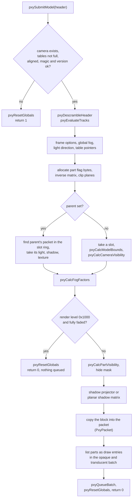

`pxyAbortModel` is the way to give up a model after some setters were
called. It only resets the block. `pxyIsModelHidden` tells the caller, after
a submit, whether the model was hidden in every camera. The actor code uses
the answer to skip work for actors that are off screen.

A second, shorter function `pxySubmitModelBasic` exists in the file. It does
not check the header, builds no shadow and no fade, ignores parents and
always uses the default part matrices. It queues its batch with
`pxyQueueBatchBasic`, which appends at the end of the list without sorting.
No code in `src/` calls it.

### Bounds and camera visibility

`pxyCalcModelBounds` computes the world position and size of the model. For
a rigid model it takes the center of the header's bounding sphere. For a
skinned model it takes the position that the caller gave with
`pxySetModelPosition`. The point is moved by the draw matrix, and the radius
is the header radius times the largest scale factor. The result is stored in
`pxyModelPosition` and in `pxyBoundSphere`, which `pxyGetBoundSphere`
returns. The function also computes `pxyFadeMetric` with `pxyCalcFadeMetric`:
the point is projected with camera 0, and the screen depth is multiplied by
the radius and divided by the tangent of half the field of view. The depth
test of the engine passes for greater or equal values, so a larger depth is
nearer, and a larger metric likely means a model that is larger on screen.
A negative result is replaced by the fixed value 10000000.

`pxyCalcCameraVisibility` fills `cameraVisible` for the four studio cameras.
A camera takes part only when `pxyCameraEnable[i]` is set and the studio has
an active camera in that position. After `pxyInitTables` only camera 0 is
enabled. `pxySetCameraEnable` changes the table, and the path menu
(`src/main/yg2path.c`) uses it. Cameras and studios are described in
[xgl.md](xgl.md).

For each camera the decision is as follows.

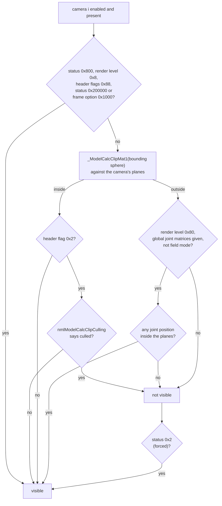

When no camera sees the model, status bit 0x10 (hidden) is set, except for
the always-visible cases. A model for which `pxyRequestForcedVisibility` was
called is also marked hidden unless its frame mask is nonzero. The parts of
such a model are still listed because status bit 0x2 is set, so the model
can cast a shadow, but the sorted batch loop skips batches with the hidden
bit. A likely reading is that this is how an actor casts a shadow without
being drawn itself.

### Part visibility

`pxyCalcPartVisibility` works per camera and per part. It ORs bits into the
part's flag byte. Bit `i` (1, 2, 4, 8) means "visible in camera `i`". The
draw passes test the bit of the current camera, `1 << pxyCurrentCamera`,
before they draw a part.

For a model with status bit 0x800 or header flags 0x88, each part is tested
with its own matrix: the draw matrix times the part matrix of its geometry.
The part's sphere is tested against the camera planes with
`_ModelCalcClipMat1`, and against the culling volumes when
`xglCullingExist()` reports that the map has some. For all other models the
part's sphere, with its radius multiplied by the largest scale factor, is
tested with the draw matrix alone. The culling volumes are only used when the
header has flag 0x1.

Two things force bits without a test. A skinned model, and a model with
render level bit 0x8, gets all four camera bits for every part, because a
bone can move a part anywhere. A part with flag 0x20 or 0x40 gets the bit of
the camera.

The clip test itself is in `src/main/model_calc_clip.c`.
`_ModelCalcClipInitMat1(clip, matrix)` loads two 4x4 plane matrices of the
camera into VU0 registers `vf24` to `vf31` and the model matrix into `vf20`
to `vf23`. `_ModelCalcClipMat1(sphere)` transforms the center by the model
matrix, computes the distance to six planes and returns 1 when every distance
is below the radius, which means the sphere touches the view volume.
`_ModelCalcClipMat1Xy` does the same with four planes and with the negated
radius. The two plane matrices come from `camera->volume[0].planeSet[0]`.

### Fading by size

Two fades use `pxyFadeMetric`.

The first applies to models with header flag 0x2 in field mode or battle
mode. In field mode the model is fully shown at 173000 and above and fully
faded at 139000 and below. In battle mode the limits are 1073000 and 839000.
Between the limits `pxyReflTransparency` and `pxyFadeAlpha` are scaled down
in a straight line. When the result is zero, render level bit 0x800 is set.

The second applies to models with render level bit 0x1000. The limits are
223000 and 209000. Below 209000 the model is dropped: `pxySubmitModel`
returns 0 without queuing anything. Between the limits the model becomes
translucent (status bit 0x4), and its transparency, shadow scale and fade
alpha are multiplied by the factor.

## Draw entries and batches

### Draw entries

`pxyDrawEntryTable` holds 6656 entries of two pointers each: a part and the
packet it belongs to. The table has two regions. Entries 0 to 0xfff are the
opaque region, filled from `pxyOpaqueEntryCursor`. Entries 0x1000 to 0x19ff
are the translucent region, filled from `pxyTranslucentEntryCursor`. When a
region is full, the remaining parts of the model are dropped. `pxyFlush`
stores how full the two regions were as percentages, which
`pxyOpaqueEntryUsagePercentGet` and `pxyTranslucentEntryUsagePercentGet`
return.

A part is listed only when its flag byte has the visible bit 0x80. For a
model with header flag 0x1 it also needs at least one camera bit. Nothing is
listed for a hidden model unless status bit 0x2 forces it.

The parts are listed in three loops.

1. When status bit 0x4 is clear, the parts of range 0 go to the opaque
   region, layer 0 first, then layer 1 and so on.
2. When status bit 0x4 is set, the parts of range 0 go to the translucent
   region instead, again in rising layer order. Parts with flag 0x10 are
   left out.
3. Unless bit 0 of `pxyStateFlags` is set, the parts of range 1 go to the
   translucent region, from the highest layer down to layer 0.

The third loop has three variants. The plain one lists the parts in file
order. A model with header flag 0x200 lists groups: a part with flag 0x80 is
a leader, and the parts that follow it with flag 0x200 or 0x40 are listed
right after it and marked with `PXY_PART_MERGED` (0x40 in the flag byte) so
that they are not listed a second time. A model with header flag 0x1000 and
a sort table sorts its groups by depth, as the next section explains.

### Sorting translucent groups inside a model

A model with header flag 0x1000 has a `PxySortEntry` per geometry: a position
(three floats), a matrix index at +0x0c and a key at +0x0e. A negative key
means "not sorted". After the parts of one layer have been listed, the code
walks them and builds sort items. Consecutive parts with the same key form
one item. A part with a negative key closes the current group of items, and
so does the end of the list. At most 8 groups of 32 items fit in the work
area `PxySortWork`.

For each group, the position of every item is moved to world space, through
the joint matrix named by the sort entry when the model has joint matrices,
and the distance to the camera position is computed. The items are sorted
with a bubble sort so that the largest distance comes first. The draw entries
of the group are then rewritten in that order through a temporary buffer.
The result is that the translucent pieces of one model, for example layers
of hair or glass, are drawn from far to near.

### Batches

A batch (`PxyBatch`) is the run of draw entries that one model added. Each
submitted model gets two batches with the same index: one in
`pxyBatchTables[0]` for its opaque entries and one in `pxyBatchTables[1]` for
its translucent entries. Each table holds 256 batches.

| Offset | Field | Meaning |
| --- | --- | --- |
| +0x00 | `start` | First entry in `pxyDrawEntryTable` |
| +0x02 | `count` | Number of entries |
| +0x04 | `depth` | Distance from the packet's center to the camera position, plus `nmlModelSortOffset` |
| +0x08 | `flags` | A copy of the status word plus the batch bits below |
| +0x0c | `packet` | The model's packet |
| +0x10 | `unk10` | Index of the previous batch in the sorted list, below zero at the head |
| +0x12 | `next` | Index of the next batch, below zero at the end |
| +0x14 | `translucent` | The partner batch in the second table |

The upper bits of `flags` are set by `pxySubmitModel` and choose the fast or
the full draw loop.

| Bit | Reason |
| --- | --- |
| 0x00020000 | Header flag 0x800 or status bit 0x20000: the batch belongs to the source pass |
| 0x00100000 | Render level bit 0x40: separate batch |
| 0x00400000 | A child model added its parts to this batch |
| 0x00800000 | Header flag 0x200 |
| 0x02000000 | Header flag 0x100: glow source pass |
| 0x04000000 | Header flag 0x40: water reflection pass |
| 0x08000000 | Header flag 0x20 or status bit 0x8: Z-write pre-pass |
| 0x40000000 | The view matrices must be sent for every part (masked clip plane, status 0x800 or header flags 0x88) |
| 0x80000000 | The render flags must be sent for every part (per-geometry fog, or a translucent child in an opaque parent) |

A child model, one submitted after `nmlModelSetParent(parentHeader)`, does
not get a batch of its own. The ring `pxyState.slots` remembers the last four
packets together with their batch indices. The child searches the ring
backwards for the packet of its parent and appends its entries to the
parent's two batches. This only works when the child is submitted right
after its parent, before another model has used the entry cursors. The map
uses it for its second model, and an actor uses it for the second model
packed in its file (`subPackOffset`) and for models attached to a parent
actor.

### The batch lists

`pxyQueueBatch` puts the new opaque batch into one of four places.

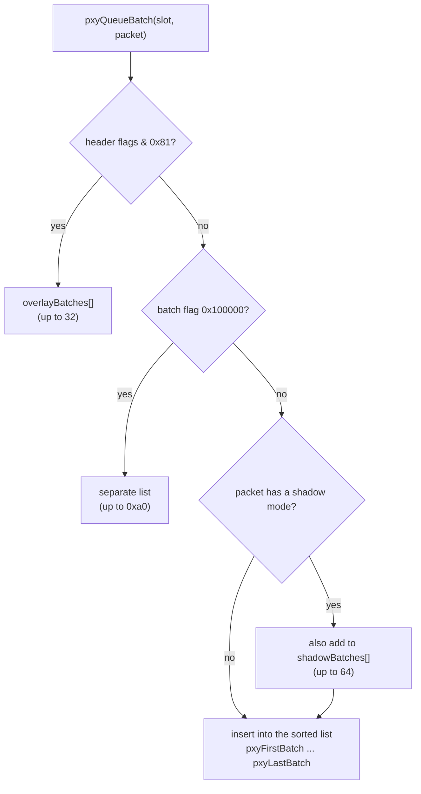

The sorted list is a doubly linked list inside `pxyBatchTables[0]`. A new
batch walks the list from the head and is inserted before the first batch
whose depth is smaller than its own. The list is therefore ordered from far
to near. Two rules bend the order. A batch whose packet has render level bit
0x10 is always inserted at the head. A batch that is already in the list
with that bit is never pushed back by a farther batch.

The translucent batches are not linked. The draw code reaches them through
`batch->translucent` while it walks the same list, so translucent parts are
drawn from far to near as well, model by model.

`nmlModelSetSortOffset(value)` adds a value to the depth of the next model.
The effect layer uses it to order effect models that sit at the same place.

## Flush

`pxyFlush` writes the drawing commands of the frame. It is bracketed by the
profiler entry named `pxyFlush`.

1. `pxyResetSubmitCount` clears the counter of texture uploads.
2. `xglPacketSelectDefaultMode` loads the first microcode program.
3. The frame options are passed to the packet code: the global color
   (`pxySetGlobalColor`), black fog, the reflection type, the field and
   battle mode flags and the animation freeze.
4. `pxyResetGsState` sets the default GS registers.
5. `pxyPlayEntryGroup(3)` plays the direct-send entries of group 3.
6. If any model, any direct-send entry or any registered callback exists,
   `nmlModelFlushSub` runs once for each of the four cameras, with
   `pxyCurrentCamera` going from 0 to 3.
7. `pxyPlayEntryGroup(2)` plays group 2.
8. `xglLightPackCacheInvalidate` forgets the global color of the light
   packs.
9. The profiler is closed. The entries are drawn on screen when
   `pxyProfileDrawFlag` is set.
10. The statistics are stored: the number of texture uploads, how full the
    packet is, how full its buffer is, and the usage of the two entry
    regions. `pxyFlushDoneFlag` is set.

While `pxyFlushDoneFlag` is set, `nmlModelDirectSendFull` ignores new
entries. The flag is cleared by `pxyBeginFrame`.

### One camera

`nmlModelFlushSub` draws everything for the camera `pxyCurrentCamera`. It
selects the camera with `xglStudioSelect`, clears the three caches and the
packet mode, and returns at once when the studio has no camera in that
position or when the camera is not enabled. Each pass that follows is
wrapped in the same three calls: `xglStudioSetScissor` limits drawing to the
camera's window, `xglPacketInitVuState` loads the constants of the camera
into VU1, and `xglSetFullScreenScissor` restores the full screen afterwards.

The passes draw into three buffers. `sRenderDisplayBase` is the buffer the
frame is built in. `sRenderFrameBase` is the other full-size buffer, used
here as a work buffer. `sRenderTextureBase` is the texture area, which also
holds the shadow texture and the screen copy. The buffers are explained in
[rendering.md](../architecture/rendering.md).

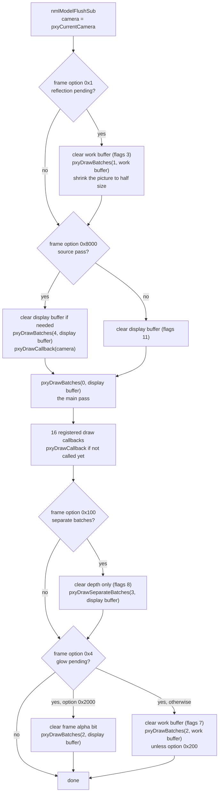

The draw mode is the first argument of `pxyDrawBatches`. It filters batches
and parts.

| Mode | Pass | Batches drawn | Parts drawn |
| --- | --- | --- | --- |
| 0 | Main pass | All | Parts without the mode bits 0x4 and 0x2000, and not source parts |
| 1 | Water reflection | Batch flag 0x4000000 (header flag 0x40) | Parts with flag 0x4 |
| 2 | Glow source | Batch flag 0x2000000 (header flag 0x100) | Parts with flag 0x2000 |
| 3 | Separate batches | The separate list | All parts of a batch with flag 0x100000 |
| 4 | Source pass | Status bit 0x20000 or batch flag 0x20000 | Source parts: status bit 0x20000 of the packet or part flag 0x10000 |

When a packet has a second part mask (`pxySetSecondPartMask`), the split
between mode 4 and the other modes is made per geometry: a source part whose
bit in the mask is clear is drawn only in mode 4, and the modes other than 4
skip it. The map uses this for its second model.

The water reflection pass draws the reflected parts into the work buffer.
Then `pxyDrawTextureRect` copies the camera's window from the work buffer to
the display buffer at half size and copies that half-size picture back to
the corner of the work buffer. The water code reads it from there as a
texture. `pxySetDrawCallback(tiWaterDrawAll)` in `src/main/TiWater.c`
installs the function that draws the water surfaces after the source pass or
after the main pass. Water is described in [animation.md](animation.md).

The glow source pass draws the bright parts of marked models a second time.
Screen effects such as the glow filter read the result. They are described
in [screen-effects.md](screen-effects.md). `pxyGlowPendingGet` tells them
whether the pass ran.

`nmlPacketAddScreenClear(frameBase, flags)` draws one sprite over the buffer.
Flag 1 clears the alpha channel, flag 2 clears the color with the clear
color of `ClearEnv`, flag 4 uses black instead, and flag 8 lets the sprite
write depth, which clears the depth buffer.

### The order inside a pass

`pxyDrawBatches(mode, frameBase)` is the heart of the library. It draws the
opaque round first and the translucent round second. The variable
`pxyDrawPass` is 0 in the opaque round and 1 in the translucent round, and
`pxySetDrawPass` copies it to the packet code.

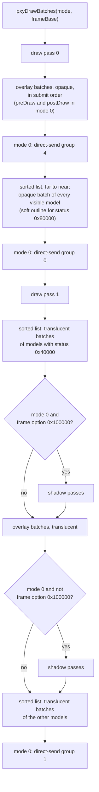

Every loop first checks that the batch belongs to the current camera. A
batch is drawn when the camera's entry in `pxyCameraEnable` is 1 or the
camera is the one stored in the packet, and when the packet's `cameraMask`
for this camera is nonzero. The sorted loops also skip packets with the
hidden bit.

Every loop also checks the packet buffer before each batch. When
`xglPacketQueuedPercent()` or `xglPacketBufferUsedPercent()` is above 85, the
function returns and the rest of the pass is not drawn. This protects the
packet buffer in very heavy scenes at the price of missing models.

In mode 0 the `preDraw` and `postDraw` functions of a packet are called
around its opaque batch with the camera index and the draw pass as
arguments. The actor code registers `preDraw` with `pxyLatchActorState`. The
first function registered for a model is kept.

For the translucent batch of a sorted model the code runs four steps in
modes 0, 2 and 4.

1. `pxyDrawZwriteParts` runs when the batch has flag 0x08000000 or status
   bit 0x8. It draws the parts with part flag 0x2, or all parts when the
   status bit is set, with every bit of the frame masked. Only depth is
   written. The translucent surfaces that follow can then no longer show
   parts of the same model that lie behind them.
2. `pxyDrawScreenSampledParts` runs for models with header flag 0x400. It
   first copies the display buffer to the texture area with one sprite, then
   draws the parts with flag 0x8000 with part style 6 and the parameters of
   `pxyUploadScreenSampleParams`. Such parts can show a distorted copy of
   what is behind them.
3. `pxyDrawBatch` draws the translucent entries.
4. `pxyDrawFrameMaskParts` runs only when frame option 0x800 is set. It
   draws the opaque batch again, but only the parts with flag 0x10 and
   without 0x800, with the whole frame masked and the alpha test reference
   set to 64.

The overlay batches get steps 1 and 3 only.

### Drawing a batch

`pxyDrawBatch(mode, batch, frameBase, frameMask)` draws the entries of one
batch. It first clears the model and matrix caches, sets the frame register
with the packet's frame mask, sends the model state with
`pxyUploadPacketState` and selects the microcode with
`nmlPacketAddTransMicrocode`. Then it runs one of three loops over the
entries.

The **full loop** is used when the batch has any of the flags 0x06920000. It
applies the mode filter of the table above to each part and then the part
flags: clearing the frame alpha bit before a group leader, setting the
part's own frame mask, setting the alpha correction register (FBA) to 1 for
parts with flag 0x40 and to `pxyAlphaCorrectionFlag` for the others, and
clearing depth by frame alpha after parts with flag 0x100. In mode 3 the
loop stops at once unless the batch is a separate batch.

The **medium loop** is used for batches with any of the flags 0xc0400000. It
sends the view matrices when the packet changes or when the batch needs them
per part, and the render flags when the batch needs them per part.

The **fast loop** is used for all other batches. Per part it only uploads the
texture set if needed, the bone matrices if needed, the part state, and the
part data.

Per part, all three loops end with the same calls: `nmlPacketAddTexture`
(unless frame option 0x40 is set), `pxyUploadBoneMatrices`,
`pxyUploadPartState` and `pxyDrawPartData`. While they run, the EE
scratchpad holds the loop state in a `PxyDrawWork` structure at 0x70000000.
The packet code reads two words of it directly: the current packet at
0x70000010 and the current part at 0x7000001c.

### The soft outline

A model with status bit 0x80000 (`nmlModelSetDropPass`) gets a post-process
around its opaque batch. Before the batch the top alpha bit of the frame is
cleared with `pxyClearFrameAlphaMsb`, and the alpha correction register is
set to 1, so that every pixel the model draws carries the bit. After the
batch the screen is processed in two halves, the upper and the lower half.
For each half the code copies the half to the texture area, blends four
copies of it shifted by two pixels to the left, right, up and down with a
fixed alpha of 40, restores the pixels of the model itself with an alpha
test on the bit, and copies the half back to the frame with a destination
alpha test, so that only pixels outside the model receive the blurred
picture. The visible result is a soft halo around the model. The actor code
asks for it with the draw flag `XENO_DRAW_AFTER_LIGHT`.

### Separate batches

`pxyDrawSeparateBatches(3, frameBase)` draws the batches of models with
render level bit 0x40. They are drawn after the whole scene, after the depth
buffer has been cleared, first all opaque batches and then all translucent
batches with the Z-write and screen-sample steps. A likely use is a model
that must always appear in front of the scene.

### Frame alpha helpers

Four small functions in `src/main/pxy_frame_alpha.c` work on the alpha
channel of the frame with full-screen sprites. `pxyClearFrameAlphaMsb`
clears the top alpha bit. `pxyFillFrameAlpha80` sets the alpha of every
pixel to 0x80. `pxyModulateFrameByAlpha` multiplies the frame color by the
frame alpha. `pxyClearDepthByFrameAlpha` clears the depth buffer where the
alpha bit is set. The planar shadows, the soft outline and the group leader
parts use them.

## Translucency

Several mechanisms make a model or a part translucent. They are easy to mix
up, so this section puts them side by side.

A part is translucent by itself when the file lists it in range 1. Such
parts always go to the translucent batch. They are drawn in draw pass 1 with
depth writes switched off in the main register set, after all opaque parts
of the frame, from far to near by model.

A whole model becomes translucent when the caller sets
`nmlModelSetStencil(1)` together with `nmlModelSetTransparency(value)`. The
status bit 0x4 moves the opaque parts to the translucent batch, and the
transparency, a value from 0.0 to 1.0 that the setter clamps, is sent to VU1
in the fourth float of the render flags quadword. The microcode likely uses
it to scale the vertex color. The actor code does this for fading
actors, and it adds `nmlModelSetZwrite(1)` so that the Z-write pre-pass hides
the inner surfaces of the fading model. When the product of an actor's alpha
values is zero or less, the actor code calls `pxyAbortModel` and submits
nothing.

`nmlModelSetReflTransparency` sets a second value with the same clamp. It is
multiplied by the transparency and, when fog is on and the model does not
use the environment program, by the fog value divided by 4080. The product
is the third float that `pxyUploadRenderFlags` sends to VU1. The distance fade
lowers this value for far models. A value of zero selects part style 1.

`nmlModelSetStencilAlpha(value)` gives the model its own blend equation. The
value is a GS ALPHA_1 register value. It is stored with the register number
0x42 and sent to VU1 address 0x3db, and bit 0x80 of the VU1 flag word tells
the microcode to use it. The effect layer uses this for additive and
subtractive effect models, with the values of `svStencilTable`.

The alpha test reference is `pxyAlphaRef`, 117 by default. In draw pass 0
the test passes for alpha greater or equal to the reference, so texels that
are nearly transparent are cut out of opaque parts. In draw pass 1 two of
the four test values use the less-than test instead.
`pxySetAlphaRef` changes the value for one model state upload. After each
upload it goes back to 117.

The global color `pxyGlobalColor` multiplies the color of every model of the
frame. `pxySetColorScale` sets it, and `pxyClearEntryTable` resets it to
white each frame. The map sets it from `gameWork.mapColor`. A light pack can
also set it, see [Light packs](#light-packs).

## Fog

Fog is computed once per model and per camera, at the center of the model's
bounding sphere. It is not computed per vertex by this code. The result is a
single value that the lit VU1 programs copy into every vertex of the model.
Only the Map program computes fog per vertex in the microcode, from
parameters of its own (see [The Map program](#the-map-program)).

`nmlModelSetFogDist(fogNear, fogFar, fogMin, fogMax)` converts its arguments
to the four parameters of `nmlModelFogPara`. The minimum and maximum are
turned into shades, `(1 - fogMin) * 255` and `(1 - fogMax) * 255`, each
clamped to 0 to 255. The parameter vector is then:

| Component | Value |
| --- | --- |
| x | `shadeMax`, the lower limit of the fog value |
| y | `shadeMin`, the upper limit |
| z | `((shadeMax - shadeMin) * (fogFar + fogNear) / (fogFar - fogNear) + (shadeMax + shadeMin)) * 0.5` |
| w | `fogFar * fogNear * (shadeMin - shadeMax) / (fogFar - fogNear)` |

`nmlModelGetFogParaStudio(position, studio)` evaluates the fog at a point.
It loads the view matrix of the studio's camera into the VU0 current matrix
and calls `_CurRotTransPersFog`, which transforms the point and computes
`z + w / pointW`, clamped between x and y. A point behind the camera gets
the value y. Without a camera the result is 255, and the reset value of the
packet is the same, so 255 likely means no fog and lower values more fog.

`pxyCalcFogFactors` stores the value times 16 in `cameraFog[i]` for each
enabled camera, so the range is 0 to 4080. Models with status bit 0x800 or
header flags 0x88 are large and made of many placed pieces, so they also get
one value per geometry and camera, computed at the position of each part
matrix. The table is allocated in the packet buffer, and
`pxyUploadRenderFlags` reads the row of the part's geometry instead of the
model value.

`nmlModelSetFogCol` sets the color. It is written to the GS register FOGCOL
each time a texture set is uploaded. `pxySetFogWhite` forces the color to
white (255, 255, 255) and the value to 0xa00. The actor code uses it for the
draw flag `XENO_DRAW_TRANSLUCENT`. Frame option 0x80 forces the color to
black.

The global fog (`nmlModelSetGlobalFogDist`, `nmlModelSetGlobalFogCol`) is a
frame option. When it is set, `pxySubmitModel` copies the global parameters
and color over the model's own fog and switches fog on, unless the model has
render level bit 0x100. The cutscene plug-in (`src/main/cfePlugIn.c`) and
the title screen (`src/ov02/title.c`) use the global fog. The effect layer
sets render level 0x100 for effect models in battle, and otherwise copies the
fog override block of the effect system into the model.

## Lights

### The light set

A model is lit by one `XglLightSet`, 0x180 bytes. The packet holds a pointer
to it.

| Offset | Field | Meaning |
| --- | --- | --- |
| +0x000 | `directions[6]` | Six light directions |
| +0x060 | `viewDirection` | A seventh direction, the axis of the two-color ambient light |
| +0x070 | `colors[6]` | The colors of the six directional lights |
| +0x0d0 | `ambientColor` | Ambient color |
| +0x0e0 | `ambientColorLower` | Second ambient color, for the lower side |
| +0x0f0 | `shadows[3]` | `shadows[0]` is the direction that shadows are cast along. Its `w` is nonzero when it is set |
| +0x120 | `pointPositions[3]` | Positions of up to three point lights |
| +0x150 | `pointColors[3]` | Their colors |

A caller chooses the light of the next model in one of two ways.
`pxySetLightPtr(light)` stores the pointer, so the light set must stay valid
until the frame is flushed. Actors use it with the light set stored in the
actor. `pxySetLightCopy(light)` allocates 0x19 quadwords in the packet buffer
and copies the set there, which is what the effect layer does. A model for
which no light was chosen uses `pxyState.light`, the default light of the
library. `pxySetDefaultLight` copies a light set into it, and
`pxyResetLightToDefault` puts the built-in default back. The cutscene code,
the title screen and the battle script native `batSetLight` set the
default light.

`xglLightSetDefault` builds the built-in default: three white directional
lights with strengths 0.8, 0.5 and 0.5, ambient colors of 0.25, and
directions made from pairs of angles with `xglDirectionFromAngles`. The
result is cached in `xglLightSetDefaultCache`, so later calls are a copy.
`xglDirectionFromAngles(direction, rotation)` rotates the vector (0, 0, 1)
by the x angle and then the y angle of `rotation`.

A special case exists for one map. In battle mode, when a model named
`MOM2_B04` is submitted, a flag is set for the rest of the frame. Every model
submitted after it gets its lower ambient color replaced by its upper
ambient color, in the default light and in its own light set.

### What is sent to VU1

`pxyUploadViewMatrices` prepares the light data for the part that is about
to be drawn. The microcode lights vertices in model space, so the C code
moves the lights there instead of moving the normals to world space.

1. The VU0 current matrix is set to the packet's inverse draw matrix. For a
   part with flag 0x8 the inverse of the part's own matrix is multiplied in
   first.
2. `_CurMatrixMul33normXYZW` rotates the first four direction rows of the
   light set into model space, normalizes them and transposes them into
   three rows, so that one row holds the x of all lights, the next the y and
   the last the z. The camera position in model space is then written over
   the fourth column, so the block carries lights 0 to 2 and the camera. The
   three rows go to VU1 address 0x384, and the camera position alone to
   0x33e.
3. The same is done with the rows that start at `directions[3]`, which
   reaches up to `viewDirection`. The result goes to 0x387.
4. The direction from the model's center to the camera is computed,
   normalized and rotated into model space. Its three components are
   written into the fourth float of the first three color rows. The eight
   color rows, six light colors and two ambient colors, go to 0x38a.
5. When status bit 0x40 is set, the three point light positions are moved to
   model space and packed as columns into a matrix that goes to 0x3d4. The
   three point light colors go to 0x3d8.

The view matrices follow the lights in the same function, see
[Per-model and per-part data](#per-model-and-per-part-data).

### Light packs

A light pack is a file with the tag `lxy`. It holds a list of light entries
with keyed curves, so the lighting of a place can change over time. The code
is in `src/main/xgl_light.c`.

`xglLightPackRegister(pack)` adds a loaded pack to `xglLightPackTable`, which
has 16 slots with a reference count each. `xglLightPackRelease` removes a
reference. `xglLightPackEvaluateAll(time)` evaluates every registered pack at
a time. For each entry, `xglLightPackEvaluate` walks 20 channels. A channel
type of 2 is a constant stored in the stream, 3 is zero, 4 is one, and 1 is
a curve that `xglLightPackSampleCurve` reads with `pxyInterpolateKeys`. The
20 results fill one `XglLightKey` of the pack: position, rotation, extent,
color, cone angle, penumbra and intensity.

`xglLightPackBuildByName(light, packName, receiver)` finds a registered pack
by name and builds the light set for one receiver position. The actor code
calls it with the name stored in the actor and the actor's position when the
draw flag `XENO_DRAW_LIGHT_SOURCE` is set. `xglLightPackBuildLightSet` does
the work in two rounds over the entries.

| Entry type | Effect on the light set |
| --- | --- |
| 1 | Both ambient colors are set to the key color times its intensity |
| 2 | The upper ambient color is the key color, the lower one is the key's extent vector, and `viewDirection` is the rotated axis (0, 0, -1) |
| 3, 4, 6, 7 | A point, box, spot or cone light whose color at the receiver is added to both ambient colors |
| 8 | A directional light. It competes for one of the six direction slots |
| 9 | The global color: `pxySetColorScale` is called with the key color times its intensity |
| 10 | The shadow direction, from the key's rotation |
| 11 | The shadow direction, from the key's position toward the receiver |
| 19 | A point light for `pointPositions` and `pointColors`, at most three. The color is scaled by intensity times 128 |
| 20, 35 | A point light with a range. Its color at the receiver competes for a direction slot, with the direction from the receiver to the light |
| 21, 23, 24 | A box, spot or cone light that competes for a direction slot |

The four shape functions decide how much of a light reaches the receiver.
`xglLightPointColor` gives the full color inside the inner radius
(`extent.x`), nothing outside the outer radius (`extent.y`) and a straight
ramp between them. `xglLightSpotColor` compares the angle between the spot's
axis and the direction to the receiver with half the cone angle, and fades
over the penumbra. `xglLightBoxColor` moves the receiver into the box's own
space, rejects it outside the box and fades near the edges.
`xglLightCylinderColor` does the same for a cone with an inner and an outer
slope.

Only six directional lights fit in a light set. `xglLightSlotsInsert` keeps
the six strongest. The strength of a light is the largest of its three color
components. A new light replaces the weakest slot when it is stronger, and
the function then finds the new weakest slot.

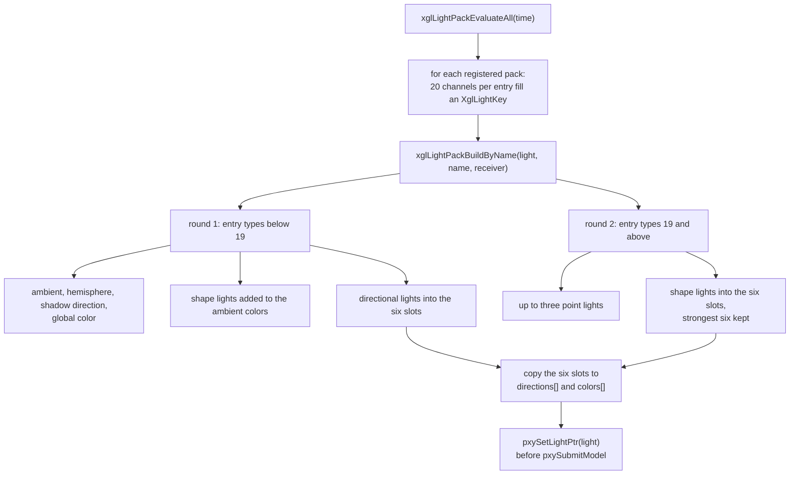

When an entry of type 9 sets the global color, the color is also kept in a
one-entry cache. `xglLightPackCacheGet` returns it while it is valid.
`pxyFlush` invalidates it at the end of the frame.

The debug functions at the end of the file (`xglLightPackDebugDrawAll` and
the functions for each shape) draw the lights of all registered packs as
wire shapes. They are covered in [debug-tools.md](../game/debug-tools.md).

### Light sets of the effect system

`src/main/sef_light_set.c` keeps three light sets for the effect system:
`sefActiveLightSet`, `sefDefaultLightSet` and `sefAppliedLightSet`.
`sefLightSetsResetDefault` fills all three with the built-in default.
`sefLightSetsApply(lights)` copies a light set to the applied and the active
copy and resets the default copy. The effect layer lights an effect model
with the applied copy when bit 0x4 of the item's image flags is set, and
otherwise with its own light set `svEffectLightSet`, which is cleared at the
start of the 3D effect pass. The effect system is described in
[sef.md](sef.md).

## Shadows

`pxySetShadowMode(mode, alpha, planeHeight, scale)` chooses the shadow of the
next model. A strength of zero or less leaves the model without a shadow.
The mode becomes the packet field `drawMode`.

| Mode | Kind | How it is drawn |
| --- | --- | --- |
| 0 | None | |
| 1 | Projected shadow | The model is drawn from the light into a 256 by 256 texture, and the texture is projected on the overlay models |
| 2 | Circle shadow | A round, soft texture is drawn as a flat quad under the model |
| 3 | Planar shadow | The model is drawn a second time, flattened on a horizontal plane |
| 4 | Projected shadow, second form | Like mode 1 with a different blend value and darkening step |
| 5 | Projected shadow, third form | Like mode 1, without the height limits on the receivers |

A model with a shadow mode is added to `pxyState.shadowBatches` when it is
queued. The shadow passes run in the main pass only (draw mode 0), once per
camera, at the place shown in
[The order inside a pass](#the-order-inside-a-pass): `pxyDrawShadowPass`,
`pxyDrawCircleShadows` and `pxyDrawMode3Pass`.

The direction of every kind of shadow comes from the model's light set. When
`shadows[0].w` is nonzero, `shadows[0]` is used. Otherwise the direction is
the x and z of the first directional light with a fixed y of 2.0. In field
mode the y of the light is used instead of the fixed value.

### Projected shadows

`pxySetupShadowProjector` runs at submit time for modes 1, 4 and 5, for
models without header flag 0x1. It allocates a `PxyShadow` (0x36 quadwords)
in the packet buffer and fills it.

| Offset | Field | Meaning |
| --- | --- | --- |
| +0x000 | `light` | Light space to world |
| +0x040 | `textureInverse` | World to the texture space of the receivers |
| +0x080 | `view` | World to light space |
| +0x0c0 | `project` | World to the shadow texture. The caster is drawn with it in place of the camera matrix |
| +0x100 | `lighting` | A cleared light block with one direction and a white color |
| +0x280 | `x`, `y`, `width`, `height` | Texture rectangle: 0, 0, 0x100, 0x100 |
| +0x294 | `psm`, `frameBase` | Pixel format (32-bit) and the base of the texture area |
| +0x2a0 | `scaleU`, `scaleV` | Texture scale, `64 / (zoom * 128)` |
| +0x2b0 | `tex0`, `clamp` | The GS TEX0 and CLAMP values for the receivers |
| +0x2c0 | `uv` | Offset and scale of u and v inside the texture page |
| +0x2e0 | `direction` | Direction of the projection |
| +0x2f0 | `center` | Position of the caster |
| +0x300 | `min`, `max` | Box that contains the caster and its shadow |
| +0x320 | `bounds` | Center and radius of that box |
| +0x338 | `alphaData` | GS ALPHA_1 value: 0x42 for mode 4, 0x89 otherwise |

The projector looks at the model's position along the shadow direction. Its
zoom is `0.968 / extent`, where the extent is two times the model radius, or
three times for a radius of 5 or more, and never below 0.968. The box
`min`/`max` starts as the bounding box of the sphere and is stretched away
from the light, by 1.3 or 1.5 times the radius times a tilt factor on the
far side and by 0.3 times on the near side. Large models get an extra lift.
The box is what limits the work later: only parts of the map that touch it
are drawn again with the shadow.

The function also decides whether the shadow is needed at all. If the box is
outside the view volume of camera 0, or culled in field mode, or the light
is vertical and the model itself is hidden, the forced-visibility bit is
cleared and the shadow pass skips the model. In field mode a shadow fades
with the size of the model on screen: below a metric of 139000 the shadow
mode is cleared, and up to 173000 its strength is scaled down.

`pxyDrawShadowPass(frameBase)` handles each projected caster of the current
camera in turn.

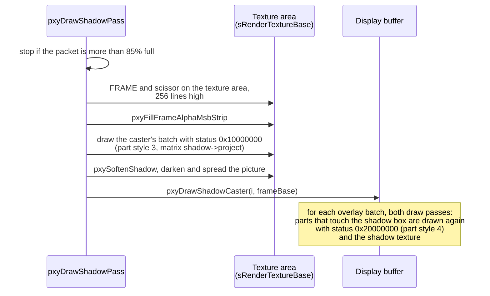

The caster is drawn with the normal part loop, but with status bit
0x10000000. `pxyUploadPacketState` then selects part style 3 and simple test
registers, and `pxyUploadViewMatrices` uses `shadow->project` as the camera
matrix. A translucent caster (status bit 0x4) is drawn from its translucent
batch.

`pxySoftenShadow` is the finishing step of the shadow texture. It draws one
sprite over the left half of the strip whose color or alpha depends on the
strength of the shadow, the transparency of the model and its fog value.
Then, three times, it copies a 255 by 255 square between the left and the
middle of the strip with bilinear filtering, which spreads the edges. Last
it draws a black line strip around the left square so that the border of the
texture is empty.

`pxyDrawShadowCaster` draws the receivers. The receivers are the overlay
batches, which in practice are the map models. For each overlay batch and
for both draw passes it sends the receiver's model state, then three blocks
of shadow data to VU1: the texture matrix (`textureInverse` times the
receiver's matrix) at 0x39e, the `uv` vector at 0x3c3, and a matrix at 0x392
that carries the shadow direction, the caster position, the factor
`128 / (2 * radius)` and two flag words (one for mode 4, one for frame option
0x20000). Then it walks the parts. A part is drawn when it does not have
flag 0x1000, passes the filter of the shadow caster mode, is in the caster's
part index list if there is one, and touches the shadow box. In field mode
the test uses the part's bounding box. Otherwise it uses the part's sphere.
The loop has a second form for receivers with header flag 0x80, where each
part has its own matrix and the three blocks are sent again for every part.

In field mode, for modes 1 and 4, the shadow is also cut by height. When
`lowerClipHeight` is below `upperClipHeight`, the code gives the receiver two
horizontal clip planes at these heights and sets status bit 0x4000 for the
length of the pass. The actor code sets the limits with
`pxySetShadowHeightRange`, and `pxyCalcModelBounds` adds the vertical shadow
offset to both.

`pxySetShadowCasterMode` chooses which receiver parts take shadows. Mode 1,
the reset value, skips parts with flag 0x10 and draws only the opaque pass.
Mode 2 in field mode uses part flag 0x20000: in the translucent pass only
parts with the flag are drawn, and in the opaque pass parts with flag 0x10
are skipped unless they have the flag.

### Circle shadows

`CONSTRUCT_CIRCLR_SHADOW` builds the texture once. It is 64 by 64 pixels
with 8 bits per pixel. Each pixel holds a level from 0 to 31: 31 within one
pixel of the center, 0 at a distance of 32 or more, and a straight ramp
between. The function also writes the two GIF headers for the image and for
its palette and builds a first palette with `pxyBuildFadeRamp(0.3)`.

`pxyBuildFadeRamp(spread)` fills the 32 palette entries that the levels use.
Entry 0 has alpha 0x80. For each following entry the alpha drops by a step
that itself grows by `spread * 0.2` each time, down to zero. The entries are
written through `pxyFadeRampOrderTable`, which is the storage order of a
32-entry GS palette. A larger spread gives a darker center.

`pxyDrawCircleShadows(frameBase)` draws the circle shadow of every model with
shadow mode 2 that the current camera sees. For each model it rebuilds the
palette with a spread of shadow strength times transparency, uploads the
texture and the palette to the texture area with
`nmlPacketSendCircleTexture`, and draws the quad with
`nmlPacketMakeCircleTexture`. The quad is a square on the ground: its
corners are the model's center plus and minus 0.35 times
`(maxX - minX) + (maxZ - minZ)` of the header's box, at the height `shadowY`
plus 0.005. The corners are projected on the EE with
`_CurRotTransPersClipScreen`. A corner that fails the clip test is written
with the GS register XYZ3 so that it does not complete a triangle. The blend
equation multiplies the frame by the texture alpha.

### Planar shadows

For mode 3, `pxySubmitModel` builds `pxyShadowMatrix`: a unit matrix whose
y row is replaced by `(-dx / dy, 0, -dz / dy)` of the shadow direction, and
whose translation puts the result at the plane height plus 0.005. Applied
after the model matrix, it pushes every vertex along the light onto the
ground plane.

`pxyDrawMode3Pass(frameBase)` draws these models. Before the first one it
fills the frame alpha with 0x80 and sets the frame mask so that only alpha
is written. Each model is drawn with status bit 0x1000000 (part style 5),
with the view matrix multiplied by the shadow matrix. The render scale sent
to VU1 is then `1 - strength * transparency`, so the flattened model writes a
darkening factor into the alpha channel. After the last model
`pxyModulateFrameByAlpha` multiplies the whole frame by its alpha, which
darkens the ground under the models.

## Clip planes and reflection

Three setters give the next model clip planes. They share the block
`PxyClipPlanes`, five quadwords allocated in the packet buffer: two planes
and two angle rows.

`pxySetClipPlaneWithAngle(plane, angle, rotation)` adds a plane, up to two.
`pxyAddClipPlanePair(plane, angle)` also adds a plane, and the first call
copies it to both slots. It ignores a call whose rows are all zero.
`pxySetClipPlaneMasked(plane, angle, count, x, y, z, mask)` sets one plane
together with a count, three floats and a geometry mask, and sets render
level bit 0x8.

At submit time each plane is rewritten in model space. The row given by the
caller is treated as a point. It is moved by the inverse draw matrix, the
vector (0, 0, 1) is rotated by the same matrix and the two angles, and the
plane equation of that normal through the point is stored.

`pxyUploadPacketState` sends the planes to VU1 address 0x352 as six
quadwords when the model has planes and one of these is true: status bits
0x2000 and 0x4 together, status bit 0x4000, or status bit 0x8000. Bit 0x200
of the VU1 flag word turns the planes on, and bit 0x1000 marks the
masked form. The lit programs do not cut triangles at a plane. They multiply
the alpha of each vertex by its clamped distance to the plane, so the model
fades out at the plane.

The masked form belongs to a break-up effect. A model with
status bit 0x8000 uses the third microcode program, which takes the model
apart into loose triangles behind the plane and lets them fly off (see
[The Break-up program](#the-break-up-program)). The source calls the data of
this effect "reflect", which does not describe it. For each part of such a
model `pxyUploadViewMatrices` sends the reflect block to VU1 address 0x3c9:
a rotating matrix, the offset between the model center and the matrix
position, the first float, a sign (-1 when the count argument is 2), the
count itself and a flag word that tells whether the part's geometry bit is
set in the mask. The second float goes to 0x3cd, limited to at least 1, with
its inverse and the third float.

The rotating matrix is updated once per frame by
`pxyUpdateBreakRotation`. An angle grows by 0.1 per frame unless the
animation is frozen, wraps at two pi, and the matrix is a rotation by the
sine of the angle about x and by the angle about y. A likely use is the
slow movement of a reflection or environment texture.

The actor code decides which setter to use from its draw flags and from its
shadow count, see [actors.md](actors.md).

## Packets

Everything in this section writes into the current VIF1 packet, which
`xglPacketGetCurrent()` returns. The packet has a tag area that the
`sceVif1Pk*` functions of the Sony library fill, and a data area behind the
cursor `packet->cursor` where this library stores blocks that the tags refer
to. Packet buffers, DMA tags and the VIF1, VU1 and GIF path are explained in
[rendering.md](../architecture/rendering.md).

### Data stored in the packet

The `nmlPacketSetAttribute*` functions copy data to the cursor and return
the address of the copy.

| Function | Effect |
| --- | --- |
| `nmlPacketSetAttributeData(data, size)` | Copies `size` bytes |
| `nmlPacketSetAttributeData64(matrix)` | Copies one matrix |
| `nmlPacketSetAttributeData64N(matrices, count)` | Copies `count` matrices |
| `nmlPacketSetAttributeData16N(data, count)` | Copies `count` quadwords |
| `nmlPacketSetAttributeAlloc16N(count)` | Reserves `count` quadwords plus one and returns the old cursor. Returns 0 when fewer than 0x8000 bytes are left |

The model packet, the part flag bytes, the shadow projector, the clip
planes, the planar shadow matrix, the per-geometry fog table, copied light
sets and the actor's joint matrices are all stored this way. They live until
the packet has been sent, which is exactly as long as the draw code needs
them.

### The microcode programs

Five VU1 model programs are linked into the executable, next to one program
for effects and one for water (see [VU1 microcode](#vu1-microcode)).
`xglPacketMode` remembers
which one is loaded, -1 when none. `xglPacketMicrocodeEntry(kind)` returns
the data of the current program: its code, its size, and three entry points.

| Mode | Program | Chosen when | Model entry | GS entry | Wide GS entry |
| --- | --- | --- | --- | --- | --- |
| 0 | `xglPlainMicrocodeProgram` | Default | `D_39D0` | `D_D60` | `D_D88` |
| 1 | `xglVertexColorMicrocodeProgram` | Header flag 0x1 | `D_3478` | `D_DB0` | `D_DD8` |
| 2 | `xglBreakUpMicrocodeProgram` | Status bit 0x8000 | `D_2C90` | `D_D60` | `D_D88` |
| 3 | `xglMode3MicrocodeProgram` | Field mode (`xglPacketMode3Flag`) | `D_3B28` | `D_D60` | `D_D88` |
| 4 | `xglMode4MicrocodeProgram` | Battle mode (`xglPacketMode4Flag`) | `D_3290` | `D_D48` | `D_D70` |

The entry points are byte addresses inside the program. They are divided by
8 to get the VU1 instruction address for the VIF command MSCAL.

`nmlPacketAddTransMicrocode(packet)` picks the mode for a model in this
order: status bit 0x8000 gives mode 2, header flag 0x1 gives mode 1, battle
mode gives 4, field mode gives 3, and everything else gives 0. When the mode
differs from the loaded one, a DMA reference to the program code is added,
which loads it into VU1. `xglPacketSelectDefaultMode` loads program 0 and
calls its GS entry once.

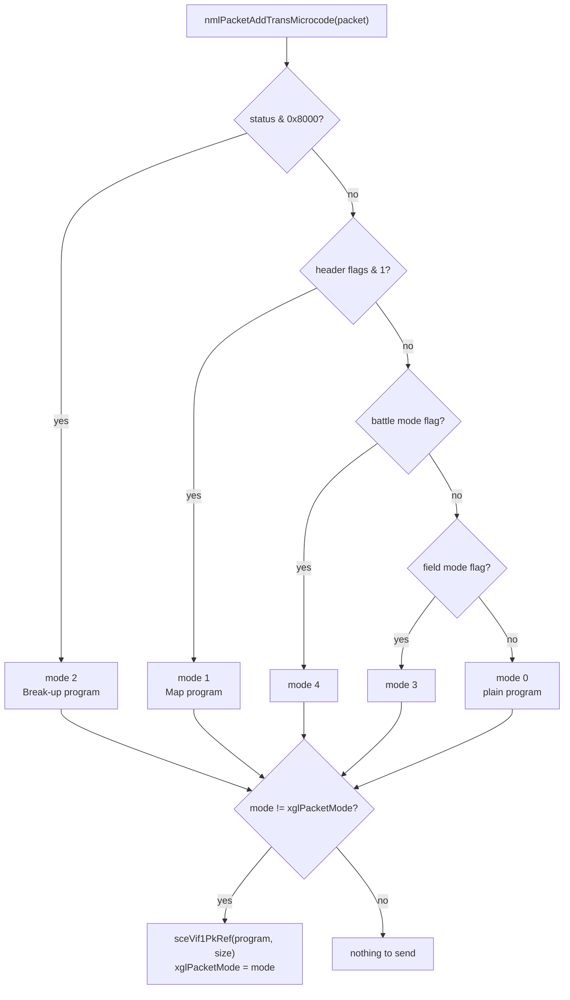

### Constants of a camera

`xglPacketInitVuState` runs at the start of every pass of a camera. It fills
the fixed part of VU1 data memory. All uploads use the VIF unpack format
0x6c, four 32-bit values per vector.

| VU1 address | Quadwords | Content |
| --- | --- | --- |
| 0x328 | 4 | Integer constants: 0x6000, 4095, 0x7fff, 0x7000 in fixed words. 0x6000 and 0x7000 are the `ADC` patterns that keep a vertex from drawing a triangle: the first for the start of a strip, the second for a vertex that failed the clip test |
| 0x32d and 0x33a | 2 each | A GIF tag for one A+D register and a TEXFLUSH write |
| 0x339 | 1 | Field-of-view scale: `tan(20 degrees) / tan(fov / 2)` when the field of view is below 40 degrees, else 1 |
| 0x33c | 1 | `vuEmptyEndTag`, the empty end-of-packet GIF tag that closes every strip |
| 0x33f | 1 | The camera's screen scale |
| 0x340 | 1 | The camera's screen offset |
| 0x341 | 1 | The global color |
| 0x342 | 6 | Templates of A+D writes for the registers TEX0_1, CLAMP_1, ALPHA_1, ALPHA_2, TEX1_1 and TEX1_2 |
| 0x35c | 16 | `vuStripGifTags`, 16 triangle strip GIF tags indexed by four bits (1 untextured, 2 blended, 4 five registers per vertex, 8 fog), or `vuStripGifTagsUntextured` when frame option 0x40 is set |
| 0x3ba | 2 | `vuLayerGifTags` or `vuSmallStateTableReflection` |
| 0x3bc | 2 | `vuThreeKickGifTags` |
| 0x3bf, 0x3c0 | 1 each | Two ALPHA_2 values with a fixed alpha of 128 |
| 0x3e2 | 5 | Five records for the triangle clipper of the Map program, one per clip plane: a count, a mask of two clip flag bits (2080, 520, 260, 130, 65: the current and the previous vertex) and a sign |

The function then selects the default program and writes the depth buffer
register of the second GS context.

### Per-model and per-part data

`pxyUploadPacketState(mode, packet)` sends the state of a model. It first
chooses the part style from the status bits and the mode argument, then
sends the data only when the packet differs from `pxyUploadedPacket`, the
model cache.

| Part style | Chosen when | Use |
| --- | --- | --- |
| 0 | Default | Normal drawing |
| 1 | Style 0 with a second alpha of zero or render level bit 0x800 | Chosen per part by `pxyUploadPartState` |
| 2 | Mode bit 8 | Z-write pre-pass |
| 3 | Status bit 0x10000000 | Drawing into the shadow texture |
| 4 | Status bit 0x20000000 | Receiving a projected shadow |
| 5 | Status bit 0x1000000 | Planar shadow |
| 6 | Mode bit 0x1000 | Screen-sampled parts |

The table below lists every VU1 address that the model and part uploads
write.

| VU1 address | Quadwords | Sent by | Content |
| --- | --- | --- | --- |
| 0x228 | up to 0x100 | `pxyUploadBoneMatrices` | Joint matrices. The wide GS flush uses the same area |
| 0x330 | variable | `nmlPacketAddGsFlush` | GS register list |
| 0x33e | 1 | `pxyUploadViewMatrices` | Camera position in model space |
| 0x348 | 10 | `pxyUploadScreenSampleParams` | A GIF tag, five register writes and three scale vectors for screen-sampled parts |
| 0x352 | 6 | `pxyUploadPacketState` | Clip planes |
| 0x370 | 8 | `pxyUploadPacketState` | Track values (header flag 0x4). The material routine reads them: a setup batch names an index and a lane for each animated material value, such as the UV scroll of both layers |
| 0x37c | 4 | `pxyUploadPacketState` | Best records of the track entries (header flag 0x10). The microcode uses them as morph records: weight in x, offset in y, stride in z |
| 0x384 | 3 | `pxyUploadViewMatrices` | Light directions 0 to 2, transposed, with the camera position in the fourth column |
| 0x387 | 3 | `pxyUploadViewMatrices` | Light directions 3 to 6, transposed |
| 0x38a | 8 | `pxyUploadViewMatrices` | Light colors and ambient colors, with the view direction |
| 0x392 | 4 | `pxyDrawShadowCaster` | Shadow receiver data |
| 0x396 | 4 | `pxyUploadViewMatrices` | Model to screen: camera matrix times model matrix |
| 0x39c | 1 | `pxyUploadPacketState` | Fog parameters (status bit 0x1) |
| 0x39d | 1 | `pxyUploadPacketState` | The vector (1, 1, 1, 0), the factor applied to the clip coordinate before the clip test |
| 0x39e | 4 | `pxyDrawShadowCaster` | Shadow texture matrix |
| 0x3a7 | 4 | `pxyUploadViewMatrices` | Model to world: draw matrix times part matrix |
| 0x3c3 | 1 | `pxyDrawShadowCaster` | Shadow texture offset and scale |
| 0x3c5 | 1 | `pxyUploadRenderFlags` | Flag word, fog value, alpha, color scale |
| 0x3c6 | 1 | `pxyUploadPartState` | Sign of the face test, style level (the face test is on when it is not zero), the float 4.0, part style |
| 0x3c9 | 4 | `pxyUploadViewMatrices` | "Reflect" block: the matrix of the Break-up program |
| 0x3cd | 1 | `pxyUploadViewMatrices` | "Reflect" scale, its inverse, third float: values of the Break-up program |
| 0x3ce | 1 | `pxyUploadRenderFlags` | The fade factor as a vector |
| 0x3d4 | 4 | `pxyUploadViewMatrices` | Point light positions (status bit 0x40) |
| 0x3d8 | 3 | `pxyUploadViewMatrices` | Point light colors |
| 0x3db | 1 | `pxyUploadPacketState` | The caller's ALPHA_1 write (status bit 0x80) |
| 0x3dc | 6 | `pxyUploadPacketState` | Four TEST_1 values and two ZBUF_1 values. The material routine picks one of each by the material flags 0x2, 0x200 and 0x1000 and appends them to the register list of the material |
| 0x3e7 | 1 | `pxyUploadPacketState` | Guard band factors from the screen size and the display magnification, and 1.001. Read only by the clipper of the Map program |
| 0x3fc | 1 | `pxyUploadPartState` | The word at 0x70000028 of the draw work area |

The six GS values at 0x3dc depend on the pass. In draw pass 0 the alpha
test passes for values greater or equal to `pxyAlphaRef` and depth is
written. In draw pass 1 the second pair uses the less-or-equal test and
depth writes are masked. The Z-write pre-pass uses the greater-or-equal test
with depth writes. The shadow styles use plain depth tests. Render level bit
0x200 changes the depth test to "always".

The flag word at 0x3c5 tells the microcode what the C code decided.

| Bit | Source |
| --- | --- |
| 0x0002 | Fog is on |
| 0x0004 | Z-write pre-pass |
| 0x0008 | The whole model is translucent |
| 0x0010 | Draw pass 1 |
| 0x0020 | Shadow receiver |
| 0x0040 | Point lights |
| 0x0080 | The caller's blend value |
| 0x0100 | Render level bit 0x1 |
| 0x0200 | Clip planes |
| 0x0400 | Status bit 0x10000 or 0x200000 |
| 0x0800 | Black fog |
| 0x1000 | Masked clip plane |

`pxyDrawPartData` then draws the part. It adds MSCAL with the model entry of
the loaded program, a DMA reference to the part's VIF data in the file, and
a FLUSH so that VIF1 waits for the microprogram before the next upload.

The ASCII diagram below shows the packet contents for one opaque part of a
model that was not the previous model.

```
VIF1 stream                               VU1 data memory
-----------                               ---------------
UNPACK 0x39d  constants                   -> 0x39d
UNPACK 0x3e7  guard band                  -> 0x3e7
UNPACK 0x384  light directions 0-2        -> 0x384..0x386
UNPACK 0x33e  camera position             -> 0x33e
UNPACK 0x387  light directions 3-6        -> 0x387..0x389
UNPACK 0x38a  light colors                -> 0x38a..0x391
UNPACK 0x3a7  model matrix                -> 0x3a7..0x3aa
UNPACK 0x396  model-to-screen matrix      -> 0x396..0x399
UNPACK 0x3c5  flags, fog, alpha, scale    -> 0x3c5
UNPACK 0x3ce  fade vector                 -> 0x3ce
UNPACK 0x3c6, 0x3fc  default part state   -> 0x3c6, 0x3fc
UNPACK 0x3dc  TEST and ZBUF values        -> 0x3dc..0x3e1
(ref) program code, if the mode changed   -> program memory
FLUSH, DIRECT image header, (ref) texels  -> GS, texture set of the layer
UNPACK 0x330  FOGCOL, TEXFLUSH, then MSCAL GS entry, MSCNT, FLUSH
UNPACK 0x228  joint matrices, if skinned  -> 0x228...
UNPACK 0x3c6, 0x3fc  part state           -> 0x3c6, 0x3fc
MSCAL model entry
(ref) part data from the .pxy file        -> vertex area, runs the program
FLUSH
```

### The GS register queue

The library never writes GS registers directly. It collects them in a small
queue inside the packet and sends the queue in one of three ways. The types
are `XglDirectQueueEntry` and the globals `xglDirectQueueBuffer` and
`xglDirectQueueCount`.

`nmlPacketGsInit` starts a queue at the packet cursor. Entry 0 is a VIF
header word and entry 1 is a GIF tag for A+D data. The caller then appends
pairs of data and register number, with the `GS_PUT` macro or with
`packet_gs_entry64`, and adds the number of entries to the count.

| Flush | How the registers reach the GS |
| --- | --- |
| `nmlPacketAddGsFlush` | Entry 0 becomes an unpack to VU1 address 0x330, the queue is referenced from the packet, and the GS entry of the microprogram is called with MSCAL, followed by MSCNT and FLUSH. The microprogram kicks the list to the GS |
| `nmlPacketAddGsFlushWide` | The same with VU1 address 0x228 and the wide GS entry. It overwrites the joint matrix area, so it clears the bone cache |
| `xglDirectQueueSubmitRef` | Entry 0 becomes a VIF DIRECT header and the queue is referenced from the packet, so the data goes straight from VIF1 to the GIF |
| `xglDirectQueueDefer(flag, key)` | The queue is not sent now. It is registered as a direct-send entry and played later with its group |

The first two forms send GS registers through VU1 on purpose. Geometry
reaches the GS from VU1, and a register write that travels the same way
arrives in the right order between two parts. A queue with fewer than three
entries is dropped, because it holds no register.

`pxyResetGsState` uses the wide flush to set the default state: depth buffer
of both contexts with writes on, alpha correction off, depth test
greater-or-equal, both frame registers on the display buffer, and a default
ALPHA_1. `xglStudioSetScissor` and `xglSetFullScreenScissor` set the scissor
of both contexts to the camera window or to the whole screen.
`xglCopyZBufferToRenderFrame` and `xglCopyRenderFrameToZBuffer` copy the
depth buffer to the work buffer and back with a GS local transfer.
`pxyDrawTextureRect` and `pxyDrawTextureFullscreen` draw one buffer into
another as a textured sprite.

### Texture upload

`nmlPacketAddTexture` runs before each part in the normal passes. It
compares the packet's texture block and the part's layer with the texture
cache (`pxyTextureTableCache`, `pxyTextureChannelCache`). When they are the
same, the textures of the previous part are still in video memory and
nothing happens. Otherwise `nmlPacketTextureTrans(table, layer, base)` sends
the set of that layer.

For each record of the set, from the last to the first, the function adds a
FLUSH, a DIRECT block of five quadwords built by `sceGsSetDefLoadImage`
(destination: the base of the texture area plus the record's x origin,
buffer width 8, 32-bit format, the record's width and height), and a DMA
reference to the image data inside the `.txy` file. The pixels go from main
memory to the GS without a copy on the EE.

After the upload the function counts it in `pxySubmitCount` and queues two
register writes: FOGCOL with the fog color of the model, and TEXFLUSH. Then
it updates the cache.

All models share one texture area at `sRenderTextureBase`. Each change of
model or layer uploads again, which is why the draw order groups parts by
model and by layer. The shadow texture, the circle shadow texture and the
screen copies use the same area, so the passes that write there call
`nmlPacketClrTextureCache` when they finish.

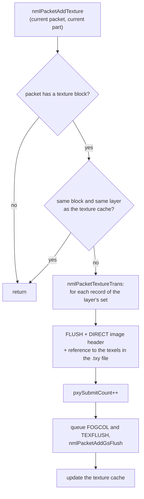

`pxyQueueTextureSet(slot, table, index, originX)` is a variant that
registers the same upload as direct-send entries instead of writing it now.
No code in `src/` calls it.

### The caches

Three caches avoid sending the same data twice. Each is a single remembered
value, so it only helps when equal items follow each other.

| Cache | Variables | Avoids | Cleared by |
| --- | --- | --- | --- |
| Texture | `pxyTextureTableCache`, `pxyTextureChannelCache` | Uploading the texture set of a layer again | `nmlPacketClrTextureCache` |
| Matrix | `pxyBoneCachePacket` | Sending the joint matrices of a model again | `nmlPacketClrMatrixCache`, every wide GS flush |
| Model | `pxyUploadedPacket` | Sending the model state again | `nmlPacketClrModelCache` |

`pxyDrawBatch` clears the model and matrix caches at its start, because the
state of the previous batch may have been sent for another pass. The texture
cache survives across batches and is cleared at the start of each camera and
after each pass that writes into the texture area. `xglPacketStateReset`
clears all three and the packet mode and reloads the camera constants.

### Direct sends

Other systems need to put their own packet data between the model passes:
gauges, debug text, font objects, cutscene overlays. They register it with
`nmlModelDirectSendFull(key, data, qwc, flag, state)` or one of its three
short forms, and the flush plays it at a fixed point.

An entry (`PxyEntry`) stores the data pointer, the quadword count, a flag, a
state value that becomes the address field of the DMA reference, a group and
a row. The key encodes three things.

| Part of the key | Meaning |
| --- | --- |
| Bit 0 | 0: the data is copied into the packet buffer now. 1: the pointer is kept, and the data must stay valid |
| `(key % 12) >> 1` | The group, 0 to 5 |
| `key / 12` | The row. Row 1 marks a list of GS register pairs |

The queue takes up to 3048 entries per frame. A mask with one bit per group
lets the players skip empty groups.

| Group | Played |
| --- | --- |
| 3 | At the start of `pxyFlush`, before any camera |
| 4 | Per camera, after the opaque overlay batches. Only entries whose flag equals the camera index |
| 0 | Per camera, after all opaque batches |
| 1 | Per camera, after all translucent batches |
| 2 | At the end of `pxyFlush`, after the last camera |
| 5 | By the render code through `pxyEntryGroupHooks[0]` |

`pxyPlayEntryGroup(group)` adds a DMA reference for each entry of the group.
`pxyPlayEntryGroupFiltered(group, filter)` plays only the entries whose flag
equals the filter. For an entry of row 1 it appends the register pairs to
the GS queue and sends them with the wide flush instead.

`pxyAddFrameCopyPacket`, the other hook installed by `nmlModelConstruct`,
adds a GS local transfer from the display buffer to the flip buffer when
`pxyFrameCopyRequest` was called. No code in `src/` calls the request
function.

## VU1 microcode

The game draws with seven VU1 programs. Five of them draw `.pxy` models and
are loaded one at a time by the packet code of this library. One draws the
sprites, polygons, ribbons and particles of the effect systems. One draws
water. All seven are data in the executable, each stored as a ready VIF1
packet that the C code only references. This section describes what the
programs do with the data that the C code puts into VU1 memory.

A VU instruction **pair** is 8 bytes. It holds an upper instruction for the
vector units and a lower instruction for loads, stores, branches, integer
registers and the divider, and both run in the same cycle. VU1 has 16 KiB of
program memory, which is 2048 pairs, and 16 KiB of data memory, which is
1024 quadwords. Addresses of program memory are given in pairs and
addresses of data memory in quadwords.

| Program | Symbol | Pairs | Loaded by | Draws |
| --- | --- | --- | --- | --- |
| Plain | `xglPlainMicrocodeProgram` | 1995 | `nmlPacketAddTransMicrocode`, mode 0 | Lit models outside field and battle mode |
| Map | `xglVertexColorMicrocodeProgram` | 1797 | mode 1, header flag 0x1 | Models with baked vertex colors |
| Break-up | `xglBreakUpMicrocodeProgram` | 1562 | mode 2, status bit 0x8000 | A model that falls apart behind a moving plane |
| Field | `xglMode3MicrocodeProgram` | 2038 | mode 3, `xglPacketMode3Flag` | Lit models in field mode |
| Battle | `xglMode4MicrocodeProgram` | 1750 | mode 4, `xglPacketMode4Flag` | Lit models in battle mode |
| Effect | `svEffectMicrocodeData` | 1203 | `svDrawLoadEffectMicrocode`, called by `svDrawScene` | Sprites, effect polygons, ribbons and particles |
| Water | `xglWaterPacketEntries` | 372 | `xglWaterMicrocodeLoad` | Water sheets |

The first column gives the names used in this section. They describe what
each program does. Two of the symbols say something else: the program behind
`xglVertexColorMicrocodeProgram` has no environment mapping and no skinning, and the
one behind `xglBreakUpMicrocodeProgram` is not a texture pass. The symbol
`xglWaterPacketEntries` is the water program, and the word before it,
`xglWaterPacketQuadwords`, is its size in quadwords.

Each stored packet holds only VIFcodes. An `MPG` code loads each run of up to
256 pairs, and the runs fill program memory from address 0. The packet ends
with the two codes `BASE` and `OFFSET`, which set up the double buffer
described in [The double buffer](#the-double-buffer). The word in front of
each packet is its length in quadwords, which the C code passes to
`sceVif1PkRef`.

Loading a program replaces the previous one, because every program starts at
address 0. The Field program fills 2038 of the 2048 pairs. The effect code
and the water code therefore load their own program when they start.
`tiWaterDrawAll` and `sefFinishDrawPass` call `xglPacketModeReset` when they
end, which makes the next model load a model program again.

### The model programs

The five model programs are variants of one source. All of them share the
first 0x15 pairs and the same set of helper routines, and they keep the same
layout of data memory. They differ in the drawing routines.

| Program | Compared with Plain |
| --- | --- |
| Battle | The same routines without point lights, without the clip plane fade and without the two shadow styles 3 and 4 |
| Field | The same structure without point lights. The lighting loops are rewritten: the one-layer loop uses three directional lights and one ambient color, and the clip plane fade is built into the loops |
| Map | No skinning. Vertex colors instead of directional lights, fog per vertex, a triangle clipper, a shadow receiver with a distance falloff |
| Break-up | The vertex loops are replaced by a loop over single triangles |

Every model program has three entry points, which `xglPacketMicrocodeEntry`
returns as byte addresses divided by 8.

| Program | Model entry | GS entry | Wide GS entry |
| --- | --- | --- | --- |
| Plain | 0x73a | 0x1ac | 0x1b1 |
| Map | 0x68f | 0x1b6 | 0x1bb |
| Break-up | 0x592 | 0x1ac | 0x1b1 |
| Field | 0x765 | 0x1ac | 0x1b1 |
| Battle | 0x652 | 0x1a9 | 0x1ae |

The first pair of every entry point carries the E bit, the "end program"
flag. An `MSCAL` to an entry point therefore stops at once and only sets the
address at which the next `MSCNT` resumes.

The two GS entries are short loops. After the `MSCAL` that
`nmlPacketAddGsFlush` sends, the `MSCNT` that follows runs three pairs: an
`XGKICK` of the register list at 0x330, or at 0x228 for the wide entry, and a
branch back to the entry point, where the program stops again. A register
list reaches the GS through PATH1 this way, in order with the strips that the
same program kicks.

### Batches of a part

The model entry is a dispatcher. `pxyDrawPartData` sends `MSCAL` to the
model entry and then references the VIF data of the part inside the `.pxy`
file. That data is a series of **batches**. Each batch is one or more
`UNPACK` codes followed by `MSCNT`, and each `MSCNT` runs the dispatcher
once. It reads the address of the batch with `XTOP` and looks at the first
quadword, the batch header.

| Header lane | Content |
| --- | --- |
| x | The count of vertices in the low 15 bits. In a setup batch, the material kind |
| y | The batch type |
| z | In a vertex batch, the index of a morph record at 0x37c |
| w | Bit 0 says that the batch has a color per vertex. Bits 1 to 4 select the skinning form, and the value 2 means one bone per vertex |

The batch type selects what the dispatcher does.

| Type | Batch | Action |
| --- | --- | --- |
| 0, 3 | Vertex batch | Morph and skin the vertices, then jump to the drawing routine that the last setup batch chose |
| 1 | Setup batch | Read the material, send its GS registers and choose the drawing routine |
| 2 and others | Flush batch | Kick the TEXFLUSH packet at 0x32d |

After each batch the program returns to the model entry and stops. VIF1 then
unpacks the next batch and resumes it. The flowchart shows one run of the
dispatcher in the Plain program.

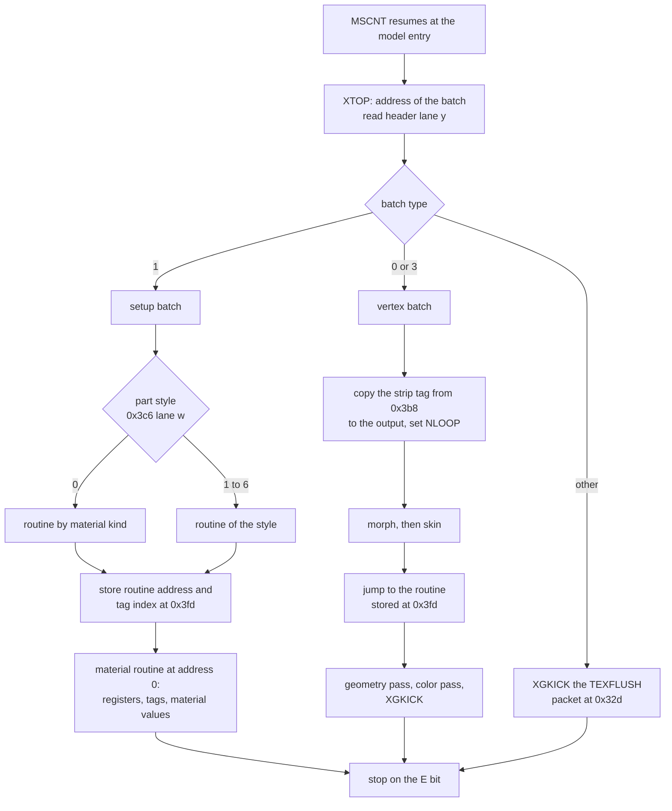

### The setup batch and the material

A material is not a C structure. It is the content of the setup batch, and
the routine at address 0 of each model program reads it. The routine does
four things.

It first sends the GS registers of the material. The second quadword of the
setup batch is a GIF tag, and the register writes that follow it are copied
to the output area together with the tag. The routine raises the count of
the tag by two and appends a `TEST_1` value and a `ZBUF_1` value, which it
picks from the six values at 0x3dc by the material flags 0x2, 0x200 and
0x1000. The C code prepared those six values for the current pass, and the
material chooses among them. The routine writes the register numbers of the
six templates at 0x342 into the list and into the two small register
packets at 0x3ac and 0x3b2, which hold the texture state of the first and of
the second layer. Material flags 0x40 and 0x80 each add two more register
writes that are read from the batch. The routine kicks the list and the
packet at 0x3ac before it returns, so the texture of the first layer is set
once per material and not once per strip.

It then resolves the animated values of the material. Several values of the
batch are not used as they are. The batch stores, next to each of them, an
index and a lane number. The routine reads the quadword at 0x370 plus the
index, which is one of the track values that `pxyUploadPacketState` sends
for models with header flag 0x4, rotates it by the lane number and
multiplies. The UV scroll of both layers is built this way, so a track of
the model can scroll a texture without any C code that knows the material.

It stores the material values that the loops read later.

| VU1 address | Stored value |
| --- | --- |
| 0x3be | UV scroll of the first layer in x and y |
| 0x3c7 | UV scroll of the second layer in x and y |
| 0x3c1 | Specular color in x, y and z, multiplied by the fade vector of 0x3ce. Lane w is the specular exponent count |
| 0x3c2 | A material vector. Lane w scales the bump offset |
| 0x3c3 | UV scale of the second layer |
| 0x3c4 | The material flag word |
| 0x39b | Two values for the distance fade of the Map program, in z and w |
| 0x3fb | The multiply color, a copy of the global color at 0x341 |

It finally chooses the GIF tag of the strips. The table at 0x35c holds 16
tags, all for triangle strips with Gouraud shading. The index is built from
bits.

| Index bit | Meaning | Set when |
| --- | --- | --- |
| 1 | No texture | Part style 5, or material flag 0x4 is clear |
| 2 | Alpha blending | Flag bit 0x10 of 0x3c5, draw pass 1 |
| 4 | Five registers per vertex | The material kind has two layers |
| 8 | Fog | Flag bit 0x2 of 0x3c5 is set and material flag 0x400 is clear |

The tags with three registers list `ST`, `RGBAQ` and `XYZF2`. The tags with
five registers list `ST`, a no-operation register, `RGBAQ`, another
no-operation register and `XYZF2`. The chosen tag is stored at 0x3b8. The
tag of the second layer is taken from the two tags at 0x3ba and stored at
0x3b9. It lists a no-operation register, `ST`, another no-operation
register, `RGBAQ` and `XYZF2`, and it selects GS context 2. When frame
option 0x40 is set the C code uploads `vuStripGifTagsUntextured`, in which the
textured tags are replaced by untextured ones.

When flag bit 0x800 of 0x3c5 is set, which the C code calls black fog, and
material flag 0x400 is clear, the routine stores zero in the multiply color
and clears the red, green and blue of every light color, both ambient
colors and the point light colors in VU1 memory. The material is then drawn
black.

Material flag 0x1 marks an unlit material. The light loader then replaces
all light colors by zero and both ambient colors by one, so the vertex color
passes through unchanged.

### Material kinds and part styles

The setup batch chooses the drawing routine from two numbers. The part style
comes from the C code, in lane w of 0x3c6 (see
[Per-model and per-part data](#per-model-and-per-part-data)). The material
kind comes from the file, in lane x of the batch header. The kind is used
only for part style 0.

| Part style | Routine of the Plain program |
| --- | --- |
| 0 | By material kind |
| 1 | The one-layer lit routine, whatever the kind |
| 2, 5 | Geometry only. The color is a constant: 128 in red, green and blue, and 128 times the color scale of 0x3c5 in alpha |
| 3 | Shadow texture. Positions are multiplied by the matrix at 0x396 and written without a perspective divide, with the constant color 128 and no texture coordinates |
| 4 | Shadow receiver, see [Shadow styles](#shadow-styles) |
| 6 | Screen sampling, see [Screen sampling](#screen-sampling) |

The lit programs know the material kinds 5 to 12.

| Kind | Layers | Routine |
| --- | --- | --- |
| 10 | 1 | Diffuse light |
| 7 | 1 | Diffuse light and a specular highlight |
| 5, 6 | 2 | Highlight, and a second texture layer that uses the same coordinates with its own scroll and scale |
| 8, 11 | 2 | Highlight, and a second layer whose coordinates come from the reflection vector |
| 9, 12 | 2, drawn in three kicks | The second coordinates are shifted along the direction of light 0. Kind 12 first clears the specular color |

Kinds 6 and 8 fall back to the one-layer routine when two bits of a word in
the setup batch are both set and the part is not in draw pass 1. An unknown
kind selects a routine that only kicks the TEXFLUSH packet, so the part is
not drawn.

The Map program has its own kinds. Kinds 0, 1 and 2 are one layer. Kinds 3
and 8 are two layers. Kind 4 is drawn in three kicks like the kinds 9 and 12
of the lit programs. Kind 13 writes five quadwords per vertex and kicks them
once. Every other number is treated like kind 0. The Map program knows the
part styles 0, 2 and 4 only, and a part with any other style is not drawn.

The Battle program has no routine for the part styles 3 and 4.

### A vertex batch

A vertex batch holds arrays of n quadwords each, one after the other behind
the header. The first array holds the positions, with the texture coordinate
s in lane w. The second holds the normals, with t in lane w. The low bit of
the t word is also read as an integer and marks the first vertex of a new
strip, so one batch can hold several strips. The arrays that follow depend
on the batch: bone weights and bone indices for a skinned batch, a color
array when bit 0 of header lane w is set, morph targets, and for the bump
kinds a frame of three vectors per vertex.

The lit programs work on a batch in up to four steps. Each step is a loop
over all vertices.

1. **Morph.** When material flag 0x100 is set, header lane z is the index of
   a record at 0x37c. The record holds a weight in x, an offset in y and a
   stride in z. Each position and normal is replaced by the mix of itself
   and a target vector read from the batch at that offset: value times one
   minus the weight, plus target times the weight. The records are the best
   records of the track entries that `pxyUploadPacketState` sends for
   models with header flag 0x10.
2. **Skin.** When bits 1 to 4 of header lane w are not zero, positions and
   normals are transformed in place by the joint matrices at 0x228. See
   [Skinning](#skinning).
3. **Geometry pass.** Each position is transformed, clipped, projected and
   written to the output area together with its texture coordinates. See
   [The geometry pass](#the-geometry-pass).
4. **Color pass.** Each vertex is lit and its color is written into the slot
   that the geometry pass left free. See [Lighting](#lighting).

The output area starts 183 quadwords behind the batch header. Its first
quadword is the strip tag from 0x3b8 with `NLOOP` set to the vertex count.
Three or five quadwords per vertex follow. The color pass ends the strip
with the quadword from 0x33c, `vuEmptyEndTag`, which is an empty GIF tag
with the end-of-packet bit.

When every vertex of the batch failed the clip test, the routine skips the
color pass and the kick and only kicks the TEXFLUSH packet.

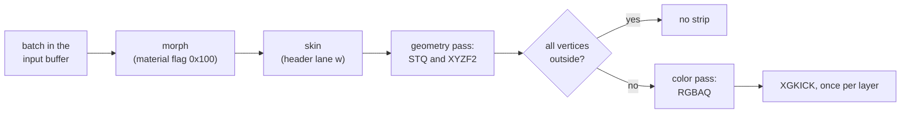

### The geometry pass

The geometry pass uses the matrix at 0x396, which `pxyUploadViewMatrices`
builds as camera matrix times model matrix. For one vertex the program:

1. Multiplies the position by the matrix. The result is the clip
   coordinate.
2. Multiplies x, y and z of the clip coordinate by the vector at 0x39d and
   tests the result against w with `CLIPW`.
3. Divides by w, which gives Q = 1/w, then multiplies x, y and z by the
   screen scale at 0x33f, adds the screen offset at 0x340 and converts to
   the 12.4 fixed point of the GS.
4. Builds the texture coordinates as s plus the scroll x and t plus the
   scroll y of 0x3be, and writes s, t and 1, each multiplied by Q and by the
   field-of-view scale at 0x339.
5. Writes the flag bits and the fog value into lane w of the position.

The field-of-view scale multiplies S, T and Q by the same factor, so the
texture stays where it is. Only Q changes, and the GS computes the mipmap
level from Q. The factor is above 1 when the field of view is below 40
degrees, so a likely purpose is to keep textures sharp in a zoomed view.

The lit programs do not compute fog. They copy lane y of 0x3c5, the fog
value that `pxyCalcFogFactors` computed for the whole model or for the
geometry, into the fog field of every `XYZF2`. The Map program computes it
per vertex, see [The Map program](#the-map-program).

The programs do not send a kick per triangle. They mark triangles that must
not be drawn with the `ADC` bit of `XYZF2`, bit 15 of lane w. The GS stores
such a vertex without drawing the triangle that it closes. The bit comes
from a small shift register in an integer register. For each vertex the
program ORs flags into it, doubles it and writes it into lane w. A flag
therefore reaches bit 15 one vertex later for every position that it starts
lower.

```
value ORed in   why                              ADC set on
-------------   ------------------------------   ---------------------------
0x6000          first vertex of a strip          this vertex and the next
0x7000          this vertex failed CLIPW         this vertex and the next two
0x4000          the triangle faces away          this vertex only
```

The table at 0x328 holds the values 0x6000 and 0x7000, so the loop picks
them with an indexed load instead of a branch. A vertex outside the clip
volume removes all three triangles that it belongs to. Except in the Map
program, the model programs never cut a triangle.

The **face test** runs when lane y of 0x3c6, the style level of the part, is
not zero. The loop keeps the last two positions at 0x335 and 0x336. For each
vertex it takes the cross product of the two edges of the new triangle and
the dot product of that normal with the direction to the camera, whose
position in model space sits in lane w of the three light rows at 0x384. The
sign of the result, the parity of the strip and the sign in lane x of 0x3c6
decide. `pxyUploadPartState` sets that sign to 1 for style levels 2 and
above and to -1 otherwise, so the level chooses which side is removed.

### Skinning

The Plain, Field, Battle and Break-up programs skin on their own. The Map
program has no skinning code. Skinning runs as a separate loop before the
geometry pass and overwrites the positions and normals of the batch, so the
drawing routines are the same for skinned and rigid batches.

A skinned batch has two more arrays. One holds four weights per vertex. The
other holds four integers per vertex, and each integer is the offset of a
joint matrix from 0x228, the area that `pxyUploadBoneMatrices` fills. The
value 255 ends the list of a vertex. The loop transforms the position by
each matrix, including its translation, and the normal by its upper three
rows, multiplies by the weight and adds up. Up to four joints per vertex are
possible.

When bits 1 to 4 of header lane w have the value 2, each vertex has one
joint and no weights. The loop then transforms position and normal by that
single matrix.

When flag bit 0x400 of 0x3c5 is set, which the C code does for status bits
0x10000 and 0x200000, a second form of both loops is used. It scales every
skinned normal back to unit length with `ERLENG`, the reciprocal length.
This is needed when the joint matrices carry a scale.

The bump kinds 9 and 12 carry a frame of three vectors per vertex. Their
routine skins all three vectors with the same joints and weights.

### Lighting

The color pass reads the light data that `pxyUploadViewMatrices` prepared
in model space (see [What is sent to VU1](#what-is-sent-to-vu1)). The three
rows at 0x384 hold the directions of lights 0 to 2, transposed, so that one
multiply-add sequence gives all three dot products at once. The three rows
at 0x387 hold lights 3 to 5 in lanes x, y and z and the seventh direction,
`viewDirection`, in lane w. The eight rows at 0x38a hold the six light
colors, the ambient color and the lower ambient color.

For one vertex with normal N and vertex color V the Plain and Battle
programs compute:

1. The six dot products of N with the light directions, each clamped at 0.
2. A hemisphere factor h = (N · `viewDirection` + 1) / 2.
3. The light sum: each light color times its dot product, plus the ambient
   color times h, plus the lower ambient color times (1 - h).
4. The color: light sum times V, plus the point light sum, limited to 255.
5. The alpha: vertex alpha times lane w of the ambient color.

V is the color of the vertex when the batch has a color array. Otherwise the
loop reads the same quadword for every vertex. The two ambient colors make a
two-color ambient light. A normal that points along `viewDirection` gets the
upper color, one that points against it gets the lower color, and normals in
between get a mix.

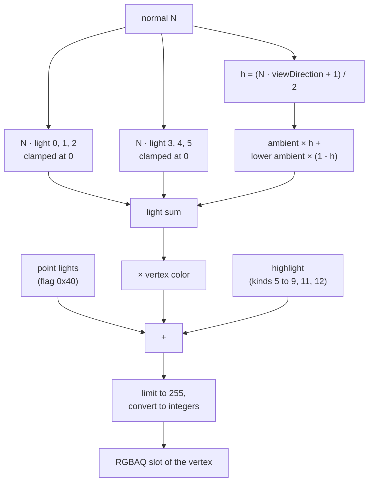

**Specular highlight.** The kinds with a highlight compute the direction
from the vertex to the camera position at 0x33e, scale it to unit length and
reflect it about the normal. They take the dot product of the reflection
with the directions of lights 0 to 2 and clamp it at 0. Each result is then
squared k + 1 times, where k is the integer in lane w of 0x3c1, which raises
it to the power 2^(k+1). The three powers weight the colors of lights 0 to
2. The sum is multiplied by the vertex color, by the specular color of
0x3c1 and by lane z of 0x3c5, and added to the color. Lights 3 to 5 give no
highlight.

**Point lights.** When flag bit 0x40 of 0x3c5 is set, a helper adds up to
three point lights. The positions sit at 0x3d4 to 0x3d6 transposed: the x
of the three lights, then their y, then their z. One subtraction per row
thus gives the offsets from the vertex to all three lights. The helper
computes, for each light, the dot product of the normal with the offset,
clamps it at 0 and divides it by the squared distance. The three results
weight the colors at 0x3d8 to 0x3da. Two of the three reciprocals come from
the divider and the third from the `ERSADD` instruction, which needs the
third light once more as a plain vector at 0x3d7.

**Clip plane fade.** When flag bit 0x200 of 0x3c5 is set, a helper reads
the plane in the w lanes of 0x352 to 0x356. It computes the distance of the
vertex from the plane, clamps it between 0 and a limit in lane w of 0x357,
and multiplies the vertex alpha by it. Geometry thus fades out as it comes
near the plane instead of ending with a hard edge. The planes are the ones
described under [Clip planes and reflection](#clip-planes-and-reflection).

The Field program uses a shorter formula in its one-layer loop: the colors
of lights 0 to 2, each times its clamped dot product and the vertex color,
plus the ambient color times the vertex color. It has no hemisphere term,
no lights 3 to 5 and no point lights in that loop, and the clip plane fade
is part of the loop.

### Two layers

A two-layer kind writes five quadwords per vertex: the first texture
coordinates, the second texture coordinates, the first color, the second
color and the position. The program sends this one block to the GS more
than once and changes only the GIF tag in front of it. The no-operation
registers in each tag make the GS skip the two quadwords that belong to the
other layer.

For kinds 5, 6, 8 and 11 the order is:

1. `XGKICK` the register packet of the first texture at 0x3ac.
2. `XGKICK` the strip with the tag that lists `ST`, skip, `RGBAQ`, skip,
   `XYZF2`.
3. `XGKICK` the register packet of the second texture at 0x3b2.
4. Overwrite two lanes of the tag with the second-layer tag from 0x3b9 and
   `XGKICK` the same strip again. It now lists skip, `ST`, skip, `RGBAQ`,
   `XYZF2` and draws with GS context 2.

The second coordinates of kinds 5 and 6 are s and t plus the second scroll
of 0x3c7, times the scale of 0x3c3. The second coordinates of kinds 8 and 11
are a reflection map. The reflection vector of the highlight is turned into
world space by the upper three rows of the matrix at 0x3a7, its x and y are
moved from the range -1 to 1 into 0 to 1 and scaled by 0x3c3, and the result
is multiplied by Q.

Kinds 9 and 12 kick the strip three times: once with the first texture,
then twice with the second texture packet, with the two `ALPHA_2` values of
0x3c0 and 0x3bf and the two tags of 0x3bc. Their second coordinates are the
first ones shifted by the direction of light 0, expressed in the frame of
three vectors that the vertex carries and scaled by lane w of 0x3c2. A
texture drawn twice with a small shift along the light and two different
blend equations is the classic emboss form of bump mapping, and that is the
likely purpose.

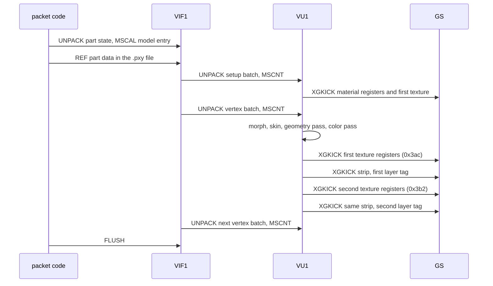

### Shadow styles

**Drawing into the shadow texture** is part style 3. The routine writes the
position times the matrix at 0x396 without a divide, the constant color 128
and no texture coordinates. `pxyDrawShadowCaster` puts the projection of the
shadow into that matrix for this pass.

**Receiving a shadow** is part style 4. The setup batch copies the blended,
textured tag at 0x35e to 0x3b8 and selects the receiver routine, and the
material routine is not run. The routine transforms each position as usual.
It computes the texture coordinates from the matrix at 0x39e, the shadow
texture matrix: the position is multiplied by it, and x and y are scaled and
moved by the four values at 0x3c3. The color is constant.

The receiver routine also decides which triangles may show the shadow. The
rows at 0x392 hold the shadow light, transposed like the other lights. The
routine takes the dot product of the vertex normal with the light direction
and with the offset from the vertex to the light. When either result is
negative, it sets the flag 0x4000, which reaches the `ADC` bit, and the triangle
is not drawn. A shadow therefore never appears on the far side of an object.

The receiver routine of the Map program does more. It first moves the
position into world space with the matrix at 0x3a7. It takes the distance
to the shadow light in x and z with a square root, multiplies it by a
factor and subtracts the result, limited to 128, from 128. The shadow thus
gets weaker with the distance from its light and ends where the value
reaches zero. With flag bit 0x200 the routine runs one more test that can
remove the triangles around a vertex.

### Screen sampling

Part style 6 draws a part with the frame buffer as its texture.
`pxyUploadScreenSampleParams` uploads ten quadwords to 0x348: a GIF tag,
five register writes and three scale vectors. The routine kicks the register
packet first.

For each vertex it computes the direction from the camera position at 0x33e
to the vertex and scales it to unit length. It builds a second point from
the vertex, the view direction and the normal, and projects that point with
the same matrix as the vertex itself. The screen position of the second
point, scaled and moved by the vectors at 0x34f to 0x351, becomes the
texture coordinate. The part thus shows the picture behind it, shifted by an
amount that depends on the normal, which gives the look of refraction
through glass or heat.

### The Map program

The Map program draws models whose light is baked into vertex colors. It is
selected by header flag 0x1. It differs from the lit programs in four ways.

**Vertex colors.** The color of a vertex is its color from the batch times
the multiply color at 0x3fb, limited to 255. No directional light is used in
the one-layer kinds. The two-layer kinds read the directions and colors of
lights 0 to 2 for a highlight. Point lights are added when flag bit 0x40 is
set, with the same helper as in the Plain program, so a map can still be lit
by a light that moves.

**Fog per vertex.** When flag bit 0x2 is set, the loop computes the fog of
each vertex from the fog parameters at 0x39c, which `pxyUploadPacketState`
sends for status bit 0x1. The value is parameter z plus parameter w times
Q, clamped between parameters x and y, the same formula that
`_CurRotTransPersFog` uses on the EE. It is converted to 12.4 fixed point,
masked with 0xff0 and written into the fog field of `XYZF2`.

**Distance fade.** When material flag 0x4000 is set, a helper computes the
distance from the vertex to the camera, subtracts the start distance in lane
z of 0x39b and divides by the range in lane w. The alpha of the vertex is
multiplied by one minus that value, clamped at 0. Parts with this flag fade
out with distance.

**Triangle clipper.** When material flag 0x800 is set, the batch is not
drawn as it is. A routine first multiplies the rows of the matrix by the
guard band factors at 0x3e7 and transforms all vertices. It then cuts each
triangle against five planes, one after the other, with two work buffers 44
and 85 quadwords behind the batch header that swap roles after each plane.
The five records at 0x3e2 that `xglPacketInitVuState` uploads describe the
planes. Each holds a count that selects the coordinate, the pair of `CLIPW`
flag bits of the plane for the current and the previous vertex, and a sign. Where an edge crosses a plane,
the routine computes the crossing point and interpolates position, texture
coordinates and color. Large floor and wall polygons near the camera are
thus cut at the edge of the guard band instead of being removed whole.

The Map program chooses between three one-layer loops. The general loop
runs the face test, the distance fade and the point lights through helper
calls. Two shorter loops are used when none of these is needed, one with fog
and one without.

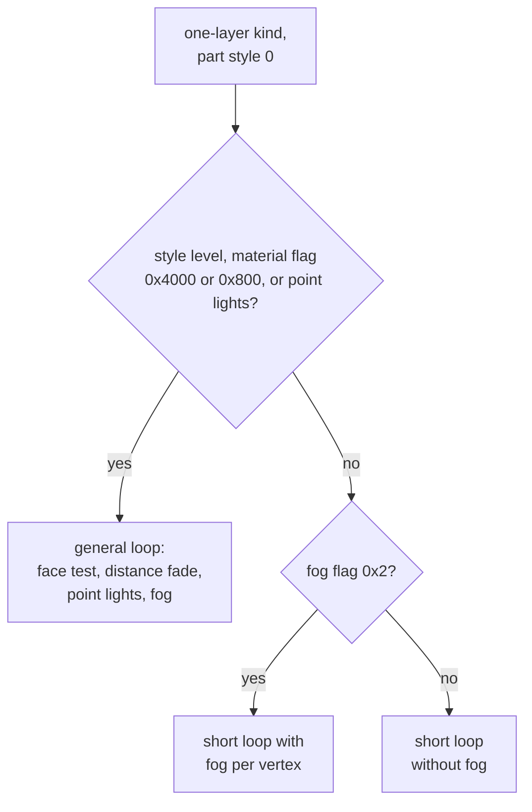

### The Break-up program

The Break-up program is loaded for a model with status bit 0x8000, which
`pxySetClipPlaneMasked` sets. It treats the vertices of a batch as single
triangles and kicks every triangle on its own.

For each triangle it computes the centroid, the mean of the three
positions. It then tests the centroid against the plane at 0x352. The test
runs only when flag bit 0x1000 of 0x3c5 is set and lane w of 0x3cc is not
zero, which `pxyUploadViewMatrices` sets for the geometries named in the
mask of the model. A triangle on the near side of the plane is drawn
unchanged. A triangle on the far side is changed as follows.

1. A time t is the distance of the centroid from the plane, times lane y of
   0x3cd, times lane w of 0x3c9. The C code puts the inverse of the scale
   argument and the first float argument there.
2. A scale factor between 1 and 1.5 is taken from the sine of a number made
   from the index of the triangle and its first position, so every triangle
   gets a different one.
3. The three corners are moved to the centroid, scaled by the factor,
   turned by the matrix at 0x3c9 to 0x3cb and moved back. The normals are
   turned by the same matrix.
4. A horizontal push is added: the direction from the center at 0x3cc to
   the centroid in x and z, scaled to unit length, times 0.5, times t, times
   lane z of 0x3cd.
5. A vertical move is added: -9.8 times t squared, times the sign in lane w
   of 0x3ca.

The triangle then goes through the usual transform and lighting. The effect
is that the model breaks into its triangles behind the plane. The farther a
triangle lies behind the plane, the more it has turned, drifted away from
the center and fallen. When the C code moves the plane through the model,
the model crumbles from one side to the other. The matrix at 0x3c9 is the
one that `pxyUpdateBreakRotation` turns a little further in every
frame, so the pieces tumble. The sign is -1 when the count argument of
`pxySetClipPlaneMasked` is 2, which makes the pieces rise instead of fall.

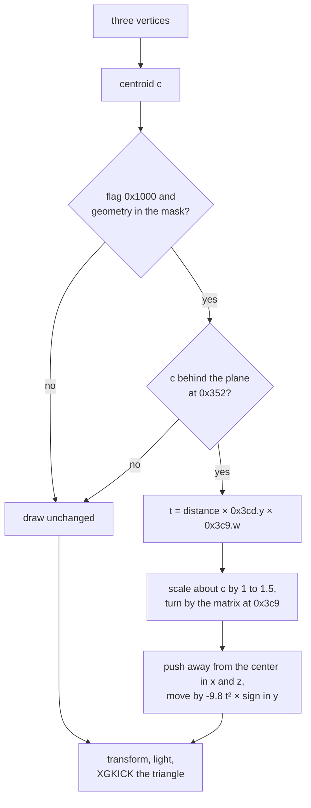

### The double buffer

`BASE` and `OFFSET` make VIF1 double buffer the batches. Every `MSCAL` and
`MSCNT` swaps the input buffer between the address in `BASE` and that
address plus `OFFSET`. An `UNPACK` with the `FLG` bit counts its address
from the current buffer, and `XTOP` gives a program the address of the
buffer that VIF1 has just filled. VIF1 can unpack the next batch into one
buffer while VU1 works on the other.

| Program | BASE | OFFSET | Buffers | Output |
| --- | --- | --- | --- | --- |
| Model programs | 0 | 0x114 | 0x000 and 0x114 | 183 quadwords behind the batch header |
| Water | 0 | 0x1aa | 0x000 and 0x1aa | Behind the four arrays of the batch |
| Effect | 0x28 | 0x1ea | 0x028 and 0x212 | In place, or 152 quadwords behind the batch header for particles |

In the model programs the two buffers end at 0x228, where the joint
matrices begin. A buffer of 0x114 quadwords with the output at 183 leaves 93
quadwords for the tag and the vertices of one strip.

### VU1 memory of the model programs

The C code uploads its parameters to fixed addresses above the two buffers,
and the programs keep their own work values between them. The diagram lists
quadword addresses. Entries marked with a star are written by the microcode
itself. The uploads of the C code are listed with their functions under
[Constants of a camera](#constants-of-a-camera) and
[Per-model and per-part data](#per-model-and-per-part-data).

```
0x000  +----------------------------------------------------+
       | batch buffer 0: header, arrays, output from 0x0b7  |
0x114  +----------------------------------------------------+
       | batch buffer 1: header, arrays, output from 0x1cb  |
0x228  +----------------------------------------------------+
       | joint matrices, 4 quadwords each, up to 64         |
       | (also the register list of the wide GS entry)      |
0x328  +----------------------------------------------------+
       | integer constants: 0x6000, 4095, 0x7fff, 0x7000    |
0x32d  | GIF tag and TEXFLUSH                               |
0x330  | register list of the GS entry                      |
0x335  | * last two positions of the face test              |
0x339  | field-of-view scale       0x33c  empty end tag     |
0x33e  | camera position in model space                     |
0x33f  | screen scale              0x340  screen offset     |
0x341  | global color                                       |
0x342  | six register templates: TEX0_1, CLAMP_1, ALPHA_1,  |
       | ALPHA_2, TEX1_1, TEX1_2                            |
0x348  | screen sampling: tag, five registers, three scales |
0x352  | clip planes (6)                                    |
0x35c  | 16 strip tags                                      |
0x370  | track values (8)          0x37c  morph records (4) |
0x384  | light directions 0-2, w = camera position          |
0x387  | light directions 3-5, w = viewDirection            |
0x38a  | light colors 0-5, ambient, lower ambient           |
0x392  | shadow light (4)                                   |
0x396  | model to screen matrix (4)                         |
0x39a  | * state of the clipper (Map program)               |
0x39b  | * distance fade values    0x39c  fog parameters    |
0x39d  | clip scale (1, 1, 1, 0)                            |
0x39e  | shadow texture matrix (4)                          |
0x3a7  | model to world matrix (4)                          |
0x3ac  | * register packet of the first texture             |
0x3b2  | * register packet of the second texture            |
0x3b8  | * strip tag               0x3b9  * second tag      |
0x3ba  | two second-layer tags     0x3bc  two more tags     |
0x3be  | * UV scroll               0x3bf  two ALPHA_2 values|
0x3c1  | * specular color, exponent  0x3c2 * material vector|
0x3c3  | * second UV scale, or shadow texture offset, scale |
0x3c4  | * material flags          0x3c5  render flags      |
0x3c6  | part state                0x3c7  * second scroll   |
0x3c8  | * depth offset                                     |
0x3c9  | break-up matrix and values (4)   0x3cd  its scales |
0x3ce  | fade vector                                        |
0x3d4  | point light positions (4) 0x3d8  their colors (3)  |
0x3db  | ALPHA_1 of the caller                              |
0x3dc  | TEST_1 and ZBUF_1 values (6)                       |
0x3e2  | five clip plane records                            |
0x3e7  | guard band factors                                 |
0x3fb  | * multiply color          0x3fc  work area word    |
0x3fd  | * drawing routine address and tag index            |
0x3ff  +----------------------------------------------------+
```

The four lanes of the **render flags** at 0x3c5 are the flag word of the
table in [Per-model and per-part data](#per-model-and-per-part-data), the fog
value, the alpha of the model, which also scales the specular color, and the
color scale. The four lanes
of the **part state** at 0x3c6 are the sign of the face test, the style
level that turns the face test on, the float 4.0 and the part style.

### The effect program

The effect program is a collection of small routines for flat, textured
shapes. Three pieces of C code use it, each with its own entry points.
`svDrawLoadEffectMicrocode`, which `svDrawScene` calls, is the only function that
loads it. The ribbon code and the particle code call their entry points
without loading anything, so they depend on that call.

| Entry (pairs) | Byte address | Caller | Work |
| --- | --- | --- | --- |
| 0x00a | `D_50` | `svDrawSendViewSetup` | Kicks the register packet at address 0 |
| 0x010, 0x022 | `D_80`, `D_110` | `svDrawSubmitMode` | Loads the constants into registers and kicks the state packet at 0x20. The two entries are the same code |
| 0x000 to 0x31b | `svDrawModeRoutineTable` | `svDrawListFlush` | One routine per draw mode, see below |
| 0x36e | `D_1B70` | `sdvDrawAlter` | Ribbons of the effect sequence driver |
| 0x3ee, 0x3fa | `D_1F70`, `D_1FD0` | `sefBuildVuPacket` | Particles facing the camera, particles in their own plane |

The **draw list** routines work on records. `svDrawListEmit` unpacks the
queued records to address 0x28 and writes a header in front of them: the
record count in x, the record size in y and a flag in z. The routine of the
draw mode then walks the records. A record already is a GS packet with a
GIF tag, register writes and room for four vertices. The routine reads the
inputs of the sprite from the record, computes the four corners, writes them
into the same record and kicks it. The corner offsets come from the state
block at 0x1c to 0x1f, where the C code puts a table for the plane of the
sprite: `svDefaultDrawStateTable` for the x-y plane, `svMode7DrawStateTable`
for x-z, `svMode9DrawStateTable` for y-z and `svSpriteDrawStateTable` for
screen sprites.

| Draw mode | Entry | Record size | Shape |
| --- | --- | --- | --- |
| 1, 2 | 0x0da, 0x13b | 14, 28 | Billboard. The center is moved to view space, the record matrix is combined with the base matrix of the state block, and one divide is used for all four corners |
| 3, 4 | 0x03b, 0x086 | 14, 28 | Screen sprite. Corners are scaled and offset without a divide and without a clip test |
| 5, 7, 9 | 0x1e5 | 17 | Board in space. The record matrix is multiplied by the view matrix, each corner has its own divide, and the texture coordinates are multiplied by Q |
| 6, 8, 10 | 0x254 | 34 | The same with two layers |
| 11, 12 | 0x2d1, 0x31b | 14, 28 | Billboard without the base matrix product |
| 13, 14 | 0x1b1, 0x1bb | 3 per vertex | Polygon that `sefClipPolygon` cut on the EE. Each vertex is transformed and divided, and no `ADC` bit is set |
| 0, 15 | 0x000 | | The records are kicked as they are |

The even modes of each pair draw two layers. The record then holds two GS
packets, the routine writes the same corners into both, gives the second
one its own texture offset and kicks both. This is the form with an overlay
texture that `svPolygonClipFlag` and `svPairAlphaTable` belong to.

Before it writes the corners, a sprite routine scales the axes of the
record by two scale vectors and adds a pivot. Lane z of the header selects
the order: when it is not zero the first scale is applied before the pivot,
otherwise after it. The billboard and board routines test all four corners
with `CLIPW`. A sprite with any corner outside the volume is not kicked.

The **ribbon** entry draws the alter strips of `src/main/sdv.c` (see
[sdv.md](sdv.md)). `sdvDrawAlter` unpacks seven quadwords of GS state to
address 0, calls the entry and then sends batches with `MSCNT`. The first
`MSCNT` kicks the state and loads the view matrix. Each later one draws a
batch. A batch whose header lane y is not zero is a line strip with two
quadwords per vertex. Otherwise it is a triangle strip of vertex pairs, one
vertex on each edge of the ribbon, and the routine draws it three times. It
splits the ribbon into three bands along its length, with the inner edges
at one third and two thirds between the outer edges and the second texture
coordinate at 1/3 and 2/3, and kicks each band as its own strip. Narrow
bands keep a wide, curved ribbon from showing the texture distortion of
long thin triangles. Both forms set the `ADC` bit from the clip test.

The **particle** entries draw the emitters of the effect system (see
[sef.md](sef.md)). `sefBuildVuPacket` uploads the block `SefVuPacket` to
address 0x14: the four corners of a unit quad, the model view matrix, a
camera matrix, the GIF tag of a four-vertex strip and three register writes.
A batch holds five quadwords per particle: three axis rows, the position and
the color. The routine writes a packet of 14 quadwords per particle 152
quadwords behind the batch header, with the tag, the `TEX0` write and four
vertices of `ST`, `RGBAQ` and `XYZ2`, and kicks it. The room between the
batch header and the output is enough for 30 particles. The entry `D_1F70` turns the axes with the camera matrix and
uses one divide for the quad, which gives a particle that faces the camera.
The entry `D_1FD0` turns them with the model view matrix and divides each
corner on its own, with texture coordinates multiplied by Q, which gives a
particle that lies in its own plane in the world.

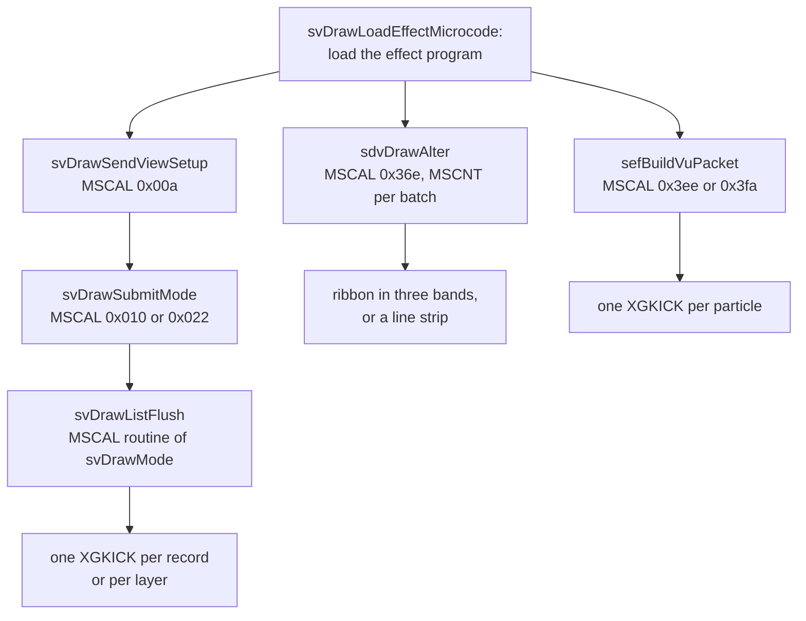

The data memory of the effect program is small.

```
0x000  +---------------------------------------------+
       | GS setup packet: tag and 7 register writes  |
0x00a  | unit matrix (4)                             |
0x00e  | screen scale        0x00f  screen offset    |
0x010  | texture corners of a unit quad (4)          |
0x014  | state block: view matrix (4), base matrix   |
       | (4), corner table (4), tag, CLAMP_1, ZBUF_1,|
       | ALPHA_1                                     |
0x028  +---------------------------------------------+
       | record header, then the records             |
       | (ribbons and particles: buffers at 0x028    |
       | and 0x212)                                  |
0x3ff  +---------------------------------------------+
```

### The water program

The water program draws the sheets of `src/main/TiWater.c` (see
[animation.md](animation.md)). `tiWaterSendFrame` loads it and uploads the
constants. `tiWaterSendGrid` then sends one batch per strip, followed by
`MSCNT`. A batch holds a GIF tag, n flat positions with y = 0 and n vectors
from the height field of the simulation. The program has six entry points.
The C code uses three of them.

| Entry (pairs) | Byte address | Used for |
| --- | --- | --- |
| 0x0d1 | `D_688` | The surface pass, item flag 0x4 |
| 0x0fe | `D_7F0` | The second pass, item flag 0x2, when `tiWaterPerVertexDirection` is set |
| 0x13e | `D_9F0` | The second pass otherwise |
| 0x03a, 0x06d, 0x095 | | No caller. A lit textured strip, a strip with vertex colors, and a lit strip whose texture coordinates come from the normal |

Every entry loads its constants into registers and stops. Each `MSCNT` then
transforms one strip with the matrix at 0x3c2, the view matrix times the
transform of the sheet. The position is flat, so the waves never move a
vertex. They only move the texture coordinates. A vertex outside the clip
volume gets the `ADC` bit.

The **surface pass** samples the copy of the screen that the C code placed
in the frame page. The texture coordinate of a vertex is its own screen
position, measured from the center of the screen and divided by 512, plus
0.5 in s and 7/16 in t, plus 0.05 times the x and z of the height field
vector. The result is halved and moved by one half in s, because the C code
clamps this pass to the right half of the page. The color is the constant
128 from the last row of `tiWaterFixedMatrix`. The vector of the height
field bends the lookup, and the screen behind the water appears distorted by
the waves.

The **second pass** adds light on top. For each vertex the program computes
the direction from the camera position at 0x3d2 to the vertex in world
space, with the transform at 0x3c6, and scales it to unit length. It takes
the dot product d with the height field vector. The brightness is the pair
of the item at 0x3da: x plus y times (1 - |d|) to the fourth power. The
water is brightest where the view grazes the surface, which is how a real
water surface reflects. The texture coordinate is the same screen position
with the same offsets, minus 0.7 times the height field vector and without
the halving. The C code clamps this pass to the left part of the page, so
it looks up a different picture with a much stronger bend. The entry at 0x13e
is a cheaper form. It uses the single direction at 0x3d6, from the camera to
the sheet, for all vertices.

The source names the second pass after depth
(`TI_WATER_ITEM_DRAW_GRAZING`, `tiWaterDepthGridHeader`). The program does
nothing with depth in it. Its GS state adds the texture to the frame with a
fixed factor, so it works as a reflection pass.

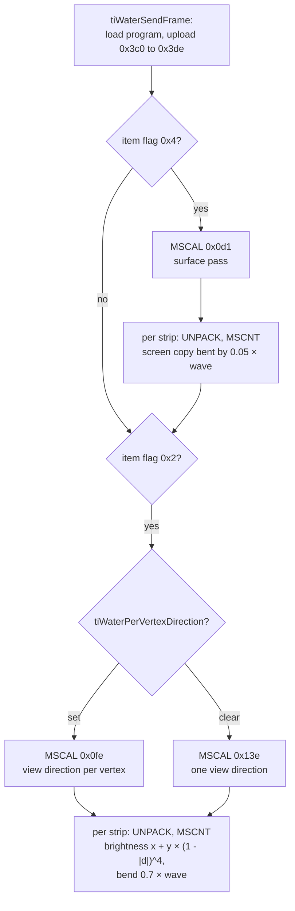

The water program keeps its constants at the top of data memory.

| VU1 address | Sent by | Content |
| --- | --- | --- |
| 0x3c0 | `tiWaterSendParamRows` | Screen scale of the camera, with 1/512 in w |
| 0x3c1 | `tiWaterSendParamRows` | Screen offset of the camera, with 7/16 in w |
| 0x3c2 | `tiWaterSendTransformed` | View matrix times the transform of the sheet |
| 0x3c6 | `tiWaterSendMatrix` | Transform of the sheet |
| 0x3ca | `tiWaterSendOrientedMatrix` | A light matrix built from `tiWaterAxes`. Only the unused lit entries read it |
| 0x3ce | `tiWaterSendFixedMatrix` | `tiWaterFixedMatrix`. Its last row is the color of the surface pass |
| 0x3d2 | `tiWaterSendDirection` | Camera position |
| 0x3d6 | `tiWaterSendDirection` | Unit direction from the camera to the sheet |
| 0x3da | `tiWaterSendBrightnessPair` | Base brightness and grazing brightness of the second pass |
| 0x3de | `tiWaterSendBendPair` | The pair (0.7, 0.05): the bend of the second pass and of the surface pass |

## The sv layer

The `sv` functions in `src/main/sv_get_image_item.c` are the drawing back
end of the visual effect system. An effect is a set of animated items:
sprites, polygons, lines and small models. The effect system itself, with
its effect numbers, records, lines and scripts, is described in
[sef.md](sef.md). This section describes what the back end keeps and how it
draws.

### Image mappers

An effect file is a chain of chunks. An **image mapper** is the catalogue of
the chunks of one file. The storage `_imageMapper` holds 57 of them. The
structure is called `SvTypeList`.

| Offset | Field | Meaning |
| --- | --- | --- |
| +0x00 | `total` | Cleared when the mapper is emptied |
| +0x04 | `size` | Start value of the video memory cursor: 0xe0000 for mapper 0, 0xf0000 for the others |
| +0x08 | `capacity` | 0x10000 |
| +0x0c | `savedSize` | The running video memory cursor |
| +0x10 | `dimensions` | A key that `svDeleteImageMapperByDimensions` searches for |
| +0x14 | `entryCount` | The second argument of `svAddImageMapper`, a key for `svDeleteImageMapperID` |
| +0x16 | `tag` | The fourth argument, a key for `svDeleteImageMapperData` |
| +0x18 | `pendingCount` | Nonzero while the mapper holds a file |
| +0x1c | `entries[0x100]` | The catalogue, 0x24 bytes per entry |

Mapper 0 is the shared mapper. Mappers 1 to 8 are found by their id or their
tag. Mappers from 9 on belong to the effect slots: slot `n` uses mapper
`n + 9`.

`svAddImageMapper(typeListId, entryCount, chunk, tag)` empties the mapper if
it was in use and then calls `svAnalyzeChunk`, which walks the chain until a
chunk of kind 0.

| Chunk kind | Handler | Entry made |
| --- | --- | --- |
| 1, 2 | | Skipped. The chunk has the fixed size of a chunk header |
| 3 | `svAddClut` | A palette (`SV_RES_CLUT`) |
| 4, 7 | `svAddImage` | An image (`SV_RES_IMAGE`) |
| 5 | `svAddScript` | A script (`SV_RES_SCRIPT`) |
| 6, 9 | `svAddModel` | A model (`SV_RES_MODEL`). Bit 0x2000 is added to its type flags |
| 10 | `svAddScript2` | A second script form, with its code at +0xc0 and its data at +0x14 of the chunk |

An entry (`SvTypeListEntry`) points at the chunk's data and name and stores
its kind, type flags, size and the texture values computed for it. Nothing
is copied. The entry is valid as long as the file stays in memory.

Lookups go through four functions. `svGetImageListItem(type, flags)` finds
the first used entry whose type byte equals the low byte of `flags`. Flag
0x100 redirects the search to mapper 0. `svGetResFromName(name, type)`
compares names. `svGetScript(effectId)` finds the script of an effect: it
asks the effect system for the mapper of the effect, returns entry 0 for a
slot mapper that starts with a typed entry, and otherwise searches for a
script entry whose name starts with the effect's name stem.
`svGetPrmFromName(resourceName, type, parameter)` builds what a drawing call
needs from a resource name. For a name that ends in `bmp` it finds the image
and the palette with the same stem and the ending `clt`, and fills a TEX0
value and the size divided by 100. For a name that ends in `pxy` it finds
the model and the texture block with the ending `txy` and returns both
pointers. This is how an effect names a model that it wants to draw.

### Texture pages

Effect images are palette images with 4 or 8 bits per pixel. Each mapper
places its images in video memory one after the other, starting at its
`size` value. `svAddImage` gives an image the base pointer `savedSize >> 6`
and advances the cursor by the image size, scaled up for images that are not
square. A square 4-bit image of at most 16 pixels takes the fixed amount
0x100. `svAddClut` does the same for a palette and advances by 256 or 128.
`svGetSizeBit` computes the width and height exponents for TEX0.

`svGetTexturePageCount` and `svGetTextureBufferWidth` are two helpers for
the same arithmetic: the number of pages of an image (128 by 64 pixels for
8-bit, 128 by 128 for 4-bit) and its buffer width in units of 64 pixels,
rounded up to an even number.

Since all mappers except mapper 0 start at the same address, only one of
them can be in video memory at a time, next to mapper 0. `svLoadImageList`
uploads every image and palette of a mapper with `svLoadTexture` and
`svLoadClut`, which add image transfers that reference the chunk data.
`svSelectImageMapper(index)` does this only when the mapper is not the
active one, and remembers it in `svActiveMapperIndex`. `svForceImageMapper`
uploads without looking at the cache. After each switch `svRefMapperPacket`
adds a small fixed block of GS state.

### Effect slots

The functions with the prefix `srs` in this file manage the table of loaded
effect files, `srsRecordTable`. `srsLoadEffectSlot(buffer, effectId, arg)`
makes an effect resident. An effect that is already loaded only gets a new
owner and a new stamp. Otherwise a free slot is taken and a buffer is found:
the caller's buffer, a block from the effect heap (`smAlloc`), or for one
owner mode a block from the game resource buffer. When no slot or memory is
free, the function frees slots of other owners
(`srsReleaseOtherOwnerEffectSlots`) or evicts the least recently used ones
until the file fits (`srsEvictEffectSlotsForSize`), and as a last resort
puts the effect in the load queue. `srsUnloadEffectSlot` deletes the slot's
image mapper and frees its buffer. These functions belong to the resource
side of the effect system and are covered in [sef.md](sef.md).

### The draw list

Sprites and polygons are not drawn one by one. They are collected as records
in a draw list and sent to VU1 in runs.

`svDrawListBegin(useFirst)` reserves the list in the packet buffer. The size
comes from the effect system's entry table. The `DrawList` header holds the
base of the 16-byte slots, the flush code, `end_index` (slots used) and
`begin_index` (start of the record being built).
`svDrawListAppend(vuAddress, a, b)` starts a run with a two-slot header: a
FLUSH, a STCYCL, an unpack header and two operands. The record builders then
append their slots behind it. The accessors in `src/main/draw_list.c` give
other files the same access: `drawListGetNextSlot`, `drawListCommitSlot`,
`drawListCommitSlots`, `drawListAppendSlot`, `drawListAppendSlotHalves`,
`drawListAppendFourSlots`, `drawListAppendSlotCopy` and
`drawListSetFlushCode`.

`svDrawListTryFlush` sends the run when it has reached 0x1ae slots.
`svDrawListFlush(count)` needs at least three slots, a 2D mode and a draw
mode above zero. It calls `svDrawListEmit`, which patches the unpack header
with the count, writes the number of primitives (the count divided by the
record size of the mode, from `svDrawRecordQuadwords`) and references the
slots from the packet. An unpack can carry at most 256 quadwords, so longer
runs are split in two. Then the function adds FLUSH, MSCAL with the
microprogram of the draw mode, and FLUSH, and starts a new run.

The draw mode `svDrawMode` names the record format and the microprogram.

| Mode | Item kind |
| --- | --- |
| 1, 2 | Plain sprite, single or paired |
| 3, 4 | Screen-space sprite (item kind 8), single or paired |
| 5, 6 | Mode bit 1 of the item |
| 7, 8 | Mode bit 2, with its own corner table |
| 9, 10 | The remaining shaped sprites, with their own corner table |
| 11, 12 | Mode bit 8, records with their own matrix |
| 13, 14 | Polygons clipped on the EE with `sefClipPolygon` |

The even modes are the "paired" forms used when bit 0x4000 of the item's
image flags is set. Each primitive is then written twice with two blend
states. The record builders (`svDrawListAppendSpriteRecord`,
`svDrawListAppendPart`, `svDrawListAppendSlot`, `svDrawListAppendRecordA`,
their pair forms, and `svDrawPolygonItem`) copy the item's matrix, corner
points, color, texture word, test word and blend word into the slots. The
colors are scaled by the vertex scale of the effect record when it has one.

### Depth sorting

Two sorts exist in the layer.

The first orders whole effect records. `sefCullSchedulerEntries` walks the
effect records, drops the placed ones whose sphere is outside the view
volume (`sefClipViewVolumeA`), and stores the rest in `svVisibleSlots` with
their view depth. An insertion sort puts the largest depth first. Outside
battle, the resource slots of the effect system are added to the same list
with their `disabled` field set, so that they are drawn at the right depth
by `sefDrawResources`.

The second orders the sprites inside one record. It is used in 2D mode for
records with flag 0x800000. `svSortReset` empties 512 buckets and a table of
1200 items. `svSortLineSlots` computes the view depth of every sprite of the
record's lines and calls `svSortAdd(id, line, depth)`. The bucket is the
depth times 20, limited to 511. Inside a bucket the items are kept in
falling depth order. `svDrawSortedImages` then walks the buckets from 511
down to 0, so the farthest sprites are drawn first. Whenever the line of the
next sprite differs from the line of the previous one, it flushes the run
and switches the draw mode, the corner table, the clamp mode and the fog
value.

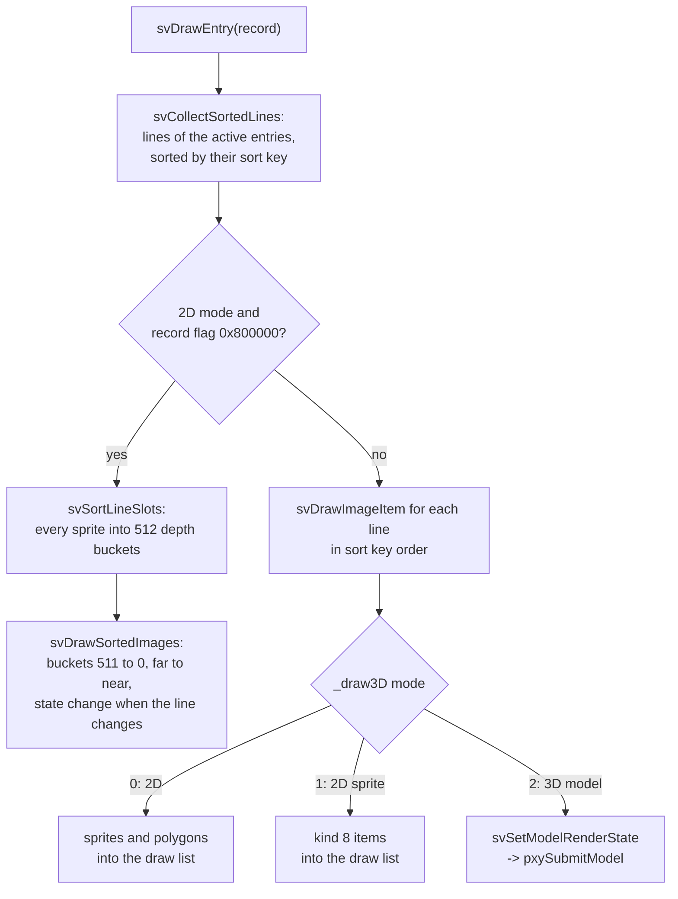

### The three effect passes

The variable `_draw3D` selects what a pass draws.

| Value | Name | Entry point | Draws |
| --- | --- | --- | --- |
| 2 | `SV_RENDER_3D_MODEL` | `svDrawEffectRecords3D` | The model items of all effect records, by submitting them to the model library |
| 1 | `SV_RENDER_2D_SPRITE` | `svDrawScene3D` | The items of kind 8 |
| 0 | `SV_RENDER_2D` | `svDrawScene2D` | All other sprites and polygons |

`svDrawEffectRecords3D` is called from `sefDrawEffect`, which
`xglRenderMove` calls just before `pxyFlush`. It stores the camera matrices
for billboards, clears the effect light set, culls and sorts the records,
and calls `svDrawEntriesByKind` for each of the 57 mapper numbers that has
entries. The models it submits are then drawn by `pxyFlush` together with
all other models.

`svDrawScene` is the common body of the two 2D passes. It sends the static
state and the view setup, uploads mapper 0, and then draws in one of two
orders. When mask 0x1 of `svSceneFlags` is set in the plain 2D pass, every
visible record is drawn in depth order, and the mapper is switched whenever
a record needs another one. Otherwise the mappers are handled one after the
other: mapper 0 first, then each mapper from 1 to 56 that holds a file is
uploaded and its records and its alters are drawn. Alters are the strips of
the effect sequence driver, see [sdv.md](sdv.md).

`svDrawEntry(recordIndex)` prepares one record: it makes it the current
record, loads its request parameters, builds the view matrix and, for a
placed record (flag 0x1000000), the record's own rotation, translation and
scale matrix, and then draws its lines.

### Models drawn by effects

In the 3D pass `svDrawImageItem` walks the 256 point handles of a line and
picks the slots whose part kind is 6. For each one it builds the model
matrix on VU0 with `svBuildItemMatrix`: the record's matrix or the point's
position, times the slot's own matrix, times the scale, with the camera
rows multiplied in for items that face the camera. Then
`svSetModelRenderState(item, matrix, sortKey)` describes the model to the
model library and submits it.

| Call | Value |
| --- | --- |
| `nmlModelSetStencil`, `nmlModelSetStencilAlpha` | A blend value from `svStencilTable`, unless the item is opaque (stencil index 0 and transparency 0x80) |
| `pxySetLightCopy` | The effect light set, with the item's color written into its ambient rows |
| `pxySetAnimTime` | The item's own time, so the tracks of the model follow the effect |
| `nmlModelSetTexture` | The texture block found by name |
| `nmlModelSetDrawMatrix` | The matrix built above |
| `nmlModelSetTransparency` | The item's alpha divided by 128 |
| `nmlModelSetRenderLevel(4)`, `(8)`, `(0x200)`, `(0x100)` | From bits 0x1, 0x2, 0x80 and 0x40 of the item's draw flags |
| `nmlModelSetZwrite` | From bit 0x8 of the draw flags |
| `nmlModelSetFogCol`, `nmlModelSetFogDist` | The fog override block of the effect system, when it is enabled and bit 0x40 is clear |
| `nmlModelSetSortOffset` | The line's sort key times `svSortOffsetScale` |
| `nmlModelSetScale` | The item's scale |
| `pxySubmitModel` | The model found by name |

### Scene flags and small helpers

`src/main/sv_scene_flags.c` holds the word `svSceneFlags` with four
accessors: `svSceneFlagsTest`, `svSceneFlagsSet`, `svSceneFlagsClear` and
`svSceneFlagsToggle`. Mask 0x1 selects the depth-ordered drawing of all
records described above. The effect system sets and clears it. Mask 0x2
shows the items and lines whose flag 0x10 normally hides them.

The same file has `vu0DirectionToAngles(angles, direction, ...)`, which
converts a direction vector into a pitch (from minus y and the horizontal
length) and a yaw (from x and z), and `lightSetLogDump(lights)`, which walks
the vectors of a light set with the labels `sDir`, `sCol`, `sSha`, `sPntP`
and `sPntC`. Its log call does nothing in the retail build.

Other helpers of the layer: `svProjectVertex` projects a point to screen
coordinates and reports whether it left the unit cube, `sefClipPolygon`
with `sefClipPlaneDistance` and `sefClipEdgeToPlane` clips a quad against
the view volume, `sefTransformClipPoint` and `sefInitClipViewVolume` set up
the cull test, `svSetZTestEnv` switches the depth test of the sprites on or
off, and `sefInitPartTransform` with `svInitItemDrawKind` prepares the
scale of an item from the scale keys of the current record.

## The VU0 helpers

Several small files hold VU0 routines that the model code calls for its own
math on the EE. The general description of VU0 macro mode and the current
matrix is in [math.md](math.md).

`src/main/nml_packet_add.c` has the current-matrix helpers. The current
matrix lives in the VU0 registers `vf27` to `vf30`. `_CurMatrixSet(matrix)`
loads it. `_CurApplyMatrix(dst, v)` transforms a point with it.
`_CurApplyMatrix33(dst, v)` applies only the rotation rows.
`_CurMatrixMul(matrix)` multiplies the current matrix by another matrix.

`src/main/model_calc_clip.c` has, next to the clip tests described earlier,
two projections. `_CurRotTransPersFog(out, in, fog)` transforms a point by
the current matrix and replaces `w` by the fog value.
`_CurRotTransPersClipFloat(out, in)` transforms a point, tests it against
the clip volume, divides by `w`, applies the view scale and offset held in
`vf25` and `vf26`, and returns the six clip flags.

`src/main/pxy_profile.c` has `_CurMatrixMul33normXYZW(dst, src)`, the
routine that rotates four vectors by the current matrix, transposes them
into three rows and normalizes each of the four columns. It prepares the
light directions for VU1. The file also has `pxyKeyInterpolate`, described
under [Tracks](#tracks).

## The profiler

`src/main/pxy_profile.c` contains a small timer table for developers. It has
32 entries with a name, a start count, a total and a text line. The time
source is the count register of EE timer 1 at 0x10000800. One tick is
0.0052173799 milliseconds, or twice that when `pxyTickScaleDouble` is 1.

| Function | Effect |
| --- | --- |
| `pxyProfileBegin(name)` | Finds the entry with that name or takes a free one, and stores the timer count |
| `pxyProfileEnd(name)` | Adds the ticks since the start to the total, formats the line `name  time` and returns the total in milliseconds |
| `pxyProfileEndMs(name)` | The same without the text line |
| `pxyProfileGetMs(name)` | Returns the total of an entry in use |
| `pxyProfileGetMsUnchecked(name)` | The same without testing the in-use flag |
| `pxyProfileDrawEntries()` | Draws the lines of all entries in use with `pxyDebugDrawStringShadow`, 17 pixels apart from y 100 |
| `pxyProfileClearEntries()` | Marks all entries free |

`pxyFlush` measures itself under the name `pxyFlush`, draws the table when
`pxyProfileDrawFlag` is nonzero and clears the table every frame.
`nmlModelConstruct` sets the flag to 0, and no code in these files sets it.
The debug text functions are described in
[debug-tools.md](../game/debug-tools.md).

## The table lookup of `txd_table_entry.c`

`txdTableEntry(table, index)` returns `table + table[index]`: the table
starts with 32-bit offsets, and each offset is relative to the start of the
table. The menu, the party code and the save screen use it to reach the
strings of their text tables (the three `.txd` files on the discs are string tables), see [main-menu.md](../game/main-menu.md) and
[save-data.md](../architecture/save-data.md). The file also contains two
functions with empty bodies, `menuSceneResetNoop` and `ysegfDetailLeaveNoop`.
Nothing in this file is used by the model code.

## Frame reset

`pxyBeginFrame` empties the library for the next frame. It calls
`nmlModelFlushClear`, which runs four resets.

| Function | What it resets |
| --- | --- |
| `pxyResetSlots` | The ring of four slots and its write index |
| `pxyResetCounters` | The next-model block (`pxyResetGlobals`), the model count, the tracked header count, the two entry cursors (0 and 0x1000), the shadow caster mode (1) and the `MOM2_B04` flag |
| `pxyClearEntryTable` | The global color (white), the direct-send queue and its group mask, the animation freeze, the 16 registered draw callbacks, the frame options `pxyFlags` and `pxyDrawCallback` |
| `pxyResetBatchTables` | Both batch tables, the overlay, shadow and separate counts, and the head and tail of the sorted list |

The frame options and the callbacks are cleared every frame, so code that
wants a pass or a callback has to ask for it again each frame. The water
code and the field loop do exactly that.

`pxyRegisterDrawCallback(function)` adds a function to the list of 16
callbacks that `nmlModelFlushSub` calls after the main pass of each camera.
A function that is already in the list is not added twice.

`xglRenderFrameBeginFlushEIrq` and `xglRenderFrameEndFlushEIrq` both call
`nmlPacketAddWaitMicrocodeIrq`, which adds a VIF FLUSH command with the
interrupt bit set (0x91000000). The render code puts one at the start and
one at the end of the frame's packet.

## Limits

| Limit | Value | Where |
| --- | --- | --- |
| Models per frame | 0x100 | `PXY_BATCH_MAX`, tested in `pxySubmitModel` |
| Batches per table | 256 | `PxyBatchTable.batches` |
| Opaque draw entries | 0x1000 | `PXY_OPAQUE_ENTRY_END` |
| Translucent draw entries | 0xa00 | From 0x1000 to `PXY_TRANSLUCENT_ENTRY_END` |
| Overlay batches | 32 | `pxyState.overlayBatches` |
| Shadow batches | 64 | `pxyState.shadowBatches` |
| Separate batches | 0xa0 | `pxyState.unk820` |
| Slots for parent lookup | 4 | `PXY_SLOT_COUNT` |
| Cameras | 4 | `pxyCameraEnable` |
| Clip planes per model | 2 | `PxyClipPlanes` |
| Sort groups and items per layer | 8 and 32 | `PxySortWork` |
| Joint matrices kept in VU1 | 0x40 | `pxyUploadBoneMatrices` |
| Direct-send entries | 3048 | `nmlModelDirectSendFull` |
| Registered draw callbacks | 16 | `pxyState.drawCallbacks` |
| Packet fill before passes stop | 85 percent | `pxyDrawBatches` |
| Light packs | 16 | `xglLightPackTable` |
| Directional lights per model | 6 | `XglLightSet` |
| Point lights per model | 3 | `XglLightSet` |
| Image mappers | 57 | `svInitImageMapper` |
| Entries per image mapper | 0x100 | `SV_ENTRY_COUNT` |
| Sort buckets and items | 512 and 1200 | `svSortBuckets`, `svSortItems` |
| Profiler entries | 32 | `PXY_ENTRY_COUNT` |

The batch lists have no overflow test of their own. They rely on the limit
of 0x100 models per frame.
