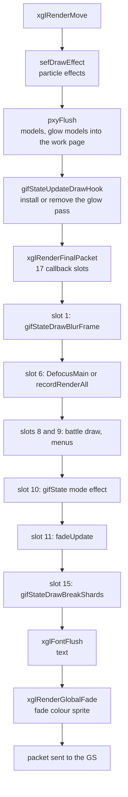
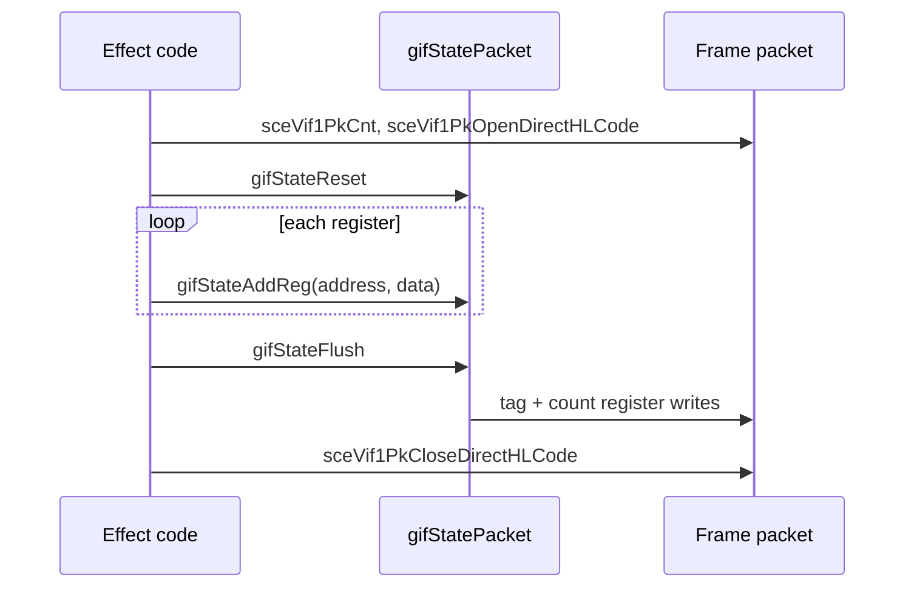
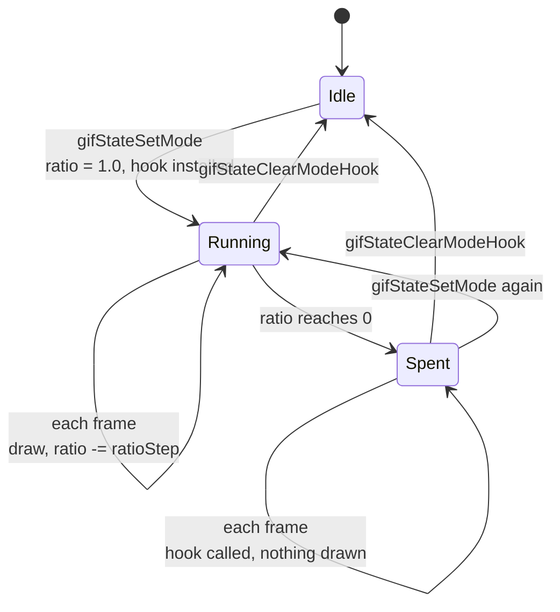
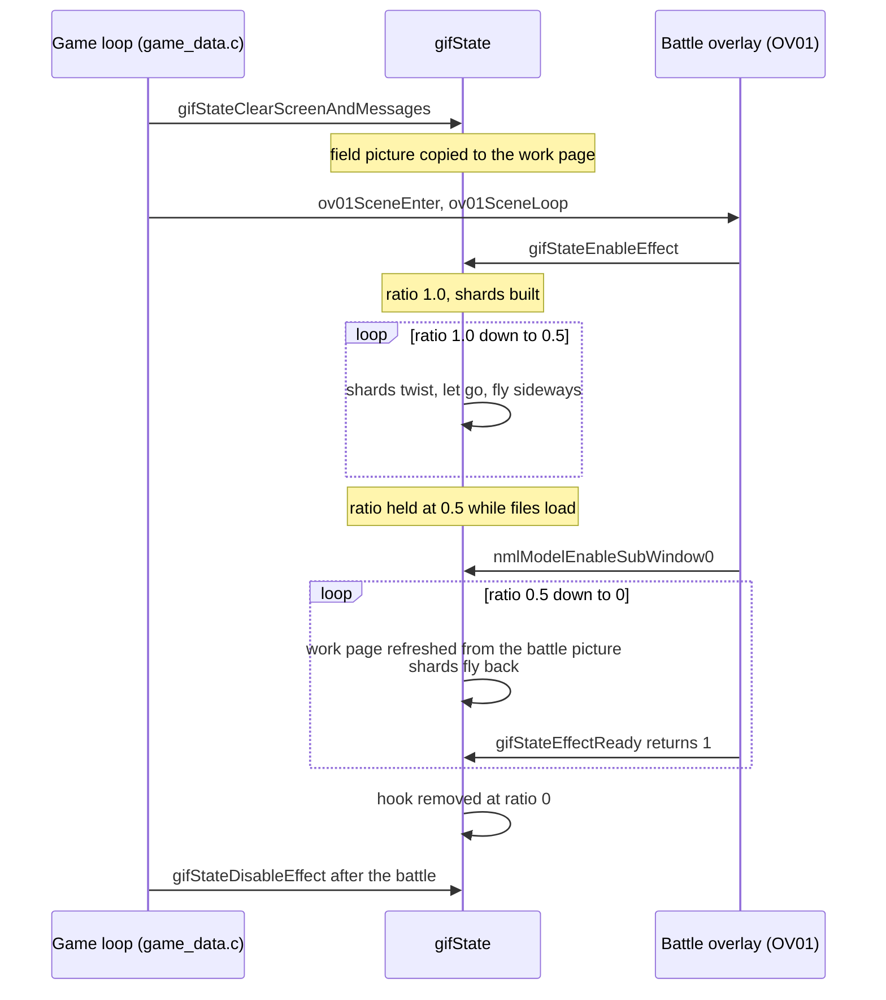
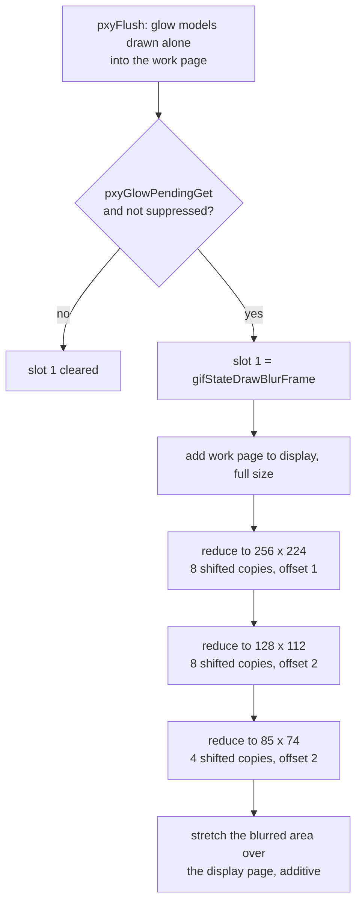
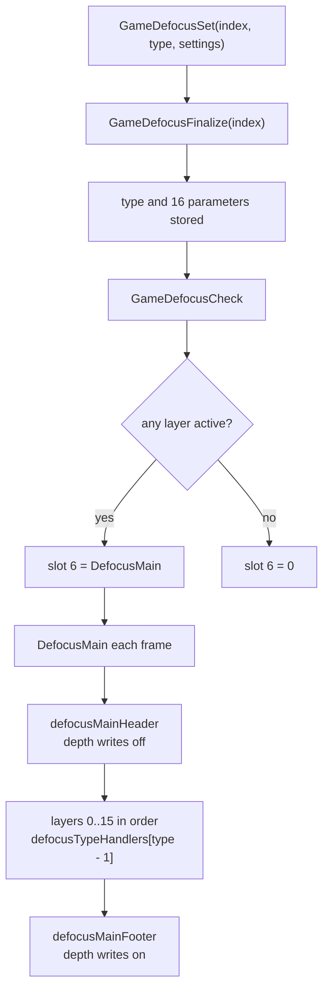
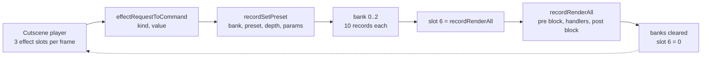
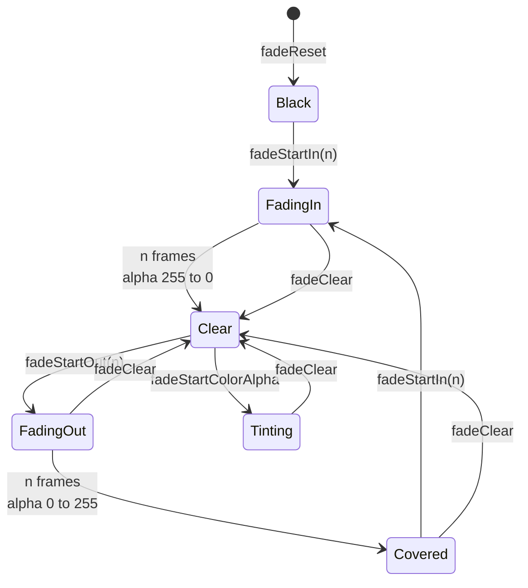
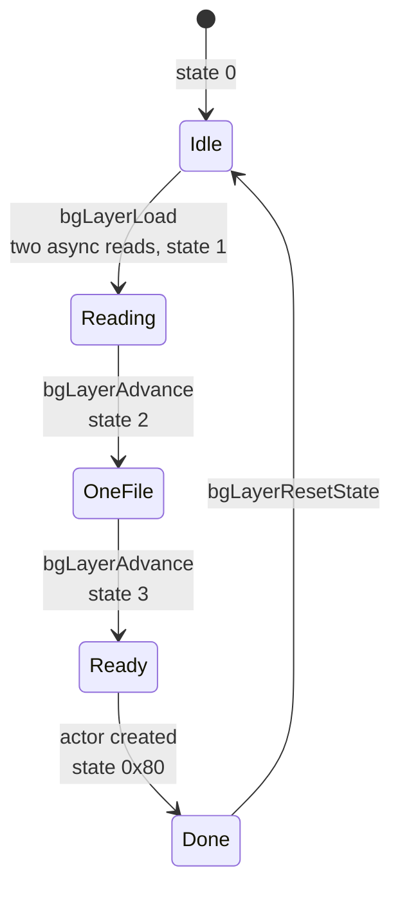
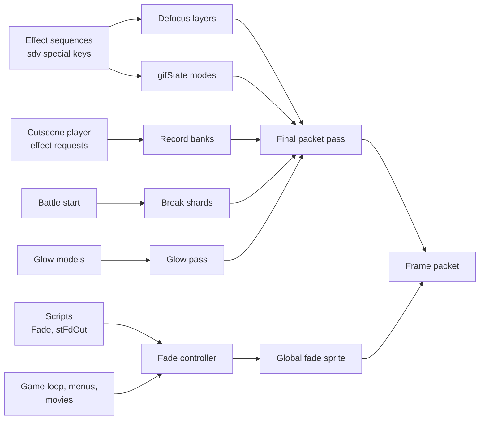

# Screen effects

Xenosaga Episode II finishes almost every frame with one or more full-screen
passes. After the 3D scene and the particle effects are in the frame buffer,
small pieces of code take the finished picture, use it as a texture and draw
it again: blurred, shifted, pixelated, broken into shards or covered by a
colour. These passes give the game its radial blurs, depth of field, glow,
cutscene wipes, the shattering screen at the start of a battle and every fade
to black.

There is no single "post-processing" module. Six separate layers do this work,
each with its own state and its own callers. `gifState` owns a queue of GS
register writes and seven screen effects built on it. The **defocus** layers
(`GameDefocusSet`, `DefocusMain`) are sixteen slots of eleven effect types.
The **records** (`recordSetPreset`, `recordRenderAll`) are three banks of ten
draw records that the cutscene player fills every frame. The **fade
controller** (`fade_ctrl.c`) drives the global fade colour. The **background
layers** (`bg_layer.c`) are the animated backdrop behind the menus. The
**glow** pass blurs the bright parts of marked models. All of them write GS
commands into the frame packet that the render module sends at the end of the
frame. The base pipeline, the packet and the frame buffers are described in
[rendering.md](../architecture/rendering.md).

[← Back to the overview](../README.md)

## Files

| File | Contents |
| --- | --- |
| `src/main/gifState.c` | The GS register queue (`gifStateReset`, `gifStateAddReg`, `gifStateFlush`), the status block `gifStatus`, the seven screen effect modes, the break shards of the battle transition, the glow blur `gifStateDrawBlurFrame` |
| `include/main/gifState.h` | `GifStatusBlock`, `GifBreakShard`, `GifBreakPoint`, the `GifEffectMode` enum |
| `src/main/game_defocus.c` | The sixteen defocus layers: `GameDefocusSet`, `GameDefocusCheck`, `GameDefocusFinalize`, `GameDefocusQuickSet`, the frame callback `DefocusMain` and the handlers `DefocusMainType01` to `DefocusMainType11`, with their fixed packet templates |
| `include/main/game_defocus.h` | Prototypes of `GameDefocusSet` and `GameDefocusCheck` |
| `src/main/record_render.c` | The record banks, `recordSetPreset` with presets 0 to 24, the frame callback `recordRenderAll`, the handlers of record types 1 to 7 and the cell grid |
| `include/main/record_render.h` | Prototypes of the record handlers and their helpers |
| `src/main/record_draw_strip.c` | Record type 8 (two-colour strip) and type 9 (turning columns) |
| `src/main/record_turn_angle.c` | `recordTurnAngleAt`, `recordLerp`, `recordOffsetCorners`: helpers of the turning columns |
| `src/main/circle_draw.c` | Record types 10 to 14: wavy ring, preset quads, rings of sprites, turning grid cells |
| `src/main/quad_draw.c` | Record types 15 to 19: alpha flags, wobbling quad, jitter grid, orbit grid, ring wave grid, and the corner rotation helpers |
| `src/main/sprite_batch_draw.c` | Record type 20 (`spriteBatchDraw`), the empty type 21 handler and the two clip rectangle helpers |
| `src/main/fade_ctrl.c` | The fade controller: `FadeState`, `fadeUpdate`, `fadeStartIn`, `fadeStartOut`, `fadeStartColor`, `fadeStartColorAlpha`, `fadeReset`, `fadeClear` |
| `include/main/fade_ctrl.h` | Prototypes of the fade controller |
| `src/main/fade_ctrl.c` | The script commands `ColorSet`, `Fadein`, `Fadeout`, `Colorfade`, `Colorfade2` and their table `fadeCommandTable` |
| `src/main/bg_layer.c` | The three background layers behind the menus (back, middle, front), their loading states and camera, and the font callback `ScissorReset` |
| `include/main/bg_layer.h` | The layer indices and the `BG_LAYER_DONE` state |
| `src/main/glow.c` | `glowRunScene`, a developer test scene for the glow pass, and `glowUpdateFromPad` |
| `include/main/glow.h` | Prototype of `glowRunScene` |
| `src/main/render_sprite.c` | `renderFadeBand` and the three sprite draws `renderSprite`, `renderSpriteClut`, `renderSpriteClutAlpha` |
| `include/main/render_sprite.h` | Prototypes of the four functions |
| `src/main/game_map_object.c` | Only `GameDefocusReset` and `mapBackdropDraw` belong here. The rest of the file is described in [map-and-units.md](../game/map-and-units.md) |

## Where the layers run in a frame

All layers draw in the same place: the end of the frame. `xglRenderMove` in
`src/main/xgl_render.c` closes each frame in a fixed order. It first draws the
particle effects (`sefDrawEffect`) and flushes the model draw lists
(`pxyFlush`). Then it calls `gifStateUpdateDrawHook`, which decides whether
the glow pass runs this frame. After that comes `xglRenderFinalPacket`, the
**final packet pass**, followed by the queued text (`xglFontFlush`) and the
global fade sprite (`xglRenderGlobalFade`).

The final packet pass is a loop over seventeen function pointers that start
at `sRender.final_packet_callback` (offset `+0x24` of the render state
`sRender` at `0x00645820`). Each non-zero pointer is called once with the
current frame packet. The first eight slots are the `final_packet_callback`
array itself. The loop then runs on through the words that follow it in
memory, which other files know under their own names. A layer switches itself
on by storing its draw function into its slot and off by storing zero.

| Slot | Address | Name in the source | Used by |
| --- | --- | --- | --- |
| 1 | `0x00645848` | `gifStateDrawHook` | The glow pass `gifStateDrawBlurFrame` |
| 6 | `0x0064585C` | `sRender.final_packet_callback[6]` | `DefocusMain` or `recordRenderAll` |
| 8 | `0x00645864` | `sRender.battle_draw_callback` | The battle draw `ov01DrawAll` ([battle-engine.md](../game/battle-engine.md)) |
| 9 | `0x00645868` | `menuCallbackHook` | The menus |
| 10 | `0x0064586C` | `gifStateModeHook` | The current `gifState` effect mode |
| 11 | `0x00645870` | `fadeUpdateHook` | `fadeUpdate` of the fade controller |
| 12 | `0x00645874` | `pxyEntryGroupHooks` | The model library |
| 13 | `0x00645878` | `pxyFrameCopyHooks` | The model library |
| 14 | `0x0064587C` | `msgFrameHooks` | The message windows |
| 15 | `0x00645880` | `gifStateEffectHook` | The battle transition `gifStateDrawBreakShards` |
| 16 | `0x00645884` | `pauseDrawHook` | The pause screen |

The slot order is the draw order. The glow comes first, then the defocus
layers or the records, then the battle draw and the menus, then the
`gifState` mode effect, then the fade controller's update, and near the end
the battle transition. Text is flushed after the whole pass, so the screen
effects never distort the text of the same frame. The global fade sprite is
drawn after the text and covers everything.

The defocus layers and the records share slot 6. `GameDefocusCheck` stores
`DefocusMain` there while any defocus layer is active and zero otherwise.
`recordUpdateRenderHook` stores `recordRenderAll` there while any record is
used and zero otherwise, and `recordRenderAll` clears the slot again after it
has drawn. The slot therefore belongs to whichever of the two wrote it last.
In practice the two have different users: the effect sequence driver sets
defocus layers during play and battle, and the cutscene player sets records.



## Pages and coordinates

Every effect on this page works on **pages**: 512 pixel wide, 32-bit areas of
GS video memory that can be both a drawing target and a texture. The render
state `sRender` holds their base addresses. The effects use four of them.
The video memory layout itself belongs to
[rendering.md](../architecture/rendering.md).

| Page | Field | Role for the effects |
| --- | --- | --- |
| Display page | `sRender.display_buffer_base` | The page the frame is being drawn into. Effects draw their result here |
| Draw page | `sRender.draw_buffer_base` | The other page of the double buffer. Used as a texture it gives the picture of the previous frame |
| Work page | `sRender.vram.work_buffer_base` | A spare page. Effects copy the display page here first, then draw the copy back as a texture |
| Second page | `sRender.vram.texture_base` | A second spare page. The glow pass and the battle transition use it for reduced copies |

A GS texture cannot be the same memory as the target that is being drawn, so
nearly every effect starts with a **frame copy**: one full-screen textured
sprite that copies the display page into the work page. The effect itself is
then a draw from the work page back onto the display page with some change in
the texture coordinates, the positions or the blending.

Two helper functions turn a small selector into a register value. Records and
defocus layers use the same selector numbers. `gsMakeFrame(buffer, flag)`
(`src/main/gs_make_frame.c`) returns a `FRAME` value and `gsMakeTex0(buffer,
tex_cc)` (`src/main/gs_make_tex0.c`) returns a `TEX0` value for a 512 by 512
`PSMCT32` texture. `GetTex0` in `game_defocus.c` does the same for the
defocus handlers.

| Selector | As a target (`gsMakeFrame`) | As a texture (`gsMakeTex0`, `GetTex0`) |
| --- | --- | --- |
| 0 | Display page | Display page |
| 1 | Draw page | Draw page |
| 2 | Work page | Work page |

Screen positions are written in the GS's 12.4 fixed point format around the
primitive origin. The picture is 512 by 448 pixels and is centred on the GS
coordinate (2048, 2048), so screen pixel (0, 0) is GS pixel (1792, 1824).
`gifState.c` keeps the two numbers in `gifStateOriginX` (`0x700`) and
`gifStateOriginY` (`0x720`) and converts with `(origin + x) * 16 - 8` for X
and `(origin + y) * 16 - 9` for Y. The half pixel bias makes the texels of a
full-screen copy land exactly on their pixels. The record code adds `1792.0f`
and `1824.0f` and multiplies by 16. `game_defocus.c` uses the ready
constants `28664` and `29175` for the top left corner. Texture coordinates
are in the same 12.4 format, so a full page is `0x2000` by `0x1C00`.

```text
GS primitive space (pixels)

      1792           2048           2304
        |              |              |
 1824 --+--------------+--------------+
        |  screen (0,0)               |
        |                             |
 2048 --+           centre            |   512 x 448 pixels
        |         (256, 224)          |
        |                             |
 2272 --+--------------+--------------+
                              screen (512,448)
```

## The gifState register queue

`gifState` is first of all a small tool for writing GS registers. The GS is
programmed through register writes: which page to draw into (`FRAME_1`),
which texture to use (`TEX0_1`), how to blend (`ALPHA_1`), which tests to run
(`TEST_1`), and also the primitive itself (`PRIM`, `RGBAQ`, `UV`, `XYZF2`).
The GIF accepts such writes in "A+D" form, one quadword per register with the
value in the low half and the register address in the high half.

The queue is the static array `gifStatePacket`, 128 quadwords. Entry 0 is the
GIF tag, the other entries are register writes. `gifStateNumPacket` counts
the queued writes. The assert text in the source names the limit:
`numPacket < (STATEPACKET_MAX - 1)` with `STATEPACKET_MAX` equal to `0x80`,
so one flush carries at most 127 register writes.

| Function | What it does |
| --- | --- |
| `gifStateReset()` | Sets the count to 0 and writes the tag header: end of packet, one register per loop, register list `A+D` |
| `gifStateAddReg(gifAddress, gifData)` | Appends one register write. Asserts when the queue is full |
| `gifStateAddRawQword(word0, word1, word2, word3)` | Appends four raw words as one quadword |
| `gifStateFlush()` | Writes the count into the tag and copies tag and writes into the current frame packet with `sceVif1PkAddDirectDataN`. Does nothing when the queue is empty |
| `gifStateTexFlush()` | Queues `TEXFLUSH` |
| `gifStateSetAlphaFix(fixedAlpha)` | Queues `ALPHA_1` for a normal blend with a fixed alpha: `(Cs - Cd) * FIX + Cd` |
| `gifStateSetScissor(minX, minY, maxX, maxY)` | Queues `SCISSOR_1` |
| `gifStateSetZBufFormat()` | Queues `ZBUF_1` at page 0 with format code `0x31` and depth writes enabled |

The caller is responsible for the VIF framing around a flush. Every user in
the game follows the same four steps: `sceVif1PkCnt(packet, 0)` and
`sceVif1PkOpenDirectHLCode(packet, 0)` open a direct block in the frame
packet, `gifStateReset` starts the queue, a run of `gifStateAddReg` calls
fills it, and `gifStateFlush` followed by `sceVif1PkCloseDirectHLCode` ends
the block. Because the primitive registers go through the same queue, a
sprite is simply `PRIM`, `RGBAQ`, then `UV` and `XYZF2` twice.



The queue is used outside this file as well. `render_sprite.c` builds all its
sprites with it, and other modules call `gifStateAddReg` for small state
changes. The larger effects in `gifState.c` use the queue only for their
state and build their vertex lists by hand on the scratchpad
(`0x70000000`), because a blur fan or a grid row has more vertices than the
queue holds.

## gifState screen effects

On top of the queue, `gifState.c` implements a set of full-screen effects
that all share one block of parameters, `gifStatus`. A caller fills the
parameters with small setter functions and then picks a mode with
`gifStateSetMode`. From then on the mode's draw function runs once per frame
in callback slot 10 until someone clears the hook.

### The status block

`gifStatus` is a single global `GifStatusBlock`. Its fields mean different
things to different modes, which is why several have generic names.

| Offset | Type | Field | Meaning |
| --- | --- | --- | --- |
| `+0x00` | `int` | `state` | The current mode number (`GifEffectMode`) |
| `+0x04` | `int` | `centerX` | Effect centre on the screen, X in pixels |
| `+0x08` | `int` | `centerY` | Effect centre, Y in pixels |
| `+0x0C` | `int` | `effectAlphaType` | Blend equation: 0 normal, 1 additive, 2 subtractive |
| `+0x10` | `int` | `effectAlpha` | Strength of the blend, 0 to `0x80` |
| `+0x14` | `int` | `fbp` | Source page of the frame copy: 1 takes the draw page, any other value the display page |
| `+0x18` | `int` | `blur` | Blur amount in pixels |
| `+0x1C` | `int` | `depth` | Z value of every vertex of the effect |
| `+0x20` | `f32` | `ratio` | Life of the effect. `gifStateSetMode` sets it to 1.0 and the draw functions lower it |
| `+0x24` | `f32` | `ratioStep` | Amount the ratio drops per frame |
| `+0x28` | `int[4]` | `subWindow` | Four integer parameters, read differently by each mode |
| `+0x38` | `f32[4]` | `subWindowValue` | Four float parameters set by `nmlModelSetSubWindowValue`. No draw function reads them |
| `+0x50` | `Vector4` | `mulColor` | A direction vector for the camera quad mode |

The setters are one-line functions: `gifStateSetCenter`,
`gifStateSetEffectAlpha`, `gifStateSetFbp`, `gifStateSetBlur`,
`gifStateSetDepth`, `gifStateSetDecrease` (the ratio step),
`nmlModelUseSubWindow(index, value)` for the four integers and
`nmlModelSetMulColor` for the vector. The two `nmlModel` names are
historical. They write `gifStatus` and have nothing to do with models.

`gifStateSetMode(mode)` accepts 0 to 6. It stores the mode in `state`, copies
the mode's draw function from the table `gifStateEffectDraws` into
`gifStateModeHook` and sets `ratio` to 1.0. `gifStateClearModeHook` stores
zero into the hook and ends the effect.

| Mode | Enum | Draw function | Effect |
| --- | --- | --- | --- |
| 0 | `GIF_EFFECT_RADIAL_BLUR` | `gifStateDrawRadialBlur` | Zoom blur from a centre |
| 1 | `GIF_EFFECT_RING` | `gifStateDrawRing` | A ring shaped distortion around a centre |
| 2 | `GIF_EFFECT_CAMERA_QUAD` | `gifStateDrawCameraQuad` | A shifted ghost of the screen along a 3D direction |
| 3 | `GIF_EFFECT_JITTER_GRID` | `gifStateDrawJitterGrid` | Random noise distortion |
| 4 | `GIF_EFFECT_FADE_QUAD` | `gifStateDrawFadeQuad` | A sheared ghost of the screen |
| 5 | `GIF_EFFECT_BREAK_SHARDS` | `gifStateDrawBreakShards` | The breaking screen of the battle transition |
| 6 | `GIF_EFFECT_NONE` | `gifStateDrawNone` | Nothing (an empty function) |

### Life of an effect

All modes share the same life cycle. The ratio starts at 1.0. Every frame the
draw function draws with a strength that depends on the ratio and then
subtracts `ratioStep`. When the ratio reaches 0 the function returns without
drawing, but the hook stays installed until the caller removes it. A
`ratioStep` of 0 therefore gives an effect of constant strength that lasts
until it is cleared, and a positive step gives an effect that fades out by
itself. The radial blur also checks the pause flag `CONTROL_PAUSED` of
`gameWork.control` and freezes its ratio and its random values while the game
is paused.



### The setup context

Modes 0 to 4 begin with `gifStateSetupContext(packet, alphaFix)`. This
function prepares the frame copy and the GS state for the redraw.

1. It patches two entries of the fixed fifteen-quadword block
   `gifStateSetupPacket`: the target becomes the work page and the texture
   becomes the display page, or the draw page when `gifStatus.fbp` is 1.
2. It sends the block. The block sets depth writes off, a test that writes
   colour only, point sampling and then draws one textured sprite over the
   whole screen. This is the frame copy into the work page.
3. It queues the state for the effect: target the display page, texture the
   work page with bilinear filtering, texture coordinates clamped to the
   region 0 to 511 by 0 to 447, a depth test that passes for a Z greater
   than or equal to the stored one, and depth writes off.
4. It queues `ALPHA_1` from `effectAlphaType`. Type 0 is a normal blend
   `(Cs - Cd) * A + Cd`, type 1 adds `Cs * A + Cd`, type 2 subtracts
   `Cd - Cs * A`.

The source of `A` differs by mode. For the ring (state 1) the blend uses the
alpha of each vertex, because the ring fades between its inner and outer
edge. For all other modes the blend uses the fixed value `alphaFix`, which
the caller computes as `effectAlpha * ratio`. This is how every mode fades
out as its ratio drops.

Because the effect has a depth test and takes its Z from `gifStatus.depth`,
a caller can place the effect in the scene: with a far depth the distortion
only touches the background and leaves near objects sharp.

### Mode 0: radial blur

`gifStateDrawRadialBlur` draws the screen copy as one triangle fan. The first
vertex is the effect centre. The other vertices walk around the four screen
edges, one every `subWindow[0]` pixels (at least 4). Each edge vertex sits at
its true screen position but samples the texture from a point pulled towards
the centre: `centre + (edge - centre) * scale`.

The scale of each edge point is random. `gifBlurScales` holds 512 values that
are drawn again every frame as `ratio * 0.9 + (xglSRand() % 10) * 0.01`.
Neighbouring fan triangles therefore zoom the picture by slightly different
amounts, which smears it along rays from the centre. At ratio 1.0 the zoom is
small. As the ratio falls, the scales fall with it and the picture is pulled
ever further outward while its alpha (`effectAlpha * ratio`) fades.

The game uses this mode for the "white shake". The script native
`setLastDan` (`runtimeSetLastDan` in `src/main/uwamono_objx.c`) calls
`gifStateStartWhiteShake` with the current map unit's actor. The function
sets depth `0xFFFFFF`, the centre (256, 224), a normal blend with alpha 100,
a ratio step of 0.006 (about 167 frames), the draw page as the source and
mode 0. It also starts the actor's sweep animation by writing its
`sweepPhase`, `sweepSpeed`, `shadowValue`, `shadowCount`, `shadowValue3` and
`moveState` fields (see [actors.md](actors.md)).

### Mode 1: ring

`gifStateDrawRing` draws a ring of `gifStateRingCount` (90) segments around
the centre as two triangle strips. The outer strip runs from radius
`subWindow[1]` to radius `subWindow[1] + subWindow[2]`. Its outer points
sample the texture `blur` pixels closer to the centre than they are drawn, so
the picture inside the band is stretched. The second strip reuses the same
points and replaces every second one by a point at radius
`subWindow[1] + subWindow[3]`, started at an angle that depends on the ratio.

Two alpha values shape the band. With `subWindow[0]` equal to 0 the stretched
outer points carry `ratio * effectAlpha` and the points at the base radius
carry 0. With a non-zero `subWindow[0]` it is the other way round. The result
is a soft ring that fades towards one of its edges, the classic shock wave
ripple. All positions are clamped to the screen.

### Mode 2: camera quad

`gifStateDrawCameraQuad` draws the whole screen copy once more as a single
512 by 448 quad, shifted on the screen. The shift comes from a direction in
the 3D world. The function builds the rotation of the active camera
(`xglStudioSelectGetActiveCamera(0)`), inverts it, scales `gifStatus.mulColor`
by `blur` and transforms it. The X and Y of the result become the pixel
offset of the quad.

The effect is a ghost image that trails in a fixed world direction, whatever
way the camera looks. With a fading ratio it reads as a directional motion
blur. The ratio is lowered each frame and nothing is drawn once it is at or
below 0.

### Mode 3: jitter grid

`gifStateDrawJitterGrid` draws the screen copy as a grid of vertices every
`gifStateGridStep` (10) pixels. The positions are regular. The texture
coordinates of each vertex are shifted by a random number of pixels,
`(xglSRand() % blur) * ratio`. The left column and the top row are never
shifted. The first two rows are sent as one strip. Every later row copies the
lower vertices of the row above and adds a new row below, and is sent as its
own packet.

On screen the picture shakes apart into a field of small random
displacements, like bad reception or heat. The displacement shrinks with the
ratio.

### Mode 4: fade quad

`gifStateDrawFadeQuad` draws the screen copy as one quad whose corners move.
The two top corners are shifted by (`subWindow[0]`, `subWindow[1]`) times the
ratio and the two bottom corners by (`subWindow[2]`, `subWindow[3]`) times
the ratio. With equal pairs this is a shifted ghost. With different pairs the
ghost is sheared or stretched. The alpha is `ratio * effectAlpha`, so the
ghost slides back into place while it fades.

### Who sets the modes

Three callers use the mode effects.

The main user is the effect sequence driver. In `src/main/sdv.c` the
"special" keys of kinds 10 to 14 map directly to modes 0 to 4
(`gifStateSetMode(kind - SDV_SPECIAL_KIND_SCREEN)`). Each frame the driver
projects the key's position to the screen and passes it on: the projected
point becomes the centre and the depth, the key's alpha, intensity, width,
height and two extra values become `effectAlpha`, `blur` and the four
sub-window integers, and for kind 12 a direction from the key becomes
`mulColor`. The key's `decrease` value divided by 256 is the ratio step. When
the sequence ends, the driver calls `gifStateClearModeHook`. Battle
techniques and field events reach the screen effects through this route. See
[sdv.md](sdv.md).

The second user is the developer water test in `src/main/TiWater.c`. Its
debug panel edits the centre, alpha type, alpha, decrease, source page, blur
and the four sub-window values live, and the circle button calls
`gifStateSetMode` with the chosen effect number. See
[debug-tools.md](../game/debug-tools.md).

The third user is `gifStateStartWhiteShake`, described under mode 0.

## The battle transition

Mode 5 is the effect every player knows: when a battle starts, the field
picture breaks like a pane of glass, the shards tumble away to both sides,
and the battle scene arrives on shards that fly back and close the picture.
It does not use the mode hook. `gifStateEnableEffect` installs
`gifStateDrawBreakShards` in callback slot 15 (`gifStateEffectHook`), near
the end of the final packet pass, so it draws over everything else.

### Shards

`gifStateBuildBreakShards` cuts the screen into 24 triangles. It starts from
an **impact triangle** of three random points (`gifBreakPoints`): one in the
upper middle of the screen and one each in the lower left and lower right.
The function finds the top, left, bottom and right corner of this triangle
and joins them to the four screen corners. That gives seven triangles around
the impact triangle, eight with the impact triangle itself. Each of the eight
is then split at its centroid into three shards.

Every shard is a `GifBreakShard`, a small 3D object.

| Offset | Field | Meaning |
| --- | --- | --- |
| `+0x000` | `vertex[24]` | A triangular prism around the shard centre: the front face, a back face 10 units behind it and three sides, as eight triangles |
| `+0x180` | `projected[24]` | The same vertices after rotation, projection and movement, in screen pixels |
| `+0x300` | `center` | The centroid of the shard on the screen |
| `+0x310` | `spin` | Rotation speed about X and Y: 30 to 49 degrees with a random sign |
| `+0x320` | `angle` | The rotation of the last frame |
| `+0x330` | `speed` | The point of the transition at which this shard lets go, 0.05 to 0.35. Shards near the middle of the screen wait longest |
| `+0x334` | `fall` | The number of frames the shard has been falling |

`gifBreakShardUpdate(shard, ratio)` moves one shard. With `progress` equal to
`1 - ratio`, the shard first twists slightly in place: over the first 0.05 of
the progress its angle grows to its `spin` value. When the progress passes
the shard's `speed`, it lets go. While the ratio is above 0.5 its angle keeps
growing and its `fall` count goes up each frame. The vertices are rotated
about X and Y, scaled by a simple perspective `(z + 300) / 300` and placed at
the shard centre plus a sideways offset of `2 * fall * fall` pixels. Shards
right of the screen middle fly right, the others fly left, and they
accelerate.

Below a ratio of 0.5 the motion reverses. The angle is set to zero and the
`fall` count goes down each frame, so the shard returns to its place flat.
This only happens while `gifStatus.subWindow[0]` is non-zero.

### Drawing one frame

`gifStateDrawBreakShards` draws the transition each frame in several steps.

1. At ratio 1.0 it clears the depth buffer, picks the three impact points and
   builds the shards. Below 0.5 it instead clears the frame and copies the
   display page into the work page, every frame.
2. It fills the display page with a dark blue (`0x28`, `0x30`, `0x78`). This
   is the colour seen in the gaps between the shards.
3. It draws every shard as 24 vertices of textured triangles. The texture is
   the work page and the texture coordinates are the shard's original screen
   position, so each shard carries its piece of the picture. The blue
   component of each face comes from `gifBreakFaceBlueTable`, which tints the
   sides and back of the prism differently from the front. Shards whose three
   front points are all off the left or right edge are skipped.
4. It builds a soft halo. The display page is reduced into a 175 by 153 pixel
   area of the second page, smeared eight times in four diagonal directions
   with additive alpha `0x10`, and added back over the full screen.
5. It blends the draw page over the result with a fixed alpha of `0x40`,
   which is half strength. The vertex alpha of this sprite is `0x40` in the
   first half and `ratio * 128` in the second half.
6. It lowers the ratio by its step while the ratio is above 0.5, or while
   `subWindow[0]` is non-zero.

The texture trick in step 1 is what swaps the pictures. During the first half
the work page holds the frozen field picture that was copied there before the
battle scene started. During the second half the work page is refreshed from
the live display page each frame, so the returning shards show the running
battle scene.

### The sequence

The transition is driven from three places. `src/main/game_data.c` prepares
it when the field hands over to a battle: `gifStateClearScreenAndMessages`
asks the model library to skip its overlay draw, waits for the GS, clears the
depth buffer, copies the displayed picture into the work page
(`gifStateClearDepthAndFlip`) and resets the message state. The battle
overlay then starts.

`ov01StepLoadBattleFiles` (`src/ov01/scene_load.c`) calls
`gifStateEnableEffect`. That sets a normal blend with alpha `0x80`, a ratio
step of 0.01334 (the whole transition is about 75 frames), source selector
1, sub-window 0 off, state `GIF_EFFECT_BREAK_SHARDS` and ratio 1.0, installs the
hook and shows message panel entry `0x151`. The screen breaks while the battle
files load. At ratio 0.5 the ratio stops, because sub-window 0 is off. The
shards stay away and the blue background shows for as long as loading takes.

When the battle units are bound, `ov01StepBindAndShow` calls
`nmlModelEnableSubWindow0`. The ratio runs again and the shards return.
During the whole time the battle frame loop `ov01SceneLoop`
(`src/ov01/scene.c`) asks `gifStateEffectReady` each frame. The function
returns 1 when no transition is running or when its ratio is below 0.5, and
only then does the loop request the model overlay pass. When the ratio
reaches 0 the draw function removes its own hook. `gifStateDisableEffect`
forces the same end. The game calls it after a battle, on the soft reset and
when a play session starts.



## The glow pass

Some models glow: light sources, energy weapons, the bright parts of an E.S.
The glow is a blur of those models added over the finished picture. It needs
help from the model library, which is described in [pxy.md](pxy.md). This
page covers the screen part.

A model whose header has flag `0x100` is a glow model. When such a model is
drawn in a frame in which the game requested the overlay pass
(`pxyRequestOverlayPass`), the model library sets flag `4` of `pxyFlags`.
During `pxyFlush` it then clears the work page and draws the glow models a
second time into it. The work page now holds the glowing parts alone on
black.

`gifStateUpdateDrawHook` runs right after `pxyFlush`. If
`pxyGlowPendingGet()` reports the flag and nobody suppressed the pass, it
installs `gifStateDrawBlurFrame` in callback slot 1. Otherwise it clears the
slot. `gifStateSuppressDrawHook` sets a one-frame flag that blocks the pass.
The G.S. Campaign path screen calls it every frame from `yg2PathDrawFrame`.

`gifStateDrawBlurFrame` blurs the work page with a three level pyramid and
adds the result to the screen. Each "add" below is an additive blend with a
fixed alpha, and all draws into the display page mask the alpha channel
(`FRAME` mask `0xFF000000`).

1. The work page is added to the display page at full size and almost full
   strength (alpha `0x7F`). This is the sharp core of the glow.
2. The work page is reduced to 256 by 224 into the second page.
3. The top left of the work page is cleared to black. The reduced copy is
   added back into it eight times, shifted by `gifStateBlurOffset` (1) pixel
   in the eight directions, each with alpha `0x28 / gifStateBlurDivisor`
   (13).
4. The second page is cleared and the work page's 256 by 224 area is reduced
   again to 128 by 112. This copy is added to the work page eight times at
   256 by 224 size with twice the offset and 1.5 times the alpha.
5. The same again with a reduction to 85 by 74, four diagonal offsets and
   twice the alpha.
6. The 256 by 224 area of the work page, which now holds three blurs of
   growing width on top of each other, is stretched over the whole display
   page and added with alpha `0x7F`.

The helper `gifStateDrawQuad(packet, width, height, offsetX, offsetY, alpha)`
draws one of the shifted copies: `width` by `height` texels of the second
page as a 256 by 224 sprite at the offset, added into the work page.



`src/main/glow.c` is the developer test scene for this pass, reached from the
test menu. `glowRunScene` loads a landscape model (`glow3.pxy`, `glow3.txy`)
and a character model with its hierarchy and motion (`ziggy00.pxy`,
`ziggy00.txy`, `ziggy00.xhr`, `ziggy00.xap`) from a developer host path. Each
frame it clears the frame, lets `glowUpdateFromPad` move the character with
the left stick (X and Z), the up and down buttons (height) and turn it
towards the stick direction, requests the overlay pass and runs the actor
update and draw. The L2 button starts a read of `iwase\citizen.xtx`, which
looks like a way to test the glow under disc load. SELECT with START ends the
scene. See [debug-tools.md](../game/debug-tools.md).

## Defocus layers

The defocus system is a second, independent set of screen effects. Its name
comes from its first use, depth of field, but its eleven types cover much
more: blur, mosaic, colour boxes, a lens, rain, wave distortion and frozen
after-images. Where `gifState` has one effect at a time, defocus has
**layers**: sixteen slots that are drawn in order every frame, each with its
own type and parameters.

### Layers

`GameDefocusParam` is an array of sixteen `DefocusLayer` entries of `0x44`
bytes.

| Offset | Type | Field | Meaning |
| --- | --- | --- | --- |
| `+0x00` | `u8` | `type` | 0 for an empty layer, otherwise the effect type |
| `+0x01` | `u8` | `state` | A step counter for types that need an init frame (9 and 10) |
| `+0x02` | `u8` | `index` | The layer's own index |
| `+0x04` | `int[16]` | `parameters` | Sixteen words whose meaning depends on the type |

`GameDefocusSet(index, type, settings)` is the entry point. It finalizes the
layer, stores the type and copies sixteen parameter words from `settings`, or
zeros when `settings` is null. Type 0 switches the layer off. A negative
index finalizes all sixteen layers. An index of 16 or more prints an error
message. `GameDefocusFinalize(index)` resets one layer and, for type 9,
restores the display state that the type changed. `GameDefocusReset` in
`game_map_object.c` is a one-line helper that switches layer 0 off.

After every change `GameDefocusCheck` scans the layers and installs
`DefocusMain` in callback slot 6 when at least one is active.

`DefocusMain(packet)` draws all layers. It first sends the fixed block
`defocusMainHeader`, which flushes the texture cache, switches depth writes
off and sets the texture clamp. It then walks the sixteen layers in index
order and calls the handler of each active one through the table
`defocusTypeHandlers`. At the end it sends `defocusMainFooter`, which turns
depth writes back on. Layers are drawn in index order, so a lower layer can
prepare a page that a higher layer uses. Type 2 exists only for this purpose.



Each handler fills a small packet on the scratchpad and adds it to the frame
packet together with a fixed template (`Head_0`, `Head_5`, `TestPrim_1` and
so on) that holds the GS state. Colours are packed as four bytes in one
parameter word: red, green, blue, alpha, with `0x80` as the neutral value.
Offsets and sizes are in pixels.

### The types

| Type | Handler | Effect |
| --- | --- | --- |
| 1, 4 | `DefocusMainType01` | Shifted, depth tested copy of a page: the basic depth blur |
| 2 | `DefocusMainType02` | Frame copy into the work page with an optional depth mask |
| 3 | `DefocusMainType03` | Shifted half-strength copy of the masked work page |
| 5 | `DefocusMainType05` | Mosaic |
| 6 | `DefocusMainType06` | Flat coloured rectangle |
| 7 | `DefocusMainType07` | Lens: radial stretch inside an ellipse |
| 8 | `DefocusMainType08` | Streaks and flickering rings |
| 9 | `DefocusMainType09` | Display feedback |
| 10 | `DefocusMainType10` | Frozen frame that fades and grows |
| 11 | `DefocusMainType11` | Wave distortion |

The handler table has twelve entries. Entry 4 repeats the type 1 handler and
entry 12 is empty.

**Type 1** draws a whole page as one sprite. Parameter 0 selects the source
page (0 display, 1 draw, 2 work), parameter 1 is a repeat count, parameter 2
the depth, parameter 3 the colour, parameters 4 and 5 an offset and
parameters 6 and 7 an extra width and height. The sprite is blended normally
with the alpha of its colour and is depth tested at its Z. Drawn with a small
offset and a far depth, it lays a shifted copy of the picture over everything
that is behind that depth. Two or three such layers with different offsets
give the blur of a depth of field. With the draw page as source and no
offset it blends the previous frame over the current one.

**Type 2** prepares the work page for type 3. It copies the display page
into the work page (`TestPrim_1`, the same fifteen-quadword copy that
`gifState` uses). When parameter 1 (a depth) is non-zero it then draws a
black sprite with alpha 0 over the copy with a depth test at that Z
(`TestPrim_2`). The pixels that pass the test lose their alpha. In both
cases the target is set back to the display page.

**Type 3** draws the work page back as a sprite with an offset (parameters
2 and 3), an extra size (4 and 5), a colour (1) and a repeat count (0). Its
template `Head_4_002BC4F0` uses a fixed half-strength blend and an alpha test
that only lets through texels with a non-zero alpha. Together with the mask
of type 2, only the unmasked part of the picture is smeared.

**Type 5** is a mosaic. It draws a rectangle (parameters 2 to 5: X, Y, width,
height) of the display page onto itself with the texture wrap mode "region
repeat". Parameters 6 and 7 are the block sizes minus one. The handler turns
them into bit masks (`size ^ 0x3FF`) that clear the low bits of every texture
coordinate, so all pixels of a block read the same texel. The sequence driver
picks the size from the list 1, 3, 7, 15, 31, 63, 127, 255, 511, which gives
blocks of 2 to 512 pixels.

**Type 6** fills a rectangle with a colour. Parameters: depth, colour, X, Y,
width, height. It is used for flashes and coloured boxes behind or in front
of scene objects.

**Type 7** is a lens. Inside an ellipse around the centre (parameters 2 and
3) with the radii of parameters 4 and 5, it draws the work page as 32 wedges
of 8 steps each. On the screen the steps run evenly from the full radius to
the centre. In the texture they shrink more slowly, by
`radius * step * intensity / 2048` with the intensity of parameter 6. The
picture inside the ellipse is pushed outwards from the centre, like a
magnifying glass or a pressure wave.

**Type 8** draws two things without any texture. First, parameter 2 gives a
number of streaks: thin diamonds, 4 pixels along and 128 pixels across, at
random screen positions, white with alpha 64 in the middle and transparent
at the tips. Their direction is the angle of parameter 3 in degrees with a
random spread of parameter 4. Second, parameter 5 gives a number of rings.
Each ring lives in one parameter word from index 8 on, which packs its X, Y
and remaining life. A ring with no life left is placed at a new random
position with a life of 1 to parameter 6 frames. It is drawn as a band of
three circles of 8, 28 and 48 pixels radius whose brightness and alpha come
from the table `rate_9`, read at a random phase each frame so that the ring
flickers. Slanted streaks and short-lived rings are a likely reading of rain
on the camera. No caller of this type exists in the game code.

**Type 9** does not draw. It reprograms the display circuit so that the GS
writes the picture it outputs back into the work page (the `EXTBUF`,
`EXTDATA` and `EXTWRITE` registers of `DispEnv`), sets `ScanLineInterpolate`
to 2 and from its second frame on shows the work page through the second
read circuit. The first frame saves the old values in its parameters and
`DefocusMainType09Final` restores them when the layer is finalized. The
visible result is a feedback of the displayed picture. The exact look
depends on the display blending that is described in
[rendering.md](../architecture/rendering.md).

**Type 10** freezes a frame. In its first frame it copies the display page
into the work page with a GS memory-to-memory move (`Copy_10`) and sets its
running colour to neutral. Every frame it subtracts the four bytes of
parameter 0 from the running colour and alpha, adds parameters 1 to 4 to a
running offset and size, and draws the frozen copy over the screen with
these values. When the alpha reaches 0 the layer switches itself off. The
frozen picture drifts or grows while it fades: an after-image.

**Type 11** is a wave distortion. It draws the work page as 16 by 14 sprites
of 32 pixels. The texture coordinates of the columns and rows are displaced
by two sine tables. Parameters 2, 3 and 4 are the amplitude, the phase step
between columns and the phase speed per frame for X. Parameters 5, 6 and 7
are the same for Y. The handler keeps the two running phases in parameters 8
and 9. The picture ripples as if seen through hot air or water.

### Quick presets

`GameDefocusQuickSet(group_index, preset, depth, intensity)` fills a group of
four layers (layers `group_index * 4` to `+3`, group 0 to 3) with a ready
combination. It has no caller in the game code, but it documents how the
types are meant to be combined.

| Preset | Layers | Result |
| --- | --- | --- |
| 1 | Two type 1 layers from the display page at `depth`, alpha `0x40`, shifted by `intensity` pixels in X and in Y | Blur behind a depth |
| 2 | Type 2 with mask depth `depth`, then three type 3 layers shifted in X, in Y and in both | Blur of the unmasked part |
| 4 | One type 1 layer from the draw page at `depth`, alpha `intensity` | Blend with the previous frame |
| 5 | Type 5 over the whole screen with block size `intensity` | Full-screen mosaic |
| 6 | Type 6 over the whole screen in white with alpha `0x80` | White overlay |
| 9 | Type 9 | Display feedback |
| 10 | Type 10 with alpha decrement `intensity` | Fading frozen frame |

### Who sets the layers

The effect sequence driver is the only caller of `GameDefocusSet` besides the
reset helper. `sdvClearSpecialWork` switches its layers off. The "special"
keys of an effect sequence (`src/main/sdv.c`) create layers each frame. Layer
0 is reserved for the type 2 copy. The other layers come from a pool of slots
1 to 7 (`sdvAllocSpecialWork`).

| Key kind | Layers set | Parameters taken from the key |
| --- | --- | --- |
| 1 | Type 1 from the display page | Repeat from the intensity, depth, colour, offset X and Y, width, height |
| 3 | Type 2 on layer 0, then type 3 | Repeat from the intensity, colour, offset, size |
| 4 | Type 1 from the draw page | Depth and colour, no offset |
| 5 | Type 5 | Depth, colour, rectangle, block size from the intensity |
| 6 | Type 2 on layer 0, then type 6 | Depth, colour, rectangle |
| 7 | Type 2 on layer 0, then type 7 | The key's 3D position projected to the screen as the centre, radii from width and height scaled by distance, intensity |
| 9 | Type 9 | None |
| 10 to 14 | None. These go to the `gifState` modes | See [Who sets the modes](#who-sets-the-modes) |

Keys with an alpha of 0 are skipped. For kind 7 the driver also clamps the
ellipse to the screen. The key format and the sequences are described in
[sdv.md](sdv.md).

## Records

The third system is built for the cutscene player. A **record** is one draw
order: "draw this page onto that page with this colour, blend and shape". A
**bank** is a list of ten records that are drawn in order, and together they
form one effect. There are three banks. The banks are not persistent. They
are drawn once and then cleared, so an effect lasts exactly as long as its
caller keeps setting it.

### Banks and the frame callback

`recordBanks` holds 3 banks of 10 records of `0x7C` bytes (3720 bytes). The
record structure is `GsQueueContext` in `include/main/gs_queue.h`. Its first
byte is the record type, 0 for unused or 1 to 21. The words after it are read
by the handler of that type.

`recordSetPreset(bankIndex, preset, depth, params)` is the normal way to fill
a bank. It clears the ten records of the bank, writes the records of the
chosen preset from the `params` array and the depth, and calls
`recordUpdateRenderHook`, which installs `recordRenderAll` in callback slot 6
when any record is in use. `recordSetSlot(bankIndex, slotIndex, type,
params)` writes one record directly from ten parameter words. It has no
caller in the game code.

`recordRenderAll(packet)` draws the banks. It returns at once when no record
is used. Otherwise it sends the fixed block `recordPreDrawGifData` (eight
register writes: depth writes off, colour clamp on, region clamp of the
texture to the screen, bilinear filtering, the full-screen scissor), calls
`recordDrawHandlers[type - 1]` for every record of bank 0, then bank 1, then
bank 2, sends `recordPostDrawGifData`, clears all three banks, clears the
pause flag `recordUpdatePaused` and removes itself from the slot.

Several record types animate with global phase variables that advance on
every draw. `recordPauseUpdates` sets `recordUpdatePaused` for one frame. The
animated handlers then keep their phases, and the random ones replace the
random generator by a value computed from the vertex position, so that a
paused cutscene shows a stable picture.



### The common record words

Most record types start with the same seven words, the `queue` arm of the
structure. They describe the GS state of the batch and are read by the
`gsQueue` batch functions.

| Offset | Field | Meaning |
| --- | --- | --- |
| `+0x04` | `frame` | Target page selector (0 display, 1 draw, 2 work) |
| `+0x08` | `tex0` | Texture page selector, same numbers |
| `+0x0C` | `color` | RGBA colour of the vertices |
| `+0x10` | `z` | Depth of all vertices |
| `+0x14` | `count` | How many times the shape is drawn. Repeats make a blend stronger |
| `+0x18` | `textured` | Non-zero draws with the texture and halves red, green and blue, so that `0xFF` becomes the neutral `0x7F` |
| `+0x1C` | `blend_kind` | 0 normal blend `(Cs - Cd) * As + Cd`, 1 additive, 2 subtractive, 3 `(Cs - Cd) * As` without the destination term |
| `+0x20` | `screen` | For sprite records: the screen rectangle (top, left, right, bottom) |
| `+0x30` | `texture` | For sprite records: the texture rectangle |

The batch functions live in `src/main/gs_queue.c`. `gsQueueBeginSprites` and
`gsQueueBeginTriStrip` start a list of register writes on the scratchpad with
the target, the tests, the texture, the blend and the primitive type taken
from the record. `gsQueueAddVertex`, `gsQueueAddTexturedVertex` and their
`Kick` forms append vertices. A plain vertex goes to the `XYZ3` register and
does not draw, a kick vertex goes to `XYZF2` and completes a primitive.
`gsQueueAddColor` appends a colour. `gsQueueFlush` sends the list. The kick
forms flush by themselves and restart the batch when the list reaches 901
quadwords. Every batch has a depth test (pass when greater), so the `z` word
places the effect in the scene. These functions are part of the drawing
toolkit described in [rendering.md](../architecture/rendering.md).

### Record types

| Type | Handler | File | What it draws |
| --- | --- | --- | --- |
| 1 | `screenBlurDraw` | `record_render.c` | The draw page over the screen, slightly zoomed |
| 2 | `screenTextureDraw` | `record_render.c` | Frame copy of a page into the work page |
| 3 | `tunnelFanDraw` | `record_render.c` | Octagonal rings of the draw page moving outwards |
| 4 | `randomCellsDraw` | `record_render.c` | A random set of grid cells |
| 5 | `screenSpreadFanDraw` | `record_render.c` | The work page as a fan with the corners pulled out |
| 6 | `screenWarpDraw` | `record_render.c` | The draw page rotated slightly about the centre |
| 7 | `ringStripDraw` | `record_render.c` | A ring of the draw page, stretched outwards |
| 8 | `recordDrawStrip` | `record_draw_strip.c` | A rectangle with a two-colour gradient |
| 9 | `recordDrawTurnColumns` | `record_draw_strip.c` | Columns that turn over one after another |
| 10 | `orbitDrawRing` | `circle_draw.c` | A ring with a wavy edge |
| 11 | `quadDrawPreset` | `circle_draw.c` | A texture rectangle drawn into a fixed diamond |
| 12 | `quadDrawPresetUv` | `circle_draw.c` | A fixed diamond of the texture drawn into a rectangle |
| 13 | `circleDrawSegments` | `circle_draw.c` | Rings of shifted full-screen sprites |
| 14 | `gridDrawCells` | `circle_draw.c` | Grid cells that turn over from the centre outwards |
| 15 | `recordSetAlphaFlags` | `quad_draw.c` | No drawing: switches the alpha test for the following records |
| 16 | `quadDrawRotating` | `quad_draw.c` | A wobbling, rotated copy of a page |
| 17 | `pointGridDraw` | `quad_draw.c` | A grid with randomly displaced points |
| 18 | `quadOrbitGridDraw` | `quad_draw.c` | A grid whose points swing on cosine waves |
| 19 | `ringWaveGridDraw` | `quad_draw.c` | A grid with a circular wave |
| 20 | `spriteBatchDraw` | `sprite_batch_draw.c` | One sprite: screen rectangle, texture rectangle |
| 21 | `recordDrawNone` | `sprite_batch_draw.c` | Nothing |

The first seven handlers build their own register list and read the words
after the type byte in their own way. The others use the common words.

**Type 1, screen blur.** Words: stage, alpha, depth. The handler draws the
draw page, which holds the previous frame, over the display page as one
full-screen sprite whose texture rectangle is inset by a few texels on every
side. The previous frame therefore appears slightly enlarged. Repeated every
frame this feeds each picture into the next and gives a zooming motion blur.
`recordStageSize` and `recordStageColor` pick the inset and the alpha from
the stage: stage 0 uses a fixed alpha of `0x40` and the alpha word as inset,
stage 1 uses the alpha word and an inset of 5, stage 2 uses the alpha word as
inset and an alpha that pulses as `80 + 5 * sin(recordAngle)`, and draws a
second sprite with the cosine. `recordStepAngle` advances `recordAngle` by 92
degrees per frame.

**Type 2, frame copy.** It reads only the texture selector and draws that
page over the whole work page through a type 20 record of its own. Most
presets start with this record.

**Type 3, tunnel.** Words: step, depth. A triangle fan from the screen
centre through octagonal rings. The rings start at `recordTunnelRadius` and
follow every 25 pixels up to 620. Each ring vertex takes its texture
coordinate from the same direction but with the radius clamped to 224, so
the outer parts of the previous frame are pulled out over the screen edge.
`recordAdvanceRingRadius` moves the first radius outwards by the step each
frame and wraps it below 406. The centre vertex has alpha 0 and the ring
vertices `0x23`, which makes the effect strongest at the edge.

**Type 4, random cells.** One extra word: `cellCount`. The handler keeps a
grid of flags, `recordGridCells`, of which `recordGridWidth` by
`recordGridHeight` (15 by 15) are in use. Each frame it sets random free
cells or clears random set cells until exactly `cellCount` are set. It then
draws every set cell as one sprite of 512 / 15 by 448 / 15 pixels. The
texture coordinates of a cell equal its screen position, so each cell shows
its own part of the texture page in the record's colour. As the count rises
the screen is covered cell by cell in random order. `recordGridCellCount` returns the number of cells.

**Type 5, spread fan.** Words: spread, depth. The work page as a triangle fan
around the screen centre with eight edge points. The four edge midpoints move
out by an eighth of the spread, the four corners by the full spread along one
axis and half of it along the other, each corner a quarter turn further. The
picture seems to be torn outwards in a pinwheel.

**Type 6, warp.** Words: alpha, depth. The draw page as a four-corner fan
with each corner rotated about (256, 224) by `recordWarpAngle` degrees
(`recordWarpCorner`). `recordStepWarp` moves the angle from its start value
of -1.37 by `recordWarpVelocity` (0.07) per frame and stops at -1.0. Blended
with the record's alpha, the previous frame lies slightly turned over the
current one, which gives a rotating motion blur.

**Type 7, ring strip.** No words. A triangle strip of 21 steps of 18 degrees
between a circle of radius 150 and one of radius 350 on the screen, textured
from radius 150 to 300 of the draw page, with alpha `0x40`.

**Type 8, gradient strip.** Extra words: `color0`, `color1`, a rectangle
(top, left, right, bottom) and `vertical`. One untextured quad with `color0`
on one edge and `color1` on the opposite edge. The gradient runs from left to
right, or from top to bottom when `vertical` is set.

**Type 9, turning columns.** The area between `startX` and `endX`, `bottom`
and `top` is cut into `columns` columns of `rows` quads. `recordTurnAngleAt`
gives each column an angle by linear interpolation from `startAngle` at
`startX` to `endAngle` at `endX`. A column whose angle is below 0 is drawn
flat. A column whose angle is above `maxAngle` is not drawn. In between, its
quads are rotated by the angle about a pivot (`recordProjectQuad`,
`recordRotateCorner`) and coloured between white and `color` by
`angle / maxAngle`. As the caller sweeps the angles, the columns turn over
one after the other like a row of slats.

**Type 10, wavy ring.** Extra words: `endColor`, centre, `radius`,
`innerRadius`, `phaseSpeed`, `segments`, `amplitude`. A triangle strip
between a fixed circle of `innerRadius` and a waving edge at
`radius + amplitude * sin(phase)`, where the phase advances by 40 degrees per
point and by `phaseSpeed` per frame (`orbitRingPhase`). When `endColor` is
set, the waving edge takes `color` and the fixed edge `endColor`.

**Types 11 and 12, preset quads.** `gsQuadHalfScreenFill` (`gs_queue.c`)
supplies one of two fixed diamonds: preset 0 with the corners (0, 224),
(128, 0), (128, 448), (256, 224), preset 1 its mirror in the right half of
the screen. Type 11 draws a texture rectangle into the diamond. Type 12 draws
the diamond of the texture into a screen rectangle.

**Type 13, rings of sprites.** Extra words: screen and texture rectangles,
`radiusStep`, `ringCount`, `endColor`, `startAngle`, `segments`,
`centerDisabled`. The handler draws the sprite once in place (unless
disabled) and then `segments` copies on each of `ringCount` rings, shifted by
`(ring + 1) * radiusStep` pixels along evenly spaced directions. With an
`endColor` the rings fade from `color` to `endColor`. Fewer than 15 segments
are required. Drawn additively this smears a picture in all directions: a
soft glow.

**Type 14, turning cells.** The screen rectangle as `rows` by `columns`
cells. `pointRadialAngles` (`quad_draw.c`) gives each cell an angle from the
squared distance of its corner to (`centerX`, `centerY`) relative to
`radius`, interpolated from `startAngle` to `endAngle`, or the other way when
`invert` is set. Below `minAngle` the cell is drawn flat
(`quadDrawRepeated`), above `maxAngle` it is hidden, and in between it is
rotated about its pivot (`quadDrawTransformed`, `quadRotateCorner`). The
cells turn over in a wave that spreads from the centre or closes in on it.

**Type 15, alpha flags.** Words: `enable`, `alphaTest`, `texAlphaExpand`. It
calls `gsQueueSetAlphaFlags`. With the alpha test on, the following batches
only draw texels whose alpha is above 0 and take the alpha from the texture.
A second type 15 record with `enable` 0 switches it off again.

**Type 16, wobbling quad.** Extra words: screen and texture rectangles,
`margin`, `wobbleX`, `wobbleY`, `angle`, `phaseStep`, pivot. The screen
rectangle is grown by the margin, moved by
`(wobbleX * cos(phase), wobbleY * sin(phase))`, rotated by `angle` degrees
about the pivot (`quadRotateAroundCenter`) and drawn textured. The phase
`quadWobblePhase` advances by `phaseStep` per draw, so the copy circles
around its place.

**Type 17, jitter grid.** Extra words: screen rectangle, `countX`, `offsetX`,
`countY`, `offsetY`, `divisions`. A grid of `divisions` by `divisions` cells
whose points are displaced by a random amount below `countX` and `countY`
plus the offsets (`pointRandomDisplace`). The texture coordinates stay
regular. The picture trembles.

**Type 18, orbit grid.** Extra words: `endColor`, screen rectangle,
`radiusX`, `speedY`, `phaseStepA`, `radiusY`, `speedX`, `phaseStepB`,
`divisions`. Each grid point moves by `radiusX * cos(...)` in X and
`radiusY * cos(...)` in Y, with phases that depend on the point's position
and on two global phases (`quadOrbitPhaseA`, `quadOrbitPhaseB`) that advance
each frame (`quadOrbitPoint`). The picture sways like a flag. With an
`endColor`, points are tinted by their displacement
(`gsQueueFadeToColorPhases`).

**Type 19, ring wave grid.** Extra words: `endColor`, screen rectangle,
centre, `innerRadius`, `outerRadius`, `phaseScale`, `amplitude`, `angleStep`,
`divisions`. Grid points between the two radii are lifted in Y by
`amplitude * sin(ringWaveAngle + phase)`, with a phase that grows from 0 at
the inner radius to `180 * phaseScale` degrees at the outer one
(`ringWavePoint`). `ringWaveAngle` advances by `angleStep` per frame. Circular
waves run through the picture like rings on water. With an `endColor`, the
lifted points are tinted (`gsQueueFadeToColor`).

**Type 20, sprite.** The workhorse. It draws the texture rectangle into the
screen rectangle `count` times with the record's page selectors, colour,
depth and blend. An untextured type 20 record is a coloured rectangle.

### Presets

`recordSetPreset` knows presets 0 to 24. Presets 0 and 24 leave the bank
empty. In the table, "copy" means a type 2 record that copies the display
page into the work page, and p0, p1 and so on are the words of `params`.

| Preset | Records | Result on screen |
| --- | --- | --- |
| 1 | Type 4 from the work page, colour p0, p1 cells | Random cells |
| 2 | Type 11: display page squeezed into the left diamond of the work page. Type 12: the diamond drawn back over the screen | The picture resampled through a diamond |
| 3 | Copy. Type 17 with colour p0, blend p1, ranges p2 and p3, 8 divisions | Trembling picture |
| 4 | Copy. Type 18 with colour p0, blend p1, radii p4 and p3, phase steps p2, end colour p5, 7 divisions | Swaying picture |
| 5 | Copy. Type 19 around (256, 224), radius 0 to 360, phase scale p2, amplitude 6, angle step p3, end colour p4, p5 divisions | Circular waves in the picture |
| 6 | Untextured type 19, colour `0x10FFFFFF` to `0x80FFFFFF`, outer radius p0 * 64, amplitude 12, angle step p1, 14 divisions | White circular waves |
| 7 | Display copied to the work page. Colour p0 subtracted from the work page. Type 13: the work page added to the display in p2 rings of p1 segments, step 4 pixels, start angle p3 | Glow of the bright parts |
| 8 | Copy. Grey `128 - p1` subtracted from the work page. Grey p2 subtracted from the display page. Work page added to the display | Higher contrast with bloom |
| 9 | Copy. Work page subtracted from itself p1 times, then added to itself p1 times. Work page drawn to the display with colour p0 | Colour-processed copy |
| 10 | One type 20 from the work page with colour p0, textured when p1 is set | Flat colour overlay, or the stored work page |
| 11 | Display copied to the work page. Work page drawn back shifted by p1 pixels in X and Y, colour p0 | Diagonal ghost image |
| 12 | One type 20 from the draw page, colour p0 | Blend with the previous frame |
| 13 | Type 8 over the screen, colour p0 with alpha p1 on one side and p2 on the other, vertical when p3 | Gradient overlay, used for wipes |
| 14 | Type 9, 9 columns of 6 rows, angle p2, colour p3, textured when p4. p1 = 1 sweeps left to right, 2 right to left | Slat wipe |
| 15 | Type 14, 9 by 6 cells around (228, 187), radius 350, angle p2, colour p0 to p3, inverted when p1 | Radial tile wipe |
| 16 | Two type 10 rings around (256, 224), radius p1, amplitude p2, colour p0, fixed edge at 350 | Iris with a wavy edge |
| 17 | Type 16 from the draw page, colour p0, margin p1, wobble p2 and p3, angle p4, phase step p5, pivot (256, 124) | Swirling feedback |
| 18 | Like 11, with a depth mask: after the copy an alpha 0 rectangle is drawn into the work page at the depth, and type 15 records switch the alpha test on around the shifted draw | Ghost image of the unmasked part only |
| 19 | Type 3 with step p0 | Tunnel |
| 20 | Type 1 with stage p0, alpha p1 | Zoom motion blur |
| 21 | Type 6 with alpha p0 | Rotating motion blur |
| 22 | Draw page copied to the work page. Type 5 with spread p0 | Pinwheel tear |
| 23 | Type 7 | Ring stretch |

### The cutscene effect requests

The only caller of `recordSetPreset` is `effectRequestToCommand(bank, kind,
arg, value)` in `src/main/effect_request.c`. It translates an **effect
request** (a kind number and a strength value) into a preset and its
parameters. The `arg` is passed on as the depth.

The cutscene player calls it every frame for each of its three evaluation
slots (`cfeScreenEffects[0..2]` in `src/main/cfePlugIn.c`), with the slot number
as the bank, the slot's integer result as the kind and its animated value as
the strength. A cutscene track therefore only has to animate one number and
the effect follows. While the cutscene is paused the player calls
`recordUpdatesHold`, which forwards to `recordPauseUpdates`. The tracks are
described in [cutscenes.md](../scripting/cutscenes.md).

| Kind | Preset | Effect |
| --- | --- | --- |
| 1 | 10 | White overlay with alpha `value` |
| 2 | 10 | Black overlay with alpha `value` |
| 35 | 10 | The stored work page with alpha `value` |
| 3 | 11 | Ghost image shifted by `value` pixels |
| 4 | 18 | Depth-masked ghost image shifted by `value` pixels |
| 5 | 12 | Blend with the previous frame, alpha `value` |
| 6 | 9 | Colour-processed copy, `value` repeats |
| 7 | 8 | Contrast and bloom, `value` up to `0x4C` |
| 8, 9 | 13 | White horizontal gradient wipe in one direction or the other |
| 12, 13 | 13 | Black horizontal gradient wipe |
| 10, 11 | 13 | White vertical gradient wipe |
| 14, 15 | 13 | Black vertical gradient wipe |
| 16, 17 | 14 | Slat wipe from the left or from the right, colour `0xFF4020` |
| 18, 19 | 15 | Radial tile wipe, outwards or inwards, colour `0xFF0000` |
| 20 | 3 | Trembling picture with ranges of 17 pixels |
| 21, 22, 23 | 5 | Circular waves with phase scale 10 or 18. Kind 23 adds a tint |
| 24 | 4 | Swaying picture |
| 25 | 16 | Wavy iris with radius `0xAF` and amplitude 22 |
| 26 | 11 | Ghost image shifted by 1 pixel, alpha `value` |
| 27 | 18 | Depth-masked ghost image shifted by 1 pixel, alpha `value` |
| 28, 32, 31 | 20 | Zoom motion blur at stage 0, 1 or 2 |
| 29 | 22 | Pinwheel tear with spread `value` |
| 30 | 19 | Tunnel with step `value / 16` |
| 33 | 21 | Rotating motion blur |
| 34 | 23 | Ring stretch |
| 36 | 1 | Random cells, `value / 127` of all cells |

For the wipes the value 0 to 127 is the progress. The gradient wipes turn it
into the two alpha values of the gradient, 50 or 45 steps apart, so that a
soft edge moves across the screen. The slat and tile wipes turn it into the
angle `360 - 360 * value / 127`.

## The fade controller

Fades to and from a colour are the simplest screen effect and the most used.
They have two parts. The render module owns the **global fade colour**: one
packed RGBA value, `xglRenderGlobalFadeColor`, that `xglRenderGlobalFade`
draws as a blended full-screen sprite at the very end of each frame, after
the text. The fade controller in `fade_ctrl.c` animates that colour over a
number of frames.

### State

The controller's state is the single global `FadeState fadeState`. Colours
are four floats, red, green, blue and alpha, in the range 0 to 255.

| Offset | Type | Field | Meaning |
| --- | --- | --- | --- |
| `+0x00` | `int` | `active` | A fade is running |
| `+0x04` | `Vector4` | `start` | Colour at the start of the fade |
| `+0x14` | `Vector4` | `current` | Colour shown this frame |
| `+0x24` | `Vector4` | `target` | Colour at the end of the fade |
| `+0x34` | `Vector4` | `color` | The **fade colour** used by fade in and fade out |
| `+0x44` | `Vector4` | `delta` | Change per frame: `(target - start) / totalFrames` |
| `+0x54` | `int` | `elapsed` | Frames done |
| `+0x58` | `int` | `totalFrames` | Length of the fade |
| `+0x5C` | `int` | `skipAnimate` | When set, the colour is applied but does not advance |

### Functions

| Function | Effect |
| --- | --- |
| `fadeReset()` | Clears the state, sets the fade colour and the current colour to opaque black, applies it and removes the update hook. The screen is black |
| `fadeSetColor(red, green, blue)` | Sets the fade colour (opaque) and installs the hook |
| `fadeStartIn(frames)` | Fades from the opaque fade colour to the transparent one. The picture appears |
| `fadeStartOut(frames)` | Fades from the transparent fade colour to the opaque one. The picture disappears |
| `fadeStartColor(frames, red, green, blue)` | Fades from the current colour to a new colour and keeps the current alpha |
| `fadeStartColorAlpha(frames, red, green, blue, alpha)` | Sets the colour at once and fades the alpha from its current value to `alpha` |
| `fadeClear()` | Ends any fade: a zero-frame fade in, the hook removed, the global fade set to transparent black |
| `fadeUpdate()` | The per-frame step |

Every start function copies the current colour to `start`, sets `target`,
computes `delta` with `fadeDeltaVector` (a frame count of 0 leaves the full
difference as the delta), zeroes `elapsed` and stores `fadeUpdate` in
`fadeUpdateHook`. That hook is callback slot 11 of the final packet pass, so
the controller is stepped once per rendered frame.

`fadeUpdate` applies `current` through `fadeApplyColor`, adds `delta`, and
counts. When `elapsed` reaches `totalFrames` it copies `target` into
`current`, applies it once more, clears `active` and removes itself from the
hook. `fadeApplyColor` divides the four values by 255 and calls
`xglRenderGlobalFadeSet`, which packs them as `0xAABBGGRR` with the alpha
scaled to the GS range 0 to 128.

The integer `fadeSuppressFlags` overrides the controller for one frame. When
it is set, `fadeApplyColor` does nothing and `fadeUpdate` sets the global
fade to transparent and clears the flag.



Other code can see whether a fade is running by testing the hook word. The
play loop in `game_data.c` skips its button check while `fadeUpdateHook` is
non-zero, and the cutscene player tests the same word before it accepts a
pause.

### Script commands

`fade_ctrl.c` wraps the controller as native functions for the SB script
VM (see [sb-vm.md](../scripting/sb-vm.md) and
[natives.md](../scripting/natives.md)). `fadeRegisterCommands` registers the
table `fadeCommandTable` under the owner name `Samplefade`. Each command
checks its argument count and returns 0 without doing anything when it is
wrong.

| Command | Arguments | Calls |
| --- | --- | --- |
| `ColorSet` | red, green, blue | `fadeSetColor` |
| `Fadein` | frames | `fadeStartIn` |
| `Fadeout` | frames | `fadeStartOut` |
| `Colorfade` | red, green, blue, frames | `fadeStartColor` |
| `Colorfade2` | red, green, blue, alpha, frames | `fadeStartColorAlpha` |

`fadeRegisterCommands` has no caller in the game code, so the `Samplefade`
commands look like an early sample module that the shipped scripts do not
use. The scripts reach the controller through two other natives instead. The
field native `Fade` (`runtimeFade` in `src/main/runtime.c`) takes
red, green, blue, alpha and a frame count and calls `fadeStartColorAlpha`.
The cutscene native `stFdOut` (`cfeCmdFadeOut` in `src/main/cfePlugIn.c`)
takes a frame count and calls `fadeStartOut`.

### Who fades

| Caller | File | Use |
| --- | --- | --- |
| Play session | `src/main/game_data.c` | `fadeReset` at the start, `fadeStartIn(30)` when a map begins, `fadeClear` before a battle and between maps |
| Map change | `src/main/runtime.c` | `uwamonoSetTransition` fades out over the transition timer. `uwamonoSetRoboMode` covers the screen at once for the change between a character and an E.S. |
| Map objects | `src/main/game_map_object.c` | `fadeStartIn(30)` after an event |
| Cutscenes | `src/main/cfePlugIn.c` | `fadeReset` and `fadeStartIn(30)` on the first frame of a cutscene, `fadeClear` at its end |
| Movies | `src/main/game_movie.c` | `fadeStartOut(1)` when a movie is skipped, `fadeClear` after it |
| Menus and save screen | `src/main/menu_scene.c`, `src/main/save_screen.c` | `fadeReset` and `fadeStartIn(30)` when they close |
| Battle result | `src/main/battle_result.c` | `fadeStartIn(16)` on entry, `fadeStartOut(15)` on exit |
| Background layers | `src/main/bg_layer.c` | `fadeReset` and `fadeStartIn(8)` when the menu backdrop appears |
| Game over, disc change | `src/main/game_over.c`, `src/main/game_disk_change.c` | `fadeReset` |

## Sprites and the fade band

`render_sprite.c` holds four small draws that are built directly on the
register queue. They use their own origin pair `renderOriginX` and
`renderOriginY` with the same pixel bias as `gifState`.

`renderFadeBand(x0, y0, x1, y1, fillColour)` draws a soft-edged vertical
band between `y0` and `y1`. It first flushes the queued text. It then draws
the same triangle strip five times with an additive blend. The strip has five
columns: transparent at its left end, the fill colour over a short stretch
around the middle of `x0` and `x1`, and transparent again at `x1`. The five
passes add up, so the middle is bright and both ends fade out. The function
has no caller in the game code.

The three sprite functions draw a rectangle of the second page, which other
code has filled with an image, into the display page.

| Function | Texture format | Blend |
| --- | --- | --- |
| `renderSprite(x, y, width, height, alpha)` | 32-bit, 256 by 256 | Normal blend with the fixed `alpha` |
| `renderSpriteClut(x, y, width, height, clutOffset)` | 8-bit with a palette at `clutOffset + 0x3800` | Normal blend with the alpha already in the frame buffer |
| `renderSpriteClutAlpha(x, y, width, height, clutOffset, alpha)` | 8-bit with the same palette base | Normal blend with the texture alpha scaled by `alpha`. The `FRAME` mask `0xFFFFFF` protects red, green and blue, so only the alpha channel of the target is written |

## Background layers

The main menu, the save screen and the battle result screen share an animated
backdrop made of three model layers: back, middle and front. `bg_layer.c`
loads them, creates one actor per layer, sets up a camera and hands the
drawing to the actor system (see [actors.md](actors.md)).

### Files and state

| Index | Name | Model | Texture | Hierarchy |
| --- | --- | --- | --- | --- |
| 0 | `BG_BACK` | `yosikawa\model\back.pxy` | `yosikawa\model\back.txy` | None |
| 1 | `BG_MIDDLE` | `yosikawa\model\midle.pxy` | `yosikawa\model\midle.txy` | `yosikawa\model\midle.xhr` |
| 2 | `BG_FRONT` | `yosikawa\model\front.pxy` | `yosikawa\model\front.txy` | `yosikawa\model\front.xhr` |
| 3 | `BG_MENUBG` | None | None | Loads both hierarchies and the animation `yosikawa\model\menubg.xap` |

The spelling `midle` is the one on the disc. Each index has one state byte in
`bgLayerState0`. A layer starts at 0. `bgLayerLoad(index)` allocates the two
buffers of the layer from the CD arena with `xglCdSectorAlloc` (the sizes
come from the table `bgLayerFilePaths`: 22528 and 92160 bytes for the back layer,
86016 and 26624 for the middle, 51200 and 10240 for the front), starts two
asynchronous reads and raises the state to 1. The reads are tagged as
background layer reads with a file number 0 to 5.

Index 3 is different. `bgLayerLoad(BG_MENUBG)` reads the two hierarchy files
and the animation file one after the other, waiting for each, into the 2048
byte buffer `bgLayerReadBuffer`. The first 512 bytes of each hierarchy are
copied out into `bgLayerMiddleHierarchy` and `bgLayerFrontHierarchy`. The
animation stays in the read buffer. The state byte then becomes
`BG_LAYER_DONE` (`0x80`).

When one of the asynchronous reads finishes, the CD arena's completion
handler (`src/main/xgl_cd_arena.c`) calls `bgLayerAdvance(fileNumber)`. The
function adds 1 to the state of the layer that owns the file. When a state
reaches 3 (started plus two files), it creates the layer's actor with
`XenoActorAlloc`, gives it the model and texture data and places it at the
origin, then marks the layer `BG_LAYER_DONE`. The middle and front layers
are only created once the `BG_MENUBG` state is done, because they also need
their hierarchy and the animation in the read buffer. They get matrices, an
animation channel at frame 0 and a play mode (1 for the middle layer, 0 for
the front). `bgLayerReady(index)` in `src/main/game_over_095.c` tests the
done bit.



### Use

| Function | Effect |
| --- | --- |
| `bgLayerInit()` | Clears the three layers and their state and loads the `BG_MENUBG` part. Called from the menu set-up in `src/main/menu_scene.c` |
| `bgLayerLoadAll()` | Starts loading back, menu background, middle and front |
| `bgLayerCameraSetup()` | On first use takes the active camera, places it at Z 14 looking straight ahead with a field of view of about 0.698 radians and a 512 by 448 window. Then sets actor flag `0x400` on all actors, resets the fade and starts an 8 frame fade in |
| `bgLayerClearFlags(index)` | Clears flags `0x400` and `0x2` of one layer's actor, when the camera is set up |
| `bgLayerClearAllFlags()` | The same for all three layers |
| `bgLayerRelease()` | Releases the three actors and clears flag `0x400` on every actor of the pool |
| `bgLayerResetState()` | Forgets the buffers, the states and the camera. Called when the CD arena closes |

The flags are how the backdrop shares the actor pool with the menu's own
models. A screen sets a flag on every actor and then clears it again on the
three layers. What the two flags switch is part of the actor draw and is not
visible in this file. A likely reading is that they hide or freeze an actor,
so that the pattern "set on all, clear on the layers" leaves only the
backdrop moving.

A screen uses the backdrop in the same way everywhere. `menuSceneEnter`
(`src/main/menu_scene.c`) waits until `bgLayerReady` holds for layers 0 to 2,
calls `bgLayerCameraSetup` and then clears the layer flags every frame before
the actor update. On exit it calls `bgLayerRelease`. The save screen
(`src/main/save_screen.c`), the battle result screen
(`src/main/battle_result.c`), the G.S. Campaign path screen
(`src/main/yg2path.c`) and `src/main/ysegf.c` follow the same pattern. See
[main-menu.md](../game/main-menu.md).

`bg_layer.c` also contains `ScissorReset`, a callback for the font printer
that adds a `SCISSOR_1` write for the full frame to the font's packet. It
belongs to the text system described in
[fonts-and-text.md](fonts-and-text.md).

## The map backdrop

Some maps have no 3D map model. Their background is one large pre-rendered
picture, and `mapBackdropDraw(active)` in `game_map_object.c` scrolls it
behind the characters. `DispMapObject` calls it when the map has no texture
data or no main model and the map's resource block has a picture
(`active->pending`).

The function first projects the map origin (`mapBackdropOriginVector`) with
the camera of the scene. The projected point, the picture's size
(`active->width`, `active->height`) and its offsets give the top left corner
of the visible window inside the picture. Both coordinates are clamped so
that the window stays inside the picture.

The visible part is drawn in four strips. For each strip the function adds a
reference to a fixed upload header (`mapBackdropImagePacket`) and a reference
to `0x7000` quadwords of picture data directly in the resource block, so the
pixels are sent from where they were loaded and never copied on the EE. It
then patches the strip's rows and texture coordinates into the template
`mapBackdropStripPacket` and adds the template to the packet as the sprite
that shows the strip.

Before drawing, the function looks through the map unit records for the
mover closest to the player's unit and keeps the sign of its Z distance.
When that distance is positive, every strip is added a second time with a
different tag and texture offset. This second pass is tied to a moving unit
that stands in front of the player. Its exact purpose cannot be told from
this function alone. The map units are described in
[map-and-units.md](../game/map-and-units.md).

## Clip rectangle helpers

`sprite_batch_draw.c` ends with two helpers that compute rectangles of four
64-bit words (top, left, width or right, height or bottom) inside the 512 by
448 frame. `clipRectFill(clip, margin, width, height)` sets a rectangle of
the given size at the origin, clamped to the frame, and writes the remaining
margin into a second rectangle. `clipRectOffsetSplit(a, b, x, y)` splits a
signed offset between two rectangles: the one that is shifted gets the
magnitude as its start and a reduced span, the other keeps the full span.
This is the arithmetic needed to draw a page shifted by (x, y) without
reading outside it. Neither function has a caller in the game code.

## Summary of the layers

| Layer | State | Switched on by | Slot | Main users |
| --- | --- | --- | --- | --- |
| Glow | `pxyFlags` flag `4` | Glow models in a frame with the overlay pass | 1 | Model library |
| Defocus | `GameDefocusParam[16]` | `GameDefocusSet` | 6 | Effect sequences (`sdv`) |
| Records | `recordBanks` (3 x 10) | `recordSetPreset`, every frame | 6 | Cutscene player (`cfe`) |
| `gifState` modes | `gifStatus` | `gifStateSetMode` | 10 | Effect sequences, the white shake |
| Fade controller | `fadeState` | `fadeStartIn` and the other start functions | 11 | Almost every part of the game |
| Battle transition | `gifStatus`, `gifBreakShards[24]` | `gifStateEnableEffect` | 15 | Battle start |
| Global fade sprite | `xglRenderGlobalFadeColor` | The fade controller | After the text | Render module |
| Background layers | `bgLayerObjects[3]` | `bgLayerLoadAll`, `bgLayerCameraSetup` | Actor draw | Menus, save screen, battle result |


