# sdv — the effect sequence driver

An effect in Xenosaga Episode II is more than a cloud of particles. A sword
technique also moves the battle camera, leaves a ribbon behind the blade, blurs
the screen at the moment of impact, changes the shadow of the target and bends
the hair and clothes of nearby characters with a gust of wind. `sdv` is the
layer of the effect system that runs all of these timed parts. Each effect
record of [sef](sef.md) carries six small timelines next to its particle lines,
and `sdv` steps them once per effect frame and turns the rows they reach into
actions in other systems.

The timelines are **key sequences**: tables of 16-bit rows whose first value is
the frame at which the row fires. `sdv` owns the reader for these tables, the
rule that lets a row wait for the **hit signal** of an attack, and one executor
per sequence type: battle effect objects, actor shadows, wind, the battle
camera, full-screen filters ("specials") and ribbon trails ("alters"). It also
holds a small ambient light fader.

The same source file contains a second, independent part: the built-in particle
emitters that the field uses for the effects of map objects. They share the
drawing path of the alters and are described at the end of the page.

[← Back to the overview](../README.md)

## Files

| File | Contents |
| --- | --- |
| `src/main/sdv.c` | The sequence reader (`sdvCheckSeqKey`, `sdvExecSeqTbl`, `sdvProgressKey`), the six sequence executors, the ambient fader, the wind slots `tiWind*`, the special records and their drawing, the alter records and their drawing, and the built-in particle emitters with their resource slots (`sefCreateKindResourceSlot`, `sefRunEmitters`, `sefDrawResources`) |
| `include/main/sdv.h` | `SdvSequence`, `SdvSpecial`, `SdvCameraSchedule`, `SdvSefRequest`, `SefSavedEffect` and the functions of `sdv.c` that other files call |
| `src/main/sc_get.c` | The readers of effect script tables that `sdv` and `sef` share: `scGetImmAdrImmIdx2`, `scGetImmNumIdx`, `scGetKeyRecord`, `scOfsToAdr`, and `sefAdvanceGroupKey`, the call that starts one scheduler pass |
| `include/main/sc_get.h` | `SefScriptRecord`, the header of an effect script |
| `src/main/effect_request.c` | `effectRequestToCommand`, which turns the screen effect requests of a cutscene into record presets, plus a few small forwarders and the deferred flush of message windows |
| `include/main/effect_request.h` | The declarations of `effect_request.c` |
| `include/main/sef.h` | `SefEffectRecord`, which embeds the sequences, and `SefRequest` and `SefLinkedContext`, the two views of the effect request |
| `src/main/sef.c` | The caller of every executor: `sefCreateScheduler2` binds the sequences and `sefExecScheduler` steps them. The file belongs to [sef](sef.md) |

## How the parts fit together

An **effect record** (`SefEffectRecord`, called a scheduler in the function
names) is one running effect. The sef core creates it from an effect script,
loads up to 32 particle lines into it and advances its clock. The record also
holds six sequence blocks. When the record is created, `sefCreateScheduler2`
reads six table addresses from the head of the script and stores them in these
blocks. From then on `sefExecScheduler` calls one `sdv` executor per block on
every pass.

Each executor reads its own row format and talks to a different system. The
effect sequence creates battle effect objects through `MSeFire`. The shadow
sequence writes the shadow fields of an actor. The wind sequence drives the
wind sources of the animation library. The camera schedule moves the game
camera through its transition slots. The special sequence sets up defocus
layers and `gifState` screen effects. The alter sequence creates ribbon trails
that `sdv` itself samples and draws.

All executors resolve positions and actors through the **effect request**, the
block that names who performs the effect and who receives it. The sef core
copies the request of the record into a global buffer before the executors
run, and `sefGetBattleData` returns that buffer.

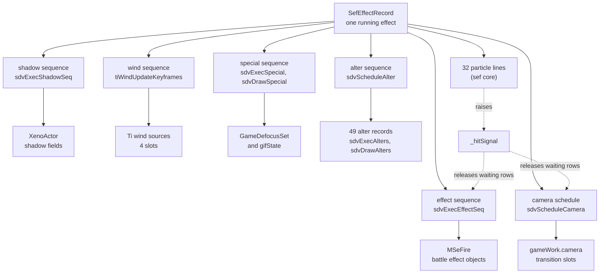

## Effect scripts and their table header

An effect script is a block of 16-bit values. Every reference inside it is an
offset counted in halfwords from the start of the script, and
`scGetImmAdrImmIdx2(base, table, index)` turns entry `index` of a table into an
address: `base + table[index] * 2`. An entry of `0xFFFF` means "absent" and
gives the address 0. `scGetImmNumIdx` reads an entry as a plain signed number.
`scOfsToAdr` applies only the "absent" rule and returns the offset unchanged.

The script itself is found by `scGetKeyRecord(key, &offset, index)`. It looks
the effect number up in the image mapper, takes the script entry with
`svGetScript` and reads the `SefScriptRecord` header. The `kind` of the header
decides how the start offset of the effect is found.

| `kind` | Meaning of `operand` | Offset returned |
| --- | --- | --- |
| `0x3C`, `0x3D` | The offset itself | `operand`. Kind `0x3D` (`SEF_START_MODE_FLAG`) also makes `sefStartEffect` set flag `0x800000` on the record |
| `0x3E` | A count for grouped effects. Without bit `0x4000` only the low 14 bits are kept in `scKeyRecordGroupCount` | `offsets[index]` |
| `0x3F` | The number of entries in `offsets` | `offsets[srsGetEffectSlot(key)]`, when that slot is below `operand` |
| `0x49` | The first word of a built-in emitter description | None. The address of `operand` is published in `scKeyRecordEntry`, see [built-in particle emitters](#built-in-particle-emitters) |

The kind that was read is left in `scKeyRecordMode`, where `sefStartEffect`
tests it. `scGetKeyRecordFirst` is the same call with index 0.

The offset leads to the **record table** of the effect. Its first five
halfwords, and the halfword just before it, are the addresses of the six
sequences. The entries of the particle lines follow.

```text
 table[-1]   shadow sequence          -> record.shadowSeq   stride 7
 table[0]    wind sequence            -> record.wind         stride 11
 table[1]    camera table             -> record.camera       (sdvSelectCamera)
 table[2]    special sequence         -> record.special      stride 2
 table[3]    alter sequence           -> record.alter        stride 28
 table[4]    effect sequence          -> record.sound        stride 7
 table[5..]  the entries of up to 32 slots, each with a list of
             up to 32 particle lines (sefInitEffectTbl)
```

`sefCreateScheduler2` clears the six blocks and binds each address with its
row size. The record fields that hold the effect and shadow sequences are
named `sound` and `shadowSeq` in `SefEffectRecord`. In this game they do not
play sounds: `sefExecScheduler` passes `sound` to `sdvExecEffectSeq` and
`shadowSeq` to `sdvExecShadowSeq`.

| Offset in `SefEffectRecord` | Field | Type | Run by |
| --- | --- | --- | --- |
| `0xA04` | `effectSeq` | `SdvSequence` | `sdvExecEffectSeq` |
| `0xA0C` | `shadowSeq` | `SdvSequence` | `sdvExecShadowSeq` |
| `0xA14` | `alter` | `SdvSequence` | `sdvScheduleAlter` |
| `0xA1C` | `camera` | `SdvCameraSchedule` (0x28 bytes) | `sdvScheduleCamera` |
| `0xA44` | `special` | `SdvSpecial` (0x10 bytes) | `sdvExecSpecial`, `sdvDrawSpecial` |
| `0xA54` | `wind` | `SdvSequence` | `tiWindUpdateKeyframes` |

## Key sequences

A key sequence is described by the 8-byte `SdvSequence`.

| Offset | Type | Name | Meaning |
| --- | --- | --- | --- |
| `0x00` | `short *` | `keys` | The first row of the table. Zero when the effect has no sequence of this type |
| `0x04` | `short` | `elapsed` | Passes counted since the sequence started |
| `0x06` | `signed char` | `position` | The index of the next row to fire |
| `0x07` | `signed char` | `stride` | Halfwords per row |

Every row starts with its frame. Three values of that first halfword have a
special meaning.

| Value | Name | Meaning |
| --- | --- | --- |
| `0x400` | `SDV_KEY_END` | The table ends here. No row after it is read |
| `0x1000` | `SDV_KEY_WAIT_HIT` | A flag bit. The row waits for the hit signal instead of a frame |
| `0xFFF` | `SDV_KEY_FRAME_MASK` | The frame part of a waiting row: the earliest pass at which the signal is accepted |

### The key test

`sdvCheckSeqKey` tests the row at `position`. A normal row fires when
`elapsed` has reached its frame. The function then returns the row index and
moves `position` to the next row. When the row is not due it returns -1.

A waiting row (bit `0x1000`) fires only while `_hitSignal` is set and `elapsed`
has reached its frame part. Even then the request must allow it. The byte
`waitHit` of the request (offset `0x24`) is tested: when it is zero the row is
skipped, which means `position` moves on but the function still returns -1 and
nothing happens. When it is nonzero the row fires like a normal one.

`sdvExecSeqTbl` is the per-pass entry. It returns `SDV_KEY_END` when the
current row is the end marker. Otherwise it adds one to `elapsed`, holds the
counter at `0x3FF`, and runs the key test. Because the counter is raised before
the test, a row with frame 0 fires on the first pass and a row with frame `n`
fires on pass `n`. A frame above 1023 can never be reached, which is why the
end marker `0x400` and the waiting rows (at least `0x1000`) never fire by time.

Most executors call `sdvExecSeqTbl` once per pass, so they fire at most one
row per pass. The special and alter executors keep calling `sdvCheckSeqKey`
after the first hit and so start every row that is due in the same pass.

`sdvProgressKey` is the same test for callers that keep the row position
themselves and pass the elapsed time in. The camera schedule uses it with the
frame number of the record, so camera keys follow the clock of the record
while the other sequences count passes.

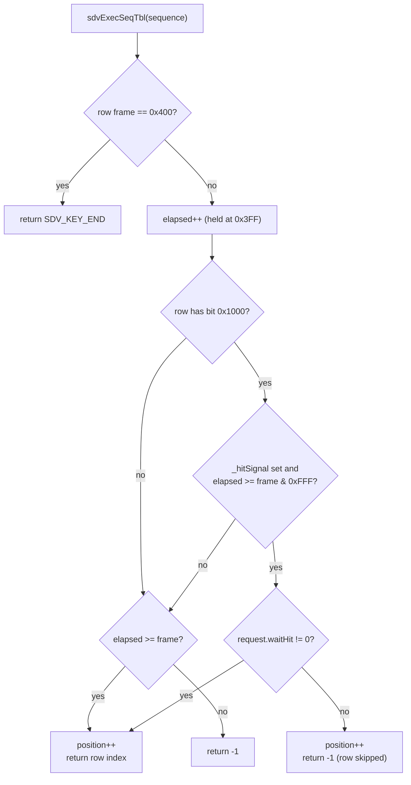

## The effect request

An effect is always started with a request. In battle the request is the
0x38-byte `struct EffectRequest` of `include/ov01/think_dispatch.h`. The
sender clears it, fills in the actors and the effect key, and hands it to
`sefCreateEffect` or `sefStartEffectAtPosition`. `sefStartEffect` copies it to
the global request buffer `sefRequestBuffer`, finds the script with
`scGetKeyRecord` and creates the record with `sefCreateScheduler`. The record
keeps its own copy of the request words, and `sefExecScheduler` writes them
back into the buffer before it runs the record. `sefLoadRequestBuffer` then
looks up the effect entry and the matrix of each of the seven actors.

| Offset | Type | Name | Meaning |
| --- | --- | --- | --- |
| `0x00` | `XenoActor *` | `head` | The actor of the unit that performs the effect. `SefRequest.source` |
| `0x04` | `XenoActor *` | `partner` | The second actor of a pair technique |
| `0x08` | `XenoActor *` | `target` | The actor that receives the effect. `SefRequest.target` |
| `0x0C` | `XenoActor *[4]` | `parts` | Child actors of the unit, such as weapons. The first three are `SefRequest.links` |
| `0x1C` | `int` | `key` | The effect number: `(group << 12) \| record` |
| `0x24` | `short` | `hitMode` | The hit kind of the attack. Its low byte is `SefRequest.waitHit` |
| `0x26` | `unsigned short` | `hitCode` | The action bits of the technique and the row bits of the target |
| `0x2C` | `short` | `mode` | The state of the attacker, or 2 or 3 for unit effects |
| `0x2E` | `short` | `targetState` | The state of the target |

`sdv` reads this block through two other types. `SefRequest` names the actors
the way the sequences use them: `source`, `target` and `links[3]`.
`SefLinkedContext` is the full 0x340-byte buffer with the matrices that
`sefLoadRequestBuffer` prepared. Its first words carry the same pointers under
the names `kind1Key` (the source), `kind5Key` (the partner), `kind0Key` (the
target) and `kind2Key` to `kind6Key` (the four parts).

### Who sends requests

The battle program sends almost all requests that reach the sequences.

| Sender | File | What it starts |
| --- | --- | --- |
| `attackEffectsStart` | `src/ov01/cmd_exec.c` | The effect of a technique. The key is the effect group of the attacker and technique (`tecEffectGroupGet`) and the `extent` of the technique record. One request is sent per hit, with that hit's target. A pair technique fills `head`, `partner` and two parts of each unit |
| `unitEffectStart` | `src/ov01/cmd_exec.c` | An effect on one unit, with `head` and `target` both set to its actor. Used for hit reactions, auras, boosts and status changes |
| `unitEffectStartMode` | `src/ov01/cmd_exec.c` | The same with `mode` 3 for the large units (unit keys 11 to 15) and 2 for the others |
| `effectSendOwned` | `src/ov01/think_dispatch.c` | The script native `createEffect`: a group, a record and an optional owner unit |
| `effectStartAtPosition` | `src/ov01/think_dispatch.c` | The script native `createEffectPos`: an effect at a table position, without actors |
| the bonus effect of `src/ov01/scene.c` | `src/ov01/scene.c` | The effect that announces the battle bonuses, without actors |

Only `attackEffectsStart` writes `hitMode`. All other senders leave the cleared
value 0 in it, so in their effects every waiting row is skipped. The rules of
attacks and hits are on [Battle](../game/battle.md), and the natives are listed
on [Natives](../scripting/natives.md).

On the field and in cutscenes, effects are started by number with
`sefCreateEffectCf`. These records have no battle actors. Their sequences still
run, but the camera schedule is disabled outside battle (see
[the camera schedule](#the-camera-schedule)). The callers are the map units
(`src/main/uwamono_record.c`, `src/main/uwamono_objx.c`), the field camera
search (`src/main/game_camera.c`), field enemies (`src/main/enemy_1.c`) and the
cutscene player (`src/main/cfeEvaluate.c`). A field script can also fast-forward
effects with the native `progEffect` (`runtimeProgEffect`), which calls
`sefProgressEffect`.

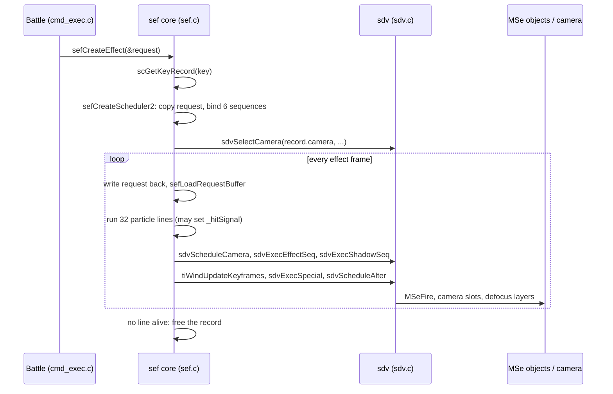

## The hit signal

Battle effects are authored before the outcome of an attack is known, so the
impact of an effect must be able to wait. Two things make this work: a flag in
the particle data that marks the moment of impact, and waiting rows in the
sequences that react to it.

`_hitSignal` is a 16-bit global of `sef.c`. `sefExecEffectData` sets it to 1
when an effect slot of the record carries flag bit 0. At the same moment it
sets flag 1 on the effect entry of the request's source actor. The signal
stays set for the rest of the scheduler pass. `sefExecStep` clears it,
together with `_hitFlag` and `_seSignal`, after all records, alters and
emitters have run.

Inside one record the particle slots run before the sequences. A waiting row
therefore fires in the same pass in which a slot of its record raised the
signal. Records are processed in table order, so the signal is also visible to
the records that come later in the same pass, but not to earlier ones.

The byte `waitHit` decides what a waiting row does when the signal arrives.
It is the low byte of `hitMode`, the hit kind that `attackEffectsStart` copied
from the hit record. Kind 0 is `HIT_KIND_NONE` and every other kind (plain
damage, HP gain, status and so on) is nonzero. A waiting row is thus played
for a hit that has a result and silently dropped otherwise. The record keeps
this byte at offset `0x7C` (the field `spawnEnabled`), and `sefExecEffectData`
reads the same byte for its own slot handling.

`_hitFlag` is a second flag. `sefHitEffect` sets it and `sefExecScheduler`
hands its value to every effect slot. No caller of `sefHitEffect` exists in
`src/`, so only `_hitSignal` is live in the sequences.

## Actor select bits

Rows do not store actor pointers. They store a **select** value: one bit that
picks an actor of the request, plus the index of a part of that actor. The
part is a joint or attachment point of the actor that the sef core resolves to
a position (`sefGetPosition`, `sefGetPoint`). The value of a select is the
actor bit plus the part index plus one.

| Bit | Name | Actor of the request |
| --- | --- | --- |
| `0x40` | `SDV_KEY_SOURCE` | `source`, the performer |
| `0x80` | `SDV_KEY_TARGET` | `target` |
| `0x100` | `SDV_KEY_OBJECT1` | The partner at offset 4. Only the camera keys use it |
| `0x400` | `SDV_KEY_LINK_1` | `links[0]` |
| `0x800` | `SDV_KEY_LINK_2` | `links[1]` |
| `0x1000` | `SDV_KEY_LINK_3` | `links[2]` |

So `0x41` is part 0 of the source and `0x85` is part 4 of the target. The
select bits live in their own columns of a row, never in the frame column.
`SDV_KEY_LINK_1` and `SDV_KEY_LINK_3` therefore share their values with
`SDV_KEY_END` and `SDV_KEY_WAIT_HIT` without conflict.

A select below 9 is not an actor at all. `sefGetPoint` treats kind 1 as a point
relative to the camera and the other small kinds as a plain world offset. The
special tables use part 8 for a position that is already given in screen
coordinates. The full list of point kinds is on [sef](sef.md).

Two part kinds stand for a whole group of parts. `0x61` and `0x62` make the
alter sequence create one trail for every listed part whose linked flag is set
(see [alters](#alters)).

## The effect sequence

`sdvExecEffectSeq(sequence, effectId)` creates battle effect objects at fixed
frames. These are the `MSe` objects of the battle program: lightning bolts,
spirals, sprays, missile trails and similar coded effects that are too complex
for the particle lines. The objects themselves are described on
[Battle effects](../game/battle-effects.md).

A row has seven halfwords.

| Halfword | Name | Meaning |
| --- | --- | --- |
| 0 | frame | The frame of the row, or a hit wait |
| 1 | `SDV_EFFECT_KIND` | The object type, an index into `MSeFireCallbacks` |
| 2 | `SDV_EFFECT_TARGET` | The select of the target part |
| 3 | `SDV_EFFECT_OWNER` | The select of the part the object is attached to |
| 4 to 6 | `SDV_EFFECT_OFFSET_X/Y/Z` | An offset from that part, in thousandths of a unit |

When a row fires, the function fills an `MSeFireEntry` and calls `MSeFire`. The
entry always names the source actor of the request as `owner`. The image
mapper index of the record (`entryId`) is passed as `param`, so the object
draws with the textures of the effect that created it.

The two selects are decoded with a few special cases. For the target, `0xA1`
means part `0x1F`, and both the bare `0x80` and `0xA2` mean part 1. Any other
value with the target bit gives part `select - 0x81`. For the owner column,
the three link bits pick `links[0]` to `links[2]` and store the actor in
`link` with its part. A bare `0x40` means part 1 of the source, and any other
value with the source bit gives part `select - 0x41`.

`MSeFire` allocates `MSeFireSpawnCount[type]` objects per call, copies the
entry into each and runs the constructor of the type.

| Type | Constructor | Objects per row |
| --- | --- | --- |
| 0 | `MEfCreateWait` | 1 |
| 1 | `MEfCreateHermitePath` | 8 |
| 2 | `MEfCreateSpiral` | 1 |
| 3 | `MEfCreateThunder25` | 1 |
| 4 | `MEfCreateThunder31` | 1 |
| 5 | `MEfCreateTepodon` | 1 |
| 6 | `MEfCreateFlagWindow` | 1 |
| 7 | `MEfCreateWaveEffect` | 1 |
| 8 | `MEfCreateSpray` | 1 |
| 9 | `MEfCreatePathStep` | 8 |
| 10 | `MEfCreateSway` | 1 |
| 11 | `MEfCreateMissileTrail` | 1 |
| 12 | `MEfCreateActorPath` | 1 |
| 13 | `MEfCreateActorHistory` | 1 |

`sefExecScheduler` runs the effect, shadow and wind sequences only for records
that do not have the flag `SEF_RECORD_RUNNING` (`0x2`).

## The shadow sequence

`sdvExecShadowSeq` changes the shadow of an actor during an effect. Each row is
an `SdvShadowKey` of seven halfwords.

| Offset | Type | Name | Meaning |
| --- | --- | --- | --- |
| `0x00` | `short` | `frame` | The frame of the row, or a hit wait |
| `0x02` | `short` | `flags` | `SDV_KEY_TARGET` picks the target, otherwise `SDV_KEY_SOURCE` picks the source |
| `0x04` | `signed char` | `shadowCount` | Copied to `actor->shadowCount` |
| `0x05` | `signed char` | `state` | Copied to `actor->moveState` |
| `0x06` | `short` | `velocity` | Tenths. Copied to `actor->sweepSpeed` |
| `0x08` | `short` | `shadowValue` | Hundredths. Copied to `actor->shadowValue` |
| `0x0A` | `short` | `angle` | Hundredths. Copied to `actor->sweepPhase` |
| `0x0C` | `short` | `shadowValue3` | Hundredths. Copied to `actor->shadowValue3` |

The target bit is tested first. When neither bit is set the row does nothing.
The six actor fields are written at once and stay in force until another row
or another system changes them. How an actor uses them when it draws its
shadow is described on [Actors](actors.md).

## The wind sequence

Characters have hair, skirts and coats that the `Ti` animation library
simulates. The library has four directional and four point wind sources. An
effect can take one of them for its lifetime, for example to make a blast push
the clothes of everyone around it. The wind model is on
[Animation](animation.md). This page covers only how an effect drives it.

### Wind slots

`tiWindSlots` is a table of four `TiWindSlot` entries. Slot `i` controls
directional wind `i` and point wind `i` of the library.

| Offset | Type | Name | Meaning |
| --- | --- | --- | --- |
| `0x00` | `int` | `key` | The owner key of the effect record. 0 marks a free slot |
| `0x04` | `unsigned short` | `subkey` | The group key of the record (`record->value`) |
| `0x06` | `short` | `windKind` | 0 for a directional wind, otherwise a point wind |

| Function | Action |
| --- | --- |
| `tiWindAcquireSlot` | Takes the first free slot for a key, subkey and kind. Returns -1 when all four are in use |
| `tiWindFindSlot` | Returns the slot of a key and subkey, or -1 |
| `tiWindReleaseSlots` | Disables both winds of every slot of a key and subkey and frees the slots. Key 0 releases all four |
| `tiWindClearFirstSlot` | Zeroes the first slot only |
| `tiWindResetSlots` | Releases all slots, then calls `tiWindClearFirstSlot` |

### Wind keys

A wind table has a two-halfword header in front of its first row: `keys[-2]`
is the wind speed in hundredths and `keys[-1]` is the wind kind. Each row is a
`TiWindKey` of 11 halfwords. All lengths are in hundredths of a unit.

| Offset | Type | Name | Meaning |
| --- | --- | --- | --- |
| `0x00` | `short` | `frame` | The frame of the key |
| `0x02` | `short` | `positionKind` | The point kind that the offset is relative to |
| `0x04` | `short[3]` | `offset` | The position of the wind source |
| `0x0A` | `short` | `rangeUpper` | The upper phase bound |
| `0x0C` | `short` | `rangeLower` | The lower phase bound |
| `0x0E` | `short` | `radius` | Negative: a global wind without a radius. 0, or 20000 and above: the wind is off |
| `0x10` | `short[3]` | `direction` | The direction of a directional wind |

`tiWindUpdateKeyframes(sequence, key, subkey)` runs every pass. Unlike the
other sequences it does not only act when a row fires. It always works with
the last row reached and blends it toward the next one. The blend factor is
the elapsed time inside the interval in 256ths, and each value is rounded. The
offset, the radius, both range bounds and the direction are blended. When the
next row is the end marker the current row is used unchanged. Two rows with
the same frame produce no update.

The function then finds or acquires the wind slot of the record and applies
the key. The position is resolved with `sefGetPosition`. A point wind gets its
position, speed, range and radius. A directional wind also gets its normalized
direction. In both cases the other wind of the slot is switched off. A radius
of 0 or of 20000 and more disables the wind and releases the slot, so a table
can end its own wind by keying such a radius.

When the record has no live particle line left, `sefExecScheduler` calls
`tiWindReleaseSlots` with the record's keys, so a wind never outlives its
effect.

## The camera schedule

Many techniques come with their own camera work. The effect script offers up
to four alternative **cameras** (shots) for an effect and the game picks one
at random each time, so that a repeated technique does not always look the
same. A camera is four key tracks: the position, the look-at point, the lens
(perspective and roll) and a shake.

### Selecting a camera

`sdvSelectCamera(schedule, base, table)` runs once, when the record is
created. The camera table has five pairs of halfwords: the offset of a camera
and its weight in percent. The function rolls `rand() % 100` and walks the
first four pairs, adding up the weights. The first pair whose running total is
above the roll, and whose camera is present, wins. All five pairs are read but
the fifth can never be chosen.

The chosen camera is itself a table of four offsets. They are resolved into
the four `SdvScheduleChannel` entries of the `SdvCameraSchedule`.

| Offset | Type | Name | Meaning |
| --- | --- | --- | --- |
| `0x00` | `int` | `camera` | The address of the selected camera, 0 when none |
| `0x07` | `unsigned char` | `animation` | Cleared on selection |
| `0x08` | `SdvScheduleChannel` | `channels[0]` | The position track |
| `0x10` | `SdvScheduleChannel` | `channels[1]` | The look-at track |
| `0x18` | `SdvScheduleChannel` | `channels[2]` | The lens track |
| `0x20` | `SdvScheduleChannel` | `channels[3]` | The shake track |

Each channel holds `keyIndex` (the next key) and `keys` (the track). When the
script has a camera table but the roll selected nothing, `sefCreateScheduler2`
sets the flag `SEF_RECORD_PENDING` on the record.

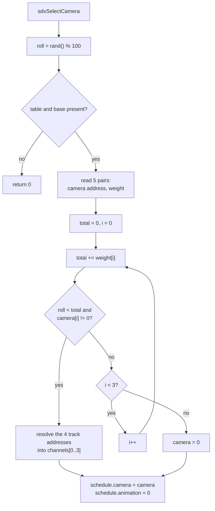

### Running the tracks

`sdvScheduleCamera(schedule, frame)` advances the four tracks to the frame of
the record. It does nothing unless the effect system is in battle mode
(`_sefBattleMode`), so field and cutscene effects never move the camera this
way. The tracks are advanced in a fixed order: look-at, position, lens, shake.
The function returns how many of the look-at and position tracks applied their
first key on this pass.

`sefExecScheduler` uses that return value to decide which effect owns the
camera. The first record whose camera starts becomes the owner: its address is
stored in `sefCameraOwnerRecord` and its flag `0x200` is set. A record with
flag `0x200` that is no longer the owner stops running its camera, and a
record with flag `0x40` never runs it. A later effect can thus take the camera
away from an earlier one, but two effects never fight over it.

Each track is stepped by `sdvProgressPrm(kind, channel, keySize, frame)`.

| Track | `kind` | Key size (halfwords) | Key type |
| --- | --- | --- | --- |
| Position | `SDV_TRACK_POSITION` (0) | 8 | `SdvCameraKey` |
| Look-at | `SDV_TRACK_LOOK_AT` (1) | 8 | `SdvCameraKey` |
| Lens | `SDV_TRACK_LENS` (3) | 4 | `SdvLensKey` |
| Shake | `SDV_TRACK_SHAKE` (0x41) | 6 | `SdvShakeKey` |

When `sdvProgressKey` reports that a key has been reached, the key is applied
at once as the current camera state. Then, for the three interpolated tracks,
a transition toward the following key is started in the game camera. The game
camera (`gameWork.camera`, see [Field](../game/field.md)) has four transition
slots, and `sdvApplyCameraSlots` hands one of them the blend mode, the ease
mode and the number of frames. It also clears `CAMERA_FLAG_SLOTS_APPLIED` so
that the next camera update blends again.

| Slot | Mask | Value |
| --- | --- | --- |
| 0 | 1 | Look-at point |
| 1 | 2 | Position and angles |
| 2 | 4 | Perspective |
| 3 | 8 | Roll |

The length of the transition is the frame distance from the key to the next
one. When the key was a hit wait, the distance is counted from the current
frame instead (`next frame - frame + 1`), and it is 0 when the next key waits
for a hit as well. A transition is started only when it is at least 2 frames
long and the next key is not the end marker. Finally, when the key after the
next one is the end marker, the channel's `keyIndex` is stepped onto it early
so that the track ends cleanly.

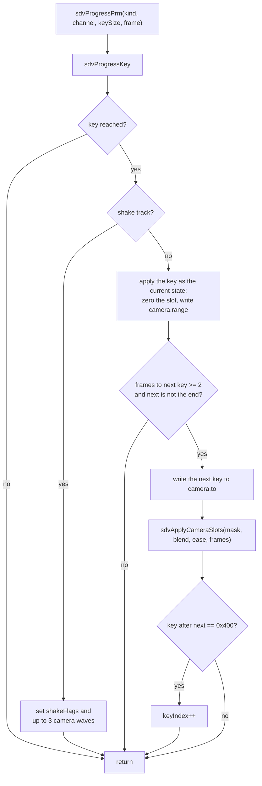

### Position and look-at keys

Both tracks use `SdvCameraKey`.

| Offset | Type | Name | Meaning |
| --- | --- | --- | --- |
| `0x00` | `short` | `frame` | The frame of the key, or a hit wait |
| `0x02` | `unsigned char` | `modes.mode.ease` | The ease mode of the transition to the next key |
| `0x03` | `signed char` | `modes.mode.blend` | The blend mode. Nonzero also derives the camera angles from the two points |
| `0x04` | `short` | `mode` | Low 4 bits: 1 for an orbit placement, otherwise an offset. Bit `0x10` (`SDV_CAMERA_MODE_ANCHOR`): the look-at follows the actor |
| `0x06` | `short` | `scaled` | Nonzero: the offset is scaled with the size of the actor |
| `0x08` | `short[3]` | `placement` | The offset, or the orbit values |
| `0x0E` | `short` | `kind` | The select of the actor and part that the point is relative to |

`sdvSetCameraParam` turns a key into a world point. It fills an
`SdvCameraParam` with the resolved `point`, the `offset`, and the `object` and
`part` that the select names.

With placement mode 1 the three placement values are an orbit: a pitch and a
yaw in degrees and a distance in hundredths. The function builds the vector
`(0, 0, distance)`, turns it by the yaw about Y and then by the pitch about X,
and uses the result as the offset. In every other mode the placement is an
`x, y, z` offset in hundredths.

The select uses the bits `SDV_KEY_SOURCE`, `SDV_KEY_TARGET` and
`SDV_KEY_OBJECT1` with a part index, as described under
[actor select bits](#actor-select-bits). A bare bit without a part means part
1 of that actor and gets a height correction: the offset is lowered by 1.3
when the kind vector of the actor has a nonzero height and by 7.8 otherwise.
When `scaled` is set, `sefInitPartTransform` is asked for the transform of the
part and the offset is multiplied by its scale. `sefGetPosition` then resolves
the final point.

A **look-at key** writes the point to `camera.range.lookAt` and to
`camera.to.lookAt`. With the anchor bit, and when the select names an actor,
it also stores the actor and part in `camera.range.anchorIndex` and
`anchorSubIndex` with the offset, so the game camera keeps following that part
as the actor moves. Without the anchor the index is set to -1. The first
look-at key of a camera has one more duty: when the active studio camera is in
state 4, `cameraInit` resets the game camera first and the state is restored.

A **position key** writes the point to `camera.range.cameraPosition` and stores
the negated distance to the look-at point in `sdvCameraDistance`. With a
nonzero blend mode, `cameraAnglesBetween` computes the camera angles from the
look-at point to the position. For the transition, the target angles are
passed through `sdvWrapAngle` and `sdvNearestAngle` so that the camera turns
the short way around: an angle is first wrapped into one full turn, and the
target is then moved by whole turns when the difference exceeds 180 degrees.

`sdvCameraKeyLog` records the select, the scale flag and the modes of the last
look-at and position keys applied.

### Lens keys

`SdvLensKey` has four halfwords.

| Offset | Type | Name | Meaning |
| --- | --- | --- | --- |
| `0x00` | `short` | `frame` | The frame of the key |
| `0x02` | `SdvKeyModes` | `modes` | Ease and blend modes, as in a camera key |
| `0x04` | `short` | `perspective` | The field of view in degrees |
| `0x06` | `short` | `roll` | The roll in degrees |

The key writes both angles in radians, the perspective to
`camera.range.cameraPosition.w` and the roll to `camera.range.lookAt.w`. A
transition is started on slot 2 only when the perspective of the next key
differs, and on slot 3 only when the roll differs.

### Shake keys

`SdvShakeKey` has six halfwords.

| Offset | Type | Name | Meaning |
| --- | --- | --- | --- |
| `0x00` | `short` | `frame` | The frame of the key |
| `0x02` | `short` | `waveMask` | Bits 0 to 2 select the three camera waves. A negative value leaves the waves alone |
| `0x04` | `short` | `amplitude` | Degrees |
| `0x06` | `short` | `period` | Copied to the wave |
| `0x08` | `short` | `hold` | Copied to the wave |
| `0x0A` | `short` | `cycles` | The number of cycles over which the shake fades out |

The mask is stored in `camera.shakeFlags`. Each selected `CameraWave` gets the
period, the hold and the cycle count. Its start value is the amplitude in
radians times 0.05, and its `step` is that value divided by the cycle count,
or 0 for a shake without cycles. Shake keys are not interpolated.

## Specials: screen filters

A **special** is a full-screen or screen-area filter that belongs to an
effect: a blur around the point of impact, a flash over the whole picture, a
shock ring, a tinted frame. The special sequence of a record starts filters,
and each filter then plays its own key table. The actual image processing is
done by the defocus layers of `game_defocus.c` and the screen effects of
`gifState.c`, which are described on [Screen effects](screen-effects.md).

### Structures

The sequence rows are two halfwords: a frame and the offset of a **special
table**. A record's `SdvSpecial` holds the sequence and six slot ids.

| Offset | Type | Name | Meaning |
| --- | --- | --- | --- |
| `0x00` | `SdvSequence` | `sequence` | The sequence. `position` counts the rows started |
| `0x08` | `signed char[6]` | `slotIds` | The special record each row took. 0 when the record was freed or none was free |

A special table (`SdvSpecialTable`) starts with three halfwords and continues
with 26-byte keys.

| Offset | Type | Name | Meaning |
| --- | --- | --- | --- |
| `0x00` | `unsigned short` | `kind` | Low byte: the kind of filter. High byte: a signed argument that enables the part scale in `sdvTransOffset` |
| `0x02` | `short` | `part` | The point kind the filter is placed at. 8 means screen coordinates |
| `0x04` | `unsigned short` | `modes` | Folded into the flags of the record by `sdvSpecialFlags` |
| `0x06` | `SdvSpecialKey[]` | `keys` | The key track |

| Offset | Type | Name | Meaning |
| --- | --- | --- | --- |
| `0x00` | `unsigned short` | `frame` | The frame of the key, counted from the start of the filter |
| `0x02` | `unsigned short` | `depth` | A depth value, shifted left by 8 for the Z buffer |
| `0x04` | `unsigned char[4]` | `color` | Red, green, blue, alpha. Kind 12 reads the first three as a signed direction |
| `0x08` | `short` | `x` | Position, in hundredths of a unit or in pixels for part 8 |
| `0x0A` | `short` | `y` | |
| `0x0C` | `short` | `z` | |
| `0x0E` | `short` | `width` | Size. Kinds 10 and above use it as the value of sub-window 0 |
| `0x10` | `short` | `height` | Size, or sub-window 1 |
| `0x12` | `short` | `subWindow2` | Sub-window 2 |
| `0x14` | `short` | `subWindow3` | Sub-window 3 |
| `0x16` | `short` | `intensity` | The strength of the filter |
| `0x18` | `unsigned short` | `decrease` | The fade-out rate of a screen effect, in 256ths |

The running state of a filter is an `SdvSpecialWork`. There are 32 of them in
`sdvSpecialTable`, shared by all effects. Index 0 is never handed out, because
a slot id of 0 means "none".

| Offset | Type | Name | Meaning |
| --- | --- | --- | --- |
| `0x00` | `SdvSpecialTable *` | `table` | The table being played. 0 marks a free record |
| `0x04` | `SdvSpecialKey` | `key` | The current, interpolated key |
| `0x1E` | `short` | `frame` | Frames since the filter started |
| `0x20` | `short` | `keyIndex` | The key being left |
| `0x22` | `unsigned char` | `flags` | Bits 0 and 1: the alpha type. Bit 4: the frame buffer choice. Bit 6: the `gifState` mode has been set |
| `0x23` | `signed char` | `decreaseWait` | Positive while the `decrease` of the current key still has to be sent |
| `0x24` | `unsigned short` | `clip` | 1 when the part gave a matrix at the start |
| `0x30` | `Matrix4` | `matrix` | That matrix, or the unit matrix |

`sdvSpecialFlags` builds the flags from the `modes` halfword: the low four
bits of the result are bits 0 to 3 of `modes` combined with bits 4 to 7, and
bits 4 to 7 of the result are bits 8 to 11 of `modes`.

### Running a special

`sdvExecSpecial(special, base)` has two phases.

In the first phase it steps the sequence. For every row that is due it looks
for a free slot id in the `SdvSpecial` and a free record with
`sdvFindFreeSpecialWork`. The record gets the table address of the row, frame
0, key index 0 and its flags. `sefGetPoint` is asked for the part of the
table. When it returns a matrix, the matrix is copied into the record and
`clip` is set. The matrix freezes the place of the filter at the moment it
started. The loop continues with `sdvCheckSeqKey` until no further row is due
or all six slots are taken.

In the second phase every started filter advances by one frame. While the
frame lies between the current key and the next, each value of the key is
interpolated with a factor in 256ths and rounding (`SDV_LERP`). The depth, the
four colour bytes, `x`, `y`, the intensity and the size are blended. Filters
of kind 10 and above blend all four size halfwords, the others only the width
and the height. The `decrease` value is taken from the current key unchanged.
The `z` value has a quirk: when the two keys differ in `z`, it moves toward
the *intensity* of the next key instead of its `z`.

The frame value after the last real key decides how the filter ends.

| Frame of the following key | Behaviour |
| --- | --- |
| Exactly `0x400` | The last key is held. The filter stays until its effect is freed |
| Above `0x400` | The record is freed one frame after the last key |

When a record is freed, by its own table or by `sdvFreeSpecialSlots` when the
effect record is destroyed, a screen effect (kinds 10 to 15) is stopped with
`gifStateClearModeHook`. This is skipped when the filter has a `decrease`
value, because such an effect fades out by itself. Kind 13 is always stopped
when the effect record is destroyed.

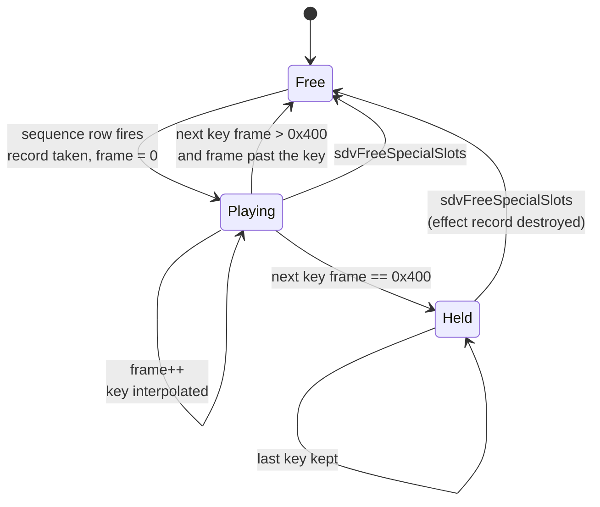

### Drawing a special

`sdvDrawSpecial` runs in the same pass, right after `sdvScheduleAlter`. It
does not draw anything itself. For each started filter whose first key has
been reached, it sets up a defocus layer or a `gifState` screen effect for the
frame that is about to be rendered. `sefExecScheduler` skips the call while
the flag `SEF_DRAW_FLAG_PENDING` (`0x04000000`) of `gameWork.control` is set,
unless the record table has 128 entries.

The defocus layers are handed out per frame. `_sdvSpecialBuf` has eight flags,
one per layer. `sdvAllocSpecialWork(0)` takes layer 0, which is reserved for
the frame copy that several filters need first. `sdvAllocSpecialWork(1)` takes
the first free layer from 1 to 7. At the start of every scheduler pass
`sdvClearSpecialWork` switches off every layer that was taken (`GameDefocusSet(i, 0, 0)`)
and clears the flags. A filter therefore exists only as long as its effect
keeps setting it up every frame.

Filters that are placed in the world are projected with `sdvTransOffset`. It
takes the offset of the key in hundredths, resolves it relative to the part
(or to the record's frozen matrix when the part has bit `0x40` and a matrix is
passed), and projects the point with the view matrix of the active camera. It
also projects a second point to measure how large a world-space size appears
on screen. The result is a screen position in pixels, a depth and a projected
extent. Part 8 skips all of this: the key already holds pixel coordinates, and
only the screen centre offset (256, 224) is added. The function returns 0 when
the point is clipped, and the filter is then not set up for this frame.

| Kind | Layers or effect used | Parameters taken from the key |
| --- | --- | --- |
| 1 | Defocus type 1 | Intensity, depth, colour, `x`, `y`, width, height |
| 3 | Type 2 in layer 0, then type 3 | Intensity, colour, `x`, `y`, width, height |
| 4 | Defocus type 1 with fixed values | Depth and colour only |
| 5 | Defocus type 5 | Depth, colour, `x`, `y`, width, height. The intensity is rounded up to the next step of `sdvDefocusSizeSteps` (1, 3, 7, 15, 31, 63, 127, 255, 511) |
| 6 | Type 2 in layer 0, then type 6 | Colour, `x`, `y`, width, height. A depth of 0 means the far plane (`0xFFFFF8`) |
| 7 | Type 2 in layer 0, then type 7 | The projected screen position and depth, colour, the projected size and the intensity |
| 9 | Defocus type 9 | None |
| 10 | `gifState` mode 0, `GIF_EFFECT_RADIAL_BLUR` | See below |
| 11 | `gifState` mode 1, `GIF_EFFECT_RING` | See below |
| 12 | `gifState` mode 2, `GIF_EFFECT_CAMERA_QUAD` | See below |
| 13 | `gifState` mode 3, `GIF_EFFECT_JITTER_GRID` | See below |
| 14 | `gifState` mode 4, `GIF_EFFECT_FADE_QUAD` | See below |

Kinds 1 and 3 to 7 are skipped while the alpha of the key is 0. Kind 15 is
counted as a screen effect when records are freed, but `sdvDrawSpecial` has no
case for it.

**Kind 7** is the filter around a world point. The point must project inside
the 512 by 448 screen. With part 8 the size is the key's width and height in
pixels. Otherwise the projected extent is used, and when the filter has a
frozen matrix the box is shrunk so that it stays inside the screen. In battle
(`sefActiveOwnerKey == 0x1012F003`) the box is also made square by reducing
the longer side.

**Kinds 10 to 14** hand the filter to `gifState`. On the first frame
`gifStateSetMode(kind - 10)` selects the effect and the record's bit 6 is set.
The `decrease` of a key is sent once per key with `gifStateSetDecrease`, as a
fraction of 256. Then the projected centre (`gifStateSetCenter`), the alpha
type and alpha (`gifStateSetEffectAlpha`), the frame buffer choice
(`gifStateSetFbp`), the blur strength from the intensity (`gifStateSetBlur`)
and the depth (`gifStateSetDepth`) are set every frame. The four size
halfwords of the key go to the four sub-window values with
`nmlModelUseSubWindow`. Kind 11 with a world part instead converts three of
them from world size to screen size: the height and `subWindow2` values, times
0.005, are projected for sub-windows 2 and 3, and `subWindow3` for sub-window
1. Kind 12 reads the colour bytes as a signed direction, normalizes it, turns
it with the transform of the part and passes it to `nmlModelSetMulColor`.

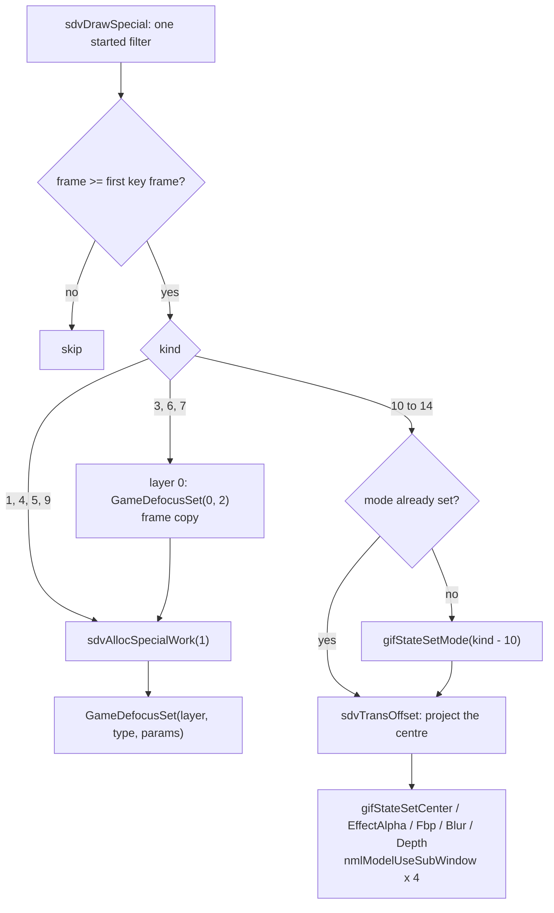

`sdvResetSpecialWork` zeroes the layer flags and all 32 records and stops the
`gifState` effect. It runs when the effect system starts and whenever all
effects are destroyed.

## Alters

An **alter** is a ribbon trail: the arc that follows a sword, the streak
behind a moving limb, a glowing line that trails an object. An alter samples
one or two points of an actor every frame, keeps the last samples in a ring
and draws a smooth, textured strip through them that fades toward its tail.

### Alter events

Each row of the alter sequence is an `SdvAlterEvent`. The stride is 28
halfwords.

| Offset | Type | Name | Meaning |
| --- | --- | --- | --- |
| `0x00` | `unsigned short` | `frame` | The frame of the row, or a hit wait |
| `0x02` | `short` | `life` | The life in frames. 2048 never runs out |
| `0x04` | `unsigned short` | `mode` | Low 4 bits: the mode. The upper 12 bits, signed: the follow value |
| `0x06` | `unsigned short` | `blend` | The blend mode, an index into `sefAlphaBlendValues` |
| `0x08` | `unsigned short[4]` | `rgba` | The colour. Only the low byte of each is used |
| `0x10` | `short[2]` | `parts` | The point kinds of the two edges of the ribbon |
| `0x14` | `short` | `maxSamples` | The length of the trail in samples, at most 64 (two rows in the effect files ask for 128) |
| `0x16` | `unsigned short` | `shrink` | Samples removed per frame once the life is spent |
| `0x18` | `short` | `imageFrames` | Frames each image is shown |
| `0x1A` | `short` | `length` | The texture length of the whole trail |
| `0x1C` | `short[2][2]` | `images` | Up to two pairs of image index and palette index. Negative means none |
| `0x24` | `float` | `ringSpacing` | Follow trails: the spacing of the ring points |
| `0x28` | `float` | `height` | Follow trails: half the height of the ribbon |
| `0x2C` | `unsigned short` | `spread` | Follow trails: the phase spread over the ring, in degrees |
| `0x2E` | `unsigned short` | `spin` | Follow trails: degrees the phases turn per frame |
| `0x30` | `unsigned short` | `timeBase` | Follow trails: the base wave radius, in thousandths |
| `0x32` | `unsigned short` | `timeStep` | Follow trails: the radius added per ring point, in thousandths |
| `0x34` | `short` | `minDelta` | Follow trails: the smallest move that changes the heading, in thousandths |

`sdvScheduleAlter(sequence, sefRequest, layer, recordIndex)` builds an
`SdvAlterRequest` from every row that is due and creates the alter. The
`layer` argument is the image mapper index of the effect record. The image and
palette indices of the row are looked up in that mapper with
`svGetImageListItem`, and each valid pair becomes a GS `TEX0` value in the
request. The request also remembers the index of the owning effect record and
a pointer to the seven request words of that record.

When the first part is `0x61` or `0x62`, one alter is created for every entry
of `sdvLinkedPartsA` (kinds 68 to 95) or `sdvLinkedPartsB` (kinds 70 and 72 to
86) whose linked flag is set (`sefGetLinkedFlag`). This gives one trail per
equipped attachment without a row for each.

### Alter records

There are 49 alters in `sdvAlterTable`. One `SdvAlter` is `0xD40` bytes.

| Offset | Type | Name | Meaning |
| --- | --- | --- | --- |
| `0x000` | `Matrix4` | `worldMatrix` | Follow trails: a small random rotation |
| `0x040` | `Matrix4` | `matrix` | Follow trails: the matrix the ring is drawn with |
| `0x080` | `Vector4[2][64]` | `points` | Two rings of 64 samples, one per edge |
| `0x880` | `Vector4[33]` | `quats` | Follow trails: the heading history, newest first |
| `0xA90` | `Vector4` | `heading` | Follow trails: the smoothed heading |
| `0xAA0` | `Vector4` | `lastDelta` | Follow trails: the last accepted move direction |
| `0xAB0` | `Vector4` | `position` | Follow trails: the current position of the part |
| `0xAC0` | `Vector4` | `previousPosition` | Follow trails: the position one frame ago |
| `0xAD0` | `SdvAlterRequest` | `request` | The 0x58-byte request |
| `0xB28` | `float[64]` | `texturePhases` | The texture phase of each sample (modes 3 and 4) |
| `0xC28` | `float` | `progress` | The running texture phase |
| `0xC2C` | `float[32]` | `angles` | Follow trails: the wave phase of each ring point |
| `0xCB0` | `float[32]` | `radii` | Follow trails: the wave radius of each ring point |
| `0xD34` | `short` | `frame` | The number of samples currently drawn |
| `0xD36` | `unsigned short` | `index` | The ring position written this frame |
| `0xD38` | `unsigned short` | `active` | Nonzero while the record is in use |
| `0xD3A` | `unsigned short` | `wrapped` | Set once `index` has wrapped around |
| `0xD3C` | `short` | `serial` | The serial number of the alter |

`sdvCreateAlter` takes the first free record, copies the request in and gives
it a serial number from an 8-bit counter. It returns `serial << 16 | index`,
or -1 when all 49 records are in use. `sdvKillAlter` takes such an id and
destroys the alter when the serial still matches. `sdvDestroyOwnerAlters`
destroys every alter of one effect record, and the sef core calls it when the
record is freed. `sdvInitAlters` and `sdvDestroyAlters` clear the whole table.

### Sampling

`sdvExecAlters` runs once per effect step and calls `sdvExecAlter` for every
active record. The function first updates the life and the sample count
`frame`.

- The life drops by one per frame, unless it is 2048.
- While the life is positive, `frame` grows by one per frame up to
  `maxSamples`. The trail gets longer.
- When the life is spent, `frame` drops by `shrink` per frame. The trail is
  eaten from its tail.
- While the owning effect record has flag `0x80` (hidden), `frame` drops by
  one per frame instead.
- When `frame` is no longer positive and the life is below zero, the record is
  destroyed.

While `frame` is positive the alter takes a sample. It first copies the seven
saved request words into the request buffer and calls `sefLoadRequestBuffer`,
so that the point kinds resolve against the actors of its own effect even
though the alters run after all effect records. A plain alter then stores the
position of each of its two parts (`sefGetPosition`) at `index` in the two
rings. Mode 8 samples only the first part.

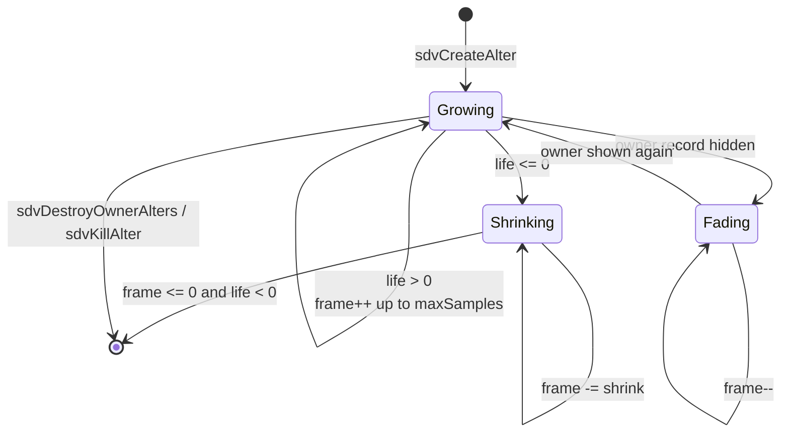

### Follow trails

A nonzero follow value turns the alter into a different shape: a ribbon or a
line that streams behind one moving part like a tail. Such an alter has at
most 32 samples. It does not store sampled positions. It stores a fixed row of
ring points behind the origin, spaced by `width`, and a history of headings.

When it is created, `sdvCreateAlter` reads the position of the part, builds a
`worldMatrix` with a random tilt of up to 5 degrees per axis, and gives every
ring point a wave phase (`spread` divided over the ring, plus a random start)
and a wave radius (`timeBase + k * timeStep` in thousandths, plus a random
amount of up to 0.1).

Each frame `sdvExecAlter` measures how the part moved since the last frame, in
the local space of the actor. A move shorter than `minDelta` keeps the
previous direction. The heading is turned toward the move direction with
`sdvSlerpVector`, a spherical interpolation whose rate is `parts[1] / 100`.
The heading history is shifted by one and the new heading is stored as a
quaternion in front. Then every ring point is moved up and down by a sine
wave: its phase advances by `spin` degrees per frame and its height is the
sine times its radius, measured relative to the first point.

`sdvSlerpVector` handles the two degenerate cases of a slerp. Nearly equal
vectors return the current one. Nearly opposite vectors are nudged by 0.002 on
one axis first, alternating the direction on each call, so that the turn has a
defined plane.

### Texture modes

The low four bits of the event's `mode` select how the texture runs along the
ribbon.

| Mode | Behaviour |
| --- | --- |
| 2 (`SDV_ALTER_MODE_SCROLL`) | The texture phase moves backward by `length / (maxSamples * 2)` on every draw and wraps at -20. The texture scrolls along the trail |
| 3 (`SDV_ALTER_MODE_REPEAT`) | Each sample keeps the phase it had when it was taken. After the ring has wrapped, new samples get the fixed phase 4. The texture is clamped along the trail instead of repeated |
| 4 | Each sample keeps its phase, and the running phase wraps by 10 once it passes 10 |
| 5 to 7 | The running phase advances by `length / maxSamples` per sample as in modes 3 and 4, and the drawing reads a phase per sample. `sdvExecAlter` stores no per-sample phase for these modes, so the stored phases stay 0 |
| 8 (`SDV_ALTER_MODE_SINGLE`) | The alter has one edge only and is drawn as a line |
| Other values | The phase runs evenly from the head to the tail |

A follow value of 2 (`SDV_ALTER_FOLLOW_LINE`) also draws a line instead of a
ribbon.

### Drawing

`sdvDrawAlter` writes one alter into the current VIF1 packet. Nothing is drawn
with fewer than two samples.

The strip is smoothed. For every pair of neighbouring samples the function
computes Hermite tangents from the four surrounding samples
(`MMathCalcHermitePrm`) and evaluates the curve at five points
(`MMathCalcHermite`, steps of 0.25). A plain alter does this for both rings
and joins the two curves into a triangle strip. A follow trail first turns
every ring point by its heading quaternion, evaluates one curve and offsets it
up and down by `height` to get the two edges, then transforms the vertices
with the alter's matrix.

Each vertex of a ribbon is three quadwords: a texture coordinate, a colour and
a position. The texture runs across the ribbon from 0 to 1 and along it with
the phase described above. The alpha starts at the event's alpha at the newest
sample and falls linearly to 0 at the oldest, which gives the trail its fading
tail. A line has two quadwords per vertex and no texture.

With images, the alter shows `images[0]` and `images[1]` in turn, each for
`imageFrames` frames. The environment sent in front of the strips sets six GS
registers (`TEX0`, `TEST`, `TEX1`, `CLAMP`, `ZBUF`, `ALPHA`). The blend mode
selects the `ALPHA` value from `sefAlphaBlendValues`.

| `blend` | Blending |
| --- | --- |
| 0 | Normal: `(Cs - Cd) * As + Cd` |
| 1 | Additive: `Cs * As + Cd` |
| 2 | Subtractive: `(0 - Cs) * As + Cd` |
| 3 | The destination alone |

Every segment is sent by reference with its own header
(`sdvSetStripHeader`), and 45 quadwords of packet memory are reserved per
segment. The packet path is described on
[Rendering](../architecture/rendering.md) and the VU1 program that receives
the strips in [pxy.md](pxy.md#the-effect-program). The program splits each
ribbon into three bands across its width.

Two functions draw alters. `sdvDrawAlters(layer)` draws all alters of one
image mapper. `svDrawAlters` calls it from the effect draw pass, and only in
the 2D render mode. `sdvDrawOwnerAlters(owner)` draws the alters of one effect
record. The depth-sorted draw loop of `svDrawScene` calls it right after it
has drawn the particles of that record, so a trail is sorted with its effect.
Both set up the view matrix and the draw state before the first alter.

## Ambient light

The first functions of `sdv.c` form a small fader for the ambient light of the
scene. It is meant to dim the surroundings while a large effect plays.

`_sdvAmbState` holds the direction and `_sdvAmbFrame` a counter from 0 to 20.
`sdvExecAmbient` runs at the start of every scheduler pass. In state 1 it
counts up, in state 2 it counts down, and at either end it returns to state 0.
While a fade is running it computes two colours: the map colour `_sdvMapRgb`
(1, 1, 1 by default) and the ambient colour `_sdvAmbient` (0.25, 0.25, 0.25 by
default), each blended toward half of its value by the factor
`_sdvAmbFrame / 20`. The two results are passed to `sdvSetAmbient`.

| Function | Action |
| --- | --- |
| `sdvInitAmbient` | Clears the state and the counter |
| `sdvSetAmbState(state, effect_no)` | Sets the state, but only when `srsAnalyzeEftNo` reports effect type 9 for the effect number |
| `sdvSetAmbState2(state, effect_no)` | Sets the state without the type test |
| `sdvExecAmbient` | Advances the fade and computes the two colours |
| `sdvRestoreAmbient` | Passes the stored colours to `sdvSetAmbient` |
| `sdvSaveAmbient`, `sdvSetAmbient` | Empty |

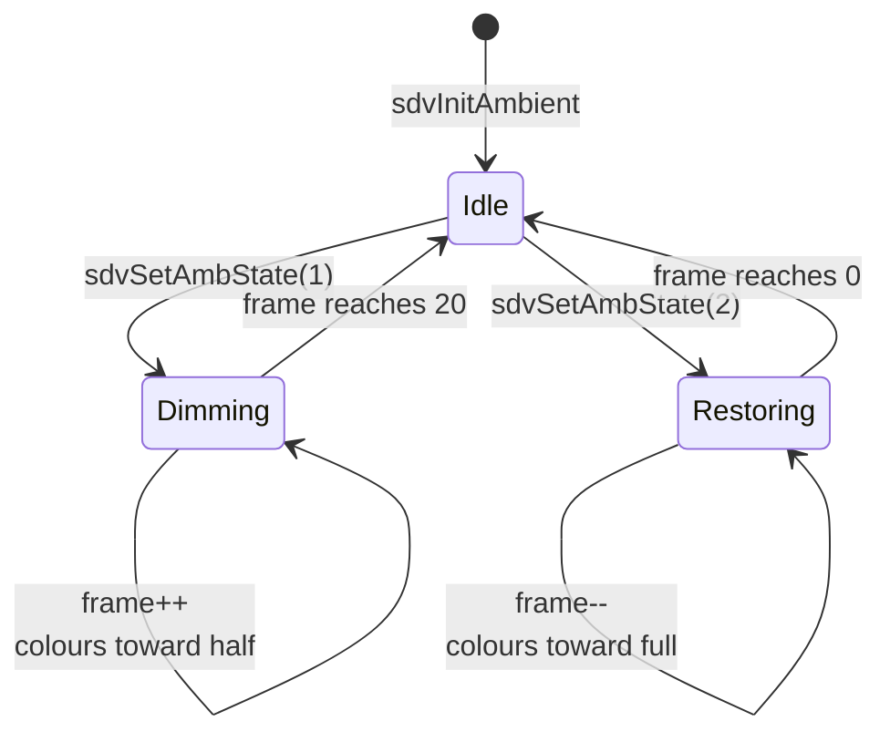

In this game the fader has no visible effect. `sdvSetAmbient` and
`sdvSaveAmbient` have empty bodies, so the computed colours go nowhere, and no
function in `src/` calls `sdvSetAmbState` or `sdvSetAmbState2`. The state
therefore stays 0 and `sdvExecAmbient` returns at once. Only the reset through
`sdvInitAmbient` is called, by the start and reset functions of the effect
system. `sc_get.c` also defines a 24-byte `sdvAmbientWork` block that nothing
reads.

## The per-frame order

The sequences run inside the effect update, which the game calls once per
frame from three places: the field loop (`src/main/game_data.c`), the battle
scene (`src/ov01/scene.c`) and the cutscene player (`src/main/cfePlugIn.c`,
when the cutscene is not paused). The entry is `sefExecEffect`. Unless the
effect system is held (`sefFlagTest(1)`), it runs one **effect step** with
`sefExecStep`.

One step does the following.

1. The entry counters are cleared.
2. `sefAdvanceGroupKey` (in `sc_get.c`) adds one to `sefGroupKey` and calls
   `sefExecScheduler(0)`, the scheduler pass over all effect records.
3. `sdvExecAlters` samples every alter.
4. `sefRunEmitters(0)` runs the built-in particle emitters.
5. The entry counters are summed.
6. `_hitFlag`, `_hitSignal` and `_seSignal` are cleared.

The scheduler pass starts with the work that is not tied to one record. Among
other things it calls `sdvExecAmbient` and `sdvClearSpecialWork`, which
releases the defocus layers of the previous frame. Then it visits every record
in use. A record with a start delay only counts the delay down. Otherwise the
record's clock advances and the integer part of the clock becomes `frame`. The
request is written back to the buffer, and the following calls are made in
this order.

1. The 32 particle slots (`sefExecEffectData`). A slot may raise `_hitSignal`.
2. `sdvScheduleCamera(&record->camera, frame)`, subject to the camera
   ownership rule.
3. `sdvExecEffectSeq`, `sdvExecShadowSeq` and `tiWindUpdateKeyframes`, for
   records without `SEF_RECORD_RUNNING`.
4. `sdvExecSpecial`.
5. `sdvScheduleAlter`.
6. `sdvDrawSpecial`, unless drawing is pending.
7. When no particle slot is alive: the wind slots are released and the record
   is restarted (looping effects) or freed. Freeing calls
   `sdvFreeSpecialSlots` and `sdvDestroyOwnerAlters`.

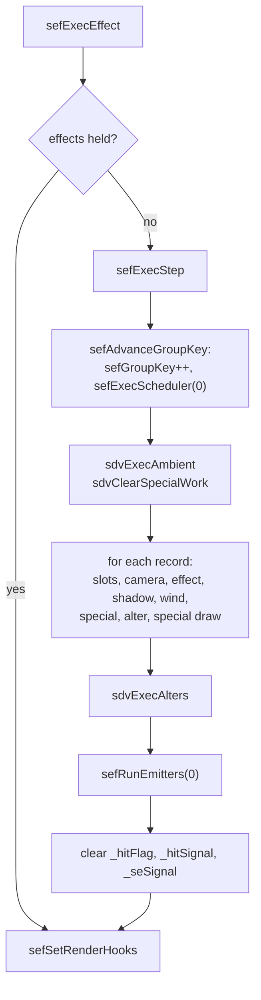

Two details of the timing matter when reading effect data. The camera tracks
are driven by the record's frame, which follows the record's speed factor and
the global effect time scale. The other sequences count scheduler passes in
their own `elapsed` field. And because the alters are sampled after all
records have run, an alter created in a pass takes its first sample in that
same pass.

`sefExecEffectSteps(record, frames, step)` runs several steps at once, to
fast-forward effects. With no record it runs `sefExecStep` repeatedly. With a
record it runs only that record's scheduler pass, or only its emitters when
the record is a built-in emitter slot. `sefProgressEffect` is the form with a
step of 1, used by the script native `progEffect` and by the cutscene player.

### Start, reset and modes

The effect system has a battle mode and a field mode, held in
`_sefBattleMode`. The mode changes which parts of `sdv` are active.

| Part | Field mode (`_sefBattleMode == 0`) | Battle mode (`_sefBattleMode == 1`) |
| --- | --- | --- |
| Camera schedule | Disabled | Active |
| Built-in emitters | Active | Disabled. `sefRunEmitters` returns at once |
| Emitter slots in the draw list | Added by `sefCullResourceSlots` | Not added |
| `MSe` objects | Not processed | `MSeObjProc` runs in the draw passes |

| Caller | `sdv` calls |
| --- | --- |
| `sefStartSystem` | `sefResetBuffers`, `sdvResetSpecialWork`, and through `sefInitWorkTables` `sdvInitAmbient` and `sefResetResourceTable` |
| `sefInitEffectBattle` (battle start, `src/ov01/m_gs.c`) | `sdvInitAlters`, then `sefDestroyEffect`, then `tiWindClearFirstSlot` |
| `sefDestroyEffect` | `sdvInitAmbient`, `sdvClearSpecialWork`, `sdvDestroyAlters`, `sdvResetSpecialWork`, `tiWindResetSlots` |
| `sefDestroyEffectCf` (field and cutscenes) | `sdvInitAmbient`, `sefResetAll`, `sdvClearSpecialWork`, `sdvDestroyAlters`, `sdvResetSpecialWork` |
| `sefResetEffects(0)` | `sdvDestroyAlters`, `sdvClearSpecialWork`, `sdvResetSpecialWork` |
| `sefFreeScheduler` and the record destroy path | `sdvFreeSpecialSlots`, `sdvDestroyOwnerAlters`, and `sefReleaseCellSlot` for an emitter slot |

When effect drawing is switched off for a frame (`sefDrawEffect` with the
pending flag set), `sdvClearSpecialWork` is called so that no filter layer
stays active.

## What the effect files use

The driver can do more than the effect files on the discs ask of it. A scan of
all 1438 effect scripts (see [Effect data](../formats/effects.md)) gives this
picture.

| Feature | Use in the shipped data |
| --- | --- |
| Shadow sequences | Four scripts (`pe806_004`, `pe557_003`, `pe558_004`, `pe559_004`). 68 scripts of an older layout have no shadow word at all |
| Wind sequences | One script, `pe818_002` |
| Effect sequences | Eight scripts with 41 rows in all, which fire object types 1, 3, 5, 7, 8, 9, 10 and 11 (see [Battle effects](../game/battle-effects.md)) |
| Camera keys | 2937 keys, all with placement mode 0. The orbit placement (mode 1) and the anchor bit `0x10` are never used |
| Camera tables | 59 of the 288 tables have a weight total of 0. With such a table no camera can be chosen and only `SEF_RECORD_PENDING` is set |
| Specials | Kinds 1, 4, 6, 7 and 10 to 14 occur. Kinds 3, 5 and 9 never do |
| Alter rows | 1484 rows, of which 824 have no image pair. The mode values are 0, 1, 2, 4 and 8 |
| Record size | A record has up to 32 slots and each slot a list of up to 32 lines. The largest record on the discs has 118 lines |

The image list of the built-in emitters is the script `ce200_900` inside the
pack `cfdef.esp`, with 22 rows. Row 16 (`line01.pxy`) is never selected by
`sefCreateKindResourceSlot`.

## Built-in particle emitters

The second half of `sdv.c` is a self-contained particle system. It does not
read key data from effect files. Each of its 25 **kinds** is a small program:
a spawn function and an update function with fixed parameter tables. The field
uses these emitters for effects that stay in the world for a long time and
belong to map objects, which is why they are active only in field mode. Map
units create them through `sefCreateEffectCf` (see
[Map and units](../game/map-and-units.md)).

### From an effect number to a slot

An effect whose script header has kind `0x49` is a built-in emitter.
`sefCreateEffectCf2` detects this through `scKeyRecordEntry` and, instead of
creating an effect record, calls `sefCreateKindResourceSlot`. The kind is
derived from the effect number: `(key & 0x3FF) - 901`. Effect `0x100C8385` is
kind 0 and effect `0x100C839D` is kind 24. Some numbers are remapped first.

| Requested effect | Becomes | Result |
| --- | --- | --- |
| `0x100C801D` | `0x100C8399` | Kind 20 |
| `0x100C801E` | `0x100C839A` | Kind 21 |
| `0x100C8023` | `0x100C83A7` | Kind 20 at five times the scale |
| `0x100C8024` | `0x100C83A8` | Kind 21 at five times the scale |
| `0x100C838A` to `0x100C838C` | `0x100C8390` to `0x100C8392` | Kinds 11 to 13 instead of 5 to 7 |

The caller receives a `SefEffectRecord` pointer as for any other effect. For
an emitter it actually points to a **resource slot**: the leading position,
rotation, scale and tint blocks and the word at `0x40` have the same layout in
both structures, and the sef core tells the two apart by the `cellSlot` word.

### Slots, emitters and the particle pool

`sefResourceTable` has 192 `ResourceSlot` entries of `0x1A0` bytes.

| Offset | Type | Name | Meaning |
| --- | --- | --- | --- |
| `0x00` | `Vector4` | `position` | An extra position applied when drawing |
| `0x10` | `Vector4` | `rotation` | An extra rotation |
| `0x20` | `Vector4` | `scale` | An extra scale. (1, 1, 1) by default |
| `0x30` | `Vector4` | `tint` | A colour multiplier for all particles. (1, 1, 1) draws them untinted |
| `0x40` | `int` | `resetFlag` | Set to 1 when the slot is created or released |
| `0x44` | `int` | `flags` | `RESOURCE_FLAG_*` bits |
| `0x48` | pointer | `activePairs` | Nonzero while the slot is in use |
| `0x50` | pointer | `owner` | The owning object, saved with the slot |
| `0x6C` | `s16` | `typeListIndex` | The image mapper of the emitter images |
| `0x6E` | `s16` | `visible` | Zero skips drawing |
| `0x74` | `int` | `key` | The effect number. Slots are released and flagged by key |
| `0x80` | `Matrix4` | `matrix` | The model matrix of the slot |
| `0xC0` | `SefEmitter[5]` | `emitters` | Up to five emitters of 0x28 bytes |
| `0x188` | `unsigned short *` | `handle` | The memory of the particle rings |
| `0x18C` | `int` | `particleCount` | Entries per ring, a power of two |
| `0x190` | `int` | `emitterCount` | Emitters in use |
| `0x194` | `s16` | `kind` | The kind, 0 to 24 |
| `0x196` | `s16` | `liveCount` | Live particles, recounted every frame |

| Flag | Value | Meaning |
| --- | --- | --- |
| `RESOURCE_FLAG_NO_DEPTH_TEST` | `0x4` | The slot is drawn without a depth test |
| `RESOURCE_FLAG_PAUSED` | `0x80` | No new particles are spawned and the empty slot is kept |
| `RESOURCE_FLAG_SUSPENDED` | `0x400000` | The slot is not updated at all |
| `RESOURCE_FLAG_PERSISTENT` | `0x4000000` | The slot is kept when it has no particles. Set for kinds 0 to 4, 20 and 21 |

Each `SefEmitter` has the GS `TEX0` value of its image, a ring of particle
indices, an elapsed time, a start `delay`, the last frame handled, a ring
cursor, a live count and a one-shot latch. The rings of a slot are allocated
together from a small-cell heap of `0x20000` bytes (`sefSmallHeap`).

The particles themselves live in one shared pool, `sefEntryPool`: 2048 entries
of `0xA0` bytes plus an unused entry 0, because index 0 means "no particle".
`sefPoolAlloc` searches the pool as a ring from a moving cursor and tests the
`life` word, which is zero for a free entry. When the search fails it sets
`sefPoolFull`, and no further allocation is tried until the next frame. A
particle holds a 3 by 3 rotation, a position, an RGBA colour, a scale with an
overall size in `w`, a velocity, its life and age, a vertical speed and a
per-axis growth factor. Kinds that spin in place keep an angle instead of a
velocity.

`sefCreateKindResourceSlot` picks the images and the number of emitters for a
kind from the image list of the effect, and `sefCreateResourceSlot` takes the
first free slot, allocates the rings and builds a `TEX0` value per emitter.
The emitters of some kinds start one after another: emitter `n` waits
`n * delayStep` frames.

| Kinds | Emitters | Ring size | Delay step | Behaviour of the particles |
| --- | --- | --- | --- | --- |
| 0 to 2 | 1 | 32 | 0 | One particle every 4 frames, 120 frames of life. It rises from just above the origin toward a random point around a height of 10, turning after frame 20, growing, fading in until frame 10 and out from frame 60. The shade is 80, 50 or 25 by kind |
| 3, 4 | 2 | 128 | 0 | Up to 3 particles at random intervals of 1 to 4 frames, 20 frames of life. They drift, rise with increasing speed and turn red as they fade. Drawn additively |
| 5 to 7 | 2 | 32, 32, 64 | 1 | Bursts from parameter rows. The particles grow and fade out, and those of odd emitters brighten |
| 8 to 10 | 4 | 32, 64, 64 | 1 | Emitters 0 and 3 grow and fade in place. Emitters 1 and 2 throw tumbling fragments that slow down, fall under gravity and bounce on the floor with half their speed |
| 11 to 13 | 3 | 64 | 1 | Emitter 0 grows and reddens, emitter 1 grows and brightens, emitter 2 throws small shrinking fragments that fall and bounce |
| 14 to 16 | 5 | 64 | 1 | Emitters 0 and 1 drift outward and sink, emitter 2 grows in place, emitters 3 and 4 throw tumbling fragments that keep a tenth of their speed when they land |
| 17 to 19 | 5 | 64, 64, 128 | 0 | Emitter 0 fades in and out, emitter 1 slows down and grows, emitter 2 stays as spawned, emitters 3 and 4 squash, stretch, fall and bounce |
| 20 | 3 | 16 | 0 | One particle per emitter every 60, 30 and 60 frames, living as long. Emitter 1 shifts its colour and grows, emitter 2 turns 6 degrees per frame and pulses |
| 21 | 2 | 16 | 0 | One particle per emitter, spawned once. The update never ages it, so it stays until the slot is released. The particle of emitter 1 turns 6 degrees per frame |
| 22 to 24 | 4 | 64 | 1 | As kinds 8 to 10, with twice the gravity and a random tint on emitters 1 and 2 |

The parameters of kinds 5 to 19 and 22 to 24 come from `SefEmitterParams` rows
(0x20 bytes): the spawn interval, the particles per spawn, the life, the
spread of the start position, the size, the overall scale, the shade, the
alpha and the last frame on which the emitter spawns.

### The emitter frame

`sefRunEmitters(target)` runs once per effect step, after the alters. It
clears `sefActiveCount` and `sefPoolFull` and, in field mode, visits every
slot in use (or only `target`). A suspended slot is skipped. The floor height
for bouncing particles is set from the slot: the negated height of the slot
position when that is above zero, otherwise 0.

Each emitter first counts down its start delay. After that the spawn handler
of the kind (`sefSpawnHandlers`) runs, unless the slot is paused, and then the
update handler (`sefUpdateHandlers`), which ages and moves the particles,
frees the dead ones and counts the live ones. A slot that ends the frame
without particles is released, unless it is paused or persistent. When the
owner kind in the effect number is 1, `uwamonoReleaseOwnedRecords` is told
first so that the map unit drops its handle.

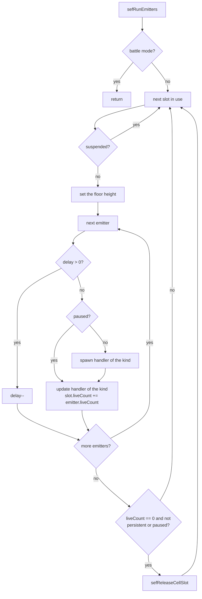

### Control functions

| Function | Action |
| --- | --- |
| `sefResetAll` | Releases every slot, re-initializes the ring heap and the pool and clears the slot table |
| `sefReleaseByKey(key)` | Releases the slots of one effect number. A negative key releases all |
| `sefSetSlotFlags`, `sefClearSlotFlags` | Set or clear flag bits in all slots of a key |
| `sefObjectSetFlags`, `sefObjectClearFlags` | The same for one slot |
| `sefResetSlotRecords(slot, suspend)` | Frees the particles of a slot, restarts its emitters and sets or clears the suspended flag |
| `sefReleaseCellSlot` | Frees the particles and the rings of a slot and clears it |
| `sefSetSlotTransform` | Sets the position, rotation and scale of a slot and rebuilds its model matrix |
| `sefGetActiveCount` | Returns the number of live particles of the last frame |
| `sefCollectPersistentSlots` | Appends the persistent slots to the saved effect list (`SefSavedEffect`, at most 64 entries) so that `sefPopEffect` can create them again later |

### Drawing emitters

Emitter slots are drawn in the same depth-sorted pass as the effect records.
In field mode `sefCullResourceSlots` runs after the records have been culled.
Every slot with live particles whose bounding sphere (radius 6, times
`scale.x` when that is above 1) intersects the view volume is appended to
`svVisibleSlots` with its clip-space depth and the marker `disabled = 1`. The
list is then sorted by depth. When `svDrawScene` reaches such an entry it
calls `sefDrawResources(slotIndex)` instead of drawing an effect record.

`sefDrawResources` sets up the view matrix and the draw state, sends a VU
packet with a unit quad and the camera matrices (`sefBuildCameraPacket`,
`sefBuildVuPacket`) and calls `sefDrawEmitter` for each emitter of the slot.

`sefDrawEmitter` sends the model matrix, the texture, the blend mode and the
depth test of the emitter (`sefSetupEmitterPacket`, `sefBuildModelPacket`) and
then the particles: five quadwords each, the particle matrix with its three
axes scaled by the particle's size and growth, followed by the colour. The
colour is multiplied by the slot's tint when the tint is not (1, 1, 1). The
fragments of kinds 8 to 10 and 14 to 16 are also turned by their age so that
they tumble. Particles are sent by reference in blocks of at most 24, and a
VU1 micro program expands each one into a camera-facing quad. Two programs
exist, and the tumbling fragments and emitter 2 of kinds 11 to 13 use the
second one.

Most emitters blend normally. Additive blending is used for kinds 3 and 4, for
the even emitters of kinds 5 to 7, for emitters 0 and 3 of kinds 11 to 13, for
emitters 0 and 1 of kinds 14 to 16, for emitter 2 of kinds 17 to 19 and for
emitter 1 of kind 20. Kinds 20 and 21 and slots with
`RESOURCE_FLAG_NO_DEPTH_TEST` are drawn without a depth test.

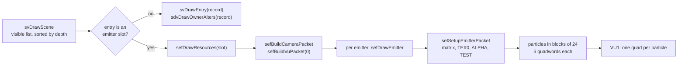

## Screen effect requests of cutscenes

`effect_request.c` holds a second, unrelated kind of "effect request". The
cutscene player evaluates three screen effect slots on every frame of a
cutscene. Each slot yields a kind, a strength and a depth value, and
`effectRequestToCommand(bank, kind, arg, value)` translates them into one of
the **record presets** of `record_render.c`: it fills a parameter block and
calls `recordSetPreset(bank, command, arg, params)`. The presets are the
full-screen fades, flashes and patterns described on
[Screen effects](screen-effects.md), and the cutscene side is on
[Cutscenes](../scripting/cutscenes.md).

The caller is the frame function of the cutscene player in
`src/main/cfePlugIn.c`. For each of the three slots it passes the slot index
as the bank, the evaluated kind, the sample value scaled by 16777215 as `arg`
and the integer sample as `value`. Kinds `0x22` and `0x23` are sent as kinds
`0x1A` and `0x1B` with the `arg` reduced to 3 percent. In the table, "white"
means the colour `0xFFFFFF` with `value` as its alpha byte.

| Kind | Preset | Parameters |
| --- | --- | --- |
| 0, unknown kinds | 0 | None. The bank is cleared |
| 1 | 10 | White, 0 |
| 2 | 10 | Black with alpha `value`, 0 |
| 35 | 10 | White, 1 |
| 3 | 11 | `0x40FFFFFF`, `value` (at least 1) |
| 4 | 18 | `0x40FFFFFF`, `value` (at least 1) |
| 5 | 12 | White |
| 6 | 9 | `0x7FFFFFFF`, `value` (at least 1) |
| 7 | 8 | `0x80FFFFFF`, `value + 50`, `value + 10`, with `value` capped at 76 |
| 8, 9, 12, 13 | 13 | A two-edge wipe with variant 0. The edge is `value / 127 * 247` and the second edge lies 50 behind it. Kinds 8 and 9 are white, 12 and 13 black. Kinds 9 and 13 swap the two edges. Both are limited to 0 to 127 |
| 10, 11, 14, 15 | 13 | The same with variant 1, a range of 197 and a distance of 45 |
| 16, 17 | 14 | `0x7FFFFFFF`, variant 1 or 2, an angle of `360 - value / 127 * 360`, colour `0xFF4020` |
| 18, 19 | 15 | `0x7FFFFFFF`, variant 1 or 0, the same angle, colour `0xFF0000` |
| 20 | 3 | White, 0, 17, 17 |
| 21 | 5 | White, 0, 10, -13, 0, 7 |
| 22 | 5 | White, 0, 18, -20, 0, 7 |
| 23 | 5 | White, 1, 10, -13, the colour `0xFAB4B4` with alpha `value`, 7 |
| 24 | 4 | White, 0, 12, 7, 4, 0 |
| 25 | 16 | White, 175, 22 |
| 26 | 11 | White, 1 |
| 27 | 18 | White, 1 |
| 28, 32, 31 | 20 | Variant 0, 1 or 2, then `value` |
| 29 | 22 | `value` |
| 30 | 19 | `value >> 4` |
| 33 | 21 | `value` |
| 34 | 23 | `value` |
| 36 | 1 | `0x7FFFFFFF` and a cell count: `recordGridCellCount() * value / 127` |

The rest of the file is a set of small helpers that other systems own.
`recordClearAllBanks` and `recordUpdatesHold` forward to `recordClearBanks`
and `recordPauseUpdates`. The cutscene player calls `recordUpdatesHold` while
a cutscene is paused. `msgWindowReset`, `msgWindowRequestFlush`,
`msgQueueSlot` and `msgWindowFlush` implement the deferred drawing of message
windows: a window or a slot is queued and `msgWindowFlush` is installed in
`msgFrameHooks[0]`, where it runs once and clears the queue. They are
described on [UI windows](ui-windows.md). `sellLabelTextOff` is a flag of the
sell list in `msg_text_draw.c` (see [G.S. Campaign](../game/gs-campaign.md)).

## Who uses sdv

| User | File | Use |
| --- | --- | --- |
| The sef scheduler | `src/main/sef.c` | Binds and steps all sequences, resets the tables, frees specials and alters with their record |
| The effect draw pass | `src/main/sv_get_image_item.c` | `sdvDrawAlters`, `sdvDrawOwnerAlters`, `sefCullResourceSlots`, `sefDrawResources`, `sefGetActiveCount` |
| The battle program | `src/ov01/cmd_exec.c`, `src/ov01/think_dispatch.c`, `src/ov01/scene.c`, `src/ov01/unit_cmd.c` | Sends the effect requests whose sequences move the camera and wait for hits |
| The `MSe` objects | `src/ov01/m_gs.c` | `MSeFire`, called by the effect sequence |
| The game camera | `src/main/game_camera.c` | Receives the camera keys through its range, target and transition slots |
| The defocus layers and `gifState` | `src/main/game_defocus.c`, `src/main/gifState.c` | Receive the specials |
| The `Ti` wind sources | `src/main/TiWindBase.c` | Receive the wind keys |
| Map units | `src/main/uwamono_record.c`, `src/main/uwamono_objx.c` | Create and release built-in emitter slots |
| The cutscene player | `src/main/cfePlugIn.c` | `effectRequestToCommand`, `recordUpdatesHold`, and the effect update itself |
