# sef, the visual effect system

`sef` is the visual effect system of the game. It draws the attack and ether
effects of a battle, hit sparks, the auras of units, and the effects placed on
the field map by doors, breakable objects, enemies and cutscenes. An effect is a
small particle system. Its timing, shapes, textures and motion all come from
effect files on the disc. The code reads those files, runs every live effect
once per frame and turns the result into drawing packets.

The system has three layers. The `srs` layer turns an effect number into file
names and keeps the loaded files in a table of resource records. The `sc` layer
finds the script of one effect inside a loaded file. The `sef` layer owns the
running effects: records, slots, lines and points, the keyed tracks that drive
them, and the per-frame update. The drawing code (`sv*`) reads the points that
`sef` produced and builds the packets.

Two neighbours build on top of this page. The effect sequence driver `sdv`
plays the sound, camera, shadow, screen and trail sequences that belong to an
effect, and it also owns a second, lighter kind of effect object. It is
described in [sdv](sdv.md). The hand-coded battle effects of the battle overlay
(`MEf`, `MSe`) are described in [Battle effects](../game/battle-effects.md).

[← Back to the overview](../README.md)

## Files

All files are in `src/main/`. The headers are in `include/main/` with the same
base names.

| File | Prefix | Contents |
| --- | --- | --- |
| `src/main/sef.c` | `sef`, `sev` | Effect records, slots, lines and points, the point allocator, tracks and cursors, emission shapes, position kinds, the request buffer, the actor entry table, start-up and teardown, the per-frame update, the draw entry points |
| `src/main/sef_entry_counts.c` | `sef` | Access to the per-mapper draw counters `sefEntryCounts`, and two functions that only return 0 |
| `src/main/sef_light_set.c` | `sef` | The three light set blocks that effects and battle units share |
| `src/main/sef_print.c` | | The empty log function `LOG`, `tracePrint`, a reset prompt for developers, and two flag words used by other files |
| `src/main/srs.c` | `srs`, `sres` | Effect keys, file stems and file kinds, load modes and paths, file loading, the resource record table |
| `src/main/srs_file.c` | `srs` | Effect name to key, the image key test, a file load wrapper |
| `src/main/sc_get.c` | `sc` | Script record lookup, script offsets and addresses, the group key |
| `include/main/sef.h` | | `SefEffectRecord`, `SefEffectEntry`, `SefLinkedContext`, record flags, the public functions |
| `include/main/srs.h` | | `SrsRecord`, `SrsTable`, load modes |
| `include/main/sc_get.h` | | `SefScriptRecord` |
| `include/main/sef_light_set.h`, `sef_print.h`, `srs_file.h` | | Prototypes of the small files |

Three other files matter for this page but belong to other pages. The image
mapper, the effect slot loader `srsLoadEffectSlot` and every draw function are
in `src/main/sv_get_image_item.c`. The sequences and the resource slot objects
are in `src/main/sdv.c`. The battle side that sends effect requests is in
`src/ov01/cmd_exec.c`.

## How the parts fit together

Game code names an effect by a 32-bit **effect key**. Before an effect can run,
its file must be in memory. `srs` loads the file into a buffer and registers
the buffer as an **image mapper**, which is a list of the textures, palettes,
models and scripts found in the file. Each loaded file has one record in
`srsRecordTable`, and the record number is also the mapper number.

When the game asks for an effect, `sef` looks up the script of the key with
`scGetKeyRecord`, takes a free **effect record** and fills it from the script.
The record holds up to 32 **slots**. Each slot starts **lines** at given frames.
A line is an emitter that creates **points**. A point is one sprite or one small
model on screen.

Each frame `sefExecEffect` steps all records. Later in the frame the render code
calls the three draw entry points of `sef`, which hand the points to the `sv`
draw functions.

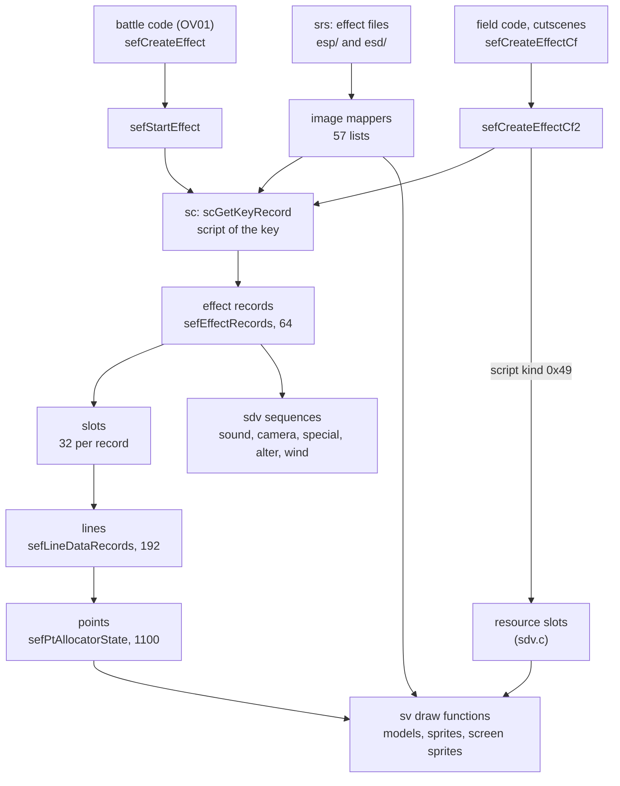

## Effect keys

### Layout of a key

An effect key packs three numbers into one word. The macro `SRS_EFFECT_KEY` in
`src/main/srs.c` builds it, and every function of the layer takes it apart with
the same shifts.

```
 31 30 29 28 27      22 21            12 11 10 9             0
+-----+-----+----------+----------------+-----+---------------+
|  0  |kind |  unused  |     index      |  0  |  sub number   |
+-----+-----+----------+----------------+-----+---------------+
       2 bits               10 bits                10 bits
```

| Field | Bits | Meaning |
| --- | --- | --- |
| kind | 28 to 29 | Family of the effect. It selects the two-letter prefix of the file name |
| index | 12 to 21 | Group number, 0 to 1023. Battle code calls it the effect group |
| sub number | 0 to 9 | Effect inside the group, 0 to 1023 |

A negative key is invalid. `srsFormatEffectStem` prints `bad effect no:%d` for
one. A key of 0 means no effect everywhere.

The kind selects a prefix from `srsEffectKindPrefix`.

| Kind | Prefix | Used for |
| --- | --- | --- |
| 0 | `pe` | Battle effects. All keys sent by the battle overlay have kind 0 |
| 1 | `ce` | Field and cutscene effects. Their records are allocated apart from records owned by map units |
| 2 | `ee` | A third family. Records of this kind get record flag 0x10 when they are created through `sefCreateEffectCf2` |
| 3 | none | The table entry is a null pointer |

The readings "battle" and "field" come from the callers. The battle overlay
builds its keys as `(group << 12) | record` (`EFFECT_KEY_GROUP_SHIFT` in
`include/ov01/think_dispatch.h`), which gives kind 0. The field code passes
constants such as `0x10000033`, which is kind 1, index 0, sub number 51.

### Stems and names

The **stem** of a key is its text form. `srsFormatEffectStem` writes the prefix
and the index as three digits. With `withSubNo` set it adds an underscore and
the sub number as three digits. Key `0x10000033` has the stems `ce000` and
`ce000_051`.

`srsGetEffectStem` returns the long stem in a static buffer.
`srsEffectNameToID` in `src/main/srs_file.c` goes the other way. It reads a
nine-character name such as `ce000_051`: two letters for the kind (`pe` is 0,
`ce` is 1, `ee` is 2, anything else is 0), three digits for the index, one
separator character that is not checked, and three digits for the sub number.
Field scripts and map unit tables name effects this way, and
`sefSpawnEffectRecordByCode`, `sefSpawnEffectByName` and `sefLoadEffectCfName`
accept such names.

### File kinds

Not every effect has a file of its own. `srsGetEffectFileKind` sorts a key into
one of three classes from its kind and index.

| Kind | Index | File kind | Where the effect data is |
| --- | --- | --- | --- |
| 2 (`ee`) | any | `SRS_EFFECT_FILE_ESD` | One `.esd` file per effect |
| 1 (`ce`) | 200 | `SRS_EFFECT_FILE_NONE` | Inside the effect package |
| 1 (`ce`) | 300 to 449 | `SRS_EFFECT_FILE_ESP` | One `.esp` file per index |
| 1 (`ce`) | other | `SRS_EFFECT_FILE_ESD` | One `.esd` file per effect |
| 0 (`pe`) | 1 to 10, 101 to 103, 500 to 799 | `SRS_EFFECT_FILE_ESP` | One `.esp` file per index |
| 0 (`pe`) | 300 to 399 | `SRS_EFFECT_FILE_NONE` | Inside the effect package |
| 0 (`pe`) | other | `SRS_EFFECT_FILE_ESD` | One `.esd` file per effect |

`srsAnalyzeEftNo` wraps this test. It returns the bare file name (`pe005.esp`
or `ce000_051.esd`) and writes an **effect type**: 0 for an effect of the
package, 1 for an `.esp` effect and 9 (`SRS_EFFECT_TYPE_ESD`) for an `.esd`
effect. The effect type decides in which part of the resource table the effect
is searched.

The two path builders add the directory. `srsGetEffectName` returns
`esd/<stem>_<sub>.esd` and `srsGetEffectName2` returns `esp/<stem>.esp`.

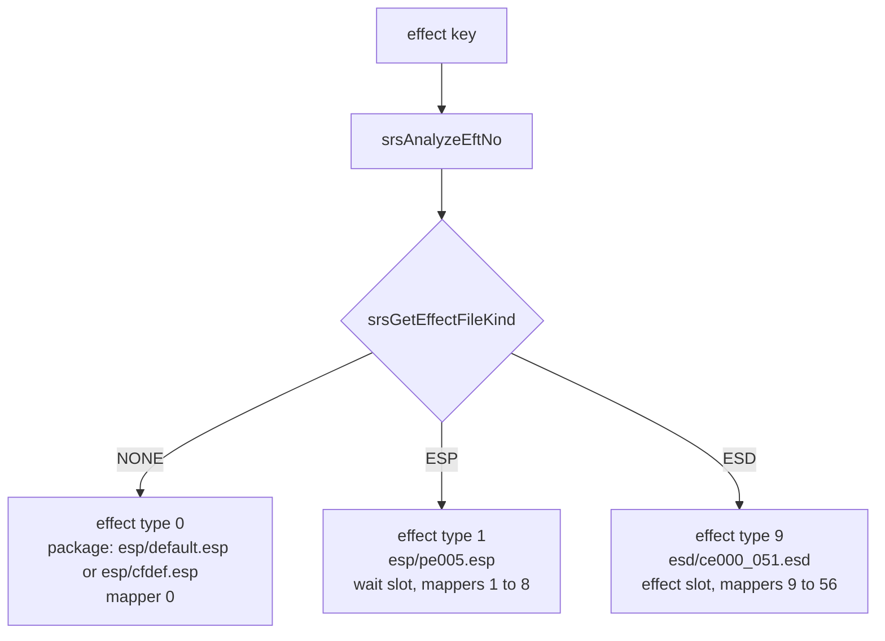

### Canonical keys and aliases

Several keys share one script. `sefCanonicalEffectId` maps a key to the key
under which the data is stored, and the loader and the script lookup both use
the result.

`sefResolveEffectAlias` first replaces four keys: `ce200_029` becomes
`ce200_921`, `ce200_030` becomes `ce200_922`, `ce200_035` becomes `ce200_935`
and `ce200_036` becomes `ce200_936`. Then two ranges are folded:

- Keys `ce200_901` to `ce200_939` all become `ce200_900` (`SEF_SPAWN_ID_BASE`,
  `0x100C8384`). The sub number minus 901 is kept by the caller as a kind
  number for the [resource slot objects](#the-boundary-with-sdv-and-mef).
- Keys from `pe300_001` to `pe340_999` lose their low four bits and get 1
  instead. Sixteen neighbouring sub numbers therefore share one script record.
  `srsGetEffectSlot` returns the low four bits minus 1 for these keys, and a
  script of kind 0x3F uses that number to pick one variant from a table (see
  [Effect scripts](#effect-scripts-sc)).

## Effect files and the resource table

### Load modes and paths

`srsMakeFileName` turns a file name into a full path. The root depends on
`srsLoadMode`.

| Mode | Value | Path |
| --- | --- | --- |
| `SRS_LOAD_MODE_CD` | 0 | `simajiri/` + name |
| `SRS_LOAD_MODE_HOST` | 1 | `host0:/home/xeno/work/` + `srsViewPath` + name |
| `SRS_LOAD_MODE_USB` | 2 | `usb0:/` + `srsViewPath` + name |
| `SRS_LOAD_MODE_DEB` | 3 | `srsViewPath` + name |

`srsLoadMode` starts at 0. `srsSetLoadMode` and `srsSetViewPath` exist, but no
function of the recovered program calls them, so the retail game always loads
from the disc directory `simajiri`. The other three modes are developer paths
for a host PC, a USB drive and the `xglDeb` file access of
[xgl](xgl.md). How a disc path becomes sectors is described in
[Files and resources](../architecture/files-and-resources.md).

`srsGetFileLen` returns the size of a file rounded up to 2048 bytes
(`SRS_SECTOR_SIZE`). In disc mode it changes every `/` to `\` with
`srsChangeSeparator` and asks `xglCdGetFileSize`. It returns 0 for a missing
file, and always 0 in USB mode.

### Reading a file

`fileLoad(buffer, name, readMode)` reads a whole file into a buffer. In disc
mode it calls `xglCdReadFile` with the completion callback `srsCdReadCallback`.
Read mode 0 waits for the data, read mode 1 returns at once and lets the read
finish in the background. When the reader answers -3 (`SRS_CD_READ_RETRY`) to a
waiting read, the read is sent again in mode 1.

The counter `_nRead` holds the number of disc reads that have not finished.
`fileLoad` adds 1 before each read. `srsCdReadCallback` takes 1 away when a read
reports status 4 (`SRS_CD_READ_COMPLETE`) or an error. When the last pending
read completes, the callback calls `sresDataMapping`, which registers the new
buffers with the image mapper. `srsInitCdRead` clears the counter and
`srsLeaveCdRead` returns it. `sefCheckLoad` uses it to tell the game that
effect data is still arriving.

The host, DEB and USB branches read the file directly and call
`sresDataMapping` themselves. `srsLoadFileSync` is `fileLoad` in mode 0, and
`srsFileLoad` in `src/main/srs_file.c` passes its three arguments through.

### The resource record table

`srsRecordTable` (`SrsTable`) holds 58 records of 28 bytes. A record owns one
file buffer, and its position in the table is the number of the image mapper
that describes the buffer.

```
srsRecordTable (58 records of 0x1C bytes)
+--------------------+  record 0        the effect package
| package            |                  esp/default.esp or esp/cfdef.esp, mapper 0
+--------------------+  records 1..8    the wait slots
| waitSlots[0..7]    |                  one .esp file each, mappers 1..8
+--------------------+  records 9..56   the effect slots
| slots[0..47]       |                  one .esd file each, mappers 9..56
+--------------------+  record 57       sentinel used while searching the oldest slot
| slots[48]          |
+--------------------+
```

| Offset | Type | Name | Meaning |
| --- | --- | --- | --- |
| 0x00 | `void *` | `handle` | The file buffer. 0 means the record is free |
| 0x04 | `int` | `key` | Effect key of the loaded file. For a wait slot only the index bits are set |
| 0x08 | `int` | `size` | Buffer size of an effect slot |
| 0x0C | `int` | `owner` | Owner number that was current when the file was loaded (`sefGetCurrentOwner`) |
| 0x10 | `int` | `arg` | The caller's value from `srsLoadEffectSlot` |
| 0x14 | `unsigned int` | `stamp` | Use counter. The slot with the lowest stamp is evicted first |
| 0x18 | `short` | `effectNo` | Index number of a wait slot |
| 0x1A | `signed char` | `kind` | How the buffer is freed: 0 `smFree`, 1 `GameResBlockFreeByBuffer`, 2 not at all (the caller's buffer) |
| 0x1B | `signed char` | `busy` | 1 while the buffer still has to be registered as an image mapper |

The buffers of kind 0 come from the effect heap. `sefInitEffect` gives the
`sm` allocator the static block `sefDefaultMemoryBlock` of 0x152800 bytes, and
`smAlloc`, `smFree` and `smFindFree` work inside it. The allocator itself is
described in [Memory](../architecture/memory.md).

### The effect package

Record 0 holds the **effect package**, a file with the textures and scripts
that are always needed. `srsLoadEspFile(reload, cfdef)` loads
`esp/cfdef.esp` for the field or `esp/default.esp` for battle into a buffer of
0x28800 bytes. The record key is index 999, sub number 500, with kind 1 for the
field package and kind 0 for the battle package. When the buffer already holds
the wanted package and `reload` is 0, the function only registers the mapper
again. Effects of type 0 (`pe300` to `pe399` and `ce200`) take their scripts
from this package. Any line can also take single images from it, see
[Images of a line](#images-of-a-line).

### Wait slots

Records 1 to 8 hold `.esp` files. An `.esp` file carries all effects of one
index, which in battle is one character or one enemy type. The battle loader
calls `sefSetupPlayer(number)` for party members and `sefSetupEnemy(number)`
for enemies. Both write the number into the table `sefSlotTable`: party members
may use entries 0 to 2, enemies entries 3 to 7. A new entry sets its
`loadPending` flag and calls `sefSetupEffect`, which runs
`srsLoadPendingEffects`. That function allocates a buffer of 0x1C000 bytes for
each pending entry, loads `esp/pe<number>.esp` in the background and stores the
key. `sefReleaseID(number)` frees an entry again. It first deletes the running
records of that mapper (`sefDeleteEffectWait`), then calls
`srsReleaseSlotsByIndex`.

The field uses wait slot 0 in a different way. Keys of kind 1 with an index
from 300 to 449 pass the test `srsIsEffectImageKey`. For them
`srsLoadEffectBlock` loads `esp/ce<index>.esp` into wait slot 0 with a buffer
of 0x10000 bytes and waits for the disc to become idle. Loading a different
index replaces the old file and deletes every record that used it
(`sefReleaseImageRecords`).

### Effect slots

Records 9 to 56 hold single `.esd` files. `srsLoadEffectSlot(buffer, key, arg)`
in `src/main/sv_get_image_item.c` makes one effect resident. Its return value
tells the caller what happened: 0 when the effect was already loaded, 1 when a
load has started, -1 for a bad key or a failed read, and -2 when no slot or no
memory is free.

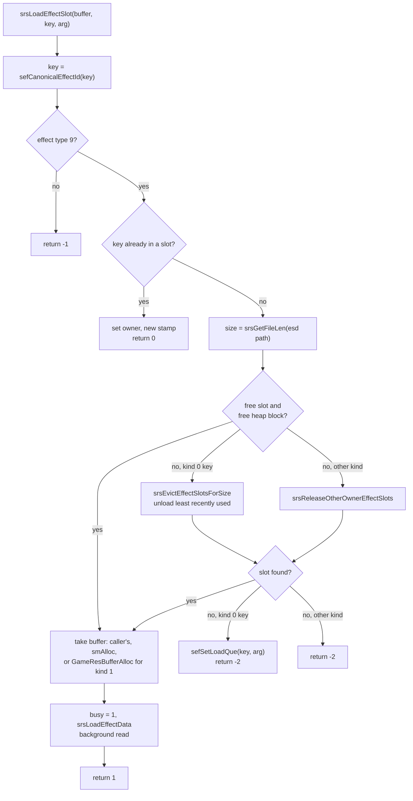

A slot can only be evicted when it is not busy, its buffer came from the effect
heap, and no record still plays its key (`sefIsFinishEffect2`).
`srsReleaseOtherOwnerEffectSlots` is the gentler variant used for field keys.
It unloads slots that were loaded under another owner number and keeps the six
keys of `srsKeptEffectKeys` (`ce000_051`, `ce000_053`, `ce000_055`,
`ce000_033`, `ce000_063` and `ce000_064`). The first four of these are the
effects that the play session loads once at its start in
`src/main/game_data.c`.

### The load queue

A battle effect that found no room is not lost. `sefSetLoadQue(key, arg)` puts
it into the ring `loadWaitTable` of 16 entries. Every frame `sefExecLoadQue`
tries the entry at the head again with `srsLoadEffectSlot`. While the answer is
-2 it counts the tries, and it gives up on the entry after 300 tries
(`SEF_LOAD_WAIT_MAX_TRIES`). `sefSetLoadQue(0, 0)` clears the ring.
`sefLoadQueBusy` reports whether any entry waits.

### Registering a file

`sresDataMapping` walks the whole table. For each record that has a buffer and
a set `busy` flag it calls `svAddImageMapper` with the record number, then
clears the flag. `svAddImageMapper` runs `svAnalyzeChunk`, which walks the
chunks of the file and adds an entry to the mapper's list for each one: images,
palettes, models and scripts. The chunk layout is a file format subject, see
[Effect files](../formats/effects.md).

`sefSearchMapperIndex(key)` answers in which mapper an effect lives. For type 9
it searches the 48 effect slots for the exact key and returns the slot number
plus 9. For type 1 it compares only the index bits with the eight wait slots
and returns the slot number plus 1. It returns 0 for a package effect and -1
when the file is not loaded.

### Loading by key and the handle table

`sefStartEffectKey(buffer, key, mode)` is the general "make this key usable"
call of the field. An image key goes to `srsLoadEffectBlock`, any other key to
`srsLoadEffectSlot`. When the load started, the key is written into
`sefHandleSlots`, a table of 48 pairs of key and buffer pointer, and the
function waits until the disc is idle if no buffer was supplied.
`sefStartEffectKeyDefault` is the same call with mode 0. `sefLoadEffectCfName`
takes a name instead of a key and reloads the field package first when the name
starts with `e`. `sefLoadEffect(key, group)` is the battle form: it calls
`srsLoadEffectSlot` without a buffer.

The handle table exists so that the set of loaded effects can be rebuilt. See
[Saving and restoring the effects](#saving-and-restoring-the-effects).

## Effect scripts (`sc`)

The data that describes one effect is called its script. It is not a program.
It is a block of tables whose entries point at each other with 16-bit offsets.
`src/main/sc_get.c` finds the block and resolves the offsets.

### Offsets and addresses

All offsets inside a script count 16-bit words from the start of the script
record. `scGetImmAdrImmIdx2(base, table, index)` reads `table[index]` and
returns `base + offset * 2`. The values 0 and 0xFFFF (`SCRIPT_ADDRESS_NONE`)
mean "nothing here" and give the address 0. `scOfsToAdr` does only the first
half: it turns 0xFFFF and -1 into 0 and leaves other offsets alone.
`scGetImmNumIdx` reads a signed 16-bit number from a table.

The base address of the script that is being read is kept in the global
`sefCurrentLoadTag` of `src/main/sef.c`. Each record stores its own base in
`loadTag` and the update sets the global before it steps the record.

### Finding the script of a key

`scGetKeyRecord(key, offset_out, index)` returns the script record of a key.
It asks `sefSearchMapperIndex` for the mapper and `svGetScript` for the list
entry. `svGetScript` returns entry 0 of an effect slot mapper directly. In a
package or `.esp` mapper it searches the script entries for one whose name
starts with the long stem of the canonical key.

The entry's data is a `SefScriptRecord`.

| Offset | Type | Name | Meaning |
| --- | --- | --- | --- |
| 0x00 | 16 bytes | | Header that the code does not read |
| 0x10 | `short` | `kind` | Script kind, 0x3C to 0x3F or 0x49. Eleven placeholder files on the discs have kind 4 and no table, and they are never loaded |
| 0x12 | `short` | `operand` | An offset, a count or an index, depending on the kind |
| 0x14 | `unsigned short[]` | `offsets` | Offset table of kinds 0x3E and 0x3F |

The kind decides how the offset of the record table is found. The function
stores the kind in `scKeyRecordMode` so that the caller can react to it.

| Kind | Meaning | Offset returned |
| --- | --- | --- |
| 0x3C | Plain effect | `operand` |
| 0x3D | Plain effect whose sprites are depth sorted | `operand`. The caller sets record flag 0x800000 (`SEF_START_MODE_FLAG`) |
| 0x3E | Group effect (`SEF_START_MODE_GROUP`) | `offsets[index]`. `operand` is stored in `scKeyRecordGroupCount`, masked with 0x3FFF unless bit 0x4000 is set |
| 0x3F | Variant effect | `offsets[srsGetEffectSlot(key)]` when the variant number is below `operand` |
| 0x49 | Resource slot effect | None. The address of `operand` is published in `scKeyRecordEntry` |

The function returns 0 when the file is not loaded, the script is missing or
the offset is empty. `scGetKeyRecordFirst` is the call with index 0.

### The group key

`sefAdvanceGroupKey` adds 1 to `sefGroupKey` and then runs `sefExecScheduler`
for all records. It is the first real step of each effect frame, so the group
key is a frame counter that every record copies into its `value` field when it
is created. Records that were created in the same frame for the same effect key
therefore share a pair of numbers. The group effects use that pair to find each
other, see [Group effects](#group-effects).

The states `scKeyRecordMode`, `scKeyRecordGroupCount`, `sefGroupKey` and
`scKeyRecordEntry` are defined in `src/main/srs.c`, between the path functions
and the file size function.

## The effect objects

A running effect is a tree of four object kinds. Every kind lives in a table of
fixed size, so nothing is allocated while an effect plays.

1. An **effect record** (`SefEffectRecord`) is one running effect. It has a
   position, rotation and scale, the actors it is attached to, a time and 32
   slots.
2. A **slot** (`SefEffectEntry`, also viewed as `SefEffectSlot`) is one part of
   the effect. It owns a small list that says at which frame each of its lines
   starts.
3. A **line** (`SefLocalData`) is an emitter. It follows its own keyed tracks
   and creates points at a fixed rhythm.
4. A **point** is one particle: a textured sprite or a small model. The code
   views the same 0x2C0 bytes as `SefTransformState` when it moves the point
   and as `SefPointState` when it samples its tracks.

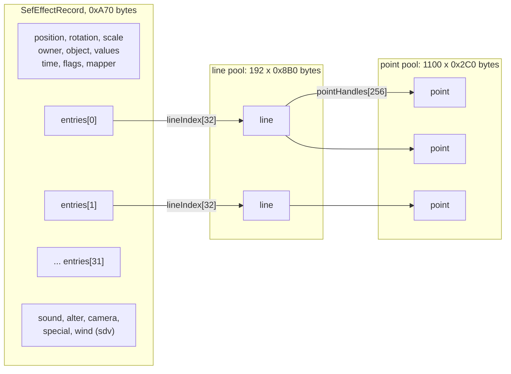

### Pools and limits

Three globals give the pool sizes. `sefInitEffect` sets them to the values
below, and the static pools in `src/main/sef.c` are sized for exactly these
numbers.

| Pool | Pointer | Count | Element size | Total |
| --- | --- | --- | --- | --- |
| Effect records | `sefEffectRecords` (`_scheduler`) | `sefEffectRecordCount` = 64 | 0xA70 | 0x29C00 |
| Lines | `sefLineDataRecords` (`sefLineDataPool`) | `sefLineDataCount` = 192 | 0x8B0 | 0x68400 |
| Points | `sefPtAllocatorState` (`_ptAlloc`) | `sefPtAllocCount` = 1100 | 0x2C0 | 0xBD110 with the header |

Smaller tables complete the picture: 24 actor entries in `sefEntryTable`, 8
group centres in `sefGroupTable`, 32 spawn slots in `sefEffectSlots`, 16 load
queue entries, 48 handle slots and 64 saved effects.

`sefStartWithMemory(block)` is an alternative start that places the three
pools inside one caller block: points at +0, lines at +0xBD120 and records at
+0x125520. It returns the size it used, 0x14F1A0 bytes. No function of the
recovered program calls it.

### The point allocator (`sev`)

Points are handed out by handle. Entry 0 of the point table does double duty:
the first 16 bytes of every 0x2C0-byte entry are a prefix, and the prefix of
entry 0 holds the `head` and `tail` indices of a ring of free handles,
`sefPtFreeSlots`.

`sevInitPtAllocator` clears the pool and the request buffer and fills the ring
with the handles 0 to 1099. `sevAllocPtAllocator` takes the handle at `head`
and returns -1 when the ring is empty. `sevFreePtAllocator` puts a handle back
at `tail`. `sevGetPtAllocator` and `sevGetPtAllocator2` return the data of a
handle, which starts after the 16-byte prefix. The draw code uses the second
one with handle 0 as the base of the whole pool.

### Effect records

`SefEffectRecord` is defined in `include/main/sef.h`. The table lists the
fields that carry meaning.

| Offset | Type | Name | Meaning |
| --- | --- | --- | --- |
| 0x000 | `Vector4` | `position` | Place of the effect |
| 0x010 | `Vector4` | `rotation` | Rotation angles, zero at creation |
| 0x020 | `Vector4` | `scale` | Scale, (1, 1, 1) at creation |
| 0x030 | `Vector4` | `vertexScale` | Extra scale for the sprite corners, (1, 1, 1) at creation |
| 0x040 | `int` | `cellSlot` | Nonzero when the object is really a resource slot of `sdv` |
| 0x044 | `int` | `flags` | Record flags, see below |
| 0x048 | `int` | `inUse` | 0 when free. Otherwise the address of the record's slot table in the script |
| 0x04C | `int` | `loadTag` | Base address of the script |
| 0x050 | `int` | `owner` | Source actor of the effect |
| 0x054 | `void *` | `ownerHigh` | Second actor, the partner of a pair technique |
| 0x058 | pointer | `object` | Target actor |
| 0x05C | `int[3]` | `values` | Three more actors, the parts of a large unit |
| 0x068 | `int` | `requestTail` | A fourth part actor |
| 0x06C | `short` | `entryId` | Number of the image mapper that holds the effect |
| 0x06E | `short` | `gate` | 1 when the record is stepped and drawn, 0 when it is hidden |
| 0x070 | `float` | `coord_a` | Time of the record in frames |
| 0x074 | `int` | `ownerKey` | Effect key |
| 0x078 | `float` | `coord_b` | Speed of this record, 1.0 by default |
| 0x07C | `unsigned char` | `spawnEnabled` | Low byte of the request's `hitMode`. Nonzero allows child effects |
| 0x07E | `unsigned short` | `spawnBits` | The request's `hitCode`: which child effects to start |
| 0x082 | `unsigned short` | `loadFlags` | Passed to `sefInitEffectTbl` |
| 0x084 | `SefEffectEntry[32]` | `entries` | The slots |
| 0xA04 | `SdvSequence` | `effectSeq` | Sound sequence |
| 0xA0C | `SdvSequence` | `shadowSeq` | Second sequence, stepped by `sdvExecShadowSeq` |
| 0xA14 | `SdvSequence` | `alter` | Alter (trail strip) sequence |
| 0xA1C | `SdvCameraSchedule` | `camera` | Camera schedule |
| 0xA44 | `SdvSpecial` | `special` | Special (screen effect) sequence |
| 0xA54 | `SdvSequence` | `wind` | Wind sequence |
| 0xA5C | `float` | `fieldA5C` | When nonzero, replaces the height of the source actor's attach points |
| 0xA60 | `float` | `cullRadius` | Radius of the bounding sphere used for culling, 8.0 |
| 0xA64 | `unsigned short` | `value` | Group key at creation |
| 0xA66 | `short` | `remaining` | Frames to wait before the first step |
| 0xA68 | `short` | `slotIndex` | Index of the record in its table |
| 0xA6A | `signed char` | `linkValue` | Frame at which the record restarts, or -1 |
| 0xA6B | `unsigned char` | `effectType` | Effect type from `srsAnalyzeEftNo` |
| 0xA6C | `unsigned char` | `requestMode` | Mode byte of the request |

The field names `coord_a` and `coord_b` do not describe their use. The update
adds `coord_b` times the global time scale to `coord_a` each frame and derives
the frame number from `coord_a`.

The record flags are a mix of named and unnamed bits. The table gives what each
bit does in the code.

| Bit | Name | Effect |
| --- | --- | --- |
| 0x1, 0x8 | | Cleared at the end of every update of the record |
| 0x2 | `SEF_RECORD_RUNNING` | Set for records made by `sefCreateEffectCf2`. Such a record skips its sound, second and wind sequences and does not start child effects |
| 0x4 | | The record is drawn without the Z test |
| 0x10 | | The record is never culled. Set for kind 2 keys and when a line follows the source actor |
| 0x20 | | The record restarts when all its slots have ended |
| 0x40 | | The record does not count as active and gets no camera. Set by `sefCreateEffect2` and by slot flag 0x8000 of a linked request |
| 0x80 | | Lines stop emitting but stay alive (set and cleared through `sefApplyRecordMode`) |
| 0x100 | | Set by `sefCreateEffect2`. With 0x2 it routes `sefFreeScheduler` to `sefFreeSchedulerCf` |
| 0x200 | | This record owns the effect camera |
| 0x400 | `SEF_RECORD_SKIP_REGISTER` | The owner is not an actor. Its matrix is read from the owner object directly |
| 0x800 | | With 0x80: a line with no points left ends |
| 0x400000 | `SEF_RECORD_SKIP_STEP` | The record is frozen: not stepped at all |
| 0x800000 | | Sprites are drawn through the depth sort (script kind 0x3D) |
| 0x1000000 | | The record has its own matrix this frame, built from position, rotation and scale |
| 0x2000000 | `SEF_RECORD_SLOTS_LOADED` | The record counts for `sefIsFinishEffect` |
| 0x4000000 | | The effect has an endless line. `sefPushEffect` saves such records |
| 0x8000000 | `SEF_RECORD_EXCLUDE_FLAG` | Shared record of a group. Not counted as a group member |
| 0x10000000 | `SEF_RECORD_PENDING` | A camera was requested but not selected. At frame 3 the bit is cleared and flag 0x1000 is set on the source actor's entry |

### Slots

A slot is 0x50 bytes. `sefInitEffectTbl` fills the slots of a record from the
record's slot table in the script, one `SefEffectLoadEntry` of 10 bytes per
slot. The table ends at an entry with a negative `key` or after 32 entries.

| Offset | Type | Name | Meaning |
| --- | --- | --- | --- |
| 0x00 | `signed char[32]` | `lineIndex` | Handles of the slot's lines, -1 when unused |
| 0x20 | `signed char[32]` | `sortKey` | Draw order tag of each line |
| 0x40 | `int` | `state` | Address of the slot's line list in the script. 0 means the slot is empty |
| 0x44 | `int` | `flags` | Four flag bytes from the script. Bit 31 is set while the slot has run this frame |
| 0x48 | `short` | `key` | Frame at which the slot starts |
| 0x4A | `unsigned char` | | Number of lines started so far |
| 0x4B | `signed char` | `signal` | When not negative: effect speed in percent, applied at the start frame |

The `link` byte of a load entry names another entry of the table. When it is
not negative the record's `linkValue` takes the `link` byte of that other
entry, and that number becomes the restart frame of the record.

The line list of a slot is a table of `SefSlotEntry` records of 16 bytes.

| Offset | Type | Name | Meaning |
| --- | --- | --- | --- |
| 0x0 | `unsigned short` | `script` | Offset of the line header |
| 0x2 | `short` | `startTime` | Frame, relative to the slot start, at which the line starts. 0x400 or more ends the list |
| 0x4 | `short` | `frame` | Frame at which the line stops. 0 means the line has no end |
| 0x6 | `short` | `link` | Index of the parent line in the same slot, or negative |
| 0x8 | `short` | `count` | 0 marks a line that ends together with its points |
| 0xA | `short` | `tag` | Draw order tag, copied to `sortKey` |
| 0xC | `short` | `flags` | Initial line flags |
| 0xE | `short` | `inherit` | Nonzero: the line takes its size scale from the actor of the parent line |

Most bits of the slot's `flags` word are messages to the battle code. When the
slot reaches its start frame, `sefExecEffectData` clears each set bit in the
slot and sets the same bit in the **entry flags** of one or more actors (see
[The actor entry table](#the-actor-entry-table)). Bits 20 to 22 of the word
choose the actors: bit 20 the source, bit 21 the partner, bit 22 the target,
and none of them means the source alone. A few bits have a fixed route.

| Slot flag | Action |
| --- | --- |
| 0x1 | Sets entry flag 1 on the source actor and sets `_hitSignal` |
| 0x4 | Sets entry flag 4 on the target actor |
| 0x8 | Ends the slot at once, unless the low byte of the request's `hitMode` (+0x24) is set |
| 0x8000 | Sets entry flag 8 on the target. For a request with record flag 0x2000000 it also marks source and partner and sets record flag 0x40 |
| 0x0F000000 | Replaces these four bits in the chosen entries |
| others | Copied to the chosen entries |

The battle code reads the entry flags back with `sefGetEntryFlags(actor)`,
`sefIsHitActor(actor)` (bit 1) and `sefEntryHasFlag2(actor)` (bit 2). This is
how an effect tells the battle at which frame the hit lands. What the battle
does with each bit is described in [Battle](../game/battle.md).

### Lines

A line record is 0x8B0 bytes. `sefInitLineData` builds it from a line header
(`SefLineScript`) of the script.

| Offset | Type | Name | Meaning |
| --- | --- | --- | --- |
| 0x0 | `unsigned short[2]` | `tables` | Offsets of the emitter track table and of the point table |
| 0x4 | `float` | `gravity` | Gravity of the points |
| 0x8 | `float` | `height` | Height of the floor the points bounce on |
| 0xC | `short` | `collision` | Bounce factor in percent. 0 turns the floor off |
| 0xE | `short` | `noAttach` | Nonzero sets line flag 0x100 |

The first table lists seven **emitter tracks**. Each track pointer points one
record past a header record, and the header holds a kind or mode number for the
track.

| Index | Field | Content | Header |
| --- | --- | --- | --- |
| 0 | `keys[0]` | Start position of new points | Position kind, and a vector that scales a random offset fixed at line start. That vector is zero in every effect file on the discs |
| 1 | `keys[1]` | Extent of the start shape | The shape kind (0 to 6) of the start position |
| 2 | `keys[2]` | Target position of new points | Position kind |
| 3 | `keys[3]` | Extent of the target shape | The shape kind of the target position |
| 4 | `keys[4]` | Direction of motion | Direction mode |
| 5 | `keys[5]` | Number of points per emission | |
| 6 | `keys[6]` | Frames between two emissions | |

The second table describes the points. Its first word is the life of a point
in frames, and its third word is a random speed variation in percent. A life of
0x800 marks points that never age, and such a line makes its record persistent
(record flag 0x4000000). The table then lists the **point tracks** by index.

| Index | Line offset | Track | Sampled into |
| --- | --- | --- | --- |
| 4 | 0x670 | Scale (vector) | Point scale, multiplied with the point's random base scale |
| 5 | 0x674 | Angle (vector) | Point rotation. The header holds the placement kind, the angle kind and the draw mode |
| 6 | 0x678 | Colour (vector) | Integer red, green and blue, clamped to 255 |
| 7 | 0x67C | Alpha (float) | Integer alpha |
| 9 | 0x680 | Spin (float) | Blend factor of the motion |
| 8 | 0x684 | Part (vector) | Offset of the point inside its own matrix |
| 11 | 0x688 | Speed (float) | The step length of the directed motion (`spinSpeed`, used by `sefGetSpeed`, see [Motion](#motion)). Its header is a random range |
| 10 | 0x19C | Image list | See below |

The source gives these seven pointers two sets of names. `SefLineKeySet`
calls them scale, angle, colour, alpha, spin, part and size, which matches what
the point step does with them, and the table uses those names. The fields of
`SefLocalData` at the same offsets carry other names.

A track with a single key is constant. `sefInitLineData` notices this, copies
the value once and sets a bit in `constantKeys` (0x1 angle, 0x2 direction,
0x8 colour, 0x10 scale, 0x20 size), so the point step can skip the sampling.

The rest of the line record holds the emitter state.

| Offset | Type | Name | Meaning |
| --- | --- | --- | --- |
| 0x000 | `Matrix4` | `matrix` | Fixed orientation of the line, built from the vector in front of the angle track |
| 0x0A0 | `Vector4` | `noise` | Random offset of this line |
| 0x0B0 | `Vector4` | `position` | Position of the emitter |
| 0x0C0 | `Vector4` | `drift` | Movement of the emitter since the last frame, added to attached points |
| 0x1A0 | vector | `imageOffset` | Texture scroll per frame |
| 0x1B0 | 30 packets | | Image packets, 32 bytes each |
| 0x570 | 8 packets | | Second images of the first eight packets |
| 0x690 | `float` | `gravity` | From the header |
| 0x694 | `float` | `height` | From the header |
| 0x698 | `float` | `startFrame` | Frames left until the line stops emitting |
| 0x69C | `float` | `frame` | Age of the line |
| 0x6A0 | `short[256]` | `pointHandles` | Handles of the line's points, -1 when free |
| 0x8A2 | `short` | `cursor` | Where the search for a free handle starts |
| 0x8A4 | `short` | `in_use` | Line flags. 0 means the record is free |
| 0x8A6 | `short` | `pointCount` | Number of live points after the last step |
| 0x8AC | `unsigned char` | `link` | Parent line index |
| 0x8AD | `unsigned char` | `mode` | Bit 0: ends with its points. Bit 1: endless |

| Line flag | Meaning |
| --- | --- |
| 0x1 | Points are attached: they follow the emitter's movement |
| 0x8 | The line has two or more image packets, so its points animate |
| 0x20 | The record is allocated |
| 0x40 | The line has a fixed orientation matrix |
| 0x80 | Draw without the Z test |
| 0x100 | Gravity acts on the position directly, not on the velocity |
| 0x200 | The texture scrolls and is drawn with repeat wrapping |
| 0x400, 0x800 | The constant direction is exactly +Z or -Z |
| 0x1000 | A child line sits on the part offset of this line's points |
| 0x2000 | The line takes the size scale of an actor |
| 0x4000 | Counted in `sefLineFlag4000Count` each frame |

`sefAllocLineData` scans the pool for a record whose flags are 0.
`sefFreeLineData` frees all points of a line with `sefDestroyLocalData` and
clears the flags. `sefAllocLocalData` finds a free place among the 256 handles
of a line, starting at `cursor`, and takes a point handle from the allocator.

### Images of a line

The image list is a table of `SefAnalyzeRecord` entries of 12 bytes: a time, a
flag byte, an image number with its palette number, and an optional second
pair. A time of 1024 (`SEF_LIST_END`) ends the list. `sefAnalyzeAnim` resolves
the list once at line start. For each entry it asks `svGetImageListItem` for
the image and the palette and fills a `SefImagePacket`.

| Offset | Type | Name | Meaning |
| --- | --- | --- | --- |
| 0x00 | `float` | `scaledWidth` | Image width times 0.005 |
| 0x04 | `float` | `scaledHeight` | Image height times 0.005 |
| 0x08 | pointer | `image` | Pixel data, or model data |
| 0x0C | pointer | `palette` | Palette data |
| 0x10 | 64 bits | `tex0` | Ready `TEX0` register value (PSMT8 or PSMT4 with a CSM1 palette) |
| 0x18 | `float` | `time` | Frame at which this packet becomes current |
| 0x1C | `unsigned short` | `flags` | Image flags |
| 0x1E | `unsigned short` | `resourceKind` | 4 for an image, 6 for a model |

Images come from the mapper of the effect. An image number with bit 0x100 set
comes from mapper 0, the package, and the packet gets flag 0x2000 so the draw
code switches mappers for it. A second image pair sets flag 0x4000 and fills
the matching packet of the second table. A list whose flag byte has bit 0x10
and whose first entry has no image produces one empty packet of kind 4. Such a
line draws nothing by default and exists to light actors, see
[Lights of effects](#lights-of-effects).

| Image flag | Meaning |
| --- | --- |
| 0x4 | A model point is lit with the applied scene light set |
| 0x10 | Light emitter. Hidden unless bit 0x2 of `svSceneFlags` is set |
| 0x20 | Sets line flag 0x4000 |
| 0x80 | Sets line flag 0x80 (no Z test) |
| 0x2000 | The image is in mapper 0 |
| 0x4000 | The point has two images and is drawn with the pair builders |

When a line has several packets, each point walks through them with
`sefStepCurveTrack`. The entries carry a `link` byte: a link of 0 or more jumps
back to that packet (a loop), -1 steps to the next packet, -2 holds the current
one.

### Points

A point is 0x2C0 bytes. Two views of it exist in `src/main/sef.c`. The table
merges them and uses the name of the view that describes the use best.

| Offset | Type | Name | Meaning |
| --- | --- | --- | --- |
| 0x000 | `Matrix4` | `matrix` | Final orientation matrix of the point |
| 0x040 | `Matrix4` | `local_matrix` | Random start rotation |
| 0x080 | 3 rows | `rotated_rows` | Rotation from the angle track |
| 0x0B0 | `Vector4` | `origin` | Start position |
| 0x0C0 | `Matrix4` | `cached_matrix` | Matrix that turns the motion direction |
| 0x100 | `Matrix4` | `part_matrix` | Orientation taken from an actor, a direction or the parent point |
| 0x140 | `Vector4` | `position` / `position` | Current position |
| 0x150 | `Vector4` | `targetPosition` | Target position |
| 0x160 | `Vector4` | `scale` | Current scale |
| 0x170 | `Vector4` | `pointVelocity` | Velocity from gravity and bounces |
| 0x180 | `Vector4` | `slot_offset` | Displacement of the last frame |
| 0x190 | `Vector4` | `offset` | Position relative to the line |
| 0x1A0 | `Vector4` | `sizeScale` / `baseScale` | Random scale factor chosen at birth |
| 0x1B0 | `Vector4` | `colorScale` | Random colour factor chosen at birth |
| 0x1D0 | 4 ints | `color` | Colour and alpha handed to the draw code |
| 0x1E0 | cursor | | Image animation cursor |
| 0x1F0 | `Vector4` | `drift` | Texture scroll position, kept as a fraction |
| 0x200 | cursor | `scaleTrack` | Scale track cursor, with `speed` at 0x20C |
| 0x220 | cursor | `angleTrack` | Angle track cursor |
| 0x240 | cursor | | Direction track cursor, value in `direction` at 0x250 |
| 0x248 | `float` | `age` | Age used by the image animation |
| 0x24C | `float` | `life` | Frames left to live |
| 0x260 | cursor | | Colour track cursor, value at 0x270 |
| 0x26A | `short` | `link` | Handle of the parent point, or -1 |
| 0x26C | `float` | `time` | Motion time |
| 0x280 | cursor | `partTrack` | Part track cursor, value in `point` at 0x290 |
| 0x288 | `int` | `flags` | Bit 0x1 landed, 0x2 direction cached, 0x4 part matrix built, 0x8 has a start rotation, 0x10 attached |
| 0x2A0 | cursor | `spinTrack` | Spin track cursor |
| 0x2AC | cursor | `sizeTrack` | Size track cursor |
| 0x2B8 | cursor | `alphaTrack` | Alpha track cursor |

## Tracks and key sampling

Everything that changes over the life of a line or a point is a **track**: a
short array of keys. A **cursor** remembers where a reader is on a track. Many
readers can share one track, because the cursor is stored in the reader. All
points of a line read the same colour track, each with its own cursor.

### Key formats

Three key layouts exist.

| Struct | Size | Fields | Used for |
| --- | --- | --- | --- |
| `SefTrackKey` | 8 | `short key`, `unsigned short link`, `float value` | Scalar tracks: alpha, size, spin |
| `SefKeyframe` | 8 | `short frame`, `short next`, `unsigned short value` | Integer tracks: points per emission, emission interval |
| `SefTrackKey16` | 16 | `float value[3]`, `short key`, `signed char link` | Vector tracks: positions, rotation, scale, colour, direction |

`key` is the frame of the key. A key with frame 0x400 (`SEF_TRACK_END_KEY`)
ends the track, so a track with one real key is followed directly by the end
key, and that is the test for "constant". `link` allows loops: when the cursor
arrives at a key whose link is 0 or more, it jumps to the key with that index
and sets its time to the frame of that key.

### Cursors

`SefTrackCursor` is 12 bytes: the key index, a 16-bit sample, the running time
and a float sample. The vector and colour cursors (`SefVectorTrackCursor`,
`SefColorTrackCursor`) add a 16-byte result at +0x10.

`sefAdvanceTrackCursor` (and `sefAdvanceVectorTrackCursor` for 16-byte keys)
moves a cursor by one step. The step size is the global `sefTrackTimeStep`,
which the line step sets before sampling: the record speed for a line, and the
record speed times the point's own speed for a point.

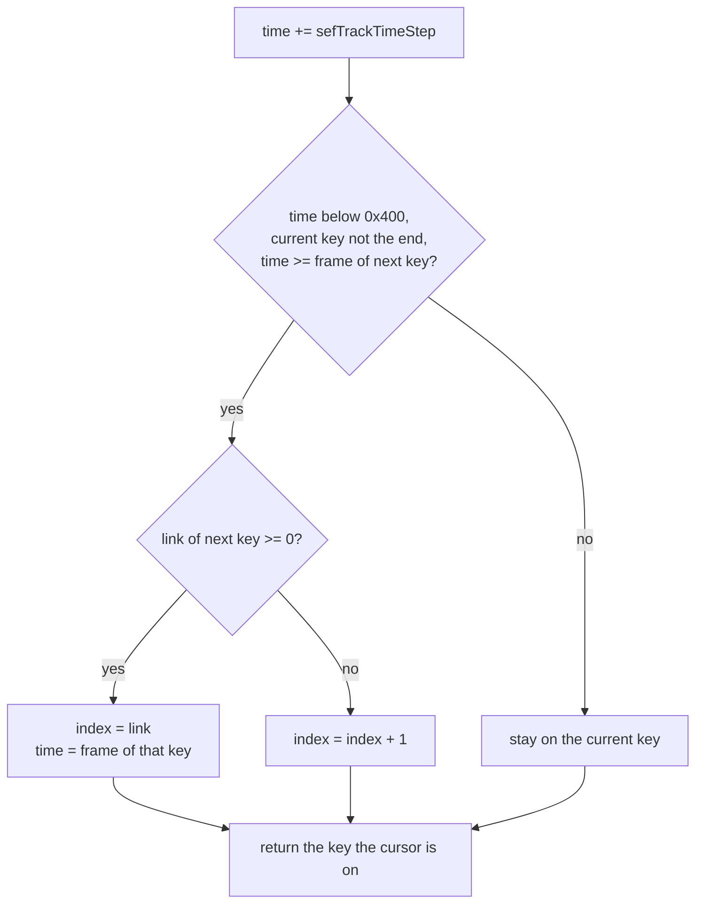

### Samplers

| Function | Keys | Result |
| --- | --- | --- |
| `sefSampleTrack` | `SefTrackKey` | Linear blend of the two keys around the time, in `cursor->sampled`. On the last key the value is held |
| `sefSampleTrackTruncated` | `SefTrackKey` | The same blend as a 16-bit integer in `cursor->sampled_s16`. Nothing is written at the end of the track |
| `sefProgressInt` | `SefKeyframe` | The value of the current key, without blending |
| `sefLerpVector` | `SefTrackKey16` | Blend of x, y and z into the cursor's vector. Returns 0 on the last key, so the caller can skip follow-up work |
| `sefSampleColorTrack` | `SefTrackKey16` | Blend, multiply with the point's colour factor, clamp to 255, convert to integers |

All blends are linear: `a + (b - a) * (time - anchor_index) / (anchor_sub_index - anchor_index)`.
Two keys with the same frame produce no new sample.

The time of a record is rounded in a particular way. After adding the step,
the update converts the time to thousandths, adds 1 when the last digit is 9,
and converts back. The frame number is the whole part. The same rounding is
applied to the age of a line. It keeps a fractional speed such as 0.1 from
drifting below a whole frame.

## The life of an effect

### Requests from battle

The battle overlay describes an effect with a request block of 0x38 bytes
(`struct EffectRequest` in `include/ov01/think_dispatch.h`).

| Offset | Name | Meaning |
| --- | --- | --- |
| 0x00 | `head` | Actor of the unit that causes the effect (the source) |
| 0x04 | `partner` | Actor of the second unit of a pair technique |
| 0x08 | `target` | Actor of the unit that is hit |
| 0x0C | `parts[4]` | Child actors of a large unit |
| 0x1C | `key` | Effect key |
| 0x20 | | Speed of the record. 0 is replaced by 1.0 |
| 0x24 | `hitMode` | Kind of the hit. The record keeps its low byte as `spawnEnabled`. Slot flag 0x8 tests the same byte |
| 0x26 | `hitCode` | Hit effects to show. The record keeps it as `spawnBits` |
| 0x2C | `mode` | Mode of the request, 2 or 3 for unit effects |

`sefCreateEffect(request)` and `sefStartEffectAtPosition(request, position)`
both call `sefStartEffect`. It copies the request into the global
`sefRequestBuffer`, looks up the script with index 1 and creates a record with
`sefCreateScheduler`. For a script of kind 0x3D it sets the depth sort flag.

`sefCreateEffect2(request)` is the variant that returns the record. It sets
record flags 0x140 and clears the pending bit. The record update uses it for
child effects, and its result can be deleted with `sefDeleteEffect2`.

### Requests from the field

Field code has no request block. `sefCreateEffectCf(key, position, rotation)`
and `sefCreateEffectCf2(key, position, rotation, scale, slotIndex)` build one
internally with only the key and a speed of 1.0.

1. The key is made canonical and its script is looked up.
2. When the script has kind 0x49, the effect is not a record at all. The
   function calls `sefCreateKindResourceSlot` in `src/main/sdv.c` and returns
   the resource slot through the same pointer type. Its first words have the
   same layout as a record, and `cellSlot` is nonzero.
3. Otherwise a record is created. Rotation and scale are copied in when given.
4. The record gets flag `SEF_RECORD_RUNNING`, flag 0x10 for a kind 2 key, and
   the depth sort flag for script kind 0x3D.

The caller then attaches the record. `sefSetRecordOwner` stores an actor as
the owner. `sefSetRecordOwnerMarked` stores an object that is not an actor and
sets `SEF_RECORD_SKIP_REGISTER`. Map units use it to bind an effect to
themselves. `sefSetRecordValues` stores three more actors and
`sefSetRecordBlock` sets the vertex scale. `sefSpawnOwnedEffect` creates a
record from a block that holds an owner and a key.
`sefSpawnEffectRecordByCode` does the same from a name.

Callers of this family are the map units and doors (`src/main/uwamono_*.c`,
`src/main/runtime_uwamono_door.c`), field enemies (`src/main/enemy_1.c`), map
objects, the field camera and the cutscene player (`src/main/cfeEvaluate.c`).
See [Map and units](../game/map-and-units.md) and
[Cutscenes](../scripting/cutscenes.md).

### Creating the record

`sefCreateScheduler2(table, request, offset, loadTag, delayFrames, reuseIndex,
flag)` does the work for both families.

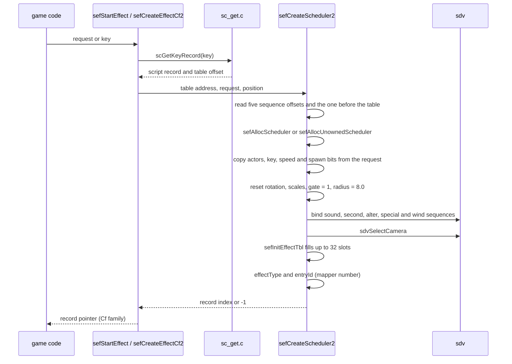

The script table of a record starts with the offsets of its sequences: wind at
word 0, camera at word 1, special at word 2, alter at word 3, sound at word 4,
and the second sequence in the word just before the table. The slot table
follows at word 5. Each sequence is bound with a stride that tells `sdv` how
long its rows are: 7 for the two sound sequences, 28 for alter, 2 for special
and 11 for wind. What the sequences do is the subject of [sdv](sdv.md).

Records are allocated round-robin. `sefAllocScheduler` starts at
`sefEffectRecordHead`, takes the first record whose `inUse` is 0 and moves the
head behind it. Keys of kind 1 use `sefAllocUnownedScheduler`, which also
skips records that a map unit still points at (`uwamonoOwnsRecord`). A caller
can force a given record with `reuseIndex`. The restore code does that.

### Group effects

A script of kind 0x3E describes an effect that hits several targets at once.
It has two tables: table 1 is the part that plays once per target, table 0 is a
part that plays once for the whole group.

`sefStartEffect` counts the records that already exist for the same key and
group key (`sefCountOwnerGroupRecords`). When there is none, it creates the
shared record from table 0 first. That record is flagged
`SEF_RECORD_EXCLUDE_FLAG`, or 0xA000000 when one of its slots has flag 0x8000.
When members already exist, their `SEF_RECORD_SLOTS_LOADED` bit is cleared, so
only the newest member reports the end of the effect. The per-target record is
then created with a start delay of `scKeyRecordGroupCount` frames times the
number of earlier members, which staggers the hits.

Finally `sefRegisterGroupCenter` averages the positions of the target objects
of all members and stores the centre in `sefGroupTable` for 600 frames. Lines
can place themselves at that centre with position kind 32.

### Child effects

A battle request can ask for extra hit effects. Its `hitMode` and `hitCode`
fields arrive in the record as `spawnEnabled` and `spawnBits`. The attack code
in `src/ov01/cmd_exec.c` puts the action bits of the technique into the low 12
bits of the code and the row of the target into the top four bits.
`sefMatchEffectEntries` runs once per frame before the records are stepped. For
each record that is not a field record it computes the frame the record will
reach in this step. When a slot with flag bit 0 starts at exactly that frame,
`sefSpawnRecordChildren` creates the children with `sefCreateEffect2`, using
the same actors: bits 0 to 7 of `spawnBits` start `pe310_008` down to
`pe310_001`, and a row value of 0 to 2 in bits 12 to 15 starts `pe310_009` to
`pe310_011`. Nothing is started while `spawnEnabled` is 0.

The same loop applies the `signal` byte of a slot. When a slot starts and its
byte is not negative, the byte times 0.01 is written to the field
`unknown_5f4` of studio camera 0. The update reads that field back as the
global effect speed, so an effect can slow down or speed up all effects from a
given frame on.

### Burst spawning

`sefSpawnEffect(key, position, direction, scale, angle, count)` (reached
through `sefSpawnEffectById` and `sefSpawnEffectByName`) scatters many copies
of a small field effect over a box. It fills one of the 32 `SefSpawnSlot`
entries of `sefEffectSlots`. The number of copies per frame grows with the
volume of the `scale` box, and `count` is the number of frames the burst
lasts. Each frame `sefUpdateEffectSlots` creates the copies at random places
inside the box, turned by `angle` around the vertical axis, until the age of
the slot reaches its lifetime. The map unit code in
`src/main/uwamono_record.c` is the caller.
The key `0x10000035` (`SEF_SPAWN_SPECIAL_ID`) is a special case that creates a
single record at once.

### Record states

A record is free, waiting for its start delay, playing or frozen. The diagram
shows the changes between these states and the functions that cause them. The
next section explains the two ways a playing record ends.

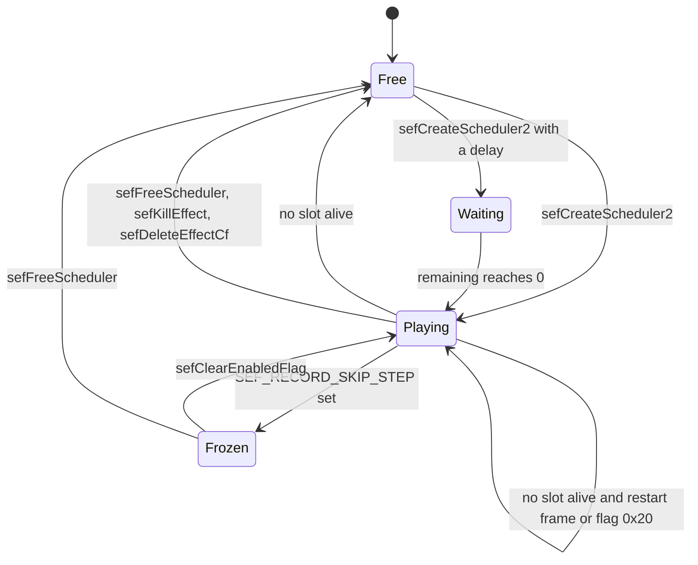

### Ending and deleting

A record ends by itself when none of its 32 slots is alive after a step. A
record with a restart frame or with flag 0x20 is rewound instead: its slots are
destroyed, its time is set to `linkValue`, and `sefInitEffectTbl` fills the
slots again.

`sefFreeScheduler(index)` frees a record by hand. It releases the special
sequence's slots (`sdvFreeSpecialSlots`), destroys all slots and their lines,
removes the alter strips of the record (`sdvDestroyOwnerAlters`) and clears
`inUse`. `sefFreeSchedulerCf(record)` is the pointer form. It also recognises a
resource slot by `cellSlot` or by its address and passes it to
`sefReleaseCellSlot`. `sefDeleteEffectCf` and `sefDeleteEffect2` are other
names for it.

Many functions select records and act on them.

| Function | Selects | Action |
| --- | --- | --- |
| `sefKillEffect(key)` | Records with this key, or all for a negative key | Free. Also releases the matching resource slots |
| `sefApplyRecordMode(owner, key, mode)` | Records with this owner and key | Mode 1 free, 2 and 3 set and clear flag 0x80, 4 and 5 gate on and off, 6 set flags 0x880 |
| `sefReleaseUnitRecords(owner, all)` | Records of an actor | Free. Without `all` only keys `pe300` to `pe399`. Key `pe320_008` is always kept |
| `sefReleaseRecordsOfOwner(owner)` | Records of an owner | Free |
| `sefReleaseImageRecords()` | Records with an image key | Free |
| `sefReleaseEntryRecords(buffer)` | Records that use the effect slot with this buffer | Free, then unload the slot |
| `sefDeleteEffectWait(number)` | Records that use the wait slot of this number | Free |
| `sefSetOwnerFlags(key, flags)`, `sefClearOwnerFlags(key, mask)` | Records with this key, or all | Set or clear record flags, also on resource slots |
| `sefResetEffects(record)` | One record, or all for 0 | One: rewind and freeze. All: free everything and clear the pools |
| `sefDestroyRecordEffectsClearFlag(record)` | One record | Rewind to frame 0 and unfreeze |
| `sefClearEnabledFlag(record)` | One record | Unfreeze |

Mode 6 of `sefApplyRecordMode` is the soft stop: the lines stop emitting, the
points that exist live out their life, and then the record ends. The battle
uses it together with modes 2 to 5 for the lasting status effects of a unit.

Questions about records are answered by `sefIsFinishEffect(key)` (no record of
the key is still flagged `SEF_RECORD_SLOTS_LOADED` without flag 0x40),
`sefIsFinishEffect2(key)` (no record of the key exists at all),
`sefOwnerInUse`, `sefOwnerPairInUse`, `sefOwnerGroupInUse`,
`sefCountOwnerGroupRecords`, `sefCountMarkedEntries` and `sefIsDeadSchduler`.

### Saving and restoring the effects

The field tears the effect system down when a battle or another full-screen
mode starts, and brings it back afterwards. Persistent effects such as the
glow of a save point must survive that.

`sefPushEffect` clears the list `sefEffectRecordList` of 64 saved effects and
rebuilds the handle table from the loaded files (`sefResetHandleSlots`). Then
it copies position, rotation, scale, flags, owner, key, object, gate and index
of every record with flag 0x4000000 into the list. The key `0x10000021` is
never saved. `sefCollectPersistentSlots` adds the persistent resource slots.

`sefPopEffect` frees all records, loads every key of the handle table again
(`sefDispatchHandleSlots`) and creates each saved effect with
`sefCreateEffectCf2` in its old table position, then copies the saved fields
back. `src/main/game_data.c` calls the pair around its mode changes.

### Owner numbers

`sefSetCurrentOwner(owner)` frees all records and stores a number that
`srsLoadEffectSlot` writes into each slot it loads. `sefGetCurrentOwner`
returns it. The number lets `srsReleaseOtherOwnerEffectSlots` drop the files
of an earlier context. In the recovered program only the developer test in
`src/main/ytachi_test.c` sets it.

## Stepping slots, lines and points

### Slots

`sefExecEffectData(slot, frame, hit)` steps one slot.

1. An empty slot returns 0. A slot whose start frame lies ahead returns 1 and
   waits.
2. The pending flag bits are passed to the actors, as described under
   [Slots](#slots).
3. The slot walks its line list. For every entry whose `startTime` has come it
   allocates a line (`sefAllocEffectData`), initialises it and stores the
   handle and the tag. A line with `inherit` gets line flag 0x2000. A line
   whose position kind is 17 marks its parent line with flag 0x1000.
4. Every line of the slot is stepped with `sefExecLineData`. The handle of its
   parent line is published in `sefParentLine` first. A line that returns 0 is
   freed. When that line had mode bit 0, all lines that name it as parent are
   freed too.
5. When no line is alive and no entry is still waiting, the slot is destroyed
   and returns 0.

### Lines

`sefExecLineData(line, frame)` steps one line.

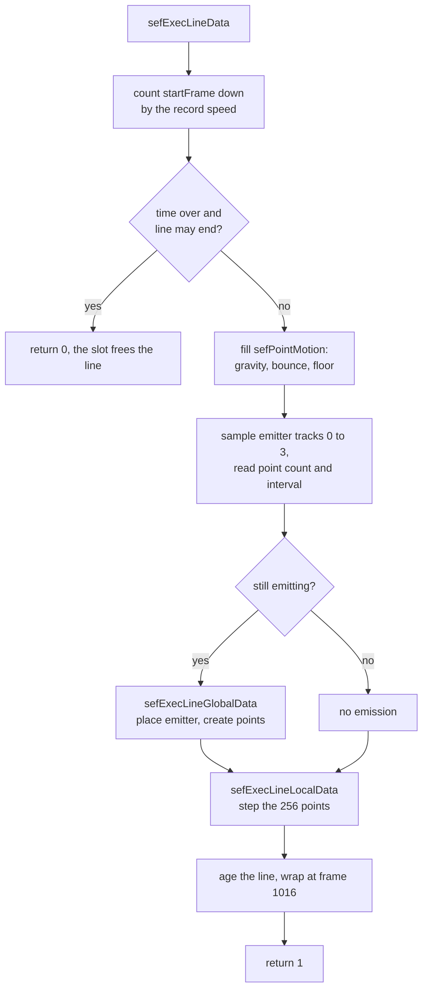

A line "may end" when its emission time is over and either it has mode bit 0
or its last step left no live point. An endless line (mode bit 1) never counts
its time down unless the record has flag 0x800.

The age of a line cannot grow past the track range. At frame 1016 an endless
line jumps back by twice its emission interval, and any other line is held at
frame 1008.

### Emission

`sefExecLineGlobalData` places the emitter and creates points. It resolves the
position kinds of tracks 0 and 2 into the world positions `emitPosition` and
`emitVelocity` with `sefGetPosition`, adds the line's random offset, and then
checks the rhythm: when at least `emitInterval` frames have passed since the
last emission, it creates `pointsPerEmit` points with `sefCreateParticle`.
Record flag 0x80 suppresses the emission.

Three cases decide where the points appear.

- A line with a parent emits one set of points for every live point of the
  parent line. The parent point is published in `sefLinkedPoint`, and position
  kinds 16 and 17 resolve to it. This is how sparks follow a moving point.
- Position kinds 0x61 and 0x62 emit one set of points at each attach point of
  the source actor that is listed in `sefLinkedIdTable61` (kinds 68 to 95) or
  `sefLinkedIdTable62` and that the actor really has.
- Any other line emits one set at the emitter position.

`sefCreateParticle` takes a free point, clears it and gives it its start
values: a start position and a target position from the emission shapes, a
speed of 1.0 plus the random variation, the life from the point table, a
random start rotation within the range of the rotation track header, a random
spin, and random scale and colour factors within the ranges of the scale and
colour track headers.

### Emission shapes

The start and target positions are random points inside a shape.
`sefGetStartPos` and `sefGetTargetPos` read the shape kind from the header of
the extent tracks (emitter tracks 1 and 3) and call `sefGetOfsRange` with the extent vector.

| Kind | Name | Shape |
| --- | --- | --- |
| 0 | `SEF_SHAPE_SPHERE_RANDOM` | Random direction, random radius up to x |
| 1 | `SEF_SHAPE_SPHERE` | Random direction, radius x |
| 2 | `SEF_SHAPE_CUBE_CENTER` | Box centred on the origin |
| 3 | `SEF_SHAPE_CUBE_TOP` | Box hanging below the origin |
| 4 | `SEF_SHAPE_CUBE_BOTTOM` | Box standing on the origin |
| 5 | `SEF_SHAPE_CIRCLE_TURNED` | Circle of radius x in the ground plane, tilted by y and z degrees |
| 6 | `SEF_SHAPE_CIRCLE_RANDOM` | Disc of radius up to x with a random height up to y |

For the box and circle shapes the result is then turned by the matrix of the
actor that the track is bound to (`sefApplyPartTransform`), so a box above a
unit turns with the unit.

The helpers behind the shapes are `sefGetSpherePos`, `sefGetUnitDirection`,
`sefGetCubePos`, `sefGetCubePosTop`, `sefGetCubePosBtm` and `sefGetCirclePos`.

### Position kinds

A position kind says relative to what a position is meant. `sefGetPoint`
resolves it. The actors come from the request buffer, which the update fills
from the record before it steps the record (see the next section).

| Kind | Position |
| --- | --- |
| 1 | Relative to the camera of the effect update, with the height kept |
| 2 to 8 | The offset itself, in world space |
| 16 | Position of the parent point |
| 17 | Part offset of the parent point, through the parent point's matrix |
| 32 | Centre of the effect's group |
| 64 | Source actor. The offset is scaled by the record scale first |
| 65 to 96 | Attach point (kind - 65) of the source actor |
| 97, 98 | Treated as 64 for positions. Used by the multi-point emission |
| 128 | Target actor |
| 129 to 160 | Attach point (kind - 129) of the target actor |
| 161 | Attach point 31 of the target, in a frame that faces from the source to the target |
| 162 | Target actor with the height set to 0 |
| 256 | Partner actor |
| 257 and up | Attach point (kind - 257) of the partner |
| 513 and up | Attach point of part actor 4 |
| 1025 and up | Attach point of part actor 1 |
| 2049 and up | Attach point of part actor 2, or of part 1 when part 2 is missing |
| 4097 and up | Attach point of part actor 3 |

`sefGetPosition` is the wrapper that sets w to 1 and maps 97 and 98 to 64.
`sefGetPartMatrix` returns the matrix that belongs to a kind without a
position.

### The request buffer

`sefRequestBuffer` is a block of 0x340 bytes that holds everything the lines
of the current record may ask about its actors. `sefGetBattleData` returns it
as a `SefLinkedContext`. `sefLoadRequestBuffer` fills it once per record and
frame, in the update and again in the draw.

```
sefRequestBuffer (0x340 bytes)
+0x000  seven actor words: source, partner, target, part 1, part 2, part 3, part 4
+0x01C  effect key
+0x02C  request mode
+0x080  matrix of the source actor            (kind 64)
+0x0C0  matrix of the partner                 (kind 256)
+0x100  matrix of the target                  (kind 128)
+0x140  matrices of parts 1, 2, 3             (kinds 0x400, 0x800, 0x1000)
+0x200  matrix of part 4                      (kind 0x200)
+0x240  frame that faces from source to target (kind 161)
+0x300  line that owns the current fixed orientation, or 0
+0x308  copy of the record flags
+0x314  height override for the source's attach points
+0x318  seven pointers to the actor entries of the seven actors
```

When the source is not an actor (`SEF_RECORD_SKIP_REGISTER`), its matrix is
read from the owner object. An owner whose flag byte is 0 gives a unit matrix
at height -20000, which puts the effect out of sight.

### The actor entry table

Lines need the attach points of actors, and the model code should not be asked
for them once per point. `sefEntryTable` caches them for up to 24 actors.

At the start of each update `sefRebuildEntryTable` clears the table and
registers the seven actors of every live record with `sefRegisterEntry`. In
battle `sefRegisterListEntries` adds the actor of every battle unit
(`unitTblGet`). Each entry gets a scale: half the height of the actor's node 0
point, clamped to the range 0.25 to 4.0. `sefGetEntryScale` returns it, and
lines with flag 0x2000 size their points with it.

`sefUpdateEntryTransforms` then fills each entry. For the nodes 0 to 31 of the
actor's motion package it stores the world matrix, the local matrix, the world
point and the local point (`sefActorMulLocalMatrix`,
`sefActorMulLocalVector`), and one flag byte that says whether the node
exists. These 32 nodes are the **attach points** of the tables above. How an
actor exposes nodes is described in [Actors](actors.md) and
[Animation](animation.md).

An entry also holds the entry flags that slots set and the battle reads, and
the list of effect lights that reach the actor.

### Stepping the points

`sefExecLineLocalData` steps the 256 point places of a line. It first copies
everything that is the same for all points of the line into the scratchpad at
`0x70000000` (`SefLineScratch`): the track pointers, the kinds from the angle
track header, the gravity values and the constant-track switches. Then, for
each live point:

1. The step size is the record speed times the point's speed. The life is
   reduced by it, unless the life is 2048 or more.
2. A point whose life has dropped below 0 is freed.
3. The colour, alpha, size, part, angle, direction and scale tracks are
   sampled, each only when it is not constant.
4. The colour and alpha are copied to the draw colour. A scrolling texture
   advances its offset (`sefAddVectorFraction` keeps the fraction).
5. A light emitter adds its light to the nearby actors.
6. The image animation is stepped, or the age is advanced.
7. An attached point is moved by the emitter's drift, or by the movement of
   its parent point.
8. `sefMoveParticle` moves the point.
9. `sefCalcLocalMatrix` builds the orientation matrix.

The function returns the number of live points and adds them to the draw
counters of the record's mapper (see [The draw counters](#the-draw-counters)).

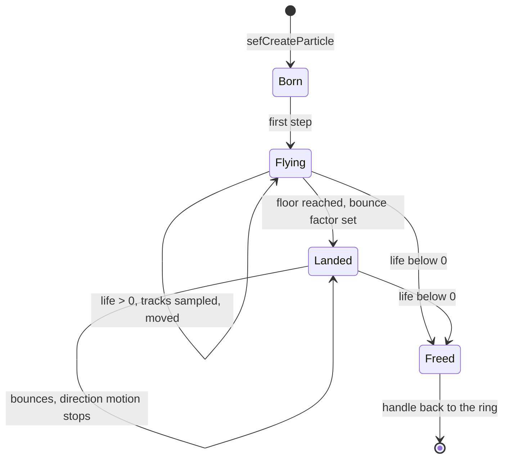

### Motion

`sefMoveParticle` combines three movements.

The first is the directed motion from `sefGetSpeed`. The step length is the
point's spin speed times the step size. The direction comes from the direction
track of the line and is turned by a matrix that depends on the direction
mode: values of 32 or more turn it toward the point's target position, 16
turns it along the movement of the parent point, 12 uses the source actor's
matrix. The spin track blends the direction toward the unit Z axis. When the
line has a motion curve (Hermite keys read by `MMathEvalHermiteKeys`), the
point follows the curve between its start and its target instead.

The second is gravity. Once per whole frame the line's gravity is taken from
the vertical velocity. With line flag 0x100 it is taken from the height
directly, which gives a constant fall speed.

The third is the floor. When the bounce factor is not 0 and the point drops to
the floor height, it is put on the floor, flagged as landed, and its velocity
is multiplied by the bounce factor and turned upward. After landing the
directed motion stops and only the bounce velocity acts.

The line step prepares these values in `sefPointMotion`: gravity is the header
value times the record speed times 0.01, the bounce factor is the `collision`
percentage times 0.01, and the floor is the header height plus a base height.
For field keys the base height is taken from the owner object.

### Orientation

`sefCalcLocalMatrix` builds the part matrix of a point from the angle kind and
the placement kind of the angle track header. The matrix can come from the
motion direction (placement 0x2000), from an attach point of the source actor
(0x3000), from the matrix of the source, target or partner (64, 128, 256,
161), from the movement of the parent point (16), or from the direction to a
resolved point (kinds above 31). The rotation from the angle track is then
multiplied in, and the result is stored in `matrix`. The part matrix is built
once and kept, except for attached points and the two motion-driven
placements, which rebuild it every frame.

`sefSetTransformRotation` applies the angle track. Sprites that face the
camera only use the Z angle. Other points get a full Y, X, Z rotation on top
of their random start rotation and of the line's fixed orientation.

## Lights of effects

Effects interact with lighting in two ways.

### Point lights from effect lines

A line whose image flags have bit 0x10 is a light emitter. For each of its
points the point step calls `sefPlacePart` to get the world position and then
`sefAccumulateEntryInfluence(position, colour, radius)`. The radius is the x
component of the point's scale.

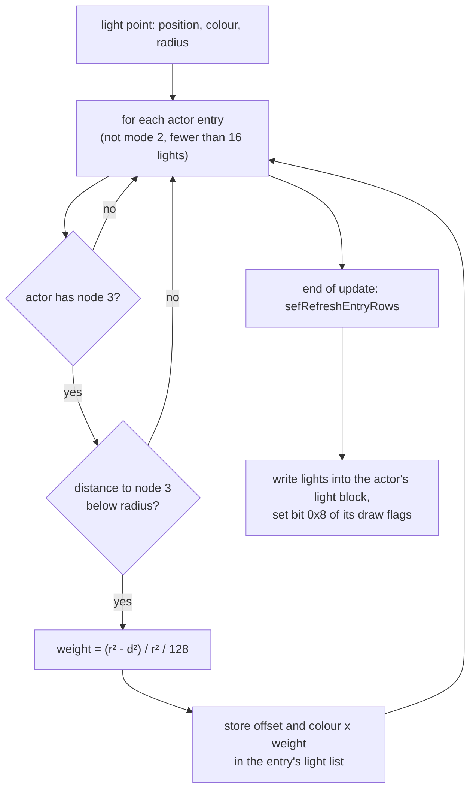

The light is measured against node 3 of each actor. Its strength falls with
the square of the distance and reaches 0 at the radius. An entry notes
whether the light belongs to an effect in which the actor is source, target
or partner.

At the end of the update, and only in battle, `sefRefreshEntryRows` writes the
result into each actor. It first reloads rows of the actor's light block from
the active light set, then fills the remaining light rows with the stored
offsets and weighted colours, lights of the actor's own effects first. Rows 3
to 5 and 10 to 12 of the block are the ones touched, which gives room for
three effect lights per actor. When an actor has no effect light any more, its
rows are restored and the draw flag bit is cleared. The light block of an
actor is described in [Actors](actors.md).

### The three light sets

`src/main/sef_light_set.c` keeps three blocks of 0x180 bytes, each one an
`XglLightSet` (see [xgl](xgl.md)).

| Block | Getter | Content |
| --- | --- | --- |
| `sefActiveLightSet` | `sefLightSetActiveGet` | The light set of the current scene |
| `sefDefaultLightSet` | `sefLightSetDefaultGet` | The engine's default light set |
| `sefAppliedLightSet` | | Copy of the scene light set, used to light effect models with image flag 0x4 |

`sefLightSetsApply(lights)` stores a scene light set in the active and applied
blocks and resets the default block with `xglLightSetDefault`. The battle
scene calls it when it starts and when a script changes the light.
`sefLightSetsResetDefault` puts the default into all three blocks.

### Switching the unit lighting

Some battle effects change the lighting of all units while they play.
`sefSetGateForId(owner, id)` reacts to the ids 55, 56 and 57
(`sefGateIdList`), and `sefSetGateDefault(owner, id)` always acts. Both call
`sefUpdateGroupGate`, which does two things.

`sefSetGateBlocks` copies a light set into the light block of every battle
unit's actor. With a nonzero owner it is the active set, and the actor's draw
flag bit 0x8 is cleared. With owner 0 it is the default set with the flag set,
and the `reset` argument also blanks the first three rows of both halves of
the block.

Then every record whose key has index 350 (`pe350`) is switched: gate on and
unfrozen for a nonzero owner, gate off and frozen for owner 0. These are
lasting effects on units that must not show while the lighting is replaced.

### Fog

Effects can be drawn with their own fog. `sefSetFogOverride(distances,
colour)` stores four fog distances and a colour in a small block that the draw
code fetches with `sefGetFogOverrideBlock`. On the field `sefExecEffect`
copies `gameWork.fogDist` and `gameWork.fogColor` into it every frame when
both first distances are nonzero, and turns the override off otherwise.

## The per-frame update

### Entry point

`sefExecEffect` is called once per frame: by the field loop in
`src/main/game_data.c`, by the battle scene loop in `src/ov01/scene.c` and by
the cutscene player in `src/main/cfePlugIn.c` while it is not paused.

1. On the field it refreshes the fog override.
2. When bit 0x1 of the flag word is clear, it runs `sefExecStep`.
3. It installs the two draw hooks with `sefSetRenderHooks`.

The flag word `sefFlagWord` is handled by `sefFlagSet`, `sefFlagClear`,
`sefFlagTest` and `sefFlagToggle`. Bit 0x1 pauses all effects, and
`sefPauseControl(selector)` sets it for a positive selector, clears it for 0
and toggles it for a negative one. Bit 0x2 makes the draw code use the default
vertex scale for the first image of a sprite.

`sefExecStep` is one effect frame.

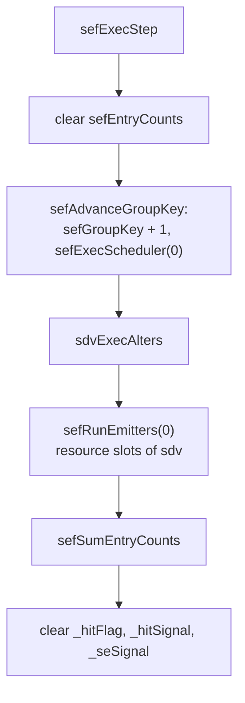

### sefExecScheduler

`sefExecScheduler(only)` steps all records, or just one. Before the loop it
prepares the shared state in this order:

1. `sefRebuildEntryTable` and `sefUpdateEntryTransforms` rebuild the actor
   entries.
2. `sefTickGroupTimers` ages the group centres.
3. `sdvExecAmbient` steps the ambient state of `sdv`.
4. `sefResetEntryFlags` clears the entry flags and the light lists.
5. `sdvClearSpecialWork` clears the work of the special sequences.
6. `sefExecLoadQue` retries one queued file load.
7. `sefUpdateEffectSlots` runs the burst spawners.
8. The camera pair `sefCameraState` is updated from the active camera: the
   transform of this frame, the one of the last frame and the movement
   between them.
9. The global speed `sefTimeScale` is set to the speed field of studio camera
   0 times `sefStepScale`.
10. `sefMatchEffectEntries` starts child effects and applies speed bytes.

Then, for each record that is in use and not frozen:

1. A record with a start delay only counts `remaining` down.
2. `sefPointTimeScale` becomes the record speed times the global speed. The
   record time advances by it and is capped at frame 1020.
3. The globals `sefActiveOwnerKey`, `sefCurrentLoadTag` and
   `sefCurrentRecord` are pointed at the record, and the request buffer is
   loaded.
4. The centre of the record's group is fetched for position kind 32.
5. `sefCalcRotTransSMatrix` builds the record matrix in the scratchpad. Record
   flag 0x1000000 notes whether the record has any translation, rotation or
   scale at all.
6. The 32 slots are stepped with `sefExecEffectData`.
7. The camera schedule is stepped (`sdvScheduleCamera`). Only one record may
   own the camera at a time. The first one that schedules a camera gets flag
   0x200 and is remembered in `sefCameraOwnerRecord`.
8. For battle records the sound sequence (`sdvExecEffectSeq`), the second
   sequence (`sdvExecShadowSeq`) and the wind sequence
   (`tiWindUpdateKeyframes`) are stepped.
9. The special sequence (`sdvExecSpecial`, `sdvDrawSpecial`) and the alter
   sequence (`sdvScheduleAlter`) are stepped.
10. When no slot is alive, the record is rewound or freed as described under
    [Ending and deleting](#ending-and-deleting). A field record that ends also
    releases the map unit records that point at it
    (`uwamonoReleaseOwnedRecords`).

After the loop `sefRefreshEntryRows` writes the effect lights into the actors.
The function returns 1 while any record is active.

### Running effects faster or ahead of time

`sefExecEffectSteps(record, frames, step)` runs the update several times in a
row with a step size other than 1. For a null record it runs the whole system,
for a record it runs only that record, and for a resource slot it runs the
emitters of that slot. `sefProgressEffect(record, frames)` is the form with
step 1.0. `src/main/runtime.c` uses it to bring a field effect
that has just been created to a later frame, so that a fire already burns when
the map appears.

### The draw counters

`sefEntryCounts` is a table of 58 entries of 20 bytes, one per image mapper
plus one for totals. The point step fills three numbers per mapper.

| Field | Counts |
| --- | --- |
| `upper` | Packet space for the world sprites of the mapper: 14 units per point, 17 when the line has a draw mode, doubled for points with two images |
| `lower` | The same for screen sprites (lines whose position kind or direction mode is 8) |
| `plain` | Number of points that are not sprites, which are the model points |

`sefSumEntryCounts` adds the three numbers into a fourth per mapper and
writes the sums over all 57 mappers into entry 57. The draw code reads the
table through `sefEntryCountsEntryGet` in `src/main/sef_entry_counts.c`. It
skips mappers with nothing to draw, and it uses the totals of entry 57 as the
size of the packet buffer it reserves. The two "draw flags" are words of that
last entry: `sefGetEntry57ScreenSprites` returns the total of `lower`, and
`sefGetEntry57Total` returns the grand total.

## Drawing

The draw functions are in `src/main/sv_get_image_item.c`. This section
explains what `sef` hands to them and in which order. Packet formats, VIF
codes are described in [Rendering](../architecture/rendering.md), and the
VU1 program that draws the effects in
[pxy.md](pxy.md#the-effect-program). Its particle entries draw camera-facing
quads or quads in the particle's own plane, 30 particles per batch.

### The three passes

A frame draws effects three times. The global `_draw3D` tells the draw code
which pass is running.

| Pass | Entry point | `_draw3D` | Draws |
| --- | --- | --- | --- |
| Models | `sefDrawEffect` | 2 (`SV_RENDER_3D_MODEL`) | Points whose image is a model (kind 6) |
| Screen sprites | `sefDrawEffect3D` | 1 (`SV_RENDER_2D_SPRITE`) | Sprite points of lines with position kind 8 |
| World sprites | `sefDrawEffect2D` | 0 (`SV_RENDER_2D`) | All other sprite points (kind 4), the alter strips and the resource slots |

The names of the last two entry points and of their flags do not match the
enum names. The table follows what the code draws.

All three passes do nothing until `sefInitialized` is set, and they are held
back while bit `SEF_DRAW_FLAG_PENDING` (0x04000000) of `gameWork.control` is
set. In battle each sprite pass also runs two steps of the battle effect object
pool (`MSeObjProc`, which advances and draws the `MEf` objects), see [Battle effects](../game/battle-effects.md).

`sefDrawEffect` is called directly by the frame function of
`src/main/xgl_render.c`, before the model lists are flushed. The other two are
hooks. `sefSetRenderHooks` writes `sefDrawEffect2D` to offset 0x30 and
`sefDrawEffect3DCallback` to offset 0x40 of the render state `sRender`. Both
offsets lie inside the table of per-frame callbacks that the final packet pass
of the renderer calls, so the sprites are drawn after the scene.
`sefDrawEffect2DAndFinish` and `sefDrawEffect3DAndFinish` are variants that
also reset the packet caches (`sefFinishDrawPass`).

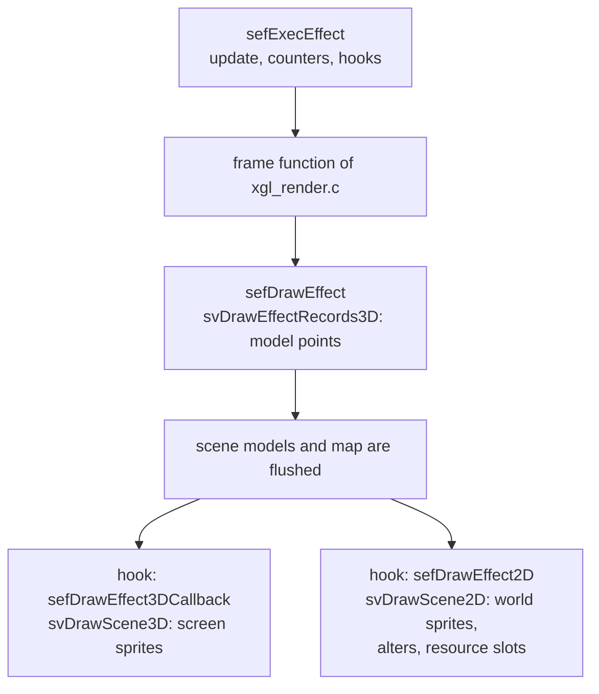

### Culling and order

The model pass starts with `sefCullSchedulerEntries`. It builds the list
`svVisibleSlots` of the records that have a key and an open gate. A record
with its own matrix is tested against the view volume with a sphere of radius
`cullRadius` (8.0, times the x scale when that is above 1), and records with
flag 0x10 skip the test. On the field the resource slots are added to the same
list (`sefCullResourceSlots`). The list is then sorted by view depth, far
records first, and the sprite passes reuse it.

`svDrawScene` draws one sprite pass. Mapper 0 is loaded first. Then two
orders are possible. When bit 0x1 of `svSceneFlags` is set (the field start-up
sets it, the battle start-up clears it), the world sprite pass walks the
visible list in depth order and switches the mapper whenever the next record
needs another one. Otherwise the pass goes mapper by mapper from 1 to 56,
loads each mapper that has images, and draws the records of that mapper
(`svDrawEntriesByKind`) and then its alter strips.

Switching a mapper means uploading its textures (`svLoadImageList`). The
depth order therefore costs texture uploads, and the mapper order costs
correct blending between effects of different files.

### Drawing one record

`svDrawEntry(index)` draws one record. It makes the record current, loads the
request buffer again, builds the record matrix when flag 0x1000000 is set, and
collects the lines of all slots that ran this frame (`svCollectSortedLines`).
The lines are sorted by their `sortKey` tag from the script, so the effect
author controls the order inside an effect. Light emitter lines are left out.

Each line is then drawn by `svDrawImageItem`, which walks the 256 point
handles and appends one draw record per point. Records with flag 0x800000 take
another path in the world sprite pass: `svSortLineSlots` puts every point of
every line into 512 depth buckets, and `svDrawSortedImages` draws them from
back to front across line borders.

The Z test is on by default. A record with flag 0x4 or a line with flag 0x80
is drawn without it.

### Primitive families

What a point looks like follows from the kind of its image and from the draw
mode word in the header of the line's angle track.

| Family | Selected by | Drawn as | Builder |
| --- | --- | --- | --- |
| Model | Image kind 6 | A small model with the point's matrix, lit by the effect light set or by the applied scene light set (image flag 0x4) | `svSetModelRenderState` |
| Screen sprite | Position kind 8 | A sprite in screen space | `svDrawListAppendSpriteRecord`, and `...Pair` for two images |
| Billboard | Mode word 0 | A quad that faces the camera, turned by the point's Z angle | `svDrawListAppendPart`, `svDrawListAppendStatePair` |
| Oriented quad | Mode bit 0x1, 0x2, or no low bit | A quad placed by the point's own matrix, in three state variants (draw modes 5, 7 and 9) | `svDrawListAppendSlot`, `svDrawListAppendRecordBPair` |
| Fixed quad | Mode bit 0x8 | A quad that ignores the record matrix (draw mode 11) | `svDrawListAppendRecordA`, `svDrawListAppendRecordAPair` |
| Clipped polygon | Image flag 0x2 with a nonzero mode word | A quad that is clipped against the view volume on the CPU (draw modes 13 and 14) | `svDrawPolygonItem` |

Every family has a variant for points with two images (image flag 0x4000),
which adds 1 to the draw mode. Draw mode 7 and draw mode 9 each have their own
table of texture state words, and the others share the default table. The
alpha test and blend setting of a line come from the header of its alpha
track, and its fog value from byte 15 of the first part key.

The size of a sprite is the image size times 0.005 from the image packet,
times the point's scale and size samples, times the record's vertex scale.
Lines with flag 0x2000 are also scaled by the size scale of their actor
(`svInitItemDrawKind`).

## Helpers

### Random numbers

Effects use two random sources so that they do not disturb the game's main
generator.

`sefNoiseInit` fills a table of 1027 values between -0.5 and 0.5 once, using
`MMathMakeRandom` with seed 0. `sefNoiseNext` returns the next value and
`sefNoiseNextVector` the next three as a vector with w = 1. The read index
wraps at 1024. Because the table never changes, the same effect produces the
same pattern from the same index.

`sefRandf` is a linear congruential generator on `sefRandSeed`: multiply by
0xF82D, add 0x303B, take bits 16 to 30 and divide by 32768. It returns a value
from 0 up to 1. `sefRandAngle` returns the same value times 2π,
`sefRandfUpperQuarter` a value from 0.75 up to 1, and `sefRandVector` three
values from three seeds of their own.

### Geometry

| Function | Purpose |
| --- | --- |
| `srsAtan2(x, y)` | Angle of a direction from a table of 1025 arctangent values (`atanTbl_0`) |
| `sefGetDirMatrix` | Rotation that turns an axis onto a direction. Returns 0 for a zero direction |
| `sefGetVecMatrix` | The same for the direction between two points |
| `sefSetSlotDirectionDefault`, `sefSetSlotDirectionBetweenDefault` | The two functions above with the +Z axis |
| `sefNormalizeDifference` | Unit vector between two points, with the sign chosen by flag 0x400 |
| `sefCalcRotTransSMatrix` | Matrix from rotation, translation and scale. Returns how many of the three were present |
| `sefMergeMatrixPos` | A matrix with its translation replaced |
| `sefCalcInvView` | The active camera's transform, moved to the origin. Stored in `sefCameraMatrix` and used to make sprites face the camera |
| `sefApplyMatrixVector` | Matrix times vector |
| `sefSegmentHitsSphere` | Tests whether a segment reaches a sphere |
| `sefLerpPositionXyz`, `sefAddVectorFraction` | Small vector helpers |
| `sefMemZero`, `sefMemFillWords`, `sefMemClear` | Clear and fill memory |

The vector and matrix functions they rest on are described in
[Math](math.md).

### Accessors

`sefGetScheduler` returns the record table and `sefGetNowScheduler` the
current record. `sefGetLineAdr(index)` returns a line.
`sefGetParentLine(check, handle)` returns the data of a point handle.
`sefCopyRecordSlotVector`, `sefGetKindSlotVector`, `sefGetKindVector`,
`sefGetKindMatrix` and `sefGetKindMatrixSecondHalf` read attach points and
their matrices from the actor entries of the current request.
`sefGetLinkedFlag(n)` tells whether the source actor has attach point n.
`sefFindEntryById` finds the entry of an actor.

### Debug leftovers

`src/main/sef_print.c` holds what remains of the developers' logging. `LOG`
takes a data pointer, a format and more arguments and does nothing. Its call
sites are still in the code, for example with the labels `scl`, `size` and
`max=%d 2=%d t=%d` in `sefSpawnEffect`. `tracePrint` formats a line into a
256-byte buffer and prints it with `printf`. `resetWaitForPad` shows the word
`RESET` and waits until SELECT and START are held together. The file also
defines `svSceneFlags` and `sefFallbackVectorFlag`. With the second flag set,
actors without motion nodes get attach points from two fixed tables of 16
positions, which lets effects be viewed on placeholder actors. Nothing in the
recovered program sets it.

`sefDummy` and `sefDummy_00259630` in `src/main/sef_entry_counts.c` return 0,
and `sefDummy_0025DEC0`, `sefDummy_0025DEC8`, `sefDummy_00265400`,
`sefLogKeyNoOp` and `sefLogRequestNoOp` in `src/main/sef.c` are empty. They
are the shells of removed debug output. The strings `load` and
`delete wait eft` are still passed to them.

## Start-up and teardown

| Function | Called by | What it does |
| --- | --- | --- |
| `sefInitEffect` | Start of the play session, start of the battle scene | Gives the effect heap its block, sets the pool sizes, runs `sefStartSystem`, fills the noise table |
| `sefStartSystem` | `sefInitEffect` | Resets the resource table, the image mappers, the special work and all work tables. Sets `sefInitialized` |
| `sefInitWorkTables` | `sefStartSystem`, `sefInitEffectCf` | Point allocator, read counter, records, lines, wait slot table, request buffer, groups, counters, ambient state, resource slots, spawn slots |
| `sefInitEffectCf` | Field start and return to the field | Field mode: `_sefBattleMode` = 0, `sefDestroyEffectCf`, work tables, sets scene flag 0x1, loads `esp/cfdef.esp` and waits for it |
| `sefInitEffectBattle` | Battle scene start | Battle mode: `_sefBattleMode` = 1, `sefDestroyEffect`, records and lines, clears scene flag 0x1, loads `esp/default.esp` |
| `sefDestroyEffect` | `sefInitEffectBattle` | Frees all records, the wait slots and effect slots, clears the tables, resets the alter strips, the special work and the wind slots |
| `sefDestroyEffectCf` | Leaving the field | The same for the field, with `sefResetAll` for the resource slots. Keeps the loaded files |

The flag `_sefBattleMode` changes several behaviours described above: battle
units are registered as actor entries, effect lights are written to actors,
the battle sound objects are run in the sprite passes, and the fog override is
left alone.

## The boundary with sdv and MEf

`sef` and `sdv` are two halves of one system, and the split follows the files.

`sef` owns the particle tree and its clock. Each record carries six sequence
blocks, and `sef` binds them at creation and steps them once per frame, but it
does not look inside. Everything those sequences do belongs to
[sdv](sdv.md): effect sounds, the effect camera, shadows, the special
full-screen sequences, the alter strips that draw trails, the ambient light
state and the wind keys.

`sdv` also owns the **resource slots** (`ResourceSlot`, 192 entries in
`sefResourceTable`). They are a second, simpler effect object with hand-coded
emitters per effect kind, used on the field for effects of script kind 0x49
(`ce200_901` and up). `sef` creates them through `sefCreateKindResourceSlot`,
steps them through `sefRunEmitters` and treats their pointers like record
pointers, which works because both start with the same position, rotation,
scale and flag fields. Their emitters, particles and drawing are described on
the sdv page. The effect requests that scripts send (`src/main/effect_request.c`)
are described there too.

The battle overlay adds its own effect objects on top: `MEf` objects for
effects that are written in code, held in the `MSe` object pool of
`src/main/m_se_obj.c`. In spite of the letters `Se`, the pool holds visual
effects and no sound. They use
`sef` for textures and for the draw passes but keep their own pools. See
[Battle effects](../game/battle-effects.md). The full-screen filters that the
special sequences drive are described in
[Screen effects](screen-effects.md).
