# User interface and windows

Xenosaga Episode II draws its small on-screen windows with three separate
toolkits. The first one is the **message system**. It shows the dialogue box at
the bottom of the field screen, the small menus that scripts open over it, the
sell window with its list of items, prices and counts, the "Acquired" notice
after an item pickup, a number entry box and the countdown clock of timed
sections. All of these are **message slots**, 0x98-byte records that share one
header, one opening animation and one frame drawer.

The second toolkit is the **battle text layer**. It holds the one-line text
window, a pool of four paged text boxes and two **choice menus**. The battle
code in OV01 uses them for command lists and for the help line under a list.
The third toolkit is `xglMenu`, a plain text menu tree that only the developer
test screens open.

All three use the same helpers for selection. A **list cursor** is a small
record that holds a position, wraps or clamps it and plays the cursor sound.
Letters, fonts and the control codes inside the strings belong to the font
module and are described in [Fonts and text](fonts-and-text.md).

[← Back to the overview](../README.md)

## Contents

- [Source files](#source-files)
- [Three window families](#three-window-families)
- [The message objects](#the-message-objects)
- [One frame of the message system](#one-frame-of-the-message-system)
- [Opening and closing](#opening-and-closing)
- [The window frame](#the-window-frame)
- [Text slots: the dialogue window](#text-slots-the-dialogue-window)
- [Input on an open message](#input-on-an-open-message)
- [List windows: script menus](#list-windows-script-menus)
- [The sell window: items, costs and counts](#the-sell-window-items-costs-and-counts)
- [The item notice](#the-item-notice)
- [Number entry and the timecode counter](#number-entry-and-the-timecode-counter)
- [The countdown panel](#the-countdown-panel)
- [Easing helpers](#easing-helpers)
- [Script natives](#script-natives)
- [The battle text layer](#the-battle-text-layer)
- [Cursor buffers](#cursor-buffers)
- [The debug menu tree: xglMenu](#the-debug-menu-tree-xglmenu)
- [Resets](#resets)

## Source files

All files are in `src/main/`. Each has a header of the same name in
`include/main/`. The slot structures themselves are declared in
`include/main/msg_slot_core.h`.

| File | Contents |
| --- | --- |
| `src/main/msg_state.c` | The three message objects (`msgWindow`, `msgChoice`, `msgPanel`), the per-slot option words, the pad handling of an open message (`msgUpdate`), the entry points the natives and the game loop call |
| `src/main/msg_balance.c` | The balance word `msgBalance` and the `CONTROL_SCRIPTED` game flag helpers |
| `src/main/msg_window_open.c` | Opens the next slot as a list window, sets its text or binds its item tables |
| `src/main/msg_window_text.c` | Opens the next slot as a text slot and feeds text into it |
| `src/main/msg_window_slot.c` | Sets a text argument or the speaker name of the current slot |
| `src/main/msg_window_run.c` | Runs the five slots of a window, one update and one draw per slot type |
| `src/main/msg_window_close.c` | Starts the closing phase of one slot or of all slots, packs the slot table |
| `src/main/msg_window_advance.c` | Scrolls the current slot and asks whether it has more text |
| `src/main/msg_window_scroll.c` | Forwarders from the window to its current slot, flag tests and the status code of a slot |
| `src/main/msg_window_move.c` | Moves or resizes the current slot |
| `src/main/msg_window_layout.c` | Size and position of a list window from its text or from its item tables |
| `src/main/msg_window_center.c` | Centres a list window and starts its opening phase |
| `src/main/msg_window_size.c` | Overflow test, the layout of an empty sell list, the row pitch |
| `src/main/msg_window_update.c` | List window update and draw, the highlight pulse, the scroll slide, the cursor sweep, cursor movement over lines or over filled items |
| `src/main/msg_window_bind.c` | The item name, cost and count tables of the sell window and its per-frame logic (`msgSaleUpdate`) |
| `src/main/msg_list_slot.c` | Initialises a list slot and counts its visible rows |
| `src/main/msg_slot_center.c` | The three control points of the opening curve, centring helpers, tests for line breaks, spaces and value escapes in text |
| `src/main/effect_request.c` | Only its last four functions belong here: `msgWindowReset`, `msgWindowRequestFlush`, `msgQueueSlot` and `msgWindowFlush`, the per-frame queue of slots to run |
| `src/main/interp_update.c` | Text slot update: the reveal cursor, line scrolling with a cosine ease, the draw call |
| `src/main/interp_text.c` | Text slot setters: arguments, speaker name, opening phase |
| `src/main/talk_scan.c` | Text slot helpers: the page cursor counter, "more lines" test, reveal jumps |
| `src/main/talk_text_box.c` | Draws the text and the speaker name plate of a text slot |
| `src/main/talk_speaker_name.c` | Cuts the text at the reveal position while it is printed, copies the speaker name |
| `src/main/talk_window_frame.c` | The animated rectangle of a frame, the alpha fade, the position of the page cursor |
| `src/main/talk_draw_fade.c` | The plain dark rectangle of the countdown panel, the cursor bar of a list window, the selection box of the number entry |
| `src/main/talk_natives.c` | Six script natives of the `talk` group (`winClose`, `resume`, `enableFlags`, `disableFlags`, `isDispMsg`, `wait`) |
| `src/main/msg_slot_core.c` | Slot initialisation and geometry, the item notice slot, the text output buffer and the word wrapper, digit string helpers |
| `src/main/msg_slot_start.c` | Starts an item notice, closes or places a slot by its type, starts and fits a text slot, feeds text |
| `src/main/timecode_choice.c` | Starts the number entry box and forwards its input steps |
| `src/main/timecode_hms.c` | Starts the countdown panel, converts hours, minutes and seconds to frames |
| `src/main/timecode_frames.c` | The value of a timecode slot: get, set, split into fields, step a digit or a field |
| `src/main/timecode_window.c` | Timecode slot update and draw, the cursor ease, mode and digit count, box width |
| `src/main/choice_menu.c` | The two battle choice menus, the pool of four text entries, the style label table |
| `src/main/cursor_buffer.c` | List cursors (`ListCursor`) and the pad handling of a text cursor record |
| `src/main/text_window.c` | The one-line battle text window and the width of a markup string |
| `src/main/xgl_menu.c` | The nested text menu of the developer test screens |

Several helpers that these files call live in files of other pages. The frame
pieces are drawn by `talkWindowDrawFrame` in `src/main/talk_script.c`. The
rows, digits and labels are printed by `src/main/msg_text_draw.c`. The button
glyphs come from `src/main/text_tag.c`. The battle windows are drawn by
`textDrawAll` in `src/main/text_marker.c`. This page explains what the windows
need from them.

## Three window families

The message system is **retained**. A script opens a slot, feeds it text and
then only polls it. The slot keeps its own state, steps its own animations and
draws itself every frame until it has closed. The game loop only calls two
functions per frame, `msgUpdateTimed()` for the pad and `msgQueueClose()` to queue
the slots for that frame.

The battle text layer is also retained, but much simpler. A choice menu or a
text entry is a fixed record with a four-step opening counter. `textUpdate()`
steps all of them once per frame and queues one draw function for the whole
layer.

`xglMenu` mixes update and draw. `xglMenuDraw()` reads the pad, moves the
selection and prints the rows in the same call.

| Family | State | Per-frame entry | Drawn through | Used by |
| --- | --- | --- | --- | --- |
| Message system | `msgWindow` (five slots), `msgChoice`, `msgPanel` in `src/main/msg_state.c` | `msgUpdateTimed()`, `msgQueueClose()`, then `msgWindowFlush()` from the frame hook | direct GS packets for frames and bars, the font queue for text | field scripts through the `talk` and `seg` natives, item pickups, the `TimeAttack` native |
| Battle text layer | `choiceMenuSlots[2]`, `textEntryPool[4]` in `src/main/choice_menu.c`, `textWindow` in `src/main/text_window.c` | `textUpdate()` in `src/main/text_marker.c` | `textDrawAll()` as a queued callback | battle command lists, help lines and enemy messages in OV01, the `namePut` native |
| `xglMenu` | `menutbl[16]` in `src/main/xgl_menu.c` | `xglMenuDraw()` | `xglFontDebugPrintf` | `src/main/yajima_test.c` (a test screen) |

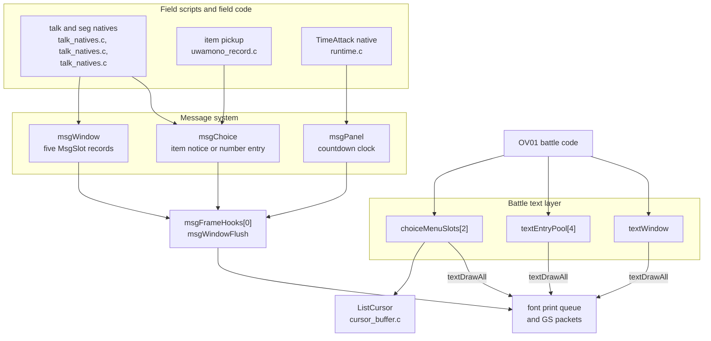

## The message objects

`src/main/msg_state.c` owns three objects and two small tables.

| Object | Type | Role |
| --- | --- | --- |
| `msgWindow` | `MsgWindow` | The stack of up to five windows a script opens: the dialogue text, a menu over it, the sell list |
| `msgChoice` | `MsgSlot` | One free-standing slot. It is either the "Acquired" item notice (slot type 4) or the number entry box (slot type 3) |
| `msgPanel` | `MsgSlot` | One free-standing slot that shows the countdown clock (slot type 3 in a time mode) |
| `msgSlotFlags[5]` | `int` | One option word per open message, set by the script that opened it |
| `msgSlotIndex` | `int` | Index of the current option word, -1 when no message is open |
| `msgChoiceTimer` | `int` | Frames left before the item notice closes, started at 0x5A (90) |

The name `msgChoice` comes from its number entry use. In the shipped game the
same slot also carries every item notice, because only one of the two can be
on screen at a time.

### MsgWindow

A `MsgWindow` is 0x308 bytes: the index of the current slot and five slots.
The current slot is the topmost open one. Opening a slot raises
`current_index`, and the pad handling always talks to the current slot.

```text
MsgWindow (0x308 bytes)
+0x000  int      current_index      -1 when no slot is open
+0x004  (4 bytes not used by the recovered code)
+0x008  MsgSlot  slots[0]           0x98 bytes
+0x0A0  MsgSlot  slots[1]
+0x138  MsgSlot  slots[2]
+0x1D0  MsgSlot  slots[3]
+0x268  MsgSlot  slots[4]
+0x300  (8 bytes not used by the recovered code)
```

`MSG_SLOT_COUNT` is 5. Both open functions refuse to open a sixth slot and
return 0.

### MsgSlot

Every slot starts with the same 0x28-byte header. The rest of the record is a
body whose layout depends on the slot type. `msgSlotInit(slot, state)` clears
all 0x98 bytes, sets `flags` to `MSG_SLOT_ACTIVE`, stores the type and sets the
frame colour to `0x98808080` (neutral grey with alpha 0x98).

| Offset | Type | Name | Meaning |
| --- | --- | --- | --- |
| +0x00 | `unsigned int` | `flags` | Status bits, see below. A value of 0 means the slot is free |
| +0x04 | `int` | `x` | Left edge in screen pixels |
| +0x08 | `int` | `y` | Top edge |
| +0x0C | `int` | `z` | Depth of the frame and the text. A larger value is nearer |
| +0x10 | `int` | `extent_x` | Width. `msgSlotSetGeometry` raises it to at least 0x5E |
| +0x14 | `int` | `extent_y` | Height |
| +0x18 | `int` | `open_counter` | Frame counter of the opening and closing animation, 0 to 12 |
| +0x1C | `int` | `slot_type` | Slot type, 1 to 4. It selects the body and the handlers |
| +0x20 | `unsigned int` | `frame_color` | RGBA colour of the frame |
| +0x28 | union | `u` | Body: `MsgSlotText`, `MsgSlotList`, `MsgSlotTimecode` or `MsgSlotItem` |

The field is called `state` in the source, but it never changes while a slot
lives. It is the type of the slot.

| `slot_type` | Constant | Body | Shows | Update and draw |
| --- | --- | --- | --- | --- |
| 1 | `MSG_SLOT_TYPE_TEXT` | `MsgSlotText` | Dialogue text with a typewriter reveal | `interpUpdate`, `interpDrawTextSlot` |
| 2 | `MSG_SLOT_TYPE_WINDOW` | `MsgSlotList` | A list of lines with a cursor bar, or the sell list | `msgWindowUpdate`, `msgWindowDraw` |
| 3 | `MSG_SLOT_TYPE_TIMECODE` | `MsgSlotTimecode` | A number with selectable digits, or a clock | `timecodeUpdate`, `timecodeSlotDraw` |
| 4 | `MSG_SLOT_TYPE_ITEM` | `MsgSlotItem` | The "Acquired" notice | `msgSlotItemTick`, `msgSlotDraw` |

Almost every slot function begins by comparing `state` with its own type and
does nothing for another type. This is why a caller can send the same request
to any slot without checking it first.

### Slot flags

The three phase bits and the active bit mean the same for every type. The
higher bits are reused by each type for its own animations.

| Bit | Name | Types | Meaning |
| --- | --- | --- | --- |
| 0x001 | `MSG_SLOT_ACTIVE` | all | The slot is in use |
| 0x002 | `MSG_SLOT_CLOSING` | all | The closing animation runs |
| 0x004 | `MSG_SLOT_OPENING` | all | The opening animation runs |
| 0x008 | `MSG_SLOT_OPEN` | all | Fully open. The contents are drawn |
| 0x010 | `INTERP_FLAG_SCAN` | text | The text is still being revealed |
| 0x020 | `INTERP_FLAG_EASE` | text | The text is scrolling to another line |
| 0x020 | `MSG_WIN_SLIDE` | list | The rows are sliding after a scroll |
| 0x040 | `TIMECODE_FLAG_SELECT` | timecode, list | The selection is live. A number entry draws its selection box. A list window sets it when it opens |
| 0x080 | `TIMECODE_FLAG_ADVANCE` | timecode | The value runs by itself toward a limit |
| 0x100 | `MSG_WIN_SWEEP` | list | The cursor bar is moving to another row |
| 0x100 | `TIMECODE_FLAG_CURSOR_MOVE` | timecode | The selection cursor is moving to another digit |
| 0x200 | `TIMECODE_FLAG_DIGIT_ROLL` | timecode | A digit is rolling to its new value |
| 0x400 | `MSG_SLOT_FADE` | item | The notice is changing to a new item |
| 0x800 | `TIMECODE_FLAG_BLINK` | timecode | The digits blink between two colours |

`src/main/msg_state.c` tests the same bits of the current slot under a second
set of names. `MSG_WINDOW_SCANNING` (0x10) is the reveal bit of a text slot.
`MSG_WINDOW_OPENING` (0x4) is the opening bit. `MSG_WINDOW_BUSY` is 0x16, which
is closing, opening or revealing. `msgWindowBusy()` returns non-zero while any
of the three is set on the current slot.

### Status codes

Two functions classify a slot for callers that must know what is on screen.
`msgWindowCurrentStatus(window)` looks at the current slot of a window, and
`msgSlotStatus(slot)` looks at one slot. Both return the same codes.

| Code | Constant | Meaning |
| --- | --- | --- |
| 0 | `MSG_STATUS_NONE` | No active slot |
| 1 | `MSG_STATUS_TEXT` | A text slot |
| 2 | `MSG_STATUS_WINDOW` | A list window |
| 3 | `MSG_STATUS_TIMECODE_IDLE` | A timecode slot in number mode |
| 4 | `MSG_STATUS_TIMECODE_RUNNING` | A timecode slot in one of the two clock modes |
| 5 | `MSG_STATUS_ITEM` | An item notice |

`msgWindowInUse()` is the broadest test. It returns 1 while the current slot
is busy or while `current_index` is not negative. The `talk.isDispMsg` and
`talk.wait` natives are built on it, and the field code in
`src/main/game_camera.c` uses it to keep the player from starting a new
interaction while a window is up.

## One frame of the message system

The message system does not update or draw its slots at the place where the
game loop calls it. The loop only handles the pad and then queues the slots.
The real work runs later in the frame from a hook.

The field loop in `src/main/game_data.c` and the battle scene loop in
`src/ov01/scene.c` both do the same two calls each frame.

1. `msgUpdateTimed()` reads the pad for the open message. It calls
   `msgUpdate()` unless the number entry box is open, then counts
   `msgChoiceTimer` down and closes the item notice when it reaches zero.
2. `msgQueueClose()` queues everything for drawing. Despite its name it closes
   nothing. It calls `msgWindowRequestFlush(&msgWindow)`, which stores the
   window in `msgPendingWindow`, and `msgQueueSlot` for `msgChoice` and for
   `msgPanel`, which appends them to `msgSlotQueue`. Each of these calls also
   writes `msgWindowFlush` into `msgFrameHooks[0]`.
3. Later in the frame the hook `msgFrameHooks[0]` is called. It is slot 14 of
   the 17 final packet callbacks of `sRender`, which `xglRenderFinalPacket`
   in `src/main/xgl_render.c` runs during the render step of `xglSleep()`
   (see [Rendering pipeline](../architecture/rendering.md)). The windows are
   therefore drawn after the 3D scene and the screen effects of the earlier
   slots.
4. `msgWindowFlush()` first flushes the font batch, then runs the pending
   window with `msgWindowRunSlots`, then runs each queued slot with
   `msgSlotRun`. At the end it clears the pending window, the queue and the
   hook, so nothing is drawn in a frame where `msgQueueClose()` was not called.

`msgSlotQueue` has `MSG_SLOT_QUEUE_SIZE` entries, which equals
`MSG_SLOT_COUNT` (5). The game queues two slots per frame.

`msgWindowRunSlots(window)` does three things. It first packs the table with
`msgWindowCompact`, which copies active slots down over free ones so that the
open windows always sit at the front. It then walks the five slots. An active
slot goes to `msgSlotRun`, which calls the update function and then the draw
function of its type. When the walk finds that the current slot has become
free, `msgWindowFindLastActive` moves `current_index` down to the last active
slot, or to -1 when none is left. This is how a window that has finished its
closing animation leaves the stack.

Every update function returns at once while `gameWork.control` has
`CONTROL_PAUSED` set. The windows freeze during the pause screen but are still
drawn.

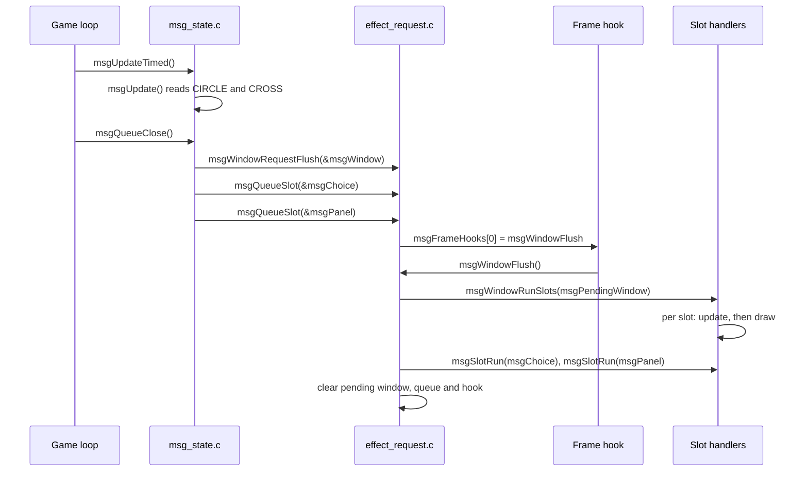

`msgQueueClose()` has one more job before it queues the window. When the current
slot is not a list window and its option word has bit 0x2 set, it calls
`talkActivate()`, which sets the `talkActive` flag for this frame. The frame
drawer does not draw the page cursor while `talkActive` is set, and
`msgWindowFlush()` clears the flag again after drawing. Option bit 0x2 is
therefore "no page cursor".

## Opening and closing

All four slot types open and close in the same way. A slot is created with
the opening bit set. Its update function counts `open_counter` up by one per
frame. After 12 frames (`MSG_OPEN_FRAMES`, `INTERP_OPEN_FRAMES`,
`TIMECODE_OPEN_FRAMES` and `MSG_SLOT_OPEN_FRAMES` are all 12) the opening bit
is replaced by `MSG_SLOT_OPEN`. Each type adds its own start bit at that
moment. A text slot starts its reveal (`INTERP_FLAG_SCAN`). A list window sets
bit 0x40. A number entry sets the same bit when it was created as editable.

Closing is the reverse. The close function of the type clears the opening and
open bits, clears the type's own animation bits and sets `MSG_SLOT_CLOSING`.
The update function then counts `open_counter` down by one per frame. When it
reaches zero the whole `flags` word is cleared, and the slot is free.

| Type | Start opening | Start closing |
| --- | --- | --- |
| text | `interpSetOpening` | `interpRewind` |
| list | `msgWindowOpen` | `msgWindowClose` |
| timecode | `timecodeStartOpening` | `timecodeBeginClose` |
| item | `msgSlotStartOpening` | `msgSlotStartClosing` |

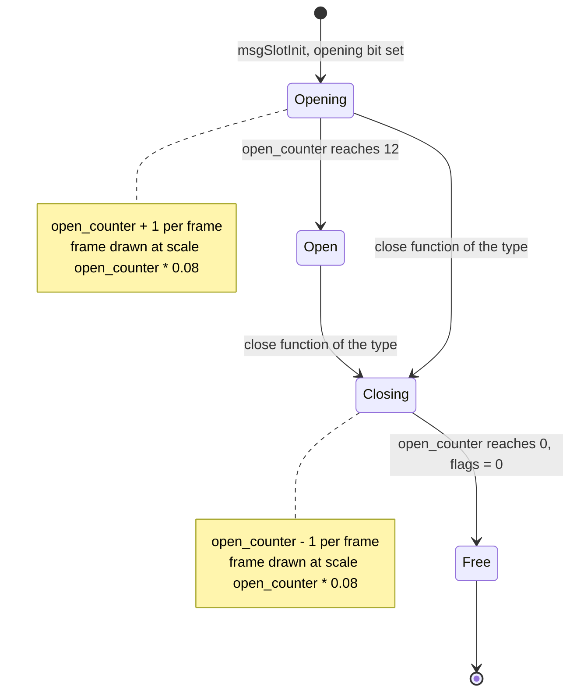

`msgWindowStartClosingSlot(window, index)` picks the right close function for
the type of a slot. `msgWindowCloseCurrent` closes the current slot, and
`msgWindowCloseAll` closes all five. Both refuse while the current slot has
bit 0x20 or bit 0x100 set, which for a list window means that a scroll slide
or a cursor sweep is still running.

`msgChoiceCloseByState(slot)` does the same for a free-standing slot. It is
used for `msgChoice` and `msgPanel`, and also by `msgBegin` to remove an old
item notice before a new message starts.

### The opening curve

While a slot opens or closes, its frame is not simply scaled. The frame is
drawn at full size and clipped by a scissor rectangle that grows from the
centre of the window. The half width and half height of that rectangle come
from a curve through three **control points**, stored as float pairs in
`grControlPoints` (`src/main/msg_slot_center.c`).

`talkWindowFrameRect` in `src/main/talk_window_frame.c` sets the three points
from the half extents of the window and calls `grControlPointBlend` with the
scale `open_counter * 0.08`. The scale is capped at 1. With `f` as the scale
the three weights are:

```text
w0 = (1 - f)^3
w2 = f^3
w1 = 1 - w0 - w2
half size = w0 * P0 + w1 * P1 + w2 * P2
```

| Mode | Constant | P0 | P1 | P2 |
| --- | --- | --- | --- | --- |
| 0 | `TALK_FRAME_FULL` | (hw, hh) | (hw, hh) | (hw, hh) |
| 1 | `TALK_FRAME_OPENING` | (0, 0) | (hw, hh/2 + hh/8) | (hw, hh) |
| 2 | `TALK_FRAME_CLOSING` | (hw/2 + hw/4 + hw/16, 0) | (0, 1) | (hw, hh) |
| 3 | `TALK_FRAME_SIZED` | as mode 2, from the saved size of an item notice | | |

Here `hw` and `hh` are half the width and half the height. An opening window
starts as a point at its centre, reaches its full width early and then grows
to its full height. A closing window follows a different path. Near the end
of its animation the rectangle is almost flat and about four fifths of the
window width, so the window collapses into a horizontal line before it
disappears.

The rectangle is placed around the centre of the window and clamped to the
screen, 0 to `TALK_SCREEN_RIGHT` (0x1FF) and 0 to `TALK_SCREEN_BOTTOM`
(0x1BF). The frame colour is faded at the same time. `talkColorFadeAlpha`
multiplies the alpha byte of `frame_color` by the scale and never raises it
above its original value.

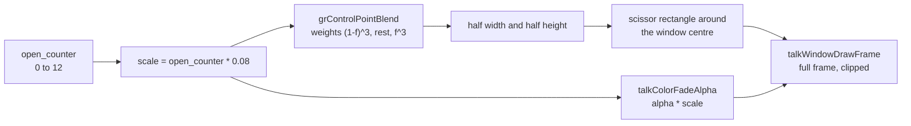

## The window frame

The frame of a message window is built from pieces of one texture,
`omiya\talk01.xtx`. `msgWindowReset` loads it through `talkStartTextureLoad`
and keeps its handle in `talkTextureHandle`. The handle name suggests a script,
but the file is a texture: every frame drawer begins by sending it with
`xglPacketTextureTrans(talkTextureHandle)`. `msgWindowReset` also loads
`omiya\botan.xtx`, the texture with the pad button glyphs. Both loads wait for
the disc service to finish before they return.

`talkWindowDrawFrame(window, mode, scale)` in `src/main/talk_script.c` builds
one GS packet for the whole frame. It computes 19 rectangles around the window
(corners 0x20 pixels wide, edges, the middle and a strip across the window)
and draws the pieces listed in `talkWindowPieces` into them. When the window
is too narrow for the middle strip piece, the two pieces beside it meet in the
middle instead.

Five small functions choose what to draw for the phase bits of a slot. Each
one draws the closing frame, the opening frame or the full frame, and some add
a part of their own.

| Function | Used by | Adds |
| --- | --- | --- |
| `talkDrawFramesBasic` | text slots | nothing |
| `talkDrawFramesWithCursor` | list windows | the cursor bar when open, and the fixed lower window of the sell list |
| `talkDrawFramesWithBox` | number entry (mode 0) | the selection box while bit 0x40 is set |
| `talkDrawFrameRects` | clock modes 1 and 2 | no textured frame at all, only a dark rectangle |
| `talkDrawFramesWithFade` | item notice | a second frame while the notice changes to a new item |

`talkDrawFrameRects` calls `talkDrawFadeRect` in `src/main/talk_draw_fade.c`.
This draws the slot rectangle as one untextured sprite in black. Its alpha is
`scale * 64`, so the fully open clock sits on a half-transparent dark panel.
While the scale is below 1 the rectangle also grows from its centre along the
control point curve, with the points (0, 0), (width/4, 0) and (width/2,
height/2).

## Text slots: the dialogue window

A text slot is the dialogue window of the field. It holds formatted text,
reveals it a few characters at a time, shows three lines at once and scrolls
by one line when the player presses CIRCLE.

### The body

| Offset | Type | Name | Meaning |
| --- | --- | --- | --- |
| +0x28 | `char *` | `start` | Start of the formatted text of this slot in the text output buffer |
| +0x2C | `const char *` | `reveal` | End of the text shown so far |
| +0x30 | `int` | `halted` | Non-zero stops the reveal |
| +0x34 | `int` | `pending` | Frames between two reveal steps |
| +0x38 | `int` | `wait` | Frames waited since the last reveal step |
| +0x3C | `int` | `first_line` | First visible line, counted from 1 |
| +0x40 | `int` | `scroll_y` | Scroll position in pixels |
| +0x44 | `int` | `scroll_to` | Scroll position at the end of the current ease |
| +0x48 | `int` | `scroll_from` | Scroll position at the start of the ease |
| +0x4C | `int` | `angle` | Phase of the ease in degrees, 0 to 180 |
| +0x50 | `int` | `angle_step` | Degrees added per frame |
| +0x54 | `int` | `visible_rows` | Text rows that fit in the slot |
| +0x58 | `int` | `width_limit` | Pixel width a wrapped line may have |
| +0x5C | `int` | `line_count` | Lines of the formatted text |
| +0x60 | `const char *` | `speaker_name` | Name shown on the plate above the window, or null |
| +0x64 | `int[10]` | `args` | Values inserted where the text has `%d` |
| +0x8C | `unsigned int` | `frame_counter` | 0 to 15, moves the page cursor up and down |

### Opening a message

`msgBegin()` starts a new message. It closes every slot that is still open,
closes the item notice, resets `msgSlotIndex` to -1, opens a text slot with
`msgWindowOpenNextTextSlot`, raises `msgSlotIndex` to 0 and sets the game flag
`CONTROL_SCRIPTED` in `gameWork.control` with `msgGameFlagSet()`. The flag
tells the field that a script owns the screen. It is described with the field
loop in [Field](../game/field.md).

`msgWindowOpenNextTextSlot` sets up the slot in these steps.

1. `msgTextSlotStart` initialises the slot as type 1 and takes the next free
   position of the text output buffer as `start`. It then writes a fixed style
   prefix (font control bytes followed by `$xx0,30;$rubyz23,21;$rubyy-2;`) and
   `$prop1;` in front of the text, and moves `reveal` past them so that the
   prefix counts as already shown.
2. `msgTextSlotFit` applies the fixed geometry: x -5, y 0x12C (300), width
   0x208 (520), height 0x9A (154). It sets `first_line` to 1, counts the rows
   that fit between 0x20 pixels below the top and 0x20 pixels above the bottom
   at 30 pixels per row, and sets `width_limit` to the width minus 80. With
   the fixed geometry this gives three rows and a wrap width of 440 pixels.
3. `msgSlotSetZ` gives the slot a depth of `index * 10 + 0x0FFFFFCD`, so each
   later slot of the stack lies in front of the earlier ones.
4. `interpSetOpening` starts the opening animation.
5. `interpSetPending` sets the reveal delay to `msgWindowStartValue`, which is
   1 after every reset.

### Feeding text

`msgWindowSetScriptText(text)` feeds one string into the current slot. A
script may call it several times in a row. `talk.smsg` does this for every
string of a list, and each string is appended to what the slot already holds.

`msgEntryFeedText` handles one string.

1. `textTagBody` looks for a bracket tag at the start of the string. When
   there is one, its body becomes the `speaker_name` of the slot.
2. `textSkipBracketTag` skips that tag.
3. `textFormatWrapped` copies the rest into the text output buffer and wraps
   it to `width_limit`.
4. `textLineCount` counts the lines of the result into `line_count`.

The **text output buffer** is a 6000-byte array in
`src/main/msg_slot_core.c`. It works like a stack. Each text slot takes the
position after the previous text as its start, and `interpRewind` gives the
space back when the slot closes by moving the output cursor to just before the
slot's start.

`textFormatWrapped` is the word wrapper. It asks the font for the number of
characters that fit in the rest of the line (`xglFontFitWords`) and copies
them one at a time. While it copies, it treats some sequences specially.

| In the source text | Written to the buffer |
| --- | --- |
| a newline character, or the two characters `\` and `n` | one newline |
| a space, when the next word does not fit in the rest of the line | one newline |
| `%d` | `%s`, a place for one of the ten arguments |
| the name of a pad button: `<○>`, `<□>`, `<△>`, `<×>` or `<R3>` | a 16-byte spacing tag, and a button glyph is registered at that position |
| anything else | the same byte |

When a line is full without a break, a newline is inserted as well. The
button names are kinds 1 to 5 of `textTagGlyphNames`. For each one
`textFormatInsertGlyphTag` measures the text so far, records a tag with the
screen position and the kind (`textTagAdd`), and writes `$xx1,18; $xx1,4;`
(kind 5: `$xx1,28; $xx1,4;`) to leave room for the picture. The glyph itself
is drawn from `botan.xtx` by `textTagDrawActive` once the reveal has passed
its position. The codes that start with `$` are font markup, explained in
[Fonts and text](fonts-and-text.md).

`msgWindowSetSlot(slot, value)` stores one of the ten arguments. Index 1 is
the first `%d` of the text. `seg.addrOn` uses this for its fixed messages
such as `You found Segment Address No. %d!`.

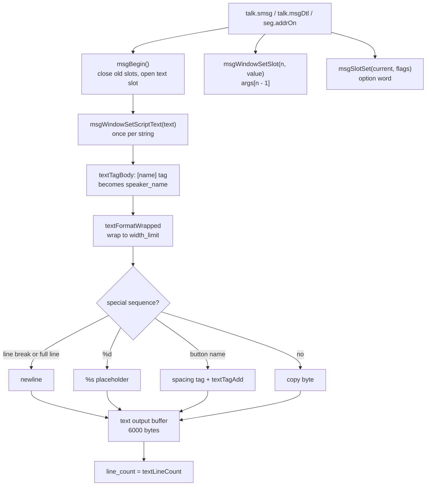

### Reveal

`interpUpdate` runs once per frame. After the opening animation it sets
`INTERP_FLAG_SCAN`, and while that bit is set it calls `interpAdvanceCursor`.

The reveal has a fixed end for each page: the end of the last visible line,
which is line `first_line + visible_rows - 1`. While `reveal` is before that
end, the function counts `wait` up. When `wait` reaches `pending` it resets
the counter, skips any markup codes that start with `$` at the reveal
position, and then moves `reveal` forward by two text units
(`textSkipTwoUnits`, two calls of `xglFontCopyTextUnit`). With the default
delay of 1 the window shows two more characters every frame. When the reveal
reaches the end of the page it is set exactly to that end and the scan bit is
cleared.

The text is printed as a whole string, so the draw code has to cut it at the
reveal position. `talkStashPrefix` saves the two bytes at `reveal` in
`talkPrefixStash` and writes zero bytes over them. After the print call
`talkRestorePrefix` puts them back.

### Paging and scrolling

When a message has more lines than rows, the player moves through it one line
at a time. `talkHasMoreLines` reports this: it is true while
`first_line + visible_rows - 1` is less than `line_count`.

`interpScrollBy(slot, 1)` moves to the next line. It raises `first_line`,
clamps it to the range 1 to `line_count - visible_rows + 1`, computes the new
scroll target as `(first_line - 1) * 30` pixels (`interpLineScrollY`) and
starts a cosine ease from the current `scroll_y` to it. The ease is the common
one described under [Easing helpers](#easing-helpers). `interpStepCosine`
advances it each frame and clears `INTERP_FLAG_EASE` at the end. After the
scroll request, `msgWindowStartScan` sets the scan bit again so that the new
line is revealed.

Three more helpers move the reveal position directly. `talkSeekToWindowEnd`
jumps to the end of the visible page, which is what CIRCLE does while text is
still appearing. `talkSeekToLimit` jumps to the end of the whole text, and
`talkScrollLines` moves it by a number of lines.

### Drawing the text

`interpDrawTextSlot` draws the frame with `talkDrawFramesBasic`. When the slot
is open it also calls `talkDrawTextBox` and `textTagDrawActive`.

`talkDrawTextBox` prints two things. If the slot has a speaker name, the name
is copied up to its closing `]` (`talkCopySpeakerName`) and printed with a
shadow at 0x20 pixels from the left edge and 0x12 pixels above the top edge of
the window. Then the text is printed at the same indent, at the first row
position and at depth `z + 7`, with the ten arguments. A scissor callback
(`talkBoxScissorCallback`) clips the text to the inside of the window so that
lines that have scrolled out are not visible.

The **page cursor** is the small mark that tells the player the window waits
for a button. `talkWindowDrawFrame` draws it when four conditions hold: the
slot is a text slot, it is open, the reveal has finished and `talkActive` is
clear. `talkWindowCursorPos` places it just after the last shown character. It
measures the text up to the reveal position, without trailing line breaks, and
adds 15 pixels to the y position. The cursor is 0x14 by 0xF pixels. While the
slot waits, `talkAdvanceCounter` cycles `frame_counter` from 0 to 15, and the
cursor is drawn 4 pixels higher during the second half of the cycle, which
makes it bob.

## Input on an open message

`msgUpdate()` in `src/main/msg_state.c` turns pad presses into requests for
the current slot. It does nothing when no message is open, and nothing when
the current slot is a list window, because a list is driven by the native that
opened it.

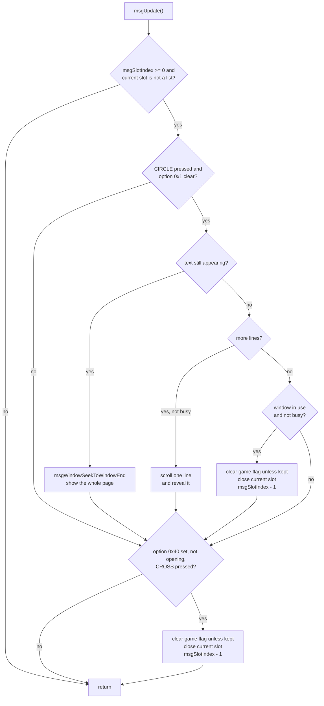

The **option word** of a message is the entry of `msgSlotFlags` that
`msgSlotIndex` points to. `talk.smsg` and `seg.addrOn` store 0.
`talk.msgDtl` stores its first argument. The recovered code tests these bits.

| Bit | Name | Effect |
| --- | --- | --- |
| 0x01 | `MSG_SLOT_NO_CIRCLE` | CIRCLE does nothing. The script must close the window itself |
| 0x02 | | The page cursor is not drawn |
| 0x04 | `MSG_SLOT_KEEP_GAME_FLAG` | Closing the window leaves `CONTROL_SCRIPTED` set |
| 0x08 | | The map object that was spoken to does not return to its walking motion when the message starts (`mapObjectFaceActive`) |
| 0x10 | | The map object that was spoken to does not turn to face the speaker |
| 0x40 | `MSG_SLOT_CROSS_CLOSES` | CROSS closes the window |

Bits 0x08 and 0x10 are read by `src/main/talk_natives.c`, not by
the window code. They are listed here because they travel in the same word.
The talk flow around them belongs to
[Events and scripts](../scripting/events.md).

`msgGameFlagClearUnlessKept()` is the common end of a message. It clears
`CONTROL_SCRIPTED` unless option 0x04 is set.

## List windows: script menus

A list window shows lines of text with a cursor bar. Scripts use it as a
small menu: the lines are the answers, and the script reads back the number
of the chosen line.

### The body

| Offset | Type | Name | Meaning |
| --- | --- | --- | --- |
| +0x28 | `int` | `cursor` | Selected row. In a sell list it is the index into the item tables |
| +0x2C | `char *` | `text` | The lines, separated by line breaks |
| +0x30 | `int` | `scroll` | First visible row |
| +0x34 | `int` | `slide_pos` | Current pixel offset of the rows |
| +0x38 | `int` | `slide_to` | Target offset, `scroll * 30` |
| +0x3C | `int` | `slide_from` | Offset at the start of the slide |
| +0x40 | `int` | `slide_angle` | Phase of the slide in degrees |
| +0x44 | `int` | `slide_step` | Degrees per frame |
| +0x48 | `int` | `visible_rows` | Rows shown at once |
| +0x4C | `int` | `capacity` | Number of lines, or 40 for a sell list |
| +0x50 | `int` | `pulse_value` | Alpha of the cursor bar, between 0x10 and 0x45 |
| +0x54 | `int` | `pulse_step` | +3 or -3 |
| +0x58 | `int` | `sweep_value` | Pixel position of the cursor bar |
| +0x5C | `int` | `sweep_end` | Target of the bar |
| +0x60 | `int` | `sweep_begin` | Position at the start of the move |
| +0x64 | `int` | `sweep_angle` | Phase of the move in degrees |
| +0x68 | `int` | `sweep_step` | Degrees per frame |
| +0x6C | `int` | `list_active` | Set when item tables are bound: the window is a sell list |
| +0x70 | `char **` | `list_source` | Item name table |
| +0x74 | `int *` | `item_costs` | Item cost table |
| +0x78 | `int *` | `counts` | Item count table, 40 entries |
| +0x7C | `int *` | `debt` | The amount shown in the window |
| +0x80 | `int` | `item_count` | Number of items with a count above zero |

### Opening and layout

`msgWindowOpenText(text)` opens a menu. It calls `msgWindowOpenNextSlot`,
which takes the next slot of `msgWindow`, initialises it as a list
(`msgListSlotInit` also starts the pulse at 0x10, rising by 3), gives it a
first geometry of x 0x96, y 0x9B, width 0xE0, height 0xD6, sets its depth and
starts the opening animation. With that geometry `msgListSlotSetGeometry`
counts five visible rows.

`msgWindowSetText` then stores the text and sizes the window to it.

| Value | Rule |
| --- | --- |
| `capacity` | number of lines of the text (`textCountLinesOf`) |
| height | `min(capacity, 5) * 30 + 64` |
| width | widest line (`textMaxLineWidth`) plus 64, at least 100 |
| x | `0x100 - width / 2`, the centre of the 512-pixel screen |
| y | `0xE0 - height / 2`, or `0xD2 - height / 2` when the text has five lines or more |

The menu slot is opened on top of the message that asked the question, and it
becomes the current slot. `msgSlotIndex` is not changed, so the option word of
the message stays in force. Because `msgUpdate` ignores a list window, the
message below does not react to the pad while the menu is up.

### Cursor, sweep and scroll

`msgWindowMoveCursor(window, delta)` moves the selection. For a plain menu it
calls `msgWindowStepCursor`. The function refuses a new move while the bar is
still travelling (`MSG_WIN_SWEEP`). Otherwise it adds `delta` to `cursor` and
wraps the result into the range 0 to the last line. It then starts the
**sweep**: the bar travels from its current pixel position to
`cursor * 30` on a cosine ease (`msgWindowSweepStep`, `msgWindowSweepValue`).

A window that shows the full five rows can also scroll. After a move the
function compares the cursor with the first and the last visible row. When
the cursor is above, the list scrolls up by the difference. When it is below,
the list scrolls down. `msgWindowScrollBy` clamps `scroll` to the range 0 to
`capacity - visible_rows` and starts the **slide**, a second cosine ease that
moves `slide_pos` to `scroll * 30`. The rows and the bar are both drawn with
`slide_pos` subtracted, so the list glides instead of jumping.

`msgWindowPulseStep` runs while the window is open. It moves `pulse_value` up
and down between 0x10 and 0x45 in steps of 3. The value is the alpha of the
cursor bar.

`msgWindowOverflows` is the list version of "more text". It is true when the
text has six lines or more (`MSG_WINDOW_OVERFLOW_LINES`), one more than the
layout shows.

### Drawing the list

`msgWindowDraw` draws the frame through `talkDrawFramesWithCursor`. For an
open plain menu this is the full frame and then the cursor bar.
`talkDrawListCursorBar` in `src/main/talk_draw_fade.c` draws the bar as one
GS packet: a soft panel across the window at the cursor row, in the colour
0x804040 with the pulse as alpha, clipped to 0x23 pixels inside the top and
bottom edges of the window. The row position is
`y - slide_pos + sweep_value + 0x20`.

The lines are printed by `msgWindowDrawLineList` in `src/main/msg_text_draw.c`, one
line per 30-pixel row, 0x20 pixels from the left edge. The line under the bar
uses the colour 0x50509C and the others 0xC0C0C0. The selected row for the
colour is computed from the bar position, so the highlight follows the bar
while it moves.

### Reading the result

`msgPollSelect()` is called every frame by the `menuGetResult` native.

1. While the window is opening it returns -1.
2. When the window is no longer open and its closing bit is set, the choice
   has been made. The function clears the game flag unless it is kept and
   returns the cursor row.
3. Otherwise it reads the pad. UP and DOWN (with auto-repeat) move the cursor
   by -1 and +1. CIRCLE calls `msgWindowCloseAll`, which starts the closing
   animation of the menu and of the message under it.
4. It returns -1.

The native adds 1 to the result, so a script receives 1 for the first line.
While the result is -1 the native reports "not finished" and the script
thread stays on the call. The mechanism is described in
[Script natives](../scripting/natives.md).

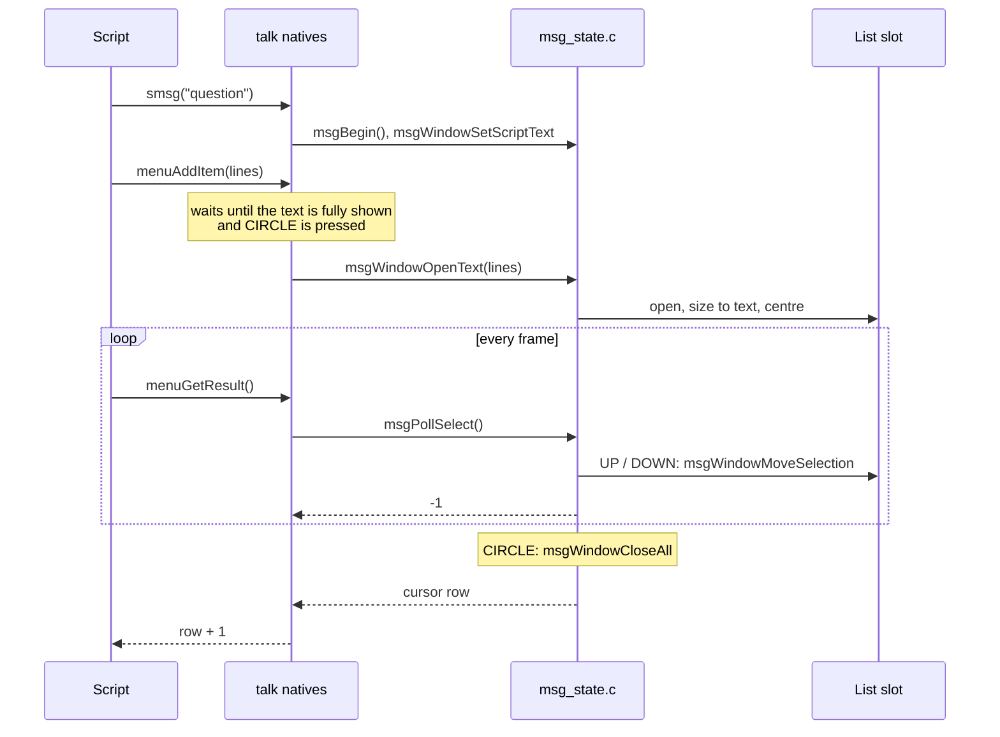

## The sell window: items, costs and counts

The list window has a second form in which each row is an item with a price
and a count. The script fills three tables of 40 entries and binds them to
the window. The labels that `src/main/msg_text_draw.c` prints in this window are
`:Sell`, `:Close`, `Remaining Debt: ` and `No items to sell.`, and prices are
printed with the format `%dG`. The window is the sell screen of the debt
side quest. The quest itself is described in
[G.S. Campaign and quests](../game/gs-campaign.md).

### Tables and balance

`src/main/msg_window_bind.c` holds the tables.

| Variable | Size | Meaning |
| --- | --- | --- |
| `msgItemNames` | 40 pointers | Name of each item (`msgSetItemName`) |
| `msgItemCost` | 40 ints | Amount one unit takes off the debt (`msgSetItemCost`) |
| `msgItemCount` | 40 ints | Units the player has (`msgSetItemCount`) |
| `msgShownBalance` | int | The amount drawn in the window |
| `msgTargetBalance` | int | The amount after all sales so far |
| `msgModeFlag` | int | Which of two item categories the list shows (`msgSetMode`) |
| `msgBalance` | int | The stored balance between two visits |

`msgBalance` is the remaining debt. `msgBalanceReset()` sets it to 10,000,000
(0x989680) when a new game starts (`src/ov02/title_game_init.c`). It is saved
as `SaveData.balance` and restored through `msgBalanceGet` and `msgBalanceSet`
in `src/main/pt_member.c`.

The `menuDeptQuest` native prepares the window. It copies 40 names and 40
costs from two script arrays, reads the counts of the chosen category from
the data box (`dataBoxChkCategory1` or `dataBoxChkCategory2`), and calls
`msgResetBalances`, which starts both the shown and the target amount at
`msgBalance`. Then `msgWindowBindTables` opens a list slot and binds the
tables with `msgWindowBindCurrentItems`.

### Layout

`msgWindowBindItems` sets `list_active`, sets `capacity` to 40
(`MSG_LIST_CAPACITY`), counts the items with a count above zero and gives the
window one of two fixed layouts.

| | With items | Without items |
| --- | --- | --- |
| x | 0x40 | 0x40 |
| y | 0x51 | 0x79 |
| width | 0x180 | 0x180 |
| height | 0xFE | 0xA5 |

The item count is taken again every frame (`msgWindowCountItems`), and
`msgWindowSetEmptyLayout` switches to the small layout as soon as the last
item is sold.

A sell list has a second, fixed window below it for the button labels.
`talkDrawListFooterWindow` draws it at x 0x81, y 0x13B with a size of 0xFB by
0x51, and it opens and closes together with the list. `drawSellPanel` prints
the two labels there, `:Sell` in a dimmed colour when nothing is left to
sell. `msgWindowDrawListIcons` draws a button glyph in front of each label, the circle button for `:Sell` and the cross button for `:Close`. The
debt line is printed inside the list window, centred, and the rows start 0x48
pixels below the top edge instead of 0x20 to leave room for it.

`drawSellItemList` prints one row for each item that has a name and a count
above zero: name, price and count. Items with a count of zero are skipped, so
the rows on screen are a compressed view of the 40 table entries.

### Moving over filled items

Because empty entries are hidden, the cursor of a sell list moves with
`msgWindowStepCursorSkipEmpty`. It steps `cursor` in the direction of the
press, wrapping from 39 to 0 and back, until it lands on an entry with a
count above zero. If it arrives back where it started, there is no other
item, and the move is cancelled. The bar target is then not the table index
but the **rank** of the item, the number of filled entries before it
(`sellCountFilled`), times 30 pixels. Scrolling compares the rank with the
visible rows in the same way as a plain menu does with the cursor.

When the item under the cursor is sold out, `msgWindowSkipEmptyItem` moves
the cursor to the nearest filled entry on the next frame. The search
(`msgWindowNearestFilledIndex`) looks forward from the cursor to the end of
the table first, then backward to the start.

### Selling

`msgSaleUpdate()` runs every frame through the `menuDeptGetResult`
native. It returns -1 while the window is in use and the final amount once it
has closed.

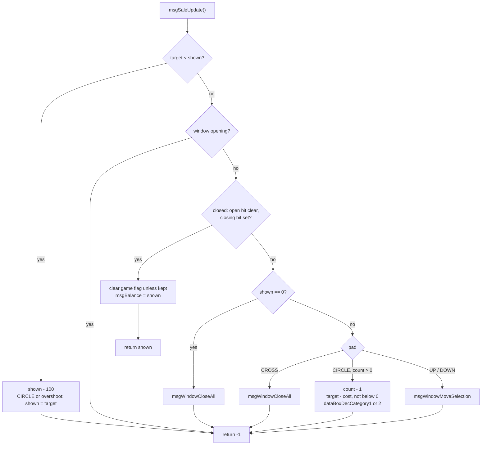

A sale never changes the shown amount directly. It lowers
`msgTargetBalance`, and on the following frames the shown amount runs down in
steps of 100 until it meets the target. No other input is read during that
run, except that CIRCLE ends it at once. When the debt reaches zero the window
closes by itself.

## The item notice

The item notice is the small window that says `Acquired <name>.` after the
player picks something up. It is a type 4 slot in `msgChoice`.

| Offset | Type | Name | Meaning |
| --- | --- | --- | --- |
| +0x28 | `int` | `saved_extent_x` | Width before the last change of item |
| +0x2C | `int` | `saved_extent_y` | Height before the last change |
| +0x30 | `char *` | `saved_name` | Previous name |
| +0x34 | `int` | `saved_count` | Previous count |
| +0x38 | `char *` | `name` | Item name |
| +0x3C | `int` | `pending` | Frame counter of the change animation, 0 to 12 |
| +0x40 | `int` | `timer` | Frames the notice stays open |
| +0x44 | `int` | `count` | Number of items |

`msgChoiceShowPair(name, count)` shows a notice. The item pickup code in
`src/main/uwamono_record.c` calls it. `msgChoiceShow(name)` is the same with a
count of 0. Both set `msgChoiceTimer` to 0x5A, call `msgItemSlotStart` and
then place the slot at x 10, y 0x20.

`msgItemSlotStart` has two paths.

- When `msgChoice` is free or already closing, the slot is initialised as
  type 4 with a size of 200 by 94, the frontmost depth `MSG_SLOT_FRONT_Z`
  (0x7FFFFF) and the opening animation.
- When a notice is already on screen, the slot is kept. `msgSlotSetItem`
  saves the old size, name and count, and `msgSlotResetCounters` starts the
  change animation: the open bit is replaced by `MSG_SLOT_FADE` and `pending`
  starts at 0.

In both paths `msgSlotSetItem` stores the name and count and sets the width
to the pixel width of the finished message plus 0x40, and the slot timer is
set to 0x78 frames. If `msgChoice` is busy as a number entry box, the
function returns 0 and shows nothing.

The text is built by `formatAcquiredText`: the word `Acquired `, the name in
the highlight colour and a full stop. From a count of 2 the count is added
after a multiplication sign.

Two timers can end the notice. `msgSlotItemTick` counts the slot timer down
while the slot is open and starts the closing animation at zero.
`msgUpdateTimed` counts `msgChoiceTimer` down every frame and closes the slot
through `msgChoiceCloseByState` at zero. The second one starts at 90 and runs
from the moment of the call, so in practice it ends the notice after three
seconds at 30 frames per second.

During the change animation `talkDrawFramesWithFade` draws two frames: the new
frame in the opening shape at scale `pending * 0.08`, and the old frame, with
its saved size, in mode `TALK_FRAME_SIZED` at scale `1 - pending * 0.08`. The
old window shrinks away while the new one grows. After 13 steps the fade bit
is replaced by the open bit again.

## Number entry and the timecode counter

A type 3 slot shows a value as digits. The code calls it a **timecode**
because the value is a 64-bit frame count at 30 frames per second, and two of
its three modes print it as a clock. The same slot type serves two different
widgets: an editable number box in `msgChoice` and a read-only clock in
`msgPanel`.

### The body

| Offset | Type | Name | Meaning |
| --- | --- | --- | --- |
| +0x28 | `long long` | `elapsed_frames` | The value. A plain number in mode 0, frames in modes 1 and 2 |
| +0x30 | `int` | `mode` | 0 number, 1 hours:minutes:seconds, 2 minutes:seconds:hundredths |
| +0x34 | `int` | `editable` | 1 shows the value, 2 also turns the selection on when the slot has opened |
| +0x38 | `int` | `selected` | Selected digit (1 is the rightmost) or field code |
| +0x3C | `int` | `digits` | Number of digits in mode 0, 1 to 9 |
| +0x48 | `long long` | `limit` | Value at which an automatic run stops |
| +0x50 | `long long` | `increment` | Added per frame during an automatic run |
| +0x58 | `int` | `phase_start` | Selection when the last value step began |
| +0x5C | `int` | `roll_angle` | Phase of the rolling digit, 0 to 180 |
| +0x60 | `int` | `roll_angle_step` | Degrees per frame |
| +0x64 | `int` | `digit` | The digit before the step |
| +0x68 | `int` | `span` | The amount of the step, +1 or -1 |
| +0x6C | `int` | `cursor_angle` | Phase of the selection cursor move, 0 to 180 |
| +0x70 | `int` | `cursor_angle_step` | Degrees per frame |
| +0x74 | `int` | `previous` | Selection before the last move |
| +0x78 | `int` | `cursor_x` | Pixel offset of the selection box |
| +0x7C | `int` | `idle_color` | Colour of the digits, 0xA8A8A8 after `timecodeInit` |
| +0x80 | `int` | `highlight_color` | Colour the digits blink to |
| +0x84 | `int` | `blink_phase` | 0 to 19: 0 to 7 fade in, 8 to 11 hold, 12 to 19 fade out |

| Mode | Constant | Shown as | Selectable fields |
| --- | --- | --- | --- |
| 0 | `TIMECODE_MODE_NUMBER` | `digits` decimal digits with leading zeros | digits 1 to `digits` |
| 1 | `TIMECODE_MODE_HMS` | hours, minutes, seconds | codes 11 (seconds), 12 (minutes), 13 (hours) |
| 2 | `TIMECODE_MODE_MSF` | minutes, seconds, hundredths of a second | codes 10 (frames), 11 (seconds), 12 (minutes) |

The frame constants are `FRAMES_PER_SECOND` 30, `FRAMES_PER_MINUTE` 1800 and
`FRAMES_PER_HOUR` 108000. `timecodeSplit` and the two formatters convert the
frame remainder to hundredths by multiplying it with 3.333
(`HUNDREDTHS_PER_FRAME`).

### The number entry box

The `slotWinOpen` native opens the box with a start value and a digit count,
and `slotWinGetResult` polls it. Scripts use it wherever the player must dial
in a number. The natives are listed in
[Script natives](../scripting/natives.md).

`msgChoiceOpen(value, digits)` calls `timecodeStartAtFrame`, which refuses
when `msgChoice` is still active. Otherwise it initialises the slot as type
3, gives it the frontmost depth, stores the value, starts the opening
animation, selects mode 0 with four digits and marks it editable (2). Then
`timecodeSetDigits` applies the requested digit count and lays the box out.

| Value | Rule |
| --- | --- |
| width | `0x54 + 20 * (digits - 1)`, at least 0xAA (`timecodeFitBoxWidth`) |
| height | 0x54 |
| position | centred on the screen: `0x100 - width / 2`, `0xE0 - height / 2` |
| digit row | centred in the box, 20 pixels per digit, 0x20 below the top edge |

When the opening animation ends, `timecodeUpdate` sets bit 0x40 because the
slot is editable. From then on `timecodeValidateSelection` keeps the selected
digit inside the valid range every frame, and the frame drawer adds the
selection box.

`msgChoicePoll()` is the input function. It returns -1 while the box is not
open and while a cursor move or a digit roll is still running (bits 0x100 and
0x200).

| Pad | Call | Effect |
| --- | --- | --- |
| LEFT | `msgChoiceStepSelection(+1)` | select the next digit to the left |
| RIGHT | `msgChoiceStepSelection(-1)` | select the next digit to the right |
| UP | `msgChoiceStepValue(+1)` | raise the selected digit |
| DOWN | `msgChoiceStepValue(-1)` | lower the selected digit |
| CIRCLE | | read the value, close the box and every message window, clear the game flag, return the value |

Digits are numbered from the right, which is why LEFT adds 1.
`timecodeStepPhase` wraps the selection inside 1 to `digits` and starts the
cursor ease from the old digit position to the new one.

`timecodeStart` changes the value. In mode 0 it calls `timecodeAddToDigit`,
which adds the step to one decimal place only. The digit wraps from 9 to 0
and from 0 to 9 without a carry into the next digit. The function works on a
digit string: `numberToDigitsLsbFirst` writes the value with the lowest digit
first, two copies get a `9` and a `0` at the selected place to give the upper
and lower bound, and a result outside the bounds is pulled back by ten units
of that place. In the clock modes `timecodeAddToField` splits the frame count
into hours, minutes, seconds and frames, changes one field and wraps it
inside its own range (24, 60, 60 or 30).

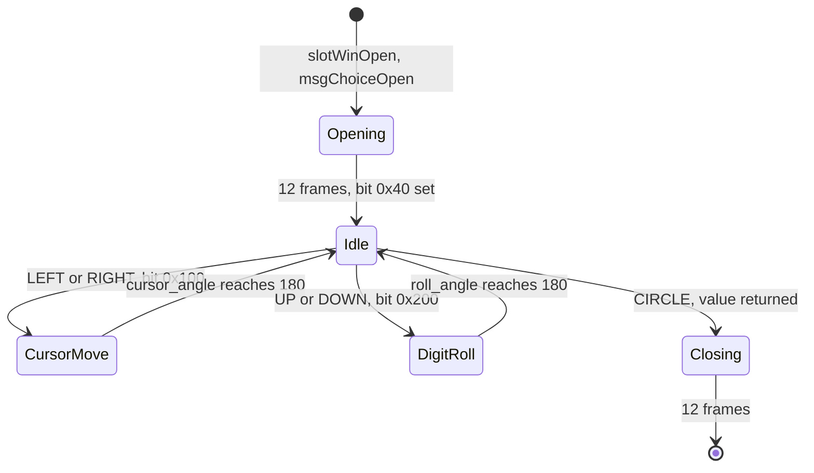

While the number entry box is open, `msgUpdateTimed` does not call
`msgUpdate`. A CIRCLE press therefore confirms the number and is not also
taken as "next page" by the message below.

### Drawing the digits

`timecodeSlotDraw` draws the textured frame in mode 0
(`talkDrawFramesWithBox`) and the plain dark rectangle in the clock modes
(`talkDrawFrameRects`). When the slot is open it calls `timecodeDrawContents`
for the digits.

In mode 0 `timecodeDrawDigitRow` prints one digit per 20-pixel cell. The digit
under the selection is drawn through an accent path, and while a step runs
the selected digit is drawn as a **rolling digit**: the old and the new digit
slide through the cell, driven by `roll_angle`. The digit strip
`0 1 2 ... 9 0 1 ... 9` that this needs is a text constant next to the other
strings in `src/main/msg_text_draw.c`.

`talkDrawSelectionBox` in `src/main/talk_draw_fade.c` draws the selection box
around the selected cell. It is a textured sprite 0x14 pixels square (0x32 by
0x19 in the clock modes) with a 12-pixel margin, drawn once in place and four
more times shifted diagonally by 3 pixels, which gives it a soft glow. Its x
position is the content origin plus `cursor_x`, and `cursor_x` is the eased
position between the previous and the selected digit (`timecodeCursorX`,
`timecodeCursorEnds`). The box therefore glides from digit to digit.

In the clock modes `drawEntryDigits` prints six digits in three pairs with
two separator marks between them. The colour comes from `entryFadeColor`. It
is `idle_color` while the blink bit is clear. With the bit set, the colour
moves between `highlight_color` and a half-dark version of it over the
20-step `blink_phase` cycle.

### Automatic runs and blinking

A timecode slot can also count by itself. `timecodeSetFramePair(slot, limit,
increment)` stores both values and sets `TIMECODE_FLAG_ADVANCE`. Each update
then adds `increment` to the value. When the value passes `limit` (above it
for a positive increment, below it otherwise) it is set to the limit and the
bit is cleared. `timecodeSetFramesHms` and `timecodeSetFramePairFromHms` take
the two values as hours, minutes and seconds.

`timecodeStartCounter(slot, color)` turns the blink on and
`timecodeSetColor` sets the idle colour. These functions and their forwarders
in `src/main/msg_slot_start.c` have no caller in the recovered code. The
shipped clock is driven from outside, as the next section shows.

## The countdown panel

`msgPanel` is the clock of timed sections. It shows minutes, seconds and
hundredths on a dark panel in the top right corner of the screen.

The `TimeAttack` native in `src/main/runtime.c` controls it. Its first
argument is a kind.

| Kind | Effect |
| --- | --- |
| 0 | `msgPanelOpen()`, then `gameWork.panelMode = 0` and `gameWork.panelValue =` the second argument, the time in frames |
| 1 | `msgPanelClear()`, `gameWork.panelMode = 1`, value 0 |

The other kinds only read or change the stored mode and are described with
the native in [Script natives](../scripting/natives.md).

`msgPanelOpen()` calls `timecodeStartAtHms(&msgPanel, 0, 0, 0)`. The slot is
set up with a size of 0x96 by 0x23, the frontmost depth, mode 2
(`TIMECODE_MODE_MSF`), `editable` 1 and the seconds field selected. Because
it is not editable (2), the selection never becomes live and no selection box
is drawn. `msgPanelShowDefault()` then places it at x 0x151, y 8.
`msgPanelShow(x, y)` places it anywhere: the screen break effect in
`src/main/gifState.c` moves it down to y 0x4E.

The panel does not count by itself. The field loop owns the time.

1. Each frame of normal play, while `gameWork.panelMode` is 0, the loop in
   `src/main/game_data.c` lowers `gameWork.panelValue` by one.
2. When the value falls below zero it is set to 0, the mode becomes 1 and
   event 7 is sent to the map objects (`uwamonoSendEvent(7, 0, 0)`). This is
   the "time is up" signal for the scripts.
3. Every frame, also during the pause screen, the loop writes the value into
   the panel with `msgPanelSetTimecode(0, 0, panelValue / 30, panelValue %
   30)`. The function adds seconds times 30 and the frame remainder, which
   gives back `panelValue` as a frame count.
4. While the mode is not 0 the loop calls `msgPanelClear()`, which starts the
   closing animation of the panel.

A battle keeps the clock running. `ov01StepBattle` in
`src/ov01/scene_finish.c` lowers `gameWork.panelValue` and updates the panel
in the same way while the event flag `CF_EVENT_TIME_LIMIT` is set. After the
battle the field loop places the panel again with `msgPanelShowDefault()`,
and reopens it with `msgPanelOpen()` when the mode is still 0.

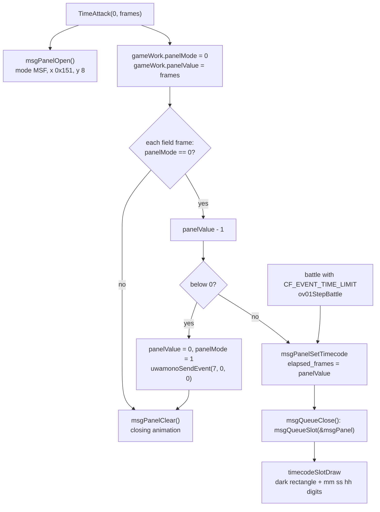

## Easing helpers

Every sliding movement of the message system uses the same half cosine. A
value moves from `from` to `to` while an angle runs from 0 to 180 degrees:

```text
mid   = (to + from) >> 1
value = mid + (mid - to) * cos(angle)
```

At 0 degrees this is `from`, at 180 degrees it is `to`, and the movement is
slow at both ends. The text scroll (`interpStepCosine`), the row slide
(`msgWindowSlideStep`), the cursor bar (`msgWindowSweepValue`) and the
selection box (`timecodeCursorX`) all use this form.

The speed is chosen by `easeAngleStep(start, target)` in
`src/main/ease_step.c`. A distance below 31 units gets 45 degrees per frame,
so a move of one 30-pixel row takes four frames. Any longer distance gets 23
degrees per frame and takes eight frames. `easeStepOverrideSet(value)`
replaces both speeds with a fixed step until `easeStepOverrideClear()` is
called.

`deltaPerStep(start, target, divisor)` in the same file divides a distance by
a step size. `msgListRowsBetween` and `textRowsBetween` use it with a step of
30 to count the rows that fit in a window.

## Script natives

The message system is driven by the `talk` native group, one native of the
`seg` group and the global `TimeAttack` native. The tables are registered by
`scriptRegisterNatives` in `src/main/talk_natives.c`. Arguments,
return values and the retry mechanism are described in
[Script natives](../scripting/natives.md).

| Native | Function | Window functions it calls |
| --- | --- | --- |
| `talk.smsg` | `talkSmsg` | `msgBegin`, `msgWindowSetScriptText`, `msgWindowSetSlot`, `msgSlotSet` |
| `talk.msgDtl` | `talkMsgDtl` | the same, with the option word as its first argument |
| `talk.winClose` | `talkWinClose` | `msgWindowCloseForTalk`: closes all slots, `msgSlotIndex = -1` |
| `talk.isDispMsg` | `talkIsDispMsg` | `msgWindowInUse` |
| `talk.wait` | `talkWait` | `msgWindowInUse`, waits while it is non-zero |
| `talk.check` | `talkCheck` | `msgWindowBusy` |
| `talk.resume` | `talkResume` | `cursorBufferTick` on the current text cursor record |
| `talk.menuAddItem` | `menuAddItem` | `msgWindowBusy`, `msgWindowHasMore`, `msgWindowOpenText` |
| `talk.menuGetResult` | `menuGetResult` | `msgPollSelect` |
| `talk.menuDeptQuest` | `menuDeptQuest` | `msgResetBalances`, `msgSetItemName`, `msgSetItemCost`, `msgSetItemCount`, `msgSetMode`, `msgWindowBindTables` |
| `talk.menuDeptGetResult` | `menuDeptGetResult` | `msgSaleUpdate` |
| `talk.slotWinOpen` | `slotWinOpen` | `msgWindowBusy`, `msgWindowHasMore`, `msgChoiceOpen` |
| `talk.slotWinGetResult` | `slotWinGetResult` | `msgChoicePoll` |
| `seg.addrOn` | `segAddrOnMessage` | `msgBegin`, `msgWindowSetScriptText`, `msgWindowSetSlot`, `msgSlotSet` |
| `TimeAttack` | `runtimeTimeAttack` | `msgPanelOpen`, `msgPanelClear` |
| `namePut` (battle) | `namePut` | `textWindowShow` |

The three natives that open something over a message (`menuAddItem`,
`menuDeptQuest` and `slotWinOpen`) all wait for the same moment. They do
nothing until the message below is fully revealed, has no more lines and, for
the first and the third, the player presses CIRCLE. That press is the one
that would otherwise close the message. They also set `CONTROL_SCRIPTED`
again, because the new window keeps the script in control.

`talk.enableFlags` and `talk.disableFlags` exist in the table, but their
functions only return 1.

## The battle text layer

Battles in OV01 do not use message slots for their lists. They use three
simpler objects that `textUpdate()` in `src/main/text_marker.c` steps every
frame: the text window, the text entries and the choice menus.
`textUpdate()` also queues `textDrawAll`, which draws all of them, with
`xglCallbackQueueAdd`. The battle scene calls `textUpdate()` just before
`msgUpdateTimed()` and `msgQueueClose()`, so both systems are alive during a
battle. How the battle uses these windows is described in
[Battle](../game/battle.md) and [The battle engine](../game/battle-engine.md).

### The text window

`textWindow` (`src/main/text_window.c`) is a single one-line box.

| Offset | Type | Name | Meaning |
| --- | --- | --- | --- |
| +0x00 | `struct FontTrack` | `track` | Current and target position of the box |
| +0x1C | `int` | `width` | Width of the box |
| +0x20 | `int` | `fade` | Frames left on screen |
| +0x24 | `unsigned char *` | `text` | The text, or null for an empty box |

`textWindowShow(x, y, minWidth, text, fadeBase)` shows it. The width is the
markup width of the text plus 24, at least `minWidth`. The track starts at
`-(width * 2)` on the x axis, which is off the left side of the screen, and
its target is (x, y), so the box slides in from the left. `fade` is set to
`fadeBase + 8`.

Each frame `textUpdate` eases the track and lowers `fade` by one. The box is
drawn while `fade` is above zero, and during its last 8 frames its opacity is
`fade << 4`, so it fades out. The `namePut` native of the battle scripts
calls `textWindowShow` with its five arguments.

`xglFontGetMarkupWidth(text)` measures a string that contains markup. It
skips every `$` code up to its `;`. Two codes change the measurement: `$zoom`
followed by one or two digits sets the scale `xglFontZoom` (16 is 1.0), and
`$init` sets it back to 16. Every other character is measured alone through
the font and scaled by the zoom.

### Text entries

A **text entry** is a box that shows one page of text out of a list of
pages. `textEntryPool` holds four of them.

| Offset | Type | Name | Meaning |
| --- | --- | --- | --- |
| +0x00 | `int` | `x`, `y`, `width`, `height` | The box, four words |
| +0x10 | `unsigned char **` | `pages` | Page texts, ended by a null pointer |
| +0x14 | `int` | `page` | Current page |
| +0x18 | `unsigned char` | `tick` | Opening step 0 to 4, or the page timer |
| +0x19 | `unsigned char` | `state` | 0 free, 1 open, 2 opening, 3 closing |
| +0x1A | `unsigned char` | `style_index` | Index into the style label table |
| +0x1C | pointer | `word_1c` | The title drawn on the box, or null |
| +0x20 | `unsigned char` | `count` | Number of marker stops the player has passed |
| +0x21 | `unsigned char` | `atLastPage` | Set when the entry has shown everything |

`textEntryAlloc(x, y, width, height, style, pages)` takes the first free
entry. When none is free it reuses the first one that is closing. It returns
the entry, or null when all four are in use. `textEntryRemove(entry)` starts
the closing countdown from 4.

`textEntryUpdate` in `src/main/text_marker.c` runs the states. An opening
entry counts `tick` to 4, and during that time the box is drawn at
`tick / 4` of its size around its centre. An open entry pages through its
text in one of two ways. Without marker stops it shows each page for 20
ticks and starts again at the first page after the last. With marker stops it
waits for the player. `textEntryConfirmPoll(entry)` is the function the battle
code polls for this: on a CIRCLE press it plays sound `0x01000002` and raises
`count`, and it returns `atLastPage`. The markers inside the text are
described in [Fonts and text](fonts-and-text.md).

`textEncodeNewlines(text)` prepares a page before it is drawn. It replaces
every two-character sequence `\` `n` by a real newline followed by the
control byte 0x07, and it steps over two-byte characters so that a trail byte
is never mistaken for a backslash.

### Choice menus

A **choice menu** is a list of items in one or more columns with a cursor.
There are two slots, `choiceMenuSlots[0]` and `[1]`. The battle command code
in `src/ov01/choice_menu.c` uses slot 0 for its item, tech, level, pair and
target lists, always at x 0x14, y 0x6C with a size of 0x1AC by 0x70.

| Offset | Type | Name | Meaning |
| --- | --- | --- | --- |
| +0x00 | `int` | `x`, `y`, `width`, `height` | The box, four words |
| +0x10 | `unsigned char **` | `items` | Item texts, ended by a null pointer |
| +0x14 | `short *` | `values` | Optional number printed beside each item |
| +0x18 | `unsigned char *` | `itemFlags` | Optional flag byte per item, bit 0x2 highlights the item |
| +0x1C | `unsigned int` | `flags` | Bit 0 active, bit 1 no result, bit 0x10 values carry a unit mark |
| +0x24 | `struct FontTrack` | `track` | Scroll position of the rows |
| +0x40 | `ListCursor` | `cursor` | The selection |
| +0x54 | `unsigned char` | `phase` | Opening or closing step, 0 to 4 |
| +0x55 | `unsigned char` | `kind` | 0 free, 1 open, 2 opening, 3 closing |
| +0x56 | `unsigned char` | `style_index` | Index into the style label table |
| +0x58 | `unsigned int` | `style_value` | The title of the box from that table, or 0 |

`choiceMenuOpen(index, x, y, width, height, style, unit_size, flags, items,
values, itemFlags)` opens a slot that is free or closing. It counts the items
up to the null pointer and initialises the list cursor with that capacity and
with `unit_size` as its unit. The unit is the number of columns: UP and DOWN
move the cursor by one unit, LEFT and RIGHT by one item, and the draw code
divides the width by the same number. The slot starts in the opening state.

`choiceMenuOpenFromRequest(index, request)` does the same from a parameter
block and also restores a cursor position (`cursor_offset - 1`). It then
scrolls the list at once so that the restored row is visible.

`choiceMenuUpdate(index)` runs once per frame.

1. It eases the scroll track toward its target.
2. It steps the phase. Opening takes four steps, then the menu is open.
   Closing counts down from four, then the slot is free.
3. If the menu is active and open or opening, it reads the pad and moves the
   list cursor.
4. It keeps the cursor row visible. Rows are 24 pixels high. While the cursor
   row lies below the box, the scroll target moves up by one row. While it
   lies above, the target moves back down. A menu with a title has 11 pixels
   less room.

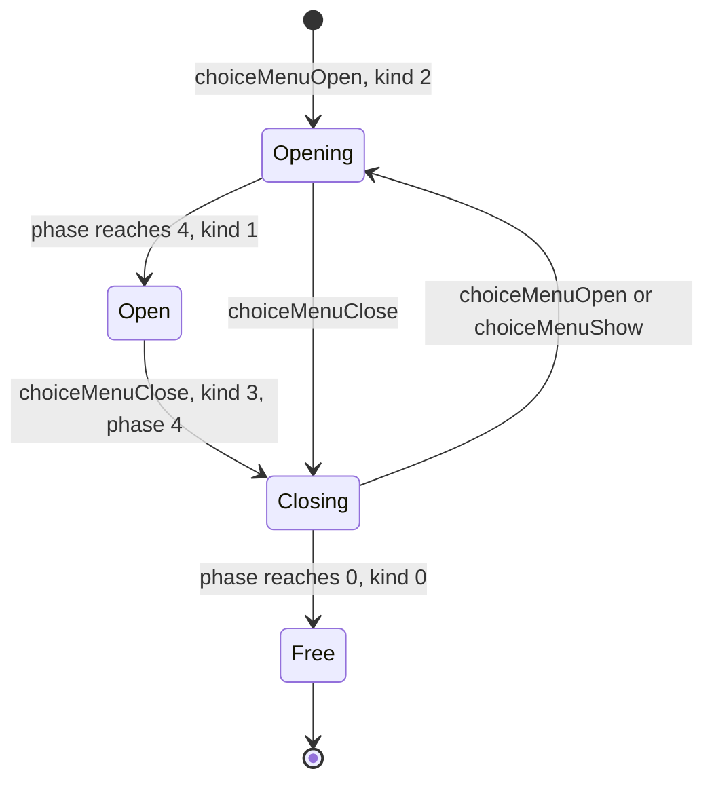

The other entry points are small. `choiceMenuIsOpen(index)` is 1 for an open
or opening menu. `choiceMenuSetActive(index, enable)` sets or clears the
active bit, which decides whether the pad moves the cursor.
`choiceMenuGetResult(index)` returns the selected item plus 1, or 0 while the
"no result" bit is set. `choiceMenuClose(index)` starts the closing countdown
and clears the active bit. `choiceMenuShow(index)` reopens a slot with its old
contents. The menu never reads CIRCLE or CROSS itself. The battle code
decides what a press means and then reads the result.

The **style label table** `textStyleTable` gives a box its title. Index 0
means no title.

| Index | Title |
| --- | --- |
| 1 | `ETHER` |
| 2 | `ITEM` |
| 3 | `DOUBLE` |
| 4 | `SPECIAL` |
| 5 | `W ETHER` |
| 6 | an empty string |
| 7 | `STATUS` |
| 8 | `EXPLANATION` |

`textDrawAll` draws a menu as a titled window, scaled by `phase / 4` while it
opens or closes. Inside it prints each item at its column and row, with the
cursor item and the flagged items in a highlight style, and the optional
value right-aligned in the column.

## Cursor buffers

`src/main/cursor_buffer.c` has two kinds of cursor. The first is a general
list cursor that many screens use. The second is the pad handling of the
text cursor records that belong to the font objects.

### ListCursor

A `ListCursor` is a position inside a list. It is 0x14 bytes.

| Offset | Type | Name | Meaning |
| --- | --- | --- | --- |
| +0x00 | `int` | `cursor` | Current position |
| +0x04 | `int` | `previous_cursor` | Position before the last move |
| +0x08 | `unsigned int` | `capacity` | Number of positions |
| +0x0C | `int` | `unit_size` | Positions per row. 0 means none |
| +0x10 | `int` | `mode_flags` | Bit 0x100 `CURSOR_MODE_WRAP`. The main menu also uses bit 0 to mark the cursor that has the focus |

The position counts single items, and `unit_size` groups them. A two-column
menu has a unit size of 2: one step sideways is one position, one step down
is one unit. `cursorBufferGetIndex` returns `cursor / unit_size`, the row,
and `cursorBufferGetAlignedOffset` returns the first position of that row.

| Function | Effect |
| --- | --- |
| `cursorBufferInit(c, capacity, unit_size, mode_flags)` | Sets the fields, position 0, and always adds `CURSOR_MODE_WRAP` |
| `cursorBufferSetCapacity(c, capacity)` | Sets the size and pulls the position back inside it |
| `cursorBufferSetOffset(c, position)` | Jumps to a position, then wraps or clamps. No sound |
| `cursorBufferMoveBy(c, delta)` | Moves by single positions |
| `cursorBufferMoveUnits(c, units)` | Moves by `units * unit_size` positions |
| `cursorBufferWrapOrClamp(c)` | Brings the position back into 0 to `capacity - 1` |

Both move functions play the cursor sound `0x01000001` through
`seVoiceStartDefault` when the position has really changed.

`cursorBufferWrapOrClamp` decides between two behaviours. A fresh press at
the end of a list jumps to the other end. A held direction, which arrives
through the auto-repeat, stops at the end. The function tells the two apart
by comparing the repeated direction bits of the pad with the newly pressed
ones. Wrapping also needs the cursor to have been exactly on the first or
last position before the move. A large step that overshoots from somewhere
in the middle only goes to the end.

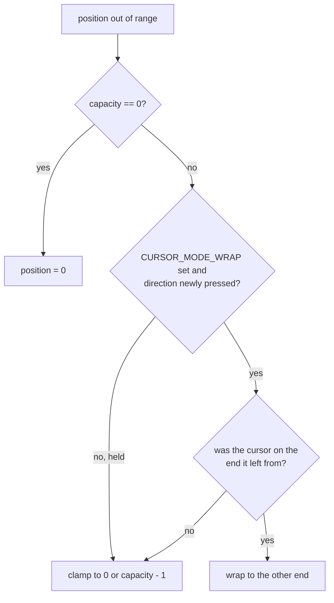

List cursors are used by the choice menus on this page, by the main menu
(`src/main/menu_scene.c`, `src/main/menu_draw.c`), by the save screen
(`src/main/save_screen.c`) and by a developer test screen
(`src/main/debug_test.c`). These screens are described in
[The main menu](../game/main-menu.md) and
[Save data](../architecture/save-data.md).

### Text cursor records

A `CursorTextRecord` is a larger record (0xD8 bytes in its pool) that pairs
a list cursor with the playback state of a block of text and with a font
object. The pool and the text blocks themselves belong to
`src/main/text_box.c` and are described in
[Fonts and text](fonts-and-text.md). This file only supplies the pieces that
react to the pad.

| Function | Effect |
| --- | --- |
| `cursorBufferActivate(record)` | Sets `CURSOR_FLAG_ACTIVE` (0x10000) in `state` and starts the opening of the font object |
| `cursorBufferDeactivate(record)` | Clears the active bit and advances the tracks of the font object |
| `cursorBufferStartClose(record)` | Starts the closing of the font object, unless bit 0 of `state` (`CURSOR_STATE_PAUSE`) is set |
| `cursorBufferReset(record)` | Clears the active status bit, the count and the auxiliary value |
| `cursorBufferTick(step)` | One step of a block cursor: `count += step`, the state takes the mode, the "tick pending" bit (0x20000) is cleared |
| `cursorBufferHandlePad(record)` | The per-frame pad handling, see below |

`cursorBufferHandlePad` only acts on an active record. It looks at the second
step record inside it (`second_step`).

- While that step record is active, CIRCLE first tries to show text that is
  still pending (`textBoxShowPending`). If nothing was pending and no text
  box is busy, CIRCLE starts the closing of the record.
- While the step record waits for a tick, CIRCLE again shows pending text
  first. Otherwise CIRCLE, or the pause bit of the record, performs the tick
  and so lets the text block continue.

The `talk.resume` native performs the same tick from a script, without a
button press.

## The debug menu tree: xglMenu

`src/main/xgl_menu.c` is a small menu system that prints plain text rows
through the debug font. The only caller in the game is the display setting
test screen in `src/main/yajima_test.c`, described in
[Debug tools](../game/debug-tools.md).

A menu is a tree of `XglMenuNode` records. Each node has a row count, a
selected row, a row spacing and an array of rows. A row is a text and a link
word. A link below 0x100000 is a **result value** that ends the menu. A
larger link is a pointer to a child node. A link of -1 marks a row that
cannot be selected, and it is printed in dark grey.

`xglMenuOpen(slot, params)` copies the request into one of the 16 entries of
`menutbl`. With `XGL_MENU_SLOT_ANY` (-1) it takes the first inactive entry
and returns its index, or -1 when all are in use. The request names the root
node, the position, a default result and a pointer where the result is
written. `xglMenuInitial()` marks all 16 entries inactive.

`xglMenuDraw()` runs every active entry. An entry of type 1 is a list menu
and goes through four states.

| `active` | Constant | Behaviour |
| --- | --- | --- |
| 1 | `XGL_MENU_ACTIVE_OPEN` | The row spacing of the current level grows by one pixel per frame up to the node's spacing |
| 2 | `XGL_MENU_ACTIVE_RUNNING` | UP and DOWN move the selection and skip disabled rows. CIRCLE selects, CROSS goes back |
| 3 | `XGL_MENU_ACTIVE_CLOSE_LEVEL` | The spacing of the current level shrinks to zero, then the parent level takes over |
| 4 | `XGL_MENU_ACTIVE_CLOSE_ALL` | The spacing of all eight levels shrinks, then the result is written and the entry is freed |

Selecting a row with a child node pushes that node as the next level, up to
eight levels deep, and the child rows are printed under their parent row with
an indent of 8 pixels. Selecting a row with a result value stores the value
and closes the whole menu. With the select flag
`XGL_MENU_SELECT_WRITE_BACK` the value is written at once and the menu stays
open, which suits a list of settings. CROSS writes the cancel result of the
node. At the root level it also closes the menu with the default result.

An entry of type 0 is reserved for a sprite menu. `xglMenuOpen` fills its
fields, but the draw function for this type only marks the entry inactive.

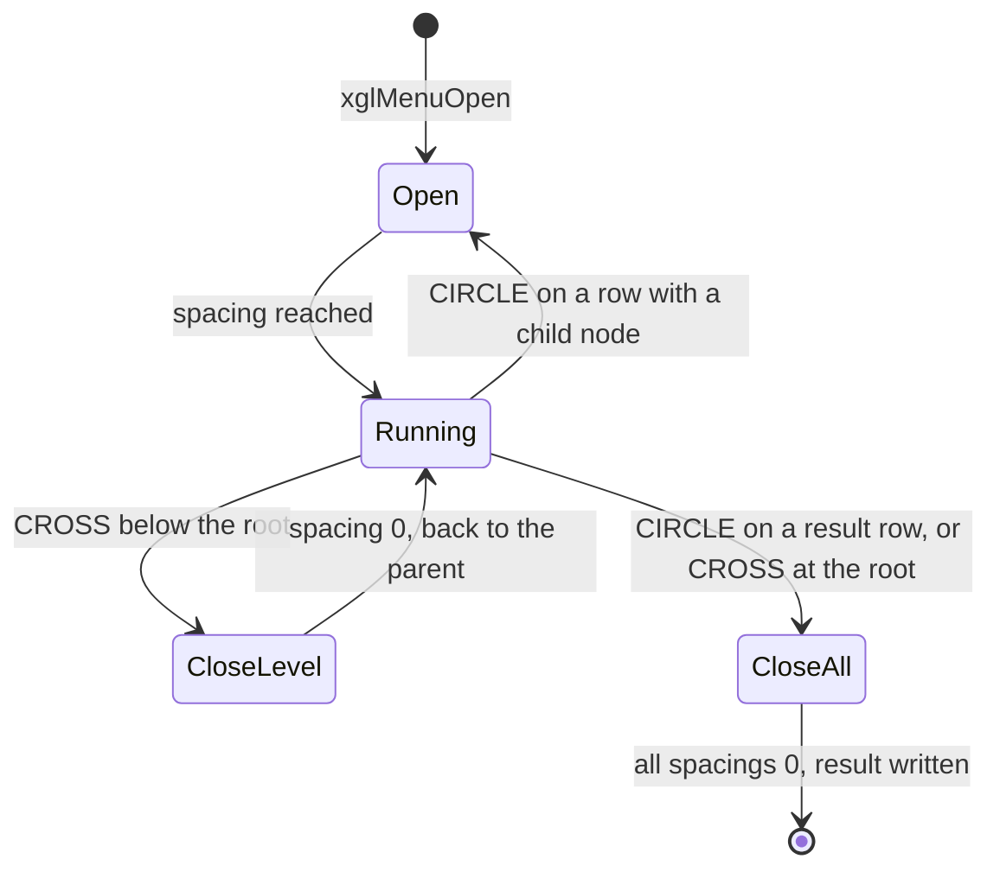

## Resets

The message system is reset at the borders between large parts of the game.

| Function | Does | Called from |
| --- | --- | --- |
| `msgResetAll()` | Clears the five option words, resets `msgWindow` with `msgWindowReset`, clears `msgChoice` and `msgPanel`, sets the reveal delay to 1, `msgSlotIndex = -1`, stops the notice timer, resets the talk result | the start of a play session and the return from a battle (`src/main/game_data.c`), loading a save (`src/main/save_party_init.c`), the cutscene player (`src/main/cfePlugIn.c`) |
| `msgStateReset()` | The same without clearing `msgPanel`, so a running countdown survives | a map change (`src/main/game_data.c`), the screen clear of `src/main/gifState.c` |
| `msgWindowReset(window)` | Clears the 0x308 bytes, sets `current_index` to -1, loads `talk01.xtx` and `botan.xtx`, empties the text output buffer and the button glyph table | the two functions above |
| `talkEnd()` | Releases `botan.xtx` and `talk01.xtx` | no caller in the recovered code |
| `choiceMenuResetAll()`, `textEntryPoolReset()`, `textWindowReset()` | Free both choice menus, all four text entries and the text window | the start of a battle scene (`src/ov01/scene.c`) |

`msgBalanceReset()` is separate from all of these. It is called once for a
new game and gives the debt its starting value.
