# xgl, the system library

`xgl` is the engine's own system library. It sits between the game and Sony's
SDK, and nearly everything that touches the hardware goes through it: the
frame, the GPU packets, file reads from the disc, controllers, memory cards,
the hard disk, interrupts and DMA. It also holds the studios, cameras and
lights that every 3D scene is drawn with, a text printer, a small debug menu,
a JPEG codec and an IPU movie decoder.

Most of its functions start with `xgl`. The code is in `src/main/xgl_*.c` and
each file's public declarations are in the header of the same name in
`include/main/`. Both overlays call into it freely, because the library is
part of the main executable `SLUS_208.92` and is always in memory.

The most important thing to know about `xgl` in Xenosaga Episode II is how
small its scheduling model is. The game runs on **one thread**. One call,
`xglSleep()`, ends a frame: it sends the picture, serves the disc and updates
the cameras, then returns to the caller. The section
[Threads and the frame](#threads-and-the-frame) describes this in detail.

[← Back to the overview](../README.md)

## Source files

All files are in `src/main/`. A file that is only summarised on this page has
its full description on the page named in the last column.

| File | Contents | Depth |
| --- | --- | --- |
| `control_entry.c` | `main()` and `InitializeSystem()`: IOP reboot, IOP modules, start of every subsystem, the title loop | [Start-up](#start-up) |
| `xgl_thread.c` | `xglSleep()`, the end of a frame | [Threads and the frame](#threads-and-the-frame) |
| `xgl_task.c` | Task schedulers: lists of per-frame callbacks | [Tasks](#tasks) |
| `xgl_dma_handler.c` | Registry of interrupt and DMA handlers, enable and disable calls | [Interrupts](#interrupts) |
| `xgl_intc.c` | The ten INTC handlers and the VIF1 interval timer | [Interrupts](#interrupts) |
| `xgl_dma.c` | Direct DMA transfers, DMA chain buffers, MFIFO, the pad records | [DMA](#dma) |
| `xgl_packet.c` | The double-buffered VIF1 packet, texture transfer, scan-line blend | [Packets](#packets) |
| `xgl_packet_scratch.c` | Batches of GS register writes built in the scratchpad, two integer helpers | [Packets](#packets) |
| `xgl_packet_unpack.c` | VIF UNPACK helpers and the water surface sender that uses them | [Packets](#packets) |
| `xgl_render.c` | Frame buffers, draw and display environments, the render step, frame pacing, clear, fade | [Rendering](#rendering) |
| `gs_make_frame.c` | GS `FRAME` and `ALPHA` register values for the frame pages | [GS register helpers](#gs-register-helpers) |
| `gs_make_tex0.c` | GS `TEX0` values for the frame pages, colour and angle helpers | [GS register helpers](#gs-register-helpers) |
| `xgl_studio.c` | Studios: four sets of eight cameras and one light block | [Studios](#studios) |
| `xgl_camera.c` | Camera data, the pad-driven travel modes, view and frustum building | [Cameras](#cameras) |
| `xgl_light.c` | Light sets, the default light set, light packs and their evaluation | [Lights](#lights) |
| `xgl_pad.c` | Controller setup and reading, key repeat, vibration | [Controllers](#controllers) |
| `xgl_cd.c` | File lookup and reads, archives, streams, overlays, IOP modules, clock, disc check | [Files and the disc](#files-and-the-disc), [files-and-resources.md](../architecture/files-and-resources.md) |
| `xgl_cd_arena.c` | Sector arena for loaded files, asynchronous read wrapper, tick, play time, draw callback queue | [Files and the disc](#files-and-the-disc), [files-and-resources.md](../architecture/files-and-resources.md) |
| `xgl_debug_file.c` | Disabled host file functions | [Debug file stubs](#debug-file-stubs) |
| `xgl_hdd.c` | Hard disk: activation, mount, install, saves on the HDD, the error screen | [Hard disk](#hard-disk), [save-data.md](../architecture/save-data.md) |
| `xgl_mc.c` | Memory card start-up, two blocking load and save helpers | [Memory card](#memory-card), [save-data.md](../architecture/save-data.md) |
| `xgl_mc_request.c` | The memory card request queue and its state machine `xglMcMain` | [Memory card](#memory-card), [save-data.md](../architecture/save-data.md) |
| `xgl_font.c` | The text print queue, control codes, glyph lookup, the flush into the packet | [Text](#text), [fonts-and-text.md](fonts-and-text.md) |
| `xgl_font_width.c` | Width sums for lists of numbers | [Text](#text), [fonts-and-text.md](fonts-and-text.md) |
| `xgl_menu.c` | The debug list menu | [The debug menu](#the-debug-menu) |
| `xgl_flags.c` | Bit fields in the script flag area of the save data | [Flags](#flags) |
| `xgl_1.c` | The IPU movie decoder (`xglMovie*`) | [IPU movies](#ipu-movies) |
| `xgl_jpeg.c` | JPEG encoder and decoder | [JPEG](#jpeg) |
| `xgl_timer0.c` | Hardware timer 0, the ARX decompressor, the language code | [Timer 0, ARX and the language code](#timer-0-arx-and-the-language-code) |
| `xgl_tick.c` | The 16-bit tick counter, a sine pulse, eased 2D tracks | [The tick counter](#the-tick-counter) |
| `xgl_2.c` | Random numbers, vectors, matrices, the matrix stack, quaternions, memory copies | [Math helpers](#math-helpers), [math.md](math.md) |
| `xgl_cur_matrix.c`, `xgl_cur_mul.c` | The current matrix held in VU0 registers | [Math helpers](#math-helpers), [math.md](math.md) |
| `xgl_vector_ops.c` | Local copies of vector helpers for the animation code | [Math helpers](#math-helpers), [math.md](math.md) |
| `xgl_matrix_axes.c` | Matrix from three axes, transpose, VU1 register read | [Math helpers](#math-helpers) |
| `xgl_vu1_regs.c` | `xglAtan2Angle`, VU1 register reads | [Math helpers](#math-helpers) |
| `oLib.c` | The object library heap, object actors, coordinate rounding, degree tables | [oLib](#olib) |

## How the parts fit together

Game code never talks to the GS, the disc drive or the controller ports
directly. It fills buffers and queues that belong to `xgl`: the current VIF1
packet, the text print queue, the file read queue, the memory card request
queue. Then it calls `xglSleep()`. That call empties what was queued, in a
fixed order, and comes back when the next frame may start.

The model library ([pxy.md](pxy.md)), the effect system ([sef.md](sef.md))
and the full-screen effects ([screen-effects.md](screen-effects.md)) are not
part of `xgl`, but the render step calls their per-frame flush functions.
They are the main producers of packet data. `xgl` owns the packet they write
into and the moment it is sent.

The diagram below shows the producers on the left, the `xgl` buffers in the
middle and the hardware on the right.

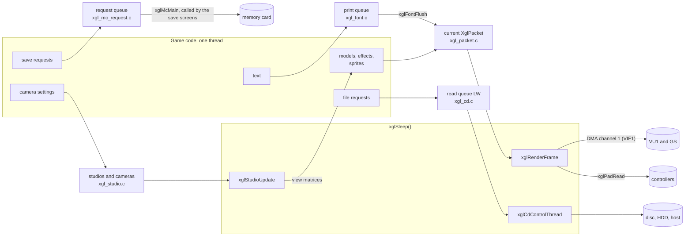

Because there is only one thread, none of these buffers needs a lock. A
producer and its consumer can never run at the same moment. The only code
that runs asynchronously is the set of interrupt handlers, and they touch
nothing but a few counters and flags.

## Start-up

File: `src/main/control_entry.c`

The program entry `main()` stores `argc` and `argv` in `mainParamArgc` and
`mainParamArgv`, shows the boot display of the title overlay code
(`BootDisplay`, see [title-and-boot.md](../game/title-and-boot.md)) and then
calls `InitializeSystem()`. This function brings up the IOP and every `xgl`
subsystem in a fixed order.

### The IOP

`InitializeSystem` first starts SIF RPC and the CD library, then replaces the
IOP kernel with the image on the disc. The path is in `iopRebootImagePath`:
`cdrom0:\IOP\IOPRP271.IMG;1`. `sceSifRebootIop` and `sceSifSyncIop` are
called in loops until they succeed. After the reboot the SIF services are
started again (`sceSifInitRpc`, `sceSifInitIopHeap`, `sceSifLoadFileReset`),
the CD library is initialised for DVD media (`sceCdMmode(SCECdDVD)`) and the
file system is reset with `sceFsReset`.

Eight IOP modules are then loaded with `xglCdSifLoadModule(name, args)`. This
function builds the path `cdrom0:\IOP\<NAME>.IRX;1` with the name in upper
case and hands it to `sceSifLoadModule`.

| Order | Module name | Arguments | Purpose |
| --- | --- | --- | --- |
| 1 | `sio2man` | none | Serial bus for controllers and memory cards |
| 2 | `mcman` | none | Memory card manager |
| 3 | `mcserv` | none | Memory card RPC server |
| 4 | `padman` | none | Controller manager |
| 5 | `cdvdstm` | none | Disc streaming |
| 6 | `libsd` | none | SPU2 sound device |
| 7 | `cri_adxi` | `spucore=1` | CRI ADX sound output on the IOP |
| 8 | `korgivag` | `vag=256`, `key=256`, `prg=64`, `sbf=128`, `seq=64`, `ply=16` | The KORG sound driver |

The modules are described on
[runtime-libraries.md](../architecture/runtime-libraries.md) and the sound
side on [audio.md](../architecture/audio.md).

### The subsystems

After the modules, `InitializeSystem` sets the work heap pointer `WorkEnd` to
`0xB00000` (`WORK_HEAP_START`) and starts the subsystems. `WorkEnd` is a bump
pointer: the code that runs next carves permanent blocks from it. The archive
directory tables read by `xglCdInitial` are the first of them. The memory
layout as a whole is on [memory.md](../architecture/memory.md).

| Step | Call | What it starts |
| --- | --- | --- |
| 1 | `xglCdInitial()` | CD drive, disc streaming, dual-layer check, HDD activation and mount, archive tables |
| 2 | `soundDriverInit()` | The sound driver client ([audio.md](../architecture/audio.md)) |
| 3 | `xglPadInitial()` | Both controller ports |
| 4 | `xglMcInitial()` | Memory card library, request queue, clears `SaveData` |
| 5 | `xglTaskInitial(0, 0, 0)` | Nothing: with a capacity of 0 the function returns at once |
| 6 | `xglDmaInitial()` | Nothing: the function is empty |
| 7 | `xglIntrInit()` | Interrupt and DMA handlers |
| 8 | `xglGeometryInit()` | Random seeds and a first DMA chain to VIF0 |
| 9 | `xglPacketInit(0xC00000, 0x400000, 50.0f)` | The two packet buffers |
| 10 | `xglRenderInit()` | GS reset, VSync callback, resolution, studios, model library |
| 11 | `xglFontInitial()` | Font texture and print queue |
| 12 | `xglMovieInit()` | The IPU (`sceIpuInit`) |
| 13 | `xglMenuInitial()` | The debug menu table |

### From `main` to the title screen

Back in `main`, a few more calls finish the start. `xglCdOpenDevice()` opens
the ADX file system handle used for disc reads. `xglRenderAndMovieInit()`
runs `xglRenderInit()` a second time and starts the CRI movie player library
(`moviePlayerLibraryInit`, see [cutscenes.md](../scripting/cutscenes.md)).
Then `main` calls `xglRenderFrame()`, `xglCdControlThread()`,
`xglStudioSetup()` and `xglStudioUpdate()` once each. These are the three
parts of `xglSleep()`, called by hand for the very first frame. The display
is switched on with `xglRenderDispOn()` and the system sound effect bank
`SYS_SE` is loaded into slot 1 with `seBankLoad`.

The rest of `main` is the top-level loop of the whole game. It loads the
title overlay (`OVERLAY_TITLE`, overlay 2) and shows the logos with
`LogoFirst()`. Then it runs `Title()` again and again. `Title` returns a
packed word: the low 24 bits are the entry address of the screen the player
chose and the top byte is the number of the overlay that contains it. `main`
loads that overlay with `xglCdLoadOverlay` and calls the entry. When the
entry returns, the loop reloads overlay 2 and shows the title again. A
result of 0, or the address of `Title` itself, restarts the title at once.
The title screen and its choices are described on
[title-and-boot.md](../game/title-and-boot.md).

The diagram below shows the whole start sequence.

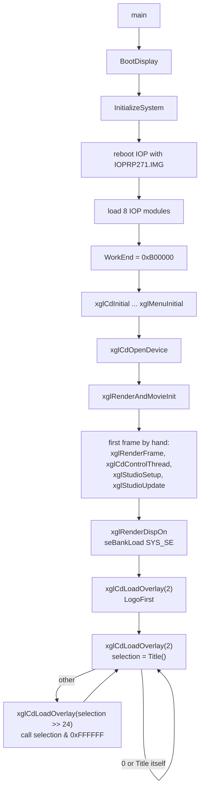

## Threads and the frame

Files: `src/main/xgl_thread.c`, `src/main/xgl_render.c`,
`src/main/xgl_cd.c`, `src/main/xgl_studio.c`

### One thread

The game does not create any system threads. `InitializeSystem` and `main`
contain no call to `CreateThread`, and the whole program contains no call to
`RotateThreadReadyQueue`, `SleepThread`, `WakeupThread` or any semaphore
function. Everything from `main` down to the deepest battle function runs on
the thread the EE kernel started the program with.

The three jobs that a system library has to do once per frame are plain
functions, and `xglSleep()` calls them one after the other:

```c
void xglSleep(void) {
    xglRenderFrame();        /* send the frame, wait for VSync, read the pads */
    xglCdControlThread();    /* one step of the file read and stream service */
    xglStudioUpdate();       /* move the cameras of all studios */
}
```

`xglCdControlThread` keeps the word "thread" in its name, but it is an
ordinary function that returns after one step of work. The same is true for
`xglRenderFrame` and `xglStudioUpdate`. Nothing runs in parallel with the
game code.

The sequence diagram below shows one frame from the point of view of a game
loop.

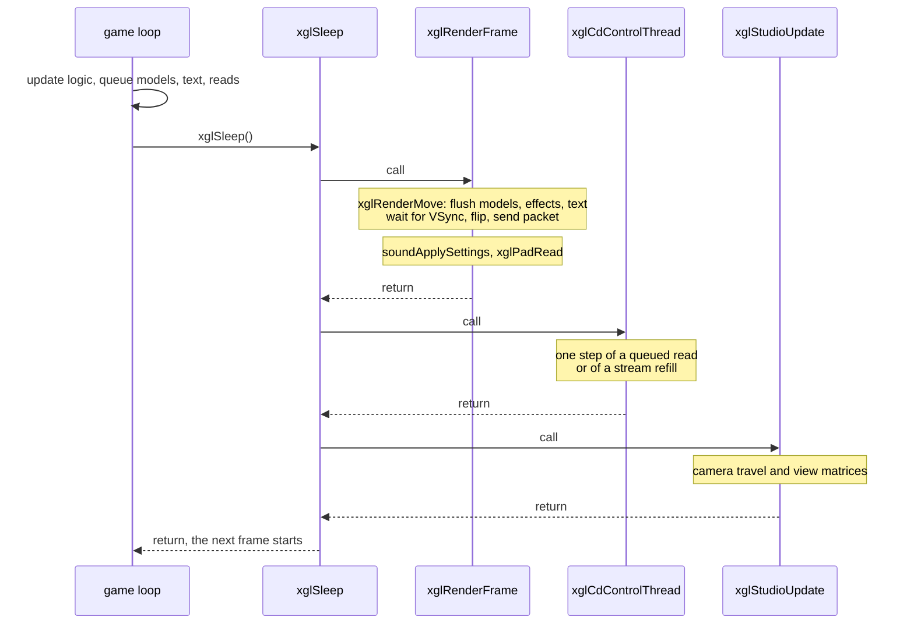

### What this means for game code

`xglSleep()` is the frame boundary. A piece of code that wants to wait for
something calls it in a loop, and each call is one displayed frame. The
function is called from 122 places in 26 source files: the title, the logos,
the save screen, the menu scenes, movie playback, the disc change screen and
many others. A typical waiting loop looks like this:

```c
while (!xglCdSyncDone()) {   /* a file is still being read */
    xglSleep();              /* draw a frame, advance the read */
}
```

Three consequences shape the rest of the engine.

- A loop that never calls `xglSleep()` freezes the picture, the file reads
  and the controller state. Long loaders therefore call it between steps, or
  they use the synchronous read mode of `xglCdReadFile`, which blocks on
  purpose.
- An asynchronous file read only advances inside `xglCdControlThread`. A
  queued read is finished some frames later, never before the next
  `xglSleep()`.
- Controller state changes only inside `xglPadRead`, at the end of
  `xglRenderFrame`. The values in `PadData` are stable for the whole of the
  following frame.

Some screens do not call `xglSleep()` but the three functions, or a subset,
by themselves. `main` does this for the first frame. Movie playback sets
`StudioEntrySkip` so that `xglStudioUpdate` does nothing while a movie runs
(`src/main/game_movie.c`).

### What runs outside the thread

Two kinds of code run asynchronously, both started by hardware interrupts.

The first is the VSync callback `xglRenderVSyncCallback`, installed with
`sceGsSyncVCallback` in `xglRenderSyncInit`. It runs at the start of every
vertical blank. It counts fields in `VSyncCount` and `xglRenderVSyncTickCount`,
records whether the GIF or VIF1 path is still busy when a frame is due, and
calls `ADXM_ExecVint(0)`, the per-field service of the CRI ADX library. This
call is what keeps streamed sound running while the game thread is busy.
[Frame pacing](#frame-pacing) explains the counters.

The second is the set of interrupt and DMA handlers of `xgl_intc.c` and
`xgl_dma_handler.c`. Each of them only increments a counter. They are listed
under [Interrupts](#interrupts).

### The load threads of the battle overlay

There is one exception to the single-thread rule, and it is outside `xgl`.
The battle overlay creates a short-lived kernel thread when it loads battle
data (`src/ov01/scene_load.c`). `ov01LoadBlockStart` and `ov01LoadRequest`
fill a `ThreadParam` on the stack and call `StartThread(CreateThread(&param), 0)`.

| Property | Value |
| --- | --- |
| Entry | `ov01LoadComplete` or `ov01LoadCompleteForOwner` |
| Stack | `loadThreadStack`, `0x1000` bytes |
| Priority | 8 |
| Global pointer | `mainGpBase` |
| End | The entry sets `ov01LoadDone = 1` and calls `ExitDeleteThread()` |

The entry runs one blocking job (`dataBattleSeUpload()` or
`dataSlotVoiceUpload(ov01LoadOwner)`), sets the done flag and deletes itself. The
battle step machine polls the flag with `ov01LoadIsDone()` from the main
thread. The thread never touches the render or file state of `xgl`, and at
most one exists at a time because both starters share one stack. The battle
side is described on [battle-engine.md](../game/battle-engine.md).

Sony's and CRI's libraries may create threads of their own inside their
library code. That code is described on
[runtime-libraries.md](../architecture/runtime-libraries.md).

### The tick counter

File: `src/main/xgl_tick.c`

`xglTickCounter` is a 16-bit frame counter for menu animation. It is not
advanced by `xglSleep()`. The screens that use it call `xglTickAdvance()`
(`src/main/xgl_cd_arena.c`) once per frame of their own loop. That function
adds one, wraps at `0xFFFF` and then calls `VibrationEngine()`, the
controller rumble sequencer. `xglTickIncrement()` only adds one,
`xglTickReset()` clears the counter and `xglTickGet()` reads it.

`xglTickWave(divisor, amplitude)` returns
`sin(tick * pi / divisor) * amplitude` as an integer. The menu uses it for
pulsing colours: `src/main/menu_draw.c` calls it with 32.0 and 24.0 and adds
the result to a colour byte.

The same file holds `fontTrackEase` and `fontTrackSetTarget`, which move a
2D point (`struct FontTrack`) toward a target with a speed that grows by 24
per tick up to 64. They belong to the font objects described on
[fonts-and-text.md](fonts-and-text.md). `swapWords` exchanges two integers.

## Tasks

File: `src/main/xgl_task.c`

A **task** is a callback that a **scheduler** calls once each time the
scheduler is executed. A scheduler is one caller-supplied block of memory: a
small header followed by a pool of fixed-size task slots. There is no memory
allocation after the scheduler is created.

In this game the task system is almost unused. `InitializeSystem` calls
`xglTaskInitial(0, 0, 0)`, which does nothing because the capacity is 0, and
no code in the main executable creates a scheduler or executes one. The type
survives in the battle overlay, where `struct ObjectTask`
(`src/ov01/unit_cmd.c`) starts with an `XglTaskPrefix`. The mechanism is
described here because the functions are present and complete.

### Data structures

The scheduler header is `XglTaskScheduler` (16 bytes):

| Offset | Type | Field | Meaning |
| --- | --- | --- | --- |
| `+0x00` | `XglTaskPrefix *` | `free_tasks` | Singly linked list of unused slots |
| `+0x04` | `XglTaskPrefix *` | `active_head` | First task of the active list |
| `+0x08` | `XglTaskPrefix *` | `active_tail` | Last task of the active list |
| `+0x0C` | `XglTaskPrefix *` | `next_to_visit` | The cursor of a running `xglTaskExecute` |

Each slot is `XGL_TASK_SLOT_SIZE` (`0x80`) bytes and starts with the common
header `XglTaskPrefix`. The remaining 112 bytes belong to the task.

```
slot (128 bytes)
+0x00  scheduler   XglTaskScheduler *
+0x04  next        XglTaskPrefix *
+0x08  previous    XglTaskPrefix *
+0x0C  callback    int (*)(XglTaskPrefix *)
+0x10  task data   112 bytes, defined by the task's own struct
```

`XglTaskManager` is the header followed by the pool, which is how
`xglTaskInitial` sees the caller's block.

### Functions

`xglTaskInitial(manager, capacity, reset_gs)` links all `capacity` slots into
the free list, clears the active list and returns the address just after the
pool. It returns 0 when `capacity` is 0. When `reset_gs` is not zero it also
calls `sceGsResetGraph(1, 0, 0, 0)` before it builds the list.

`xglTaskEntryNext(scheduler, callback, entry)` and
`xglTaskEntryPrev(scheduler, callback, entry)` take a slot from the free
list, store the callback and insert the task after or before `entry`. With
`entry` equal to 0 the new task becomes the only member of the list. Both
return the new task, or 0 when the pool is empty or the scheduler is null.
The list order is the execution order.

`xglTaskExecute(scheduler)` walks the active list from the head. Before it
calls a callback it stores the following task in `next_to_visit`. A callback
may therefore remove itself or insert new tasks during the walk.

`xglTaskRemove(task)` unlinks a task at once and pushes its slot on the free
list. If the task is the one stored in `next_to_visit`, the cursor is first
moved to the task after it. `xglTaskWaitRemove(task)` only replaces the
callback with `xglTaskRemove`. The task then removes itself the next time
the scheduler visits it.

The diagram below shows a scheduler block with three active tasks and two
free slots.

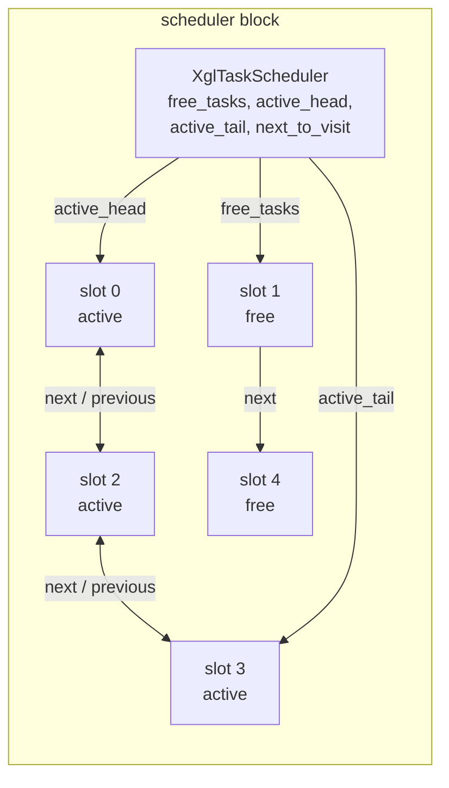

## Interrupts

Files: `src/main/xgl_dma_handler.c`, `src/main/xgl_intc.c`

`xglIntrInit()` registers a handler for ten interrupt causes and seven DMA
channels. The handlers do no real work. Each one increments a counter in its
record and returns. The counters let other code ask "how many times has this
event happened" without installing a handler of its own.

### The registry

Both tables use the record `XglIntrRecord`:

| Field | Meaning |
| --- | --- |
| `handle` | The id returned by `AddIntcHandler` or `AddDmacHandler`, `-1` before registration |
| `count` | Number of events so far |
| `id` | The INTC cause or the DMAC channel. A negative id ends the table |
| `handler` | The handler function |

`xglIntrInit` walks `xglIntcRecords` and `xglDmaRecords`. For each record it
stores the record's index in a slot map (`xglIntcSlotMap[cause]` or
`xglDmaSlotMap[channel]`) and registers the handler. The slot maps start
filled with `-1`, so a cause without a handler is recognisable. At the end
it clears the VIF1 interval timer.

| INTC cause | Source | Handler |
| --- | --- | --- |
| 0 | GS | `xglIntcHandlerGs` |
| 2 | VBlank start | `xglIntcHandlerVblankStart` |
| 3 | VBlank end | `xglIntcHandlerVblankEnd` |
| 4 | VIF0 | `xglIntcHandlerVif0` |
| 5 | VIF1 | `xglIntcHandlerVif1` |
| 6 | VU0 | `xglIntcHandlerVu0` |
| 7 | VU1 | `xglIntcHandlerVu1` |
| 8 | IPU | `xglIntcHandlerIpu` |
| 9 | Timer 0 | `xglIntcHandlerTimer0` |
| 10 | Timer 1 | `xglIntcHandlerTimer1` |

The table lists the GS cause a second time before its end marker, so the GS
handler is registered twice.

| DMAC channel | Device | Handler |
| --- | --- | --- |
| 0 | VIF0 | `xglDmaHandlerVif0` |
| 1 | VIF1 | `xglDmaHandlerVif1` |
| 2 | GIF | `xglDmaHandlerGif` |
| 3 | from IPU | `xglDmaHandlerFromIpu` |
| 4 | to IPU | `xglDmaHandlerToIpu` |
| 8 | from scratchpad | `xglDmaHandlerFromSpr` |
| 9 | to scratchpad | `xglDmaHandlerToSpr` |

Registering a handler does not enable the interrupt. `xglIntcEnable(cause)`
and `xglIntcDisable(cause)` call the kernel's `EnableIntc` and `DisableIntc`
when the cause has a handler, and return 1 when they did. `xglDmaEnable` and
`xglDmaDisable` do the same for DMA channels. `xglIntcGetEventCount(cause)`
and `xglDmaGetEventCount(channel)` return the counter, or `-1` when nothing
is registered. The only enable call in the game is `xglIntcEnable(5)` in
`xglRenderInit`, which enables the VIF1 interrupt.

### The VIF1 interval timer

`xglIntcHandlerVif1` does one thing more than the others. A VIF1 interrupt
is raised by a VIF code with the interrupt bit set, which the model library
places at the start and at the end of the frame's model data
(`xglRenderFrameBeginFlushEIrq` and `xglRenderFrameEndFlushEIrq`, both of
which call `nmlPacketAddWaitMicrocodeIrq`). The handler uses these two
interrupts as a stopwatch:

1. On the first interrupt it stores the count of hardware timer 1
   (`0x10000800`) in `intrTimerStart` and sets `intrTimerActive`.
2. On the next one it adds the elapsed count to `intrTimerAccum` and clears
   `intrTimerActive`.
3. In both cases it writes the `STC` bit to `VIF1_FBRST` (`0x10003C10`),
   which lets the stalled VIF1 continue.

`intrTimerReset()` clears the three variables and `intrTimerGetAccum()`
returns the total. The result is the time VIF1 and VU1 needed for the frame,
in timer 1 ticks. It is a profiling value.

### Timer 0

File: `src/main/xgl_timer0.c`

`xglTimer0Reset(mode)` clears the counter of hardware timer 0
(`0x10000000`) and writes `mode + 0x80` to its mode register
(`0x10000010`). Bit 7 is the count enable bit, so the timer starts with the
clock selection the caller passed. `xglTimer0Get()` returns the low 16 bits
of the counter. No game code outside the library calls these two functions.

## DMA

File: `src/main/xgl_dma.c`

The DMA module is a thin layer over the EE's DMA controller. It knows the
register blocks of the ten channels through the table `tbl[12]` (the last
two entries are 0) and drives the first three of them: VIF0 (0), VIF1 (1)
and GIF (2). Calls with a higher channel number return without effect.

### Direct transfers

`xglDmaDirectNormal(channel, address, count)` sends `count` quadwords from
`address` in normal mode. `xglDmaDirectSrcChain(channel, address)` starts a
source-chain transfer whose first DMA tag is at `address`. Both wait in a
loop until the channel's previous transfer has ended (the `STR` bit of
`CHCR`), write the registers, clear the channel's bit in `DMAC_STAT` and
start the channel. An address in the scratchpad (`0x7000xxxx`) is converted
to the form the DMA controller expects: the low 14 bits plus the flag
`0x80000000`.

The render module uses `xglDmaDirectNormal(2, ...)` for small GIF packets
built in the scratchpad (frame copies, the clear packet) and
`xglDmaDirectSrcChain(1, ...)` for the frame's main packet.

### Chain buffers

`XglDmaBuffer` (`start`, `current`) is a small builder for DMA chains
outside the main packet.

| Function | DMA tag written | Effect |
| --- | --- | --- |
| `xglDmaBufferReset(buffer, address)` | none | Points the buffer at `address` |
| `xglDmaBufferCnt(buffer, source, count)` | `cnt` | Copies `count` quadwords from `source` behind the tag |
| `xglDmaBufferRef(buffer, address, count)` | `ref` | References `count` quadwords at `address` |
| `xglDmaBufferCall(buffer, address)` | `call` | Calls a sub-chain |
| `xglDmaBufferRequest(buffer, channel)` | `end` | Closes the chain, flushes the cache, starts it and resets the buffer |

### MFIFO

Three functions support the memory FIFO mode, where data written through the
"from scratchpad" channel (8) passes through a ring buffer in main memory
and drains into another channel. `xglDmaMFIFOSetup(address, size, channel)`
sets the ring base and size registers (`RBOR`, `RBSR`), selects GIF drain
mode in `DMAC_CTRL` and starts the drain channel in chain mode.
`xglDmaMFIFOKick(spr_address, count)` waits until the ring has room for
`count` quadwords and starts channel 8. `xglDmaMFIFOLeave()` waits for the
GS path and both channels and switches the drain mode off. No code in the
game calls these functions.

### Other contents

`xglDmaInitial()` is empty. The file also defines `PadData[2]`, the two
controller records that `xgl_pad.c` fills (see [Controllers](#controllers)).

## Packets

Files: `src/main/xgl_packet.c`, `src/main/xgl_packet_scratch.c`,
`src/main/xgl_packet_unpack.c`

Everything the GS draws in a frame reaches it as one long DMA chain for the
VIF1 channel. The chain is called the **packet**. It is built with the
`sceVif1Pk*` functions of Sony's packet library, and `xgl` owns the object
those functions work on, `XglPacket`. The whole path from the packet to the
screen is described on [rendering.md](../architecture/rendering.md). This
section covers the buffers and the helper functions.

### Two buffers

`xglPacketInit(buffer, size, rate)` splits a memory block into two halves
and creates one `XglPacket` for each (`packetSourceFirst` and
`packetSourceSecond`). `InitializeSystem` passes the block at `0xC00000`
with a size of `0x400000`, so each half is 2 MiB.

The `rate` argument (clamped to 1..99) is a percentage. It reserves that
part of each half, rounded up to 16 bytes, at the top of the half. With the
value 50 that the game passes, the reserve is 1 MiB. The packet's `limit`
field is the address where the reserve starts and `cursor` is set to the
same address. The DMA chain grows upward from the start of the half. The
area from `limit` to the end of the half is a second store that the model
library allocates from through `cursor`, for data that the chain only
references. `xglPacketQueuedPercent()` and `xglPacketBufferUsedPercent()`
(`src/main/pxy_packet_state.c`) report how full each of the two areas is.

```
0x00C00000  +---------------------------+  packetSourceFirst.buffer
            | DMA chain, grows upward   |
0x00D00000  +---------------------------+  packetSourceFirst.limit (cursor starts here)
            | referenced data           |
0x00E00000  +---------------------------+  packetSourceSecond.buffer
            | DMA chain, grows upward   |
0x00F00000  +---------------------------+  packetSourceSecond.limit
            | referenced data           |
0x01000000  +---------------------------+
```

The fields of `XglPacket` that `xgl` itself uses are listed below. The
packet library keeps more state in the unnamed bytes.

| Offset | Field | Meaning |
| --- | --- | --- |
| `+0x00` | `write_cursor` | Where the next word of the chain is written |
| `+0x04` | `start` | First DMA tag of the chain, the address `xglPacketSend` starts the DMA at |
| `+0x08`, `+0x0C` | `directCode`, `directState` | Set while a direct (GIF) block is open |
| `+0x20` | `limit` | Start of the referenced-data area |
| `+0x24` | `cursor` | Allocation cursor of the referenced-data area |
| `+0x28` | `buffer` | Start of this packet's half |
| `+0x2C` | `bufferSize` | Size of the half |

### Current and send

Two pointers select the roles. `pCurrentPacket` is the packet the game is
writing into. Every producer gets it from `xglPacketGetCurrent()`.
`pSendPacket` is the packet that is on its way to the GS.

`xglPacketMove()` ends the frame's packet. It appends the end tag
(`sceVif1PkEnd`, `sceVif1PkTerminate`), flushes the data cache, resets the
`cursor` to `limit`, makes the finished packet the send packet and switches
`pCurrentPacket` to the other half, which it resets with `sceVif1PkReset`.
`xglPacketSend()` starts the DMA: `xglDmaDirectSrcChain(1, pSendPacket->start)`.

Because the two halves alternate, the game can already fill the next frame's
packet while VIF1, VU1 and the GS are still working through the previous
one. The render step makes sure the previous packet has finished before it
sends the next (see [Frame pacing](#frame-pacing)).

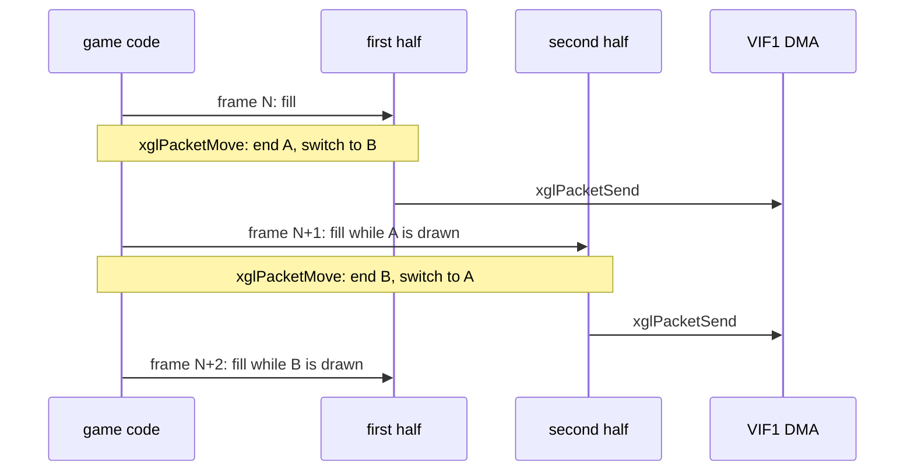

### Texture transfer

`xglPacketTextureTrans(set)` uploads a set of images to GS memory through
the current packet. A set (`XglTextureTransSet`) holds a count at `+0x08`
and the offset of an entry table at `+0x0C`. Each entry
(`XglTextureTransEntry`) gives the width, the height, an offset in video
memory, the size of the pixel data in quadwords and its offset from the set
base.

For each entry the function writes the `BITBLTBUF` and `TRXREG` values into
a fixed GIF template (`textureTransGifSetupTable` with
`textureTransBitbltAd` and `textureTransRegionAd`), adds the template to
the packet and then adds a DMA reference to the pixel data, so the pixels
are not copied. The destination block address is
`((sRenderTextureBase << 11) + vramOffset) >> 6`: offsets are relative to
the texture area that starts behind the frame buffers. The 2D screens use
this function for their image sets: the title, the talk windows
(`talk_script.c`), the G.S. Campaign screens (`yg2path.c`) and others.

### Scan-line blend packet

`xglPacketInterpolate()` adds a full-screen textured sprite that uses the
displayed frame buffer as its texture (`interpolateGifTable`,
`interpolatePrimTable`). The render step calls it only when
`ScanLineInterpolate` is 2. See [Scan-line modes](#scan-line-modes).

### Scratchpad batches

`xgl_packet_scratch.c` offers a four-call pattern for short lists of GS
register writes. The list is built in the EE scratchpad (`0x70000000`) as
`GsAdPair` records (64-bit data, 64-bit register address) and then appended
to the packet as one direct block.

| Function | Effect |
| --- | --- |
| `xglPacketScratchBegin()` | Remembers the current packet, resets the count |
| `xglPacketScratchAddQuad(high, low)` | Appends one pair. The first pair is the GIF tag |
| `xglPacketScratchPatchTag()` | Adds `count - 1` to the tag, which sets its loop count |
| `xglPacketScratchAddDirect()` | Appends the batch to the packet as a VIF1 direct block |

The render module builds the same kind of batch by hand in several
functions. The pattern is always: tag `0x1000000000008000` with register
list `0xE` (A+D), then the register writes, then the loop count patch.

The file also contains `xglClampInt(value, lower, upper)` and
`xglWrapIntRange(value, lower, upper)`, which wraps a value once into a range.

### UNPACK helpers and the water sender

`xgl_packet_unpack.c` wraps the VIF `UNPACK` command, which copies data into
VU1 memory. `xglPacketCaptureCurrent()` caches the current packet in
`xglCurrentPacket`. `xglPacketBeginUnpack(vuAddress)` opens an unpack of
32-bit four-component vectors to a VU1 address and `xglPacketEndUnpack()`
closes it. `xglPacketFlush()` adds a VIF `FLUSH` code and
`xglWaterMicrocodeLoad()` adds a reference to `xglWaterPacketEntries`.

The rest of the file is the packet side of the water surface of the `Ti`
library: `tiWaterSendFrame` sends the matrices and constants of a water
plane to VU1 addresses `0x3C0` to `0x3DE`, and `tiWaterSendGrid` sends the
height grid as strips of 29 columns (`tiWaterStripColumns`), each followed
by an `MSCNT` code that runs the microprogram. Water is described on
[animation.md](animation.md).

## Rendering

File: `src/main/xgl_render.c`

The render module owns the frame buffers and the moment of the flip. Once
per frame `xglRenderMove()` collects the output of all drawing systems into
the packet, waits for the vertical blank, swaps the buffers and starts the
transfer. The module also provides the screen clear, the global fade, frame
buffer copies and a list of callbacks that other systems hook into.

### The render state

The module's state is the global `sRender` (`XglRenderState`,
`include/main/gr_screen.h`). It starts with a copy of one row of each of two
tables, `asDispReso` and `asVramBase`, selected by
`xglRenderSetReso(index)`.

| Offset | Symbol or field | Meaning |
| --- | --- | --- |
| `+0x00` | `reso.depth_psm` | Pixel format of the depth buffer (`0x31`) |
| `+0x02` | `reso.frame_psm`, `sRenderPsm` | Pixel format of the frame buffers (0, 32-bit colour) |
| `+0x04` | `reso.frame_width`, `cameraScreenWidth` | Frame width in pixels |
| `+0x06` | `reso.frame_height`, `cameraScreenHeight` | Frame height in pixels |
| `+0x08` | `vram.depth_base` | Page of the depth buffer |
| `+0x10` | `sRenderDispfbBase` | Page that is shown on screen |
| `+0x12` | `sRenderPrevDispfbBase` | Page that was shown before, and that is drawn into now |
| `+0x14` | `vram.work_buffer_base`, `sRenderFrameBase` | A third frame-sized work page |
| `+0x1A` | `vram.texture_base`, `sRenderTextureBase` | First page behind the frame pages, the base of the texture area |
| `+0x20` | `display_buffer_base`, `sRenderDisplayBase` | Copy of the shown page for the drawing systems |
| `+0x22` | `draw_buffer_base`, `sRenderFlipBase` | Copy of the draw page for the drawing systems |
| `+0x24` | `final_packet_callback[]` | Per-frame callbacks, see [Final packet callbacks](#final-packet-callbacks) |

Six resolutions are defined. All are 448 lines high with 32-bit colour.

| Index | Width | Depth page | First frame page | Second frame page | Work page | Texture base |
| --- | --- | --- | --- | --- | --- | --- |
| 0 | 640 | `0x000` | `0x08C` | `0x118` | `0x1A4` | `0x230` |
| 1 | 512 | `0x000` | `0x070` | `0x0E0` | `0x150` | `0x1C0` |
| 2 | 448 | `0x000` | `0x062` | `0x0C4` | `0x126` | `0x188` |
| 3 | 384 | `0x000` | `0x054` | `0x0A8` | `0x0FC` | `0x150` |
| 4 | 320 | `0x000` | `0x046` | `0x08C` | `0x0D2` | `0x118` |
| 5 | 256 | `0x000` | `0x038` | `0x070` | `0x0A8` | `0x0E0` |

`xglRenderInit` selects index 1, and no other code calls `xglRenderSetReso`,
so the game always runs at 512 x 448. The page numbers are in units of 8192
bytes (the GS frame buffer pointer unit). One 512 x 448 buffer of 32-bit
pixels is `0x70` pages, so the depth buffer and the three frame pages lie
back to back and the texture area starts at page `0x1C0`.

```
GS memory at 512 x 448 (pages of 8192 bytes)
0x000  depth buffer                 (ZBUF, format 0x31)
0x070  frame page A                 shown or drawn, alternating
0x0E0  frame page B                 drawn or shown, alternating
0x150  work page                    sRenderFrameBase: copies, effects, movies
0x1C0  texture area                 sRenderTextureBase
```

`xglRenderSetReso` also rebuilds the three environment blocks described
below and calls `xglStudioInit()` and `xglStudioMainCameraInit()`, because
the cameras keep the screen size.

### Environment blocks

Three prepared GS packets hold the per-frame register state.

`DrawEnv` (`GsDrawEnv`) is a GIF packet of fifteen register writes that
`sceGsPutDrawEnv` sends. `xglRenderDrawEnvInit` fills it once:

| Register | Value |
| --- | --- |
| `FRAME_1`, `FRAME_2` | Draw page, width / 64, frame format, no mask |
| `ZBUF_1`, `ZBUF_2` | Depth page, depth format, depth writes on |
| `XYOFFSET_1`, `XYOFFSET_2` | `(2048 - width / 2) << 4`, `(2048 - height / 2) << 4`: the screen is centred in the GS coordinate space |
| `SCISSOR_1`, `SCISSOR_2` | The whole frame |
| `TEST_1`, `TEST_2` | Depth test on, pass when greater or equal. No alpha test |
| `PRMODECONT` | Primitive attributes come from `PRIM` |
| `TEXA` | `TA0` and `TA1` are `0x80`, no alpha expansion method |
| `COLCLAMP` | Clamp |
| `DTHE`, `DIMX` | Dithering off, with a 4 x 4 dither matrix loaded |

`xglRenderDrawEnvMove` writes the current draw page and depth page into the
block each frame and sends it.

`DispEnv` (`GsDispEnv`) holds the display registers. `xglRenderDispEnvInit`
fills it with `sceGsSetDefDispEnv` for the frame size and copies read
circuit 1 to read circuit 2. `xglRenderDispEnvMove` writes the shown page
into both `DISPFB` values each frame, applies the scan-line mode, sends the
block with `sceGsPutDispEnv` and then writes the second circuit's registers
directly. `xglRenderDispOn()` and `xglRenderDispOff()` set and clear bit 1
of the `PMODE` value (`EN2`), which switches the picture on and off.

`ClearEnv` (`GsClearEnv`) is a six-quadword GIF packet that draws one
full-screen sprite. See [Clearing the screen](#clearing-the-screen).

### The render step

`xglRenderFrame()` is the first third of `xglSleep()`. It calls
`xglRenderMove()`, then `soundApplySettings()` (the sound driver applies the
volume and output settings, see [audio.md](../architecture/audio.md)), then
`xglPadRead()`.

`xglRenderMove()` does the following, in this order.

1. `xglRenderFrameBeginFlushEIrq()` adds a VIF code that raises the first
   VIF1 interrupt of the frame.
2. `sefDrawEffect()` lets the effect system queue its draw data
   ([sef.md](sef.md)).
3. `pxyFlush()` turns every model queued during the frame into packet data,
   for each of four camera slots ([pxy.md](pxy.md)).
4. `gifStateUpdateDrawHook()` runs the full-screen effect state
   ([screen-effects.md](screen-effects.md)).
5. `xglRenderFinalPacket()` calls the registered final packet callbacks.
6. `xglFontFlush()` turns the print queue into sprites, so text lies over
   the 3D picture.
7. `xglRenderGlobalFade()` adds the global fade sprite.
8. `xglPacketInterpolate()` is added when `ScanLineInterpolate` is 2.
9. `xglRenderFrameEndFlushEIrq()` adds the second VIF1 interrupt code.
10. `xglPacketMove()` ends the packet and switches to the other half.
11. `xglRenderSyncMove()` waits until the previous frame has been drawn and
    the frame time has passed.
12. `xglRenderMoveCount` and `LoopCount` are incremented and
    `sceGsResetGraph(1, 0, 0, 0)` is called.
13. `xglRenderSwapBase()` exchanges the shown page and the draw page.
14. `xglRenderDrawEnvMove()` and `xglRenderDispEnvMove()` send the
    environments for the new pages.
15. `xglRenderClearEnvMove()` clears the new draw page, unless
    `xglRenderClearSkip` is set.
16. `xglPacketSend()` starts the DMA of the packet that was just finished.
17. `xglRenderSkippedFrameCount` is set to
    `xglRenderVSyncTickCount / 2 - 1` (not below 0) and the tick count is
    cleared.
18. `pxyBeginFrame()` prepares the model library for the next frame.

Steps 2, 3, 5 and 7 and the scan-line packet are skipped while the byte at
`sRender + 0x84` is not zero. `xgl_render.c` reaches this byte as
`pxyDigitStrokeTable[0]` and `xgl_hdd.c` as `errorScreenActive`. The HDD
error screen sets it so that only text is drawn. In that case
`nmlModelFlushClear()` empties the model queues instead of drawing them.

The flowchart below shows the same sequence in three phases.

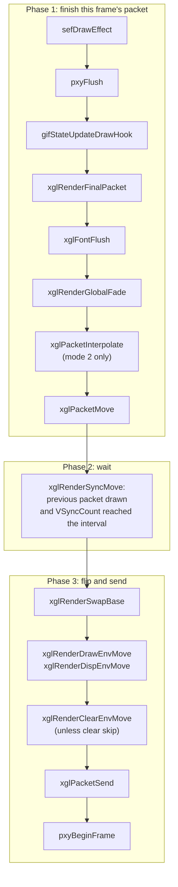

A frame that the game builds during frame N is therefore drawn by the GS
during frame N+1 and visible during frame N+2. The picture on screen is
always complete, because the shown page is never the one being drawn.

### Buffer swap

`xglRenderSwapBase()` moves four values:

```c
previous = sRenderDisplayBase;
sRenderPrevDispfbBase = sRenderDispfbBase;   /* was shown: draw into it now */
sRenderDispfbBase     = sRenderFlipBase;     /* was drawn: show it now */
sRenderDisplayBase    = sRenderFlipBase;
sRenderFlipBase       = previous;
```

With the start values of resolution 1 the shown page alternates between
`0x70` and `0xE0` and the draw page is always the other one. The function
also clears `xglRenderStatus` and adds `xglRenderFrameDelta` to
`xglRenderFrameCount`. `xglRenderFrameDelta` is 1 when the frame took longer
than its interval, so `xglRenderFrameCount` counts late frames.

### Frame pacing

The game is paced by the vertical blank. The television draws one field per
VSync, and `xglRenderVSyncInterval` says how many fields one game frame
lasts. `xglRenderInit` sets it to 2, which gives 30 frames per second on a
60 Hz display. Two other values are used: the movie player sets 1 while a
movie plays (`src/main/game_movie.c`), and the title screen sets 3 for one
of its phases (`src/ov02/title.c`). Both restore 2 afterwards.

The VSync callback `xglRenderVSyncCallback` runs in interrupt context once
per field:

1. It increments `VSyncCount` and `xglRenderVSyncTickCount`.
2. If `VSyncCount` has reached the interval and either the GIF reports an
   active path (`GIF_STAT & 0xC00`) or VIF1 is not idle (`VIF1_STAT & 3`),
   it sets `xglRenderPathBusyFlag`, otherwise it clears it. The flag says
   that the GS was still drawing when the frame should have ended.
3. It calls `ADXM_ExecVint(0)` for the sound streams.

`xglRenderSyncMove()` is the waiting side. First it sets
`xglRenderFrameDelta` to 1 when `VSyncCount` is already above the interval.
Then it polls up to `0x80` times: `sceGsSyncPath(1, 0)` asks whether the
drawing path is still busy, and the loop ends as soon as the path is idle
and `VSyncCount` has reached the interval. Between polls it calls
`mwPlyExecServer()`, the service function of the CRI movie player, so a
playing movie keeps decoding while the game waits. At the end `VSyncCount`
is reset to 0.

If the path is still busy after all polls, the function recovers by force.
It stops the VIF1 and GIF DMA channels, resets the path and the GS
(`sceGsResetPath`, `sceGsResetGraph`), and sends a small GIF packet that
copies the shown page over the page that was being drawn. Then it waits for
one more VSync. The effect is that a frame whose drawing did not finish is
replaced by a repeat of the previous picture.

When `pxyTickScaleDouble` is 1 the function skips the loop. It calls
`mwPlyExecServer()` once and waits for the path with a blocking
`sceGsSyncPath(0, 0)`, without waiting for the field count. The flag is set
through `pxyTickScaleDoubleOverride(1)` (`src/main/xgl_cd_arena.c`) and
makes the model library count time in double steps to compensate.

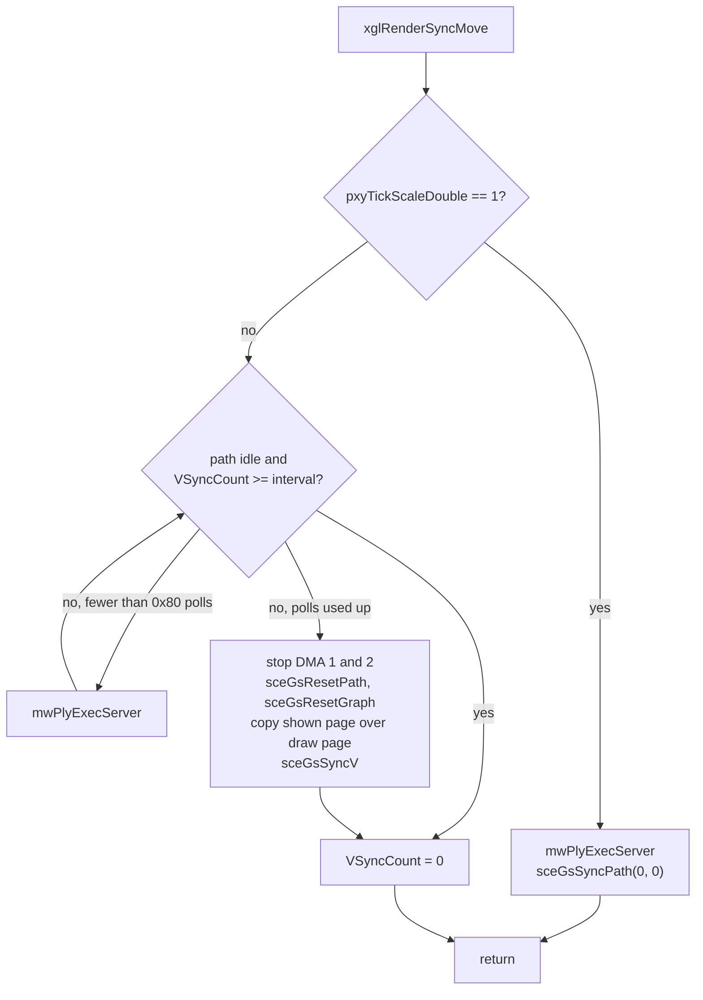

### Clearing the screen

The clear packet `ClearEnv` draws one sprite over the whole frame.
`xglRenderClearEnvInit` prepares it: the sprite corners are the frame
rectangle in GS coordinates, and after the sprite the packet restores
`TEST_1` to the normal depth test.

Three functions change what the clear does.

| Function | Effect |
| --- | --- |
| `xglRenderClearFrame()` | Sets the test value `0x00030003`: colour and depth are both written. This is the default |
| `xglRenderClearDepth()` | Sets the test value `0x00032001`: the alpha test never passes and its failure mode writes only depth, so the old picture stays and only the depth buffer is cleared |
| `xglRenderClearColor(color)` | Sets the clear colour from a packed `0xAABBGGRR` value. The default is `0x80000000`, black with alpha `0x80` |

`xglRenderClearSkipOn()` and `xglRenderClearSkipOff()` set and clear
`xglRenderClearSkip`. While it is set the render step does not send the
clear packet at all. Screens that paint every pixel themselves, or that want
to keep the previous picture as a background, use the depth-only clear or
the skip.

### The global fade

The global fade is a colour laid over the whole finished frame. Its state is
one packed word, `xglRenderGlobalFadeColor`, in the form `0xAABBGGRR` with
an alpha range of 0 to `0x80`.

| Function | Effect |
| --- | --- |
| `xglRenderGlobalFadeInit()` | Colour 0, fade callback cleared |
| `xglRenderGlobalFadeSet(r, g, b, a)` | Clamps the four floats to 0..1 and packs them: colours times 255, alpha times 128 |
| `xglRenderGlobalFadeSetPacked(value)` | Stores a packed value |
| `xglRenderGlobalFadeGet()` | Returns the packed value |

`xglRenderGlobalFade()` runs near the end of the render step. It first calls
the function in `xglRenderGlobalFadeCallback[0]` with the packet, when one
is set. Then it adds a GIF batch that draws a sprite from (`0x7000`,
`0x7200`) to (`0x9000`, `0x8E00`), which is the 512 x 448 frame. When the
alpha is not zero the batch sets `ALPHA_1` to blend the fade colour over the
picture with the alpha as a fixed factor. When the fade is off the same
batch is sent with a blend equation that leaves the picture unchanged. In
both cases the batch ends with 80 more writes of the neutral `ALPHA_1`
value.

Fades between scenes are built on these functions by
`src/main/fade_ctrl.c` (see [screen-effects.md](screen-effects.md)).

### Final packet callbacks

`xglRenderFinalPacket()` gives other systems a place in the frame after the
models and before the text. It walks 17 function pointers that start at
`sRender + 0x24` and calls every non-zero one with the current packet.
`xglRenderInit` clears all 17.

The slots are fixed by convention. The users that the source shows are
listed below. The last five slots are also reachable under their own
symbol names.

| Slot | Address | User |
| --- | --- | --- |
| 6 | `sRender + 0x3C` | `recordRenderAll` (record effects) or `DefocusMain` (defocus), see [screen-effects.md](screen-effects.md) |
| 8 | `sRender + 0x44` | `ov01DrawAll`, the battle overlay's draw pass, set by `ov01SceneInit` |
| 12 | `pxyEntryGroupHooks` | `pxyPlayEntryGroup5`, set by `nmlModelConstruct` |
| 13 | `pxyFrameCopyHooks` | `pxyAddFrameCopyPacket`, set by `nmlModelConstruct` |
| 14 | `msgFrameHooks` | `msgWindowFlush`, the message windows ([ui-windows.md](ui-windows.md)) |
| 15 | `gifStateEffectHook` | `gifStateDrawBreakShards` while that effect runs |
| 16 | `pauseDrawHook` | `pauseDrawTitleHook` while the game is paused ([field.md](../game/field.md)) |

The order of the slots is the order of drawing, so the pause title is drawn
over the message windows, and those over the battle scene.

A second, smaller mechanism lives in `xgl_cd_arena.c`. `xglCallbackQueueAdd(entry)`
appends a function to `xglCallbackQueue` (four entries) and
`xglCallbackQueueRun()` calls them in order and empties the queue. The menu
scenes, the save screen and the battle result screen queue their draw
function every frame and install `xglCallbackQueueRun` as their draw hook.

### Scan-line modes

`ScanLineInterpolate` selects how the two read circuits of the GS show the
frame. `xglRenderInit` sets mode 1.

| Mode | Behaviour of `xglRenderDispEnvMove` |
| --- | --- |
| 0 | Read circuit 1 is switched off. Only circuit 2 shows the frame |
| 1 | Both circuits are enabled and blended with the factor `0x80`. Both read the same page, and one of them is placed one line higher (`dy - 1`). Each visible line is then the average of two neighbouring lines, which removes interlace flicker |
| 2 | The display registers are left as they are, and the render step adds the `xglPacketInterpolate` sprite instead. The defocus effect selects this mode (`src/main/game_defocus.c`) |

### Frame copies

Four functions copy between the frame pages with the GS's local-to-local
transfer. Each builds a five-register batch in the scratchpad (`BITBLTBUF`,
`TRXPOS`, `TRXREG` for 512 x 448, `TRXDIR` 2) and sends it at once on the
GIF channel, outside the packet.

| Function | Source | Destination |
| --- | --- | --- |
| `xglRenderCopyDisp2Draw()` | `sRenderDisplayBase` | `sRenderFlipBase` (the draw page) |
| `xglRenderCopyDisp2Flip()` | `sRenderDisplayBase` | `sRenderFrameBase` (the work page) |
| `xglRenderCopyDraw2Flip()` | `sRenderFlipBase` | `sRenderFrameBase` |

`xglRenderDrawFlipPk(packet)` appends a copy from the draw page to the work
page to a packet, so the copy happens at a chosen point of the frame's
drawing. `xglRenderDrawFlip()` exchanges `sRenderDisplayBase` with
`sRenderFrameBase` and points `FRAME_1` and `FRAME_2` at the new value.

`xglRenderCpUDispOn()` and `xglRenderCpUDispOff()` set and clear
`xglRenderCpUDispFlag`. Only debug programs switch it on (the viewer of
`src/main/game_data.c` and the battle debug entry). By its name it enables a
processor load display.

### GS register helpers

Files: `src/main/gs_make_frame.c`, `src/main/gs_make_tex0.c`

Effects that draw into one frame page while they use another as a texture
need register values for the pages. These helpers build them from the
render state.

| Function | Result |
| --- | --- |
| `gsMakeFrame(buffer, flag)` | A `FRAME` value with a buffer width of 8 blocks (512 pixels). Buffer 0 is `sRenderDisplayBase`, 1 is `sRenderFlipBase`, 2 is `sRenderFrameBase`. `flag` is not used |
| `gsMakeTex0(buffer, tex_cc)` | A `TEX0` value for a 512 x 512 32-bit texture at the same three pages. `tex_cc` selects whether the texture's alpha is used |
| `gsMakeAlpha(blend)` | An `ALPHA` value: 1 is additive (`0x48`), 2 subtractive (`0x42`), 3 is `(Cs - Cd) * As` (`0x84`), anything else is normal alpha blending (`0x44`) |

The same files contain three small helpers. `xglVectorNormalInPlace(v)`
normalises a vector in place. `xglColorLerp(from, to, t)` interpolates two
packed colours channel by channel. `xglWrapDegrees(degrees)` moves an angle
one turn toward the range 0..360.

## Studios

File: `src/main/xgl_studio.c`

A **studio** is a set of eight cameras together with one block of lights.
The engine has four studios in the static array `asStudioSource`. A studio
record is `0x3180` bytes: a light block of `0x180` bytes followed by eight
`XglCamera` records of `0x600` bytes each.

```
studio record (0x3180 bytes)
+0x0000  light block          0x180 bytes, the layout of XglLightSet
+0x0180  cameras[0]           0x600 bytes
+0x0780  cameras[1]
  ...
+0x2B80  cameras[7]
```

The idea behind several studios is that different parts of the game can
keep their own camera setup at the same time. The field, the cutscene
player and the menus each prepare cameras, and switching between them is a
change of one index.

### Current and active studio

Two indices exist and they are not the same thing.

The **current studio** is the pointer `pCurrentStudio`, set by
`xglStudioChange(index)`. All accessor functions work on it:
`xglStudioGetCamera2(i)` returns camera `i`, `xglStudioGetCamera(&camera, i)`
does the same through an output argument, and `xglStudioGetLight2()` returns
the light block. `xglStudioGetActiveCamera()` returns the first camera of
the current studio whose `active` field is not zero, or 0.
`xglStudioSelectGetActiveCamera(studio)` does that search in a studio named
by index without changing the current one.

The **active studio** is `activeStudioIndex`, set by
`xglStudioSetActiveIndex(index)`. It decides which studio's cameras react to
the controller in the per-frame update.

### Initialisation

`xglStudioInit()` resets everything. For each studio it resets the light
block with `xglStudioLightReset` (the default light set, see
[Lights](#lights)) and calls `xglCameraInit` on all eight cameras. Then it
selects studio 0 as the current and the active one, enables camera updates
and clears `StudioEntrySkip` and `studioSceneFlag`.

`xglStudioMainCameraInit()` switches on camera 0 of each studio: `active`
is set to 1 and `state` to 1. `xglStudioSetup()` calls both functions and is
what `main` uses. `xglRenderSetReso` calls both as well.

### The per-frame update

`xglStudioUpdate()` is the last third of `xglSleep()`. Unless
`StudioEntrySkip` is set, it calls `xglStudioMainCameraMove()`, which makes
the active studio the current one, and then `xglStudioMove()`.

`xglStudioMove()` visits all 32 cameras. For each camera with `active`
equal to 1:

1. If the camera's studio is the active studio and
   `studioCameraUpdateEnabled` is set, `xglCameraTravelProc(camera)` runs
   the camera's travel mode, which may read the controller.
2. `xglCameraMove(camera)` rebuilds the camera's matrices and frustum.

At the end the current studio is set back to 0.

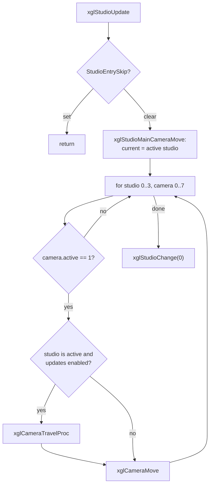

Three switches control the update.

| Switch | Set by | Effect |
| --- | --- | --- |
| `StudioEntrySkip` | Movie playback (`game_movie.c`) | The whole update is skipped |
| `studioCameraUpdateEnabled` | `xglStudioDisableCameraUpdate()`, `xglStudioEnableCameraUpdate()` | Travel modes do not run, matrices are still rebuilt |
| `studioSceneFlag` | `studioSceneFlagSet()`, `studioSceneFlagClear()` | A flag that scene code sets when it has prepared the studios. The studio module only stores it |

`xglStudioFlushActiveCamera()` rebuilds the matrices of the first active
camera of every studio at once. Code that has just moved a camera and needs
correct matrices before the next frame calls it.

### Who sets the cameras

The game's own cameras do not use the pad-driven travel modes. The field
camera (`src/main/game_camera.c`) puts its camera into state 4 and writes
the travel position and rotation itself every frame
([field.md](../game/field.md)). The cutscene player writes camera tracks the
same way ([cutscenes.md](../scripting/cutscenes.md)). The debug viewers set
state 2 on all eight cameras of all four studios, which gives a free camera
on the controller (`src/main/game_data.c`).

## Cameras

File: `src/main/xgl_camera.c`

An `XglCamera` describes one view: where it looks from, the lens, the
rectangle of the screen it fills, and the matrices and clip planes derived
from those. Drawing code takes the view matrix and the screen scale from
the camera. The model library reads them for every model it draws.

### Camera data

`XglCamera` is `0x600` bytes and has four parts.

| Offset | Field | Meaning |
| --- | --- | --- |
| `+0x000` | `active` | 1 when the camera is in use |
| `+0x004` | `state` | The travel mode, see [Travel modes](#travel-modes) |
| `+0x008` | `padPort` | Controller port the travel modes read (0 or 1) |
| `+0x010` | `screen` | `XglCameraScreen`: depth range, clip range, window, projection |
| `+0x090` | `travel` | `CameraTravel`: position, rotation, lens, velocities, matrices |
| `+0x270` | `volume[0]` | `CameraVolume`: frustum corners, clip planes, the view matrix |
| `+0x5F0` | `lookAtLocked` | Toggled by START in look-at mode |
| `+0x5F4` | `unknown_5f4` | A global time scale, set to 1.0 by `xglCameraInit`. The field of studio camera 0 is the clock step of every actor's motion ([animation.md](animation.md)) and the speed of the effect system, which an effect slot can change ([sef.md](sef.md)). The field camera also copies it into its work area |

The screen block `XglCameraScreen`:

| Field | Default | Meaning |
| --- | --- | --- |
| `depthMax`, `depthMin` | `0x00FFFFFF`, 0 | Range of depth buffer values |
| `clipRange` | 0.08, 14000 | Near and far distance in `x` and `y`. `z` and `w` are computed |
| `portEffect` | 1, 1, 1, 100 | Scale factors applied to the screen scale and fog values |
| `resolution` | frame width and height, twice | Size of the frame |
| `projection` | computed | Resolution with the pixel aspect applied |
| `window` | 0, 0, width, height | The rectangle of the screen the camera fills |
| `screenOffset` | computed | Centre of the window in GS coordinates, middle of the depth range, a fog term |
| `screenScale` | computed | Half window size in GS units, half depth range (negative), a fog term |

The travel block `CameraTravel`:

| Field | Default | Meaning |
| --- | --- | --- |
| `focus` | 5.0 | Speed step of the pad modes, 1 to 9 |
| `fov` | 0.698 rad (40 degrees) | Field of view |
| `fov_velocity`, `scale` | 0 | Zoom speed and zoom input |
| `rotation` | 0, 0, 0 | Rotation angles about x, y, z |
| `angle_velocity`, `angle_delta` | 0 | Rotation speed and rotation input |
| `position` | 0, 1, 4 | Camera position |
| `place_velocity`, `place_delta` | 0 | Movement speed and movement input |
| `chase_yaw`, `chase_distance` | from rotation and position | Stored at init |
| `chase_reference`, `chase_position` | 0, 1, 0 | The point the look-at mode aims at |
| `frustum` | computed | Four vectors with the half extents of the near plane |
| `transform` | computed | Camera-to-world matrix |
| `inverseTransform` | computed | World-to-camera matrix |

`xglCameraInit(camera)` fills all of this: `xglCameraControlInit` clears
`active` and `state` and sets `padPort` to 1, `xglCameraScreenInit` and
`xglCameraTravelInit` copy the defaults from the constants `sClipRange_0`
through `sChaseIntPos_9`.

Three setters exist. `xglCameraSetPadPort(camera, port)` stores the port
(values of 2 and above become 1). `xglCameraSetWindow(camera, x0, y0, x1, y1)`
sorts the corners, clamps them to the frame and stores them in
`screen.window`. `xglCameraClipRangeDefault(camera)` sets the clip range to
0.08 and 12000.

### Travel modes

`xglCameraTravelProc(camera)` runs once per frame for each active camera of
the active studio. It dispatches on `camera->state`.

| State | Behaviour |
| --- | --- |
| 0 | Off. The function returns at once |
| 1 | Fixed. Nothing moves the camera, the game writes its fields |
| 2 | Free camera: `xglCameraTravelManual` |
| 3 | Look-at camera: `xglCameraTravelChase` |
| 4 | Game camera. Like state 1 from this module's point of view. `game_camera.c` names it `CAMERA_STATE_GAME` |

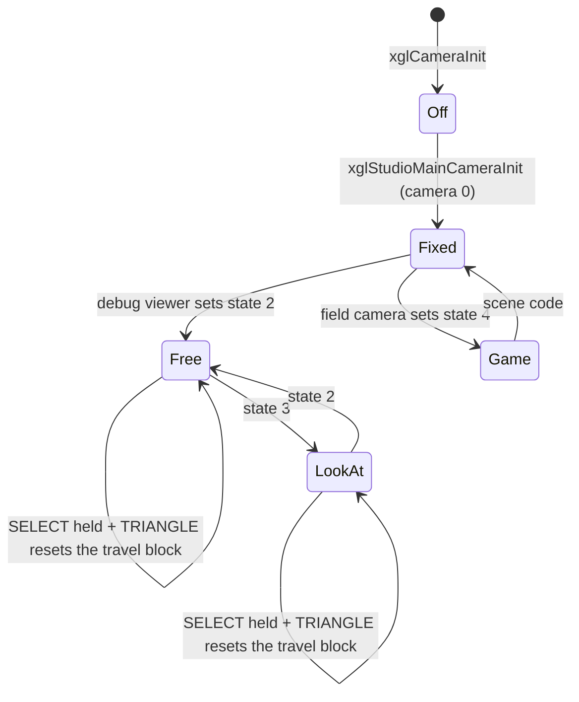

In states 2 and 3 the controller input is the OR of the camera's own port
and port 1, so a second controller can always steer. The analog sticks are
taken from the controller whose sticks are deflected more. While SELECT is
held the mode does not run, and SELECT with a fresh press of TRIANGLE calls
`xglCameraTravelInit` to put the camera back to its defaults.

Both pad modes start with `xglCameraTravelReset` (inputs to zero) and
`xglCameraTravelFocus`. The latter changes the speed step: CIRCLE raises
`focus` by 1 up to 9 and SQUARE lowers it down to 1, when none of R2, L1 and
R1 is held. R1 held sets a positive zoom input (the field of view widens)
and R2 a negative one.

**Free camera (state 2).** The controls are listed below. After reading
them, `xglCameraTravelScale` multiplies all inputs by a factor that depends
on `focus`, and by 4 while CROSS is held. Velocities are damped by 0.8 per
frame and the inputs are added, so the camera glides. Movement is relative
to the camera's heading (its rotation about y).

| Input | Effect |
| --- | --- |
| Right stick up and down | Pitch (`angle_delta.x`) |
| Right stick left and right | Yaw (`angle_delta.y`) |
| D-pad left, right | Roll |
| Left stick | Move sideways and forward |
| L1, L2 | Move along the y axis: L1 adds 0.0064 per frame, L2 subtracts it |
| R1, R2 | Zoom: R1 widens the field of view, R2 narrows it |
| CIRCLE, SQUARE | Speed step up, down |
| CROSS held | Four times the speed, growing while held |

**Look-at camera (state 3).** The camera always looks at
`chase_position`. Its rotation is computed from the direction to that point
at the end of the update.

| Input | Effect |
| --- | --- |
| Left stick left and right | Orbit the camera around the target |
| Left stick up and down | Move the camera along the view line, toward or away from the target |
| L1, L2 | Move the camera along the y axis |
| CROSS held with the left stick | The camera stays. The target turns around the camera or moves along the view line |
| SQUARE held with the left stick | Camera and target move together, sideways or along the view line |
| CROSS held with L1, L2 | Move only the target along the y axis |
| SQUARE held with L1, L2 | Move camera and target along the y axis |
| START | Toggles `lookAtLocked` |

All steps are scaled by the horizontal distance between camera and target,
so the controls feel the same near and far.

**Pad override.** `xglCameraSetPadOverride(held, pressed, unknown04, rightX, rightY, leftX, leftY)`
stores a synthetic controller state in `cameraPadOverride` and sets its
`active` flag. While the flag is set the travel modes read this record in
place of the real controller. `xglCameraTravelProc` clears the record at
the end of every call, so an override lasts one frame.

### Building the view

`xglCameraMove(camera)` derives everything the drawing code needs. It calls
three functions with a zero offset. `xglCameraMoveOffset(camera, offset)`
does the same with a position offset that is subtracted from the camera
position.

`xglCameraViewScreen` computes the screen mapping. The window centre
relative to the frame centre gives `screenOffset.x` and `.y` (plus 2048, the
centre of the GS coordinate space). The pixel aspect comes from the
magnification field of the display register:
`(135 / 11) / (54 / (MAGH + 1))`. The horizontal projection size is the
frame width times this factor. `screenScale` is half the scaled frame size,
with the y scale negative because GS y grows downward, and the z scale is
minus half the depth range.

`xglCameraViewTravel` computes the lens and the camera matrix. The half
extent of the near plane is `tan(fov / 2)` times the near distance, with the
horizontal extent multiplied by the aspect ratio. The four frustum vectors
hold the positive and negative extents. The camera-to-world matrix is built
on the matrix stack as translation, then rotation about y, x and z, and is
saved in `travel.transform`. Its inverse is saved in
`travel.inverseTransform`.

`xglCameraViewVolume` builds the view volume. It multiplies a perspective
matrix (`xglMatrixStackFrustum` with the near plane extents and the clip
range) by the inverse transform and saves the result as
`volume[0].viewMatrix`. This is the matrix that takes world coordinates to
clip space. Then it computes two sets of eight frustum corner points in
world space, six clip planes for each set through the index table
`aaiVertexIndex`, and a transposed copy of the planes in `planeSet` that
the culling code tests several planes at once with.

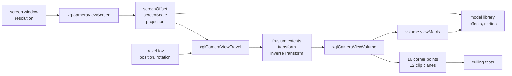

The file also holds `cullingMapDataTable`, a table of 14 rows (the last one
is an end marker) that the culling checks of `src/main/face_point.c` read,
and local copies of small vector helpers (`xglVectorMul`, a
component-wise product, among them).

## Lights

File: `src/main/xgl_light.c`

Models are lit by a **light set**: up to six directional lights, two
ambient colours, a shadow direction and up to three point lights. The light
module defines this structure, provides a default set, and can build a set
for a given position from a **light pack**, an animated list of light
sources that comes from a file.

### The light set

`XglLightSet` is `0x180` bytes (24 quadwords). The model library copies it
to VU1 when it draws a model ([pxy.md](pxy.md)).

| Offset | Field | Meaning |
| --- | --- | --- |
| `+0x000` | `directions[6]` | Direction of each of the six directional lights |
| `+0x060` | `viewDirection` | A seventh direction, the axis of the two-colour ambient light |
| `+0x070` | `colors[6]` | Colour of each directional light |
| `+0x0D0` | `ambientColor` | Ambient colour |
| `+0x0E0` | `ambientColorLower` | Second ambient colour, for the opposite side of the ambient axis |
| `+0x0F0` | `shadows[3]` | Shadow directions. Light packs fill the first |
| `+0x120` | `pointPositions[3]` | Positions of up to three point lights |
| `+0x150` | `pointColors[3]` | Colours of the point lights |

`xglLightSetClear(lightSet)` zeroes all 24 quadwords.

`xglLightSetDefault(lightSet)` fills a set with the engine's standard
lighting. The first call computes it and keeps a copy in
`xglLightSetDefaultCache`. Later calls copy the cached set.

| Element | Default |
| --- | --- |
| Light 0 | Grey 0.8, from angles (-0.262, 0.531) |
| Light 1 | Grey 0.5, from angles (2.356, 1.273) |
| Light 2 | Grey 0.5, from angles (0.349, 3.787) |
| Lights 3 to 5 | Black, angle (pi / 2, 0) |
| Ambient axis | Angle (pi / 2, 0) |
| Both ambient colours | Grey 0.25 |
| Point lights | None |

The directions are written as two angles first, and
`xglDirectionFromAngles` converts the seven vectors to unit directions.
`xglStudioLightReset(light)` is the same function under the name the studio
module uses. Every owner of a light set starts from this default: the
studios, each actor (`xenoActor.c`), the model library state, the effect
system (`sef_light_set.c`) and the battle scene.

### Light packs

A light pack is a block of data that starts with the tag `lxy`. It lists
light sources, each with a type and with animation channels for its
parameters. The module reads these fields of the header (`XglLightPack`):

| Offset | Field | Meaning |
| --- | --- | --- |
| `+0x00` | `tag` | The characters `l`, `x`, `y` |
| `+0x10` | `name` | Name of the pack, up to 32 bytes |
| `+0x30` | `entryCount` | Number of light sources |
| `+0x3C` | `keyOffset` | Offset of the array of evaluated values, one `XglLightKey` per source |
| `+0xF0` | `entryOffsets[]` | Offset of each source's entry |

Each source has an entry (`XglLightEntry`) with its `type` at `+0x04`, 20
channel type bytes at `+0x10` and a data stream at `+0x30`. It also has one
`XglLightKey` (`0x50` bytes) in the key array, which holds the source's
current values:

| Offset | Field | Meaning |
| --- | --- | --- |
| `+0x00` | `position` | Position of the source |
| `+0x10` | `rotation` | Rotation angles about x, y, z |
| `+0x20` | `extent` | Radii, slopes or box half sizes, by type |
| `+0x30` | `color` | Colour |
| `+0x40` | `coneAngle` | Full opening angle of a spot |
| `+0x44` | `penumbra` | Width of the soft edge of a spot |
| `+0x48` | `intensity` | Multiplier for the colour |

The key is 20 floats, and the 20 channel bytes of the entry say where each
float comes from.

**The pack table.** `xglLightPackTable` has 16 slots, each a pack pointer
and a reference count. `xglLightPackRegister(pack)` checks the `lxy` tag.
If the pack is already in the table it adds a reference and returns 2. If
not, it takes the first free slot and returns 1. It returns 0 when the tag
is wrong or the table is full. `xglLightPackRelease(pack)` drops a reference
and frees the slot when the count reaches zero. `xglLightPackTableInit()`
and `xglLightPackTableClear()` empty the table.

**Evaluation.** `xglLightPackEvaluateAll(time)` calls
`xglLightPackEvaluate(pack, time)` for every registered pack. That function
walks the sources and fills each key from the entry's stream, channel by
channel:

| Channel type | Value written to the key |
| --- | --- |
| 1 | An animation curve: the stream is aligned to 16 bytes and `xglLightPackSampleCurve` evaluates the curve at `time` |
| 2 | A constant: the next float of the stream |
| 3 | 0.0 |
| 4 | 1.0 |
| other | The value is left unchanged |

A curve (`XglLightCurve`) has a key count, a minimum and a maximum time and
then rows of key data. `xglLightPackSampleCurve` converts the time to 24.8
fixed point, clamps it to the curve's range and calls `pxyInterpolateKeys`
of the model library to interpolate.

**Building a light set.** `xglLightPackBuildByName(light, packName, receiver)`
looks the pack up by name in the table and calls
`xglLightPackBuildLightSet(pack, lightSet, receiver)`. The `receiver` is the
world position of the object to be lit. The result depends on it, because
local lights only count when the receiver is inside their range.

The function clears the light set and makes two passes over the sources.
The first pass handles the types below 19 and stops at the first source
with a higher type. The second pass handles the types from 19 upward.

| Type | Kind | Effect on the light set |
| --- | --- | --- |
| 1 | Ambient | Both ambient colours are set to colour times intensity |
| 2 | Two-colour ambient | `ambientColor` is colour times intensity, `ambientColorLower` is `extent` times intensity, and the ambient axis is (0, 0, -1) rotated by the key |
| 3 | Point, as ambient | Added to both ambient colours when the receiver is in range |
| 4 | Box, as ambient | Added to both ambient colours when the receiver is in the box |
| 6 | Spot, as ambient | Added to both ambient colours when the receiver is in the cone |
| 7 | Cylinder, as ambient | Added to both ambient colours when the receiver is in the cylinder |
| 8 | Directional | A candidate for the six light slots, direction (0, 0, 1) rotated by the key |
| 9 | Colour scale | Colour times intensity is stored in `xglLightColorScale` and passed to `pxySetColorScale` |
| 10 | Shadow direction | `shadows[0]` is (0, 0, 1) rotated by the key |
| 11 | Shadow from a point | `shadows[0]` is the normalised direction from the receiver to the source |
| 19 | Point light | Copied to the next free point light: position, and colour times intensity times 128. At most three |
| 20, 35 | Point | A slot candidate with the direction from the receiver to the source |
| 21 | Box | A slot candidate |
| 23 | Spot | A slot candidate |
| 24 | Cylinder | A slot candidate |

The four local shapes share their tests between the ambient and the slot
variants.

- `xglLightPointColor` gives the full colour inside the radius `extent.x`
  and fades it linearly to zero at `extent.y`.
- `xglLightSpotColor` rotates the axis (0, 0, -1) by the key and compares
  the angle between the axis and the direction to the receiver with half of
  `coneAngle`. Inside the last `penumbra` radians the colour fades.
- `xglLightBoxColor` transforms the receiver into the box's own space
  (position, rotation, scale by `extent`). The receiver must lie within -1
  to 1 in x and y and at negative z. The colour fades within one unit of
  the box edges. The light direction is the box's z axis.
- `xglLightCylinderColor` transforms the receiver into a cylinder's space with
  radius `extent.y` and half height `extent.z`, and fades the colour between
  the inner radius `extent.x` and the outer radius. Beyond the two end caps
  it measures the distance to the end of the axis.

**The six slots.** The directional slots of a light set are filled by
strength. `xglLightSlotsInsert(slots, color, direction)` takes the largest
of the three colour components as the strength of a candidate. If it is
stronger than the weakest light currently in the six slots, the candidate
replaces that light and the weakest slot is searched again. A zero direction
becomes (0, 0, 1), and directions are normalised. After both passes the six
winners are copied into `colors` and `directions`. A pack may therefore hold
many more than six sources, and each object receives the six that matter
most at its position.

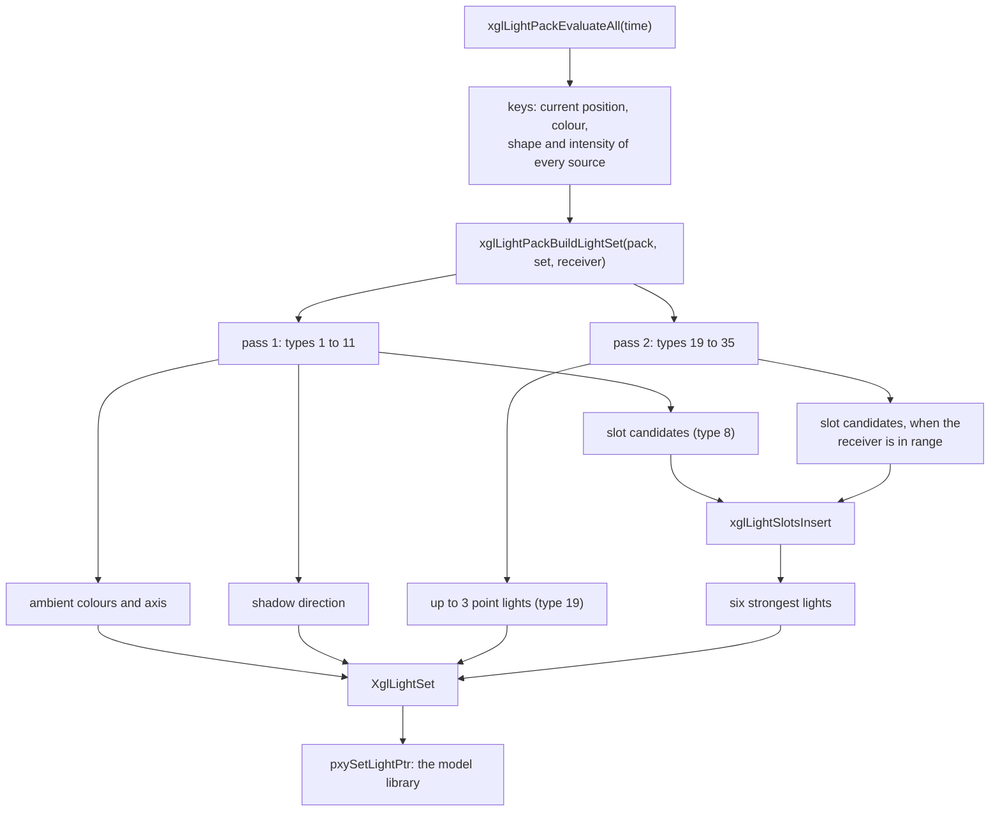

**Users.** The actor draw code is the caller: an actor with the draw flag
`XENO_DRAW_LIGHT_SOURCE` builds its `sourceLight` from the pack named in
`actor->lightSource` at its own position every time it is drawn
(`src/main/xenoActor.c`, see [actors.md](actors.md)). The lookup compares
names, and when no registered pack has the name the light set is left as it
was. The game's source contains no call that registers a pack or that
evaluates the packs over time, so in this build the table appears to stay
empty.

**The colour scale cache.** A type 9 source sets `xglLightColorScaleValid`.
`xglLightPackCacheGet()` then returns the stored colour, and 0 otherwise.
`xglLightPackCacheInvalidate()` clears the flag. `pxyFlush` calls it at the
end of each frame, and `xglLightSetDefault` and `xglLightPackBuildByName`
clear it too.

**Debug shapes.** `xglLightPackDebugDrawAll()` walks all registered packs
and calls one helper per source type (`xglLightPackDebugBox`,
`xglLightPackDebugSpot`, `xglLightPackDebugCone` and others). The helpers
compute the outline points of each shape: the corners of a box, a ring of
eight points for a cone. They do not draw anything. The drawing calls are
not present in this build.

The file ends with small quadword helpers that the light code uses:
`xglVectorCopy`, `xglVectorZero`, `xglVectorSub`, `xglVectorAddXYZ` and a
three-component subtract.

## Controllers

File: `src/main/xgl_pad.c`

The pad module reads the two controller ports once per frame and keeps the
result in `PadData[2]`, one `PadRecord` per port. Game code never calls the
SDK's pad functions. It only reads these records: which buttons are held,
which were pressed this frame, the stick positions and the button
pressures. The module also handles the slow start-up conversation with a
controller and sends the vibration values.

### The pad record

`PadRecord` is `0x80` bytes (`include/main/pad.h`).

| Offset | Type | Field | Meaning |
| --- | --- | --- | --- |
| `+0x00` | `u8[0x20]` | `packet` | Raw data from `scePadRead` |
| `+0x20` | `u8` | `mode` | Byte 1 of the packet: controller type in the high nibble |
| `+0x21` | `u8` | `actuatorCount` | Number of vibration motors, 0 when none |
| `+0x22` | `u16` | `modeId` | Mode id from `scePadInfoMode` |
| `+0x26` | `u8` | `connectionState` | Result of `scePadGetState` |
| `+0x27` | `u8` | `setupState` | State of the setup machine |
| `+0x28` | `u16` | `held` | Buttons that are down |
| `+0x2A` | `u16` | `pressed` | Buttons that went down this frame |
| `+0x2C` | `u16` | `repeated` | `pressed`, plus auto-repeat |
| `+0x2E` | `u16` | `released` | Buttons that went up this frame |
| `+0x30` | `u16` | `directionHeld` | Like `held`, with the left stick added as d-pad directions |
| `+0x32` | `u16` | `directionPressed` | Like `pressed`, from `directionHeld` |
| `+0x34` | `u16` | `directionRepeated` | Like `repeated`, from `directionHeld` |
| `+0x36` | `u16` | `directionReleased` | Like `released`, from `directionHeld` |
| `+0x38` | `s8[4]` | `position` | Stick positions, centred on 0: right x, right y, left x, left y |
| `+0x3C` | `s16` | `horizontalPressure` | D-pad pressure right minus left |
| `+0x3E` | `s16` | `verticalPressure` | D-pad pressure down minus up |
| `+0x40` | `u8[8]` | `pressure` | Pressure of TRIANGLE, CIRCLE, CROSS, SQUARE, L1, R1, L2, R2 |
| `+0x48` | `s8` | `repeatDelay` | Frames before auto-repeat starts |
| `+0x49` | `s8` | `repeatInterval` | Frames between repeats |
| `+0x4A` | `u16` | `repeatMask` | Buttons that auto-repeat |
| `+0x4C` | `s8` | `repeatWait` | Counter for the delay |
| `+0x4D` | `s8` | `repeatCount` | Counter for the interval |
| `+0x4E` | `u8` | `horizontalDeadZone` | Stick threshold for left and right as d-pad |
| `+0x4F` | `u8` | `verticalDeadZone` | Stick threshold for up and down as d-pad |
| `+0x50` | `u8[6]` | `actuator` | Vibration values: small motor in byte 0, large motor in byte 1 |
| `+0x56` | `u8` | `actuatorMode` | Not zero: vibration is muted |
| `+0x58` | `u8[8]` | `buttonMap` | Remapping of the eight low button bits |
| `+0x60` | `u8[4]` | `axisDeadZone` | Dead zone of each stick axis |
| `+0x64` | `s8[4]` | `axis` | Stick positions with the dead zone applied: `rightX`, `rightY`, `leftX`, `leftY` |

The button bits of the six halfwords are in `include/main/pad_buttons.h`:

| Bit | Button | Bit | Button |
| --- | --- | --- | --- |
| `0x0001` | L2 | `0x0100` | SELECT |
| `0x0002` | R2 | `0x0200` | L3 |
| `0x0004` | L1 | `0x0400` | R3 |
| `0x0008` | R1 | `0x0800` | START |
| `0x0010` | TRIANGLE | `0x1000` | UP |
| `0x0020` | CIRCLE | `0x2000` | RIGHT |
| `0x0040` | CROSS | `0x4000` | DOWN |
| `0x0080` | SQUARE | `0x8000` | LEFT |

`PAD_SOFT_RESET_HELD` is L2 + R2 + L1 + R1 + SELECT. Together with a fresh
press of START it is the soft reset combination `PAD_SOFT_RESET`. Screens
test it on `PadData[0].heldAndPressed`, which reads `held` and `pressed` as
one word (movie playback, the disc change screen, the game over screen).

### Start

`xglPadInitial()` calls `scePadInit(0)` and opens port 0 and port 1, slot 0,
each with a 256-byte work buffer from `PadDmaBuffer`. It clears both
records and then sets the defaults:

- Auto-repeat for UP, RIGHT, DOWN, LEFT, L1 and R1, with a delay of 8 and an
  interval of 1 (`xglPadSetRepeat`).
- The identity button map: entry `i` is `1 << i`.
- The d-pad thresholds `horizontalDeadZone` and `verticalDeadZone` are 64.
- The four `axisDeadZone` values are 32.

`xglPadSetRepeat(port, mask, delay, interval)` changes the auto-repeat
settings of one port, or of both when `port` is `-1`, and restarts the
counters.

### The setup state machine

A controller cannot be used the moment it is plugged in. Its mode has to be
queried, the analog mode locked, the motors assigned and the pressure mode
entered, and each of these requests takes several frames. `xglPadRead()`
therefore runs a small state machine per port in `setupState`, one step per
frame. A port whose `scePadGetState` result is 0 (disconnected) falls back
to the first state.

| State | Value | Step |
| --- | --- | --- |
| `PAD_SETUP_PROBE` | `0x00` | Clear all state. When the pad is stable, read the mode table (`scePadInfoMode`). A digital-type id (4) goes to `0x40`, a DUALSHOCK-type id (7) to `0x70`, anything else to ready |
| `PAD_SETUP_QUERY_ACTUATORS_MODE` | `0x40` | If the pad offers an analog mode go to `0x41`, otherwise ready |
| `PAD_SETUP_SET_MAIN_MODE` | `0x41` | `scePadSetMainMode(port, 0, 1, 3)`: switch to analog and lock the mode. On acceptance go to `0x42` |
| `PAD_SETUP_WAIT_MAIN_MODE` | `0x42` | Wait for the request. Done: back to probe, which now sees a DUALSHOCK. Failed: retry `0x41` |
| `PAD_SETUP_ACTUATOR_ALIGN` | `0x70` | Read the motor count. With motors, send the alignment table `PadActAlign` (small motor first, large motor second) and go to `0x71`. Without motors: ready |
| `PAD_SETUP_WAIT_ALIGN` | `0x71` | Wait until the pad has executed the command, then `0x80` |
| `PAD_SETUP_PRESSURE_INFO` | `0x80` | If the pad supports pressure mode go to `0x81`, otherwise ready |
| `PAD_SETUP_PRESSURE_ENTER` | `0x81` | `scePadEnterPressMode`. On acceptance go to `0x82` |
| `PAD_SETUP_WAIT_PRESSURE` | `0x82` | Wait for the request. Done: ready. Failed: retry `0x81` |
| `PAD_SETUP_READY` | `0xFF` | Normal reading |

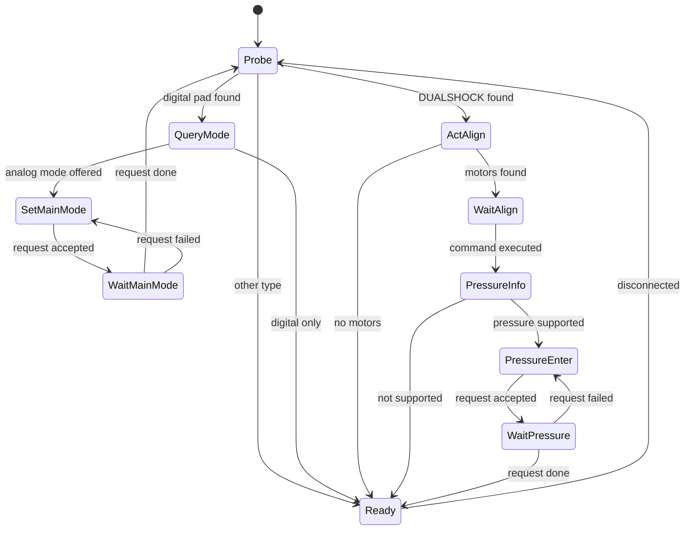

### Reading

In the ready state `xglPadRead()` does the following for each port.

1. **Read.** `scePadRead` fills `packet`, and `mode` takes packet byte 1.
2. **Vibration.** When the pad has motors, the six `actuator` bytes are
   sent with `scePadSetActDirect` and then cleared. A vibration request
   therefore lasts one frame, and code that wants a longer rumble writes
   the bytes every frame (the vibration sequencer `VibrationEngine` does
   this). When `actuatorMode` is not zero the bytes are cleared before
   they are sent. The party code copies the vibration setting of the save
   data (`SaveData.actuatorMode`) into this field for both ports
   (`src/main/pt_member.c`), which is how the option switches the motors
   off.
3. **Decode.** If packet byte 0 is 0 (valid data) the packet is decoded by
   the controller type in the high nibble of byte 1.

| Type nibble | Decoding |
| --- | --- |
| `0x40` (digital), `0x30` | Buttons only: the inverted 16-bit word from bytes 2 and 3 |
| `0x50` (analog joystick), `0x70` (DUALSHOCK) | Buttons, four stick bytes (bytes 4 to 7, re-centred by adding 128), d-pad pressures (bytes 8 to 11) and eight button pressures (bytes 12 to 19) |
| `0x10` (mouse) | Byte 3 gives the buttons, bytes 4 and 5 are added to a running position |
| `0x20` | Buttons and four axis bytes copied as they are |
| `0x60` | Buttons, two position bytes with an offset that is re-zeroed when the bits `0x6008` are all set |
| `0xE0` | Buttons and two axis bytes |
| `0x80` | The port is skipped for this frame |

For the analog types the four `axis` values are the stick positions with
the dead zone applied: a value strictly inside `-axisDeadZone` to
`+axisDeadZone` becomes 0, and other values are kept as they are.

4. **Pressures for digital pads.** When packet byte 1 is not `0x79` (a
   DUALSHOCK 2 in pressure mode), the pressures are made up from the
   buttons: a pressed button gets 255 and a released one 0, and the two
   d-pad pressure values become -255, 0 or 255.
5. **Stick as d-pad.** A second button word, `directions`, starts as a
   copy of the buttons. LEFT, RIGHT, UP and DOWN are added when
   `position[2]` or `position[3]` (the left stick) is beyond the d-pad
   threshold of 64.
6. **Button map.** The low eight bits of both words (L2 to SQUARE) are
   passed through `buttonMap`: each set bit `i` is replaced by the mask in
   `buttonMap[i]`. The high eight bits (SELECT to LEFT) are not remapped.
7. **Edges.** For both words: `pressed` is the newly set bits, `released`
   the newly cleared bits, `held` the new state. `repeated` starts as a
   copy of `pressed`.
8. **Auto-repeat.** While a button of `repeatMask` is held in the direction
   word, `repeatWait` counts up. Once it is above `repeatDelay`,
   `repeatCount` counts frames, and each time it is above `repeatInterval`
   the masked held buttons are written to `directionRepeated` and
   `repeated` and the count restarts. When none of the masked buttons is
   held the wait counter is cleared.

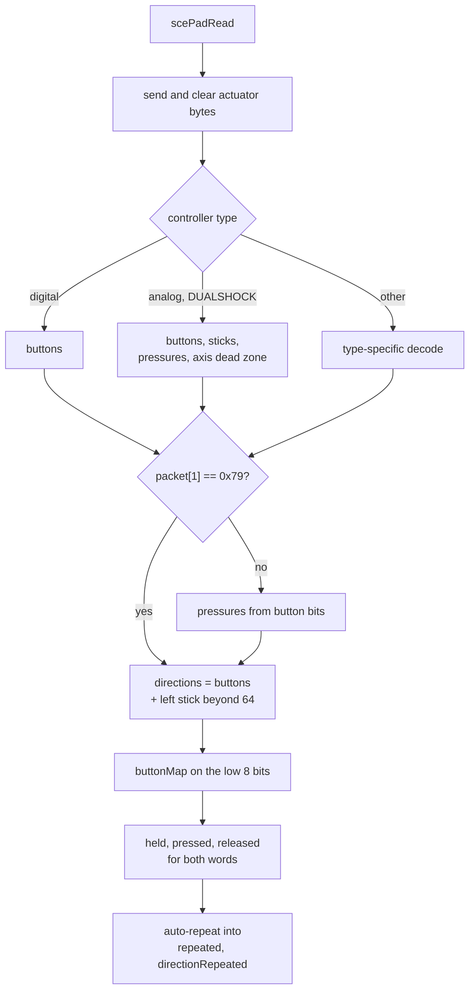

The two families of halfwords serve two kinds of code. Menus read the
`direction*` words, so the left stick works as a d-pad and held directions
repeat. The debug menu reads `directionRepeated` for up and down and
`directionPressed` for the buttons. Action code reads `held`, `pressed` and
the `axis` values.

## Files and the disc

Files: `src/main/xgl_cd.c`, `src/main/xgl_cd_arena.c`

The CD module turns a path into bytes in memory. A path may be found in one
of the `xenosaga.NN` archives, as a plain file on the disc, on the hard
disk or on a development host. The module also reads streams, loads
overlays and IOP modules, reads the clock and identifies the disc. The full
description, with the archive directory format, packed files and the
resource layer above, is on
[files-and-resources.md](../architecture/files-and-resources.md). This
section gives the parts that the rest of this page depends on.

### Start

`xglCdInitial()` initialises the drive for DVD media, allocates an IOP
buffer of `0x40` sectors for streaming (`sceCdStInit` with `0x10` banks),
resets the module with `xglCdReset()`, asks the drive whether the disc is
dual layer, marks the four archive slots of `ArcHeader` unused, activates
and mounts the hard disk and reads the archive directory tables with
`xglCdArcInit()`. The tables are placed at `WorkEnd`, which is advanced
past them. On a dual-layer disc the tables of `xenosaga.10` (layer 0) and
`xenosaga.20` (layer 1) are both read. `xenosaga.00` is read from the hard
disk copy `pfs0:/xenosaga.00` when the game is installed, otherwise from
the disc.

`xglCdOpenDevice()`, called from `main`, opens the handle
`ADXF_Open("CDV:DVD-ROM", 0)`. Disc reads go through this CRI ADX file
system handle when it is open.

### Reading a file

`xglCdReadFile(name, buffer, mode, notify)` reads a whole file and
`xglCdReadFilePart` adds an offset and a length. The `mode` bits select the
behaviour:

| Mode | Value | Meaning |
| --- | --- | --- |
| `CD_READ_SYNC` | 0 | Wait until the data is there. Failed disc reads are retried |
| `CD_READ_ASYNC` | 1 | Start or queue the read and return at once |
| `CD_READ_NO_EXTRACT` | 2 | Leave packed data packed |
| `CD_READ_WHILE_BUSY` | 4 | Read even while another read is active |

The return value is the size rounded up to whole sectors of 2048 bytes, -1
when the file does not exist, or `CD_READ_BUSY` (-3). The `notify` callback
receives events: lookup, size, progress, done (`CD_EVENT_DONE`, 4) and read
error. A file that starts with the magic `ARX` is packed. It is read to the
end of the buffer and unpacked toward the start by `xglArxExtract` (see
[Timer 0, ARX and the language code](#timer-0-arx-and-the-language-code)).

The read control block `LW` holds the state of the active read and a queue
of waiting requests. Its `dispatch_state` says what the service function
has to do.

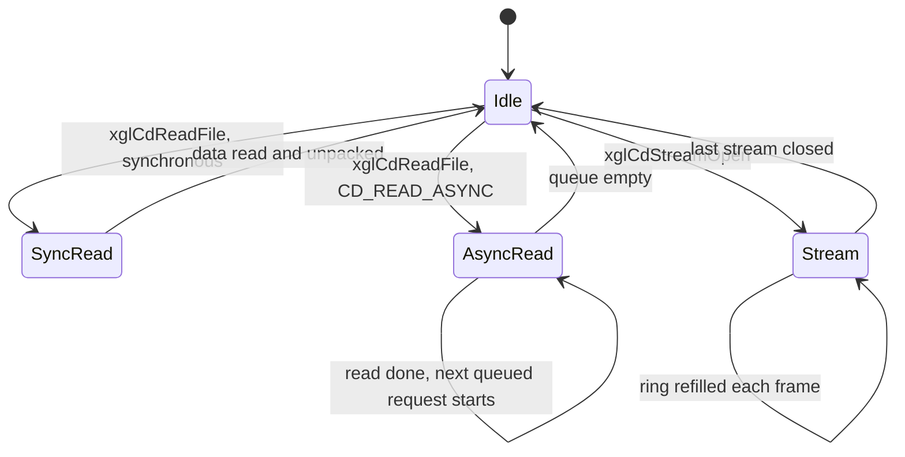

### The service step

`xglCdControlThread()` is the middle third of `xglSleep()`. One call does
this:

1. It counts down `ReadClockInterval`, which limits how often the real-time
   clock is read.
2. If a power-off is pending (`LW.power_off_pending`, set by
   `xglCdPowerOffCB`), it closes all files on the `pfs0:` and `pfs1:`
   mounts, switches the expansion bay off (`dev9x:`) and powers the console
   down with `sceCdPowerOff`.
3. In the asynchronous read state it calls `xglCdServiceRead()`. A disc
   read reports its position and, when the drive has finished, unpacks the
   data, reports `CD_EVENT_DONE` and starts the next queued request
   (`queue_next`). A host or HDD read transfers at most 64 KiB per call.
4. In the stream state it refills the ring buffer of the current stream
   (`xglCdStreamReadRingCore`). Two streams can be open
   (`xglCdStreamList`). Each gets `0x40` consecutive calls, then the drive
   is sought to the position of the other.

`xglCdSyncDone()` tells a caller whether the last request has finished, and
`xglCdReadCancel(immediate)` aborts the active read and empties the queue.

### Streams

A stream (`CdStreamParam`) reads a file piece by piece into a ring buffer
(`StreamRing`: buffer, capacity, write position, read position).
`xglCdStreamOpen(stream, path)` looks the file up and starts the drive's
streaming mode. `xglCdStreamReadRing(stream, bytes)` advances the read
position and refills the ring, `xglCdStreamRead` copies whole sectors into a
caller's buffer, and `xglCdStreamSeek`, `xglCdStreamRewind` and
`xglCdStreamClose` do what their names say. A stream with an `xss` record
is interleaved: a bit map in the file routes each sector to the main ring
or to `alternate_ring`. The IPU movie decoder reads its file through a
stream (see [IPU movies](#ipu-movies)).

### Overlays and IOP modules

`xglCdLoadOverlay(overlay)` loads one of the two overlays. It does nothing
when the requested overlay is the one in `loaded_overlay`. Otherwise it
builds the path `cdrom0:\OVnn.OVL;1`, clears the overlay memory (`0x80000`
bytes at `0xA80000`), flushes the caches, calls `sceSifLoadElf` until it
succeeds and flushes the caches again. Only one overlay is in memory at a
time, because both load at the same address: overlay 1 is the battle
program and overlay 2 the title program. `xglCdInitial` sets
`loaded_overlay` to 2 before any load, so the first call for overlay 2 in
`main` loads nothing. That is correct, because the main executable carries
a copy of overlay 2 as a section of its own at `0xA80000`. The title code
is in memory from the first instruction, which is why `main` can call
`BootDisplay` before the disc system is even started.

`xglCdSifLoadModule(path, args)` loads an IOP module from
`cdrom0:\IOP\<NAME>.IRX;1` (see [Start-up](#start-up)).

### Disc check and clock

`xglCdDiskCheck()` identifies the disc. It requires a PlayStation 2 DVD,
derives the archive flags from the sizes of `xenosaga.10` and
`xenosaga.20`, and checks that `system.cnf` names an executable whose third
letter is `U`. It returns the flags, 0 with no disc, or a negative value
for an open tray, a drive that is not ready or an unsupported disc. Once a
disc is identified only the tray is checked. The disc change screen uses it
(see [events.md](../scripting/events.md)).

`xglClockRead(clock)` reads the console's real-time clock into an
`XglClock` (second, minute, hour, day, month, year). The hardware is asked
again only after `ReadClockInterval` has run down, which takes 10 frames. `xglClockDayTime2UInt` converts a reading to seconds since
2000-01-01 and `xglClockUInt2DayTime` converts back.

### The sector arena and its helpers

`xgl_cd_arena.c` is a second, small file of the CD module. It serves the
2D screens (menus, the save screen, the battle result screen), which load
many small files into one block.

`xglCdArenaOpen(buffer, size)` opens an arena over the caller's buffer, or
over a block from `GameResourceWorkAlloc` when `buffer` is 0 (with a
default size of `0x288000` when `size` is 0 as well).
`xglCdSectorAlloc(size)` is a bump allocator that hands out the arena in
multiples of 2048 bytes. `xglCdBufferAlloc`, `xglCdBufferReserve` and
`xglCdBufferRewind` manage a sub-buffer in the arena with its own cursor.
`xglCdArenaClose()` waits until the CD module is idle, resets the users of
the arena and releases the block when the arena owns it.

`xglCdReadFileAsync(name, buffer, kind, sub)` starts an asynchronous read
with `xglCdReadDoneCallback` as its callback and counts it in
`xglCdPendingReads`. The pair `(kind, sub)` is stored as the read tag. When
the read is done the callback uses the tag to hand the data to the right
consumer and decrements the counter. `xglCdWaitIdle()` loops until no read
is pending.

The file also contains the play time clock (`xglClockSampleDayTime`,
`xglClockAccumulate`, which adds the elapsed real time to the party's
`playTime`, and `PartyTimeDispChange`, which clamps the display at
99:59:59), `xglTickAdvance` (see [The tick counter](#the-tick-counter)),
the draw callback queue (see
[Final packet callbacks](#final-packet-callbacks)), two button predicates
(`padCirclePressedAlone`, `padCrossPressedAlone`) and
`xglFontGetTextWidth`.

### Debug file stubs

File: `src/main/xgl_debug_file.c`

`xglDebFileSize`, `xglDebFileRead` and `xglDebFileWrite` were the host file
functions of the development build. In this build each prints
`Don't use xglDebFile...()`, executes a break instruction and returns -1.
`xglDebFileEmpty` does nothing. The debug file selector of `xgl_cd.c`
(`xglCdFileSelect`, a pad-driven browser over a `.filelist` file) depends
on them. It is described on [debug-tools.md](../game/debug-tools.md).

## Hard disk

File: `src/main/xgl_hdd.c`

The game supports the PlayStation 2 hard disk drive in two ways: the game
data can be installed on it, and save data can be kept on it. The module
wraps both. The save side is described in full on
[save-data.md](../architecture/save-data.md) and the install screen on
[title-and-boot.md](../game/title-and-boot.md).

| Group | Functions | Purpose |
| --- | --- | --- |
| Activation | `xglHddActivate(state)`, `xglHddMount()`, `xglHddMountPartition(flags)` | Detect the drive and mount the game partition as `pfs0:`. `xglHddMount` compares the installed check file `pfs0:/xenosaga.hdd` with the directory record of `xenosaga.00` on the disc, so an installation only counts for the matching disc |
| Checks | `xglHddCheck()`, `xglHddCheck2()` | Report the drive state. `xglHddCheck` shows the error screen when the state requires it |
| Install | `xglHddInstall(callback, param)`, `xglHddUninstall()` | Create a partition, grow it with 256 MB sub-partitions, format and mount it, copy the `xenosaga.0N` archives in 16 MB pieces and write the check file. Progress stages 0 to 8 and failure codes -1 to -15 go to the callback |
| Saves | `xglHddMcExist`, `xglHddMcLoad`, `xglHddMcCheck`, `xglHddMcGetFree`, `xglHddMcCreate`, `xglHddMcSave` | The memory card operations, on a save partition of the hard disk |
| Error screen | `xglHddErrorScreen()` | See below |

`xglHddErrorScreen()` is a small frame loop of its own and shows how a
blocking screen is written on top of `xglSleep()`. It sets the flag byte at
`sRender + 0x84`, which makes the render step skip all 3D drawing. Then,
each frame, it sends a prepared six-quadword GIF packet, prints the error
text at (48, 64) with `xglFontPrint` and calls `xglSleep()`. After 30
frames it starts to accept the CIRCLE button. On that press it plays the
decide sound, clears the flag and returns.

## Memory card

Files: `src/main/xgl_mc.c`, `src/main/xgl_mc_request.c`

Memory card operations are slow and the SDK's card library is
asynchronous: a call starts an operation and `sceMcSync` reports later that
it has finished. The module hides this behind a request queue. The save
file layout and the save screen are on
[save-data.md](../architecture/save-data.md).

`xglMcInitial()` initialises the card library, resets the queue
(`xglMcReset`) and clears the save image `SaveData`.

`xglMcRequest(port, command, param, result)` appends a request to a queue
of 16 entries (`xglMcQueue`), clears `*result` and runs one step of the
state machine. The commands are:

| Value | Command | Purpose |
| --- | --- | --- |
| 1 | `MC_REQ_FREE_SPACE` | Free space of the card |
| 2 | `MC_REQ_EXIST` | Does a save exist |
| 3 | `MC_REQ_LIST` | Scan the save folders and report the saves found |
| 4 | `MC_REQ_LOAD` | Read a save file |
| 5 | `MC_REQ_SAVE` | Write a save file |
| 6 | `MC_REQ_CREATE` | Create the save folder with `icon.sys`, the three icon files and a filler file |
| 7 | `MC_REQ_FORMAT` | Format the card |
| 8 | `MC_REQ_CHECK_OLD` | Look for older save data in three other folders: `/BASLUS-20469Xeno`, `/BISLPS-29005Xeno` and `/BISLPS-25353` |
| 9 | `MC_REQ_UNFORMAT` | Unformat the card |

`xglMcMain()` is the state machine. It is **not** called by `xglSleep()`.
The screens that use the memory card call it once per frame from their own
loops (`src/main/save_screen.c`, the title screen). One call polls the
pending card operation and then either starts the next queued request,
refreshes the status of a card, or advances the running request by one
step. It returns `MC_STATUS_BUSY_BOTH` (`0xFF00FF`) while a request runs
and otherwise a status word with one halfword per port:

| Value | Status |
| --- | --- |
| 0 | No card |
| 1 | Card ready |
| 2 | Card not formatted |
| `0x80` | Error |
| `0x81` | PlayStation 1 card |
| `0x82` | PocketStation |

`xglMcGetState()` returns the same status word without doing a step. This
game's own save folder is `/BASLUS-20892Xeno2` (`xglMcBasePath`).

`xgl_mc.c` also holds `xglMcEasyLoad(path, buffer, size)` and
`xglMcEasySave(path, buffer, size)`. They do a whole open, read or write,
close sequence on port 0 and wait for each step with a blocking
`sceMcSync`. Only a debug program uses them (`src/main/yajima_test.c`).

## Text

Files: `src/main/xgl_font.c`, `src/main/xgl_font_width.c`

The font module draws text. Like everything else it is deferred: a print
call only stores the string, and the render step turns the stored strings
into textured sprites. The glyph tables, the control codes and the text
objects built on top are described on
[fonts-and-text.md](fonts-and-text.md). This section explains the part
that belongs to the frame.

`xglFontInitial()` points the font state at a texture buffer of `0x78800`
bytes, loads the font file with `xglFontLoad(1, ...)` and sets the
defaults: a line height of 24, printing enabled, clipping on.
`xglFontLoad(font_index, notify)` reads `font0.us` or `font1.us` into the
buffer and returns the previous selection.

The print functions all check the enable bit of the font flags and append
a record to the print queue:

| Function | Purpose |
| --- | --- |
| `xglFontPrint(x, y, color, text)` | Text at a position with a colour |
| `xglFontPrintf(x, y, color, arg)` | The same with a format argument block |
| `xglFontPrintDirect(text)`, `xglFontPrintDirectOT(ot, text)` | Text that carries its own position codes, in an ordering bucket |
| `xglFontPrintExtFunc(ot, function, argument)` | Queues a callback record: `function(cursor, argument)` runs during the flush. `ScissorSet` and `ScissorReset` are queued this way |
| `xglFontDebugPrintf(x, y, format, ...)`, `xglFontDebugHex(x, y, value, digits)` | Debug text and hexadecimal numbers |

The queue has 16 buckets (`FONT_QUEUE_BUCKETS`). The `ot` argument selects
the bucket, and buckets are flushed in order, so a higher bucket is drawn
over a lower one. Text may contain inline commands that start with `$` and
end with `;` (for example `$init;` and `$prop1;`). The command handlers
are `xglFontCmdAx`, `Rx`, `Init`, `Col`, `Bg`, `Shadow`, `Alpha`, `Zoom`,
`Xx`, `Ruby`, `Han` and `Mark`.

`xglFontFlush()` is step 6 of the render step. It prepares a draw cursor
(`FontDrawCursor`) at the base of the scratchpad with a neutral colour (127
per channel), scale one and the screen origin (`0x700`, `0x720`), binds the
font texture
(`xglFontReloadTexture`), then walks the 16 buckets and passes each queued
string to `xglFontFlushCore`, which emits one sprite per glyph into the
current packet. At the end it adds a closing block of register writes and
empties the queue with `buffer_reset()`.

`xglFontGetStringWidth(text)` measures a string in pixels without drawing
it. `xgl_font_width.c` builds on it for right-aligned number columns:
`xglFontWidthBegin(values)` starts a run over a list of integers,
`xglFontWidthAddValue()` formats the next value and adds its width to a
running sum, and `xglFontWidthGetSum()` returns the sum.

## The debug menu

File: `src/main/xgl_menu.c`

`xgl_menu` is a small hierarchical text menu for debug programs. It is
drawn with `xglFontDebugPrintf` and steered with controller 1. Only one
caller remains in the game, the display setting test
(`src/main/yajima_test.c`, see
[debug-tools.md](../game/debug-tools.md)).

### Menu data

A menu is described by nodes and rows (`include/main/xgl_menu.h`).

| Structure | Field | Meaning |
| --- | --- | --- |
| `XglMenuNode` | `item_count` | Number of rows |
| | `initial.initial_selected_item` | Row selected when the node is entered, or negative to keep the last one |
| | `initial.flags` | Bit 0: the cursor wraps around |
| | `initial.row_spacing` | Line distance in pixels when fully open |
| | `selected_item` | Current row |
| | `enter_result`, `cancel_result` | Values reported when the node is entered or left |
| | `rows` | The row array |
| `XglMenuRow` | `text` | The label |
| | `next` | A child node pointer, or a result value below `0x100000`, or `-1` for a disabled row |

`xglMenuOpen(slot, params)` opens a menu in one of 16 slots of `menutbl`
(`XGL_MENU_SLOT_ANY` picks the first free one) and returns the slot, or -1.
`XglMenuParams` gives the type, the position, the root node, a default
result and a pointer `result_out` that receives results. Type 1 is the
list menu. Type 0 is a sprite menu whose draw function only closes the
entry, so it is not functional in this build.

### Running

`xglMenuDraw()` must be called once per frame by the owner. It updates and
draws every active entry. A list menu keeps a stack of up to eight open
levels (`items[]`, `current_index`) and one row spacing per level
(`row_offsets[]`). Opening a level animates its spacing from 0 to the
node's `row_spacing`, one pixel per frame, so submenus unfold. Closing
animates it back.

| State (`active`) | Behaviour |
| --- | --- |
| 1, open | The top level's spacing grows. When it reaches `row_spacing` the state becomes 2 |
| 2, running | UP and DOWN (with auto-repeat) move the selection and skip disabled rows. CIRCLE selects, CROSS cancels |
| 3, close level | The top level's spacing shrinks to 0, then the level is popped and the state returns to 2 |
| 4, close all | All spacings shrink. When all are 0 the result is written to `*result_out` and the entry becomes inactive |

CIRCLE on a row with a result value stores the value. With the select flag
`XGL_MENU_SELECT_WRITE_BACK` it is written to `*result_out` at once and the
menu stays open. Without the flag the menu closes and delivers the value at
the end. CIRCLE on a row with a child node pushes the child, writes its
`enter_result` and starts the open animation. CROSS writes the node's
`cancel_result`, then closes one level, or the whole menu with the default
result when it is the root.

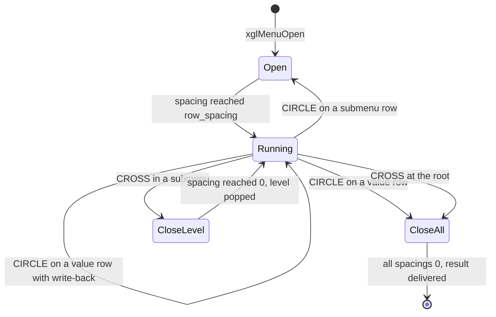

Drawing is recursive (`xglMenuDrawType1Sub`). Each row is printed at the
current position, the selected row in red, a disabled row in dark grey and
other rows in the default colour. After a row whose child is the next open
level, the child's rows are printed indented by 8 pixels. `xglMenuInitial()`
marks all 16 slots inactive.

## Flags

File: `src/main/xgl_flags.c`

The story state of the game is a bit field area of 256 bytes in the save
data, `SaveData.scriptFlags` (at `+0x74` of the save image). A flag is
addressed by a bit offset and a width. The script natives that read and
write flags call these functions (see [natives.md](../scripting/natives.md)
and [events.md](../scripting/events.md)).

`xglFlagsGet(bit_offset, bit_count)` copies the bytes that contain the
field into an 8-byte window, shifts the window right by `bit_offset & 7`
and masks the result with `(1 << bit_count) - 1`.
`xglFlagsSet(bit_offset, bit_count, value)` does the same read, replaces
the field in the window, writes the bytes back and returns the old value.

```
bit offset 13, width 4:  byte offset 1, shift 5, bytes copied: (4 + 5 + 7) >> 3 = 2

scriptFlags[1]           scriptFlags[2]
 7 6 5 4 3 2 1 0          7 6 5 4 3 2 1 0
[v v v . . . . .]        [. . . . . . . v]
 bits 0..2 of the value                   bit 3 of the value
```

Fixed-width wrappers exist for 1, 2, 4, 8, 16 and 32 bits (`xglFlagsGet1`
to `xglFlagsGet32`, `xglFlagsSet1` to `xglFlagsSet32`). The 64-bit variants
make two 32-bit calls.

The 32-bit width has a trap. The mask is computed with a 32-bit shift, and
on this processor a shift by 32 is a shift by 0, so the mask
`(1 << 32) - 1` is 0. `xglFlagsGet32` therefore always returns 0 and
`xglFlagsSet32` writes nothing. The 64-bit functions inherit this.
Fields of up to 16 bits work as expected.

`xglFlagsInitial()` clears all 256 bytes. It is called when a new game is
set up (see [save-data.md](../architecture/save-data.md)).

## IPU movies

File: `src/main/xgl_1.c`

The EE has a hardware image decoder, the IPU. `xgl_1.c` drives it to play
short movies in a simple intra-frame format with the signature `ipum`. The
file has a 16-byte header, each frame starts with a flags byte and ends with
the code `00 00 01 B0`, and the file ends with `00 00 01 B1` (see
[Movies, images and icons](../formats/movies-images-and-icons.md)). This
is not the game's main movie path. Full-screen cutscene movies are Sofdec
streams played by the CRI library (see
[cutscenes.md](../scripting/cutscenes.md)). The IPU player is used by the
cutscene player for movie images inside a scene: `cfePlugIn.c` opens one
per movie entry and `cfeEvaluate.c` calls `xglMoviePlay` for it each frame.

### The work record

All state is in the caller's `XglMovieWork`. `xglMovieInfoInit(info)`
resets it: the stream record is cleared, the two packet buffers are placed
in the scratchpad at `+0x40` and `+0x1000`, the transfer mode is set to
memory (`0xFF`) and looping is off.

| Field | Meaning |
| --- | --- |
| `stream` | The CD stream of a streamed movie. Its ring is the source buffer |
| `width`, `height`, `frameCount`, `currentFrame` | From the file header and the play position |
| `source`, `sourceSize` | The source data, or one half of the ring when streaming |
| `chain[4]` | DMA tags that feed the ring to the IPU |
| `decodeState` | Which half of the ring the IPU is reading |
| `dmaControl`, `dmaAddress`, `dmaQwords`, `dmaTag`, `bitPosition` | The saved position of the IPU input between frames |
| `imageAddress[2]` | Two buffers for decoded pixels |
| `packetAddress[2]` | Two buffers for the upload packets |
| `transMode` | 0: upload to the work page. 1: upload to the texture base. 2: upload to the buffer in `bitbltbuf`. `0xFF`: decode to memory only |
| `loop` | Restart at the end |
| `threshold0`, `threshold1` | Values for the IPU's `SETTH` command |
| `workBuffer` | Decode buffer for memory mode. 0 selects the scratchpad |

The file header (`XglMovieSourceHeader`) is 16 bytes: the signature, then
the width at `+0x08`, the height at `+0x0A` and the frame count at `+0x0C`.

### Opening

`xglMovieOpen(info, name)` has two modes. With a file name the movie is
streamed. The source buffer becomes a ring of two halves of `sourceSize`
bytes each (at most `0xF0000` when the requested size is too large). A CD
stream is opened on the file, the first half is filled, and four DMA tags
are prepared: one for the first half without its header, one for each full
half, and one for the last partial piece of the file. With a null name the
whole movie is already in memory at `info->source` and is fed to the IPU as
one transfer.

In both modes the function checks the `ipum` signature (and closes the
movie and returns 1 when it is wrong), takes the size and the frame count
and computes the strip size: a strip is one row of 16 x 16 macroblocks, and
each macroblock is 64 quadwords of 32-bit pixels.

### Playing a frame

`xglMoviePlay(info)` decodes exactly one frame and returns 0, or 1 at the
end of the movie, or -1 on an error. The caller calls it once per displayed
frame.

1. If the IPU input channel (DMA channel 4) is stopped, the IPU is reset,
   the thresholds and the saved bit position are restored and the channel
   is restarted from the saved address.
2. For a streamed movie `checkdma` advances the ring (see below). If the
   ring has run dry the frame is dropped with the message `frame drop` and
   the result is -1.
3. The frame is decoded strip by strip. For each strip a transfer from the
   IPU output (DMA channel 3, `myDmaDirectFromIPU`) is started. On the
   first strip the picture header byte is read from the bit stream with the
   `FDEC` command and the intra decode command `IDEC` is issued.
4. In an upload mode `make_gstrans` builds a GIF packet for the strip: one
   image transfer of 16 x 16 pixels per macroblock, with the pixel data
   referenced in place. The packet is sent on the GIF channel as soon as
   the IPU has delivered the strip. The two image buffers and the two
   packet buffers alternate from strip to strip, so the IPU can fill one
   while the GS reads the other.
5. In memory mode the strip is decoded into the work buffer and copied
   into the image buffer, rearranged from macroblock order to scan-line
   order.
6. After the last strip the 32-bit frame trailer is skipped and
   `currentFrame` is incremented. At the end of the movie the channels are
   stopped, or `xglMovieRewind` starts over when `loop` is set. Otherwise
   the position of the IPU input (DMA address, remaining count, tag
   pointer and the bit position from `IPU_BP`) is saved for the next call.

### The ring feed

`checkdma` keeps the IPU supplied from the two-half ring. It stops the
input channel, looks how far the DMA address has advanced and decides which
tag the channel continues with. When the IPU has crossed into the other
half, the half it left is released to the CD stream by moving the ring's
read position, and the next tag is chosen: the other full half, or the
final partial piece when the file has no bytes left. If the stream has not
yet delivered enough data for the half the IPU is entering, the function
reports that the caller must wait.

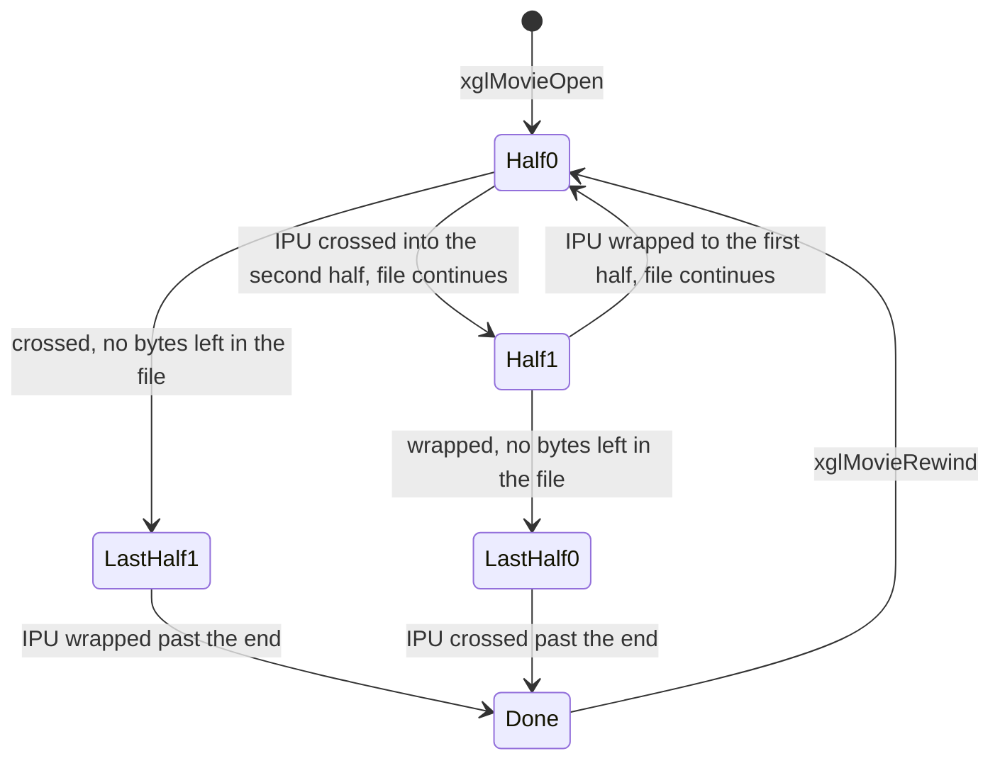

`xglMovieRewind(info)` stops both IPU channels, seeks the stream back to
its first sector, refills the first half and resets the DMA state.
`xglMovieClose(info)` closes the stream, stops the input channel and resets
the IPU. `xglMovieInit()`, called at start-up, is `sceIpuInit()`
(`src/main/movie_player.c`).

## JPEG

File: `src/main/xgl_jpeg.c`

The library has its own baseline JPEG codec, written in floating point. It
is used for still pictures: the decoder for backgrounds of 2D screens and
the encoder for the pictures the game takes of its own frame buffer.

### Decoding

`xglJpegDecode(request)` takes a 32-byte `JpegDecodeControl`:

| Field | Meaning |
| --- | --- |
| `source` | The JPEG data |
| `destination` | Output buffer. 0 uploads the picture straight to GS memory |
| `consumedSize` | Out: number of source bytes parsed |
| `frameBufferBase`, `frameBufferWidth` | GS destination page and width for an upload |
| `originX`, `originY` | Position in the destination |
| `imageLimits` | In: a size limit, or 0 for none. Out: the picture's width and height |
| `scaleMode` | Selects the brightness adjustment |
| `luminancePercent`, `chrominancePercent` | Scale factors in percent for mode YUV |
| `redPercent`, `greenPercent`, `bluePercent` | Scale factors in percent for mode RGB |
| `pixelFormat` | Output pixel format |

`DefineQuantizeTable` reads one table per `DQT` segment. It picks the
luminance or the chrominance table from the first id byte and then copies
every remaining byte of the segment. Ten pictures on the discs
(`gameov1.jpg`, `mnt_set.jpg` and `umn1.jpg` to `umn8.jpg`) store both tables
in one segment. For these the copy runs on from the luminance table into the
chrominance table that follows it in memory, so the chrominance table is
shifted by one entry and its first entry is the id byte 1. The colours of
these pictures are therefore decoded with slightly wrong weights (see
[Movies, images and icons](../formats/movies-images-and-icons.md)).

The function walks the markers of the file: `DQT` (quantisation tables),
`SOF0` (size and sampling), `DHT` (Huffman tables), `DRI` (restart
interval) and `SOS`. Unknown segments are skipped by their length. The scan
itself is decoded in `StartOfScan`: for each MCU the six 8 x 8 blocks are
Huffman decoded (`HuffmanDecode`), transformed with the inverse DCT
(`FFIDCT`), converted from MCU layout to a YUV block (`ConvertMCU2YUV`) and
then to RGB (`ConvertYUV2RGB`). The marker loop stops at `RST0` or `EOI`. The
three sampling modes 4:4:4, 4:2:2 and 4:2:0 are supported. The work area is
in the scratchpad.

The percent factors let a caller fade a picture while it decodes it. The
game over and disc change screens decode the same picture again with
changing factors for their fades (`game_over.c`,
`game_disk_change.c`). Other users are the menu background
(`menu_scene.c`), the save screen thumbnails (`save_screen.c`) and map
objects that show a picture (`game_map_object.c`).

### Encoding

`xglJpegEncode(request)` takes a `JpegEncodeRequest`: an output buffer, a
frame buffer page and width, an origin and size, two quality values (100 is
the best) and the sampling mode. It reads the pixels back from GS memory,
builds quantisation tables from the quality values
(`RebuildQuantizeTable`), copies a prepared 623-byte header (`headerALL`)
with the standard Huffman tables into the output and patches the size and
the tables into it. Then it encodes MCU by MCU: colour conversion
(`ConvertYUV2MCU`), forward DCT (`FFDCT`), quantisation (`Quantize`) and
Huffman coding (`EncodeDc`, `EncodeAc`, `PutBits`). `outputSize` receives
the number of bytes written.

The encoder makes the thumbnail of a save file (`save_screen.c`) and the
snapshots of the frame (`game_snap_shot.c`, see
[field.md](../game/field.md) and
[save-data.md](../architecture/save-data.md)).

## Timer 0, ARX and the language code

File: `src/main/xgl_timer0.c`

Besides the two timer functions (see [Timer 0](#timer-0)) this file holds
two unrelated helpers.

**ARX.** `xglArxExtract(dest, src)` unpacks the engine's own compression
format. The data is a stream of 32-bit words:

| Word | Content |
| --- | --- |
| 0 | Magic `ARX\0` (`0x00585241`) |
| 1 | Unpacked size in bytes |
| 2 | Packed payload size in bytes |
| 3 | Flags, must be 0 |
| 4 to 33 | A dictionary of 30 words |
| 34 onward | The bit stream |

The output is produced one word at a time. One flag bit decides: 0 means
the next stream word is copied as it is. 1 means the word comes from the
dictionary, and a unary prefix followed by a few index bits selects the
entry, so the most frequent words have the shortest codes. The dictionary
is copied to a temporary place at the 64-byte aligned address after
`WorkEnd`.

The function supports unpacking in place. The CD module reads a packed file
to the end of the destination buffer and unpacks toward the start. If the
write position catches up with the read position, the unread rest of the
stream is first moved to the temporary area behind the dictionary. The
function returns the unpacked size, or -1 for a wrong magic or non-zero
flags.

**Language code.** `xglGetLanguageCode(buffer)` returns a two-letter code
selected by the caption setting `SaveData.caption_all` from the table
`en`, `jp`, `en`, `de`, `fr`, `it`, `es`, `zh`, `ko`. With a buffer it also
stores the two characters. The resource path builder and the movie player
use it to pick language-specific files (`res_get_path.c`, `game_movie.c`).

## Math helpers

Files: `src/main/xgl_2.c`, `src/main/xgl_cur_matrix.c`,
`src/main/xgl_cur_mul.c`, `src/main/xgl_vector_ops.c`,
`src/main/xgl_matrix_axes.c`, `src/main/xgl_vu1_regs.c`

The vector and matrix code of the library is described on
[math.md](math.md). This overview lists what each file contributes.

| File | Contents |
| --- | --- |
| `xgl_2.c` | Random numbers: `xglSRand` (a 15-bit linear congruential generator on `iRandSeed`), `xglLRand` (32 bits from two steps), `xglFRand` and `xglFSrand` (the VU0 random register). Conversions `F2I` and `I2F`. `xglSin`, `xglCos`, `xglAtan2`. The `xglMemCopy*` family. Vector functions (`xglVectorScale`, `xglVectorNormal`, `xglVectorOuter`, `xglPointLength` and others). Matrix functions (`xglMatrixMul`, `xglMatrixInverse`, `xglMatrixRotX` and others). The matrix stack (`xglMatrixStackUnit`, `Mul`, `Trans`, `RotX`, `Frustum`, `Save`, `Load`, `Push`, `Pop`, `MulVector`, `RTPS`). Quaternions. `xglRotTransPers`, the projection of a point through a studio camera |
| `xgl_cur_matrix.c` | The **current matrix**, a matrix kept in VU0 registers: `xglCurMatrixSet`, `Mul`, `Get`, `xglCurApplyVector`, and setters that load a rotation, translation or scale |
| `xgl_cur_mul.c` | Multiplies the current matrix by a rotation, translation or scale: `xglCurMulRotateX`, `Y`, `Z`, `xglCurMulTranslate`, `xglCurMulScale`, `xglCurMulScaleXYZ`, `xglCurMulInvScaleXYZ` |
| `xgl_vector_ops.c` | Local copies of vector copy, add, subtract, multiply and normalise for the animation code, two `Ti` and actor helpers (`tiMRPackageFillNodes`, `XenoActorConvertSourceRecord`) and `tiVu0LoadIdentityMatrix` |
| `xgl_matrix_axes.c` | `xglMatrixFromAxes` (a matrix whose rows are three negated, normalised axes, then transposed), `xglMatrixReverseInPlace` (transpose), `xglVu1ReadFloatRegisters` |
| `xgl_vu1_regs.c` | `xglAtan2Angle(x, y)`, the angle of a 2D vector in the range 0 to 2 pi. `xglVu1ReadControlRegisters` and `xglVu1ReadIntegerRegisters` |
| `xgl_packet_unpack.c` | `xglMatrixFromRows`, which fills a matrix from four row vectors, next to the water sender that uses it |

`xglGeometryInit()`, called at start-up, seeds both random generators
(`xglFSrand(0.1f)` and `iRandSeed = 0x12345678`) and sends a short DMA
chain to VIF0 (`xglVu0ResidentMicroprogram`).

The three `xglVu1Read*Registers` functions read the VU1 registers through
their window in VU0 data memory (16 control, 16 integer and 32
floating-point quadwords) and discard every value. They have no caller in
the game. They look like the remains of a debug dump whose output was
removed.

## oLib

File: `src/main/oLib.c`

`oLib` is a small helper file. Its source name, kept in the string
`../oLib.euc.c`, suggests "object library". It is not part of `xgl` by
name, but several of its functions carry the `xgl` prefix. In this build
only the two degree-table functions have a caller
(`src/main/circle_draw.c`). The heap, object and coordinate functions are
present but unused.

`oLibInit()` sets up heap number 4 over the memory from `0x01000000` to
`0x01200000`, allocates a block of `0x800010` bytes from it and hands
`0x800000` bytes to the resource system (`GameResourceInit`). `oLibExit()`
resets the resource system and frees the block. The heaps and the resource
blocks are described on [memory.md](../architecture/memory.md) and
[files-and-resources.md](../architecture/files-and-resources.md).

`oLibLoadObject(object, Id)` loads an object resource by number with
`GameResLoadID` and creates an actor from it. The resource is a table of
five values: model, texture, hierarchy, a table entry and motion. The
function allocates an actor (`XenoActorAlloc`), stores the values in the
actor's resource slots, allocates its matrices and resets its animation
channels. Actors are described on [actors.md](actors.md).

The remaining functions are 2D helpers.

| Function | Result |
| --- | --- |
| `gsVertexX(x)`, `gsVertexY(y)` | A screen coordinate in the GS's 12.4 fixed point, with the offsets `0x7008` and `0x7208` |
| `gsRoundCoord(c)`, `xglRoundCoord(c)` | `c * 16 + 8` for positive values, `-(abs(c) * 16) - 8` otherwise |
| `xglPointDistanceInt(from, to)` | The distance of two points as an integer |
| `xglCosDeg(degrees)`, `xglSinDeg(degrees)` | Cosine and sine from tables with one entry per 10 degrees, built on first use. The angle's absolute value is taken first, so `xglSinDeg` of a negative angle returns the sine of the positive angle |

## Who uses xgl

Every part of the game uses the library. The table lists the main links
between `xgl` and the systems described on the other pages.

| System | What it uses |
| --- | --- |
| Title and boot ([title-and-boot.md](../game/title-and-boot.md)) | The whole start-up, `xglCdLoadOverlay`, `xglSleep` loops, `xglMcMain`, `xglHddInstall`, `xglRenderVSyncInterval` |
| Field ([field.md](../game/field.md)) | `xglSleep`, studio cameras in state 4, `PadData`, the clear and fade functions |
| Model library ([pxy.md](pxy.md)) | The current packet, `XglLightSet`, camera view matrices, final packet callback slots 12 and 13 |
| Effects ([sef.md](sef.md), [screen-effects.md](screen-effects.md)) | The packet, frame copies, `gsMakeFrame`, `gsMakeTex0`, callback slots 6 and 15, the scan-line mode |
| Actors ([actors.md](actors.md)) | Light sets and light packs |
| Cutscenes ([cutscenes.md](../scripting/cutscenes.md)) | Studios and cameras, the IPU movie player, `StudioEntrySkip` |
| Scripts ([natives.md](../scripting/natives.md)) | `xglFlagsGet`, `xglFlagsSet` |
| Menus and windows ([main-menu.md](../game/main-menu.md), [ui-windows.md](ui-windows.md)) | The print queue, `xglPacketTextureTrans`, the sector arena, the tick counter, the draw callback queue, `xglJpegDecode` |
| Save data ([save-data.md](../architecture/save-data.md)) | `xglMcRequest`, `xglMcMain`, the `xglHddMc*` functions, `xglJpegEncode` |
| Battle ([battle-engine.md](../game/battle-engine.md)) | `xglSleep`, callback slot 8 for its draw pass, light sets, `XglTaskPrefix` |
| Debug programs ([debug-tools.md](../game/debug-tools.md)) | The free cameras, the debug menu, debug print, `xglMcEasySave` |
