# Cutscenes: the cfe event player, movies and captions

Xenosaga Episode II tells most of its story in real-time cutscenes. The system
that plays them is called `cfe` in the code. Its debug tool is labelled
`CFEventTool` and its data folder is `motion/cfevent/`, so the name most likely
stands for "CF event". A `cfe` cutscene is a set of key tracks. Every value
that changes during the scene has its own track: the position of an actor, the
angle of the camera, the colour of a light, the volume of the music. A track is
a list of keys sorted by frame number. Once per frame the player samples every
track at the current frame and writes the results into the actors, the camera,
the lights and the other parts of the scene.

The player has no file format of its own in the executable. A cutscene is an
SB script (see [sb-vm.md](sb-vm.md)). The script calls the natives of the `cfe`
plug-in to load the cast, to add every key one by one, and then to step the
scene one frame at a time. The C side is therefore a library of 29 script
commands plus the evaluation code behind them (`src/main/cfePlugIn.c`,
`src/main/cfeEvaluate.c`).

Pre-rendered movies are a separate path. `GameMpeg2Play`
(`src/main/game_movie.c`) plays a CRI Sofdec `.sfd` file through the wrapper in
`src/main/movie_player.c` and prints a caption script over it. The last
sections of this page cover the movie player and the caption format, because
movies and `cfe` scenes share the same pause, skip and caption rules.

[← Back to the overview](../README.md)

## Files

| File | Contents |
| --- | --- |
| `src/main/cfePlugIn.c` | The `cfe` plug-in: the native table `cfePlugInTable`, every `cfeCmd*` command, the loaders for actors, maps, effects, monitors and sound, the message layout helpers, the frame step `cfeCmdStepFrame` |
| `src/main/cfeEvaluate.c` | Evaluation of every table at a frame time: actors, maps, camera with shake, effect commands, lights, fog, monitors, screen effects, sound. Also the monitor movie quad, two debug grids and the static tables themselves |
| `src/main/cfe_init.c` | `cfeInit` and the initializers of each table, the default light set, small file wrappers over the SDK calls |
| `src/main/cfe_node_pool.c` | The pool of 6144 track key nodes: `cfeNodeAlloc`, `cfeNodeRelease`, `cfeListTail` |
| `src/main/cfe_list.c` | Sorted key lists: find or insert a key, set a value or an angle, copy and remove keys |
| `src/main/cfe_track.c` | Track mathematics: tangent directions, angle unwrapping, linear and Bezier sampling, stepwise sampling, key search and time shifting |
| `src/main/cfe_entry.c` | Actor entry lookup (`cfeGetEntry`) and the frame range with its current value (`cfeRange*`), plus the table counters |
| `src/main/yg2_text.c` | Line helpers for text files: next line, compare a line against a pattern, find a line |
| `src/main/cfeFileControl.c` | The `pFileTemp` text buffer: an indented log writer and whole-file read and write through the debug file layer |
| `src/main/game_movie.c` | `GameMpeg2Play`, the caption parser (`caption_nextline`, `caption_getparam`, `caption_convert`) and the two frame-buffer copies used around a movie |
| `src/main/movie_player.c` | The Sofdec player wrapper: creation, start by disc position, per-frame update with the GS upload chain, pause, destroy |
| `src/main/test_129.c` | The developer test menu `testMenuRun` whose first entry is `CFEventTool` (see [debug-tools.md](../game/debug-tools.md)) |
| `include/main/cfeEvaluate.h` | Every table record: `CfeActor`, `CfeMap`, `CfeCamera`, `CfeEffect`, `CfeLight`, `CfeFog`, `CfeMonitor`, `CfeScreenEffect`, and the track index enums |
| `include/main/cfe_list.h` | `CfeTrackNode`, its flags and the 8.8 fixed-point conversion macros |
| `include/main/cfePlugIn.h` | `CfeSndRecord` and `cfeRegisterPlugIn` |
| `include/main/cfe_node_pool.h`, `cfe_track.h`, `cfe_entry.h`, `cfe_init.h`, `yg2_text.h`, `cfeFileControl.h` | Prototypes of the functions other files call |
| `include/main/movie_player.h`, `include/main/game_movie.h` | `MoviePlayerRecord`, the movie size constants, `GameMpeg2Play` |

## How a cutscene fits into the game

The SB virtual machine lets C code register groups of native functions under
an owner name. `scriptRegisterModules` (`src/main/uwamono_objx.c`) registers
all field modules at start-up, and one of its calls is `cfeRegisterPlugIn`,
which passes the table `cfePlugInTable` to `sbNativeOwnerAdd` under the name
`cfe`. From then on a script can call `cfe.init`, `cfe.ldAt`, `cfe.stFrm` and
so on. How natives are found and called is described in
[sb-vm.md](sb-vm.md) and [natives.md](natives.md).

A cutscene has no task or game mode of its own. It runs inside the normal
field loop `Game()` in `src/main/game_data.c` (see
[field.md](../game/field.md)). Each frame the loop calls `sbRunAll`, which
runs every script thread. The thread of the cutscene script calls `cfe.stFrm`
once and then waits for the next frame. `cfe.stFrm` does everything a frame
needs: it samples the tracks, updates and draws the actors, runs the effects
and prints the subtitles.

The field must stay out of the way while this happens. `cfe.init` sets two
bits in `gameWork.control`:

| Bit | Name | Effect |
| --- | --- | --- |
| `0x200` | `CONTROL_CFE_SCENE` | `Game()` skips the field work for the frame: `DispMapObject`, `uwamonoPlayerUpdate`, `cameraUpdateFrame`, `mapObjectsDraw`, its own `sefExecEffect` and `XenoActorDoit` calls, and the field pad handling such as opening the main menu |
| `0x100000` | `CONTROL_CFE_NO_FADE` | `uwamonoSetTransition` (`src/main/runtime.c`) starts no fade-out when a script requests a map change, and `Game()` clears the fade right after its initial 30-frame fade-in on the next map |

`cfe.destroy` clears `CONTROL_CFE_SCENE` and `CONTROL_CFE_NO_FADE` again.
`Game()` also clears `CONTROL_CFE_NO_FADE` when a play session starts, and
`src/main/pt_member.c` clears it together with the soft-reset bit.

The usual way into a cutscene is an event. A field script calls the `runtime`
native `jumpCF`, which ends in `uwamonoSetTransition` and queues a change of
map and state (see [events.md](events.md)). The new map's scene script then
drives the `cfe` natives. The 93 cutscene scripts on the discs all have the
same shape (see
[Scripts and archives](../formats/scripts-and-archives.md)). The script
switches the camera with `camera.mode(1, 0)` and calls `cfe.init`. It sets
the first and last frame with `cfe.stStrtFrm` and `cfe.stEndFrm` and then
loads its resources, always in the order `ldMp`, `ldAt`, `ldMt`, `ldEf`,
`ldMnt`, `ldSnd`, `ldMpDev`. The messages come next (`cfe.allocMes`, then one
`cfe.setMes` per line), and after them the keys, in the fixed order camera,
map, actors, effects, lights, fog, monitors, screen effects, sound.

The scene is then played by a script thread named `scene`. There is no loop
instruction around `cfe.stFrm`. The thread body is one frame of the scene,
and it ends with the rewind opcode `0x1C`, so the machine runs the body once
per frame (see [The SB virtual machine](sb-vm.md)). The body calls
`cfe.stFdIn(30)` on the start frame, then `cfe.stFrm`, and in most scripts
`cfe.stFdOut(30)` thirty frames before the end. On the end frame it calls
`cfe.destroy` and `runtime.jumpCF` to go to the next place.

The sequence below shows that life cycle.

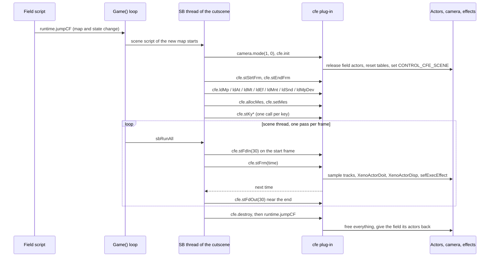

## The tables of a scene

All scene state lives in static tables defined at the end of
`src/main/cfeEvaluate.c`. Each table holds one kind of scene object. Every
record keeps the values it last produced and an array of track pointers, one
per animated value. A null track pointer means "this value is not animated",
and the evaluation leaves the value alone.

| Table | Record | Count | Record size | Address | Purpose |
| --- | --- | --- | --- | --- | --- |
| `cfeActors` | `CfeActor` | 64 | `0x1B0` | `0x6318C0` | Characters and props driven as `XenoActor` objects |
| `cfeCamera` | `CfeCamera` | 1 | `0x70` | `0x6384C0` | The studio camera, its tracks and the shake state |
| `cfeEffects` | `CfeEffect` | 64 | `0x80` | `0x638530` | Visual effects spawned from the sef library |
| `cfeLights` | `CfeLight` | 4 | `0x40` | `0x63A530` | The ambient light and three directional lights |
| `cfeLightSet` | `XglLightSet` | 1 | `0x180` | `0x63A630` | The light set the light rows point into |
| `cfeMaps` | `CfeMap` | 4 | `0xC0` | `0x63A7B0` | Background maps and their movable parts |
| `cfeMonitors` | `CfeMonitor` | 16 | `0x230` | `0x63AAB0` | Monitors: movies shown on a quad inside the scene |
| `cfeFog` | `CfeFog` | 1 | `0x50` | `0x63CDB0` | Fog colour, fog distances and the fog switch |
| `cfeScreenEffects` | `CfeScreenEffect` | 3 | `0x18` | `0x63CE00` | Full-screen effects |
| `cfeSndRecords` | `CfeSndRecord` | 1 | `0x50` | `0x63CE48` | The music name and its volume tracks |

Three more objects are allocated at run time. The key node pool is one block
of `0x48000` bytes. The message records are allocated by `cfe.allocMes`. The
per-part records of actors and maps are allocated by their loaders. All of
them come from `GameResBufferAlloc`, the resource block allocator described in
[files-and-resources.md](../architecture/files-and-resources.md).

The counters `cfeEntryCount`, `cfeCommandCount`, `cfeGroupCount`,
`cfeEvalEntryCount` and `cfeSndRecordCount` (`src/main/cfe_entry.c`) say how
many records of each table are in use. Each loader fills the record at the
current count and then increments it. Scripts refer to a record by that index,
so the first actor loaded is actor 0, the second is actor 1, and so on.

The diagram below shows how the tables hang together.

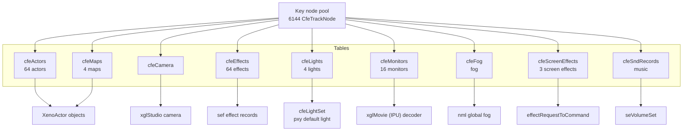

### Initialization

`cfeInit` (`src/main/cfe_init.c`) resets the whole system. `cfe.init` calls it
at the start of every cutscene. It first calls `soundDriverReset` and clears
the global collision handle with `tiGlobalCollSetHandle(0)`, then runs one
initializer per table in this order:

1. `cfeNodePoolInit` allocates the `0x48000`-byte node pool with
   `GameResBufferAlloc`, stores it with `cfeNodePoolSet` and clears it.
2. `cfeGroupTableInit` clears the four maps and sets `cfeGroupCount` to 0.
3. `cfeActorTableInit` clears the 64 actor entries. Each entry gets the vector
   (0, 0, 1, 1) from `cfeActorInitialVector` as its look target position and at
   `+0xD0`, no parent (`parentActId = -1`), both motion speeds 1.0 and
   `firstWord` 1.
4. `cfeStudioInit` clears `cfeCamera`, restarts the studio system
   (`xglStudioInit`, `xglStudioChange(0)`, `xglStudioMainCameraInit`), takes
   camera 0 of the studio, sets its state to 2 and binds it to pad port 1.
5. `cfeCommandTableInit` clears the 64 effect commands and sets the `owner` of
   each to -1.
6. `cfeLightRowsInit` builds the default light set and wires the four light
   rows to it (see [Lights](#lights)).
7. `cfeMessageCountReset` sets the message count to 0.
8. `cfeEvalGlobalInit` clears the fog block and sets the fog colour to
   (255, 255, 255, 1) and the fog distance vector to (5, 20, 0, 1).
9. `cfeEvalEntriesInit` clears the 16 monitors. Each one gets the unit quad of
   `cfeUnitQuad` as corners, position and angles at the origin and scale 1.
10. `cfeEvalSlotsInit` clears the three screen effect slots and gives each the
    kind 0, the strength `0x80` and the float value 1.0.
11. `cfeSndRecordsReset` clears the sound record and sets its volume value to
    `0x7F` and its duration to 0.

The studio, its cameras and pad ports belong to the xgl library (see
[xgl.md](../libraries/xgl.md)).

## Key tracks

A track is a doubly linked list of `CfeTrackNode` records sorted by time. The
owner of a track holds only a pointer to the first node. An empty track is a
null pointer.

### The key node

| Offset | Type | Name | Meaning |
| --- | --- | --- | --- |
| `0x00` | `int` | `flags` | `CFE_TRACK_*` bits, see below |
| `0x04` | `int` | `startTime` | The frame number of the key |
| `0x08` | `int` | `value` | The key value in 8.8 fixed point. A whole number on integer tracks |
| `0x0C` | `int[2]` | `firstDirection` | The tangent on the incoming side, a 2-D unit vector (time, value) in 8.8 fixed point |
| `0x14` | `int[2]` | `secondDirection` | The tangent on the outgoing side |
| `0x1C` | pointer | `prev` | The key before this one |
| `0x20` | pointer | `next` | The key after this one |
| `0x24` | 12 bytes | | Not used by the code that was read |

A node is `0x30` bytes. The flags are:

| Bit | Name | Meaning |
| --- | --- | --- |
| `0x01` | `CFE_TRACK_IN_USE` | The pool node is allocated |
| `0x02` | `CFE_TRACK_LINEAR` | The segment from this key to the next one is sampled linearly instead of as a curve |
| `0x04` | `CFE_TRACK_INTEGER` | Set on the first key: the track holds whole numbers and has no tangents |
| `0x08` | `CFE_TRACK_RESET_FIRST` | The incoming tangent is forced to (1, 0), a flat arrival |
| `0x10` | `CFE_TRACK_RESET_SECOND` | The outgoing tangent is forced to (1, 0), a flat departure |

Values travel between the script and the tracks as 8.8 fixed-point integers.
The SB virtual machine passes integers, so a script writes 1.5 as 384. The
macro `CFE_FIXED_TO_FLOAT` converts with `value / 256 + (value % 256) / 256`,
and the setters convert back with `CFE_FIXED_FROM_WHOLE`. The resolution of
every animated value is therefore 1/256. Angles are in radians, so a rotation
key has a resolution of about 0.22 degrees.

### The node pool

`src/main/cfe_node_pool.c` owns the nodes. The pool is an array of
`CFE_POOL_NODE_COUNT` = 6144 nodes, which at `0x30` bytes each is exactly the
`0x48000` bytes that `cfeNodePoolInit` allocates. `cfeNodeAlloc` scans the
array from the start, takes the first node without `CFE_TRACK_IN_USE`, clears
it and marks it. It returns null when all 6144 nodes are taken.
`cfeNodeRelease` only clears the in-use bit. `cfeNodePoolClear` and
`cfeNodePoolReset` free every node at once by clearing the array, and
`cfeNodePoolCountInUse` counts the allocated nodes. `cfeListTail` walks a
track to its last key.

A whole cutscene, with all tracks of all objects together, can hold at most
6144 keys. Nothing frees single keys during play. The pool is dropped as a
whole when the next `cfe.init` allocates and clears a new one.

### Building a track

`cfeListFindOrAdd(list, key)` (`src/main/cfe_list.c`) returns the node with
the given frame number. If the track has no such key it allocates one and
links it in time order: in front of the first key, between two keys, or after
the last one. When it finds an existing key it clears that key's two reset
flags. `cfeListLink` and `cfeListUnlink` do the pointer work.

Four setters sit on top of it:

| Function | Value kind | `CFE_TRACK_LINEAR` | Extra step |
| --- | --- | --- | --- |
| `cfeListSetValue` | plain | cleared | |
| `cfeListSetValueLinear` | plain | set | |
| `cfeListSetAngle` | angle | cleared | `cfeChainUnwrapAngles` |
| `cfeListSetAngleLinear` | angle | set | `cfeChainUnwrapAngles` |

Each setter stores the value in 8.8 fixed point and then calls
`cfeTrackUpdateDirections` on the whole track, so the tangents are always up
to date after a key is added. The file also has `cfeListCopyKey`, which copies
the flags and the value of one key to another frame, `cfeListRemoveKey`, which
unlinks and frees the key of a frame, and `cfeListFreeAll`, which frees a whole
track. The script commands never call these three.

`cfePlugIn.c` adds two wrappers used only by the camera command,
`cfeListSetKeyMode` and `cfeListSetAngleKeyMode`. They take a key mode:

| Mode | Name | Effect |
| --- | --- | --- |
| 0 | `CFE_KEY_MODE_PLAIN` | Curve key |
| 1 | `CFE_KEY_MODE_LINEAR` | Linear key |
| 2 | `CFE_KEY_MODE_RESET_BOTH` | Curve key, then both reset flags on the last key of the track |
| 3 | `CFE_KEY_MODE_RESET_FIRST` | Curve key, then `CFE_TRACK_RESET_FIRST` on the last key |
| 4 | `CFE_KEY_MODE_RESET_SECOND` | Curve key, then `CFE_TRACK_RESET_SECOND` on the last key |

Modes 2 to 4 let the camera come to rest or leave a rest without overshoot,
because a flat tangent makes the curve ease in or out at that key. Any other
mode value fails an assertion.

### Angle unwrapping

A rotation track must not jump from +179 degrees to -179 degrees through the
whole circle. `cfeChainUnwrapAngles` (`src/main/cfe_track.c`) walks the track
from the first key and moves each following key by whole turns of 2π until it
lies within π of the key before it. The adjusted value is stored back. A
track built with the angle setters is therefore continuous, and the stored
values may lie outside the range of one turn.

### Tangents

`cfeTrackUpdateDirections` computes the two tangents of every key. It returns
at once for an integer track. For the other tracks it walks the keys and looks
at the neighbours of each:

| Position of the key | Tangent |
| --- | --- |
| The only key | Both tangents (1, 0) |
| First key | The step to the next key: (next time - time, next value - value) |
| Last key | The step from the previous key |
| Middle key | The step from the previous key to the next key, which skips the key itself |

The step is written as a 2-D vector in 8.8 fixed point and normalized to unit
length by `cfeEntryNormalizeDirs`, which calls `cfeNormalizeFixedVec2` for each
pair. A zero length counts as 0.000001 to avoid a division by zero. Both
tangents of a key start equal, so the curve passes smoothly through it. This
is the classic Catmull-Rom choice of tangent.

`CFE_TRACK_LINEAR` changes this. On a middle key the incoming tangent becomes
the straight step from the previous key, and the previous key's outgoing
tangent is set to the same vector. On the last key only the previous key's
outgoing tangent is changed. After each key the function applies the reset
flags of the previous, current and next key with `cfeEntryResetDirs`, which
forces a flagged tangent to (1, 0). When both reset flags are set on one key,
only the first tangent is reset, because the function returns after the first
match.

### Sampling

Three functions read a track at a frame time.

`cfeTrackSample(track, time)` is used for continuous values. An empty track
gives 0. Before the first key it gives the first value, after the last key the
last value. Between two keys it looks at the earlier key: with
`CFE_TRACK_LINEAR` it calls `cfeTrackLerp`, otherwise `cfeTrackBezier`.

`cfeTrackLerp(from, to, time)` is a plain linear blend:
`(end - start) * t + start` with `t = (time - from time) / (to time - from time)`.

`cfeTrackBezier(from, to, time)` builds a cubic Bezier curve in the plane of
time and value. The four control points are:

| Point | Time | Value |
| --- | --- | --- |
| P0 | `from->startTime * cfeBezierTimeScale` | `from->value` |
| P1 | P0 + outgoing tangent of `from` | |
| P2 | P3 - incoming tangent of `to` | |
| P3 | `to->startTime * cfeBezierTimeScale` | `to->value` |

Both tangents are normalized again before use, with 0.0000001 standing in for
a zero length. `xacBuildCubicSegment` from the animation library (see
[animation.md](../libraries/animation.md)) turns the four points into the four
coefficients of a cubic polynomial in time. `cfeEntryEvalCubic` then evaluates
it in Horner form at `(time - from time) * cfeTimeScale`. Both scale globals
are 1.0, so time is measured in frames.

`cfeTrackSampleStep(track, time)` is used for values that switch instead of
blend: motion numbers, flags, parents, effect actions. It returns the value of
the last key at or before the time, or the first key's value before the track
starts. On an integer track the raw `value` is returned as a whole number, on
other tracks it is converted from 8.8.

The flow of `cfeTrackSample` is shown below.

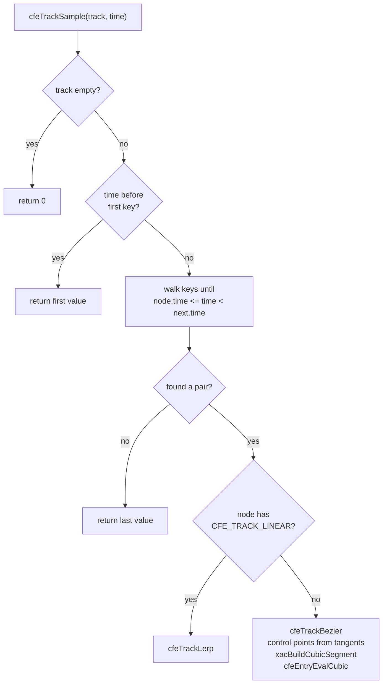

### Editing helpers

`src/main/cfe_track.c` also holds functions that no script command and no
other recovered function calls: `cfeTrackHasTime`, `cfeTrackAnyHasTime`,
`cfeTrackFindTime`, `cfeTrackFindAtOrAfter`, `cfeTrackFindNeighbor`,
`cfeTracksFindNearest`, `cfeTrackCount`, `cfeTrackCountInRange`,
`cfeTrackCountValueRuns`, `cfeTrackCountValueRunsInRange`,
`cfeTrackShiftTimes`, `cfeTrackShiftTimesBack` and `cfeTrackAllValuesEqual`.
They find the key next to a time in either direction, count keys and runs of
equal values, and move all keys after a time forwards or backwards. These are
the operations of a timeline editor: jump to the next key, insert or remove
frames, test whether a track is constant. They are most likely the remains of
the `CFEventTool` editor, which used the same track code as the game. The
same holds for the key copy and remove functions in `src/main/cfe_list.c`.

## The frame range

`src/main/cfe_entry.c` keeps three integers: `cfeRangeMin`, `cfeRangeMax` and
the current frame `cfeRangeValue`. The defaults are 0 and 1000. The script
sets the limits with `cfe.stStrtFrm` (`cfeRangeSetMin`) and `cfe.stEndFrm`
(`cfeRangeSetMax`). Both setters pull the current frame back inside the range.
`cfeRangeSetValue` stores a frame and clamps it to the range.
`cfeCmdStepFrame` calls it with the script's time at the start of every frame.

The start frame matters in several places. `cfeRangeGetMin` marks the first
frame of the scene: on that frame the actors get their motion set even when
it did not change, the opening fade-in starts and the voice stream is
prepared. The pause button only works 31 frames after it.

The file also has `cfeRangeStepWrap`, which steps the current frame and wraps
it around at the limits, and `cfeRangeAdjustMin` and `cfeRangeAdjustMax`,
which move a limit by a delta. No recovered code calls them. Like the track
editing helpers they fit a timeline editor with a looping preview.

`cfeGetEntry(index)` returns the actor entry of an index or null when the
index is at or above `cfeEntryCount`, and `cfeGetEntryCount` returns the
count. `cfeFloatAddDouble` adds a double to a float and has no caller.

## The cfe commands

`cfePlugInTable` holds 29 natives. A script calls them as `cfe.<name>`. Every
native receives the calling `SbThread`. It reads its argument count with
`VM_PLUGIN_CNT_GET`, integer arguments with `vmArgGet(thread, n)` (1-based) and
strings with `vmKeyedEntryGet`, which looks an argument up in the string table
of the script library. Most commands assert on their argument count, and the
assertion texts name the original source file `cfePlugIn.euc.c`. All commands
return 1 except `stFrm`, which returns the next frame time. The return value
is pushed on the script stack by `sbOpCallNative`.

In the table, "8.8" marks a value passed in 8.8 fixed point, and "linear"
is a flag: nonzero adds the key with `CFE_TRACK_LINEAR`.

### Scene control

| Command | Function | Arguments | Effect |
| --- | --- | --- | --- |
| `init` | `cfeCmdInit` | none | Ends the field scene and resets the cutscene system, see [Starting a scene](#starting-a-scene-cfeinit) |
| `stStrtFrm` | `cfeCmdSetStartFrame` | frame | Sets the first frame of the scene (`cfeRangeSetMin`) |
| `stEndFrm` | `cfeCmdSetEndFrame` | frame | Sets the last frame of the scene (`cfeRangeSetMax`) |
| `stFrm` | `cfeCmdStepFrame` | time | Plays one frame at `time` and returns the time for the next call, see [One frame](#one-frame-cfestfrm) |
| `stFdIn` | `cfeCmdKillEffects` | one value (not read) | Kills every sef effect with `sefKillEffect(-1)`. Despite its name it starts no fade. The fade-in is started by `stFrm` on the first frame |
| `stFdOut` | `cfeCmdFadeOut` | frames | Starts a fade-out over that many frames (`fadeStartOut`) |
| `destroy` | `cfeCmdDestroy` | none | Ends the cutscene and frees everything, see [Ending a scene](#ending-a-scene-cfedestroy) |

### Loaders

| Command | Function | Arguments | Effect |
| --- | --- | --- | --- |
| `ldAt` | `cfeCmdLoadActor` | resource ID | Loads an actor into the next entry of `cfeActors` |
| `ldMt` | `cfeCmdLoadMotion` | actor, slot, name | Loads a motion file by name and stores it as motion resource `slot` of the actor. Slot 0 also restarts motion 0 and selector 0 |
| `ldMp` | `cfeCmdLoadMap` | resource ID | Loads a background map into the next entry of `cfeMaps` |
| `ldMpDev` | `cfeCmdLoadMapCollision` | map, name | Loads the file `motion/cfevent/<name>` and stores it as the collision set of the map |
| `ldEf` | `cfeCmdLoadEffect` | page, offset, or flag, page, offset | Registers a sef effect in the next entry of `cfeEffects` and loads it with `sefStartEffectKeyDefault` |
| `ldMnt` | `cfeCmdLoadMonitor` | name | Opens a movie file for the next monitor of `cfeMonitors` |
| `ldSnd` | `cfeCmdLoadSound` | name | Copies the name into the next sound record and starts it as background music with `seBgmNameSet` |
| `ldDev` | `cfeCmdLoadDev` | ignored | Does nothing and returns 1 |

### Key setters

| Command | Function | Arguments | Track written |
| --- | --- | --- | --- |
| `stKyAt` | `cfeCmdSetActorKey` | actor, track, frame, linear, 8.8 value | `cfeActors[actor].track[track]`. Tracks 3 to 5 are angles |
| `stKyAtHd` | `cfeCmdSetActorHeadKey` | actor, track, frame, linear, 8.8 value | `cfeActors[actor].headTrack[track]` |
| `stKyAtPrts` | `cfeCmdSetActorPartKey` | actor, part, column, frame, linear, 8.8 value | `cfeActors[actor].records[part].track[column]`, the visibility of one model part |
| `stKyCm` | `cfeCmdSetCameraKey` | track, frame, mode, 8.8 value | `cfeCamera.eval.track[track]`. Tracks 3 to 5 are angles. `mode` is a key mode 0 to 4 |
| `stKyEf` | `cfeCmdSetEffectKey` | effect, track, frame, linear, 8.8 value | `cfeEffects[effect].track[track]`. Tracks 3 to 5 are angles |
| `stKyLgt` | `cfeCmdSetLightKey` | light, track, frame, linear, 8.8 value | `cfeLights[light].track[track]`. Tracks 3 to 5 are angles |
| `stKyMp` | `cfeCmdSetMapKey` | map, part, track, frame, linear, 8.8 value (6 arguments) | `cfeMaps[map].records[part].source[track]`. Tracks 3 to 5 are angles |
| `stKyMp` | `cfeCmdSetMapKey` | map, track, frame, linear, 8.8 value (5 arguments) | `cfeMaps[map].tracks[track]`, the map's own values |
| `stKyFog` | `cfeCmdSetFogKey` | track, frame, linear, 8.8 value | `cfeFog.source[track]` |
| `stKyMnt` | `cfeCmdSetMonitorKey` | monitor, track, frame, linear, 8.8 value | `cfeMonitors[monitor].source[track]` |
| `stKyScrEff` | `cfeCmdSetScreenEffectKey` | slot, track, frame, linear, 8.8 value | `cfeScreenEffects[slot].source[track]` |
| `stKySnd` | `cfeCmdSetSoundKey` | sound, track, frame, linear, 8.8 value | `cfeSndRecords[sound].track[track]` |

Note that the camera command has its own argument order and takes a key mode
where the others take a linear flag. None of the setters checks the index or
the track number against the table size.

### Messages

| Command | Function | Arguments | Effect |
| --- | --- | --- | --- |
| `allocMes` | `cfeCmdAllocMessages` | count | Allocates and clears `count` message records of `0x44C` bytes. A count of 0 or less does nothing |
| `setMes` | `cfeCmdSetMessage` | text, first frame, end frame | Fills the next message record with a subtitle |
| `setMes` | `cfeCmdSetMessage` | text, first frame, end frame, name, sound slot (5 arguments) | The same, plus the name of a voice stream and the sound slot it plays in |
| `setMesScr` | `cfeCmdSetMessageScr` | ignored | Does nothing and returns 1 |

## Starting a scene: `cfe.init`

`cfeCmdInit` turns the field into an empty stage. It works in this order:

1. It waits until the disc service has nothing pending
   (`xglCdServiceIfPending`).
2. It resets all message windows with `msgResetAll` and loads font 0 with
   `xglFontLoad(0, ...)`. Font 0 is the caption font. `cfe.destroy` loads
   font 1 again at the end.
3. It calls `resPlayerSlotUpdate(-3)` and `xglMovieInit`, which initializes
   the IPU for the monitors.
4. It clears the pause state (`cfePaused`, `cfeStartDelay`) and takes both
   stream sound slots out of pause.
5. It runs `cfeInit` and sets `cfeEntryCount` to 0.
6. It clears the global collision handle, sets `pxyTickScaleDouble` to 0,
   calls `studioSceneFlagSet` and sets `CONTROL_CFE_NO_FADE` and
   `CONTROL_CFE_SCENE` in `gameWork.control`.
7. It walks all 256 records of `uwamonoRecords`, the field's unit table (see
   [map-and-units.md](../game/map-and-units.md)). Records of kind 4 (`MAP_KIND_ACTOR_STATIC`)
   and 5 (`MAP_KIND_PART`, a part attached to the player) are moved to (99999, 99999, 99999) and
   their actor is released. Every record whose kind is not 0 gets the flags
   `0x400000` and `0x800000`.
8. It releases all actors with `XenoActorReleaseAll` and rebuilds the actor
   pool with `XenoActorPoolInitDefault`. The cutscene's own cast then starts
   from an empty pool.
9. It sets the state of studio camera 0 to 1 and clears the screen fade with
   `fadeClear`.

After this the script loads its cast.

## Actors

An actor entry drives one `XenoActor`, the engine's animated model object (see
[actors.md](../libraries/actors.md)). Characters, props and anything else with
a skeleton are actors.

### Loading

`cfeCmdLoadActor` calls `cfeLoadActorObject(id)`. The loader waits for the
disc, loads the resource with `GameResLoadID` and reads the loaded data as a
block of five words (`CfeResourceBlock`): the model pack, a second resource
that goes to the actor's texture slot, the hierarchy, a look link and a slot
table. It allocates an actor with `XenoActorAlloc`, sets draw mode 6, stores
the resource ID as the actor's kind and fills the resource slots
`XAct_Rsrc_MDL`, `XAct_Rsrc_TEX`, `XAct_Rsrc_XHR`, `XAct_Rsrc_XAP` and
`XAct_Rsrc_EntryTableC`.

When the hierarchy has face nodes (a nonzero `skipCount` at `+0x1C`), the
loader also loads the
shared resource `0x30041` into `XAct_Rsrc_SlotTableB`, sets the second
channel value to 0 and the selector to 0. The second channel and the selector
drive the secondary animation of an actor, which for characters is the face
(see [animation.md](../libraries/animation.md)), and `0x30041` is
the shared face motion pack `motion\face_all.fap`. Finally the loader allocates the actor's
matrices, zeroes both channel values and starts motion 0 in slot 0.

Back in the command, the entry copies the play range of the actor's first
motion state into `playStart` and `playEnd`, sets `drawMode` to 6 and
allocates the part records: 8 bytes per geometry of the model pack, cleared.
Each part record (`CfeFlagRecord`) holds a value and one track, and controls
the visibility of one geometry.

`cfeCmdLoadMotion` adds motion data to an actor that is already loaded. It
copies the name from the script's string table, loads the file with
`GameResLoadName` and stores the address in resource slot
`XAct_Rsrc_XAP + slot`. For slot 0 it restarts the motion and the selector so
the new data takes effect.

### The actor entry

| Offset | Type | Name | Meaning |
| --- | --- | --- | --- |
| `0x0C0` | pointer | `actor` | The `XenoActor` |
| `0x0D0` | vector | `vectorD0` | Set to (0, 0, 1, 1) at init |
| `0x0E0` | vector | `position` | The look target of the actor |
| `0x0F0` | `int` | `flags` | `CFE_ACTOR_LOOK_ENABLED` (bit 0): the actor looks at `position` |
| `0x0F4` | `int` | `mode` | The motion number |
| `0x0F8` | `int` | `selector` | The secondary motion number |
| `0x0FC` | `int` | `slot` | The motion slot the mode is set in |
| `0x100` | `float` | `channelValue` | The channel value of both channels |
| `0x104` | `int` | `playStart` | Start of the play range of the first motion state |
| `0x108` | `int` | `playEnd` | End of that range |
| `0x10C` | `int` | `parentActId` | Index of the actor this one is attached to, -1 for none |
| `0x110` | `int` | `parentMatId` | The joint of the parent it is attached to |
| `0x114` | `float` | `speedA` | Speed of motion state 0 |
| `0x118` | `float` | `speedB` | Speed of motion state 1 |
| `0x11C` | `int` | `dampOffset` | A direction number 0 to 8 for the focus offset |
| `0x120` | `int` | `firstWord` | Passed to `XenoActorSetSolverPasses` |
| `0x124` | `int` | `shadowType` | The actor's draw mode |
| `0x128` | `int` | `translucent` | Nonzero sets the translucent draw flag |
| `0x12C` | `int` | `forceMode` | Nonzero sets the motion again on every frame |
| `0x130` | pointers | `track[25]` | The main tracks |
| `0x194` | pointers | `headTrack[4]` | The look tracks |
| `0x1A4` | pointer | `records` | The part visibility records |

### Actor tracks

`cfe.stKyAt` addresses these tracks by number:

| Track | Name | Sampling | Drives |
| --- | --- | --- | --- |
| 0 to 2 | `CFE_ACTOR_TRACK_POSITION` | curve | `actor->position` x, y, z |
| 3 to 5 | `CFE_ACTOR_TRACK_ROTATION` | curve, angle | `actor->rotation` x, y, z |
| 6 to 8 | `CFE_ACTOR_TRACK_SCALE` | curve | The actor's scale vector x, y, z |
| 9 | `CFE_ACTOR_TRACK_MODE` | step | The motion number |
| 10 | `CFE_ACTOR_TRACK_SELECTOR` | step | The secondary motion number |
| 11 | `CFE_ACTOR_TRACK_SLOT` | step | The motion slot used for the mode |
| 12 | `CFE_ACTOR_TRACK_CHANNEL` | step | The channel value, set on both channels |
| 13 | `CFE_ACTOR_TRACK_PLAY_START` | step | Start of the play range |
| 14 | `CFE_ACTOR_TRACK_PLAY_END` | step | End of the play range |
| 15 | `CFE_ACTOR_TRACK_PARENT_ACT` | step | The parent actor index |
| 16 | `CFE_ACTOR_TRACK_PARENT_MAT` | step | The parent joint |
| 17 | `CFE_ACTOR_TRACK_SPEED_A` | step | Speed of motion state 0 |
| 18 | `CFE_ACTOR_TRACK_SPEED_B` | step | Speed of motion state 1 |
| 19 | `CFE_ACTOR_TRACK_ALPHA` | curve | The actor's alpha |
| 20 | `CFE_ACTOR_TRACK_DAMP_OFFSET` | step | The focus offset direction |
| 21 | `CFE_ACTOR_TRACK_FIRST_WORD` | step | `XenoActorSetSolverPasses` |
| 22 | `CFE_ACTOR_TRACK_DRAW_MODE` | step | The draw mode |
| 23 | `CFE_ACTOR_TRACK_TRANSLUCENT` | step | The translucent flag |
| 24 | `CFE_ACTOR_TRACK_FORCE_MODE` | step | The force-mode flag |

`cfe.stKyAtHd` addresses the look tracks: track 0 (`CFE_ACTOR_HEAD_LOOK_ENABLED`,
step) switches looking on and off, tracks 1 to 3 (`CFE_ACTOR_HEAD_POSITION`,
curve) give the point to look at. `cfe.stKyAtPrts` addresses the visibility
track of one model part.

### Evaluating an actor

`cfeActorTableEvaluate(time)` calls `cfeActorEvaluate` for every loaded entry.
The function goes through the tracks in a fixed order, and the order matters
because later steps use earlier results.

1. Position, rotation and scale are sampled with `cfeTrackSample` and written
   straight into the `XenoActor`.
2. The look target is moved in front of the actor. The function takes the
   offset from the actor to `entry->position`, keeps its height and its
   horizontal distance, places that point straight ahead on the Z axis and
   rotates it by the actor's Y rotation. The target therefore stays ahead of
   the actor at the old distance and height when the actor turns.
3. The channel value is sampled and set on both channels
   (`XenoActorSetBlendFrames`, `XenoActorSetBlendFramesB`).
4. The slot, both speeds and the force-mode flag are sampled. The speeds go to
   the motion states with `tiMRStateSetSpeed`.
5. The mode is sampled. The motion is set with `XenoActorSetBlendLocal` and
   `XenoActorSetModeInSlot` only when something changed: the actor's mode
   differs, the slot differs, the time is the first frame of the scene, or
   force mode is on. The entry then copies the new motion's play range.
6. The play range tracks are sampled. If either exists, the range is applied
   with `XenoActorSetPlayRange`.
7. The selector is sampled and set with `XenoActorSetBlendLocalB` and
   `XenoActorSetSelector` when it changed or on the first frame.
8. Draw mode and the translucent flag are sampled and applied. The translucent
   draw flag (`0x2000000`) follows `entry->translucent` on every frame, with or
   without a track.
9. Alpha is sampled. An alpha other than 1.0 sets the alpha draw flag
   (`0x10000`). An alpha of 0 or less hides the actor by setting draw mode 0
   and the hidden flag (`0x4`). Any positive alpha restores the entry's draw
   mode and clears the hidden flag. A fade-in from 0 thus makes the actor
   appear by itself.
10. The parent tracks are sampled. With a parent index of 0 or more the actor
    is released from its current parent (`XenoActorReleaseChild`) and appended
    to the given joint of the parent actor
    (`XenoActorAppendChildOnJoint`). With a negative index it is only
    released. This happens on every frame. It is how a character holds a prop,
    and how the prop is let go.
11. The focus direction and `firstWord` are sampled.
12. `cfeRecordListSample` samples the visibility track of every model part and
    sets or clears bit `i` of `actor->visibility` for part `i`.
13. The look tracks are sampled last. Track 0 sets or clears
    `CFE_ACTOR_LOOK_ENABLED`, tracks 1 to 3 overwrite `entry->position`.

Two more actor steps run later in `cfeCmdStepFrame`, after all tables are
evaluated. For an entry with `CFE_ACTOR_LOOK_ENABLED` the look target is handed to
the actor with `XenoActorSetFocusTarget`. For every entry
`cfeDampDirOffset(actor, dampOffset)` (`src/main/xeno_actor_set.c`) moves the
actor's focus offset pair one tenth of the way towards the table value of the
direction. The table `cfeDirOffsetTable` has entries for directions 0 to 8:
0 is the centre, the others are combinations of ±0.1 sideways and -0.1 or
+0.15 vertically. The damping gives a soft glance in one of eight directions.
The focus pair is most likely the eye direction of the character.

The diagram below shows the order of the evaluation.

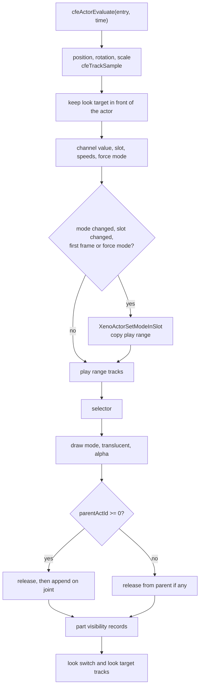

## The camera

The cutscene camera is camera 0 of the current studio. A studio is the xgl
library's bundle of cameras and view settings (see
[xgl.md](../libraries/xgl.md)). `cfeCamera` holds a pointer to the camera, ten
tracks and the shake state.

| Offset | Type | Name | Meaning |
| --- | --- | --- | --- |
| `0x00` | pointer | `camera` | The `XglCamera`, refreshed every frame |
| `0x04` | pointers | `track[10]` | The camera tracks |
| `0x2C` | `int` | `flags` | `CFE_CAMERA_HELD` (bit 0) stops the evaluation |
| `0x30` | `int` | `shakeOn` | Nonzero while the shake is active |
| `0x34` | `int` | `shakeFrames` | Frames from one shake offset to the next |
| `0x38` | `int` | `shakeAmount` | Largest shake offset |
| `0x3C` | `int` | `shakeCounter` | Frames left until the next offset |
| `0x40` | 6 floats | `from` | The shake offset being left: position x, y, z and rotation x, y, z |
| `0x58` | 6 floats | `to` | The shake offset being approached |

The tracks, addressed by `cfe.stKyCm`:

| Track | Name | Sampling | Drives |
| --- | --- | --- | --- |
| 0 to 2 | `CFE_CAMERA_TRACK_POSITION` | curve | `camera->travel.position` |
| 3 to 5 | `CFE_CAMERA_TRACK_ROTATION` | curve, angle | `camera->travel.rotation` |
| 6 | `CFE_CAMERA_TRACK_FOV` | curve | `camera->travel.fov` |
| 7 | `CFE_CAMERA_TRACK_SHAKE_ON` | step | The shake switch |
| 8 | `CFE_CAMERA_TRACK_SHAKE_FRAMES` | step | The shake period |
| 9 | `CFE_CAMERA_TRACK_SHAKE_AMOUNT` | step | The shake strength |

`cfeCameraEvaluate(time, paused)` fetches the camera with
`xglStudioGetCamera`, returns if `CFE_CAMERA_HELD` is set, samples the tracks
and applies the shake. The camera is described by a position and three Euler
angles, not by a look-at point. A cut between two shots is made by placing two
keys on neighbouring frames, most simply with linear keys. At the end the
function calls `xglStudioMove`, which turns the travel values into the view
matrices.

### Camera shake

The shake is active while `shakeOn` and `shakeAmount` are both nonzero. It
works by blending between two random offsets:

1. When `shakeCounter` drops below 0, the counter is reloaded with
   `shakeFrames`, the old target offset `to` becomes `from`, and a new `to` is
   drawn. Each of the six components is
   `xglSRand() % (shakeAmount + 1)` multiplied by a unit and by a random sign
   from `cfeShakeSigns` (-1 or +1). The unit is 0.001 for the position and
   0.0001 for the rotation.
2. The blend factor is `shakeCounter / (shakeFrames + 1)`, limited to 1.
3. The camera's travel position and rotation each get
   `from * blend + to * (1 - blend)` added.
4. The counter is decremented.

The camera thus glides from one random offset to the next over `shakeFrames`
frames. A short period gives a hard rattle and a long one a slow sway. When
the shake is off, the counter and both offsets are cleared. While the scene is
paused the counter does not run and no new offset is drawn.

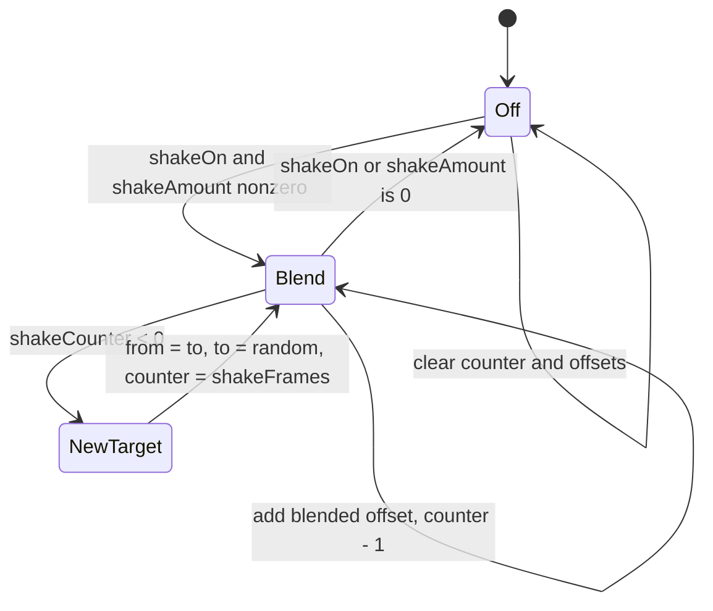

## Lights

`cfeLightSetInit` (`src/main/cfe_init.c`) fills `cfeLightSet` with the default
lighting of a cutscene: the first directional light is grey 0.9, the second
and third are black, both ambient colours are 0.2, and there are no point
lights. The directions are stored as angle vectors first and turned into
direction vectors with `xglDirectionFromAngles`. The set is then made the
default light of the model library with `pxySetDefaultLight` (see
[pxy.md](../libraries/pxy.md)).

`cfeLightRowsInit` wires the four rows of `cfeLights` to this set:

| Row | `direction` points to | `color` points to |
| --- | --- | --- |
| 0 | null | The ambient colour |
| 1 | Direction of light 0 | Colour of light 0 |
| 2 | Direction of light 1 | Colour of light 1 |
| 3 | Direction of light 2 | Colour of light 2 |

Each row has nine tracks, addressed by `cfe.stKyLgt`:

| Track | Name | Drives |
| --- | --- | --- |
| 0 to 2 | `CFE_LIGHT_TRACK_EXTRA` | The three floats behind the row's `extra` pointer |
| 3 to 5 | `CFE_LIGHT_TRACK_ANGLE` | The row's `angles` (X and Y rotation of the direction) |
| 6 to 8 | `CFE_LIGHT_TRACK_COLOR` | Red, green, blue behind the `color` pointer |

`cfeLightTableEvaluate` samples all nine tracks of each row as curves. For a
row with a direction pointer it then calls `cfeDirectionFromAngles`, which
rotates the forward vector (0, 0, 1) by the X angle and then the Y angle and
writes the result into the light set. Row 0 has no direction, so only its
colour tracks are useful, and they animate the ambient light.

`cfeLightRowsInit` never sets the `extra` pointer, so it stays null after the
table is cleared. A script that added keys to tracks 0 to 2 of a light would
make the evaluation write through that null pointer. The tracks are most
likely a feature that was dropped.

`cfeCmdStepFrame` makes `cfeLightSet` the default light again on every frame
after the evaluation, and `cfe.destroy` restores the normal light with
`pxyResetLightToDefault`.

## Fog

`cfeFog` holds the fog. Its eight tracks are addressed by
`cfe.stKyFog`:

| Track | Sampling | Drives |
| --- | --- | --- |
| 0 to 2 | curve | The fog colour, default (255, 255, 255) |
| 3 to 6 | curve | Four fog distance values, default (5, 20, 0, 1) |
| 7 | step | `fogEnabled` |

`cfeGlobalEvaluate` samples them. `cfeCmdStepFrame` calls it twice per frame,
once before the actors and once after the effects, with the same result. When
`fogEnabled` is nonzero the frame step passes the four distance values to
`nmlModelSetGlobalFogDist` and the colour to `nmlModelSetGlobalFogCol`. When
it is zero the fog settings are left as they are. How the renderer uses them
is described in [rendering.md](../architecture/rendering.md).

## Maps

A "map" in `cfe` is the background of the scene: a room, a street, a ship
deck. Up to four can be loaded. A map is drawn through an actor object like
everything else, but it has no skeleton. Instead its model pack can carry a
part pack whose geometries each have a matrix, and the cutscene can animate
those matrices. This is how doors open and machines move in the background.

### Loading

`cfeCmdLoadMap` calls `cfeLoadResourceObject(id)`. The loader loads the
resource, allocates an actor, stores the ID as its kind, fills only the model
and texture slots and registers the pack as the culling map with
`xglCullingMapSet`. The command then reads the pack header (`CfePackHeader`):
the word at `+0xD0` is the byte offset of the part pack, or 0 when there is
none. With a part pack the map entry gets a pointer to it, a pointer to its
matrix array (at the part pack's `+0x68` offset) and a newly allocated array
of one `CfeEvalRecord` (`0x80` bytes) per geometry.

`cfeMapInitRecords` gives each part record its starting values by taking the
part's matrix apart. The position comes from the translation row. The X angle
is the arcsine of the pitch element, the Y angle is the `atan2f` of two
elements of the third row, and the Z angle is the roll, reflected across π
when the up row points down. The scale starts at 1. Position and angles are
also kept in `initial`.

`cfeCmdLoadMapCollision` (`cfe.ldMpDev`) loads a file from `motion/cfevent/`
and stores its address in the map's `collision` field. The frame evaluation
passes it to `tiGlobalCollSetHandle`, the global collision set of the cloth
and hair dynamics (see [animation.md](../libraries/animation.md)). The file is
a `.dev` file, a `TiGlobalCollSet` of spheres, planes and cylinders in world
space plus eight wind blocks. The discs hold only three of them, all on disc
2, and each describes a few small shapes near a character, such as a seat,
that hair and clothes must not pass through (see
[Skeletons and motion](../formats/skeletons-and-motion.md)).

### The map entry

| Offset | Type | Name | Meaning |
| --- | --- | --- | --- |
| `0x00` | pointer | `object` | The actor object that draws the map |
| `0x04` | pointer | `parts` | The part pack, or null |
| `0x08` | pointer | `matrices` | One matrix per part |
| `0x0C` | pointer | `records` | One `CfeEvalRecord` per part |
| `0x50` | vector | `position` | Three values from tracks 0 to 2, passed to `pxySetColorScale` |
| `0x60` | `int` | `light` | From track 4 |
| `0x64` | pointers | `tracks[5]` | The map's own tracks |
| `0xB8` | pointer | `collision` | The collision set of the map |

### Evaluating maps

`cfeGroupTableEvaluate(time)` handles every loaded map:

1. Tracks 0 to 2 are sampled as curves into `position`.
2. Track 4 is sampled stepwise into `light`.
3. Track 3 is sampled stepwise as a "hidden" switch. When it is nonzero the
   map's object gets the hidden draw flag. When it is zero the map is shown:
   if `light` is nonzero `pxySetTexMapDropAll` is called, `position` is passed
   to `pxySetColorScale`, the hidden flag is cleared and the map's collision
   set becomes the current one.
4. For every part, `cfeRecordEvaluate` samples nine tracks (position, angles,
   scale) and `cfeRecordBuildMatrix` rebuilds the part's matrix in place:
   translate, rotate Z, rotate Y, rotate X, scale.

Although the field is named `position`, step 3 uses it as a colour scale. The
three map tracks 0 to 2 are thus the red, green and blue brightness of the
map, which lets a scene dim or tint its background. Because showing a map also
selects its collision set, a scene that switches between two maps by their
hidden tracks switches the cloth collision with them. The actions of step 3 only
run for a map that has a hidden track.

## Effects

Visual effects come from the sef library (see [sef.md](../libraries/sef.md)).
An effect is identified by a page index and an offset inside the page. `cfe`
builds the effect number as `(page << 12) | offset` plus a bank bit:
`0x10000000` normally, `0x20000000` when the command's `flag` is set by the
three-argument form of `cfe.ldEf`.

`cfeCmdLoadEffect` stores page, offset and flag in the next command, loads the
effect data with `sefStartEffectKeyDefault`, and sets the command's position
and rotation to the origin and its scale to (1, 1, 1).

| Offset | Type | Name | Meaning |
| --- | --- | --- | --- |
| `0x00` | `int` | `flag` | Selects the effect bank |
| `0x04` | `int` | `page_index` | The effect page |
| `0x08` | `int` | `page_offset` | The effect inside the page |
| `0x10` | vector | `position` | Where the effect is created |
| `0x20` | vector | `rotation` | Its rotation |
| `0x30` | 3 floats | `scale` | Its scale |
| `0x40` | `int` | `frames` | Frames to run ahead when created |
| `0x44` | `int` | `action` | What to do on this frame |
| `0x48` | `int` | `owner` | The actor the effect follows, or negative |
| `0x4C` | pointers | `track[12]` | The effect tracks |

The tracks, addressed by `cfe.stKyEf`:

| Track | Name | Sampling |
| --- | --- | --- |
| 0 to 2 | `CFE_COMMAND_TRACK_POSITION` | curve |
| 3 to 5 | `CFE_COMMAND_TRACK_ROTATION` | curve, angle |
| 6 to 8 | `CFE_COMMAND_TRACK_SCALE` | curve |
| 9 | `CFE_COMMAND_TRACK_ACTION` | step |
| 10 | `CFE_COMMAND_TRACK_FRAMES` | step |
| 11 | `CFE_COMMAND_TRACK_OWNER` | step |

`cfeCommandEvaluate` samples the transform, the frame count and the owner
first and the action last, then runs the action:

| Action | Function | Effect |
| --- | --- | --- |
| 0 | | Nothing |
| 1 | `cfeCommandSpawn` | Creates the effect |
| 2 | `cfeCommandSetOwnerFlags` | Sets the flag `0x80` on the live records of this effect (`sefSetOwnerFlags`) |
| 3 | `cfeCommandReleaseRecords` | Kills the effect (`sefKillEffect`) |
| 4 | `cfeCommandRespawn` | Kills it and creates it again |

`cfeCommandSpawn` clears the `0x80` flag on existing records of the effect,
creates a new record with `sefCreateEffectCf` at the command's position and
rotation, writes the scale into the record, runs it ahead by `frames` frames
in `frames / 15 + 1` steps (`sefExecEffectSteps`) and sets the record flag
`0x10`, which exempts the effect from view-volume culling. When `owner` is 0
or more and the actor entry exists, the effect is attached to that actor with
`sefSetRecordOwner`.

The action track is sampled stepwise, so its value holds from one key to the
next and the action runs on every frame while it holds. A track with a key of
value 1 followed one frame later by a key of value 0 creates the effect
exactly once. Leaving the value at 1 would create a new effect every frame.

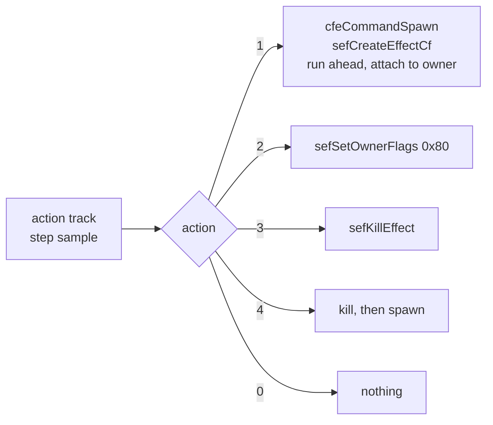

## Monitors

A monitor is a movie shown on a rectangle inside the 3-D scene: a display
screen, a hologram, a window with a view. Up to 16 can be loaded. They do not
use the Sofdec player of the full-screen movies. They use the xgl movie
decoder, which plays IPU streams and is described in
[xgl.md](../libraries/xgl.md).

`cfeCmdLoadMonitor` copies the file name into the entry, initializes the
movie work record with `xglMovieInfoInit`, asks the disc for the file size,
allocates a block of that size and reads the whole file into it with
`xglCdReadFile`. The movie then plays from memory with `loop` set to 1. It is
opened with `xglMovieOpen`, and a failure stops with the assertion "failed
movie open". Two frame buffers of `imageQwords * 16 + 0x20` bytes are
allocated for the decoded pictures.

Each monitor has ten tracks, addressed by `cfe.stKyMnt`:

| Track | Sampling | Drives |
| --- | --- | --- |
| 0 to 2 | curve | Position of the quad |
| 3 to 5 | curve | Rotation angles (set as plain values, without unwrapping) |
| 6 to 8 | curve | Scale. The Z scale is also the opacity |
| 9 | curve | `rewind`: nonzero restarts the movie |

`cfeEntryTableEvaluate` samples the tracks. Later in the frame
`cfeEntryTableUpdate(noPlay)` does the work for each monitor:

1. If `rewind` is nonzero it calls `xglMovieRewind`.
2. If the absolute value of any scale component is below 0.05 the monitor is
   skipped. Scaling a monitor to zero switches it off.
3. Unless the scene is paused it decodes the next frame with `xglMoviePlay`.
4. It draws the frame with `cfeEntryDrawMovie`.

`cfeEntryDrawMovie` moves the four corners of the unit quad (±0.5 in X and Y)
by the monitor's translation, rotation and scale, and projects them with the
active camera. If any corner is clipped nothing is drawn. Otherwise the
decoded frame is uploaded to the second texture page of video memory
(`sRender.vram.texture_base`) as a GS image transfer, and the quad is drawn as
a textured triangle strip with perspective-correct texture coordinates. The
texture coordinates stay a little inside the picture (0.01 from the top,
0.005 from the bottom) to keep the edges clean. The vertex colour is neutral
grey `0x80` and the vertex alpha is the Z scale times 128, so the Z scale
track fades the monitor in and out. The packet path is described in
[rendering.md](../architecture/rendering.md).

## Screen effects

The three slots of `cfeScreenEffects` drive full-screen effects such as colour
fades, blur and glow. Each slot has three values and three tracks, addressed
by `cfe.stKyScrEff`:

| Track | Name | Sampling | Value |
| --- | --- | --- | --- |
| 0 | `CFE_SLOT_SOURCE_RESULT_INT` | step | `effectKind`, the effect kind |
| 1 | `CFE_SLOT_SOURCE_SAMPLE_FLOAT` | curve | `sample_float`, a strength from 0 to 1, default 1.0 |
| 2 | `CFE_SLOT_SOURCE_SAMPLE_INT` | curve | `sample_int`, a second value, default `0x80` |

`cfeSlotTableEvaluate` samples them. Near the end of the frame
`cfeCmdStepFrame` sends each slot to `effectRequestToCommand(slot, kind, arg,
value)` (`src/main/effect_request.c`), which translates the request into a
preset of the screen effect system (see
[screen-effects.md](../libraries/screen-effects.md)). The argument is
`sample_float * 16777215`, and the value is `sample_int`. Three special cases
apply:

- Kinds 1 and 2 are a white and a black screen cover whose alpha is the
  value. When such a slot has a value above 0 the frame step calls
  `fadeClear`, so the normal fade does not stack on top of it.
- Kind `0x22` is sent as kind `0x1A` with the argument multiplied by 0.03.
- Kind `0x23` is sent as kind `0x1B` with the argument multiplied by 0.03.

Kind 0 is "no effect", which is the state after `cfeEvalSlotsInit`.

## Sound and music

`cfe.ldSnd` copies a name into the sound record and calls `seBgmNameSet`,
which starts that piece as background music or fades to it (see
[audio.md](../architecture/audio.md)). The table has room for one record.

The record has two tracks, addressed by `cfe.stKySnd`:

| Track | Name | Value |
| --- | --- | --- |
| 0 | `CFE_SND_TRACK_VALUE` | The target volume |
| 1 | `CFE_SND_TRACK_DURATION` | The time base of a volume change |

`cfeSndTableEvaluate(time)` evaluates record 0 with `cfeSndRecordEvaluate`.
Both tracks are sampled stepwise. When the record has a nonzero duration the
function calls `seVolumeSet(value, steps)` with
`steps = |old value - new value| / duration`, at least 1. The volume thus
moves to each new key value over a number of steps that grows with the size
of the change.

Voices are not part of the sound record. They belong to the messages, which
the next section covers.

## Messages, subtitles and voices

A message is one subtitle with a time window and, optionally, a voice stream.
`cfe.allocMes` allocates the array `cfeMessages`, and each `cfe.setMes` fills
the next record:

| Offset | Type | Name | Meaning |
| --- | --- | --- | --- |
| `0x000` | `int` | `firstFrame` | The first frame the text is shown |
| `0x004` | `int` | `endFrame` | The first frame it is gone again |
| `0x008` | `int` | `soundSlot` | The stream sound slot (five-argument form) |
| `0x00C` | `char[0x400]` | `text` | The laid-out subtitle |
| `0x40C` | `char[0x40]` | `name` | The voice stream file, or empty |

The record is `0x44C` bytes. `cfeMessageCount` counts the records in use.

### Text layout

The text argument goes through two steps. `cfeMesUnescape` copies it and
turns each two-character sequence `\n` into a real newline. Any other
character after a backslash is dropped.

`cfeMesLayoutText` then centres every line. It works line by line on the
scratchpad at `0x70000000` and collects the result in a local buffer of
`0x400` bytes, which finally replaces the text. In front of every line it
puts two bytes: the control code 1 and a signed offset of
`-1 - width / 2`, where `width` is the pixel width of the line from
`xglFontGetStringWidth`. An offset of 0 is replaced by 1 so that it cannot
end the string. The font system most likely reads the pair as a horizontal
shift, which centres the line on the print position (see
[fonts-and-text.md](../libraries/fonts-and-text.md)). Before each measurement
the function prints the font setup string
`$bg3;$prop1;$han1;$xx0,22;$xx1,8;$xx2,0;` so that the width is measured in
the caption style.

A text that starts with `@` gets special treatment. The `@` is removed and a
space is put in front of the first line, before its two header bytes. That
leading space is a marker. It is tested when the subtitle is drawn.

### Drawing

On every frame `cfeCmdStepFrame` walks all messages. A message is drawn when
`firstFrame <= time < endFrame` and one of two conditions holds: the save
data option `SaveData.caption_all` is nonzero, or the text starts with a
space. The `@` marker therefore makes a line that is shown even when the
player has switched subtitles off. Such lines are most likely on-screen text
that is not spoken dialogue, such as place names.

The text is printed at Y 370, or at Y 348 when it contains two or more
newlines. The setup string is printed first with `xglFontPrint`, then the
text with `xglFontPrintDirect`. The colour is white.

### Voices

The five-argument form of `cfe.setMes` names an ADX stream and a sound slot.
The game has two stream slots, 0 and 1 (see
[audio.md](../architecture/audio.md)). The voice handling has two parts:

1. On the first frame of the scene, if the first message record has a name,
   `cfeSoundSlotStartWait` prepares that stream. It pauses the slot, sets its
   volume, assigns the file with `adxSetSlotFile` and then sleeps frame by
   frame until `soundSlotStatus` reports 3. The stream is then loaded and
   waits in pause.
2. On the exact frame `firstFrame` of any message that has a name, the
   message's slot is taken out of pause, unless the scene is paused.

Only the first record's file is ever assigned. A scene thus has one voice
stream that is cued up before the first frame and released at the right
moment, which keeps the voices in sync with the picture regardless of disc
seek times.

## One frame: `cfe.stFrm`

`cfeCmdStepFrame` is the heart of the player. The script passes the current
time and gets the next time back. In normal play the result is `time + 1`.
While paused the result is the same `time`, so the scene stands still. After
a skip the result is `time + 30000`, far past the end of any scene, and the
script's loop ends.

The steps of one call, in order:

1. Wait for pending disc service. Store the time with `cfeRangeSetValue`.
   Count `cfeStartDelay` down.
2. Pause toggle. If the scene has run for at least 31 frames, no fade is
   running (`fadeUpdateHook == 0`) and START was pressed, `cfePaused` is
   toggled, `cfeStartDelay` is set to 2 and the pause sound `0x2000011` is
   played. On entering pause the play-time clock is sampled with
   `xglClockSampleDayTime`.
3. On the first frame, cue up the voice stream.
4. Evaluate the tables: camera (only when not paused), lights, fog, actors,
   maps, effect commands, fog again, monitors, screen effects, sound.
5. Make `cfeLightSet` the default light and apply the fog if it is enabled.
6. For each actor set the look target and damp the focus offset.
7. On the first frame call `fadeReset` and `fadeStartIn(30)`: every scene
   opens with a 30-frame fade-in.
8. Release the voice slots of messages that start on this frame.
9. Draw the subtitles.
10. Pause handling or time advance, described below.
11. Soft reset test: START pressed while L1, L2, R1, R2 and SELECT are held
    sets `CONTROL_SOFT_RESET` in `gameWork.control`.
12. Send the three screen effect slots to `effectRequestToCommand`.
13. `cfeEntryTableUpdate(cfePaused)` plays and draws the monitors.
14. `XenoActorDoit` updates all actors and `XenoActorDisp` draws them.
15. Unless paused, `sefExecEffect` runs the effects.

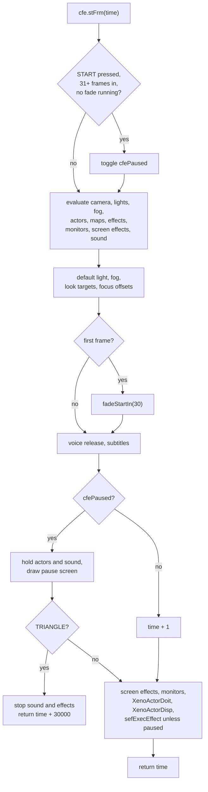

### Pause and skip

While `cfePaused` is set, each frame does the following: the play-time clock
is corrected with `xglClockAccumulate` so that paused time does not count,
`recordUpdatesHold` freezes the screen effect records, `XenoActorSetHoldFlag`
freezes the actors, both stream slots are paused, sound effects are muted
with `seSetMuted(1, 1)` and `pauseDrawScreen` draws the pause title, its
background and the button hints (`src/main/game_pause_disp.c`). The camera is
not evaluated, the monitors are drawn but not advanced and the effects do not
run. The tables are still evaluated at the same time each frame, which
changes nothing.

Pressing START again toggles `cfePaused` off in step 2. The non-paused branch
then sees START pressed, takes the slots out of pause, unmutes the sound
effects and clears the actor hold flag.

Pressing TRIANGLE while paused skips the scene, provided `cfeStartDelay` has
run down to 0. That delay of two frames stops the same button press that
opened the pause from being read again. The skip clears the TRIANGLE bit
from the pad state, stops both stream slots, lifts the pauses and the mute,
sets the music volume to 0, plays the pause sound, kills all effects and
returns `time + 30000` at once, without drawing the frame.

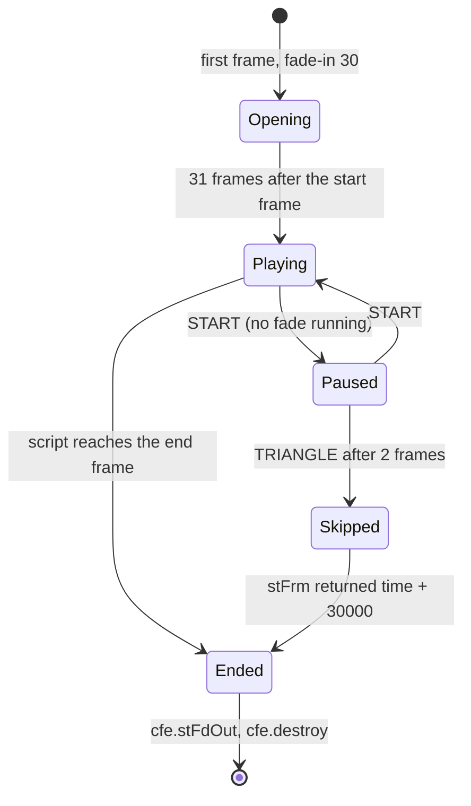

## Ending a scene: `cfe.destroy`

`cfeCmdDestroy` hands the game back to the field:

1. It stops both stream slots and kills all effects.
2. It clears the depth buffer, waits for the GS path with `sceGsSyncPath`,
   copies the displayed frame to the draw buffer, sleeps two frames and
   copies again. The last picture of the scene thus stays on screen in both
   buffers while everything is torn down.
3. It clears `CONTROL_CFE_SCENE` and `CONTROL_CFE_NO_FADE` and clears flag
   `0x2` of the current unit record.
4. It frees the message records.
5. For each map it frees the part records and frees the map's resource by
   owner (`GameResBlockFreeByOwner` with the resource ID kept as the actor's
   kind).
6. For each monitor it frees the movie file block and both frame buffers.
7. It clears the collision handle, disables all wind sources
   (`tiWindDisableAll`), releases all actors, resets the resource system with
   `GameResourceReset` and the player slots with `resPlayerSlotsReset`.
8. It gives every unit record of kind 4 or 5 a fresh actor from
   `XenoActorAlloc`, to replace the one that `cfe.init` released.
9. It loads font 1 again and restores the default light.

The resource reset in step 7 also drops the actor resources, the effect data
and the key node pool, which is why the function does not free them one by
one.

## The CFEventTool leftovers

Several parts of the `cfe` files serve an authoring tool and not the game.

`src/main/cfeFileControl.c` manages one large text buffer called `pFileTemp`
(`cfeFileTemp`). `cfeFileTempInit(buffer, size)` installs and clears it.
`cfeFileLogf` formats a line with `vsprintf` on the scratchpad and appends it
to the buffer behind the current indentation, which is one tab character per
level. `cfeFileLogBlockBegin` writes `{` and indents, `cfeFileLogBlockEnd`
unindents and writes `}`. `cfeFileTempWrite(name)` saves the buffer as a file
through `xglDebFileWrite`, and `cfeFileTempRead(name, &buffer)` loads a file
into it and asserts that it is smaller than `MAX_OF_FILESIZE` (`0x60000`).
This is a writer and reader for brace-structured text files, the kind of file
an editor saves a scene in. In the retail game only two developer screens
install the buffer, `src/main/ysegf.c` and `src/main/yg2path.c`, both with
`0x60000` bytes. `cfeFileClose`, `cfeFileOpenWrite`, `cfeFileOpenRead`,
`cfeFileWrite` and `cfeFileRead` are thin wrappers over `sceClose`, `sceOpen`,
`sceWrite` and `sceRead`.

`src/main/yg2_text.c` parses such text. `yg2TextNextLine` moves to the start
of the next line and skips its leading spaces and tabs. `yg2TextCompareLine`
compares a line with a pattern up to the pattern's newline, and a `%` in the
pattern ends the comparison as a match, so a pattern like `frame %d` matches
any line that starts with `frame `. `yg2TextFindLine` walks forward to the
first matching line. `src/main/yg2path.c` uses `yg2TextCompareLine` for its
own text file.

`src/main/cfeEvaluate.c` has two drawing helpers without callers.
`cfeDrawDirectionGrid` draws a 7 by 7 line grid with a pointer, turned
towards a direction vector and seen from the active camera, in a corner of
the screen. `cfeDrawRotationGrid` draws the same grid turned by two angles.
Both shade the lines between two colours and use `cfeDrawLine`, which queues
one Gouraud-shaded GS line. They are gizmos that show a light direction or a
camera orientation in an editor view.

`src/main/test_129.c` holds the entry to the tool. `testMenuRun` is a small
developer menu with four entries: `CFEventTool`, `GlowTest`, `WaterTest` and
a fourth labelled "test" in Japanese. It loads overlay number 98 when it
opens. UP and DOWN move the cursor, CIRCLE runs the entry, and SELECT with
START leaves. The first entry calls `testCfEventToolRun`. That function is
only declared in the recovered source, and its body is not part of the main
executable's recovered files. The other functions of the file
(`testLoadFile`, the test heap, `sjisToEuc`) and the water test variables
belong to the debug tools, described in
[debug-tools.md](../game/debug-tools.md).

## Movies

Pre-rendered movies are CRI Sofdec files with the extension `.sfd`. Three
callers start one, all through `GameMpeg2Play(name)`:

| Caller | File | Use |
| --- | --- | --- |
| `mpeg2` | `src/main/runtime.c` | The SB native `runtime.mpeg2(name)` for field and event scripts |
| `resCmdMpeg2` | `src/main/res_get_path.c` | The scene resource script command `;mpeg2` (see [events.md](events.md)) |
| the movie list | `src/main/yajima_test.c` | A developer test screen |

`GameMpeg2Play` is a blocking function. It runs its own frame loop with
`xglSleep` and returns when the movie is over.

### The player wrapper

`src/main/movie_player.c` wraps the Sofdec library, whose functions start
with `mwPly` (see [runtime-libraries.md](../architecture/runtime-libraries.md)).
The game keeps a small record per player:

| Offset | Type | Name | Meaning |
| --- | --- | --- | --- |
| `0x00` | `int` | `handle` | The player object from `mwPlyCreateSofdec` |
| `0x04` | `int` | `chain_address` | The DMA chain that uploads a frame |
| `0x08` | `int` | `frame_stamp` | The stamp of the last frame taken, -1 until the first frame |
| `0x0C` | `u8` | `frame_held` | A frame was taken and not released yet |
| `0x0D` | `u8` | `extra_enabled` | The extra audio stream block is in use |
| `0x0E` | `u8` | `volume` | The volume, `0x7F` by default |

Two functions run once at system start. `xglMovieInit` calls `sceIpuInit`
(from `InitializeSystem` in `src/main/control_entry.c`).
`moviePlayerLibraryInit` calls `mwPlyInitSfdFx` with the frame rate 59.94
(from `src/main/xgl_render.c`). `xglRenderAndMovieShutdown` shuts the video
and sound libraries down again: it removes the vertical sync callback,
suspends the KORG driver, and finishes Sofdec and ADX.

`moviePlayerParamsInit` fills the creation parameters: file type 1, a maximum
bit rate of 7,000,000, a maximum picture of 512 by 448, three frame pools and
one stream. `mwPlyCalcWorkCprmSfd` returns the size of the work area these
need.

`movieRenderBufferSize(include_extra)` adds up the memory one player needs:
the work area, the upload chain and, when asked, the work area of an extra
stream from `mwPlyCalcWorkStm`. Each part is rounded up to 64 bytes.
`movieRenderBufferAlloc(record, cursor, extra)` lays these parts out from the
address `cursor`, creates the player with `mwPlyCreateSofdec`, builds the
chain and, with the extra block, calls `ADXM_Lock` and `mwPlyCreateStm`. The
extra block is requested when the save option `SaveData.dolby_digital` is on,
so it is most likely the Dolby Digital audio stream of the movie.

```
movie buffer (GameResourceWorkAlloc)
+---------------------------+  buffer
| caption script (converted)|  rounded up to 64 bytes
+---------------------------+
| Sofdec work area          |  mwPlyCalcWorkCprmSfd
+---------------------------+  chain_address
| GS upload DMA chain       |  makeGstransChain
+---------------------------+
| extra stream work area    |  only with dolby_digital
+---------------------------+
```

`makeGstransChain(destination, image, width, height)` builds the DMA chain
that sends a decoded RGBA32 picture to the GS. The picture is sent as
macroblocks of 16 by 16 pixels, column by column. The chain starts with a
header that sets `BITBLTBUF` and `TRXREG` for a 16 by 16 transfer. For each
macroblock it holds a small packet that sets `TRXPOS` and `TRXDIR` and opens
an image transfer of 64 quadwords, followed by a REF tag that points at the
macroblock's `0x400` bytes in the decoder's output. With a null destination
the function writes nothing and only returns the length in quadwords, which
is how the size is computed in advance. For 512 by 448 the chain has
32 × 28 = 896 macroblocks.

`moviePlayerStartFile(player, name)` sets the volume unless the extra stream
is in use, builds the path `movie\<name>` with every `/` turned into `\`,
looks the file up on the disc with `xglCdGetFileData` and returns -1 when it
is missing. Sofdec is not given a file name. It gets the text key
`%08x.%08x` made of the file's start sector and its length in sectors, and
reads the disc by position. `frame_stamp` is set to -1.

`moviePlayerUpdate(player)` runs once per displayed frame:

1. It releases the frame taken on the previous call (`mwPlyRelCurFrm`).
2. It asks for the current frame (`mwPlyGetCurFrm`). When there is a new
   picture it stores the stamp, rebuilds the chain for the picture's address,
   patches the destination to the page `sRender.vram.work_buffer_base`, and queues
   the chain with `sceVif1PkCall`.
3. Once any frame has arrived it queues a GS local-to-local copy of 512 by
   448 pixels from that page to the page being displayed. The copy is made on
   every call, so the last picture stays visible while the decoder has no new
   one.
4. It reads the player status. Status 3 returns 1, status 4 returns -1, any
   other status returns 0.

`moviePlayerPause` forwards to the player's pause method. `moviePlayerDestroy`
stops and destroys the player. With the extra stream it also destroys the
stream, unlocks ADX, runs `ADXM_ExecMain` once, restores the KORG transfer
callback and reopens the game's stream slots with `soundSlotsReopen`.

### Playing a movie

`GameMpeg2Play(name)` goes through these steps:

1. `fadeClear`, a copy of frame-buffer page 0 to page 1
   (`GameMovieFrameCopy0To1`), `soundRestart`, and the allocation of the movie
   buffer with `GameResourceWorkAlloc`. It returns at once if a soft reset is
   pending.
2. It loads the caption font (font 0) and builds the movie path
   `<name>.sfd`. A name that starts with `EP` sets `skip_hidden`, which
   removes the skip option. The discs have two such movies, `EP07` and
   `EPSTAFF`, both ending movies on disc 2.
3. It builds the caption path `movie/<language>/<name>.txt`, where the
   two-letter language code comes from `xglGetLanguageCode`. It reads the
   file to the start of the movie buffer. A missing file is fine and means no
   captions. Otherwise `caption_convert` compacts the text in place.
4. It creates the player behind the captions with `movieRenderBufferAlloc`
   and starts the file.
5. During playback it sets `sRender.movie_active`, sets the render sync
   interval `xglRenderVSyncInterval` and `StudioEntrySkip` to 1 and
   `gameWork.inputDelay` to 32. A movie thus runs at one picture per vertical
   sync, where the game normally uses an interval of 2.
6. The frame loop runs until the movie ends, is skipped or fails.
7. Afterwards it restores the interval to 2, destroys the player, and unless
   the current map is one of a fixed list, starts a one-frame fade-out. It
   copies page 1 back to page 0, sleeps two frames, loads font 1 again,
   releases the buffer with `GameResArenaRelease` and clears the fade.

The list of maps without the closing fade-out is `0x1B60`, `0x1B6C` to
`0x1B72`, `0x1B81`, `0x1B89` and `0x1B8D` to `0x1B91`. On those maps the last
picture of the movie stays up for whatever follows.

Each pass of the frame loop does the following:

1. `moviePlayerUpdate`.
2. Caption update and print (see below).
3. A negative status shows the text "A seek error has occured." with two
   choices: CIRCLE replays the movie from the start, TRIANGLE skips it. The
   clock is stopped while the message is up.
4. A positive status ends the loop normally.
5. Once the first frame has arrived and the input delay of 32 frames has run
   down, START pauses. The player is paused, the pause screen
   `GamePauseDispEvent` is drawn over the frozen picture, and the loop waits.
   START resumes. TRIANGLE skips with a one-frame fade-out, unless
   `skip_hidden` is set. The soft reset combination ends the movie and sets
   `CONTROL_SOFT_RESET`.

The status mapping in step 3 and 4 follows the caller. `GameMpeg2Play` treats
the value 1 from `moviePlayerUpdate` as the normal end and -1 as a read
error.

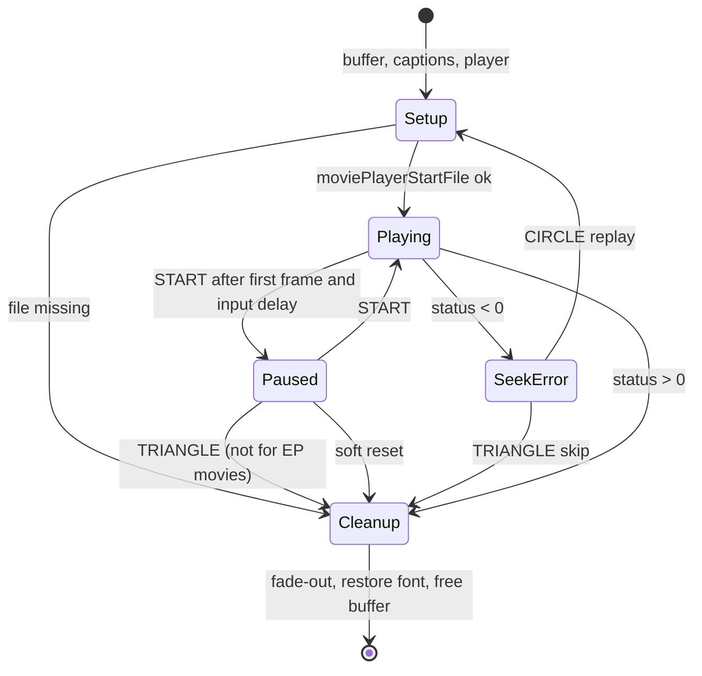

The two helpers `GameMovieFrameCopy0To1` and `GameMovieFrameCopy1To0` each
queue one GS local-to-local transfer of 512 by 448 pixels between the two
frame-buffer pages in `sRender.buffer_base`. They keep a stable picture in
both pages before the movie, behind the pause screen and after the movie.
`GameMovieCaptionFadeOut` is `fadeStartOut(1)`.

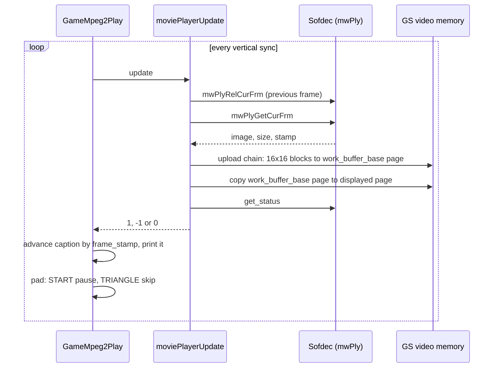

## Movie captions

### The caption file

A caption file is a plain text file in a language directory next to the
movies. The discs hold `movie\en\` only, with 45 files in EUC-JP. The parser
gives it this structure:

- A line that starts with `;` is a comment. Empty lines are skipped.
  `caption_nextline` does both: from a comment or a line end it moves forward
  to the first line that is neither empty nor a comment.
- An entry line starts with a time stamp, then spaces or tabs, then the text.
- A line that starts with neither a digit nor `+` ends the script.

The time stamp is a list of numbers separated by colons. `caption_getparam`
adds each number to a running total and multiplies the total at every colon:
by 60 at the first colon and by 30 at the second. A stamp `m:s:f` therefore
gives `(m × 60 + s) × 30 + f`, a frame count. The movies run at 29.97 frames
per second and the stamps count movie frames. A
stamp with a single colon gives `first × 60 + second`. A leading `+` makes
the stamp relative: the result is added to the previous entry's time.

The text runs to the end of the line. Inside it:

| Text | Meaning |
| --- | --- |
| `\` | Starts a further line of the same caption. The character after the backslash is skipped |
| `@` at the start of a line | Replaced by a space. Marks a caption that is shown even with subtitles off |
| `[base/ruby]` | Ruby text: expands to `$rubyb;base$rubys;ruby$rubye;`, the font system's control strings for small reading aids above a word |

Every line of a caption gets the same two-byte header as the `cfe` messages:
the control code 1 and the complement of half the line's pixel width, which
centres the line.

An example of the syntax, built from these rules. The shipped files use only
part of it: every entry has a full `m:s:f` stamp, none uses `+`, `@` or ruby
text, each file opens with a `00:00:00` entry that holds font control
commands, and each ends with the line `end`
(see [Movies, images and icons](../formats/movies-images-and-icons.md)):

```
; opening narration
0:02:00  First line of the caption
+0:03:00 @A line that is always shown
0:10:15  Two lines\nin one caption
0:14:00
```

A stamp with no text, as in the last line, makes an empty caption and so
clears the screen at that time.

### The converted form

`caption_convert(text)` rewrites the file in place into a compact list and
returns its size. It measures the font setup string once, skips leading
comments and reads the first entry. If that entry has time 0 its text becomes
the header of the list, which is the caption on screen from the first frame.
Otherwise the header is an empty string. Then it reads entries until one has
no time stamp. Each entry becomes a record of the time as a 16-bit
little-endian number followed by the caption text with its terminator. The
final record carries the time -1, stored as `0xFFFF`.

```
+----------------+----+---------+----------------+----+---------+-----+--------+----+
| header text    | 00 | time lo | time hi | text  | 00 | time lo | ... | FF FF  | 00 |
+----------------+----+---------+----------------+----+---------+-----+--------+----+
  shown from frame 0     record 1                        record 2        end marker
```

The times are 16 bits wide, so a caption time can be at most 65535, which at
30 per second is a little over 36 minutes.

### Showing captions

The movie loop keeps a pointer `text` to the current caption, which starts at
the header. On every frame it finds the end of the current text, reads the
16-bit time behind it and, when the player's `frame_stamp` has reached that
time, moves `text` to the next caption. Only one step is taken per frame. The
end marker `0xFFFF` is never reached by a real stamp, so the last caption
stays current.

Printing uses the setup string
`$bg3;$prop1;$han1;$xx0,24;$xx1,8;$xx2,0;` at Y 317. The loop then counts the
lines of the caption by walking it with `xglFontCopyTextUnit` and counting
newlines. The base position is Y 370. A caption of three or more lines is
moved up by 22 pixels per line beyond two. The position is set with the
control string `$ay<y>;$xx0,22;` and the caption is printed with
`xglFontPrintDirect`.

As in `cfe` scenes, the caption is only printed when `SaveData.caption_all`
is nonzero or when the first character after the two header bytes is a space,
which is the trace of an `@` line.

## Cutscenes, scripts and events

The three scripting layers divide the work as follows.

The scene resource script (see [events.md](events.md)) is the outer layer. It
says which files a map or event needs and can play a movie directly with
`;mpeg2`.

The SB script (see [sb-vm.md](sb-vm.md)) is the director. It decides when a
cutscene starts, builds it through the `cfe` natives, steps it and tears it
down. Because the frame loop is in the script, a script can also do other
things between two `stFrm` calls, such as starting a movie with
`runtime.mpeg2` or changing game flags.

The `cfe` plug-in is the stage machinery. It knows nothing about the story.
It only stores keys and replays them.

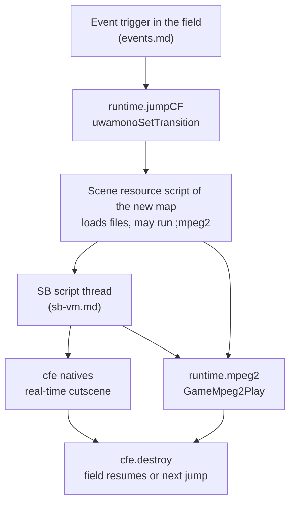

A real-time cutscene and a movie look the same to the player in three
respects, and the code keeps them consistent by hand: START pauses with the
same sound `0x2000011`, TRIANGLE on the pause screen skips, and the subtitle
option `caption_all` with the `@` exception decides which lines are shown.
