# Events and the story flow

The story of Xenosaga Episode II is a chain of numbered places. Every place has
one four-digit number. That number names a small text file that lists what
the place needs (`cf\cfNNNN.txt`), a compiled script that brings the place to
life (`cf\scNNNN.sb`) and a text library with the script's messages in the
current language. The script creates the people and objects of the place,
reacts when the player talks, walks into a trigger or wins a battle, and in
the end names the next place. The C code around it loads the files, starts the
script, turns pad input and movement into messages for the script, shows the
message windows and keeps the flags that remember what already happened.

The sections below follow that chain. They start with the place number and
the frame loop that reacts to it, go through the scene resource script and its
commands, the start of the place script, the events that C code sends to
scripts, talks and message windows, the flag stores, and end with the three
story services that interrupt the game: the map change, the chapter
intermission and the disc change. The script virtual machine itself is
described in [sb-vm.md](sb-vm.md), the native functions scripts can call in
[natives.md](natives.md) and the cutscene player in
[cutscenes.md](cutscenes.md).

[← Back to the overview](../README.md)

## Source files

| File | Contents |
| --- | --- |
| `src/main/res_get_path.c` | The scene resource script: the command table `resCommandTable`, the parser `resScriptRun`, the handlers `resCmdMap`, `resCmdAct`, `resCmdMot`, `resCmdMobj`, `resCmdEffect`, `resCmdMapse`, `resCmdRuntimeBgm`, `resCmdBgmVol`, `resCmdFoot`, `resCmdEnefoot`, `command_disk`, `command_save` and `resCmdMpeg2`, the loader `resLoadCfFile`, the preloader `resPreloadStep`, `resApplyCfFile`, and the jump points that start a preload (`resParseJumpTarget`, `resJumpPointsBuild`, `resJumpPointsUpdate`). The file and block code of the same file is described in [Files and resources](../architecture/files-and-resources.md) |
| `src/main/ytachi_test.c` | `mapSceneScriptLoad`, which loads and starts the script of a place, the flag clears `gameRowFlagsClear` and `gameEventFlagsClear`, and the record reset `uwamonoResetRecords` |
| `src/main/runtime.c` | Natives of the `runtime` module that drive the story: `runtimeJumpCf` with `uwamonoSetTransition`, `runtimeMapChange`, `runtimeMessage`, `runtimeSetFlag`, `runtimeGetFlag`, `runtimeSystem`, `runtimeFade`, `changeRobo`, and the map look natives `runtimeSetMapFog`, `setMapColor`, `runtimeSetItai`, `runtimeSetMapLight` |
| `src/main/uwamono_event_check.c` | `uwamonoSendEvent`, the event slot table `uwamonoEventIds`, the locator test `Check_Locater` with its shape handlers and `Check_InsideID`, and the footstep code `Sound_FootStep` |
| `src/main/talk_natives.c` | Registration of the `talk`, `g2path` and `seg` native modules, the talk hooks of map objects (`mapObjectBeginMessage`, `mapObjectSetActive`, `mapObjectFaceActive`, `mapObjectClearTalkFlags`), the talk result (`talkSetResult`, `talkStateReset`) and `slotWinGetResult` |
| `src/main/talk_natives.c` | The message natives `talkSmsg` (`talk.smsg`) and `talkMsgDtl` (`talk.msgDtl`) |
| `src/main/talk_natives.c` | The small talk natives `talkWinClose`, `talkResume`, `talkIsDispMsg`, `talkWait`, `talkEnableFlags`, `talkDisableFlags` |
| `src/main/talk_script.c` | The talk window texture (`talkLoadOmiyaTexture`, `talkCloseTexture`), the `talkActive` flag, and the frame drawing of talk windows, which is described in [Message windows](../libraries/ui-windows.md) |
| `src/main/talk_scan.c` | Helpers that move the reveal position of a text slot: `talkScrollLines`, `talkSeekToWindowEnd`, `talkSeekToLimit`, `talkHasMoreLines`, `talkSetScanFlag`, `talkAdvanceCounter` |
| `src/main/talk_speaker_name.c` | The speaker name plate text (`talkCopySpeakerName`) and the cut of the text at the reveal position (`talkStashPrefix`, `talkRestorePrefix`) |
| `src/main/quest_flag_set.c` | The quest and citizen flag stores: `questFlagSet`, `questFlagGet`, `citizenFlagSet` |
| `src/main/sv_scene_flags.c` | The effect scene flag word `svSceneFlags` with its four accessors, plus two unrelated helpers (`vu0DirectionToAngles`, `lightSetLogDump`) |
| `src/main/game_disk_change.c` | The disc change prompt `GameDiskChange` and the synopsis screen `GameSynopsis` with `GameSynopsisCrossfadeWait` |

## Overview

One word decides where the game is: `gameWork.nextMap`. It is the number of
the place that should be loaded next, or -1 when the current place should go
on. The play session `Game()` in `src/main/game_data.c` is two nested loops.
The outer loop loads the place named by `nextMap`. The inner loop runs one
frame of that place after the other and leaves as soon as `nextMap` holds a
number again. A script changes place by calling the native `runtime.jumpCF`,
which starts a fade and stores the destination in `nextMap` when the fade is
over.

A place is made of three files, all found from its number. The scene resource
script `cf\cfNNNN.txt` is plain text. It names the map model, the character
models, the motions, the effects, the sound banks and the music of the place.
The place script `cf\scNNNN.sb` is an SB bytecode image. The language library
`cf\<language>\scNNNN.sbl` holds the strings of that script in one language.
`mapSceneScriptLoad` applies the first file, reads the other two into one
buffer, links them and starts the script.

While the place runs, C code and script talk in both directions. The script
calls natives. C code sends events: it queues a small message on a script
thread that the script named for that kind of event. The table below lists
what can start script activity.

| Activity | Started by | Reaches the script through |
| --- | --- | --- |
| Start of the place script | `mapSceneScriptLoad` | `sbStartImage` on the image in `mapSceneScriptBuffer` |
| Strike on an object | SQUARE on the selected map object (the player attacks it, the code calls this state `CONTROL_MAP_ATTACK`) | event slot 0 and, when the strike motion reaches its event frame, slot 1 |
| Locator | walking through or pressing CIRCLE inside a locator area | event slot 2 |
| Map jump area | standing on ground of the jump class | event slot 3 |
| Ladder ends | reaching the top or the foot of a ladder | event slots 4 and 5 |
| End of a battle | return from the battle scene | event slot 6 |
| Timer panel | the countdown reaching zero, or a timed battle running out | event slot 7 |
| Item pickup | an item object finishing its pickup | event slot 8 |
| Talk | CIRCLE near a character, or walking close to one that talks by itself | the value the script reads with `talk.check` |

The diagram below shows the whole circle, from the place number to the script
and back to a new place number.

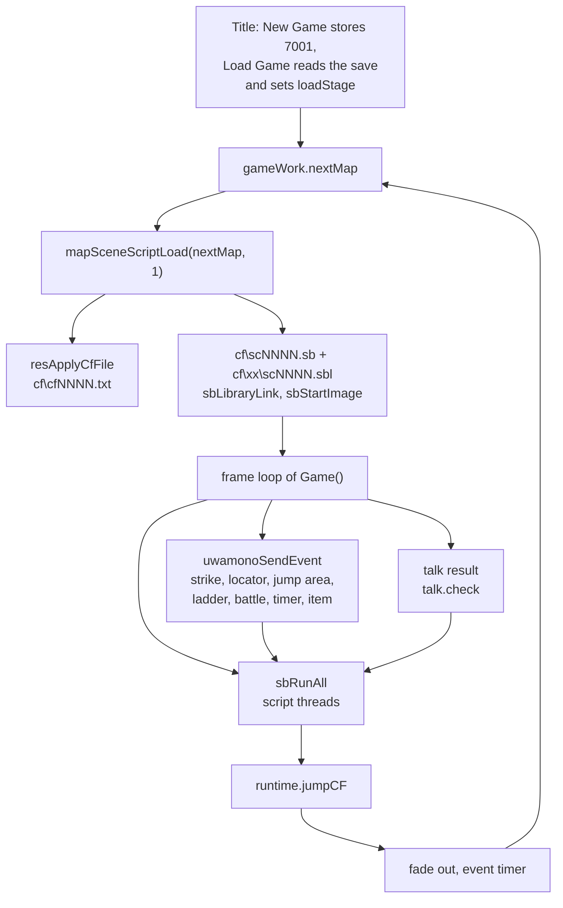

## Place numbers

A place number is a decimal number of up to four digits. The source calls the
current one `gameWork.mapId` and the requested one `gameWork.nextMap`. The
same number is used in three file names. `xglCdFormatFileName` writes the low
16 bits of a number as `cf` followed by four decimal digits, which gives the
scene resource script `cf\cfNNNN.txt`. `mapSceneScriptLoad` writes the four
digits into the name `sc0000.sb`, which gives the place script and, with an
`l` added, the language library.

A place is more than a map. Several numbers can share one map model, and a
number can also stand for a story step that shows a cutscene and jumps on.
What a place shows is decided by its script, which loads a map with
`runtime.mapChange` and plays cutscenes through the `cfe` module (see
[cutscenes.md](cutscenes.md)). The map model has a separate number,
`gameWork.resourceId`, which is a file id of the resource system and is
described under [Changing the map model](#changing-the-map-model).

A few numbers have a fixed meaning in the code. They are listed below. Every
other number gets its meaning from the files on the disc.

| Number | Where | Meaning |
| --- | --- | --- |
| 7001 (`0x1B59`, `MAP_ID_NEW_GAME`) | `src/ov02/title.c`, `GameSynopsis` | The first place of a new game. The title screen stores it in `nextMap`. The synopsis screen is skipped for it |
| 10 (`MAP_ID_DEBUG_START`) | `src/ov02/title.c`, `GameSynopsis` | Stored only by a third arm of the title screen that the menu cannot reach, most likely a developer start. Load Game itself runs `MenuFileMain(1)` and sets `gameWork.loadStage`, and `saveReadGameWork` then sets `nextMap` to the saved `mapId` |
| 7057 (`0x1B91`, `MAP_ID_GAME_END`) | `src/main/pt_member.c` | The place of the end of the game. A save made there resumes at 2540 (`0x9EC`, `MAP_ID_GAME_END_RESUME`) with the story progress flag set to `0x75` |
| 1520, 1560 | `resJumpPointsUpdate` | Places in which the automatic preload of neighbour places is switched off |
| below 6300 | `Game()` | After a battle the field sound state is restored with `seStateRestoreField`. From 6300 on it is cleared with `seStateClear` |

Together with the place number goes the entry key `gameWork.entryKey`. It
tells the new place where the player should stand. -1 means no position is
given, -2 means the position stored with the party progress, and any other
value is the key of an entry point of the map. `Game()` looks the key up with
`uwamonoFindEntry` and puts the player on that point with the pose that
`uwamonoGetEntryPose` returns. The entry points belong to the map data and are
described in [Map and units](../game/map-and-units.md). A script reads the
entry key back through `objx.getParam` with parameter 7, which returns -2
after a load from a save.

## The frame loop and the place change

`Game()` prepares the session once: it shows the synopsis screen, clears the
map object records and the two flag tables with `gameRowFlagsClear` and
`gameEventFlagsClear`, gives the resource system its memory with
`GameResourceInit((void *) 0x1000000, 0x1000000)`, loads the common sound bank
and the common effects, and reads the save image when the session was started
by Load Game. Then the outer loop begins. The session as a whole is described
in [The field](../game/field.md). The parts that carry the story are these.

At the top of the outer loop the cameras are set up again,
`gameWork.sceneFlag` and `gameWork.fadeTimer` are cleared, and
`mapSceneScriptLoad(gameWork.nextMap, 1)` loads the place. That call sets
`nextMap` back to -1. After it the actor pool is reset, the player's party
models are loaded, the player is put on the restart position, the control bits
that belong to one place are cleared and a fade-in of 30 frames starts.

The inner loop runs once per frame. The order of the story-related steps in
one frame is fixed:

1. The player is placed on the entry point while control bit `0x20`
   (`CONTROL_MAP_LOADED`) is set and an entry key is given.
2. `sbRunAll` runs every script thread, unless the game is paused
   (`CONTROL_PAUSED`). A script can end the session here: bit `0x10000000`
   (`CONTROL_SOFT_RESET`) and bit `0x08000000` both leave the loop.
3. `DispMapObject` updates the map objects. It also counts the event timer of
   every record down, which is how a pending place change reaches `nextMap`.
4. `uwamonoPlayerUpdate` moves the player, finds the talk target and tests
   the locators.
5. `msgUpdateTimed` reads the buttons for the open message window.
6. `msgQueueClose` queues the windows for drawing.
7. `resJumpPointsUpdate` preloads the files of a neighbour place when the
   player comes close to its jump area.
8. When `nextMap` is no longer -1 the inner loop ends.

After the inner loop the session stops the preloader with
`resResetScriptState`, destroys the place effects, resets the message state
with `msgStateReset`, waits two frames and clears the fade. When `nextMap`
holds a number the outer loop runs again. When it is still -1, or when one of
the bits `0x18000000` is set, the session ends. Bit `0x08000000` at the end
leads to `GameOver()`.

The diagram below shows the two loops and the points where they are left.

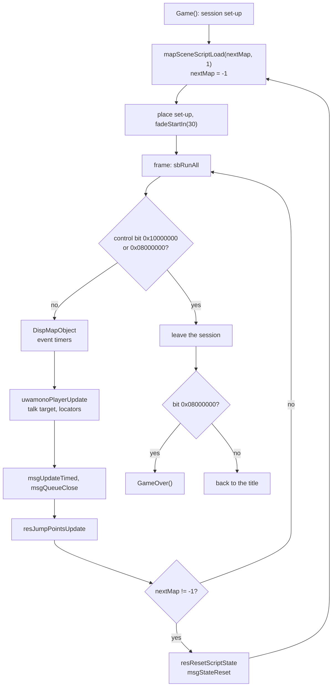

## The scene resource script

Most places have a scene resource script, the text file `cf\cfNNNN.txt`. Of
the 352 script images on the discs, 38 have none: `sc1290` and 37 story steps
in the range `sc7005` to `sc7099`, which load nothing of their own. The file
is a list of commands, one per line, that tells the resource system what the
place needs. The folder name comes from the string `cfDirectoryPath`, which is
`"cf\\"`. `resLoadCfFile` copies it into a path buffer, lets
`xglCdFormatFileName` add `cf` and the four digits, and appends `.txt`.

The file is read into `resScriptBuffer`, a buffer of `0x800` bytes, which is
one disc sector. A script file therefore has to fit in 2048 bytes. The file
must start with the four characters `#scn`. `resScriptRun` compares the first
word of the buffer with `RES_SCRIPT_MAGIC` (`0x6E637323`) and does nothing for
any other content. A place without a file is allowed: `resLoadCfFile` tests
the file size first and starts no read when the file does not exist.

### Syntax

The parser is line based. `next_line` moves to the end of the current line,
then skips spaces, tabs and line ends. A line whose first character is `;` is
a comment and is skipped as a whole. No file on the discs has a comment line. `skip_space` skips spaces and tabs in
front of a command and between a command and its argument.

The first line holds the `#scn` header and is skipped. After that every line
is a command word followed by white space and one argument. The command word
is compared with each name in `resCommandTable`. The comparison is exact and
case sensitive, and the word must be followed by a space, a tab or a line
end, so `bgm` does not match `bgmvol`. The handler of the matching entry gets
a pointer to the argument and returns the position where it stopped reading.
A line with an unknown word is ignored. The line `#end` ends the script.

A line that starts with `#` and is anything other than `#end` is a trap. The
parser tests such a line again without moving on, so a script must hold no
other `#` line after the header.

```
#scn
map     <map name>
act     <character model name>
mot     <motion pack name>
mobj    <map object model name>
effect  <effect name>
mapse   <bank name>[,<second bank name>]
bgm     <name>[,<name>...]
bgmvol  <number>
foot    <material>[,<material>...]
enefoot <name>[,<name>...]
disk    <1 or 2>
save    <number>
#end
```

The layout above shows the form of each command. The names in angle brackets
are placeholders for what the handlers read.

The diagram below shows the parser loop of `resScriptRun`.

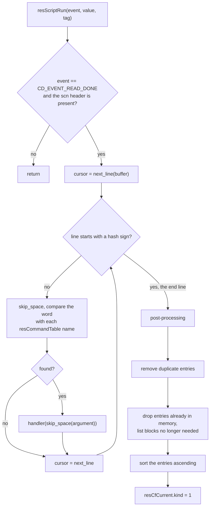

### The entry table

The handlers do not load anything. Each one appends one or more words to
`resEntryTable`, a table of 64 words. Word 0 holds the index of the next free
word, so an empty table has the value 1 there. `resEntryAdd(key, name)` writes
one word. What it writes depends on the key:

| Key | Constant | Word written | Extra data |
| --- | --- | --- | --- |
| a file id | none | the file id itself | none |
| `0x40000` | `RES_KIND_EFFECT` | `0x40000` plus the current offset in the name pool | a name in the name pool |
| `0x90000` | `RES_KIND_SOUND` | `0x90000` plus the current offset in the name pool | a sound record in the name pool |
| `0xF00000` | `GAME_RES_OWNER` | `0xF00000` plus the current offset in the name pool | a file name in the name pool |
| `0xF10000` | `RES_KIND_EVENT` | `0xF10000` plus the number passed in the name argument | none |

The name pool `resNamePool` is 1024 bytes of text storage, and
`resNameCursor` points at its free end. A handler that needs text writes it
there right after the call of `resEntryAdd`, so the low 16 bits of the entry
word are the offset of that text. No command of the table produces a
`GAME_RES_OWNER` entry. The kind exists for files loaded by name, and
`resApplyCfFile` handles it by calling `GameResLoadName`.

```
resEntryTable (64 words)
[0]      next free index (1 = empty)
[1..]    entries

entry word
 31            16 15             0
+----------------+----------------+
| kind / file id |  offset or id  |
+----------------+----------------+
 0x0001..0x0008   file id of a model, map, motion (whole word is the id)
 0x0004           effect:  low half = offset of the name in resNamePool
 0x0009           sound:   low half = offset of the record in resNamePool
 0x00F0           named:   low half = offset of the file name
 0x00F1           event:   bits 8-15 = event number, bits 0-7 = argument
```

When the last line has been parsed `resScriptRun` cleans the table in three
passes. The first pass removes duplicates and keeps the first of each value.
The second pass walks the block table `gameResBlockTable` of the resource
system. A block whose owner equals an entry is already in memory, so the entry
is removed from the table. A block whose owner matches no entry is no longer
needed, and its owner is appended to a second table, `resOwnerTable`, which
has the same form. The third pass sorts the entries in ascending order. The
sort puts the entries in a fixed order of kinds: character models, map,
motions, effects, map object models, sound records, named files and at last
the events. Sound records keep the order of their lines, because their low
half is a growing offset.

### The commands

`resCommandTable` has 13 entries. The table below lists them in table order.

| Command | Handler | Argument | Entry it adds |
| --- | --- | --- | --- |
| `map` | `resCmdMap` | name of a map model | file id of kind `0x20000` |
| `act` | `resCmdAct` | name of a character, E.S. or enemy model | file id of kind `0x10000` |
| `mot` | `resCmdMot` | name of a motion pack | file id of kind `0x30000` |
| `mobj` | `resCmdMobj` | name of a map object model | file id of kind `0x70000` |
| `effect` | `resCmdEffect` | effect name | effect entry with the name |
| `mapse` | `resCmdMapse` | one or two sound bank names | two sound records, banks 3 and 4 |
| `bgm` | `resCmdRuntimeBgm` | list of music names | sound record `s` |
| `bgmvol` | `resCmdBgmVol` | decimal number | sound record `v` |
| `foot` | `resCmdFoot` | list of footstep materials | one sound record `f` per material |
| `enefoot` | `resCmdEnefoot` | list of model names | one sound record `e` per name and one bank record per name and material |
| `disk` | `command_disk` | disc number | event entry `0xF10200` plus the disc number |
| `save` | `command_save` | decimal number | event entry `0xF10100` plus the number |
| `;mpeg2` | `resCmdMpeg2` | movie name | none, the movie would play at once |

**`map`, `act`, `mot`, `mobj`.** The four handlers call `resCmdResolve` with
their kind. `resParseFileGroup` then searches the file name tables
`xglCdFileGroups` for the argument. It looks only at groups whose id base has
the wanted kind in bits 16 to 23. The comparison ignores letter case and skips
every underscore on both sides, so `Shion_00` and `shion00` are the same name.
The result is the file id, which is the group base plus the index of the
name. It becomes the entry word. A name that is in no table gives -1. The
argument ends at a comma, a space, a tab or a line end, and each line carries
one name. The table below shows which folders each command can reach. The
file ids and the files behind them are described in
[Files and resources](../architecture/files-and-resources.md).

| Command | Id bases | Folders (first string of each name table) |
| --- | --- | --- |
| `act` | `0x10000`, `0x11000`, `0x12000`, `0x13000` | `model\char\pc\`, `model\char\npc\`, `model\char\cf_npc\`, `model\char\citizen\` |
| `act` | `0x14000`, `0x15000`, `0x16000` | `model\robo\pc_robo\`, `model\robo\npc_robo\`, `model\robo\gattai_robo\` |
| `act` | `0x18000`, `0x19000` | `model\enemy\` (enemies and bosses) |
| `map` | `0x20000` | `model\map\` |
| `mot` | `0x30000` | `motion\` |
| `mobj` | `0x70000` | `model\mobj\` |

**`effect`.** `resCmdEffect` adds an effect entry and copies the argument up
to the next white space into the name pool. When the place is applied the
name goes to `sefLoadEffectCfName(0, name)`, which turns it into an effect key
and starts that effect. Effect names and keys are described in
[sef](../libraries/sef.md).

**`mapse`.** `resCmdMapse` adds two sound records. The first holds the byte 3
and the first name. The second holds the byte 4 and the name after the comma,
or an empty name when there is no comma. The leading byte is a sound bank
number. Banks 3 and 4 are the two sound effect banks of a map
(`mapSeBankNameBuffer` and `mapSeSecondBankNameBuffer`). When the place is
applied each record goes to `seBankSetName`, which loads the named bank or
unloads the bank for an empty name. Sound banks are described in
[Audio](../architecture/audio.md).

**`bgm`.** `resCmdRuntimeBgm` adds one sound record that starts with the
letter `s`. It copies the argument and turns every comma into a string end, so
the record is a list of names. When the place is applied, the list is read
with the help of `bgmNameListIndex`. For every count above 1 in that index one
name is skipped, and the name reached is given to `seBgmNameSet`. The index is
0 after `GameResourceInit` and is set by the script native `runtime.nextBgm`.
A place can therefore list several pieces of music, and the script of the
place before decides which one plays on arrival. `seBgmNameSet` keeps a
piece playing when the name did not change, and an empty name stops the music.

**`bgmvol`.** `resCmdBgmVol` reads a decimal number and adds a sound record
with the letter `v` and the number as one byte. When the place is applied the
byte is stored in `seBgmVolume`, the volume `seBgmNameSet` uses. Without the
command the volume is -1, which `resApplyCfFile` sets before it reads the
entries.

**`foot`.** `resCmdFoot` reads a list of three-letter material names, divided
by commas, spaces or tabs. `footMaterialFind` looks each one up in
`footMaterialKeys`, a list of 14 keys: `kon`, `rai`, `gla`, `flo`, `iro`,
`sto`, `car`, `woo`, `clo`, `wat`, `tur`, `ear`, `sno` and `sna`. An unknown
name gives index 0, which is `kon`. The keys are likely short forms of surface
names such as glass, floor, iron, stone, carpet, wood, cloth, water, turf,
earth, snow and sand. For every material the handler adds a sound record with
the letter `f`, the position in the list and the material index. It also
keeps the list in `footMaterialList`, closed by `0xFF`, for the `enefoot`
command. When the place is applied the records fill `resFootMaterials`. A
place can list at most 9 materials (`RES_FOOT_MATERIAL_MAX`).
`seFootBanksLoad` later loads one bank per listed material for the player
(`fs_xxx_xxx`, with the player group and the material key written into the
name), and `Sound_FootStep` picks the bank that fits the ground under each
walking character.

**`enefoot`.** `resCmdEnefoot` reads a list of model names. For each name it
searches all file name tables and adds a sound record with the letter `e`, the
position in the list and the four bytes of the file id. The list ends at the
first name that is in no table. For each found name and each material of the
`foot` list it adds one more sound record: a bank number that counts up from
12 (`SE_BANK_ENEMY_FOOT`) and the bank name `fs_<name>_<material>`. The
`foot` line must therefore come before the `enefoot` line. When the place is
applied the `e` records fill `resEnemyFootGroups`, and
`seFootBankFromKind` uses that table to find the footstep bank of an enemy or
a non-player character from its model id.

**`disk`.** `command_disk` adds an event entry. Its number is the first
character of the argument plus `0x1D0`, so the digit `1` gives `0x201` and
the digit `2` gives `0x202`. In the entry word that is event number
`RES_EVENT_DISK` (`0x200`) with the disc number in the low byte. When the
place is applied, `GameDiskChange` is called with the disc number (see
[The disc change](#the-disc-change)).

**`save`.** `command_save` reads a decimal number and adds an event entry
with event number `RES_EVENT_SAVE` (`0x100`) and the number in the low byte.
When the place is applied, `Intermission` is called with the number (see
[The chapter intermission](#the-chapter-intermission)).

**`;mpeg2`.** The last entry of the table is named `;mpeg2`, and its handler
`resCmdMpeg2` calls `GameMpeg2Play` with the argument. The parser never
passes a line that starts with `;` to the command search, because `next_line`
treats such a line as a comment. The command can therefore not be reached from
a script file. It was most likely switched off by putting the comment
character into its name. Movies are played from the place script instead, with
the native `runtime.mpeg2` (see [cutscenes.md](cutscenes.md)).

### Loading in the background

The game loads the files of the next place while the player is still walking
through the current one. `resLoadCfFile(id)` is the entry for that. It keeps
its state in `resCfCurrent`, which holds the place number (`id`) and a state
byte (`kind`).

The first call for a new number resets the tables with `resResetScriptState`,
stores the number and adds one sound record by itself: bank 12 with an empty
name, which clears the enemy footstep banks unless an `enefoot` line fills
them. Then it starts an asynchronous read of the text file with `resScriptRun`
as the completion callback and sets the state to `RES_CF_LOADING` (`0xFF`).
When the read is done the callback parses the file and sets the state to 1.

Every later call with the same number does one step of work in
`resPreloadStep`. The state byte is now the index of the next entry. The step
passes that entry to `GameResLoadID` with the flag `RES_ID_QUEUED_LOAD`
(`0x80000000`) and marks the block it gets with `RES_OWNER_PRELOADED`
(`0x40000000`) in its owner word. Then the index moves on. After the last
entry it becomes 0, which means that everything is in memory. A step called
from the frame loop does nothing while the disc stream service is busy
(`xglCdGetServicePending`), so preloading never competes with streamed sound.

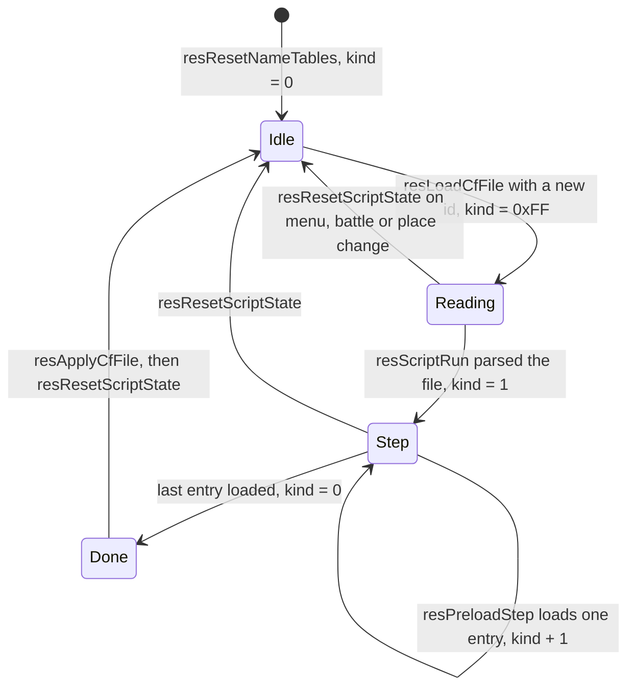

`resResetScriptState` cancels a pending read and calls `resResetNameTables`.
That function empties both tables and the name pool and frees every block
that still carries the preloaded mark, which are the blocks of a place the
player did not enter after all. `Game()` calls it before the main menu and
the save menu open, before a battle starts and when the inner loop ends.

### Jump points

What tells the game which place comes next? The answer is in the place script
itself. Stepping on ground of the jump class sends event 3 to the script (see
[Events sent to scripts](#events-sent-to-scripts)), and the script answers in
a function named `mapjump` that switches on the area number and calls
`runtime.jumpCF` with a destination. `resParseJumpTarget` reads that function
without running it.

It looks up the name `mapjump` in the name table of the image in
`mapSceneScriptBuffer` and goes to its code. It follows the first jump
instruction and searches for a lookup-switch instruction (opcode `0x25`). The
operand of the switch is the number of cases. For every case the function
creates one jump record in `resJumpRecords` (32 records). The record kind is
the case value minus 1. Then it walks the code of the case with a tiny model
of the VM stack: the push opcodes (`0x03` to `0x09` and `0x26`) store their
operand, the pop opcodes (`0x01`, `0x02`, `0x0A`, `0x0B`) drop one value. When
it meets a native call (opcode `0x15`) whose id is the one `sbFindNative`
returns for `runtime.jumpCF`, the top of the model stack is the argument
count and the first argument below it is the destination place. That number
is stored in the record. The walk of a case ends at the call, at a jump or at
the end of the code. The opcodes are described in [sb-vm.md](sb-vm.md).

`resJumpPointsBuild` then gives each record a position. It reads the collision
blocks of the map (16 at most, through `UnduDataGetHeader`) and looks at every
triangle whose kind code has the class `RES_MAP_KEY_JUMP` (`0x100`). The low
byte of the kind code is the area number. The centre of each such triangle is
averaged into the record with the same number, so the record ends up at the
centre of its jump area. At the end every record gets a radius: half the
distance to the nearest record that leads to a different place.

`resJumpPointsUpdate` runs once per frame. It builds the records when the
first one is empty, which happens after every place change, because
`resApplyCfFile` empties the list. Then it compares the player position with
each record. When the player is inside the radius of a record with a
destination above 0 and the disc is idle (`xglCdSyncDone`), it calls
`resLoadCfFile` with the destination. Called every frame, this first reads
the neighbour's scene resource script and then loads one of its files per
frame. A script can also place a preload point by hand with the native
`id.preload` of the elevator module (`src/main/elevator.c`), which calls
`resJumpRecordSet` with a record index, a place number, a position and a
radius.

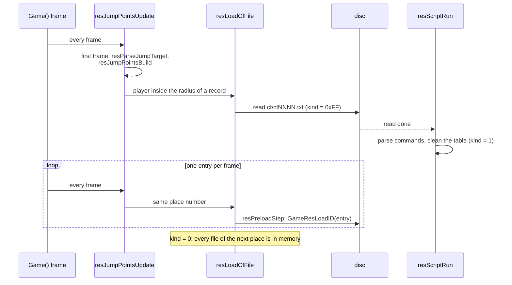

### Applying a place

`resApplyCfFile(id)` makes a place the current one. `mapSceneScriptLoad`
calls it before it reads the place script. It does not matter how far the
background loading got. The function first calls `resLoadCfFile(0x10000 | id)`
in a loop until the state for that number is 0. The set bit 16 tells
`resPreloadStep` to work even while the stream service is busy, so the loop
finishes whatever is still missing.

Then it clears the state of the old place: the resource descriptor tables,
the map model pointer `mainObject`, `gameWork.active`, the collision block
(`mapLoadBlock(0)`), the jump records and the music volume. When the new place
had no script file at all it resets the whole resource memory with
`GameResourceReset`.

Next it frees every block listed in `resOwnerTable`, which are the blocks of
the old place that the new place does not use. After that it tidies the
memory. Every block with the preloaded mark is moved down into the first free
block that is large enough or that sits directly below it. For character
models, maps and map object models the five pointers at the start of the
block are turned into offsets before the copy and back into addresses after
it (`resRelocateRecord`). A block that cannot move just loses its mark.

At last it walks the entry table and acts on every entry:

| Entry kind | Action |
| --- | --- |
| sound record, first byte below 64 | `seBankSetName(bank, name)`. An empty name clears the bank. For bank 8 and bank 12 an empty name clears five banks in a row |
| sound record `f` | stores the material in `resFootMaterials` and closes the list with `0xFF` |
| sound record `e` | stores the file id in `resEnemyFootGroups` |
| sound record `s` | picks a name by `bgmNameListIndex` and calls `seBgmNameSet` |
| sound record `v` | stores `seBgmVolume` |
| effect | `sefLoadEffectCfName(0, name)` |
| named file | `GameResLoadName(name, 0, 0, 0)` |
| event `0x100` | `Intermission(argument)` |
| event `0x200` | `GameDiskChange(argument)` |
| any other | `GameResLoadID(entry, 0, 0, 0)` |

The function ends with `resResetScriptState`, so the tables are empty again
and ready for the next neighbour. Because the events sort last, a `save` or
`disk` line always runs after every resource and sound line of the same file.

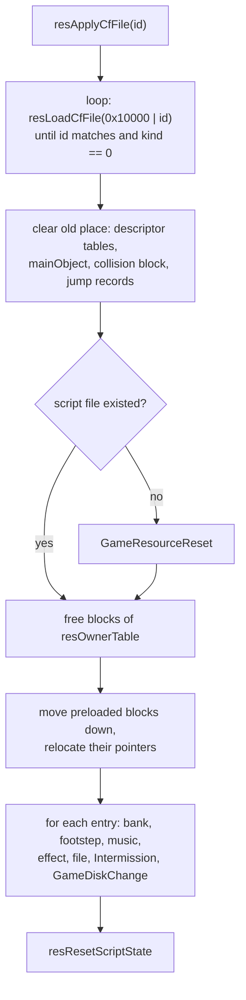

## Starting the place script

`mapSceneScriptLoad(id, mode)` in `src/main/ytachi_test.c` is the one function
that starts a place. `Game()` is its only caller and always passes mode 1.
Its steps are:

1. For every map object record of kind `MAP_KIND_MODEL` that has a transform,
   the stored pose is copied back to the transform.
2. `sbInit` clears the script VM: all threads, their stacks and message
   queues, and the native tables.
3. `scriptRegisterModules` registers the native modules again: `objx`,
   `enepc`, `runtime`, `ladder`, `camera`, `math`, `menu`, `uwamono`, the
   cutscene plug-in, the elevator module, and through `scriptRegisterNatives`
   the modules `talk`, `g2path` and `seg`.
4. With mode 1, `sefSetCurrentOwner(id)` makes the place number the owner of
   new effects and `resApplyCfFile(id)` applies the scene resource script.
5. The digits of the number are written into the name `sc0000.sb`, and the
   path is built with the format `"cf\\%s"`. `xglCdReadFile` reads the image
   to the start of `mapSceneScriptBuffer` and returns its size.
6. The language path is built with the format `"cf\\xx\\%sl"`, which gives
   `cf\xx\scNNNN.sbl`. `xglGetLanguageCode` then overwrites the two letters
   `xx` with the code of the current language. The library is read to the
   address right behind the image.
7. `sbLibraryLink(image, library)` links the two. It resolves the native
   imports of the image and connects it to the string library. A failure
   stops the game in a debugger trap.
8. `sbStartImage` creates the first thread at the entry of the image.
9. `gameWork.mapId` becomes the number, `gameWork.nextMap` becomes -1, the
   eight event slots in `uwamonoEventIds` are set to -1, and
   `uwamonoResetRecords(-1, 1)` clears the map object records, apart from
   the static actor and part records that mode 1 keeps.

`mapSceneScriptBuffer` is 131072 bytes (`0x20000`) and holds the image and
the library together. The image stays there for the whole stay in the place.
It is the key under which the VM files every thread of the place, and
`uwamonoSendEvent` and `resParseJumpTarget` both refer to it.

```
mapSceneScriptBuffer (0x20000 bytes)
+0x00000   cf\scNNNN.sb       SB image: header, code, globals, name table
+size      cf\xx\scNNNN.sbl   SBL library: the strings of this script
```

The two-letter language code is chosen by `SaveData.caption_all`.
`xglGetLanguageCode` reads it from a table of nine codes: `en`, `jp`, `en`,
`de`, `fr`, `it`, `es`, `zh` and `ko`. Because the script and its strings are
separate files, the same script runs in every language and only the library
differs.

There is a fourth path string for scripts, `"cf\\sc"`
(`configScriptPrefixName` in `src/ov01/menu_wep_sp_panel.c`). The battle debug
menu page `configScriptPage` in `src/ov01/debug_entry.c` uses it. It builds
`cf\scNNNN.sb` from a number chosen on the page, reads the file into a buffer
of its own, links it with `sbLinkImage` and starts it. That page starts a
script without a language library and without a scene resource script (see
[Debug tools](../game/debug-tools.md)).

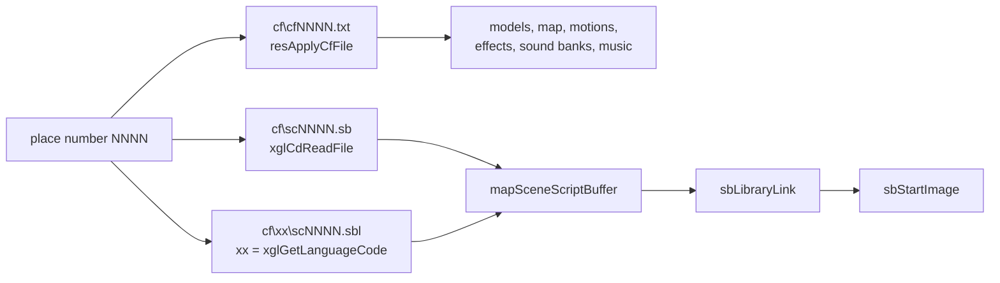

After a battle the script is not loaded again. `Game_Data_Pop` restores the
field, resumes the threads of the image with `sbThreadsResume`, clears the
native counts and calls `scriptRegisterModules` once more, because the battle
registered natives of its own in between.

## Events sent to scripts

A script does not poll the pad or the collision system for most things.
Instead it tells the game which of its threads wants to hear about a kind of
event, and the game queues a message on that thread when the event happens.

The registration is the native `runtime.message(slot, value)`
(`runtimeMessage`). It stores `value` in `uwamonoEventIds[slot]`. The value is
the number under which the VM knows the receiving thread. The table has eight
words and `mapSceneScriptLoad` sets all eight to -1 at the start of a place,
so a new place hears nothing until its script registers.

The sender is `uwamonoSendEvent(slot, first, second)`. It reads the thread
value of the slot and does nothing when it is -1. Otherwise it fills an
`SbMessage` with the slot number as the kind and the two arguments, and
queues it with `sbThreadEnqueue` on the thread of that value in the image of
`mapSceneScriptBuffer`. The thread reads the message the next time it runs.
A thread queue holds 16 messages (see [sb-vm.md](sb-vm.md)).

```
SbMessage (0x10 bytes)
+0x00 kind      the event slot number
+0x04 sender    -1 for events from C code
+0x08 args[0]   first argument
+0x0C args[1]   second argument
```

The table below lists every call of `uwamonoSendEvent` in the source.

| Slot | Sent from | When | `args[0]` | `args[1]` |
| --- | --- | --- | --- | --- |
| 0 | `uwamonoPlayerUpdate` (`src/main/game_camera.c`) | SQUARE is pressed while a map object with flag `0x20000` is selected. The player turns to it and starts the strike motion | id of the object | 0 |
| 1 | `uwamonoPlayerUpdate` | the strike motion reaches its event frame (`uwamonoSquareEventCount` runs out) in search modes 3 to 5 | id of the object | 0 |
| 2 | the locator handlers below | the player triggers a locator | id of the record in the actor's `moved` field | id of the locator |
| 3 | `uwamonoPlayerUpdate` | the player stands on ground whose collision kind has the class `0x100`, once per visit | area number plus 1 | 0 |
| 4 | `src/main/get_ladder.c` | the player climbs past the top of a ladder | id of the ladder | 0 |
| 5 | `src/main/get_ladder.c` | the player climbs down to the foot of a ladder | id of the ladder | 0 |
| 6 | `Game()` | a battle ended with return code 1, 2, 3 or 4 | return code minus 1 | id of the enemy record that started the battle |
| 7 | `Game()` | the timer panel counted down to 0 (arguments 0, 0), or a battle ended with return code 5 (arguments -1, -1) | 0 or -1 | 0 or -1 |
| 8 | `src/main/uwamono_record.c` | an item object was picked up and its message was shown | id of the item record | -1 |

Slot 3 is the map jump. While the player stands on such ground, control bit
`0x400` is set so the event is sent once, and the bit is cleared when the
player leaves the area. The argument is the low five bits of the collision
kind plus 1, which is the case value that `resParseJumpTarget` expects in the
`mapjump` function.

Slot 7 belongs to the timer panel. The native `runtime.TimeAttack` with kind
0 opens the panel and stores a frame count in `gameWork.panelValue`. `Game()`
counts it down by one per frame, shows it as seconds and frames, and sends
the event when it reaches 0. The battle code reads the same counter to end a
timed battle, which is reported with the return code 5.

Slot 8 is used although `uwamonoEventIds` has only eight words, slots 0 to 7.
The read for slot 8 takes the word that follows the table in memory. Whether
a script can register for it could not be determined from the C source alone.
In the scripts on the discs, slots 0 and 7 are registered by no script at
all, and slots 4 and 5 by only six and four scripts (see
[Scripts and archives](../formats/scripts-and-archives.md)).

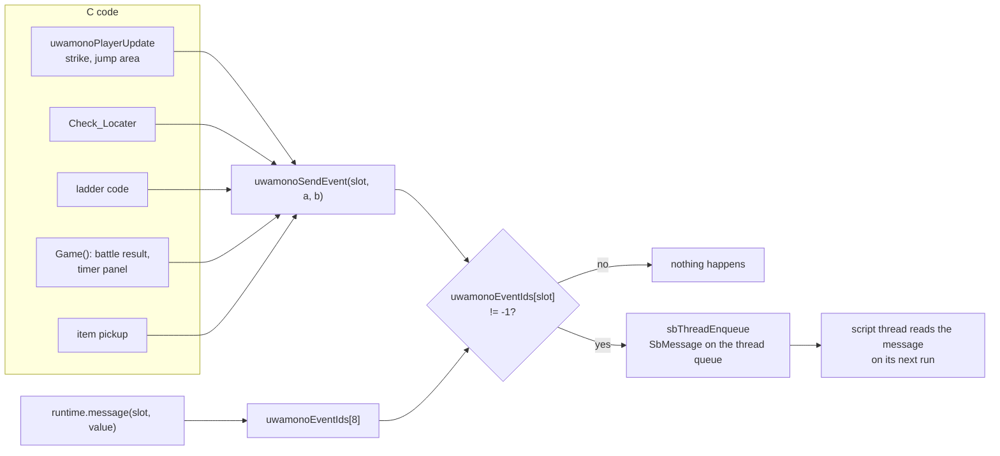

### Locators

A locator is an invisible trigger that a script places in the map. The native
`runtime.setLocater` (`runtimeSetLocater` in `src/main/uwamono_objx.c`)
creates two map object records of kind `MAP_KIND_MOVER` (kind 7), one at each
of two points, and links them to each other through `lookLink`. The first
record gets the id from the script and the shape number from the script in
`searchShape`. The second gets the id plus 1 and the shape 10, which marks it
as the far end. Two angles from the script are stored in `turnFrom.x` and
`turnTo.x`.

`Check_Locater(index)` is called at the end of `uwamonoPlayerUpdate` for the
player. It does nothing while a save is being loaded or while the player is
being placed on an entry point. It walks the 256 records and takes the first
record of kind 7 with a shape other than 0 and 10 whose height range holds
the player and for which `Check_InsideID` reports a hit. The index of the
locator the player was in on the frame before is kept in the actor. Shapes
that fire on entry compare with it, so they fire once and not on every frame
the player stays inside.

`Check_InsideID(mover, sector, other)` is the geometric test. It depends on
the shape of the locator:

| Shape | Area | Test |
| --- | --- | --- |
| 1 | the line between the two points | the player's step from the previous to the current position crosses the line, or one of the two positions lies in the strip between the points and their previous positions |
| 2 | the line between the two points | the line from the player to a point ahead of the player crosses it |
| 3, 4, 5, 6 | a circle around the first point, the radius is the distance to the second point | the player is no farther from the first point than the radius |
| 7, 8, 9 | a square around the first point with that distance as half its side | the player's x and z lie inside |
| 11 | a strip 0.6 wide that reaches from the first point the same distance toward lower z | the player's x and z lie inside |

When a locator was found, `Check_Locater` calls the handler of its shape. All
handlers end in `uwamonoSendEvent(2, ...)`. They differ in the extra
condition:

| Shape | Handler | Fires | Extra condition |
| --- | --- | --- | --- |
| 1 | `uwamonoSearchArcHit` | on entry | when the angle width is below 6.28, the player's heading must lie inside the angle range of the locator |
| 2 | `uwamonoSearchFacingHit` | on CIRCLE | the player's facing must lie inside the angle range |
| 3 | `uwamonoSearchTouchHitShape3` | on entry | none |
| 4 | `uwamonoSearchFacingHitShape4` | on CIRCLE | the player's facing must lie inside the angle range |
| 5 | `EventCheck_Square_Button_Center` | on CIRCLE | the first point must lie in a fan of 50 degrees half angle in front of the player |
| 6 | `uwamonoSearchPlainHit` | every frame inside | none |
| 7 | `uwamonoSearchTouchHitShape7` | on entry | none |
| 8 | `uwamonoSearchCircleFacing` | on CIRCLE | the player's facing must lie inside the angle range |
| 9 | `uwamonoSearchPlainHitShape9` | every frame inside | none |
| 11 | `uwamonoSearchTouchHitShape11` | on entry | none |

The handlers that need a button do nothing while control bit `0x20000000` is
set. Scripts set that bit with `runtime.System(5)` and clear it with
`runtime.System(6)`, and `uwamonoSetTransition` sets it when a place change
starts, so no locator fires during a transition.

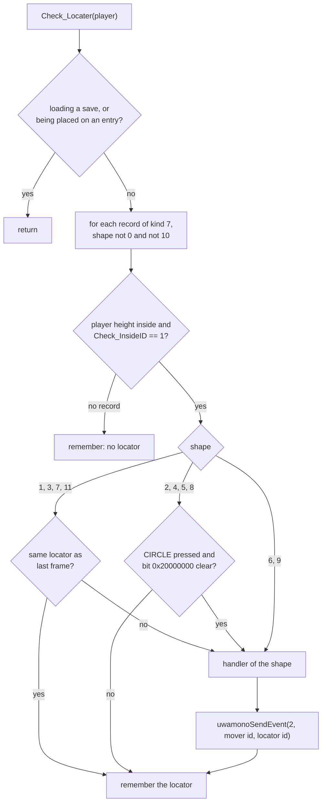

### Footsteps

`src/main/uwamono_event_check.c` also holds `Sound_FootStep`, which
`DispMapObject` calls for every actor record. It watches the motion frame of
a walking or running character. When the frame passes one of the step frames
it starts the footstep sound from the bank that `seFootBankFromKind` picks for
the ground material and creates a small ground effect
(`sefCreateEffectCf`). The step frames come from `footStepTable` for 44 enemy
model ids and from fixed frame numbers for the player characters and the E.S.
The link to the story system is the `foot` and `enefoot` commands above, which
decide which footstep banks a place has in memory. The map objects themselves
are described in [Map and units](../game/map-and-units.md).

## Talking to people and objects

A talk is a short exchange between three parts: the player code finds out who
is addressed, the script decides what is said, and the message window shows
it and waits for the buttons.

### Finding the partner

Every frame in which the player can move, `uwamonoPlayerUpdate` calls
`uwamonoFindTalkTarget(actor, 50.0f)`, which returns the nearest map object
record the player could address, or -1. What happens next depends on the
target:

- When CIRCLE is pressed and the target is an actor record (kind 1) whose
  actor kind lies in the character range starting at `0x10000`, and no
  message window is in use, the talk starts. `talkSetResult` stores the id of
  the target in `talkResult`. `mapObjectSetActive` remembers the target record
  in `mapActiveObject`. The player actor is put into mode 0, the standing
  motion.
- When CIRCLE is not pressed but the target has flag `0x800`, `talkSetResult`
  stores its id as well. Such a character talks as soon as the player comes
  close.
- In every other case `mapActiveObject` is cleared.

The C code does not know which script function belongs to a character. It
only publishes the id. The script calls the native `talk.check` (`talkCheck`
in `src/main/pt_member.c`) in a loop. The native returns the stored id and
sets `talkResult` back to -1. It returns -1 while the message window is busy
or while a search is running (`CONTROL_MAP_ATTACK`), so a talk cannot start in
the middle of another message. `talk.reset` drops a stored id without
reading it.

### Showing the message

The script answers with `talk.smsg` or `talk.msgDtl`. Both do the same work.
`talkMsgDtl` takes one more argument in front, a word of slot flags, which
`talkSmsg` sets to 0.

1. The text argument is either one string or a list of strings that ends with
   the string `NULL`. The native tells them apart by the type tag of the
   argument (3 is a string). Strings are read from the language library with
   `vmKeyedEntryGet`.
2. `msgBegin` closes every open window and the choice window, opens the next
   text slot of the message window, makes it slot 0 and sets control bit
   `CONTROL_SCRIPTED` (`0x8000`). While that bit is set the player cannot
   walk.
3. Each string is fed to the window with `msgWindowSetScriptText`.
4. The remaining arguments are stored with `msgWindowSetSlot` as value 1, 2
   and so on. These are the values of the `%d` and `%s` escapes in the text.
   A text slot has room for 10 of them.
5. `msgSlotSet` stores the flag word for the open slot.
6. `mapObjectBeginMessage` puts the player actor into mode 0 and sets
   `CONTROL_SCRIPTED` once more.
7. `mapObjectFaceActive` handles the partner in `mapActiveObject`. The
   partner gets the flags `0x400400`. Unless slot flag `0x10` is set, the
   partner's heading is set so that it faces the player. Unless slot flag
   `0x8` is set, the partner plays the motion in entry 3 of its walk table
   (`motions->walk[3]`). Then `mapActiveObject` is cleared.

The turn itself happens over the next frames. `DispMapObject` turns every
record that has both flag bits toward its heading with a speed of 4.0, and
calls `mapObjectClearTalkFlags` to remove the two bits as soon as
`CONTROL_SCRIPTED` is no longer set.

The slot flag word controls how the window reacts:

| Bit | Name | Effect |
| --- | --- | --- |
| `0x1` | `MSG_SLOT_NO_CIRCLE` | CIRCLE does not advance or close the window |
| `0x2` | none | `msgQueueClose` hides the page cursor of the window (`msgWindowActivateTalk` sets `talkActive`) |
| `0x4` | `MSG_SLOT_KEEP_GAME_FLAG` | closing the window leaves `CONTROL_SCRIPTED` set, so the player stays locked for what the script does next |
| `0x8` | none | the partner keeps its current motion |
| `0x10` | none | the partner does not turn to the player |
| `0x40` | `MSG_SLOT_CROSS_CLOSES` | CROSS closes the window |

### Buttons

`msgUpdateTimed` calls `msgUpdate` once per frame. With CIRCLE the window
goes through three stages. While the text is still being typed
(`MSG_WINDOW_SCANNING`), CIRCLE shows the rest of the page at once. When the
page is complete and more text follows, CIRCLE scrolls to the next page. When
the last page is complete, CIRCLE closes the slot: `CONTROL_SCRIPTED` is
cleared unless the slot keeps it, the window closes and `msgSlotIndex` goes
back by one. CROSS closes the slot right away when the slot allows it and the
window is not locked.

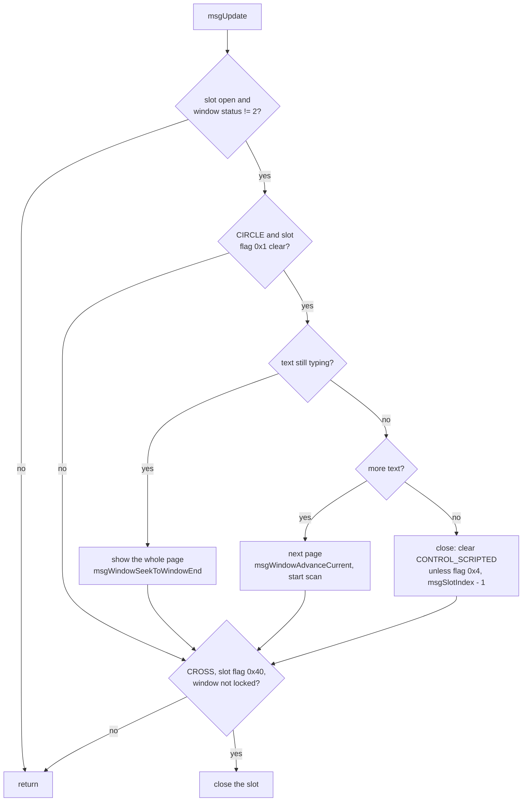

### Waiting and closing

The script has to wait until the player has read the message. The natives of
the `talk` module use the retry rule of the VM for that: a native that sets
its status output to 1 is called again on the next run of the thread, and the
script does not move on (see [natives.md](natives.md)).

| Native | Function | Behaviour |
| --- | --- | --- |
| `talk.check` | `talkCheck` | returns the id of the addressed record once, else -1 |
| `talk.reset` | `talkReset` | forgets a stored id |
| `talk.smsg` | `talkSmsg` | opens a message |
| `talk.msgDtl` | `talkMsgDtl` | opens a message with a slot flag word |
| `talk.winClose` | `talkWinClose` | closes every message window and sets the slot index to -1 |
| `talk.resume` | `talkResume` | ticks the second step of the current cursor text record |
| `talk.enableFlags`, `talk.disableFlags` | `talkEnableFlags`, `talkDisableFlags` | do nothing and return 1 |
| `talk.isDispMsg` | `talkIsDispMsg` | returns whether a message window is in use |
| `talk.wait` | `talkWait` | retries while a message window is in use |
| `talk.menuAddItem` | `menuAddItem` | when the window is idle and CIRCLE is pressed, opens the next window record with a string, else retries |
| `talk.menuGetResult` | `menuGetResult` | polls the selection with `msgPollSelect` and returns the chosen row plus 1, retries until a row is chosen |
| `talk.slotWinOpen`, `talk.slotWinGetResult` | `slotWinOpen`, `slotWinGetResult` | open the choice object and poll it with `msgChoicePoll` |
| `talk.menuDeptQuest`, `talk.menuDeptGetResult` | `menuDeptQuest`, `menuDeptGetResult` | the list window of the G.S. Campaign, see [G.S. Campaign](../game/gs-campaign.md) |

`msgWindowInUse` is the test behind `talk.wait` and `talk.isDispMsg`. It is
true while the window is busy or while its first slot is still open. The
window objects, their slots and their drawing are described in
[Message windows](../libraries/ui-windows.md).

The diagram below shows a complete talk.

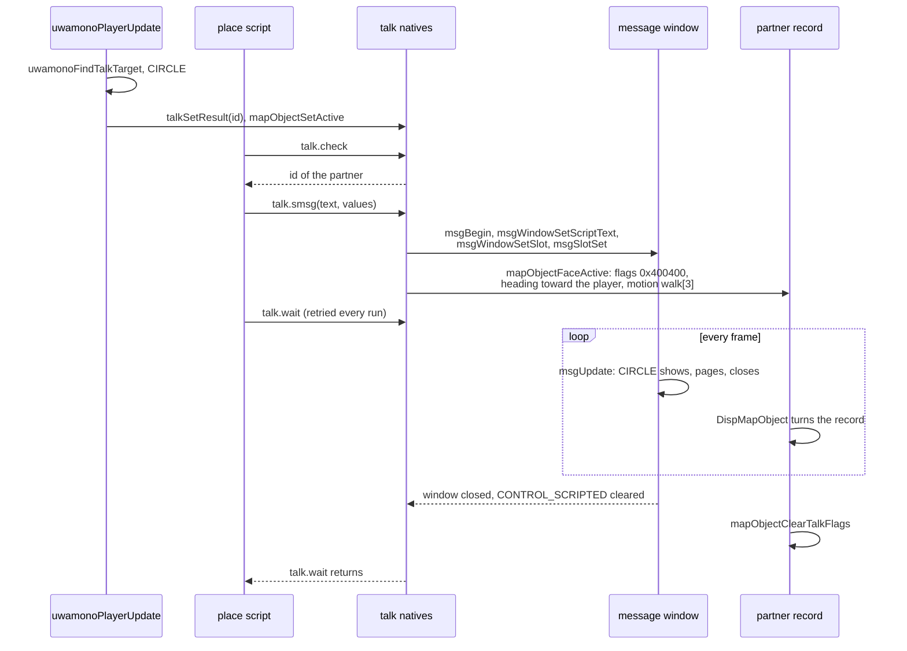

## Message text

The text of a message comes from the language library of the place. A string
argument in the script is a key, and `vmKeyedEntryGet` returns the string of
that key from the library that `sbLibraryLink` attached to the image. Fixed
strings of the C code use the same window functions. An example is
`seg.addrOn` (`segAddrOnMessage`), which shows
`"You found Segment Address No. %d!"` and passes the number as value 1.

`msgWindowSetScriptText` hands the string to the text slot, which formats it
into lines. The control codes and tags of the text, the fonts and the line
breaking are described in [Fonts and text](../libraries/fonts-and-text.md).
What the talk files add to that is small and is listed here.

**The speaker name.** A text slot can carry a pointer to a speaker name,
`MsgSlotText.speaker_name`, which the text formatter takes from a tag of the
text. `talkCopySpeakerName` copies the name into a buffer up to the end of the
string or up to the character `]`, which closes the tag. `talkDrawTextBox`
then draws the name as a plate above the window.

**The reveal position.** Text appears letter by letter. The slot field
`reveal` points at the end of the text shown so far. Before the text is
printed, `talkStashPrefix` saves the two bytes at that position in
`talkPrefixStash` and replaces them with string ends, so the print stops
there. After the print `talkRestorePrefix` puts the bytes back. The second
byte is only handled when it is not 0.

**Pages.** The helpers of `src/main/talk_scan.c` move the reveal position by
whole lines. `talkSeekToWindowEnd` moves it to the last line that fits in the
window, which is what CIRCLE does to a page that is still typing.
`talkSeekToLimit` moves it to the last line of the whole text.
`talkScrollLines` moves it by a number of lines. `talkHasMoreLines` tells
whether lines follow below the window, which is the "more text" test of
`msgUpdate`. `talkSetScanFlag` marks a slot whose cursor is still advancing
(`INTERP_FLAG_SCAN`), and `talkSetSetting` stores the wrap width. All of them
act only on a slot in the text state (`MSG_SLOT_TYPE_TEXT`).

**The page cursor.** `talkAdvanceCounter` counts a slot's frame counter from
0 to 15 and around. The page cursor at the bottom of a finished page uses it
to bob: it rises 4 pixels in the second half of the count. The cursor is not
drawn while `talkActive` is set.

**The window texture.** The frame of a talk window is drawn from the texture
file `omiya\talk01.xtx`. `talkLoadOmiyaTexture` loads it by name into
`talkTextureHandle` and waits for the disc, and `talkCloseTexture` frees it.
`msgWindowReset` loads it whenever the message state is reset.

## Flags

The game keeps several separate flag stores. They differ in who writes them
and how long they live.

| Store | Size | Lives | Written by |
| --- | --- | --- | --- |
| `SaveData.scriptFlags` | 256 bytes, 2048 bits | in the save file | scripts, through `runtime.setFlag` |
| `questFlags` | 36 bytes | in the save file | scripts, through `g2path.setQuestFlag` |
| `citizenFlags` | 50 bytes | in the save file | scripts, through `g2path.setCitizenFlag` |
| segment address flags | see [G.S. Campaign](../game/gs-campaign.md) | in the save file | scripts, through `seg.addrOn` |
| `gameWork.eventFlags` | 512 bytes | in the save file, as part of `gameWork` | the item pickup code |
| `gameWork.rowFlags` | 2 times 512 bytes | in the save file, as part of `gameWork` | the enemy code |
| `gameWork.control` | 32 bits | in the save file, some bits only for one place | C code and `runtime.System` |
| `svSceneFlags` | 32 bits | until changed | the effect system |

### Game flags

The game flags are the memory of the story. They are one packed bit array of
256 bytes inside the save image, `SaveData.scriptFlags`, at offset `0x74` of
`SaveData`. A flag is a field of 1 to 32 bits at any bit offset.
`xglFlagsSet(bit_offset, bit_count, value)` and
`xglFlagsGet(bit_offset, bit_count)` in `src/main/xgl_flags.c` copy the bytes
that hold the field into an 8-byte window, shift by the bit offset inside the
first byte and mask. The set function returns the old value. Fixed-width forms
exist for 1, 2, 4, 8, 16, 32 and 64 bits. `xglFlagsInitial` clears all 256
bytes for a new game.

Scripts reach the array through two natives of the `runtime` module.
`runtime.setFlag(offset, count, value)` (`runtimeSetFlag`) takes exactly three
arguments, and an empty second argument means a count of 1.
`runtime.getFlag(offset, count)` (`runtimeGetFlag`) takes two arguments with
the same rule and returns the value of the field.

C code reads a few of the flags directly. The best known is the 8-bit field
at bit offset `0x191` (401), the story progress (`STORY_PROGRESS_FLAG`).
The table below lists the uses found in the files of this page.

| Field | Read by | Use |
| --- | --- | --- |
| 8 bits at `0x191` | `GameSynopsis` | below `0x4C` the synopsis asks for disc 1, from `0x4C` on for disc 2. The value also picks the synopsis picture |
| 8 bits at `0x191` | `seFootBanksLoad` | above 13, the footstep bank of one player group changes its last letter to `2` |
| 8 bits at `0x191` | `saveReadGameWork` | set to `0x75` when a save from the end of the game is loaded |
| 1 bit at `0x279` | `GameSynopsis` | when set, synopsis picture 22 is shown |

### Quest and citizen flags

`src/main/quest_flag_set.c` holds the store for the side quests.
`questFlagSet(index, value)` writes one of 36 bytes in `questFlags`. For the
values 2 and 3 it also sets bit `0x10` in the stored byte.
`questFlagGet(index)` returns the byte without that bit, and 0 for an index
outside the table. `citizenFlagSet(index, value)` writes one of 50 bytes in
`citizenFlags`. Both setters ignore an index outside their table.

The script natives are in the `g2path` module, registered by
`scriptRegisterNatives`: `setQuestFlag`, `getQuestFlag`, `setCitizenFlag` and
`getCitizenFlag`. They count from 1, so the native subtracts 1 from the number
before it calls the store. The third module registered in the same place,
`seg`, has `addrOn` and `getAddrOn` for the segment addresses. What the quest,
citizen and segment values mean in the game is described in
[G.S. Campaign](../game/gs-campaign.md). All three tables are copied from the
save image by `saveReadGameWork`.

### Pickup and enemy flags

Two tables in `gameWork` remember which items were taken and which enemies
were beaten. `Game()` clears both at the start of a play session with
`gameEventFlagsClear` and `gameRowFlagsClear`. When the session was started
by Load Game, `saveReadGameWork` then copies the whole `gameWork` block back
from the save image, and the two tables come back with it.

`gameWork.eventFlags` has 512 bytes, one per row of the event table of the
place (`uwamonoEventTable`). When an item object has been picked up, its byte
is set to 1. When the place is entered again and the script asks for the same
item object, the creation code in `src/main/uwamono_objx.c` sees the 1 and
frees the record at once, so a collected item does not come back.

`gameWork.rowFlags` has two rows of 512 bytes, one per row of the key row
table (`uwamonoKeyRowTable`). The first row is used while control bit `0x800`
is clear and the second while it is set. `uwamonoReleaseChildren` sets the
byte of an enemy to 1 when the enemy and its companions are gone after a
battle. When an actor is created from a key row whose byte is 1, the key row
decides through `gateIfClear` or `gateIfSet` whether it may appear again.
Field enemies are described in [Field enemies](../game/field-enemies.md).

### Control bits a script can set

`gameWork.control` is the word of control bits of the field. Most bits belong
to the field code and are described in [The field](../game/field.md). The
native `runtime.System(n)` (`runtimeSystem`) lets a script set or clear some
of them:

| Argument | Bit | Action | Effect seen in the code of this page |
| --- | --- | --- | --- |
| 0 | `0x08000000` | set | the frame loop ends and `Game()` calls `GameOver()` |
| 1 | `0x00080000` | set | `Game()` calls `pxySetTexMapDropAll` every frame |
| 2 | `0x00080000` | clear | |
| 3 | none | nothing | |
| 4 | `0x00800000` | set | `Game()` no longer calls `pxySetShadowUploadFlag` |
| 5 | `0x20000000` | set | button locators, the menus and the message buttons are off |
| 6 | `0x20000000` | clear | |
| 7 | `0x40000000` | set | the main menu and the save point menu cannot be opened |
| 8 | `0x40000000` | clear | |
| 9 | `0x00100000` | clear | place changes fade again |
| 10 | `0x00100000` | set | `CONTROL_CFE_NO_FADE`: place changes start no fade-out and the new place starts without fade-in |

`Game()` clears the bits `0x80000`, `0x800000`, `0x10000`, `0x20000000` and
`0x200000` at the start of every place, so these settings last for one place.

### The effect scene flags

`src/main/sv_scene_flags.c` holds a flag word of the effect system,
`svSceneFlags`, with four accessors: `svSceneFlagsTest`, `svSceneFlagsSet`,
`svSceneFlagsClear` and `svSceneFlagsToggle`. Each takes a bit mask. The
effect code in `src/main/sef.c` sets and clears bit 0 around its work, and
the effect drawing code in `src/main/sv_get_image_item.c` reads bits 0 and 1
to decide which effect records are drawn. These flags are not story flags.
They are described with the effect system in [sef](../libraries/sef.md).

The same file holds two helpers that have nothing to do with flags.
`vu0DirectionToAngles` turns a direction vector into a pitch and a yaw angle.
`lightSetLogDump` walks a light set and logs every vector, which does nothing
in the released game because the log call is empty.

## Changing place

### `runtime.jumpCF`

A script leaves a place with `runtime.jumpCF(place, entry, mode, timer)`
(`runtimeJumpCf`). The first argument is the number of the next place. The
other three may be left empty. The entry key defaults to -1, the mode to 1 and
the timer to 30 frames. The call is ignored while a place change is already
pending on the player record.

The work is done by `uwamonoSetTransition(mode, state, stateArg, timer)`. It
does not change the place at once. It stores the request on the record of the
player, `uwamonoRecords[uwamonoCurrentIndex]`:

| Field | Value |
| --- | --- |
| `eventState` | the next place |
| `eventStateArg` | the entry key |
| `eventTimer` | the timer in frames |
| `event` | 0, the kind "place change" |

It also sets the control bits `0x20000000` and `CONTROL_SCRIPTED`, so the
player can neither walk nor trigger anything. Mode 1 sets bit `0x10000`
(`CONTROL_REPLAYED`). Any other mode clears that bit and puts the player into
motion 0, unless the player is on a ladder. Unless `CONTROL_CFE_NO_FADE` is
set, a fade-out over the timer length starts with `fadeStartOut`. A timer of
0 skips the wait: `nextMap` and `entryKey` are written at once.

Otherwise `DispMapObject` finishes the job. For every record with an event
timer it counts the timer down by one per frame. When the timer has run out
and the event kind is 0, it copies `eventState` to `gameWork.nextMap` and
`eventStateArg` to `gameWork.entryKey`. The frame loop sees the new `nextMap`
on the same frame and leaves.

The same record fields carry a second kind of event. `runtime.changeRobo`
(`uwamonoSetRoboMode`) sets `event` to 1 with a timer of 30 and an immediate
fade-out. When that timer runs out, `DispMapObject` calls
`uwamonoChangePlayerModel(-1000)` and fades in again. This is how the player
changes between walking on foot and riding an E.S. inside one place.

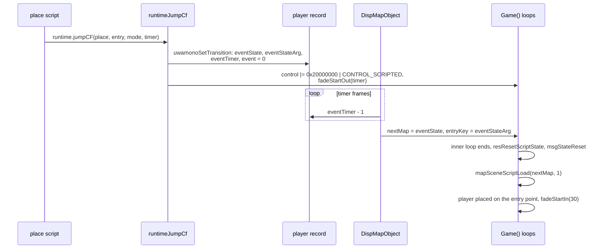

### Changing the map model

The place number and the map model are separate things. The model is chosen
by the script with `runtime.mapChange(id)` (`runtimeMapChange`), which calls
`mapResourceSwitch(id, 1)` in `src/main/game_map_object.c`. The id is a file
id of the resource system, the same kind of number the `map` command of the
scene resource script produces. `mapResourceSwitch` resets the map object
records and the effect handle slots, stores the id in `gameWork.resourceId`,
loads the resource with `GameResLoadID` until the load is accepted, and frees
the previous map when it was a different one. Because the scene resource
script already put the map file into memory, this load normally finds the
block in place. What the callback does with the loaded map is described in
[Map and units](../game/map-and-units.md).

The same group of natives lets the script set the look of the map. They only
store values that the field drawing reads every frame.

| Native | Function | Stores |
| --- | --- | --- |
| `runtime.Fade` | `runtimeFade` | starts a fade to a colour: red, green, blue, alpha and a frame count, passed to `fadeStartColorAlpha` |
| `runtime.setFog` | `runtimeSetMapFog` | fog distances in hundredths and a fog colour. With key -1 they go to `gameWork.fogDist` and `gameWork.fogColor` and to every actor, with key -2 only to every actor |
| `runtime.setMapColor` | `setMapColor` | `gameWork.mapColor`, three values divided by 255, the colour scale of the map model |
| `runtime.setLight` | `runtimeSetMapLight` | one light of one of the 16 light sets in `gameWork.lights`: type 0 the ambient colour, types 1 to 3 a direction and a colour, type 4 a direction and a strength |
| `runtime.setItai` | `runtimeSetItai` | the shadow caster mode and draw or render flag bits of one or all actors |
| `runtime.progEffect` | `runtimeProgEffect` | advances an effect by a number of frames through `sefProgressEffect` |
| `runtime.setElevator` | `runtimeSetElevator` | the elevator motion and its argument of one record |

One detail of `runtime.setFog` is worth knowing. For a single record key the
loop over the records ends at the found index itself, so no actor is changed.
Only the keys -1 and -2 have an effect.

## The chapter intermission

The `save` command of a scene resource script calls
`Intermission(chapter)` in `src/main/game_over.c` while the place is being
applied. It is the picture between two chapters with the offer to save. It
does nothing when the place is reached by loading a save
(`gameWork.loadStage == 1`), so loading a game does not show the picture
again.

The function sets `gameWork.resourceId` to the chapter number plus 1 and
reads the archive `yajima\im.bin` into free resource memory. The archive
starts with a table of offsets. The function turns them into addresses and
decodes the JPEG picture at index `chapter` with `xglJpegDecode`. The picture
fades in from black. Then the text `Save game data?` is printed with the two
answers. CIRCLE stores `nextMap` in `gameWork.mapId`, so that the save names
the place that is being entered, and calls `GameSceneReset`, which resets the
scene and opens the save screen with `MenuFileMain(0)`. CROSS asks `Continuing without saving. Is this okay?`, and a
second CROSS returns to the first question. The save screen is described in
[Save data](../architecture/save-data.md) and the surrounding screens in
[Title and boot](../game/title-and-boot.md).

## The disc change

The game comes on two discs. `GameDiskChange(request)` in
`src/main/game_disk_change.c` makes sure the right one is in the drive. The
low four bits of the request are the disc number, 1 or 2. Any other number
returns -1. There are two callers. The `disk` command of a scene resource
script passes the plain number, at the place where the story moves to the
other disc. `GameSynopsis` passes `0x11` or `0x12` at the start of a play
session.

The function first asks the drive with `xglCdDiskCheck`, a second time when
the answer was -2. A positive answer is a bit mask of the discs that match,
with bit 0 for disc 1 and bit 1 for disc 2. When the wanted bit is set, the
function returns after two frames and the player sees nothing.

Otherwise the prompt appears. The background is the picture
`yajima\diskchg.jpg`. A request below `0x10` decodes it into the largest free
block of the resource memory, and a request of `0x10` or more uses the fixed
address `0x01000000`, because at the start of a session the resource memory
is not set up yet. `GameDiskSetDiscDigit` writes the wanted disc number into
the three message texts by replacing every `1` and `2` in them. Then a loop
runs once per frame:

1. `DrawImage` draws the background.
2. `xglCdDiskCheck` asks the drive. Once an answer of -2 has been seen, the
   status texts of the table below replace the plain request.
3. When the right disc is reported for the first time, `xglCdArcCheck` checks
   the archives of the disc and the frame is counted. When it is reported
   again on the next frame, the loop ends. When the report fails in between,
   the status becomes -3 and the count starts again.
4. One of the texts is printed at position (32, 64) in white.

| Situation | Text |
| --- | --- |
| before the first answer of -2 | `Please insert DISC n of Xenosaga Episode II.` |
| status -3 | `Checking disc...` |
| status -2 | `Please insert DISC n of Xenosaga Episode II.` |
| status -1 | `Incorrect disc.` and the insert text |
| status 0 | `There is no disc inserted.` and the insert text |
| the right disc, first report | `Checking disc...` |
| another disc of the game | `Incorrect disc.` and the insert text |

The global fade is saved before the prompt and restored after it, so the
prompt is fully visible even when the game was faded out.

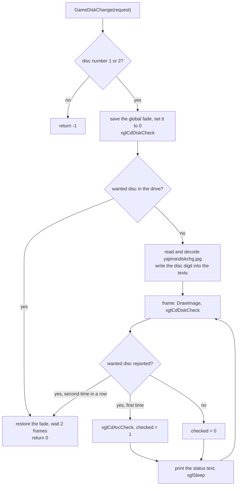

### The synopsis screen

`GameSynopsis` is the first thing `Game()` calls. It is the bridge between
the title screen and the first place, and it is where the disc is checked at
the start of a session. It does nothing when the session was started by Load
Game, where `nextMap` is still 10 at that moment.

It reads the story progress flag and calls `GameDiskChange(0x11)` when the
value is below `0x4C` and `GameDiskChange(0x12)` otherwise. Then it reads the
archive `yajima\synopsis.bin` to the fixed address `0x01E00000` and turns its
offset table into addresses in the same way as the intermission archive. The
first two images of the archive are two text panels of 512 by 64 pixels.

For a new game (`nextMap` is 7001) the screen stays black. Otherwise a
background picture is chosen from the story progress. The progress value is
compared with a list of 20 thresholds (9, 13, 21, 23, 30, 37, 43, 51, 59, 66,
68, 76, 78, 81, 88, 91, 96, 102, 112, 122), and the picture number is one
more than the number of thresholds the progress has reached. Two cases
override that: a progress of exactly `0x87` shows picture 20, and a set 1-bit
flag at `0x279` shows picture 22. The number is written into the path
`yajima\synopsis\00.jpg`, and the picture is read to `0x01D00000` and decoded
to `0x01C00000`.

Later in the set-up, `GameSynopsisCrossfadeWait` plays a sound, fades the
first panel out and the second panel in over the picture, and waits for
CIRCLE. The soft reset button combination sets `CONTROL_SOFT_RESET` and makes
`Game()` return to the title. The function does nothing when `nextMap` is 10, the place
of the unreachable developer start, and for a new game. The screens before and after are described in
[Title and boot](../game/title-and-boot.md).

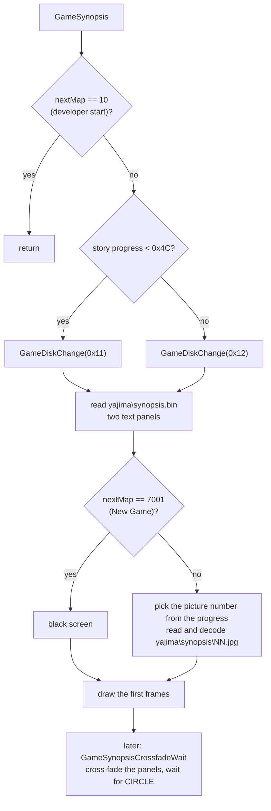

## Debug access

Two developer pages give direct access to the systems of this page. Both are
described in [Debug tools](../game/debug-tools.md).

The resource test page in `src/main/yajima_test.c` steps a place number with
the pad and calls `resLoadCfFile` and `resApplyCfFile` for it. It then lists
the block table and prints the two tables that `resGetEntryTables` returns,
the entry table and the owner table, side by side. This shows exactly what a
scene resource script asked for and what it will free.

The script page of the battle debug menu, `configScriptPage`, starts any
place script by number with the path prefix `cf\sc`, as described under
[Starting the place script](#starting-the-place-script).
