# Native functions

The SB scripts of Xenosaga Episode II cannot touch the engine directly. A script only computes integers, jumps, and exchanges messages with other script threads. Everything else it does to the game, from moving a door to starting a cutscene or queuing an enemy's attack, goes through a **native function**: a C function of the game that the script calls by a module name and a function name, for example `objx.move` or `bat.unitCreate`.

The game defines 268 natives in 17 name tables. 200 of them are available to the scripts of the field (maps, events and cutscenes), 120 are available to the scripts of a battle, and 5 belong to a table that is never registered. This page explains how the tables are registered, how a native reads its arguments and returns a value, and what every native does.

The virtual machine that runs the scripts, its threads, its stack and its opcodes are described on the [SB virtual machine](sb-vm.md) page.

[← Back to the overview](../README.md)

## Source files

| File | Contents |
| --- | --- |
| `src/ov01/sb_vm.c` | The native registry (`sbNativeOwnerAdd`, `sbFindNative`, `sbResetNativeCounts`), the linker that resolves imports (`sbLinkImage`) and the call opcode (`sbOpCallNative`) |
| `include/ov01/sb_vm.h` | `SbNativeMethod`, `SbThread`, the jump keys `SB_JUMP_ZERO_DIVIDE` and `SB_JUMP_ARGUMENTS` |
| `src/ov01/sb_natives.c` | The argument readers (`VM_PLUGIN_CNT_GET`, `vmArgGet`, `vmArgGetHigh`, `vmArgTagIsZero`, `vmKeyedEntryGet`, `vmEntryGet`, `vmSubEntryGet`) and 23 natives of the `bat` module |
| `src/ov01/sb_natives_unit.c` | The other 40 natives of `bat`, the `samp` and `deb` modules, the three tables `batMethods`, `sampMethods` and `debMethods`, and the battle registration `runtimeInit` |
| `src/main/uwamono_objx.c` | `scriptRegisterModules` (the field registration), the 15 natives of `objx`, and `runtime.setNumber`, `runtime.setLocater`, `runtime.setLastDan` and `runtime.setPlayer` |
| `src/main/runtime_enepc.c` | The `runtime` table `runtimeNativeTable`, `runtime.Vibration`, and `enepc.setParams`, `enepc.setParamsAll` and `enepc.motion` |
| `src/main/runtime.c` | Fourteen natives of `runtime`: effects, form change, elevators, map jumps, fades, flags, fog, light and the `System` switches. It also holds most name strings of the `runtime` and `enepc` tables |
| `src/main/runtime.c` | `runtime.Item`, `runtime.TimeAttack` and `runtime.GetAnalogR` |
| `src/main/runtime.c` | `runtime.mpeg2`, `runtime.adx`, `runtime.adxload` and `runtime.adxplay` |
| `src/main/runtime.c` | The eight sound natives of `runtime` (`se`, `sePos`, `seVol`, `bgmse`, `bgmsePos`, `bgmFade`, `nextBgm`, `bgm`) |
| `src/main/runtime_uwamono_door.c` | The `enepc` table `enepcNativeTable`, `enepc.disableDrawFlags`, and the five natives of `uwamono` |
| `src/main/runtime_enepc.c` | Fourteen natives of `enepc`, from `motionFace` to `enableDrawFlags` |
| `src/main/runtime_camera.c` | The 50 natives of `camera`, the tables `cameraNatives` and `ladderNatives`, and both registration functions |
| `src/main/get_ladder.c` | `ladder.setLadder` and `ladder.setEntrance` |
| `src/main/get_ladder.c` | The `uwamono` table `uwamonoNativeTable` and `uwamonoRegisterNatives` |
| `src/main/runtime_math.c` | The four natives of `math` |
| `src/main/runtime_menu.c` | The `math` table and `mathRegisterNatives`, and `menu.ptInit` and `menu.ptClear` |
| `src/main/runtime_menu.c` | `menu.ptJoin`, `menu.ptLeave`, `menu.ptChangeMode` and `menu.ptSet` |
| `src/main/runtime_menu.c` | `menu.ptSetPilot`, `menu.ptGetLeader`, `menu.ptSetArray`, `menu.ptTent` and `menu.umnReturn` |
| `src/main/runtime_menu.c` | The `menu` table `menuNativeTable` and `menuRegisterNatives`. The rest of the file sets up map object records and belongs to [Map and units](../game/map-and-units.md) |
| `src/main/elevator.c` | The seven natives of the `id` module, their table and `elvReset` |
| `src/main/cfePlugIn.c` | The 29 natives of `cfe`, their table and `cfeRegisterPlugIn` |
| `src/main/talk_natives.c` | `scriptRegisterNatives`, the tables of `talk`, `g2path` and `seg`, `talk.slotWinGetResult`, and the helpers that tie a conversation to a map object |
| `src/main/talk_natives.c` | `talk.smsg` and `talk.msgDtl` |
| `src/main/talk_natives.c` | `talk.winClose`, `talk.resume`, `talk.enableFlags`, `talk.disableFlags`, `talk.isDispMsg` and `talk.wait` |
| `src/main/talk_natives.c` | The four natives of `g2path`, the two of `seg`, and the menu and shop natives of `talk` |
| `src/main/pt_member.c` | `talk.check` and `talk.reset` (the rest of the file is the party, see [Party and growth](../game/party-and-growth.md)) |
| `src/main/fade_ctrl.c` | The five natives of `Samplefade` and `fadeRegisterCommands` |

## Overview

A native belongs to an **owner**, also called a module: a short name such as `objx`, `camera` or `bat`. Each owner has one table of `SbNativeMethod` entries, and each entry pairs a function name with a C function. A script names a native by the two strings together. The script compiler stores them in the import list of the script image, and the VM turns each pair into a number when it links the image.

The tables are not registered once at boot. The game has two sets of them. The **field set** is registered every time a map scene script is loaded, and the **battle set** is registered every time a battle starts. Each registration first empties the registry. A script therefore only ever sees the natives of the mode the game is in.

| Owner | Natives | Set | Table | System it drives |
| --- | --- | --- | --- | --- |
| `objx` | 15 | field | `objxNatives` in `src/main/uwamono_objx.c` | Map object records: movement, rotation, scale, transparency, parents ([Map and units](../game/map-and-units.md)) |
| `enepc` | 18 | field | `enepcNativeTable` in `src/main/runtime_uwamono_door.c` | Field enemies and NPCs: parameters, routes, motions, look-at, encounters ([Field enemies](../game/field-enemies.md)) |
| `runtime` | 34 | field | `runtimeNativeTable` in `src/main/runtime_enepc.c` | Game flow on the map: object creation, the player, items, flags, map jumps, fog, light, fades, sound, movies ([Field](../game/field.md), [Events](events.md)) |
| `ladder` | 2 | field | `ladderNatives` in `src/main/runtime_camera.c` | Ladders of the map ([Map and units](../game/map-and-units.md)) |
| `camera` | 50 | field and battle | `cameraNatives` in `src/main/runtime_camera.c` | The scripted camera ([Field](../game/field.md)) |
| `math` | 4 | field and battle | `mathNativeTable` in `src/main/runtime_menu.c` | Trigonometry and random numbers ([Math](../libraries/math.md)) |
| `menu` | 11 | field | `menuNativeTable` in `src/main/runtime_menu.c` | The party: members, pilots, order, split mode ([Party and growth](../game/party-and-growth.md)) |
| `uwamono` | 5 | field | `uwamonoNativeTable` in `src/main/get_ladder.c` | Doors and breakable objects ([Map and units](../game/map-and-units.md)) |
| `cfe` | 29 | field | `cfePlugInTable` in `src/main/cfePlugIn.c` | The cutscene player ([Cutscenes](cutscenes.md)) |
| `id` | 7 | field | `elvNativeTable` in `src/main/elevator.c` | Elevators, slopes, keep-off areas, jump points ([Map and units](../game/map-and-units.md)) |
| `talk` | 16 | field | `talkNativeTable` in `src/main/talk_natives.c` | Conversations, message windows, choice menus, shops ([Message windows](../libraries/ui-windows.md), [Events](events.md)) |
| `g2path` | 4 | field | `g2pathNativeTable` in `src/main/talk_natives.c` | Quest and citizen flags of the G.S. Campaign ([G.S. Campaign](../game/gs-campaign.md)) |
| `seg` | 2 | field | `segNativeTable` in `src/main/talk_natives.c` | Segment addresses ([G.S. Campaign](../game/gs-campaign.md)) |
| `samp` | 2 | field and battle | `sampMethods` in `src/ov01/sb_natives_unit.c` | Test output: debug font and pad |
| `deb` | 1 | field and battle | `debMethods` in `src/ov01/sb_natives_unit.c` | A debug print that does nothing in this build |
| `bat` | 63 | battle | `batMethods` in `src/ov01/sb_natives_unit.c` | The battle: enemy tables, units, commands, effects, messages, light ([Battle](../game/battle.md), [Battle engine](../game/battle-engine.md)) |
| `Samplefade` | 5 | none | `fadeCommandTable` in `src/main/fade_ctrl.c` | Screen fades ([Screen effects](../libraries/screen-effects.md)) |

The field set has 15 owners and 200 natives. The battle set has 5 owners and 120 natives. `camera`, `math`, `samp` and `deb` are in both sets with the same C functions, so the two sets together name 263 different natives. With the 5 of `Samplefade` the tables hold 268 entries.

Six natives are empty functions that return 1 and do nothing: `camera.AngleMode`, `talk.enableFlags`, `talk.disableFlags`, `cfe.ldDev`, `cfe.setMesScr` and `deb.put`. They are probably left from earlier versions of the engine, and they stay registered so that scripts that still call them link without an error.

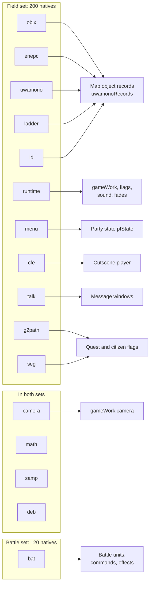

## The registry

The registry is two arrays in `src/ov01/sb_vm.c`. `sbNativeOwners` has room for `SB_NATIVE_OWNER_MAX` (0x600) owners and `sbNativeMethods` for `SB_NATIVE_METHOD_MAX` (0x800) methods. Two counters, `sbNativeOwnerCount` and `sbNativeMethodCount`, say how much of each is in use. `sbResetNativeCounts` sets both counters to 0, which empties the registry without clearing the arrays.

An owner record is small:

| Offset | Type | Name | Meaning |
| --- | --- | --- | --- |
| 0x00 | `const char *` | `name` | The owner name, for example `"objx"` |
| 0x04 | `SbNativeMethod *` | `methods` | The owner's first entry in `sbNativeMethods` |
| 0x08 | `int` | `count` | The number of methods of this owner |

A method is one `SbNativeMethod`, 8 bytes:

| Offset | Type | Name | Meaning |
| --- | --- | --- | --- |
| 0x00 | `const char *` | `name` | The function name the script uses, for example `"move"` |
| 0x04 | `int (*)()` | `func` | The C function |

`sbNativeOwnerAdd(name, methods)` registers one table. It refuses when the owner array is full. Otherwise it writes the name and the address of the next free method entry into a new owner record, then copies the caller's table into `sbNativeMethods` entry by entry until it meets an entry whose name is null. It stores the number of copied entries as the owner's `count` and returns 1. The copy means that the registry does not point into the tables of the modules. The tables in the source files only serve as the input of the registration.

The source tables all end with a `{ 0, 0 }` entry. The `ladder` table is declared with four entries and has two null entries after its two natives. Only the first null entry matters.

`sbFindNative(ownerName, methodName)` turns a pair of names into a **native id**. It compares the owner name with every registered owner by `strcmp`, then the method name with every method of a matching owner. The id is `(owner << 16) + method`, where both numbers are indices in registration order. The result is -1 when the pair is not registered.

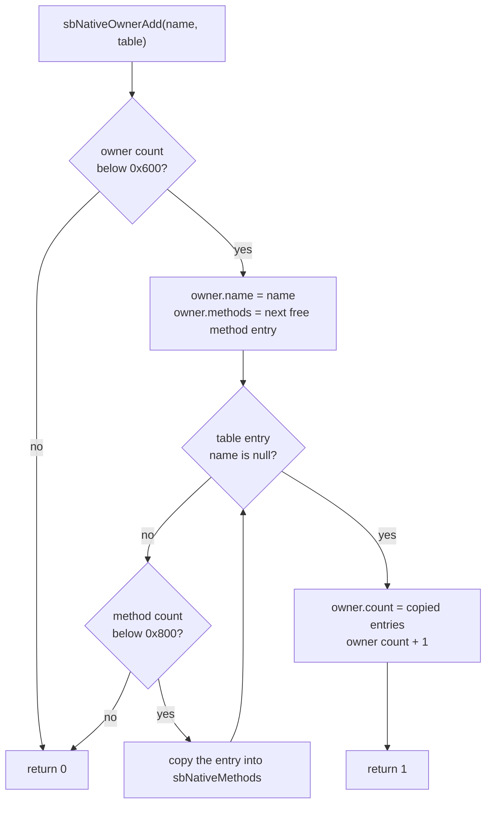

### The field registration

`scriptRegisterModules` in `src/main/uwamono_objx.c` registers the field set. It calls one registration function per module, in this order:

| Order | Call | Owner index | Owner registered |
| --- | --- | --- | --- |
| 1 | `objxRegisterNatives` | 0 | `objx` |
| 2 | `enepcRegisterNatives` | 1 | `enepc` |
| 3 | `runtimeRegisterNatives` | 2 | `runtime` |
| 4 | `ladderRegisterNatives` | 3 | `ladder` |
| 5 | `cameraRegisterNatives` | 4 | `camera` |
| 6 | `mathRegisterNatives` | 5 | `math` |
| 7 | `menuRegisterNatives` | 6 | `menu` |
| 8 | `uwamonoRegisterNatives` | 7 | `uwamono` |
| 9 | `cfeRegisterPlugIn` | 8 | `cfe` |
| 10 | `elvReset` | 9 | `id` |
| 11 | `scriptRegisterNatives` | 10, 11, 12 | `talk`, `g2path`, `seg` |
| 12 | `runtimeInitState` | 13, 14 | `samp`, `deb` |

Some of these functions do more than register. `cameraRegisterNatives` also clears the three bytes of the camera move protocol (see [The camera module](#the-camera-module)). `elvReset` also clears the move duration of the eight elevator records. `runtimeInitState` is a function of the battle overlay. Besides registering `samp` and `deb` it clears the battle state that the `bat` natives write: the two words of `runEffSet`, the music index, the light block and the two fog vectors.

`scriptRegisterModules` has two callers. `mapSceneScriptLoad` in `src/main/ytachi_test.c` calls it after `sbInit` when it loads the script of a map scene. It then reads the script file and the language file behind it into `mapSceneScriptBuffer`, links the two with `sbLibraryLink` and starts the script with `sbStartImage`. `Game_Data_Pop` in `src/main/game_data.c` is the second caller. It restores the field after an interruption, resumes the threads of the map scene script with `sbThreadsResume`, and then calls `sbResetNativeCounts` and `scriptRegisterModules`.

The second caller exists because of the native ids. A linked script holds owner and method indices, not names. A battle replaces the registry with the battle set, where index 0 is `samp` and not `objx`. When the field comes back, the same tables must be registered again in the same order so that the ids in the already linked map script point at the right functions again.

### The battle registration

`runtimeInit` in `src/ov01/sb_natives_unit.c` registers the battle set. The battle start step `ov01StepSceneScript` in `src/ov01/scene_load.c` calls it, links the battle script with `sbLibraryLink` and starts it with `sbStartImage`.

| Order | Call | Owner index | Owner registered |
| --- | --- | --- | --- |
| 1 | `sbResetNativeCounts` | | Empties the registry |
| 2 | `runtimeInitState` | 0, 1 | `samp`, `deb` |
| 3 | `sbNativeOwnerAdd("bat", batMethods)` | 2 | `bat` |
| 4 | `mathRegisterNatives` | 3 | `math` |
| 5 | `cameraRegisterNatives` | 4 | `camera` |

A battle script can therefore use the whole scripted camera of the field and the four math functions, but none of the map object, party or conversation natives.

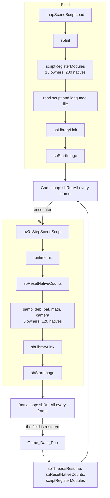

### The Samplefade table

`fadeRegisterCommands` in `src/main/fade_ctrl.c` would register a seventeenth owner, `Samplefade`, with five fade natives. No function in the game calls it, so no script can reach these natives. Their work is covered by `runtime.Fade` and by the fade commands of the cutscene player. They are listed in [The Samplefade module](#the-samplefade-module) because the code is complete.

## Linking a script to its natives

A script image lists the natives it uses in its import list. `SbImageHeader.import_count` gives the number of imports and `import_offset` the position of the list. The list is one 32-bit word per import, followed by the name strings. The high half of an import word is the offset of the owner name in the string block and the low half is the offset of the method name.

`sbLinkImage` resolves the list once per image. For each import it calls `sbFindNative` with the two names and replaces the import word by the native id. Then it walks the whole code of the image. Every native call instruction (`SB_OP_CALL_NATIVE`, opcode 0x15) carries the index of an import as its operand, and the linker replaces that index by the native id. After linking, the script calls natives by id and no name is compared at run time. The image is marked with `SB_IMAGE_LINKED` in its `flags` so that it is not linked twice.

A missing native is normally an error. `sbLinkImage` returns 0, and the callers stop the game: `mapSceneScriptLoad` runs into a debug break and `ov01StepSceneScript` loops forever. When bit `SB_FLAG_ALLOW_MISSING_NATIVES` of the VM flags is set, the linker instead stores -1 for the import and overwrites every call of it with four zero halfwords, which are four no-operation instructions. The script then simply skips the call.

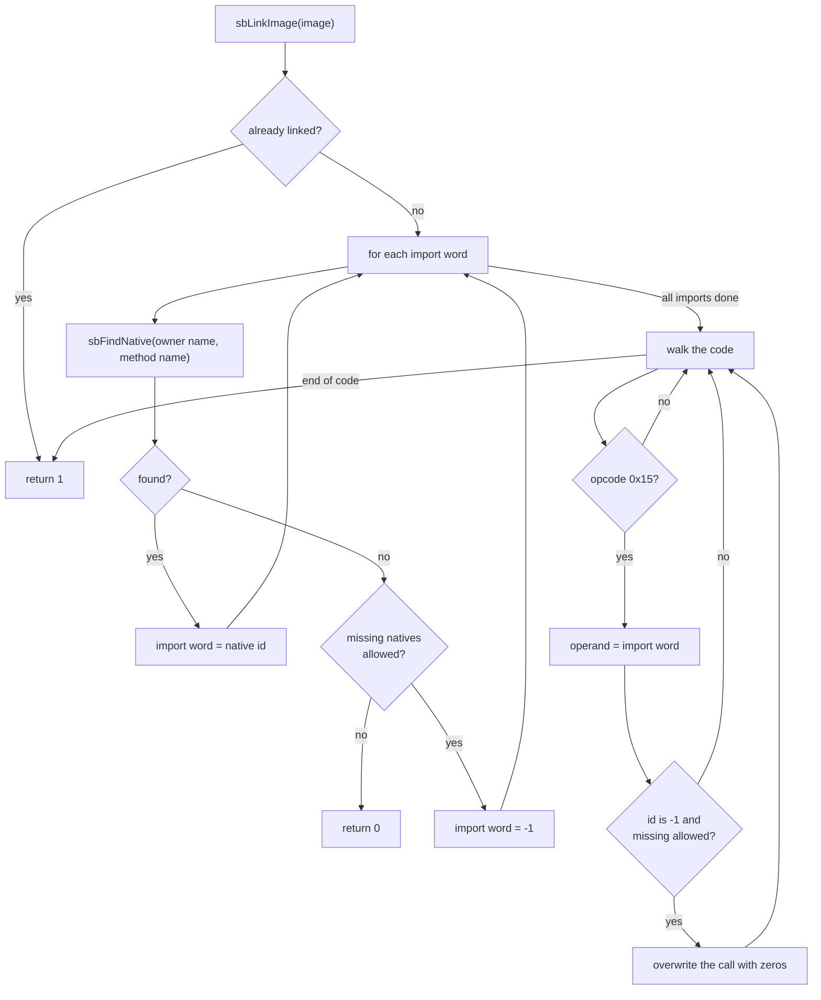

One part of the game looks a native up by name outside the linker. The function in `src/main/res_get_path.c` that scans the `mapjump` routine of a map script calls `sbFindNative("runtime", "jumpCF")` to get the id of the map jump native, and then searches the code for calls with that id to learn where the map leads. The scan is described on the [Events](events.md) page.

## The calling convention

Every native is called through the same pointer type, `int (*func)()`, with two arguments:

```c
int native(SbThread *thread, int *status);
```

`thread` is the script thread that made the call. `status` points to a word that the VM has set to 0. Most natives ignore `status`, and many are declared with only the first parameter or with none at all. The C return value is the script's return value.

### Arguments on the stack

The script pushes the arguments on its operand stack before the call. Each argument takes two 32-bit words: a low word with the value and a high word with the type. After the last argument the script pushes one more word, the **argument count**. The native reads everything relative to the top of the stack, `thread->stack + thread->sp`.

```
operand stack of the thread, for a call with three arguments

  lower addresses                                        stack top
        |                                                    |
        v                                                    v
  ... | arg1 value | arg1 type | arg2 value | arg2 type | arg3 value | arg3 type | count = 3 |
         top[-7]      top[-6]     top[-5]      top[-4]     top[-3]      top[-2]     top[-1]

  value of argument k:  top[-3 - 2 * (count - k)]
  type of argument k:   top[-2 - 2 * (count - k)]
```

Six functions in `src/ov01/sb_natives.c` read this frame, and every native uses them instead of touching the stack itself:

| Function | Result |
| --- | --- |
| `VM_PLUGIN_CNT_GET(thread)` | The argument count, the word below the stack top |
| `vmArgGet(thread, k)` | The value word of argument `k`. Arguments are numbered from 1 |
| `vmArgGetHigh(thread, k)` | The type word of argument `k` |
| `vmArgTagIsZero(thread, k)` | 1 when the first byte of the type word of argument `k` is 0, or when `k` is larger than the argument count. Otherwise 0 |
| `vmKeyedEntryGet(thread, value)` | The address of a string or data entry of the library image that `value` names, or 0 |
| `vmEntryGet(thread, index)` | The address of global word `index` of the thread's own image |

`vmArgGet` and `vmArgGetHigh` treat a wrong index as a fatal error. When `k` is 0 or larger than the count they call `sbFatal`, which never returns. `vmArgTagIsZero` is the tolerant reader: an index past the count is simply reported as an empty argument.

All values are integers. The VM has no floating point type, so the natives use fixed scales. The scale that appears almost everywhere is 100: a position of 2.5 units is passed as 250 and an angle of 90 degrees as 9000. A few natives use other scales, and the tables below name them.

### Omitted arguments

A type byte of 0 means that the script left the argument out. The script still pushes a slot for it, so the positions of the later arguments do not change. This is how the scripts express optional arguments and "keep the current value". `objx.move`, for example, takes a key, a frame count and three coordinates, and a coordinate that is omitted keeps the object's present coordinate:

```c
destination.vector.x = vmArgTagIsZero(thread, 3) != 0
    ? uwamonoRecords[index].positionCoords[0]
    : (float) vmArgGet(thread, 3) / 100.0f;
```

Because `vmArgTagIsZero` also answers 1 for an index past the count, a native can test optional arguments at the end of its list without checking the count first. `bat.atkTbl` requires two arguments and reads a third only when it is present.

### Strings, arrays and data

A script value can name data instead of being a number. Two tables hold such data.

The first is the **library image**, the `SBL` image that `sbLibraryLink` attached to the script as `image->keys`. On the field it is the language file loaded behind the map script, and it holds the texts and names of the scene. A value whose bits 20 to 23 are `VM_KEY_TAG_ENTRY` (0x200000) is a key into it. `vmKeyedEntryGet` removes the tag, checks the index against the entry count of the library and returns the address of the entry. A native that expects a string passes the argument through this function, as `runtime.bgm` does for the track name. Natives that accept either a number or a string look at the type word: type 3 is a string (`SCRIPT_ARG_STRING` in `src/main/talk_natives.c`). `runtime.setNumber` uses this to accept an entry either by number or by name.

The second is the **global area** of the script image itself. `vmEntryGet(thread, index)` returns the address of global word `index`. A script passes the index of a global array, and the native reads or writes the array in place. `enepc.setParams` reads path points this way, `camera.GetRefPos` writes three results this way, and `bat.atkTbl` fills a whole attack table in the script's globals. `vmSubEntryGet(thread, index, sub)` goes one step further for arrays of references: entry `index` holds word offsets relative to the start of the global area, and the function returns the address that word `sub` of the entry points to. The battle tables of enemy groups are read with it.

### Return values and the result

`sbOpCallNative` runs the call. It reads the native id from the instruction, calls the function with the thread and the address of a zeroed status word, and then removes the frame: with `count` arguments it drops `count * 2 + 1` words. It pushes the C return value as one word and moves on to the next instruction. A native always leaves exactly one result on the stack. Natives that have nothing to return use 1, and the script ignores it.

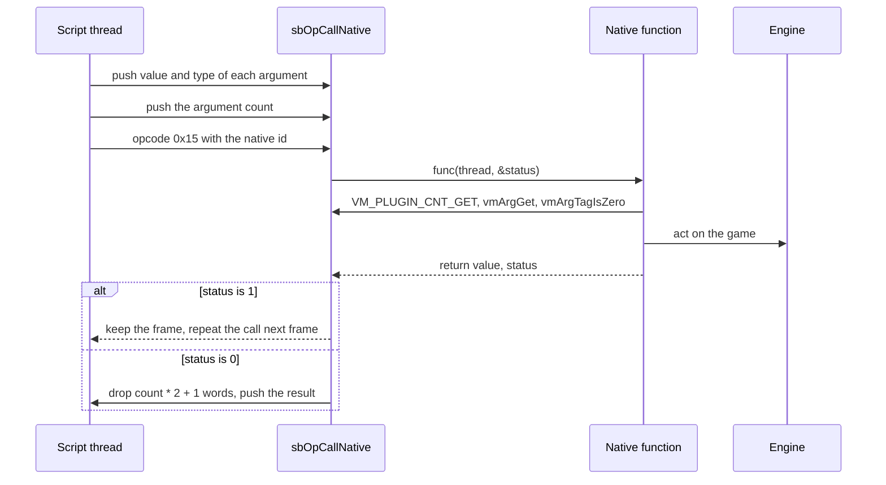

### Natives that wait

A native cannot block, because all script threads run on the game's main loop. A native that must wait for something writes 1 to `*status` and returns. `sbOpCallNative` then returns 1 without removing the frame, `sbStep` puts the program counter back on the call instruction, and the thread stops for this frame. On the next frame `sbRunAll` runs the thread again, and the first thing it does is call the same native with the same arguments. The native is polled once per frame until it leaves `status` at 0.

Thirteen natives use this:

| Native | Waits while |
| --- | --- |
| `talk.wait` | The message window is in use |
| `talk.menuAddItem`, `talk.slotWinOpen` | The message window is busy, has more text, or pad button bit 0x20 was not pressed this frame |
| `talk.menuDeptQuest` | The message window is busy or has more text |
| `talk.menuGetResult`, `talk.menuDeptGetResult`, `talk.slotWinGetResult` | The player has not chosen yet |
| `camera.WaitMoveRef`, `camera.WaitMoveCam` | The camera move has not reached its end |
| `bat.loadWaitEffect` | Effect files are still loading |
| `bat.msgPutWait` | A battle message is still shown |
| `bat.unitLoadWait` | A disc read, an effect load or a unit model load is pending |
| `bat.unitMotWait` | The unit is busy or its motion has not finished |

The cutscene player does not use this mechanism. `cfe.stFrm` advances the cutscene by one frame per call and returns the time to continue with, and the script itself contains the loop that calls it once per frame.

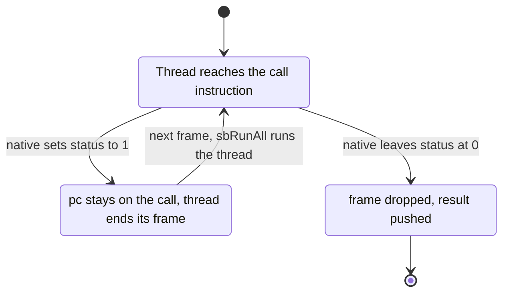

### Argument errors

Most natives check the argument count first. Some require an exact count (`!= 5`), some a minimum (`< 2`), and `runtime.setItai` a maximum. When the check fails the native calls `sbSlotJumpRequest(thread, SB_JUMP_ARGUMENTS)` and returns 0. The request records jump key 2 and the position of the call in the thread. The VM still drops the frame and pushes the 0. Before the next instruction runs, `sbSlotJump` looks for a jump slot with key 2 in the thread's slot table. When the script installed such a slot and the call lies inside the slot's range, execution continues at the slot's target, which works like an exception handler written in the script. When the slot exists but does not cover the position, the request is dropped and the script goes on. When there is no slot with that key, the VM calls `sbFatal` and the game stops in an endless loop.

The jump slots and their opcodes belong to the VM and are described on the [SB virtual machine](sb-vm.md) page. For the natives the consequence is simple: a script must pass the number of arguments the native expects, with omitted arguments as empty slots.

Three groups of natives do not follow this pattern. The `cfe` natives check the count with an assertion (`assertFailed` with the text `VM_PLUGIN_CNT_GET() == 5` and the original file name `../cfePlugIn.euc.c`). The `id` natives, the sound and movie natives of `runtime`, `talk.smsg` and `talk.msgDtl` do not check the count at all and rely on `vmArgGet` and `vmArgTagIsZero`. The `Samplefade` natives return 0 on a wrong count without requesting a jump.

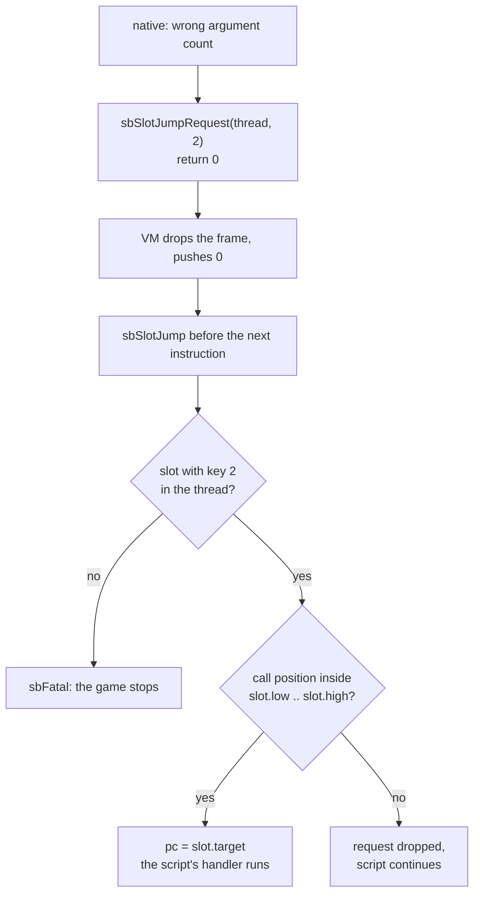

## Field natives and battle natives

The two sets differ in more than their lists. They address different objects, and they are written against different parts of the engine.

A **field native** runs while `Game` is in its map loop, which calls `sbRunAll` once per frame unless the game is paused (`gameWork.control` bit 1). Field natives live in the main executable. Almost all of them name their target by a **key**: a 16-bit number that the script gave to a map object when it created it with `runtime.setNumber`. The native finds the record with `uwamonoFindIndexByShortKey`, which searches the 256 records of `uwamonoRecords` for a used record with that `id`. A key that is not found gives index -1. Many natives return quietly in that case, but several of the simpler ones (`objx.rotate`, `objx.scale`, `objx.setRotateTurn` and others) use the index without a check, so a script must only name objects that exist. The second common target is the current record, `uwamonoRecords[uwamonoCurrentIndex]`, which is the player's character. The map object records and their kinds are described on the [Map and units](../game/map-and-units.md) page.

A **battle native** runs while the battle scene loop in `src/ov01/scene.c` calls `sbRunAll`. The `bat`, `samp` and `deb` natives live in the battle overlay OV01, next to the VM itself. Battle natives name their target by a **unit index** into the combined unit table, which `unitPtrGet` turns into a `BattleUnit`. Two natives, `bat.unitCreate` and `bat.unitBind`, pass the address of a `BattleUnit` through the script as a plain integer. A battle script also has a second kind of data argument that the field does not use: tables of enemy groups, positions and attack candidates that lie in the script's own global area and are read with `vmEntryGet` and `vmSubEntryGet`.

| | Field natives | Battle natives |
| --- | --- | --- |
| Registered by | `scriptRegisterModules` | `runtimeInit` |
| When | Every map scene load, and when the field resumes | Every battle start |
| Script | The map scene script in `mapSceneScriptBuffer` | The battle script of the encounter |
| Run from | `Game` in `src/main/game_data.c` | The scene loop in `src/ov01/scene.c` |
| Target | Map object record by key, or the player's record | Battle unit by index |
| Typical data argument | Strings of the language file | Tables in the script's globals |
| Owners | `objx`, `enepc`, `runtime`, `ladder`, `camera`, `math`, `menu`, `uwamono`, `cfe`, `id`, `talk`, `g2path`, `seg`, `samp`, `deb` | `samp`, `deb`, `bat`, `math`, `camera` |

The shared `camera` module shows how the two worlds meet. Its anchor arguments are indices into `uwamonoRecords` when they are below 4096 and are taken as the address of an actor when they are larger. A battle script gets such an address from `bat.actorGet` and can then point the scripted camera at a battle unit.

## The objx module

`objx` moves and shapes the objects of a map. Every native takes the key of a map object record as its first argument. The record kinds named below are `MAP_KIND_ACTOR` (1), `MAP_KIND_MODEL` (2), `MAP_KIND_FLAG` (3), `MAP_KIND_ACTOR_STATIC` (4), `MAP_KIND_PART` (5), `MAP_KIND_EFFECT` (6) and `MAP_KIND_MOVER` (7). All natives are in `src/main/uwamono_objx.c`. The records, their animated moves and their flags are explained in [Map and units](../game/map-and-units.md).

Positions, scales and pivots are in hundredths. Angles are in hundredths of a degree. A frame count of 0 or an omitted frame count applies the change at once.

| Script name | C function | Arguments | Returns | What it does |
| --- | --- | --- | --- | --- |
| `getParam` | `objxGetParam` | Exactly 2: key (may be omitted), parameter number | The value, or -1 | With a key it reads the record: 0 to 2 the position, 3 to 5 the rotation in hundredths of a degree, for actor and model records. Without a key it reads the game state: 6 the kind of the player's actor, 7 the entry key of the map (-2 when the game was loaded from a save), 8 bit 0x800 of `gameWork.control`, 9 an area group number 0 to 9 derived from the key of the player's record |
| `move` | `objxMove` | At least 5: key, frames, x, y, z, then optional motion and mode | 1 | Starts `uwamonoStartMove`: the record moves to the point over the frames. An omitted coordinate keeps the present one. With a motion an actor plays it and turns towards the destination over 15 frames. Mode 1 selects the end behaviour of the move |
| `rotate` | `objxRotate` | Exactly 5: key, frames, x, y, z | 1 | Turns the record to the angles over the frames. An omitted angle keeps the present one. Applies to actor, model and effect records |
| `scale` | `objxScale` | Exactly 5: key, frames, x, y, z | 1 | Scales the record over the frames through `uwamonoStartScale`. An omitted component keeps the present one |
| `transparent` | `objxTransparent` | Exactly 3: key, frames, transparency | 1 | Changes the record's transparency to the value over the frames through `uwamonoStartTransparency`. The value is used as given, not divided by 100 |
| `offsetPivot` | `objxOffsetPivot` | Exactly 4: key, x, y, z | 1 | Sets the pivot of the record. An omitted component is kept |
| `setRotateTurn` | `objxSetRotateTurn` | Exactly 2: key, order | 1 | Sets the rotation order of the record |
| `setStepMove` | `setStepMove` | Exactly 3: key, step in tenths, speed in hundredths | 1 | Adds one step to the record's move profile with `uwamonoAddMoveStep`. A step of -1 clears the profile instead |
| `setStepRotate` | `setStepRotate` | Exactly 3: key, step in tenths, speed in hundredths | 1 | The same for the rotation profile, with `uwamonoAddRotateStep` |
| `enableFlags` | `objxEnableFlags` | At least 2: key, bits, optional target | 1 | Sets flag bits on the record. Target 99 sets them on every used record, another target on every record of that kind |
| `disableFlags` | `objxDisableFlags` | At least 2: key, bits, optional target | 1 | Clears flag bits on the record, or on every record of the target kind. Clearing bit 0x20000 also resets the record's state and deletes its two attached effects |
| `setParent` | `objxSetParent` | At least 2: key, other key (may be omitted), optional attach | 1 | With attach: the record's effect follows the other record's actor, or the other record when it has no actor. Without attach: the other record becomes the record's parent through `uwamonoSetTarget`. An actor then walks to the parent along a path of 128 points, and other records keep their offset from it |
| `setPair` | `objxSetPair` | Exactly 2: key, other key | 1 | Links the two records so that they look at each other. When the other record is an effect, the effect is tied to the first record's actor instead |
| `changeId` | `objxChangeId` | Exactly 2: key, ground id | 1 | Changes the collision ground of the record's actor to entry `ground id` of map block 0x100 |
| `footId` | `objxFootId` | Exactly 2: key, id | 1 | Sets the footstep id of the record |

## The enepc module

`enepc` configures the characters of a map that act on their own: field enemies and NPCs. The name joins "enemy" and "NPC". The natives write the behaviour state of a record (`UwamonoState`, reached as `record->body.motions`) and its actor. The AI that reads these values is the subject of [Field enemies](../game/field-enemies.md). Every native takes the key of the record first, and all of them return 1 quietly when the key is not found unless noted.

| Script name | C function | File | Arguments | Returns | What it does |
| --- | --- | --- | --- | --- | --- |
| `setParams` | `enepcSetParams` | `src/main/runtime_enepc.c` | At least 7: key, unused, preset number, path array, path count, route array, route count | 1 | Copies the path points (three integers each, in hundredths) from a global array into the state. In route mode 9 the path is mirrored back onto itself and the mode becomes 8. Adds the route nodes with `Homing_Add`, builds the spline with `Set_Spline_By_Route`, and applies preset `preset number` of the table loaded by `readyEnepcData` |
| `setParamsAll` | `enepcSetParamsAll` | `src/main/runtime_enepc.c` | At least 15, up to 20: key, then the single parameters | 1 | Sets the parameters one by one. Arguments 2 to 10 are height, radius, wander step, leash range, move speed, pursuit speed, sight angle in degrees, sight length and notice range, in hundredths (the two speeds are divided by 1000 again). Arguments 11 to 14 are the wander time, a pick count, the wait time and a second pick count. Argument 15 sets state flag 4. Arguments 16, 18 and 19 are three actor values, 17 a motion. An omitted argument 20 runs `Enemy_Init`. Every omitted parameter is left unchanged |
| `Extra` | `enepcExtra` | `src/main/runtime_enepc.c` | At least 2: key, value | 1, or 0 when the record or its actor is missing | Passes the value to `XenoActorSetSolverPasses` for the actor |
| `motion` | `enepcMotion` | `src/main/runtime_enepc.c` | At least 6: key, motion, speed, first frame, last frame, loop switch | 1 | Starts motion `group * 100 + number` on an actor record when it differs from the one playing, with the speed in hundredths, and limits the play range when frames are given. A present argument 6 clears actor flag 2, an omitted one sets it |
| `ExMotion` | `enepcExMotion` | `src/main/runtime_enepc.c` | Exactly 2: key, resource id | 1 | Loads a motion resource with `GameResLoadID` and gives it to the actor as its extra motion resource |
| `motionFace` | `motionFace` | `src/main/runtime_enepc.c` | At least 3: key, selector, unused | 1 | Sets the face animation selector of an actor record when it differs from the present one |
| `lookat` | `enepcLookAt` | `src/main/runtime_enepc.c` | At least 4: key, x or target key, y, z, optional point number and reach | 1, or 0 for a record that is not an actor | With a point number: defines one of the 10 look-at points with its reach. With arguments 2 to 4 omitted: releases the look-at. With only argument 2: looks at the record with that key. Otherwise: looks at the point |
| `Encount` | `enepcEncount` | `src/main/runtime_enepc.c` | Exactly 2: key, value | 1 | Calls `Check_Encount` for the record, which tests for and starts a battle with it |
| `Resigne` | `Resigne` | `src/main/runtime_enepc.c` | Exactly 1: key | 1 | Makes a record that is in action 5 (walking to a parent) give up: it restarts from its present position in action 2 and searches its route again with `Homing_Search` |
| `setGroup` | `setGroup` | `src/main/runtime_enepc.c` | At least 2: key, up to 8 group numbers | 1 | Fills the 8 group entries of the state. Entry `i` becomes -1 when argument `i + 2` is omitted. Otherwise it takes the value of argument `i + 1`, so entry 0 receives the key itself |
| `setBattle` | `enepcSetBattle` | `src/main/runtime_enepc.c` | At least 2: key, encounter flag bits | 1 | Stores the bits that `Check_Encount` ORs into `gameWork.encounterFlags` when this record starts a battle (see [Field enemies](../game/field-enemies.md)) |
| `setSE` | `enepcSetSe` | `src/main/runtime_enepc.c` | At least 4: key, three sound ids | 1 | Stores the three sound effect ids of the record |
| `defaultMotion` | `enepcDefaultMotion` | `src/main/runtime_enepc.c` | At least 3: key, slot, motion | 1 | Stores the motion for one slot of the record's standard motions (`walk[slot]`) |
| `setTogether` | `enepcSetTogether` | `src/main/runtime_enepc.c` | At least 2: up to four keys | 1 | Makes up to four records a group that acts together: each record found gets the indices of all four |
| `Algorithm` | `enepcAlgorithm` | `src/main/runtime_enepc.c` | Exactly 3: key, mode, area size | 1 | Sets the behaviour mode, takes the present position as the home point, sets the area size in hundredths (1000 when omitted), starts action 1 and runs `Enemy_Init` |
| `readyEnepcData` | `enepcReadyEnepcData` | `src/main/runtime_enepc.c` | Exactly 1: resource id | 1 | Loads the preset table that `setParams` indexes. It repeats `GameResLoadID` until the resource is loaded |
| `enableDrawFlags` | `enepcEnableDrawFlags` | `src/main/runtime_enepc.c` | At least 2: key, bits, optional kind | 1 | Sets draw flag bits on the actor of the record, or on the actors of all actor records of the given kind |
| `disableDrawFlags` | `disableDrawFlags` | `src/main/runtime_uwamono_door.c` | At least 2: key, bits, optional kind | 1 | Clears the same bits in the same way |

## The runtime module

`runtime` is the general module of the field. Its 34 natives create the objects of a scene, control the player, hand out items, read and write the story flags, change maps, set fog and light, and play sound and movies. The table `runtimeNativeTable` is in `src/main/runtime_enepc.c`, and the functions are spread over six files.

### Objects, the player and the map

| Script name | C function | File | Arguments | Returns | What it does |
| --- | --- | --- | --- | --- | --- |
| `setNumber` | `runtimeSetNumber` | `src/main/uwamono_objx.c` | At least 3: key, kind, entry, two optional values | The record index, or 1 | Creates the map object record for a key with `uwamonoCreateRecord`. The entry is a number or a name: for an effect the name of the effect (`srsEffectNameToID`), for other kinds the name of an entry of the map's object table. An omitted kind releases the record instead. Returns 0 when a named entry does not exist |
| `setLocater` | `runtimeSetLocater` | `src/main/uwamono_objx.c` | Exactly 10: id, point 1 (x, y, z), point 2 (x, y, z), shape, two angles | 1 | Creates two linked mover records with ids `id` and `id + 1` at the two points. When the y and z of both points are omitted, arguments 2 and 5 name rows of the map's pose table instead. The shape is stored as the search shape of the first record and the angles in hundredths of a degree |
| `setElevator` | `runtimeSetElevator` | `src/main/runtime.c` | Exactly 3: key, motion, value | 1 | Stores the elevator motion and its argument in the record |
| `setLastDan` | `runtimeSetLastDan` | `src/main/uwamono_objx.c` | None read | 1 | Starts the white shake screen effect on the player's actor (`gifStateStartWhiteShake`) |
| `setPlayer` | `runtimeSetPlayer` | `src/main/uwamono_objx.c` | At least 5, up to 12 | 1 | Sets the player's control and movement values. Argument 1: 1 puts the player under script control (`CONTROL_SCRIPTED`), another value gives control back. Then the frame scale, the collision radius, five movement parameters, the climb frame count, gravity, the bounce divisor, and a child key: a positive key attaches that record's actor to joint 0x4D of the player, a negative key releases it. Every omitted value is kept |
| `changeRobo` | `changeRobo` | `src/main/runtime.c` | Exactly 1: form | 1 | Asks for a change of the player's form. The record's `form` value is 1.0 for form 0 and 5.0 for form 1, and form 1 is the E.S.: the value 5.0 goes with the model ids `0x14002`, `0x14003` and `0x14005` and a body radius of 4.0 (see [The field game](../game/field.md)). When the requested form differs from the present one it starts the model change event with a 30 frame timer, puts the player under script control and fades out |
| `message` | `runtimeMessage` | `src/main/runtime.c` | Exactly 2: index, value | 1 | Stores the value in entry `index` of `uwamonoEventIds` |
| `jumpCF` | `runtimeJumpCf` | `src/main/runtime.c` | At least 2: target, entry, optional mode and timer | 1 | Leaves the map. Queues a transition to map or event `target` with entry key `entry` (default -1), mode (default 1) and a fade-out of `timer` frames (default 30). A timer of 0 jumps at once. Does nothing while a transition is already pending |
| `mapChange` | `runtimeMapChange` | `src/main/runtime.c` | Exactly 1: id | 1 | Switches the map resource set with `mapResourceSwitch(id, 1)` |
| `System` | `runtimeSystem` | `src/main/runtime.c` | At least 1: switch number | 1 | Sets or clears one bit of `gameWork.control`. See the table below |
| `progEffect` | `runtimeProgEffect` | `src/main/runtime.c` | At least 2: key, frames | 1 | Advances effects by a number of frames with `sefProgressEffect`. Without a key it advances all of them. With a key present, the native looks up the record by the value of argument 2 and advances the effect of that record |
| `GetAnalogR` | `runtimeGetAnalogR` | `src/main/runtime.c` | At least 1: mode | 0, a count, or -1 | Mode 0 clears the two right stick counters `padDebugSector` and `padDebugCount`. Mode 4 returns `padDebugCount` |
| `Vibration` | `runtimeVibration` | `src/main/runtime_enepc.c` | At least 4: weak value, strong target, strong start, frames | 1 | Sets the weak motor and starts a strong motor ramp. With argument 1 omitted it stops the vibration |

`jumpCF` is the native behind every door and event trigger that leads elsewhere. `uwamonoSetTransition` records the target on the player's record and sets two control bits, 0x20000000 and `CONTROL_SCRIPTED`. Mode 1 also sets bit 0x10000. Any other mode clears it and puts the player back into the standing motion when no ladder is in use. The fade-out is skipped when bit `CONTROL_CFE_NO_FADE` (0x100000) is set. The frame loop of the field then counts the timer down and performs the jump (see [Field](../game/field.md) and [Events](events.md)).

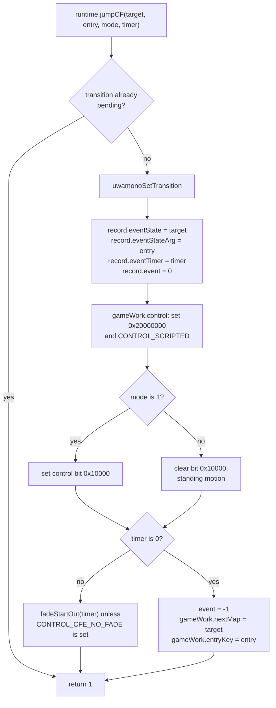

The switches of `runtime.System`:

| Value | Effect on `gameWork.control` |
| --- | --- |
| 0 | Sets 0x08000000 |
| 1 | Sets 0x00080000 |
| 2 | Clears 0x00080000 |
| 3 | Nothing |
| 4 | Sets 0x00800000 |
| 5 | Sets 0x20000000 |
| 6 | Clears 0x20000000 |
| 7 | Sets 0x40000000 |
| 8 | Clears 0x40000000 |
| 9 | Clears 0x00100000 (`CONTROL_CFE_NO_FADE`) |
| 10 | Sets 0x00100000 |

The frame loop in `Game` tests bit 0x08000000 right after `sbRunAll`, so switch 0 is a request that the loop acts on in the same frame. The meaning of each bit is given with the game modes on the [Field](../game/field.md) page.

### Items, flags and the time panel

| Script name | C function | File | Arguments | Returns | What it does |
| --- | --- | --- | --- | --- | --- |
| `Item` | `runtimeItem` | `src/main/runtime.c` | At least 3: kind, number, count, optional message switch | The amount now held for kinds 1 to 4, otherwise 0 | Gives or takes things. Kinds 1 to 4 are the four inventory categories: the native adds `count` pieces one by one, or removes them when the count is negative, and returns the amount held. Kind 5 calls `slotPairSet`, kind 6 `dataSkillLearnSet(3, number)`, kind 7 `battleSlotMarkSet(2, number)` and kind 8 `dataEtherLearnSet(number, 63)`. With the message switch at 1 it shows the pickup message: the name of the item followed by the text for "x00 obtained!" with the two digits of the count filled in |
| `setFlag` | `runtimeSetFlag` | `src/main/runtime.c` | Exactly 3: bit offset, bit count, value | 1 | Writes a field of the story flags with `xglFlagsSet`. An omitted bit count means 1 |
| `getFlag` | `runtimeGetFlag` | `src/main/runtime.c` | Exactly 2: bit offset, bit count | The flag value | Reads a field of the story flags with `xglFlagsGet`. An omitted bit count means 1 |
| `TimeAttack` | `runtimeTimeAttack` | `src/main/runtime.c` | At least 1: kind, optional value | A value or -1 | Controls the on-screen panel of a timed event through `gameWork.panelMode` and `gameWork.panelValue`. Kind 0 opens the panel with the value. Kind 1 clears the panel. Kind 2 stores mode 2 and returns the value. Kind 3 sets the mode to 0 and returns the value. Kind 4 returns the value, or -1 while the mode is 1 |

The story flags are one bit array in the save data, and a flag is addressed by the offset of its first bit and its width. They are described on the [Events](events.md) page. The inventory categories behind `Item` belong to [Party and growth](../game/party-and-growth.md).

### Fog, light and colour

| Script name | C function | File | Arguments | Returns | What it does |
| --- | --- | --- | --- | --- | --- |
| `Fade` | `runtimeFade` | `src/main/runtime.c` | Exactly 5: red, green, blue, alpha, frames | 1 | Starts a screen fade to the colour and alpha over the frames with `fadeStartColorAlpha` |
| `setFog` | `runtimeSetMapFog` | `src/main/runtime.c` | Exactly 8: key, four distances, three colour values | 1 | Sets the fog. Key -1 stores it in `gameWork.fogDist` and `gameWork.fogColor` and gives it to every actor. Key -2 only gives it to every actor. The distances are in hundredths. With the key of a single record the loop range is empty, so no actor is changed |
| `setItai` | `runtimeSetItai` | `src/main/runtime.c` | At most 10 | 1 | Sets drawing options of actors. Argument 2 is the shadow caster mode (default 1). Argument 3 selects one record by key, or all when omitted or negative. Arguments 4 and 5 set and clear draw flag bits, 6 and 7 set and clear render flag bits, 8 is a value in hundredths, 9 fills the first free entry of the actor's 16 colour indices. Argument 10 sets or clears control bit 0x200000 |
| `setLight` | `runtimeSetMapLight` | `src/main/runtime.c` | Exactly 8: light set, type, colour (3), direction (3) | 1 | Writes one of the 16 light sets in `gameWork.lights`. Type 0 is the ambient colour. Types 1 to 3 are the three directional lights with a normalized direction. Type 4 is a fourth direction with one strength value (0.2 when the colour is omitted). The colour is out of 256 and the direction in hundredths. A colour with only its first component gives a grey light |
| `setMapColor` | `setMapColor` | `src/main/runtime.c` | Exactly 3: red, green, blue | 1 | Sets `gameWork.mapColor`, each component out of 255 |

Fades and the other full-screen effects are described in [Screen effects](../libraries/screen-effects.md), light sets in [The model library](../libraries/pxy.md).

### Sound and movies

These twelve natives do not check their argument count. All of them return 1. The sound system behind them is described on the [Audio](../architecture/audio.md) page.

| Script name | C function | File | Arguments | What it does |
| --- | --- | --- | --- | --- |
| `mpeg2` | `mpeg2` | `src/main/runtime.c` | 1: file name (string) | Plays a full-screen movie with `GameMpeg2Play` |
| `adx` | `adx` | `src/main/runtime.c` | 1: file name (string) | Resets the volume of stream slot 0 and gives the slot an ADX file, which starts it |
| `adxload` | `adxLoad` | `src/main/runtime.c` | 1: file name (string) | The same, but pauses slot 0 first, so that the stream is loaded and held |
| `adxplay` | `adxPlay` | `src/main/runtime.c` | None | Releases the pause of slot 0. Together with `adxload` it starts a stream at an exact moment |
| `se` | `runtimeSe` | `src/main/runtime.c` | 1 to 3: sound, volume, pan | Starts a sound effect with `seVoiceStart`. The volume defaults to the value set by `seVol` and the pan to 0x40, the centre. A volume of 0 or less stops the sound with `seVoiceStop` |
| `sePos` | `sePos` | `src/main/runtime.c` | 4: sound, x, y, z | Starts a sound effect at a position in the map. Volume and pan come from `seVoicePanVolumeFromPosition`. Nothing plays when the result is 0 |
| `seVol` | `seVol` | `src/main/runtime.c` | 1: volume | Sets the default volume byte that `se` uses |
| `bgmse` | `bgmSe` | `src/main/runtime.c` | 1 to 3: sound, volume, pan | Registers an ambient sound with `seVoiceRecordSet`. The volume defaults to -1 and the pan to 0x40 |
| `bgmsePos` | `bgmSePos` | `src/main/runtime.c` | 4: sound, x, y, z | Registers an ambient sound at a position with `seVoiceRecordAddAt` |
| `bgmFade` | `bgmFade` | `src/main/runtime.c` | 1 or 2: volume, fade length | Changes the music volume with `seVolumeSet`. A volume below 0 means the default, and an omitted length means at once |
| `nextBgm` | `nextBgm` | `src/main/runtime.c` | 1: index | Stores the index of the next music in `bgmNameListIndex` |
| `bgm` | `runtimeBgm` | `src/main/runtime.c` | 1: track name (string) | Starts the music track with `seBgmNameSet`. An empty name stops the music |

## The ladder module

Two natives describe the ladders of a map to the ladder system. Both are in `src/main/get_ladder.c`. Climbing itself is described in [Map and units](../game/map-and-units.md).

| Script name | C function | Arguments | Returns | What it does |
| --- | --- | --- | --- | --- |
| `setLadder` | `ladderSetLadder` | Exactly 3: ladder id, entry key, height | 1 | Fills the first unused ladder slot: the id, the key of the map object entry the ladder stands at, its pose from `uwamonoGetEntryPose`, and its height in hundredths. An entry key of -1 only stores id 0 in the slot |
| `setEntrance` | `ladderSetEntrance` | Exactly 4: ladder id, height, left exit, right exit | 1 | Adds a rung to the ladder: its height in hundredths, and whether the player can step off to the left or to the right there (1 allows the exit) |

## The camera module

`camera` is the largest module, with 50 natives in `src/main/runtime_camera.c`. It drives the scripted camera of the field camera system, and because it is also registered in battle, battle scripts direct their camera with the same calls. The camera system itself, its types and its per-frame update are described on the [Field](../game/field.md) page. This section explains only what the natives need.

The camera state is `gameWork.camera`. Its block `range` holds the present shot, and its block `to` holds the target of a running move:

| Field | Meaning |
| --- | --- |
| `range.lookAt` (x, y, z) | The **reference point**: where the camera looks |
| `range.lookAt.w` | The bank (roll) angle |
| `range.cameraPosition` (x, y, z) | The **camera position** |
| `range.cameraPosition.w` | The perspective angle (field of view) |
| `range.angles` (x, y, w) | Pitch, yaw and distance of the camera around the reference point |
| `range.anchorIndex`, `range.anchorSubIndex`, `range.offset` | The object the reference point follows, and the offset from it |
| `slot[0]` to `slot[3]` | Four move slots: 0 moves the reference point, 1 the camera position, 2 the perspective, 3 the bank |

Positions and distances are in hundredths (`cameraCentiToFloat`). Angles are in hundredths of a degree (`cameraCentiDegToRad`). The natives check their count through the helper `cameraCheckArgCount`, which compares with the byte `cameraArgCount` that each native sets first. The count is always exact.

Several natives take an **anchor**: an index and a sub-index. `cameraAnchorGet` resolves it. An index below 4096 names a map object record and stands for its actor. A negative index gives the origin. A larger value is taken as the address of an actor. A sub-index of 0 or more selects a point of the actor through `XenoActorMulVector`, which is most likely a joint, and -1 means the actor's own position. The natives whose names end in `R` rotate their offset by the yaw and pitch of the anchor (`cameraApplyAnchorOffset` with an offset `w` of 1). The others add the offset unrotated.

### Moves

A camera change is either a cut or a move. By default every `Set` native writes into `range`, which is a cut. To make a move instead, the script first calls `MoveRefMode` or `MoveCamMode`. The next `Set` native of that half then writes into `to` instead of `range` and clears the mode flag again. `Move` finally starts the move slots with a blend mode, an ease mode and a frame count, and the camera update interpolates from the present shot to the target. `WaitMoveRef` and `WaitMoveCam` hold the script until a slot has run out.

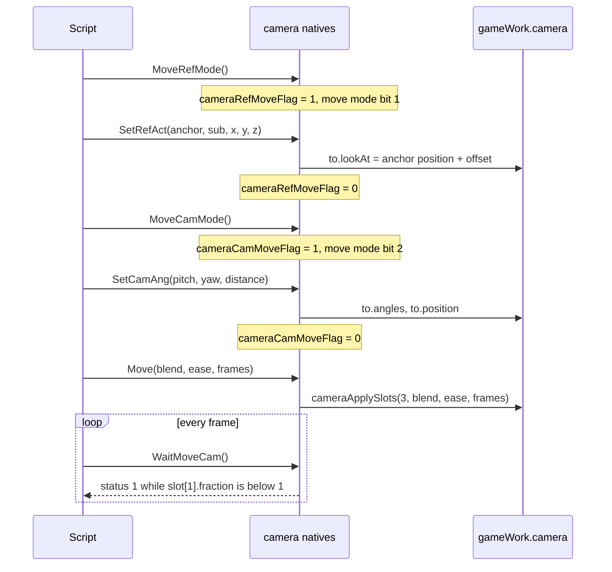

When `Move` is called without a preceding mode native, it moves both halves (mode 3). `cameraRegisterNatives` clears the two flags and the mode, so each scene starts in a clean state.

### General and "cf" natives

The natives whose names start with `cf` control the automatic camera of the field (`cf` is the game's short name for the field scene).

| Script name | C function | Arguments | Returns | What it does |
| --- | --- | --- | --- | --- |
| `reset` | `cameraReset` | None | 1 | Resets the camera with `GameCameraReset` |
| `mode` | `cameraMode` | 2: type, sub-type | 1 | Sets `cameraType` and `cameraSubType` |
| `AngleMode` | `cameraAngleMode` | None | 1 | Does nothing |
| `PosReset` | `cameraPosReset` | 0 | 1 | Sets camera flag 0x20, which asks for a position reset |
| `cfSet` | `cameraCfSet` | 1: slot | 1 | Saves the present shot in camera record `slot` of `cameraCfSlots`: camera type, mode, move slot 0 and the 28 words of `range` from `anchorIndex` on |
| `cfChange` | `cameraCfChange` | 1: slot | 1 | The same without move slot 0 |
| `cfRotRange` | `cameraCfRotRange` | 4: angles | 1 | Sets the four angle limits of the camera. A first angle of -9000 is changed to -8999 |
| `cfRangeMode` | `cameraCfRangeMode` | 1: mode | 1 | Sets `range.rangeMode` |
| `cfCamID` | `cameraCfCamId` | 1: id | 1 | Switches to camera `id` with `GameCameraChangeID(id, 0, 0)` |
| `cfLock` | `cameraCfLock` | 1: bits | 1 | Sets the locks: bits 0x21 the probe mode, 0x2, 0x4 and 0x8 the locks of the x, y and z axis |
| `cfSelectCHG` | `cameraCfSelectChg` | 1: index | 1 | Selects camera track `index` of the map (block 0x600) with `cameraSetIndex` and makes the camera track the player. A negative index keeps the present track |
| `cfHokan` | `cameraCfHokan` | 2: key, sub-key | 1 | Takes a free entry of the 32 entries of the camera key table and stores the key pair, the range mode and move slot 0 in it. Without a free entry it requests the argument jump and returns 0. The name is the Japanese word for interpolation, so the entry probably defines the blend used when the camera with that key is selected |
| `cfBattleCam` | `cameraCfBattleCam` | 1: switch | 1 | Sets or clears camera flag 0x200, stops all four move slots, clears flag 0x10 and sets flag 0x80 |
| `cfNorth` | `cameraCfNorth` | 1: angle | 1 | Sets the north angle of the map. `rangeFlag` becomes 1 when the angle lies outside -36000 to 36000 |

### Reference point natives

| Script name | C function | Arguments | Returns | What it does |
| --- | --- | --- | --- | --- |
| `SetRefPos` | `cameraSetRefPos` | 3: x, y, z | 1 | Reference point at a fixed position. In a cut it also removes the anchor |
| `SetRefAct` | `cameraSetRefAct` | 5: anchor, sub, x, y, z | 1 | Reference point at an anchor plus an offset. In a cut the anchor is kept, so the camera follows it |
| `SetRefActR` | `cameraSetRefActR` | 5: anchor, sub, x, y, z | 1 | The same with the offset rotated by the anchor |
| `SetRefAng` | `cameraSetRefAng` | 2: pitch, yaw | 1 | Reference point 10 units in front of the camera position in the given direction |
| `RefLock` | `cameraRefLock` | 0 | 1 | Stops move slot 0 and removes the anchor |
| `SetRefCamActR` | `cameraSetRefCamActR` | 8: anchor, sub, offset (3), pitch, yaw, distance | 1 | Sets both halves at once: the reference point at the anchor plus the rotated offset, and the camera orbiting it at the angles relative to the anchor's rotation |
| `SetRefCamAct3R` | `cameraSetRefCamAct3R` | 11: anchor A, sub A, anchor B, sub B, blend, offset (3), pitch, yaw, distance | 1 | Sets both halves from two anchors: the reference point lies between A and B at the blend factor (hundredths) plus an offset turned into the direction from A to B, and the camera orbits it relative to that direction |
| `GetRefPos` | `cameraGetRefPos` | 1: global index | 1 | Writes the reference point as three integers into the script's globals |
| `GetRefAng` | `cameraGetRefAng` | 1: global index | 1 | Writes pitch and yaw of `range.angles` as two integers |

### Camera position natives

| Script name | C function | Arguments | Returns | What it does |
| --- | --- | --- | --- | --- |
| `SetCamPos` | `cameraSetCamPos` | 3: x, y, z | 1 | Camera at a fixed position |
| `SetCamAng` | `cameraSetCamAng` | 3: pitch, yaw, distance | 1 | Camera on an orbit around the reference point. The position is computed with `GetCameraPos` |
| `SetCamAct` | `cameraSetCamAct` | 5: anchor, sub, x, y, z | 1 | Camera at an anchor plus an offset |
| `SetCamActR` | `cameraSetCamActR` | 5: anchor, sub, x, y, z | 1 | The same with the offset rotated by the anchor |
| `SetCamAct2` | `cameraSetCamAct2` | 5: anchor, sub, pitch, yaw, distance | 1 | Camera on an orbit around an anchor |
| `SetCamAct2R` | `cameraSetCamAct2R` | 5: anchor, sub, pitch, yaw, distance | 1 | The same with the angles relative to the anchor's rotation |
| `SetCamAct3` | `cameraSetCamAct3` | 8: anchor A, sub A, anchor B, sub B, offset (3), blend | 1 | Camera between two anchors plus an offset. This native uses the blend value as given, without dividing by 100 |
| `OffsCamPos` | `cameraOffsCamPos` | 3: x, y, z | 1 | Camera at its present position plus an offset |
| `OffsCamAng` | `cameraOffsCamAng` | 3: pitch, yaw, distance | 1 | Adds to the present orbit angles and distance and recomputes the position |
| `CamLock` | `cameraCamLock` | 0 | 1 | Stops move slot 1 |
| `GetCamPos` | `cameraGetCamPos` | 1: global index | 1 | Writes the camera position as three integers into the script's globals |
| `GetCamAng` | `cameraGetCamAng` | 1: global index | 1 | Writes pitch, yaw and distance as three integers |

### Move, shake, bank and perspective natives

| Script name | C function | Arguments | Returns | What it does |
| --- | --- | --- | --- | --- |
| `MoveRefMode` | `cameraMoveRefMode` | 0 | 1 | The next reference point native sets a move target |
| `MoveCamMode` | `cameraMoveCamMode` | 0 | 1 | The next camera position native sets a move target |
| `Move` | `cameraMove` | 3: blend mode, ease mode, frames | 1 | Starts the selected move slots with `cameraApplySlots` |
| `WaitMoveRef` | `cameraWaitMoveRef` | 0 | 1 | Waits while `slot[0].fraction` is below 1 |
| `WaitMoveCam` | `cameraWaitMoveCam` | 0 | 1 | Waits while `slot[1].fraction` is below 1 |
| `MoveRefStop` | `cameraMoveRefStop` | 0 | 1 | Stops the reference point move (slot 0) |
| `MoveCamStop` | `cameraMoveCamStop` | 0 | 1 | Stops the camera position move (slot 1) |
| `MovePersStop` | `cameraMovePersStop` | 0 | 1 | Stops the perspective move (slot 2) |
| `MoveBankStop` | `cameraMoveBankStop` | 0 | 1 | Stops the bank move (slot 3) |
| `Shake` | `cameraShake` | 5: channel bits, amplitude, period, hold, frames | 1 | Starts a camera shake on the channels of bits 1, 2 and 4. The amplitude is an angle that falls to zero over the frames |
| `HandShake` | `cameraHandShake` | 0 | 1 | Toggles the hand-held sway (shake flag 8) and clears its four values |
| `SetBank` | `cameraSetBank` | 1: angle | 1 | Sets the bank angle at once |
| `SetPers` | `cameraSetPers` | 1: angle | 1 | Sets the perspective angle at once |
| `MoveBank` | `cameraMoveBank` | 3: angle, ease mode, frames | 1 | Moves the bank to the angle over the frames (slot 3) |
| `MovePers` | `cameraMovePers` | 3: angle, ease mode, frames | 1 | Moves the perspective to the angle over the frames (slot 2) |

## The math module

Four natives in `src/main/runtime_math.c` give scripts the functions they cannot compute with integers. Results of the trigonometric functions are scaled by 10000. The module is registered in both sets.

| Script name | C function | Arguments | Returns | What it does |
| --- | --- | --- | --- | --- |
| `atan` | `mathAtan` | Exactly 2: y, x in hundredths | `atan2f(y, x)` in radians times 10000 | The angle of a direction |
| `sin` | `mathSin` | Exactly 1: angle in hundredths of a degree | The sine times 10000 | |
| `cos` | `mathCos` | Exactly 1: angle in hundredths of a degree | The cosine times 10000 | |
| `random` | `mathRandom` | Exactly 2: minimum, maximum | `Get_Rnd(minimum, maximum)` | A random integer in the range |

The functions behind them are described on the [Math](../libraries/math.md) page.

## The menu module

Despite its name, `menu` holds the natives that change the party. An event script uses them when characters join or leave, when the party gets into the E.S., and when the story sets a fixed party. The party state `ptState`, its slots, its roster and the split mode are described in [Party and growth](../game/party-and-growth.md). Most of these natives finish with `ptLoadPartyModels` and `ptRefreshCurrent`, which reload the models of the party and update the player's record.

| Script name | C function | File | Arguments | Returns | What it does |
| --- | --- | --- | --- | --- | --- |
| `ptInit` | `ptInit` | `src/main/runtime_menu.c` | Exactly 0 | 1 | Initializes the party state with `ptStateInit` |
| `ptClear` | `ptClear` | `src/main/runtime_menu.c` | Exactly 0 | 1 | Empties the party slots with `ptResetSlots` |
| `ptJoin` | `ptJoin` | `src/main/runtime_menu.c` | Exactly 1: member id | 1 | Adds a member with `ptAddMember` |
| `ptLeave` | `ptLeave` | `src/main/runtime_menu.c` | Exactly 1: member id | 1 | Removes a member with `ptRemoveMember` |
| `ptChangeMode` | `ptChangeMode` | `src/main/runtime_menu.c` | Exactly 1: mode | 1 | Leaves the split mode (`PARTY_SPLIT_OFF`), enters it (`PARTY_SPLIT_ON`), or toggles it for any other value |
| `ptSet` | `ptSet` | `src/main/runtime_menu.c` | 1 to 7: member ids | 1 | Removes members 1 to 7 and then adds the listed members in order |
| `ptSetPilot` | `ptSetPilot` | `src/main/runtime_menu.c` | Exactly 2: pilot id, roster id | 1, or 0 | In split mode, swaps the pilot's place with the roster entry that has the given id. Returns 0 outside split mode or when either one is not found |
| `ptGetLeader` | `ptGetLeader` | `src/main/runtime_menu.c` | Exactly 1: which | A member id, or 0 | The id of the front member of the party, or with a nonzero argument of the back group's member |
| `ptSetArray` | `ptSetArray` | `src/main/runtime_menu.c` | Exactly 2: member id, slot | 1, or 0 | Moves a member into a slot of the active party by swapping. Returns 0 for an unknown member, a member outside the first seven slots or a slot outside the party |
| `ptTent` | `ptTent` | `src/main/runtime_menu.c` | Exactly 0 | 1 | Calls `battleSlotsRestoreAll`, which restores the whole party. The name suggests a rest in a tent |
| `umnReturn` | `umnReturn` | `src/main/runtime_menu.c` | Exactly 0 | 1 | Calls `uwamonoDetachCurrent` for the player's record. The name suggests the return from a place visited through the U.M.N. |

## The uwamono module

`uwamono` is the game's name for the things that stand on a map. This module configures two families of them, doors and breakable objects (`kowaremono`), and sends signals to them. All five natives are in `src/main/runtime_uwamono_door.c`. The behaviour of doors and breakable objects is described in [Map and units](../game/map-and-units.md).

| Script name | C function | Arguments | Returns | What it does |
| --- | --- | --- | --- | --- |
| `setDoorAll` | `uwamonoSetDoorAll` | Exactly 13 | 1 | Configures a door. Argument 1 is the key, 2 the motion kind (1 slides, otherwise the door swings), 3 the timer, 5 to 7 the travel, 8 the speed, 9 the height, 10 the width, 11 the swing length, 12 the search state and 13 the sound. An omitted value is kept, and an omitted travel is computed from the door's facing and swing length. When only the timer or only the search state is given besides the key, the native stores just that value in the door and its linked partner. Otherwise it also builds the seven-step speed profile of the opening move |
| `setKowaremonoAll` | `uwamonoSetKowaremonoAll` | At least 9, up to 12 | 1 | Configures a breakable or searchable object: key, search mode, the effect it plays (number or effect name), a search flag, two linked records by key, the level, the trigger sound, a focus offset of three values, and a cell mask written as a decimal number of eight 0 or 1 digits. Linked records lose flag 2 and get flag 0x02000000 |
| `SendSignal` | `uwamonoSendSignal` | Exactly 2: key, signal | 1, or 0 when the record is not found | Signals 0 to 2 set the pair mode of the record (`uwamonoSetPairMode`), 6 triggers it (`uwamonoTriggerRecord`), 7 moves the selection (`uwamonoMoveSelection`). Signals 3 to 5 do nothing |
| `setCollisionSize` | `uwamonoSetCollisionSize` | Exactly 4: key, width, height, depth | 1 | Sets the collision box of the record in hundredths. Width and depth are halved. The actor's radius and height follow |
| `setCollisionScale` | `setCollisionScale` | Exactly 4: key, three percentages | 1 | Multiplies the present collision box by the percentages |

## The cfe module

`cfe` is the script interface of the cutscene player. A cutscene on the field is a script that loads actors, motions, effects, a map and sounds, fills animation tracks with keys, and then steps the cutscene frame by frame. The 29 natives are in `src/main/cfePlugIn.c`, and `cfeRegisterPlugIn` registers the table `cfePlugInTable` under the name in `cfePlugInName`. The player, its tracks and the meaning of every key are the subject of the [Cutscenes](cutscenes.md) page. The table here gives the interface.

The count checks of this module are assertions. Key values are fixed point numbers with 8 fraction bits.

| Script name | C function | Arguments | Returns | What it does |
| --- | --- | --- | --- | --- |
| `init` | `cfeCmdInit` | None read | 1 | Ends the map scene for a cutscene: waits for the disc, resets messages, font and sound levels, parks and releases the actors of the map and resets camera and fade |
| `ldAt` | `cfeCmdLoadActor` | 1: actor id | 1 | Loads an actor into the next cutscene entry |
| `ldMt` | `cfeCmdLoadMotion` | 3: slot, index, name (string) | 1 | Loads a motion file for an actor |
| `ldEf` | `cfeCmdLoadEffect` | 2 or 3: optional bank flag, page index, page offset | 1 | Creates the effect of the next effect command at the origin with unit scale |
| `ldMp` | `cfeCmdLoadMap` | 1: resource id | 1 | Loads a map model as the next group |
| `ldMpDev` | `cfeCmdLoadMapCollision` | 2: slot, name (string) | 1 | Loads the collision data of a map |
| `ldMnt` | `cfeCmdLoadMonitor` | 1: name (string) | 1 | Opens a movie that plays on a monitor inside the scene |
| `ldDev` | `cfeCmdLoadDev` | None | 1 | Does nothing |
| `ldSnd` | `cfeCmdLoadSound` | 1: name (string) | 1 | Loads the sound of the cutscene |
| `stFdIn` | `cfeCmdKillEffects` | 1 (not read) | 1 | Calls `sefKillEffect(-1)` |
| `stFdOut` | `cfeCmdFadeOut` | 1: frames | 1 | Starts a fade-out with `fadeStartOut` |
| `stFrm` | `cfeCmdStepFrame` | 1: time | The time to continue with | Runs one frame of the cutscene: handles pause and skip, evaluates all tracks, draws the scene and its subtitles, and returns the next time, one frame later unless paused |
| `stKyAt` | `cfeCmdSetActorKey` | 5: actor, track, key, linear, value | 1 | Sets a key of an actor track |
| `stKyAtHd` | `cfeCmdSetActorHeadKey` | 5: actor, track, key, linear, value | 1 | Sets a key of an actor's head track |
| `stKyAtPrts` | `cfeCmdSetActorPartKey` | 6: entry, row, track, key, linear, value | 1 | Sets a key of a part track of an actor |
| `stKyCm` | `cfeCmdSetCameraKey` | 4: track, key, mode, value | 1 | Sets a key of a camera track |
| `stKyEf` | `cfeCmdSetEffectKey` | 5: effect, track, key, linear, value | 1 | Sets a key of an effect track |
| `stKyLgt` | `cfeCmdSetLightKey` | 5: light, track, key, linear, value | 1 | Sets a key of a light track |
| `stKyMp` | `cfeCmdSetMapKey` | 5 or 6: group, optional part, track, key, linear, value | 1 | Sets a key of a map group track, or of one part of the group |
| `stKyFog` | `cfeCmdSetFogKey` | 4: track, key, linear, value | 1 | Sets a key of a fog track |
| `stKyMnt` | `cfeCmdSetMonitorKey` | 5: monitor, track, key, linear, value | 1 | Sets a key of a monitor track |
| `stKyScrEff` | `cfeCmdSetScreenEffectKey` | 5: effect, track, key, linear, value | 1 | Sets a key of a screen effect track |
| `stKySnd` | `cfeCmdSetSoundKey` | 5: sound, track, key, linear, value | 1 | Sets a key of a sound track |
| `allocMes` | `cfeCmdAllocMessages` | 1: count | 1 | Allocates the subtitle records |
| `setMes` | `cfeCmdSetMessage` | 3 or 5: text (string), first frame, end frame, optional name (string) and sound slot | 1 | Fills the next subtitle record |
| `setMesScr` | `cfeCmdSetMessageScr` | None | 1 | Does nothing |
| `stStrtFrm` | `cfeCmdSetStartFrame` | 1: frame | 1 | Sets the first frame of the cutscene (`cfeRangeSetMin`) |
| `stEndFrm` | `cfeCmdSetEndFrame` | 1: frame | 1 | Sets the last frame of the cutscene (`cfeRangeSetMax`) |
| `destroy` | `cfeCmdDestroy` | None read | 1 | Ends the cutscene: stops sound and effects, frees everything the load natives created and gives the map its actors back |

## The id module

The elevator natives are registered under the owner name `"id"` (`elvModuleName` in `src/main/elevator.c`). `elvReset` registers them. None of the seven natives checks its argument count. The first five assert that their number is in range and print the assertion text with the original file name when it is not. Elevators, slopes and keep-off areas are described in [Map and units](../game/map-and-units.md).

| Script name | C function | Arguments | Returns | What it does |
| --- | --- | --- | --- | --- |
| `elvActive` | `elvSetActive` | 2: elevator 1 to 8, switch | 1 | Sets or clears the elevator's bit in `elvActiveMask` |
| `elvMove` | `elvMove` | 5: elevator 1 to 8, x, y, z, frames | 1 | Moves the elevator to the position (hundredths) over the frames, or places it there at once when the frame count is not positive. An omitted axis is marked as not moving |
| `elvNoOut` | `elvSetNoOut` | 2: elevator 1 to 8, switch | 1 | Sets or clears the elevator's bit in `elvNoOutMask`, which keeps the player from leaving it |
| `slopeSet` | `elvSlopeSet` | 4: slope 1 to 8, angle, push, speed | 1 | Defines a slope in `gameWork.slopes`: the direction from the angle in hundredths of a degree, and push and speed in hundredths |
| `keepoff` | `elvSetKeepOff` | 2: area, switch | 1 | Enables or disables a keep-off area of the map (block 0xB00). Switch 0 clears the entry in `elvKeepOffFlags` |
| `preren` | `preren` | 2: y offset, x offset | 1 | Sets the two scroll offsets of the active pre-rendered background, when there is one |
| `preload` | `preload` | 6: index, target, four values | 1 | Stores a jump point record with `resJumpRecordSet`: its index, the map or event it leads to, and four values in hundredths. Index and target are -1 when omitted |

## The talk module

`talk` runs conversations. A map object that the player talks to wakes a script thread, and the script uses these natives to show text, wait for the player, offer choices and open shop windows. The message windows, their slots and the choice menus are described in [Message windows](../libraries/ui-windows.md), and the way a talk event reaches a script in [Events](events.md).

| Script name | C function | File | Arguments | Returns | What it does |
| --- | --- | --- | --- | --- | --- |
| `check` | `talkCheck` | `src/main/pt_member.c` | None | The talk result, or -1 | Returns the pending talk result and resets it to -1. Returns -1 while the message window is busy or while `CONTROL_MAP_ATTACK` is set |
| `reset` | `talkReset` | `src/main/pt_member.c` | None | 1 | Sets the talk result to -1 |
| `smsg` | `talkSmsg` | `src/main/talk_natives.c` | 1 or more: text, values | 1 | Begins a message. Argument 1 is one string, or the index of a global array of strings that ends with the string `NULL`. Each string is added to the window text. Arguments 2 and up fill the number slots 1 and up of the message. The native then clears the flag word of the open message slot, puts the player under script control and makes the object being talked to face the player |
| `msgDtl` | `talkMsgDtl` | `src/main/talk_natives.c` | 2 or more: flags, text, values | 1 | The same with a leading flag word for the message slot. Flag 16 stops the object from turning to the player and flag 8 from changing its motion |
| `winClose` | `talkWinClose` | `src/main/talk_natives.c` | None | 1 | Closes the message window |
| `resume` | `talkResume` | `src/main/talk_natives.c` | None | 1 | Advances the current text cursor record one step |
| `enableFlags` | `talkEnableFlags` | `src/main/talk_natives.c` | None | 1 | Does nothing |
| `disableFlags` | `talkDisableFlags` | `src/main/talk_natives.c` | None | 1 | Does nothing |
| `isDispMsg` | `talkIsDispMsg` | `src/main/talk_natives.c` | None | 1 while the message window is in use, else 0 | A test that does not wait |
| `wait` | `talkWait` | `src/main/talk_natives.c` | None | 1 | Waits while the message window is in use |
| `menuAddItem` | `menuAddItem` | `src/main/talk_natives.c` | Exactly 2: unused, text (string) | 1 | Waits until the message is fully shown and pad button bit 0x20 is pressed (`PadData[0].pressed`), then opens the choice text and keeps the player under script control. A second argument that is not a string requests the argument jump |
| `menuGetResult` | `menuGetResult` | `src/main/talk_natives.c` | Exactly 1 | The chosen line, counted from 1 | Waits until the player has chosen (`msgPollSelect`) |
| `menuDeptQuest` | `menuDeptQuest` | `src/main/talk_natives.c` | Exactly 4: name array, cost array, value, mode | 1 | Opens the list window of the debt and sell boxes. Waits for the message window, then reads 40 names and 40 costs from two global arrays, fills the item counts from inventory category 1 (mode 0) or 2 (other modes) and binds the tables to the window |
| `menuDeptGetResult` | `menuDeptGetResult` | `src/main/talk_natives.c` | None read | The result of `msgSaleUpdate` | Waits while the result is negative |
| `slotWinOpen` | `slotWinOpen` | `src/main/talk_natives.c` | Exactly 2: two values | 1 | Waits like `menuAddItem`, then opens the choice window with `msgChoiceOpen` |
| `slotWinGetResult` | `slotWinGetResult` | `src/main/talk_natives.c` | None read | The result of `msgChoicePoll` | Waits while the result is negative |

`src/main/talk_natives.c` holds one more function with the form of a native, `talkSetSlotFlags`, which stores its argument as the flag word of the open message slot. No table lists it, so no script can call it. `msgDtl` covers its use.

A conversation with a choice is a chain of these natives, with the waits doing the pacing:

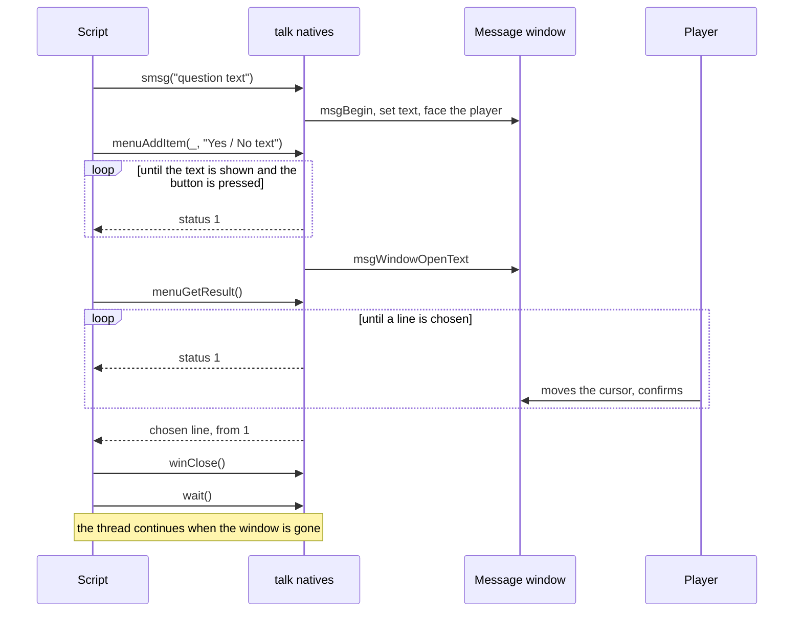

## The g2path and seg modules

These two small modules connect scripts to the quest systems of the game, the G.S. Campaign and the segment addresses. All six natives are in `src/main/talk_natives.c`. Flags and addresses are numbered from 1 in scripts and from 0 in the engine. The systems are described on the [G.S. Campaign](../game/gs-campaign.md) page.

| Module | Script name | C function | Arguments | Returns | What it does |
| --- | --- | --- | --- | --- | --- |
| `g2path` | `setQuestFlag` | `setQuestFlag` | Exactly 2: quest number, value | 1 | Stores the state of a quest with `questFlagSet` |
| `g2path` | `getQuestFlag` | `getQuestFlag` | Exactly 1: quest number | The state | Reads it with `questFlagGet` |
| `g2path` | `setCitizenFlag` | `setCitizenFlag` | Exactly 2: citizen number, value | 1 | Stores the state of a citizen with `citizenFlagSet` |
| `g2path` | `getCitizenFlag` | `getCitizenFlag` | Exactly 1: citizen number | The state | Reads it with `yg2PathGetCitizenFlag` |
| `seg` | `addrOn` | `segAddrOnMessage` | Exactly 2: address number, message kind | 1 | Sets the state of a segment address with `segSetAddrOn` and shows a message with the address number in slot 1. Kind 1 is "found" with a sound, kind 2 "written on a door", kind 3 "decoded" with a sound |
| `seg` | `getAddrOn` | `segAddrOnGetFlag` | Exactly 1: address number | The state | Reads it with `segGetAddrOn` |

## The samp and deb modules

`runtimeInitState` registers two tiny modules in both sets. Their names and contents suggest that they are the sample and debug modules the programmers used while bringing up the VM. All three natives are in `src/ov01/sb_natives_unit.c`.

| Module | Script name | C function | Arguments | Returns | What it does |
| --- | --- | --- | --- | --- | --- |
| `samp` | `fontPut` | `sampFontPut` | At least 3: x, y, text (string) | 1 | Prints the text with `xglFontPrint(x, y, -1, text)` |
| `samp` | `padRead` | `sampPadRead` | At least 1: mode | Direction bits | The direction buttons of pad 0: pressed (mode 1), repeated (mode 2) or held (any other mode) |
| `deb` | `put` | `debPut` | None read | 1 | Does nothing in this build |

## The bat module

`bat` is the interface between a battle script and the battle engine. Each encounter has a script that describes it: which enemies appear, where they stand, how the scene is lit, and how each enemy decides what to do. The script sets the battle up with these natives, and during the battle the engine wakes the script's threads for the enemies' turns. The 63 natives are in two files of the battle overlay. The battle rules are described in [Battle](../game/battle.md), the engine with its units, slots and commands in [Battle engine](../game/battle-engine.md), and the effects in [Battle effects](../game/battle-effects.md).

A unit argument is an index of the combined unit table, resolved by `unitPtrGet`. Values that stand for fractions are in hundredths.

### Setting up the scene

| Script name | C function | File | Arguments | Returns | What it does |
| --- | --- | --- | --- | --- | --- |
| `posDataSet` | `posDataSet` | `sb_natives.c` | At least 1: global index | 1 | Selects the position table of the battle: the entry that word 0 of the global entry points to. `posDataGet` hands it to the engine as the effect position table |
| `monsTblSet` | `monsTblSet` | `sb_natives.c` | At least 2: list index, choice | 1 | Selects the enemy group. The list is a global array of pairs (table, value) that ends with a zero table, with at most 1000 candidates. The native takes candidate `choice` (0 when out of range), passes its value to `monsTblMapNoSet` and makes the first entry of its table the enemy list that `monsTblGet` returns. An empty list requests the argument jump |
| `monsSetNoGet` | `monsSetNoGet` | `sb_natives.c` | None | The group number | The enemy group number of this encounter (`cfMonsSetNoGet`), which the field chose. The script normally passes it to `monsTblSet` as the choice |
| `cameraSet` | `cameraSet` | `sb_natives.c` | At least 1: value | 1 | Stores the camera setting of the battle for `cameraSettingGet` |
| `plPosInit` | `plPosInit` | `sb_natives_unit.c` | At least 2: party entry, position | 1 | Sets the starting position number of a party entry |
| `plDirInit` | `plDirInit` | `sb_natives_unit.c` | At least 2: party entry, degrees | 1 | Sets the starting direction of a party entry, brought into 0 to 360 |
| `setMoveCmd` | `setMoveCmd` | `sb_natives_unit.c` | At least 1: value | 1 | Stores `moveCmd` in the battle state |
| `bgmPlay` | `bgmPlay` | `sb_natives_unit.c` | At least 1: index | 1 | Stores the music index of the battle for `bgmIndexGet` |
| `bgmStop` | `bgmStop` | `sb_natives_unit.c` | None | 1 | Stops stream slot 0 |
| `bgmFade` | `batBgmFade` | `sb_natives_unit.c` | At least 2: code, value | 1 | Code 0x5A starts the music fade with `bgmSlotLevelSet(0)`. Any other code is passed to `soundSlotSetVolume(0, code, value)` |
| `streamPlay` | `streamPlay` | `sb_natives_unit.c` | At least 1: file name (string) | 1 | Reopens stream slot 1, sets its level and gives it the file |
| `cfFlagSet` | `cfFlagSet` | `sb_natives_unit.c` | At least 1: bits | 1 | Sets bits in the event flags that the battle hands back to the field (`cfEventSet`) |
| `runEffSet` | `runEffSet` | `sb_natives_unit.c` | At least 1: record | 1 | Selects the effect shown when the party runs away: group 0x140 and the given record, read back with `runEffGet` |

### Light and fog

| Script name | C function | File | Arguments | Returns | What it does |
| --- | --- | --- | --- | --- | --- |
| `initLight` | `initLight` | `sb_natives_unit.c` | None | 1 | Makes the battle's light block the default light set of xgl, of the model library and of the effect system |
| `setLight` | `batSetLight` | `sb_natives_unit.c` | At least 1: kind, colour (3), direction (3) | 1 | Writes one light of the light block and applies the block again, also to every unit's actor. Kinds 0 to 2 are the directional lights, 3 the view light with the ambient colour, 4 the lower ambient colour, 5 to 7 the three shadow directions. The colour is 0 to 255 per channel and defaults to mid grey. The direction is in hundredths and defaults to +z. A shadow kind with a default colour or direction is switched off |
| `setFog` | `batSetFog` | `sb_natives_unit.c` | At least 8: flags, four distances, three colour values | 1 | Sets the fog override of the effect system. Flag bit 1 also gives the fog to the actor of the first active enemy slot, bit 2 to the actors of all units |

### Units

| Script name | C function | File | Arguments | Returns | What it does |
| --- | --- | --- | --- | --- | --- |
| `unitLoad` | `unitLoad` | `sb_natives_unit.c` | At least 1: unit number | 1 | Starts loading the data file of an enemy and reserves its effect slot |
| `unitLoadWait` | `unitLoadWait` | `sb_natives_unit.c` | None read | 1 | Waits while a disc read, an effect load or a unit load is pending |
| `unitCreate` | `unitCreate` | `sb_natives_unit.c` | At least 5: unit number, position number, degrees, two values | The unit, or 0 | Creates an enemy unit with `unitEnCreate`, places it at the position, turns it and stores the two values in its stat block. The result is the address of the `BattleUnit`, which the script keeps as a number |
| `unitBind` | `unitBind` | `sb_natives_unit.c` | At least 2: data slot id, unit | 1, or 0 when the slot is not found | Binds the unit created by `unitCreate` to its loaded data: gives it its actors, fades it in, switches its status effects on and requests the model load |
| `unitBind2` | `unitBind2` | `sb_natives_unit.c` | At least 2: data slot id, unit | 1, or 0 | The same, but leaves the unit hidden (`unitUnbind`) instead of fading it in |
| `actorGet` | `actorGet` | `sb_natives.c` | At least 1: unit | An address | The address of the unit's actor. The camera natives accept it as an anchor |
| `unitParaGet` | `unitParaGet` | `sb_natives.c` | At least 2: unit, field | The value | Reads a unit parameter (`UNIT_PARA_*`) |
| `unitParaSet` | `unitParaSet` | `sb_natives.c` | At least 3: unit, field, value | 1 | Writes a unit parameter |
| `unitStatGet` | `unitStatGet` | `sb_natives.c` | At least 3: unit, row, mask | The value | Reads status bits of the unit (`calcStatGet`) |
| `unitStatSet` | `unitStatSet` | `sb_natives.c` | At least 3: unit, row, bit | 1 | Sets a status of the unit (`calcStatSet`) |
| `unitTblBitGet` | `unitTblBitGet` | `sb_natives_unit.c` | None | A bit mask | One bit per occupied entry of the combined unit table |
| `unitDirGet` | `unitDirGet` | `sb_natives_unit.c` | At least 1: unit | Degrees | The unit's facing |
| `unitDirChk` | `unitDirChk` | `sb_natives_unit.c` | At least 2: unit, target | 1 or 0 | Whether the bearing from the unit to the target lies within a quarter turn of the target's facing. This is how a script tests for an attack from behind or from the front |
| `unitDefAreaGet` | `unitDefAreaGet` | `sb_natives_unit.c` | At least 1: unit | Hundredths | The size of the unit's body area (`unitDefArea`) |
| `unitFade` | `unitFade` | `sb_natives_unit.c` | At least 2: unit, frames, percent | 1 | Fades the unit to the percentage over the frames |
| `unitMotWait` | `unitMotWait` | `sb_natives_unit.c` | At least 1: unit | 1 | Waits while the unit has flag 0x10 set or its motion is not done |
| `scale` | `batScale` | `sb_natives_unit.c` | At least 2: unit, percent | 1 | Scales the unit's actor on all three axes |
| `pari` | `pari` | `sb_natives_unit.c` | At least 4, up to 7: unit, count, state, speed, three optional values | 1 | Sets sweep and shadow values of the unit's actor: `shadowCount`, `moveState`, the sweep speed, and optionally a shadow value (default 1), the sweep phase (default 0) and a third shadow value (default 1), all fractions in hundredths |
| `partsHide` | `partsHide` | `sb_natives_unit.c` | At least 2: unit, part name (string) | 1 | Hides a named part of the unit's model |
| `partsShow` | `partsShow` | `sb_natives_unit.c` | At least 2: unit, part name (string) | 1 | Shows it again |

Creating an enemy takes four natives, because the data comes from the disc:

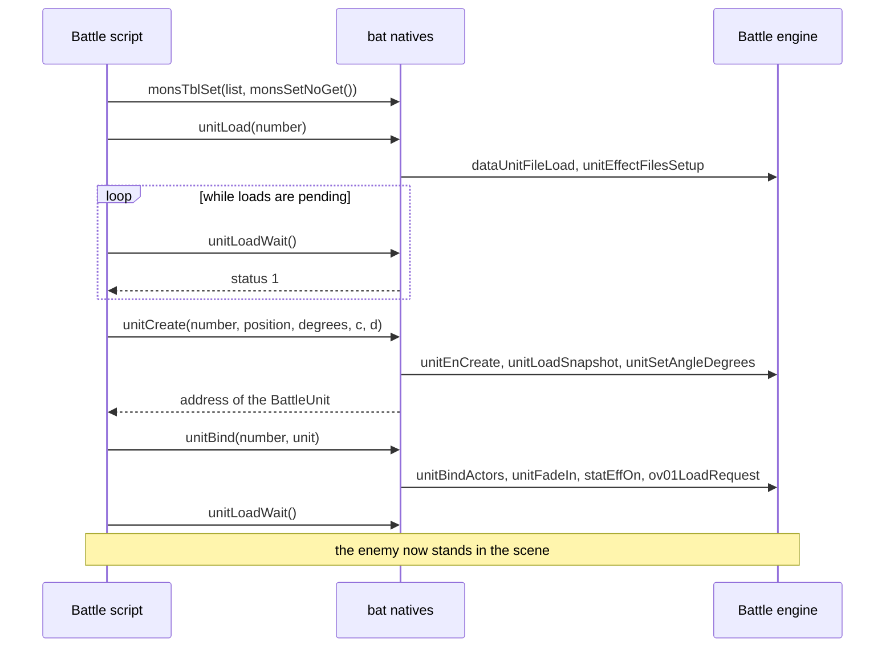

### Enemy thinking and commands

When it is an enemy's turn, the engine runs the think routine of that enemy in the battle script. The routine inspects the battle with the read natives and ends by queuing a command.

| Script name | C function | File | Arguments | Returns | What it does |
| --- | --- | --- | --- | --- | --- |
| `thinkSet` | `thinkSet` | `sb_natives.c` | At least 4: unit, command, value, target unit | 1 | Queues a command for the unit with `thinkDispatch` and ends its thinking with `thinkSendEnd` |
| `thinkSet2` | `thinkSet2` | `sb_natives.c` | At least 4: unit, command, value, target unit | 1 | Queues a command without ending the thinking, so that more can follow |
| `thinkSetEnd` | `thinkSetEnd` | `sb_natives.c` | At least 1: unit | 1 | Ends the unit's thinking: queues the end record and leaves the target selection mode |
| `atkTbl` | `atkTbl` | `sb_natives.c` | At least 2: unit, table index, optional row limit | The row count | Fills an attack table in the script's globals with `atkTblBuild`: one row (technique slot, target unit) for every technique of the unit, up to the row limit (default 10), and every unit that the technique can affect |
| `atkTblGet` | `atkTblGet` | `sb_natives.c` | At least 3: field, table index, row | The value | Reads one field of one row of the attack table |
| `tecParaGet` | `tecParaGet` | `sb_natives.c` | At least 2: technique, field | The value | Reads field 0 to 3 of a technique record |
| `partyDataGet` | `partyDataGet` | `sb_natives_unit.c` | At least 2: gauge, slot | The value | Reads the stock gauge of a party: slot 0 the stock, 1 the progress, 2 the maximum stock |
| `partyDataSet` | `partyDataSet` | `sb_natives_unit.c` | At least 3: gauge, slot, value | 1 | Writes one of the three values |
| `stockGet` | `stockGet` | `sb_natives_unit.c` | At least 1: slot 0 to 3 | A unit key, or 0 | The key of the unit in an action stock slot |
| `counterBoost` | `counterBoost` | `sb_natives.c` | At least 1: unit | 1 when it was applied | If `calcBoostChk(unit, 0)` allows it, performs a counter boost: `calcBoost`, the boost effect (group 0x140, record 7) and a voice |
| `boost` | `boost` | `sb_natives.c` | At least 1: unit | 1 when it was applied | The same for a normal boost, with mode 1 |
| `frameCntGet` | `frameCntGet` | `sb_natives_unit.c` | None | A frame count | Frames the battle scene has run |
| `ETGet` | `ETGet` | `sb_natives_unit.c` | None | A phase number | The current step of the action step counter (`actStepCounterValue`) |

### Effects, messages and the HUD

| Script name | C function | File | Arguments | Returns | What it does |
| --- | --- | --- | --- | --- | --- |
| `loadEffect` | `loadEffect` | `sb_natives.c` | At least 2: group, index | 1 | Starts loading an effect. The effect key has the group above bit 12 and the index below it |
| `loadWaitEffect` | `loadWaitEffect` | `sb_natives.c` | None read | 1 | Waits while effect files are loading (`sefCheckLoad`) |
| `createEffect` | `createEffect` | `sb_natives.c` | At least 2: group, index, optional unit | 1 | Starts an effect, attached to the unit when one is given |
| `createEffectPos` | `createEffectPos` | `sb_natives.c` | At least 2, reads 3: group, index, position number | 1 | Starts an effect at a record of the position table, whose three integers are in hundredths |
| `msgPut` | `msgPut` | `sb_natives_unit.c` | At least 3: two values, text (string), then optional x, y and size | 1 | Shows a battle message with `msgPutObject`. The defaults of the optional arguments are 0x3C, 0x1AC and 0x28 |
| `msgPutWait` | `msgPutWait` | `sb_natives_unit.c` | None read | 1 | Waits while a battle message is shown |
| `namePut` | `namePut` | `sb_natives_unit.c` | At least 5: x, y, minimum width, text (string), fade base | 1 | Shows a text box with `textWindowShow`, used for the names of techniques |
| `arrowOn` | `arrowOn` | `sb_natives_unit.c` | At least 3: x, y, direction | 1 | Shows the pointing arrow sprite |
| `arrowOff` | `arrowOff` | `sb_natives_unit.c` | None | 1 | Removes it |
| `decoDisp` | `decoDisp` | `sb_natives_unit.c` | At least 1: switch | 1 | Switch 0 sets flag bit 4 on all HUD panels (`decoFlagsSetAll`), any other value clears it |
| `decoDisp2` | `decoDisp2` | `sb_natives_unit.c` | At least 1: switch | 1 | The same for the first panel group only |
| `VPadEnable` | `VPadEnable` | `sb_natives.c` | None | 1 | Turns the virtual pad on (`dataVPadModeSet(1)`). Input then comes from the script |
| `VPadDisable` | `VPadDisable` | `sb_natives.c` | None | 1 | Turns it off |
| `VPadSet` | `VPadSet` | `sb_natives_unit.c` | At least 1: button bits | 1 | Sets the 16 button bits of the virtual pad |

The virtual pad lets a script press buttons for the player. With the message and arrow natives it is the toolkit of the battle tutorials: the script shows an explanation, points at a panel, and feeds the input that the explanation describes.

## The Samplefade module

The five natives of `src/main/fade_ctrl.c` are complete but unreachable, because `fadeRegisterCommands` is never called. They wrap the fade functions of `src/main/fade_ctrl.c`, which are described in [Screen effects](../libraries/screen-effects.md). On a wrong argument count they return 0 without requesting the argument jump.

| Script name | C function | Arguments | Returns | What it does |
| --- | --- | --- | --- | --- |
| `ColorSet` | `fadeColorSet` | Exactly 3: red, green, blue | 1 | Sets the fade colour (`fadeSetColor`) |
| `Fadein` | `Fadein` | Exactly 1: frames | 1 | Fades the overlay alpha from 255 to 0 (`fadeStartIn`) |
| `Fadeout` | `Fadeout` | Exactly 1: frames | 1 | Fades the overlay alpha from 0 to 255 (`fadeStartOut`) |
| `Colorfade` | `Colorfade` | Exactly 4: red, green, blue, frames | 1 | Fades to a colour (`fadeStartColor`) |
| `Colorfade2` | `ColorfadeAlpha` | Exactly 5: red, green, blue, alpha, frames | 1 | Fades to a colour and alpha (`fadeStartColorAlpha`), the same call as `runtime.Fade` |

## Counts

| Group | Owners | Natives |
| --- | --- | --- |
| Field only: `objx`, `enepc`, `runtime`, `ladder`, `menu`, `uwamono`, `cfe`, `id`, `talk`, `g2path`, `seg` | 11 | 15 + 18 + 34 + 2 + 11 + 5 + 29 + 7 + 16 + 4 + 2 = 143 |
| Field and battle: `camera`, `math`, `samp`, `deb` | 4 | 50 + 4 + 2 + 1 = 57 |
| Battle only: `bat` | 1 | 63 |
| Never registered: `Samplefade` | 1 | 5 |
| All tables | 17 | 268 |

The field set is 143 + 57 = 200 natives in 15 owners. The battle set is 63 + 57 = 120 natives in 5 owners. A script can reach 263 different natives in total.

The scripts on the discs import 227 of the 268 natives. The other 41 are never
called, among them the five of `Samplefade`, `deb.put` and 15 natives of
`camera`. No script asks for a native that the executable lacks. The usage
counts per native are listed in
[Scripts and archives](../formats/scripts-and-archives.md).
