# The SB virtual machine

The event logic of Xenosaga Episode II is not written in C. Every map has a
script that reacts to the player, moves the camera, opens message windows and
starts cutscenes. Every battle has a script that places the enemies, drives
their thinking and plays the attack sequences. These scripts are files with
the extension `.sb`. They hold a compact stack bytecode, and the game contains
a small virtual machine (VM) that interprets it. The source calls everything
that belongs to this machine `sb`, after the magic letters `SB` at the start of
each script file.

The VM is small and strict. A script is one **image** in memory: a header, a
stream of 16-bit code units, a table of 32-bit global words and a few name
tables. The image runs as one or more **threads**. A thread is a program
counter, a small stack of 128 words, a table of eight jump slots and a queue
of sixteen messages. All threads advance once per game frame, one after the
other, until each one waits, yields or ends. A script reaches the engine only
through **natives**: C functions that the engine registers under an owner name
and a method name, and that the script calls by those names.

The whole machine is in `src/ov01/sb_vm.c`, which is part of the overlay
`OV01.OVL`. The map scripts of the field use the same machine, although the
field code is in the main executable. The section
[A machine that lives in the overlay](#a-machine-that-lives-in-the-overlay)
explains what follows from that. The catalogue of the natives has its own page,
[Native functions](natives.md).

[← Back to the overview](../README.md)

## Source files

| File | Contents |
| --- | --- |
| `src/ov01/sb_vm.c` | The whole VM: `sbInit`, the image checks `sbIsSbImage` and `sbIsSblImage`, the linker `sbLinkImage` and `sbLibraryLink`, the native registry (`sbNativeOwnerAdd`, `sbFindNative`), thread records, `sbRunAll`, `sbRun` and `sbStep`, the stack, locals and globals, jump slots, message queues, the 46 opcode handlers, the tables `sbOpLengths` and `sbOpHandlers` |
| `src/ov01/sb_push_const.c` | The handlers of the eight opcodes `0x26` to `0x2D`, which push a small constant |
| `src/ov01/sb_natives.c` | The argument readers that every native uses (`VM_PLUGIN_CNT_GET`, `vmArgGet`, `vmArgGetHigh`, `vmArgTagIsZero`), the data readers `vmKeyedEntryGet`, `vmEntryGet` and `vmSubEntryGet`, the empty error report `sbFatalReport`, and the first battle natives (described on [Native functions](natives.md)) |
| `src/ov01/scene_script.c` | The two accessors of the battle script: `ov01ScriptKeyGet` (the SB image) and `ov01ScriptImageGet` (its SBL library) |
| `src/main/script_load.c` | A development loader that reads `scNNNN.sb` from the host PC and links it (`scriptLoadByNumber`, `scriptReadFile`, `scriptFreeBuffer`) |
| `src/main/talk_natives.c` | `scriptRegisterNatives`, which registers the owners `talk`, `g2path` and `seg`, their three method tables, and a few talk helpers for map objects |
| `include/ov01/sb_vm.h` | `SbImageHeader`, `SbNameEntry`, `SbThread`, `SbSlot`, `SbQueue`, `SbMessage`, `SbNativeMethod`, the limits and the public functions |
| `include/ov01/sb_push_const.h` | Prototypes of the eight constant handlers |
| `include/ov01/sb_natives.h` | Prototypes of the argument readers and of the natives in `sb_natives.c` |
| `include/ov01/sb_natives_unit.h` | `runtimeInit` and `runtimeInitState`, the battle side of native registration |
| `include/ov01/scene_script.h` | Prototypes of the two battle script accessors |

Several other files take part and are named where they matter:
`src/main/ytachi_test.c` (`mapSceneScriptLoad`, the map script loader),
`src/main/game_data.c` (the field frame loop, and the suspension of the map
script around a battle), `src/main/uwamono_objx.c` (`scriptRegisterModules`),
`src/ov01/scene_load.c` and `src/ov01/scene.c` (the battle side),
`src/ov01/data_file_load.c` (`dataThinkScriptLoad`) and
`src/main/res_get_path.c` (`resParseJumpTarget`, which reads script code
without running it).

## The parts of the machine

A short map of the parts helps before the details. The machine has four kinds
of state. The first is the **native registry**: two arrays that hold every
owner name and every method the engine has registered. The second is the
**image**: the script file as it was read from the disc, patched once by the
linker. The third is the **thread table**: 80 records, each with its own stack,
slot table and message queue. The fourth is a single flag word, `sbFlags`.

The image is passive. It holds code and data but no run state, except the
global words, which the code reads and writes in place. All run state is in the
threads. A thread refers to its image by address, and that address is also the
**key** by which the engine names the threads of one script: every function
that suspends, resumes, releases or sends a message to threads takes the image
address as its first argument.

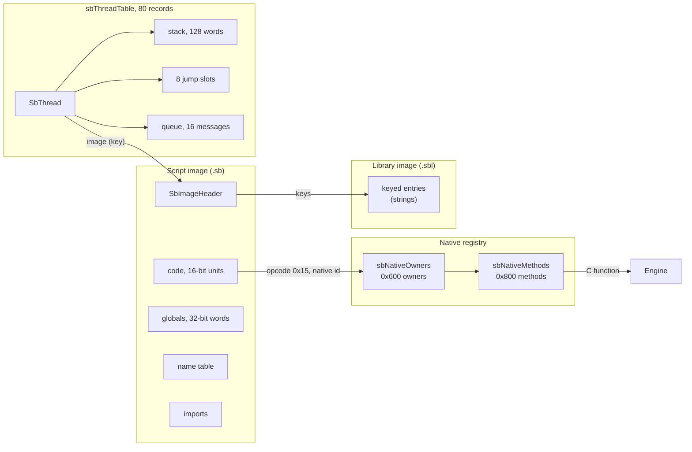

## Memory used by the VM

All VM state is static data of the overlay. Nothing is allocated from a heap.
The limits are fixed by the constants in `include/ov01/sb_vm.h` and at the top
of `src/ov01/sb_vm.c`.

| Variable | Address | Element | Count | Bytes |
| --- | --- | --- | ---: | ---: |
| `sbFlags` | `0x00AC51C0` | `int` | 1 | 4 |
| `sbThreadTable` | `0x00AC51C8` | `SbThread` (`0x40`) | 80 (`SB_THREAD_COUNT`) | `0x1400` |
| `sbStacks` | `0x00AC65C8` | `int[0x80]` (`SB_STACK_WORDS`) | 80 | `0xA000` |
| `sbSlotTables` | `0x00AD05C8` | `SbSlot[8]` (`SB_SLOT_COUNT`) | 80 | `0x2800` |
| `sbQueues` | `0x00AD2DC8` | `SbQueue` (`0x114`) | 80 | `0x5640` |
| `sbNativeOwners` | `0x00AD8408` | `SbNativeOwner` (12 bytes) | `0x600` | `0x4800` |
| `sbNativeOwnerCount` | `0x00ADCC08` | `int` | 1 | 4 |
| `sbNativeMethods` | `0x00ADCC10` | `SbNativeMethod` (8 bytes) | `0x800` | `0x4000` |
| `sbNativeMethodCount` | `0x00AE0C10` | `int` | 1 | 4 |

Together these tables take about 113 KiB. Thread number `i` always uses stack
`i`, slot table `i` and queue `i`. `sbThreadStart` stores the three addresses
in the thread record when it starts a thread, through the small accessors
`sbStackGet`, `sbSlotTableGet` and `sbQueueGet`.

The images are not part of this memory. The map script is read into the buffer
`mapSceneScriptBuffer` (`0x003C6DC0`) of the main executable. The battle script
is in the buffer `gameWork.resBuffer`. A debug page of the overlay has its own
static buffer of `0xC000` bytes. The sections on the field and the battle say
how each buffer is filled.

`sbInit` puts the machine in its empty state. It clears `sbFlags`, marks all 80
thread records as free by setting their `image` field to 0, fills the stacks,
slot tables and queues with zero bytes, and calls `sbResetNativeCounts`, which
sets both registry counters to 0. It is called from two places: `ov01InitAll`
(`src/ov01/choice_menu.c`), which runs once when a play session starts, and
`mapSceneScriptLoad`, which runs each time a map is loaded.

## The image

An image is a file read into memory without any conversion. All offsets in it
count from the first byte of the header, so the image can sit at any address.
The header is the struct `SbImageHeader`.

| Offset | Type | Field | Meaning |
| --- | --- | --- | --- |
| `+0x00` | `int` | `magic` | `0x20204253`, the bytes `"SB  "`, for a script. `0x204C4253`, the bytes `"SBL "`, for a library |
| `+0x04` | `int` | `flags` | Bit 31 (`SB_IMAGE_LINKED`) is set by `sbLinkImage` |
| `+0x08` | `int` | `entry` | Code position where the first thread starts. In a library: the number of keyed entries |
| `+0x0C` | `int` | `name_count` | Number of entries in the name table |
| `+0x10` | `int` | `import_count` | Number of native imports |
| `+0x14` | `int` | `code_offset` | Offset of the code. In a library: offset of the entry index array |
| `+0x18` | `int` | `global_offset` | Offset of the global words. In a library: offset of the entry data |
| `+0x1C` | pointer | `keys` | Address of the library image. Written by `sbLibraryLink`, not read from the file |
| `+0x20` | `int` | `name_offset` | Offset of the name table |
| `+0x24` | `int` | `import_offset` | Offset of the import words |

Two functions test the magic. `sbIsSbImage` returns 1 when the header address
is not null and the magic is `"SB  "`. `sbIsSblImage` does the same for
`"SBL "`. Both letter groups end in spaces, so the magic is always four bytes.

### Sections

The code reads four sections of a script image.

The **code** starts at `code_offset`. It is a stream of unsigned 16-bit units.
Every position in the code, such as a jump target, a thread entry or the
program counter, is an index of a unit in this stream. The code ends where the
globals start: both `sbRun` and `sbLinkImage` compute the code length as
`(global_offset - code_offset) / 2` units. The source has no separate length
field, so the globals must directly follow the code in the file.

The **globals** start at `global_offset`. They are 32-bit words, read by
`sbGlobalGet` and written in place by `sbGlobalSet`. The same area also holds
the constant data of the script: message records, attack tables, lists of
strings and tables of offsets. Natives reach that data with `vmEntryGet` and
`vmSubEntryGet`, which take the index of a global word. There is no border
between variables and data, and nothing in the header gives the number of
globals.

The **name table** starts at `name_offset` and has `name_count` entries of the
type `SbNameEntry`, eight bytes each. An entry holds `name_offset`, the offset
of a NUL-terminated name counted from the start of the name table, and `value`.
`sbNameTableFind` returns the value of a name, or -1. `sbNameTableNameOf` does
the reverse and returns the name of a value, or null. The values are code
positions. `sbThreadEnqueueByName` uses the value as the entry of a thread, and
`resParseJumpTarget` adds the value of the name `mapjump` to the start of the
code to find that routine. The table therefore names the entry points of the
script.

The **imports** start at `import_offset`. There are `import_count` 32-bit
words, and the name strings follow directly after the last word. Each word
holds two offsets into that block of strings: the owner name in the high 16
bits and the method name in the low 16 bits. The linker replaces every word
with a native id, as described in [Linking](#linking).

```
SbImageHeader ("SB  ")
+0x00 +----------------------------+
      | header, 0x40 bytes in files |
      +----------------------------+  <- code_offset
      | code: u16 units            |
      |   opcode, operands ...     |
      +----------------------------+  <- global_offset (= end of code)
      | globals: 32-bit words      |
      |   variables and data       |
      +----------------------------+  <- name_offset
      | SbNameEntry[name_count]    |
      |   { name_offset, value }   |
      | name strings               |
      +----------------------------+  <- import_offset
      | int imports[import_count]  |
      |   owner << 16 | method     |
      | owner and method strings   |
      +----------------------------+
```

The order of the name table and the imports in the file is not fixed by the
code, because each is found through its own offset. Every file on the discs
uses the order of the drawing.

The code reads the first `0x28` bytes of the header. In the files the header
is 64 bytes long. The word at `+0x28` is the offset of a source name string
that follows the imports, and the bytes from `+0x2C` to `+0x3F` are zero.
`code_offset` is `0x40` in all 465 script images and libraries. The `flags`
word is 1 in a file, and the `keys` word, which the machine overwrites, holds
a copy of `name_offset`. The name table of a script holds exactly the entries
of the threads that the script starts with opcode `0x16`. Functions that are
only called have no name. The files are described byte by byte in
[Scripts and archives](../formats/scripts-and-archives.md).

### The library image

A script usually comes with a second file, the **library**, with the magic
`"SBL "`. It holds the texts of the script in one language, so that the code
is the same for every language and only the library changes. The map loader
reads the script from `cf\scNNNN.sb` and the library from
`cf\xx\scNNNN.sbl`, where `xx` is replaced by the language code that
`xglGetLanguageCode` writes.

A library reuses the header struct with other meanings. `entry` is the number
of **keyed entries**. `code_offset` is the offset of an array of 32-bit
offsets, one for each entry. `global_offset` is the offset of the data that
these offsets point into. `vmKeyedEntryGet` in `src/ov01/sb_natives.c` reads
it:

1. The script value must carry the tag `0x200000` in bits 20 to 23
   (`VM_KEY_TAG_ENTRY` under `VM_KEY_TAG_MASK`). Any other value gives null.
2. The remaining bits are the entry index. An index that is not below
   `entry` gives null.
3. The result is the address
   `library + global_offset + index_array[index]`.

Almost every caller treats the result as a C string: the text of a message
window, the name of a model part, the name of an effect, the name of a sound
stream. A string in a script is therefore not a pointer. It is a small number
with a tag, and it only becomes an address when a native asks for it. Because
the library is found through the thread's image (`thread->image->keys`), a
script can only read strings from its own library.

## Linking

A script image must be linked before it can run. Linking does two things: it
resolves every import to a native, and it rewrites the code so that a native
call costs no name lookup at run time.

`sbLinkImage(image, library)` does the work. Its second parameter is not read.

1. If the image fails `sbIsSbImage`, the function never returns. It enters an
   endless loop.
2. If `SB_IMAGE_LINKED` is already set, it returns 1 at once. An image is
   linked only one time.
3. It sets `SB_IMAGE_LINKED`.
4. For each import word it splits the two name offsets, calls
   `sbFindNative(ownerName, methodName)` and stores the result back into the
   import word. The result is the **native id**.
5. If a native is not found, the result depends on `sbFlags`. With the bit
   `SB_FLAG_ALLOW_MISSING_NATIVES` (1) the id becomes -1 and linking goes on.
   Without it the function returns 0.
6. It walks the code from the first unit to the end. At each instruction it
   reads the opcode and the 32-bit operand behind it, and steps to the next
   instruction with `sbOpLength`.
7. For each instruction with opcode `0x15` (`SB_OP_CALL_NATIVE`) the operand
   is an index into the import words. The linker overwrites the operand with
   the native id of that import.
8. If missing natives are allowed and the id is -1, it also writes 0 over the
   opcode, over both operand units and over the unit after them. Opcode 0 is
   the no-operation, so the call disappears. The fourth cleared unit is the
   opcode of the next instruction. A likely reading is that the script
   compiler always puts a one-unit instruction, such as a drop of the result,
   behind a call, and that this instruction must go as well.

`sbFlagsSet` and `sbFlagsClear` change `sbFlags`, and `sbFlagsGet` reads it. No
code in the game calls `sbFlagsSet`, so in this build a missing native always
makes `sbLinkImage` return 0, and every caller treats that as fatal.

`sbLibraryLink(image, library)` is the version that the game uses for real
scripts. It calls `sbLinkImage`, returns 0 if that fails, then checks the
library with `sbIsSblImage`. A library with the wrong magic stops the game in
an endless loop. On success it stores the library address in `image->keys` and
returns 1.

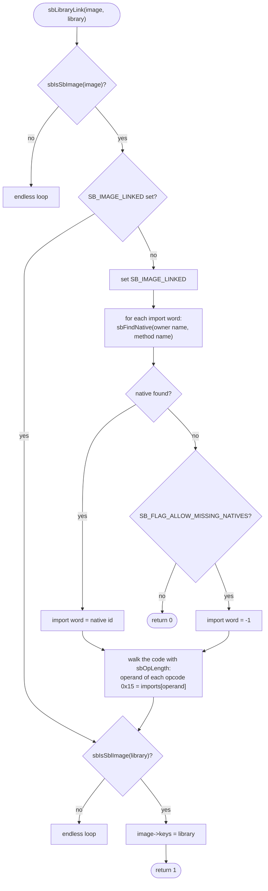

The native id is `(owner index << 16) + method index`. Both indices are
positions in the registry at the moment of linking. This has an important
consequence that the engine respects with care: a linked image is only valid
as long as the registry holds the same owners in the same order. The section
[The script around a battle](#the-script-around-a-battle) shows where this
matters.

## Natives

A native is a C function with a script-visible name. Scripts do not know C
symbols. They know an **owner**, which is a module name such as `camera`,
`talk` or `bat`, and a **method** name inside that owner, such as `smsg`. The
import of a script names both.

### The registry

A table of natives is an array of `SbNativeMethod` records that ends with a
record whose name is null.

| Offset | Type | Field | Meaning |
| --- | --- | --- | --- |
| `+0x00` | `const char *` | `name` | Method name as scripts write it |
| `+0x04` | function pointer | `func` | The C function. It is called with the running thread and the address of a status word |

`sbNativeOwnerAdd(name, methods)` registers such a table under an owner name.
It refuses when `sbNativeOwnerCount` has reached `0x600`. Otherwise it writes a
new `SbNativeOwner` record (`name`, `methods`, `count`) and copies the method
records one by one to the end of the shared array `sbNativeMethods`. The
owner's `methods` field points at its first copy. If the shared array reaches
`0x800` methods during the copy, the function returns 0 and the owner is not
counted. On success it returns 1.

The registry never removes a single owner. `sbResetNativeCounts` empties it
completely, and the engine then registers everything again.

`sbFindNative(ownerName, methodName)` is the lookup. It compares the owner name
with `strcmp` against each registered owner in order, and inside a matching
owner compares the method name against each method. It returns the native id,
or -1. If two owners have the same name, the search continues into the second
one when the method is not in the first.

### Who registers what

The field and the battle register different sets. The table lists every call
of `sbNativeOwnerAdd` in the source.

| Owner name | Registered by | File | Used in |
| --- | --- | --- | --- |
| `objx` | `objxRegisterNatives` | `src/main/uwamono_objx.c` | field |
| `enepc` | `enepcRegisterNatives` | `src/main/runtime_uwamono_door.c` | field |
| `runtime` | `runtimeRegisterNatives` | `src/main/runtime_enepc.c` | field |
| `ladder` | `ladderRegisterNatives` | `src/main/runtime_camera.c` | field |
| `camera` | `cameraRegisterNatives` | `src/main/runtime_camera.c` | field and battle |
| `math` | `mathRegisterNatives` | `src/main/runtime_menu.c` | field and battle |
| `menu` | `menuRegisterNatives` | `src/main/runtime_menu.c` | field |
| `uwamono` | `uwamonoRegisterNatives` | `src/main/get_ladder.c` | field |
| `cfe` | `cfeRegisterPlugIn` | `src/main/cfePlugIn.c` | field |
| `elv` | `elvReset` | `src/main/elevator.c` | field |
| `talk`, `g2path`, `seg` | `scriptRegisterNatives` | `src/main/talk_natives.c` | field |
| `samp`, `deb` | `runtimeInitState` | `src/ov01/sb_natives_unit.c` | field and battle |
| `bat` | `runtimeInit` | `src/ov01/sb_natives_unit.c` | battle |
| `Samplefade` | `fadeRegisterCommands` | `src/main/fade_ctrl.c` | no caller found |

The field set is registered by `scriptRegisterModules`
(`src/main/uwamono_objx.c`). It calls the register functions in the order of
the table from `objx` to `cfe`, then `elvReset`, `scriptRegisterNatives` and
`runtimeInitState`. That gives fifteen owners, with the ids 0 to 14.

The battle set is registered by `runtimeInit` (`src/ov01/sb_natives_unit.c`).
It first calls `sbResetNativeCounts`, then `runtimeInitState` (`samp`, `deb`),
then adds `bat`, then calls `mathRegisterNatives` and `cameraRegisterNatives`.
That gives five owners, with the ids 0 to 4.

`scriptRegisterNatives` is the smallest example of a registration. It makes
three calls of `sbNativeOwnerAdd` with the tables `talkNativeTable` (16
methods), `g2pathNativeTable` (4 methods) and `segNativeTable` (2 methods). The
same file holds one of the natives, `slotWinGetResult`, and helper functions
for talking to a map object (`mapObjectBeginMessage`, `mapObjectSetActive`,
`mapObjectFaceActive`, `mapObjectClearTalkFlags`, `talkStateReset`,
`talkSetResult`). What these natives do is described on
[Native functions](natives.md) and [Events and scenes](events.md).

### Arguments are pairs

A script passes arguments on its stack. Each argument takes two words: the
**value** first and a **tag** above it. After the last argument the script
pushes one more word, the **argument count**. The call instruction follows.
When the native runs, the stack of the thread therefore ends like this, for a
call with `n` arguments:

```
stack index            content
sp - 1                 argument count n
sp - 2                 tag of argument n
sp - 3                 value of argument n
sp - 4                 tag of argument n-1
sp - 5                 value of argument n-1
...
sp - 2n                tag of argument 1
sp - 2n - 1            value of argument 1
```

The argument readers in `src/ov01/sb_natives.c` hide this layout. Arguments
are numbered from 1.

| Function | Result |
| --- | --- |
| `VM_PLUGIN_CNT_GET(thread)` | The argument count, `stack[sp - 1]` |
| `vmArgGet(thread, k)` | The value of argument `k`, `stack[sp - 3 - 2 * (n - k)]` |
| `vmArgGetHigh(thread, k)` | The tag of argument `k`, `stack[sp - 2 - 2 * (n - k)]` |
| `vmArgTagIsZero(thread, k)` | 1 when the lowest byte of the tag of argument `k` is 0, and also 1 when `k` is larger than the count |

`vmArgGet` and `vmArgGetHigh` call `sbFatal` when `k` is 0 or larger than the
count. `vmArgTagIsZero` calls `sbFatal` only for `k` equal to 0. For an index
past the count it answers 1, which lets a native ask about an optional
argument without checking the count first.

The tag tells the native what kind of value it got. Two tag values are tested
in the source. A tag whose low byte is 0 means that the argument is empty: the
script left that place open. Natives use this for optional arguments. `atkTbl`
uses the default 10 when argument 3 has a zero tag, and many natives of
`src/main/runtime_uwamono_door.c` and `src/main/runtime_enepc.c` keep
the old value of a field when the matching argument is empty. A tag of 3 means
a string (`SCRIPT_ARG_STRING` in `src/main/talk_natives.c`). `talkSmsg` checks it
to tell a single string from a list of strings: with tag 3 the value is a
keyed entry, otherwise it is the index of a global table of keyed entries that
ends with the string `"NULL"`. The source does not test any other tag value.

Three more readers give access to the data of the image.

| Function | Result |
| --- | --- |
| `vmKeyedEntryGet(thread, key)` | Address of a keyed entry of the library, usually a string. See [The library image](#the-library-image) |
| `vmEntryGet(thread, index)` | Address of global word `index` of the thread's image. The caller decides what lies there |
| `vmSubEntryGet(thread, index, subIndex)` | Global `index + subIndex` holds a word offset from the start of the globals. The result is the address of the global at that offset |

`vmSubEntryGet` is how scripts pass nested tables. `monsTblSet` uses it to
walk a list of enemy tables, and `posDataSet` to find a table of positions.

### The call

Opcode `0x15` calls a native. Its handler `sbOpCallNative` reads the native id
from the operand, clears a local status word and calls
`sbNativeOwners[id >> 16].methods[id & 0xFFFF].func(thread, &status)`.

The native returns an integer and may set the status word.

- **Status stays 0.** The call is complete. The handler reads the argument
  count from the top of the stack, removes `2 * count + 1` words (all pairs
  and the count), pushes the return value and moves the program counter three
  units forward.
- **Status is 1.** The native is not finished. The handler returns 1 without
  touching the stack or the program counter. The thread stops for this frame,
  and the same call instruction runs again in the next frame with the same
  arguments.

Every native call leaves exactly one result word on the stack, also when the C
function has nothing useful to return. Most natives return 1 for success.

The status word is the only waiting mechanism for natives, and it makes
waiting very simple to write. A native that waits for something checks a
condition and sets the status when the condition is not met yet.
`cameraWaitMoveRef` sets it while the camera movement fraction is below 1.0.
`msgPutWait` sets it while the battle message is still shown.
`loadWaitEffect` sets it while effect files are still loading.
`slotWinGetResult` sets it while the player has not chosen yet. The script
just calls the native, and the call takes as many frames as it needs.

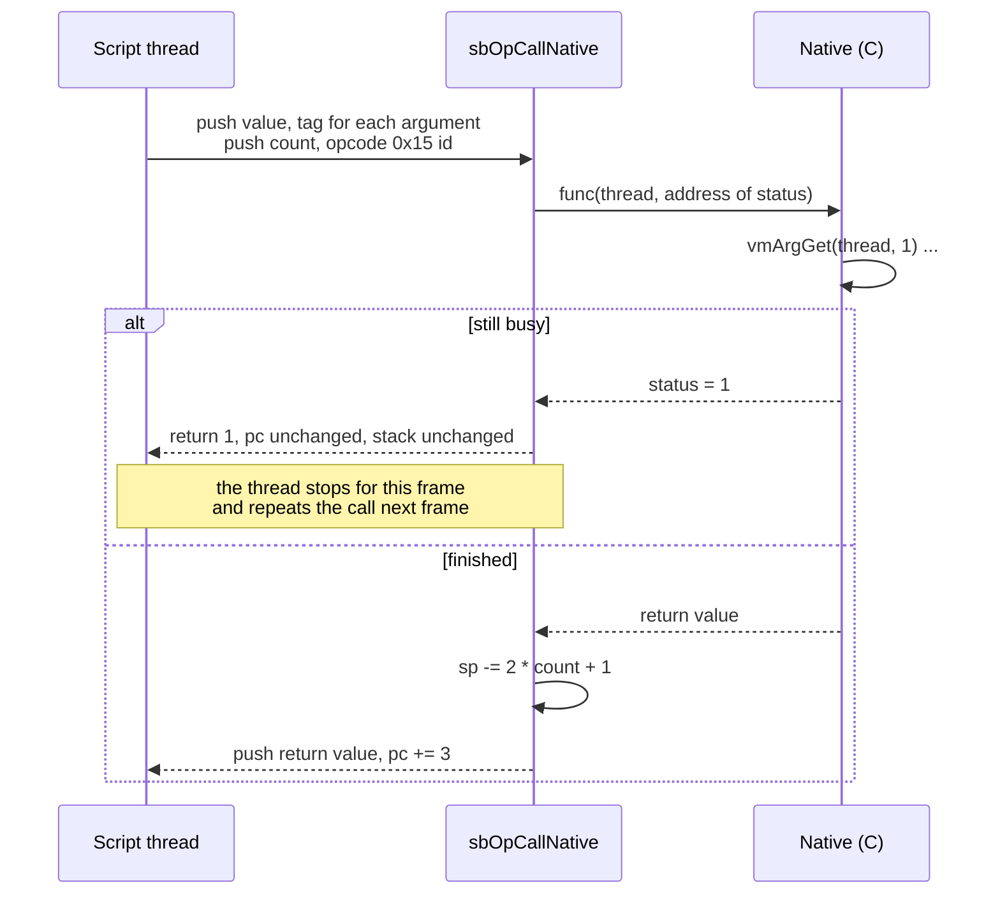

### Too few arguments

Natives check their argument count themselves. The common pattern is: if
`VM_PLUGIN_CNT_GET(thread)` is below the needed number, call
`sbSlotJumpRequest(thread, SB_JUMP_ARGUMENTS)` and return 0. This requests an
error jump, which the VM handles before the next instruction. The section
[Jump slots and errors](#jump-slots-and-errors) describes what happens then.

## Threads

A thread is one `SbThread` record of `sbThreadTable`.

| Offset | Type | Field | Meaning |
| --- | --- | --- | --- |
| `+0x00` | `int` | `pc` | Program counter, a unit index into the code of the image |
| `+0x04` | `int` | `sp` | Number of stack words in use |
| `+0x08` | `int` | `frame` | Stack index of local 0 of the current function. 3 at start |
| `+0x0C` | `int` | `jumpKey` | Key of a pending slot jump, 0 for none |
| `+0x10` | `int` | `jumpPosition` | Program counter at the moment the jump was requested |
| `+0x14` | pointer | `image` | The image the thread runs. 0 marks a free record |
| `+0x18` | `int` | `value` | The code position the thread started at. Together with `image` it names the thread |
| `+0x1C` | `int *` | `stack` | The thread's stack, 128 words |
| `+0x20` | `int` | `stackLimit` | `SB_STACK_WORDS`, `0x80` |
| `+0x24` | `SbSlot *` | `slots` | The thread's eight jump slots |
| `+0x28` | `SbQueue *` | `queue` | The thread's message queue |
| `+0x2C` | `int` | `status` | 1 while an instruction is waiting, 0 otherwise. Bit 31 (`SB_THREAD_SUSPENDED`) makes `sbRunAll` skip the thread |
| `+0x30` | `int[4]` | `wait` | `wait[0]` is the frame counter of opcode `0x1E`. The other three words are cleared and not used |

### Identity

A thread has no number and no handle. It is named by the pair of its image and
the code position it started at, which the source keeps in `value`.
`sbFindThread(key, value)` searches the table for that pair and returns the
first match. All thread services are built on it: `sbThreadRelease`,
`sbThreadSuspend`, `sbThreadResume`, `sbThreadEnqueue` and
`sbThreadDequeue`.

This makes the entry position the name of a thread inside a script. A script
that wants to send a message to a handler pushes the code position of that
handler. The engine does the same from C: it keeps script entry positions that
the script gave it earlier and sends messages to them. Two threads started at
the same entry cannot be told apart, and the services always reach the one in
the lower record.

### Starting and ending

`sbThreadStart(key, entry)` takes the first free record. It clears the four
wait words, sets `pc` and `value` to the entry, `frame` to 3, `sp` to 0, clears
the pending jump, attaches the stack, slot table and queue of that record
number, clears the slot table, resets the queue with `sbQueueReset` and sets
`status` to 0. It returns 1, or 0 when all 80 records are in use.

`sbStartImage(image)` starts the first thread of a script: it checks the magic
with `sbIsSbImage`, hangs in an endless loop if the check fails, and calls
`sbThreadStart(image, image->entry)`. Every other thread is started by the
script itself with opcode `0x16`.

A thread ends when its record is released. `sbThreadRelease(key, value)` sets
the `image` field to 0. `sbThreadsRelease(key)` releases every thread of one
image. A script releases a thread with opcode `0x17`.

`sbThreadSuspend` and `sbThreadResume` set and clear `SB_THREAD_SUSPENDED` in
the status of one thread, and `sbThreadsSuspend(key)` and
`sbThreadsResume(key)` do it for every thread of an image. A suspended thread
keeps all its state. It is just not run.

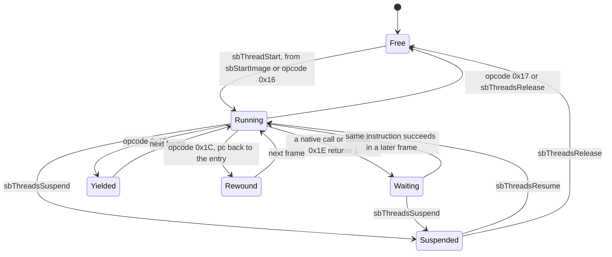

## Running

### Once per frame

`sbRunAll` is the only entry point for running scripts. It walks the thread
table from record 0 to record 79 and calls `sbRun` for every record that has
an image and does not have `SB_THREAD_SUSPENDED` set. It does not look at which
image a thread belongs to. Whatever is in the table runs.

The threads are cooperative. `sbRun` keeps executing instructions of one
thread until an instruction asks to stop, and only then does `sbRunAll` go to
the next thread. There is no time slice and no instruction limit. A script
that loops without a wait, a yield or an end stops the whole game.

A thread started by opcode `0x16` lands in the first free record. If that
record is behind the record of the starting thread, the new thread runs for
the first time in the same frame. If it is before, the new thread first runs
in the next frame.

### One thread

`sbRun(thread)` first computes the code length in units. Then it repeats
three steps:

1. If the program counter is larger than the code length, call `sbFatal`.
2. Call `sbSlotJump`, which performs a pending error jump if there is one.
3. Call `sbStep`. Continue while it returns 0.

`sbStep(thread)` executes one instruction. It reads the opcode unit at `pc`
with `sbCodeU16`. An opcode of `0x2E` or more is fatal. Otherwise it remembers
`pc`, calls `sbOpHandlers[opcode](thread, opcode)` and acts on the result of
the handler.

| Handler result | Effect in `sbStep` | Effect in `sbRun` |
| ---: | --- | --- |
| 0 | `status = 0` | Next instruction |
| 1 | `status = 1`, `pc` is set back to the start of the instruction | The thread stops for this frame and repeats the instruction next frame |
| 2 | `status = 0`, `pc = thread->value` (the entry) | The thread stops for this frame and starts again from its entry next frame |
| 3 | `status = 0`, `pc` stays where the handler put it | The thread stops for this frame and goes on behind the instruction next frame |

Result 1 is the wait. The handler may have moved `pc`, but `sbStep` restores
it, so the instruction is retried. The `status` field is what lets the retried
instruction know that this is not its first run: opcode `0x1E` uses it.

Result 2 comes from opcode `0x1C`, from opcode `0x17` when a thread released
itself or named a thread that does not exist, and from opcode `0x16` when no
free record was left. The rewind to the entry does not release the thread and
does not reset its stack. A thread that reaches `0x1C` simply runs its body
again in the next frame. This fits the way the engine talks to scripts: a
handler thread can check its message queue, act on a message if there is one,
and end, once per frame. The source does not show the scripts themselves, so
this use is a likely reading of the mechanism.

Result 3 comes from opcode `0x1D`, the plain yield.

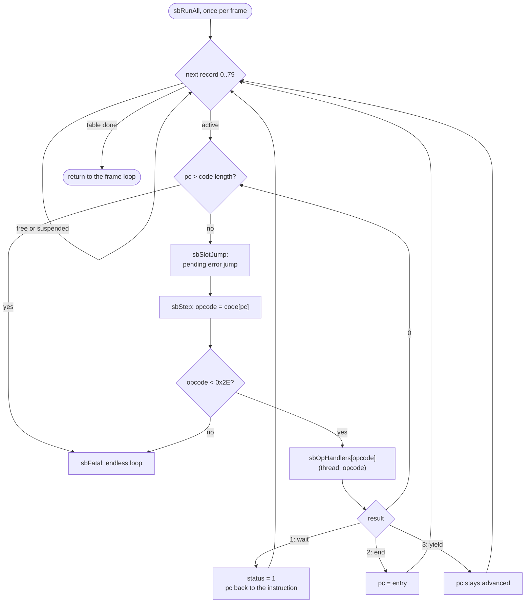

### Reading the code

Code units are 16 bits, but most operands are 32 bits. An operand sits right
behind its opcode unit, so it starts at an address that is a multiple of 2 but
often not of 4. `sbCodeS32(thread, index)` reads the 32-bit word at unit
`index` with an unaligned copy (`UnalignedWordCopy` from
`include/unaligned.h`). The word is stored low half first, as two consecutive
units. `sbCodeU16(thread, index)` reads one unit.

`sbOpLength(opcode, count)` gives the length of an instruction in units. For
every opcode except `0x25` it is the entry of the table `sbOpLengths`. For
`0x25`, the switch, it is `4 * count + 5`, where `count` is the first operand
of the instruction. The table has 48 entries. The entries for `0x25`, `0x2E`
and `0x2F` are 0.

Only two lengths exist besides the switch: 1 unit for an opcode alone and 3
units for an opcode with one 32-bit operand.

## The stack, locals and globals

### The stack

Each thread has 128 words of stack. `sp` counts the words in use, so the top
of the stack is `stack[sp - 1]`. `sbStackPush` calls `sbFatal` when `sp` has
reached `stackLimit`, then stores the value and increments `sp`. `sbStackPop`
calls `sbFatal` when `sp` is 0 or less, then decrements `sp` and returns the
word. All values are 32-bit integers. The VM has no floating-point
instructions. Natives that need fractions take scaled integers, for example
positions in hundredths in `createEffectPos`.

The stack holds three things at once: the operands of the current expression,
the local variables of every active function, and the frame headers that link
those functions.

### Locals and frames

The locals of the current function are the stack words from index `frame`
upward. `sbLocalGet(thread, i)` reads `stack[frame + i]` and `sbLocalSet`
writes it. Negative indices reach the frame header, which lies directly below
the locals.

A call between script functions takes three instructions.

**Opcode `0x11`, enter frame.** It pushes three words: 0, the current `frame`
value, and 0. Then it writes the new `sp` into local -1 of the *current* frame,
that is `stack[frame - 1]`. This word now holds the stack index where the
locals of the callee will start. The three pushed words are the header of the
new frame.

**Argument pushes.** The caller then pushes the arguments of the call. They
land directly above the header, which is exactly where the callee's locals
start. The arguments are therefore the first locals of the callee.

**Opcode `0x12`, call.** It loads `frame` from local -1 of the current frame,
which switches to the new frame. It stores `pc + 2` into local -3 of the new
frame, the return slot. Then it jumps to the operand.

The header of a frame with base `F` therefore looks like this:

```
stack[F - 3]   return slot: pc of the call instruction + 2
stack[F - 2]   saved frame of the caller
stack[F - 1]   frame base of the next callee (written by opcode 0x11 in this function)
stack[F + 0]   local 0 (first argument)
stack[F + 1]   local 1
...
```

**Opcode `0x13`, return.** It calls `sbFatal` when the stack is empty. It sets
`sp` to `frame`, which drops all locals and operands of the callee. It pops
three words: the first is discarded, the second becomes `frame`, the third
becomes `pc`. Then it adds its own length, 1. The result is `pc` of the call
plus 3, the instruction behind the call.

**Opcode `0x14`, return a value.** It first pops the return value, then does
the same as `0x13`, then pushes the value. The caller finds it on top of its
own stack.

A new thread starts with `sp` 0 and `frame` 3. The value 3 is the size of one
header. When the entry code of a thread runs its first opcode `0x11`, the
three header words go to `stack[0]`, `stack[1]` and `stack[2]`, and the new
frame base written to `stack[frame - 1]` is 3 again. The first call of a
thread therefore builds a regular frame at the bottom of the stack.

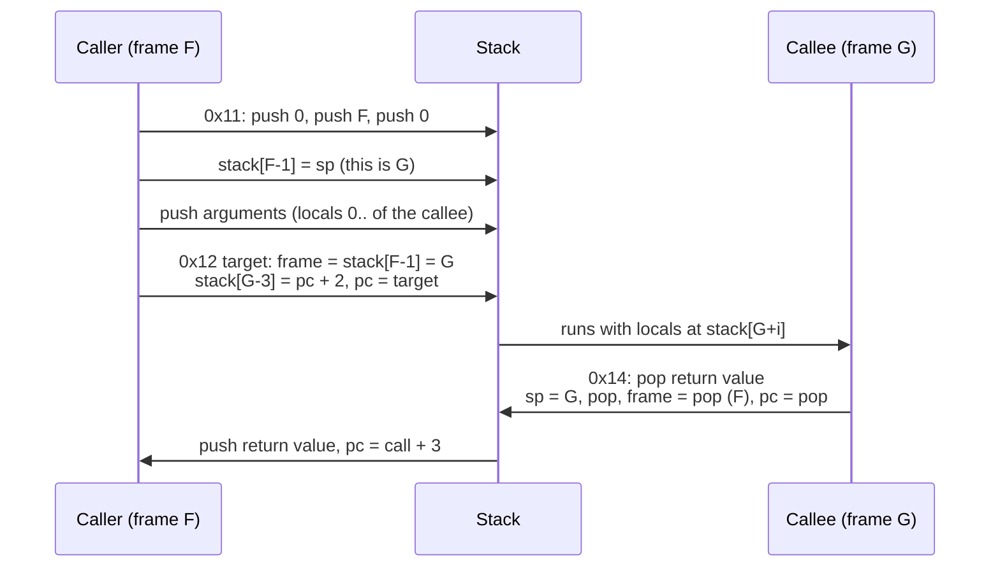

### Globals

`sbGlobalGet(thread, i)` and `sbGlobalSet(thread, i, value)` read and write
word `i` of the globals of the thread's image. All threads of an image share
them. Because the globals are part of the image buffer, a freshly loaded image
starts with the values that are in the file.

The instructions for variables come in pairs, one for globals and one for
locals. Some take the variable index as an operand, others pop it from the
stack. The second kind allows indexed access: the script computes an index and
then loads or stores through it, which is how arrays work in this machine.

## Instruction set

The table lists all 46 opcodes with their handler in `sbOpHandlers`, their
length in 16-bit units from `sbOpLengths`, and their effect on the stack. In
the stack column the top of the stack is on the right. `imm` is the 32-bit
operand.

| Opcode | Handler | Units | Operand | Stack | Meaning |
| ---: | --- | ---: | --- | --- | --- |
| `0x00` | `sbOpNop` | 1 | | no change | No operation |
| `0x01` | `sbOpBinary` | 3 | operator | `a b → r` | Arithmetic, comparison or logic. See the operator table |
| `0x02` | `sbOpNopOperand02` | 3 | ignored | no change | No operation with an operand |
| `0x03` | `sbOpPushWord` | 3 | value | `→ imm` | Push the operand |
| `0x04` | `sbOpPushWord04` | 3 | value | `→ imm` | Push the operand |
| `0x05` | `sbOpNopOperand05` | 3 | ignored | no change | No operation with an operand |
| `0x06` | `sbOpPushWord06` | 3 | value | `→ imm` | Push the operand |
| `0x07` | `sbOpPushWord07` | 3 | value | `→ imm` | Push the operand |
| `0x08` | `sbOpPushGlobal` | 3 | global index | `→ v` | Push global `imm` |
| `0x09` | `sbOpPushLocal` | 3 | local index | `→ v` | Push local `imm` |
| `0x0A` | `sbOpStoreGlobal` | 1 | | `v i →` | Global `i` = `v` |
| `0x0B` | `sbOpStoreLocal` | 1 | | `v i →` | Local `i` = `v` |
| `0x0C` | `sbOpStoreGlobalKeep` | 1 | | `v i → v` | Global `i` = `v`, the value stays on the stack |
| `0x0D` | `sbOpStoreLocalKeep` | 1 | | `v i → v` | Local `i` = `v`, the value stays on the stack |
| `0x0E` | `sbOpJump` | 3 | code position | no change | `pc = imm` |
| `0x0F` | `sbOpJumpIfZero` | 3 | code position | `v →` | `pc = imm` when `v` is 0 |
| `0x10` | `sbOpJumpIfNotZero` | 3 | code position | `v →` | `pc = imm` when `v` is not 0 |
| `0x11` | `sbOpEnterFrame` | 1 | | `→ 0 frame 0` | Build the header of a new frame |
| `0x12` | `sbOpCall` | 3 | code position | no change | Switch to the new frame, store the return slot, `pc = imm` |
| `0x13` | `sbOpReturn` | 1 | | frame dropped | Return to the caller |
| `0x14` | `sbOpReturnValue` | 1 | | frame dropped, `→ v` | Return to the caller with a value |
| `0x15` | `sbOpCallNative` | 3 | native id | `(value tag)* n → r` | Call a native. May wait |
| `0x16` | `sbOpSpawn` | 1 | | `entry →` | Start a thread of the same image at `entry` |
| `0x17` | `sbOpKillThread` | 1 | | `entry →` | Release the thread of the same image that started at `entry` |
| `0x18` | `sbOpDup` | 1 | | `v → v v` | Duplicate the top word |
| `0x19` | `sbOpDrop` | 1 | | `v →` | Remove the top word |
| `0x1A` | `sbOpLoadGlobal` | 1 | | `i → v` | Push global `i` |
| `0x1B` | `sbOpLoadLocal` | 1 | | `i → v` | Push local `i` |
| `0x1C` | `sbOpEnd` | 1 | | no change | Stop for this frame and rewind to the thread entry |
| `0x1D` | `sbOpYield` | 1 | | no change | Stop for this frame |
| `0x1E` | `sbOpWaitFrames` | 1 | | `n →` | Wait `n` frames |
| `0x1F` | `sbOpSend` | 1 | | `g entry →` | Send the message at global `g` to thread `entry` |
| `0x20` | `sbOpReceive` | 1 | | `g entry → found` | Take the next message of thread `entry` into global `g` |
| `0x21` | `sbOpIncGlobal` | 1 | | `i →` | Global `i` += 1 |
| `0x22` | `sbOpIncLocal` | 1 | | `i →` | Local `i` += 1 |
| `0x23` | `sbOpDecGlobal` | 1 | | `i →` | Global `i` -= 1 |
| `0x24` | `sbOpDecLocal` | 1 | | `i →` | Local `i` -= 1 |
| `0x25` | `sbOpSwitch` | `4 * count + 5` | count, default, pairs | `v →` | Jump by a sorted table |
| `0x26` | `sbPushConst0` | 1 | | `→ 0` | Push 0 |
| `0x27` | `sbPushConst0Op27` | 1 | | `→ 0` | Push 0 |
| `0x28` | `sbPushConst1` | 1 | | `→ 1` | Push 1 |
| `0x29` | `sbPushConst2` | 1 | | `→ 2` | Push 2 |
| `0x2A` | `sbPushConst3` | 1 | | `→ 3` | Push 3 |
| `0x2B` | `sbPushConst4` | 1 | | `→ 4` | Push 4 |
| `0x2C` | `sbPushConst5` | 1 | | `→ 5` | Push 5 |
| `0x2D` | `sbPushConst6` | 1 | | `→ 6` | Push 6 |

Some notes on the table.

The four push instructions `0x03`, `0x04`, `0x06` and `0x07` have identical
handlers. Each pushes its operand word. The two instructions `0x02` and `0x05`
do nothing and skip their operand. The VM does not need the difference, so the
reason for six opcodes with two behaviours is not in the source. A likely
reading is that the script compiler uses different opcodes for different kinds
of constants, such as integers, strings and code positions, and that tools
which read the code without running it can tell them apart.

The eight instructions `0x26` to `0x2D` are in their own file,
`src/ov01/sb_push_const.c`. They save two units for the most common small
numbers. Given the argument format, they are a natural fit for tags and
argument counts, although the source cannot confirm how the compiler uses
them. `0x26` and `0x27` both push 0.

The store instructions pop the index first and the value second, so the script
pushes the value and then the index. The two "keep" forms pop both words and
then raise `sp` by one again. The value word is still in that stack position,
so it becomes the top of the stack again. This is the form for an assignment
used as an expression.

`sbOpDrop` lowers `sp` without the underflow check that `sbStackPop` has, and
`sbOpDup` reads `stack[sp - 1]` without checking that the stack is not empty.

The jump instructions take absolute code positions, not distances.

### Operators of opcode 0x01

`sbOpBinary` reads its operator from the operand. For every operator except
the negation it pops the right operand first and the left operand second. For
the negation it pops only one word.

| Operand | Name in the source | Result |
| ---: | --- | --- |
| 1 | `SB_BIN_ADD` | `left + right` |
| 2 | `SB_BIN_SUB` | `left - right` |
| 3 | `SB_BIN_MUL` | `left * right` |
| 4 | `SB_BIN_DIV` | `left / right`. With `right` 0: result 0 and an error jump request |
| 5 | `SB_BIN_MOD` | `left % right`. With `right` 0: result 0 and an error jump request |
| 6 | `SB_BIN_OR` | `left \| right` |
| 7 | `SB_BIN_AND` | `left & right` |
| 8 | `SB_BIN_SHIFT_RIGHT` | `left >> right`, arithmetic |
| 9 | `SB_BIN_SHIFT_LEFT` | `left << right` |
| 10 | `SB_BIN_NEG` | `-right`, one operand |
| 11 | `SB_BIN_EQ` | `left == right` |
| 12 | `SB_BIN_GT` | `left > right` |
| 13 | `SB_BIN_LT` | `left < right` |
| 14 | `SB_BIN_GE` | `left >= right` |
| 15 | `SB_BIN_LE` | `left <= right` |
| 16 | `SB_BIN_NE` | `left != right` |
| 17 | `SB_BIN_LOGICAL_OR` | `left \|\| right` |
| 18 | `SB_BIN_LOGICAL_AND` | `left && right` |

All operations are on signed 32-bit integers. Comparisons and the two logical
operators give 1 or 0. Both operands of a logical operator are always
evaluated, because they are already on the stack. A script that needs
short-circuit behaviour must build it from conditional jumps. Any other
operator number calls `sbFatal`.

### The switch

Opcode `0x25` is the only instruction with a variable length. Its layout in
units, counted from the opcode, is:

```
+0        opcode 0x25
+1, +2    count           (32 bits)
+3, +4    default target  (32 bits)
+5, +6    value 0         (32 bits)
+7, +8    target 0        (32 bits)
+9, +10   value 1
+11, +12  target 1
...                       4 units per pair
```

`sbOpSwitch` pops the key and searches the pairs with a binary search, so the
values must be sorted in rising order. A match sets `pc` to the target of that
pair. Without a match `pc` becomes the default target. All targets are
absolute code positions.

`sbOpLength` returns `4 * count + 5` for this opcode, which is the reason why
it takes the first operand as a parameter. The linker and
`resParseJumpTarget` both rely on it to step over a switch.

## Waiting

A thread can stop in four ways, and each fits a different need.

**A waiting native.** The native sets its status word to 1. The call is
repeated each frame until the native leaves the status at 0. This is how a
script waits for the engine: the end of a camera move, a message, a motion, a
load. See [The call](#the-call).

**A frame count.** Opcode `0x1E` waits for a number of frames. The first time
it runs, `status` is 0. It pops the count into `wait[0]` and returns 1. From
then on `sbStep` has set `status` to 1, so each later run takes the other
branch: it decrements `wait[0]` and returns 1 while the counter is above 0.
When the counter reaches 0 or less it moves `pc` forward and returns 0, and
the thread continues in that same frame. A wait of `n` thus resumes `n` frames
after the frame in which it started. A wait of 0 still costs one frame.

**A yield.** Opcode `0x1D` stops the thread for the rest of the frame and lets
it continue behind the instruction in the next frame. A loop that polls
something each frame uses it.

**An end.** Opcode `0x1C` stops the thread for the frame and moves it back to
its entry. See [One thread](#one-thread).

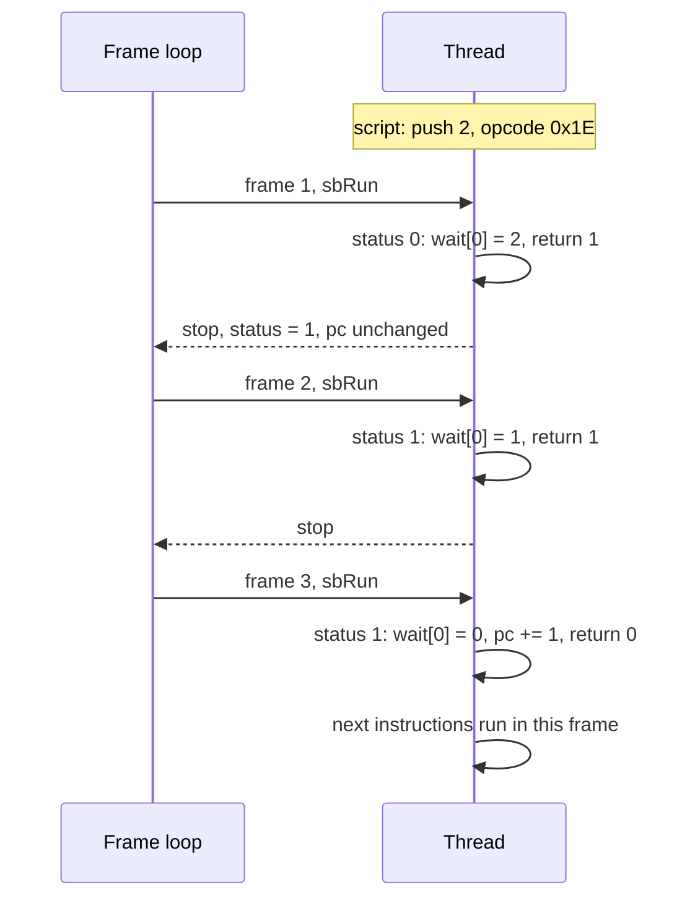

## Messages

Threads talk to each other, and the engine talks to threads, through
messages. A message is the struct `SbMessage`, sixteen bytes.

| Offset | Type | Field | Meaning |
| --- | --- | --- | --- |
| `+0x00` | `int` | `kind` | What happened. The meaning belongs to the sender |
| `+0x04` | `int` | `sender` | Entry position of the sending thread, or -1 when the engine sent it |
| `+0x08` | `int[2]` | `args` | Two free words |

Each thread has a queue of the type `SbQueue`, a ring of sixteen messages.

| Offset | Type | Field | Meaning |
| --- | --- | --- | --- |
| `+0x00` | `int` | `first` | Lowest ring index, 0 |
| `+0x04` | `int` | `last` | Highest ring index, 15 (`SB_QUEUE_LAST`) |
| `+0x08` | `int` | `head` | Index of the message read last |
| `+0x0C` | `int` | `tail` | Index of the message written last |
| `+0x10` | `int` | `used` | Number of waiting messages |
| `+0x14` | `SbMessage[16]` | `messages` | The ring |

`sbQueueReset` sets `first` to 0, `last` to 15 and the other three fields to 0.
`sbQueuePush` returns -1 when `used` has reached `last - first + 1`.
Otherwise it increments `used`, advances `tail` with a wrap from `last` to
`first`, and returns the new `tail`. `sbQueuePop` does the same with `head`
and returns -1 when the queue is empty. Both indices advance before use, so
the first message of a fresh queue goes to ring index 1.

`sbThreadEnqueue(key, value, message, sender)` is the sending side. It finds
the thread with `sbFindThread`, takes a ring index, copies the message there
and overwrites the `sender` field: with `sender->value` when a sending thread
is given, with -1 otherwise. It returns 0 when the thread does not exist or
its queue is full, so a message to a missing thread is lost without an error.
`sbThreadEnqueueByName(image, name, message)` first translates a name to an
entry position with the name table of the image. No code in the game calls it.

`sbThreadDequeue(key, value)` is the receiving side. It returns the address of
the next message in the ring, or null when the thread does not exist or its
queue is empty.

Scripts use two opcodes. `0x1F` pops the entry of the target thread and then a
global index, reads four words at that global as a message, and sends it with
the running thread as sender. `0x20` pops an entry and a global index, takes
the next message from the queue of the thread with that entry, copies it to
the four global words and pushes 1. With an empty queue it pushes 0. A thread
normally passes its own entry to read its own queue, but the instruction can
read the queue of any thread of the same image.

The engine sends messages from three places.

| Sender | File | Target thread | Message |
| --- | --- | --- | --- |
| `uwamonoSendEvent(slot, first, second)` | `src/main/uwamono_event_check.c` | Thread `uwamonoEventIds[slot]` of the map script | `kind` is the slot number, the two arguments are map record ids |
| `unitScriptPairEventSend(kind, event)` | `src/ov01/think_dispatch.c` | Thread `stats->spawnArgC` of the battle script | Unit numbers and two words, packed in 16-bit halves |
| `unitScriptEventSend(kind, event)` | `src/ov01/think_dispatch.c` | Thread `stats->spawnArgD` of the unit, or the entry stored by the native `cameraSet` | Unit number and three words, packed in 16-bit halves |

In all three cases the engine holds an entry position that the script handed
over earlier. For the map script this is done by the native `message` of the
owner `runtime` (`runtimeMessage` in `src/main/runtime.c`): it
stores its second argument in `uwamonoEventIds[first argument]`. The table has
eight places and is filled with -1 when a map script is loaded, and
`uwamonoSendEvent` sends nothing for a place that still holds -1. The script
therefore subscribes to an event kind by naming the thread that will handle
it. [Events and scenes](events.md) and [Battle rules and flow](../game/battle.md)
describe the events themselves.

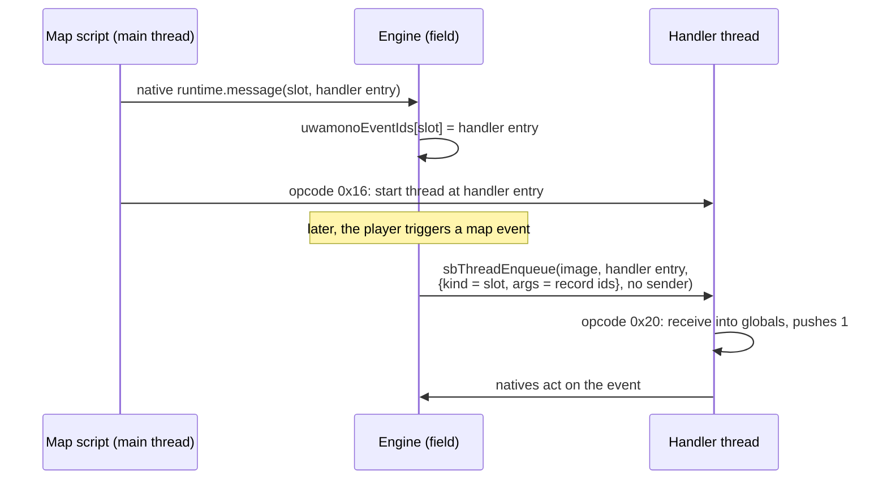

## Jump slots and errors

### Slots

Each thread has a table of eight `SbSlot` records.

| Offset | Type | Field | Meaning |
| --- | --- | --- | --- |
| `+0x00` | `int` | `key` | Kind of event the slot handles. 0 marks a free slot |
| `+0x04` | `int` | `target` | Code position to jump to |
| `+0x08` | `int` | `low` | Lowest code position the slot covers |
| `+0x0C` | `int` | `high` | Highest code position the slot covers |

A slot is a handler for an error inside a range of code: "if an event with
this key is raised while the program counter is between `low` and `high`,
continue at `target`". `sbSlotFind` returns the slot with a given key.
`sbSlotStore` copies a slot record into the slot that already has its key, or
into the first free slot, and returns 0 when all eight are taken.
`sbSlotRemove` frees the slot with a key.

An event is raised with `sbSlotJumpRequest(thread, key)`. It only records the
key in `jumpKey` and the current program counter in `jumpPosition`. The jump
itself is done by `sbSlotJump`, which `sbRun` calls before every instruction:

1. With no pending key it returns at once.
2. It looks for the slot with the pending key.
3. If the slot exists, it clears the request. When the recorded position lies
   between `low` and `high`, it sets `pc` to `target`. When the position is
   outside the range, the request is dropped and the thread goes on.
4. If no slot exists, it sets `pc` back to the recorded position, calls
   `sbSlotJumpUnhandledKey` for the keys 1 and 2, and then `sbFatal`.

Two keys are defined.

| Key | Name | Raised by |
| ---: | --- | --- |
| 1 | `SB_JUMP_ZERO_DIVIDE` | `sbOpBinary`, on a division or remainder by zero |
| 2 | `SB_JUMP_ARGUMENTS` | Natives, when the argument count is wrong |

The mechanism is complete on the reading side, but nothing in the game fills
it. `sbSlotStore` and `sbSlotRemove` have no callers, and no opcode writes a
slot. `sbThreadStart` clears the table. In this build every thread therefore
has eight free slots, and each raised event takes the path of step 4. A
division by zero or a native call with too few arguments stops the game. The
slots look like the remains of an error handling feature of the script
language that the released scripts do not use.

### Fatal errors

`sbFatal(thread)` is the single error exit of the VM. It calls
`sbFatalReport(thread, thread->pc)` and then loops forever.
`sbFatalReport` in `src/ov01/sb_natives.c` is an empty function. Its
parameters, the thread and the program counter, show what a development build
printed there.

| Cause | Detected in |
| --- | --- |
| Program counter beyond the end of the code | `sbRun` |
| Opcode `0x2E` or higher | `sbStep` |
| Push on a full stack (128 words) | `sbStackPush` |
| Pop from an empty stack | `sbStackPop` |
| Return with an empty stack | `sbOpReturn`, `sbOpReturnValue` |
| Unknown operator of opcode `0x01` | `sbOpBinary` |
| Argument index 0 or beyond the count | `vmArgGet`, `vmArgGetHigh`, `vmArgTagIsZero` (index 0 only) |
| Raised event without a slot | `sbSlotJump` |

Four more situations stop the game in an endless loop without going through
`sbFatal`: an image without the `SB` magic in `sbLinkImage` or `sbStartImage`,
a library without the `SBL` magic in `sbLibraryLink`, and a failed link in the
battle step `ov01StepSceneScript` and in the two development loaders. The map
loader uses a debugger trap (`DEBUG_BREAK`) for a failed link instead.

There is no recovery from any of these. The scripts on the disc are expected
to be correct, and the checks exist to stop at a known place when they are
not.

## A machine that lives in the overlay

The game has a main executable and two overlays. Both overlays are linked for
the same address, `0x00A80000`, so only one of them can be in memory at a
time. `xglCdLoadOverlay` (`src/main/xgl_cd.c`) clears the `0x80000` bytes at
that address and loads `OVnn.OVL` over them. Overlay 2 holds the title screen.
Overlay 1 holds the battle engine and the SB virtual machine. `main`
(`src/main/control_entry.c`) loads overlay 2 for the title screen, and when
the title returns a selection it loads the overlay named in the top byte of
that selection before it jumps to the chosen entry. The overview and
[Title and boot](../game/title-and-boot.md) describe this start-up.

The VM is used by code on both sides of that border. The battle code calls it
from inside the same overlay. The field code in the main executable calls it
too: `mapSceneScriptLoad` calls `sbInit`, `sbLibraryLink` and `sbStartImage`,
the frame loop of `Game` calls `sbRunAll`, and every field native in
`src/main/` calls `vmArgGet`, `vmKeyedEntryGet` or `sbSlotJumpRequest`. These
are direct calls to fixed addresses inside the overlay. Several things follow
from that.

- **Overlay 1 must be loaded for the whole play session.** The field cannot
  run a single frame of script without it. The battle engine is therefore
  already in memory when a battle starts, and entering a battle needs no
  overlay load. `Game` calls `ov01InitAll` during its own set-up, long before
  the first battle.
- **Nothing in the title screen can use scripts.** While overlay 2 is loaded,
  the addresses of the VM hold title code.
- **All VM state is lost when the overlay is loaded.** The thread table, the
  stacks, the queues and the native registry are static data of the overlay,
  and `xglCdLoadOverlay` clears the whole area first. `ov01InitAll` calls
  `sbInit` to set the machine up again.
- **The registry holds pointers in both directions.** The method tables of the
  field natives are data of the main executable, and `sbNativeOwnerAdd` copies
  them into an array inside the overlay. The copied records point back to
  functions in the main executable. The method tables `batMethods`,
  `sampMethods` and `debMethods` are in the overlay itself.
- **The images are outside the overlay.** The map script is in a buffer of the
  main executable, and the battle script is in work memory. Only the machine
  is in the overlay.

The headers show the same arrangement: the field files include
`ov01/sb_vm.h` and `ov01/sb_natives.h`, which are headers of the overlay.

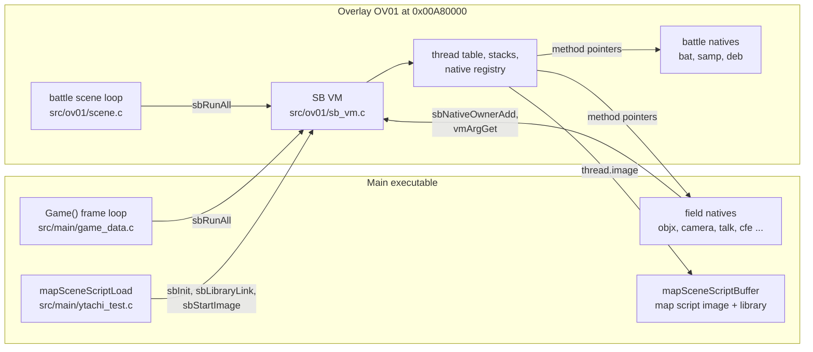

## Scripts in the field

### Loading a map script

`mapSceneScriptLoad(id, mode)` in `src/main/ytachi_test.c` loads the script of
a map. `Game` calls it with `gameWork.nextMap` each time a map is entered. The
parts that concern the VM are these.

1. `sbInit` empties the machine. All threads of the previous map are gone, and
   the native registry is empty.
2. `scriptRegisterModules` registers the fifteen field owners.
3. The script name is built by writing the four decimal digits of the map id
   into `sc0000.sb`. The file `cf\scNNNN.sb` is read with `xglCdReadFile` into
   `mapSceneScriptBuffer`. The call returns the size it read.
4. The library path `cf\xx\scNNNN.sbl` is built, the language code is written
   over `xx`, and the file is read directly behind the script in the same
   buffer, at `mapSceneScriptBuffer + size`.
5. `sbLibraryLink` links the script against the registry and attaches the
   library. A failure is a debugger trap.
6. `sbStartImage` starts the first thread at the `entry` position of the
   header.
7. The eight entries of `uwamonoEventIds` are set to -1, so no event handler
   is known until the script names one.

The first thread is the set-up code of the map. It typically runs natives that
place objects and characters, registers its event handlers and starts further
threads. The page [Events and scenes](events.md) describes what map scripts do
with these tools.

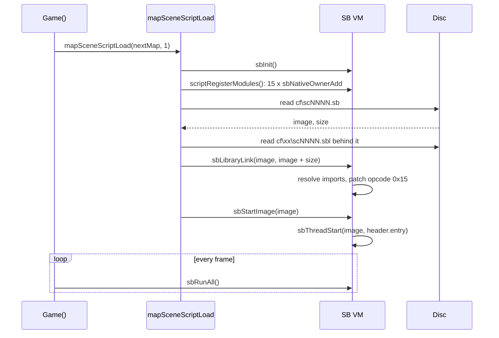

### The field frame

The frame loop of `Game` in `src/main/game_data.c` calls `sbRunAll` once per
frame, as the first step of the frame's game logic, before the map objects,
the player, the camera, the effects and the actors are updated. The call is
skipped while bit 0 of `gameWork.control` is set. Right after the call the loop
checks two bits of `gameWork.control` (`0x10000000` and `0x08000000`) and
leaves the frame loop when one of them was set during the script run. The loop itself is described on
[The field](../game/field.md).

### Reading a script without running it

One piece of field code reads the bytecode directly. `resParseJumpTarget` in
`src/main/res_get_path.c` finds the map exits of a map by scanning the routine
named `mapjump` in the name table of the map script. It walks the
instructions with `sbOpLength`, follows the first jump (`0x0E`) to a switch
(`0x25`), and for each case of the switch simulates the push instructions on a
small private stack until it meets a call (`0x15`) of the native `runtime` /
`jumpCF`, whose id it gets from `sbFindNative`. The pushed argument tells it
which place the case leads to. The function shows that the code format is
regular enough to be analysed without the VM, and it depends on the image
being linked, because it compares native ids. Its results belong to
[Map and units](../game/map-and-units.md).

## Scripts in battle

### The think script

A battle has its own script, called the think script in the source. It is
addressed through two accessors in `src/ov01/scene_script.c`.
`ov01ScriptKeyGet` returns `gameWork.resBuffer` as the SB image, and
`ov01ScriptImageGet` returns `gameWork.imageEnd`, the SBL library behind it.
`gameWork.resBuffer` is a buffer of `0x12000` bytes that `Game` allocates
with `GameResBufferAlloc` at the start of the session.

The usual way for the images to get there is the resource loader of the field
(`src/main/res_get_path.c`), which reads a script file into
`gameWork.resBuffer`, the library of the current language behind it, and
stores the library address in `gameWork.imageEnd`. That loader is described on
[Files and resources](../architecture/files-and-resources.md). The overlay
also has its own loader, `dataThinkScriptLoad(index)` in
`src/ov01/data_file_load.c`, used by the battle debug menu. It allocates
`0x12000` bytes from the overlay heap, reads
`yamamoto\think\thinkNNN.sb` into it, rounds the file size up to a whole disc
sector, and reads `yamamoto\think\jp\thinkNNN.sbl` behind it. No such
library exists on the discs: the only `.sbl` directories are `cf\en` and
`model\map\en`, so this loader is a development leftover. The battle scripts of the released
game are `model\map\<map>.bin` with `model\map\en\<map>.sbl`
(see [Game data tables](../formats/game-tables.md)).

The same file holds `ov01SceneInitDummy`, an empty function that
`ov01SceneInit` calls in the place where a script reset would be.

### Starting and running

A battle scene is a chain of steps (see
[The battle engine](../game/battle-engine.md)). `ov01StepChainStart` makes
`ov01StepSceneScript` the first step. That step does three things.

1. `runtimeInit` empties the native registry and registers the five battle
   owners.
2. `sbLibraryLink(ov01ScriptKeyGet(), ov01ScriptImageGet())` links the think
   script. A failure is an endless loop.
3. `sbStartImage(ov01ScriptKeyGet())` starts its first thread.

The battle frame loop `ov01SceneLoop` in `src/ov01/scene.c` calls `sbRunAll`
as the first step of each frame, before `ov01UpdateAll`, the camera, the
actors, the effects and the text. The call is skipped while `pauseProc`
reports a pause, which it never does in this build.

When the scene ends, `ov01SceneRelease` calls
`sbThreadsRelease(ov01ScriptKeyGet())`, which frees every thread of the think
script and no other.

### The script around a battle

The field script and the think script share one thread table and one native
registry. A battle starts in the middle of a map, and the map script must
survive it. The engine handles this with three measures, all in
`src/main/game_data.c`.

`Game_Data_Push` runs before the battle. Among the other field state that it
saves, it calls `sbThreadsSuspend(mapSceneScriptBuffer)`. Every thread of the
map script gets the suspended bit. During the battle `sbRunAll` still walks
the whole table, but it skips these threads, so only the think script runs.

`runtimeInit` then replaces the registry with the battle set. This breaks the
native ids that are patched into the code of the map script, because an id is
a position in the registry. That does no harm while the map threads are
suspended.

`Game_Data_Pop` runs after the battle. It calls
`sbThreadsResume(mapSceneScriptBuffer)`, then `sbResetNativeCounts`, then
`scriptRegisterModules`. The field owners are registered again in the same
order as when the map script was linked, so every owner gets its old index
and every patched native id is valid again. The map script is not linked a
second time. Its `SB_IMAGE_LINKED` bit is still set, and the code still holds
ids, not import indices.

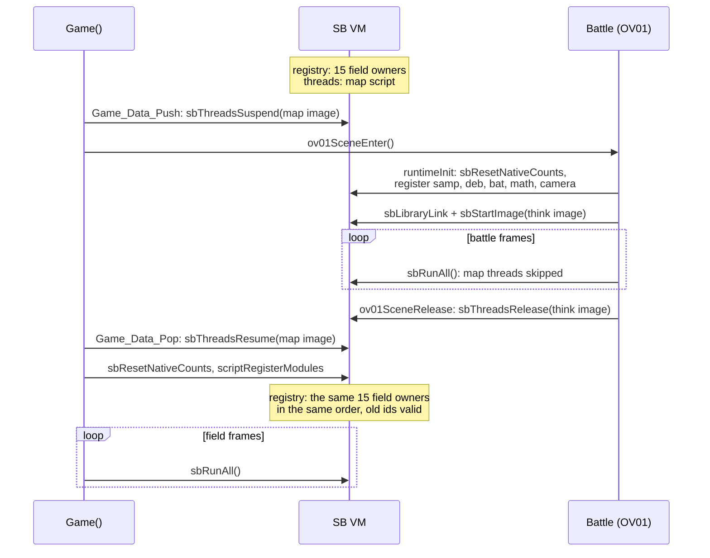

## Development loaders

Two more loaders exist beside the map loader and the battle path. Both are
remains of development.

`src/main/script_load.c` loads a script from the development PC.
`scriptLoadByNumber(slot, number)` writes the four digits of the number into
`sc0000.sb` and calls `scriptReadFile(slot, fileName)`. That function
allocates a buffer with `malloc`, loops forever if the allocation fails,
builds the path `host0:/home/xeno/vcd/x2/cf/` plus the file name, reads the
file with `xglDebFileRead` and links it with `sbLinkImage`. It returns the
link result, or loops forever when the link fails. It does not load a library
and does not start a thread. The buffer it asks for is only 100 bytes, which
no real script fits in. `scriptFreeBuffer(slot)` frees the buffer and clears
the pointer. No code in the game calls these functions. The host path shows
where the scripts lived on the developers' machines.

`configScriptPage` in `src/ov01/debug_entry.c` is a page of the battle debug
menu with the title `--SCRIPT CONFIG--`. It lets the developer choose a script
number, builds the path `cf\scNNNN.sb`, reads the file into a static buffer of
`0xC000` bytes, links it with `sbLinkImage` and starts it with
`sbStartImage`. It attaches no library, so a script started this way cannot
read strings. The debug menus are described on
[Debug tools](../game/debug-tools.md).

## Limits and quirks

- **80 threads for everything.** The field script and the think script share
  the table. `sbThreadStart` returns 0 when it is full. Opcode `0x16` then
  rewinds the starting thread to its entry.
- **128 stack words per thread.** Locals, frame headers, operands and native
  arguments all come out of this. A native call with `n` arguments needs
  `2n + 1` words on top of everything else. Overflow is fatal.
- **16 messages per queue.** A seventeenth message is dropped and the sender
  gets 0.
- **`0x600` owners and `0x800` methods.** The field registers 15 owners and
  the battle 5, so the owner table is far larger than needed.
- **Integers only.** The VM has no floating-point type. Fractions travel as
  scaled integers.
- **Threads are named by their entry.** Two threads with the same entry cannot
  be addressed separately.
- **An ended thread is not released.** Opcode `0x1C` rewinds it. Only opcode
  `0x17` and `sbThreadsRelease` free a record.
- **Native ids depend on registration order.** A linked image must always meet
  the registry it was linked against. The field restores this by hand after
  each battle.
- **The link flag is set before the imports are resolved.** If `sbLinkImage`
  fails on a missing native, a second call for the same image returns 1
  without doing anything. Every caller stops the game on the first failure,
  so this never shows.
- **The error slots are never filled.** A division by zero and a native call
  with too few arguments are fatal in this build.
- **No protection between scripts and data.** Globals and constant tables
  share one area, and `vmEntryGet` hands natives a raw address into it. A
  wrong index reads or writes whatever is there.
- **A missing library is not checked at use.** `vmKeyedEntryGet` reads
  `thread->image->keys` without a null test. A script linked with
  `sbLinkImage` alone must not use strings.
